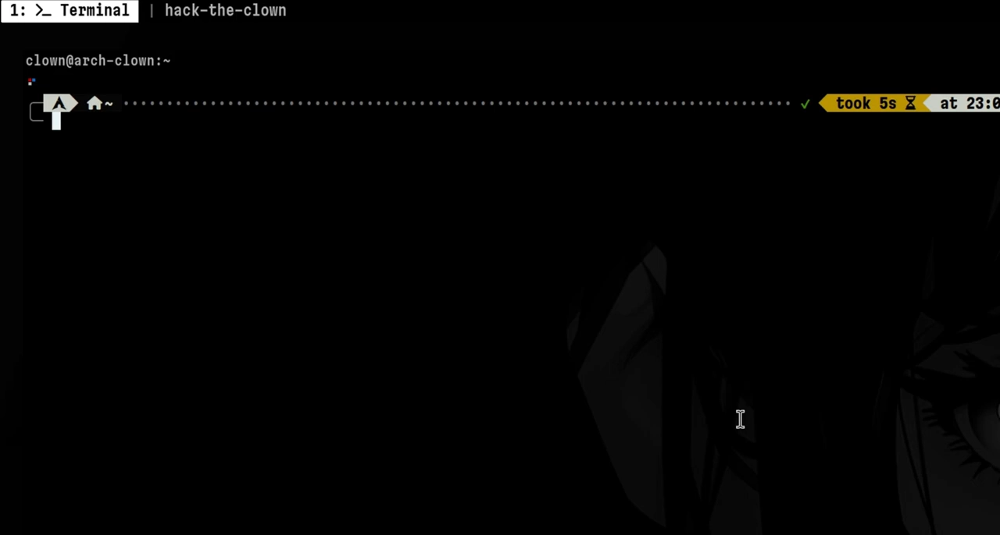
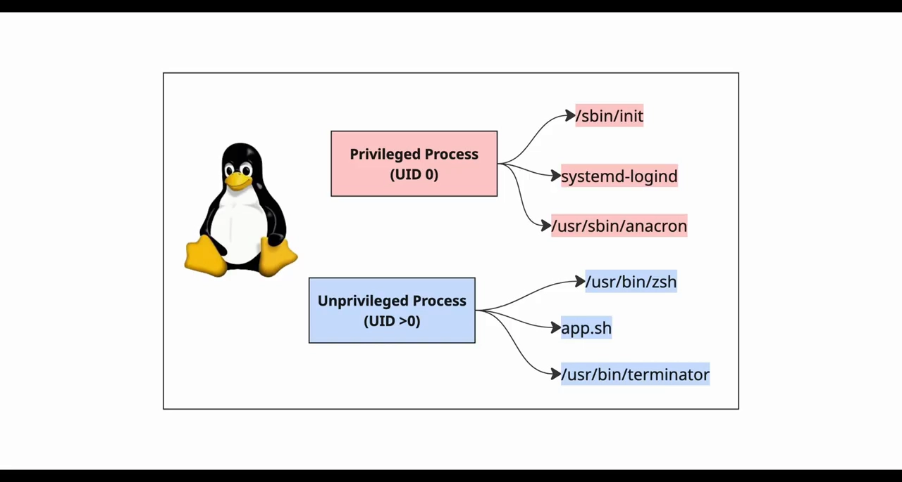
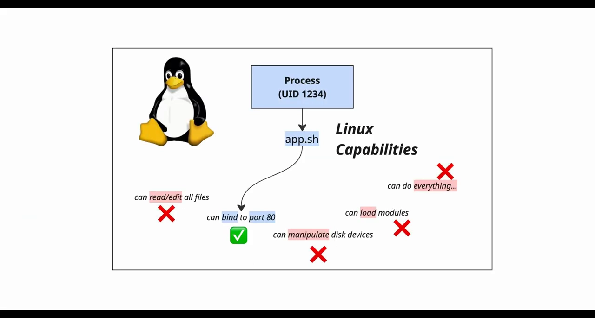
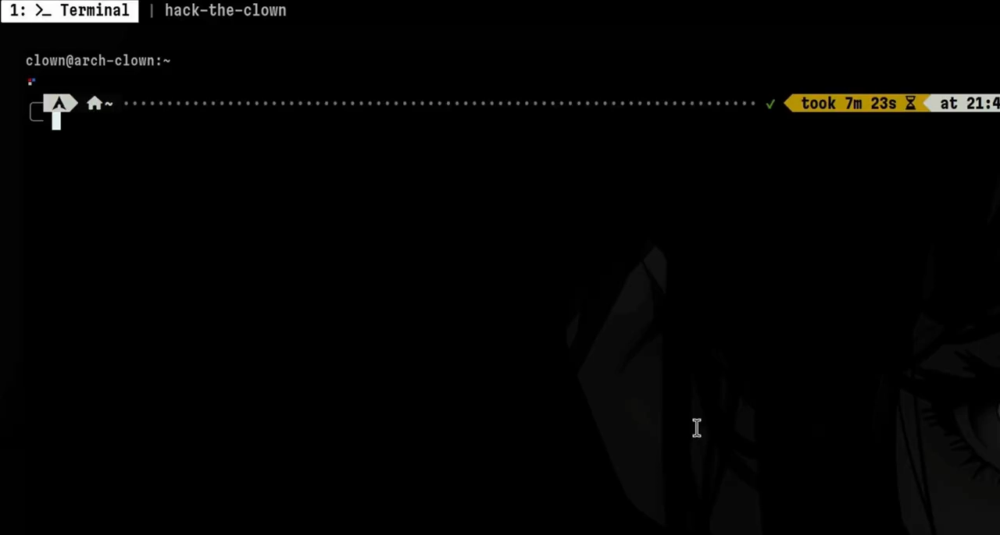
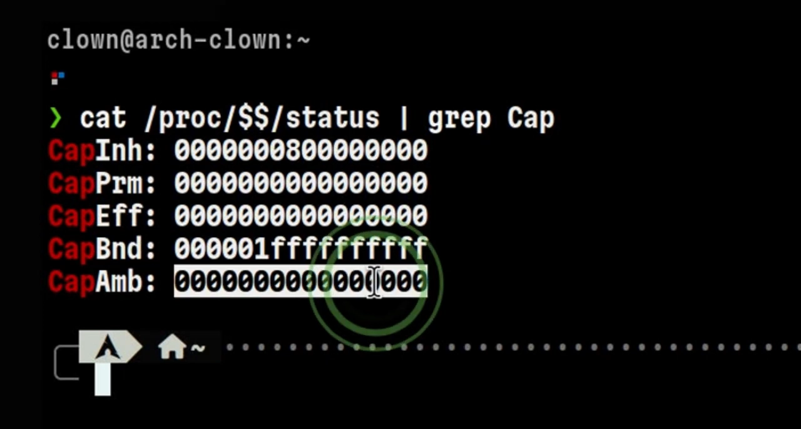
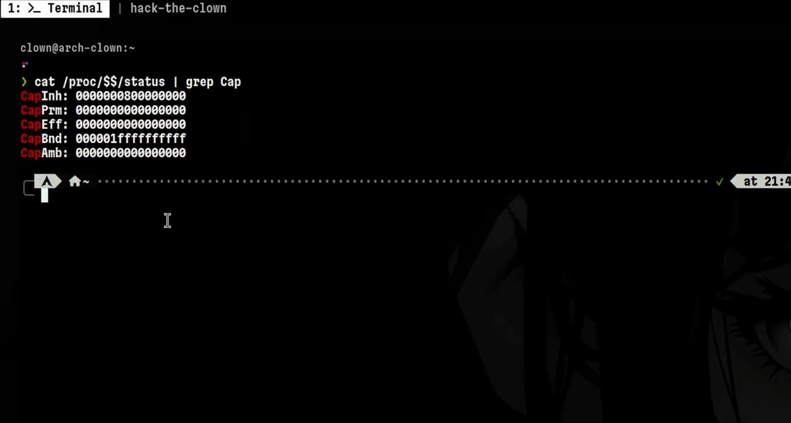
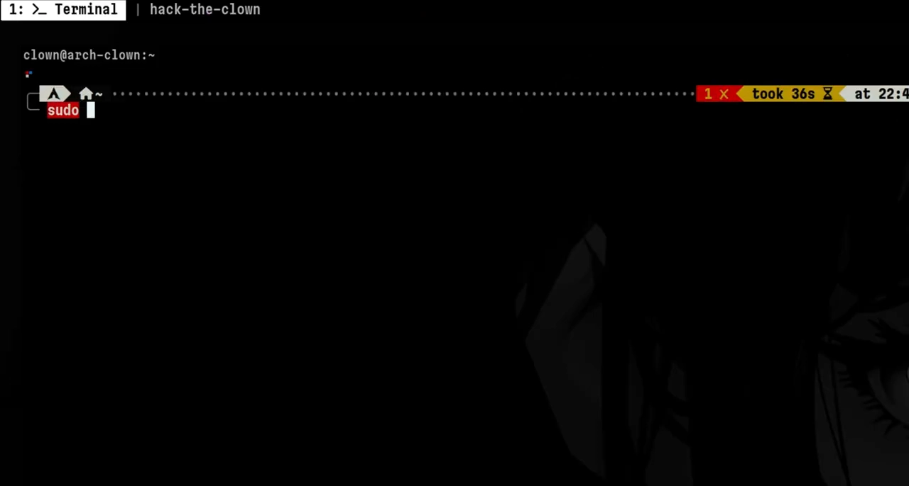

# Root 也不再是万能钥匙：Linux Capabilities 入门

> 本文整理自 YouTube 视频《[Root is not enough. Linux Capabilities Explained](https://www.youtube.com/watch?v=cdo63IGyeKI)》（约 4 分半，频道 Hack the Clown，"能力"两篇的上篇）。视频用一个反直觉实验开场：root 用户绑定 1024 以下的特权端口竟然失败——由此引出 Linux capabilities：内核把 root 的"全能"拆成 40 多项细粒度权限，进程能不能做特权操作，看的是它身上挂的能力集合，而不是"它是不是 root"。文中还演示了用 `/proc` 与 `capsh` 观察能力、以及"拿走一项能力后 root 也会被拒"。续篇《[How Hackers Abuse Linux File Capabilities](https://www.youtube.com/watch?v=txo5miQz-SI)》讲文件能力与滥用，见本目录姊妹篇。

## 本讲要解决的核心问题（SCQA）

**背景**：Linux 是多用户系统。谁该有特权？大家熟悉的答案很简单：root 是超级用户，什么都能干；普通用户需要特权操作时，就用 sudo 借 root 的权力。比如 Web 服务要绑定 80 端口，那就用 root 来跑。

**冲突**：视频里有一台"看起来很正常"的机器：普通用户绑不了低端口（正常），可 root 去绑低端口也报 `Operation not permitted`（反常）。同一时刻，这位 root 做别的事都一切正常。

**疑问**：root 不是全能的吗？内核判定"这个操作能不能做"，看的到底是什么？

**回答（中心思想）**：看的是**能力（capabilities）**。从 Linux 2.2 内核起，root 的权力被拆成 40 多项细粒度权限；进程执行特权操作时，内核检查的是**该线程挂载的能力集合**。能力可以在运行中被裁剪——root 丢了 `cap_net_bind_service`，照样绑不了 80 端口。**root 单独并不足够**。

## 一、开场实验：root 绑不上特权端口

Linux 规定：绑定 1024 以下的端口（"特权端口"，如 80/443）需要特权，普通用户只能绑更大的端口。视频先演示了正常的一面，接着看这位 root 用户——绑定低端口，失败了。

[【跳转到 00:00】](https://www.youtube.com/watch?v=cdo63IGyeKI&t=0)

如果只学过"UID 0 = 天下无敌"，这一幕没法解释。要解释它，得先看 Linux 历史上对进程的分类方式。

## 二、历史两分法：UID 0 与非 0，以及它的问题

传统 Linux 把进程分成两类：

- **特权进程**：运行在 UID 0（root）之下，对系统有管理权限；
- **非特权进程**：运行在非 0 UID 之下——shell、用户态应用、终端等等，默认没有任何 root 式的高权限。

[【跳转到 00:28】](https://www.youtube.com/watch?v=cdo63IGyeKI&t=28)

当一个应用需要执行某项特权操作，传统做法就是把它放到 root 下运行。问题在于 root 是"整包授权"：

- 能读、改**所有文件**；
- 能绑定**所有端口**；
- 能操作磁盘设备；
- 能加载内核模块；

……基本上什么都能干。应用只需要其中一小项权力，却拿到了全部——这是一个重大安全漏洞（"爆炸半径"太大）。

## 三、capabilities：把 root 的权力拆开卖

为了解决这个问题，Linux 从 2.x 内核（视频表述为 version two）起引入了 **capabilities（能力）**：把 root 的权力拆成一项项细粒度权限，只给进程完成工作所需的那几项。应用就能以非 root 用户运行，把"爆炸半径"压到最小。

[【跳转到 01:06】](https://www.youtube.com/watch?v=cdo63IGyeKI&t=66)

技术上，能力是**线程的权限属性**：每当线程发起系统调用，内核检查这条线程上挂了哪些能力，再决定放行还是拒绝。能力有很多项——管理审计控制、阻止线程挂起系统、执行 BPF 操作等等。本讲只聚焦其中一项：**绑定端口的能力 `cap_net_bind_service`**。

## 四、五张清单：/proc 里的能力集合

用什么观察一个进程/线程的能力？视频用了 `/proc` 文件系统：打开进程的 `status` 文件、grep `Cap`，会看到五行，第一列是**能力集合（capability sets）**的名字，按场景各有用途：

- **CapInh（inheritable，可继承）**：从父进程传给子进程的能力；
- **CapPrm（permitted，允许）**：线程一生中"可以被允许"的上限，内核随时可以增删；
- **CapEff（effective，生效）**：线程最终真正生效的那组权限；
- **CapBnd（bounding，边界）**：线程能拥有的最大权限列表；
- **CapAmb（ambient，环境）**：一种特殊集合，用于非特权场景的能力传递（概念较绕，视频说另开一期讲）。

[【跳转到 01:45】](https://www.youtube.com/watch?v=cdo63IGyeKI&t=105)

帮助记忆的类比：**Permitted 像"钱包上限"，Effective 是"此刻拿出来的钱"，Bounding 是"这张卡的总额度"，Inheritable 是"能传给下一代的份额"**（类比仅为记忆用，严格定义以 `man capabilities` 为准）。

## 五、解码十六进制：capsh 与普通用户/root 的对比

清单右边的数字是什么？就是**能力的十六进制位掩码**。解码工具是 `capsh`。视频先解码普通用户会话的 effective 集合——什么都没有（普通用户没有生效的特权能力）；切到 root 会话再对比：**permitted 集合包含全部能力**，因为现在就是 root。

[【跳转到 02:28】](https://www.youtube.com/watch?v=cdo63IGyeKI&t=148)

[【跳转到 02:39】](https://www.youtube.com/watch?v=cdo63IGyeKI&t=159)

## 六、回到实验：被拿走一项能力的 root

现在可以解释开场的怪事了。普通用户：绑不了 1024 以下的特权端口，但只要端口空闲，绑更大的端口没问题；root（permitted 全满）：绑任何端口都行。

那开头那位 root 为什么失败？因为**能力可以在任意时刻被内核裁剪**。视频模拟了这一点：在切换到 root 会话时把 `cap_net_bind_service` 丢掉——再看 permitted 集合，这项能力已经不在了。

[【跳转到 03:19】](https://www.youtube.com/watch?v=cdo63IGyeKI&t=199)

于是，尽管 UID 是 0，尝试绑定特权端口时内核照样拒绝——root 单独并不足以执行特权操作，**能力才是内核放行与否的主要决定因素之一**。

## 小结

- 内核判定特权操作看 **capabilities**，不是看"是不是 root"；root 只是"默认拿满能力"的 UID。
- 进程身上有五张能力清单：**Inheritable / Permitted / Effective / Bounding / Ambient**（对应 `/proc/<pid>/status` 里的 CapInh/CapPrm/CapEff/CapBnd/CapAmb 五行）。
- `capsh` 能把十六进制能力位掩码解码成人话。
- 能力可被随时增删：丢掉 `cap_net_bind_service` 的 root 也绑不了 80 端口。
- 视频预告的后续主题——**文件能力、systemd 服务注入能力、ambient 集合**——其中"文件能力"正是本目录下一篇的主题。

## 关键术语速查

| 术语 | 一句话解释 |
| --- | --- |
| capabilities | 把 root 的全能拆成 40 余项细粒度权限的内核机制 |
| 特权端口 | 1024 以下的端口（如 80/443），绑定需要 `cap_net_bind_service` |
| capability set | 进程身上的能力清单，共五张（Inh/Prm/Eff/Bnd/Amb） |
| CapEff / CapPrm | 当前生效的集合 / 生命周期内允许的上限集合 |
| capsh | 解码能力位掩码、配合实验的命令行工具 |
