# UID/GID 与进程凭证：内核凭什么判定一个进程的权限？

> 本文整理自 B 站视频《[linux系统编程手册-从内核理解进程凭证](https://www.bilibili.com/video/BV1KEftYrEck/)》（约 14 分钟）。作者先通读了 Linux 0.11 内核源码（启动、内存、进程、调度、设备、缓冲区），再转向应用层（学过 Qt 与 Windows 上的 MFC，自认欠缺 socket 网络编程），然后借助《Linux/UNIX 系统编程手册》（TLPI）第九章「进程凭证」，从顶层使用到底层实现，把"进程的身份"这件事讲透。视频全程有内核源码走读 + 实机演示，适合初学者跟练。

## 本讲要解决的核心问题（SCQA）

**背景**：Linux 是多用户系统。文件有属主、属组和 rwx 权限；每个进程都以某个用户的身份在运行。在 shell 里敲 `ls -l`，就能看到 `rwxr-xr-x` 这样的权限串和属主信息。

**冲突**：普通用户 paradise 运行一个"读取 `/etc/shadow` 密码"的小程序，会被直接拒绝——shadow 只有 root 能读。可偏偏 `passwd`、`sudo` 这类程序，平日也是普通用户在运行，它们却能改密码、提权限。同样是普通用户跑的程序，为什么有的碰不了 root 的资源，有的可以？

**疑问**：内核到底凭什么判定"这个进程有没有权限访问这个文件"？

**回答（中心思想）**：凭**进程凭证（process credentials）**，尤其是**有效用户 ID（EUID）/ 有效组 ID（EGID）**——内核权限检查看的是 EUID 而不是用户名；`EUID == 0` 直接放行，这就是 root 万能的来源；而 **SUID 机制**允许"执行时把进程的 EUID 临时换成文件属主的 UID"，这正是 `passwd`、`sudo` 能工作的原理。

## 一、进程凭证是什么：先从 UID 与 /etc/passwd 说起

### 1.1 UID：你真正的身份

进程凭证讲的是"这个进程是谁"。最基础的两个身份是**用户 ID（UID）**和**组 ID（GID）**。

UID 就是"真正的你的 ID"，它保存在 `/etc/passwd` 里。视频里展示了作者机器上的一条记录：

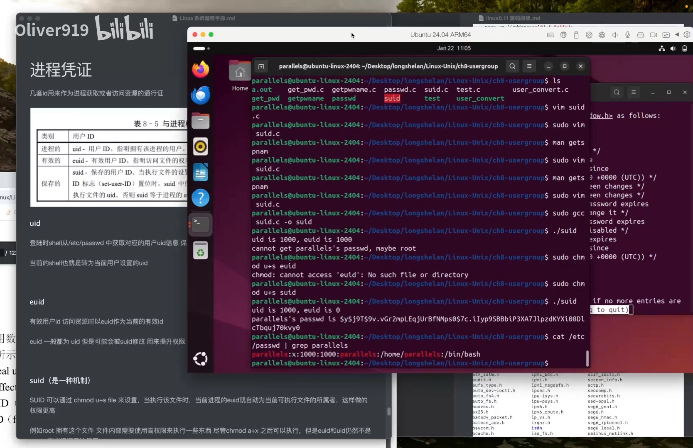

[【跳转到 04:52】](https://www.bilibili.com/video/BV1KEftYrEck/?t=292)

把这条记录拆开看：

- **用户名**：`paradise`，这是给人看的"姓名"；
- **密码位**：`x`，表示密码不存放在本文件，而被隐藏进了 `/etc/shadow`（shadow 只有 root 能读）；
- **UID = 1000**、**GID = 1000**：系统内部真正使用的"身份证号"；
- 后面还有**家目录**和**登录 shell**（`/bin/bash`）。

给初学者的类比：用户名只是名字，**UID 才是内核认的号**——内核认号不认名。

### 1.2 GID 与 UID 同理

组 ID（GID）与 UID 配对出现，机制与 UID 完全类似，所以本讲只展开用户 ID 这条线。

本讲的参考书是《Linux/UNIX 系统编程手册》（TLPI），作者读到第九章「进程凭证」。他提到：读完内核再来看这些顶层的东西——如何使用 Linux——"感觉就比较通透"：反正都是通过系统调用，有时经由 libc，有时经由其他接口，书里的 signal、进程、IO、线程这些主题，读过内核之后都觉得简单。

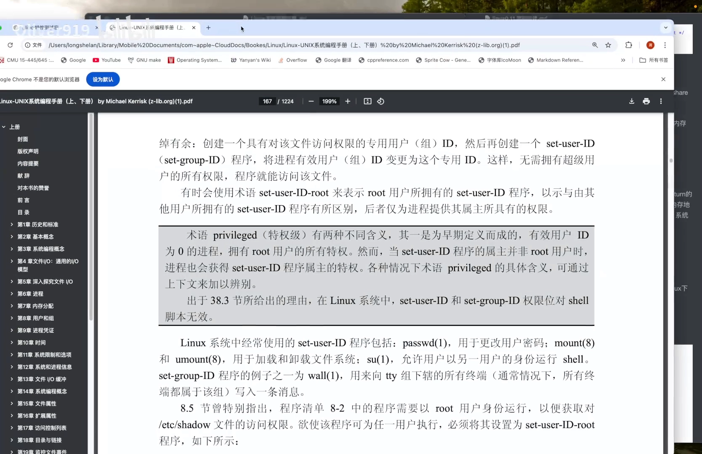

[【跳转到 03:33】](https://www.bilibili.com/video/BV1KEftYrEck/?t=213)

## 二、内核如何检查权限：看 EUID，不看用户名

### 2.1 为什么需要有效用户 ID（EUID）

平时，进程的 EUID 就等于你的 UID。但"执行程序的时候，有时不是完全通过 UID 来判断"——内核还要看 **EUID（有效用户 ID）**：进程申请资源、访问资源（也就是执行某个程序）的时候，内核通过 EUID 来判断你有没有访问这个文件、执行这个程序的权限。

[【跳转到 05:17】](https://www.bilibili.com/video/BV1KEftYrEck/?t=317)

### 2.2 权限检查的完整路径

视频带读了内核源码里的权限检查函数（permission / `inode_permission`）。它的逻辑是拿到目标文件的 **inode**（文件的内核元数据对象），先确认文件存在，然后逐级比对身份：

1. **先比属主**：当前进程的 `EUID == inode 的 i_uid`（文件属主的 UID）？相等就用**属主位的 rwx**；
2. **再比组**：不相等，就看进程的有效组 ID 是不是匹配文件属组，匹配就用**组位的 rwx**；
3. **都不匹配 → others**：落到"其他用户"的权限上——others 一般权限最低，没有写权限。

这里的关键是：`rwx` 三位权限对应**三类身份**——owner（拥有者，比如文件是 paradise 自己的）、group（属组）、others（其他用户）。而一个掩码（mask）会把无关的位清掉，**保证 mode 的最后三位是本次真正生效的权限**——不管你是属主、属组还是 others，最终都只看保留下来的这三位。

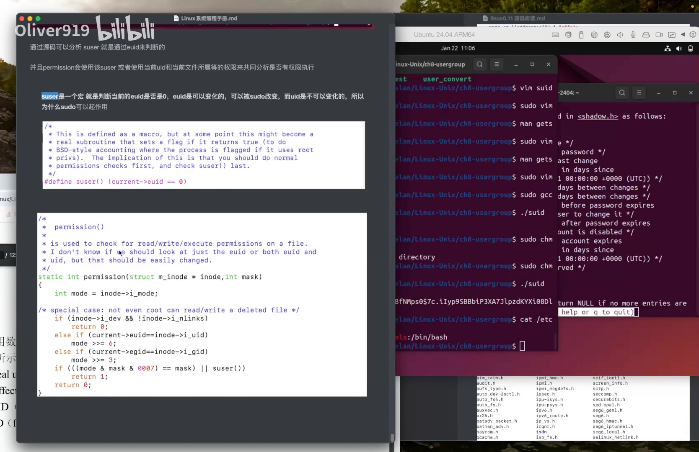

[【跳转到 05:41】](https://www.bilibili.com/video/BV1KEftYrEck/?t=341)

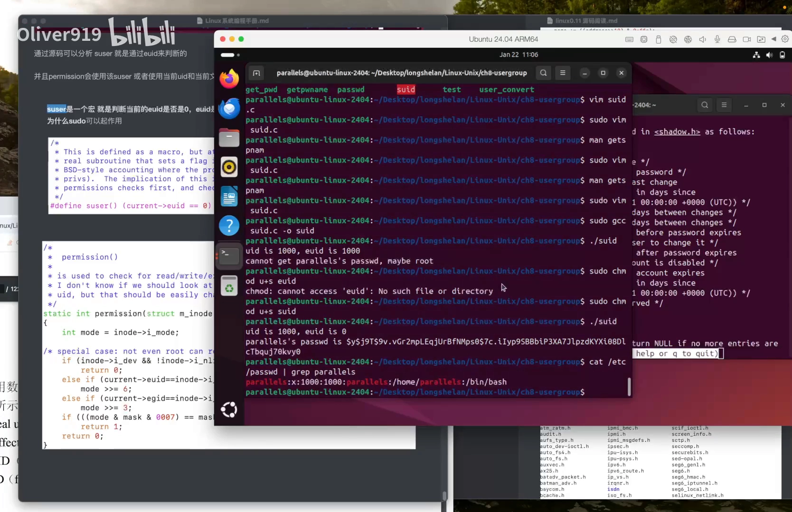

[【跳转到 06:23】](https://www.bilibili.com/video/BV1KEftYrEck/?t=383)

### 2.3 suser()：root 万能的内核依据

检查里还有一个特殊的判断：**`suser()`（super user）**。它是一个宏，定义就是：

```c
suser()  ==  (current->euid == 0)
```

意思是：当前进程的 EUID 是 0（root），**前面的所有比对全部跳过，直接返回 1**——百分百通过。这就是"root 可以做任何事"在内核里的真正出处：root 的特权不来自名字，而来自 `EUID == 0`。

所以 EUID 和 EGID 才这么重要——它们才是权限检查真正使用的身份。

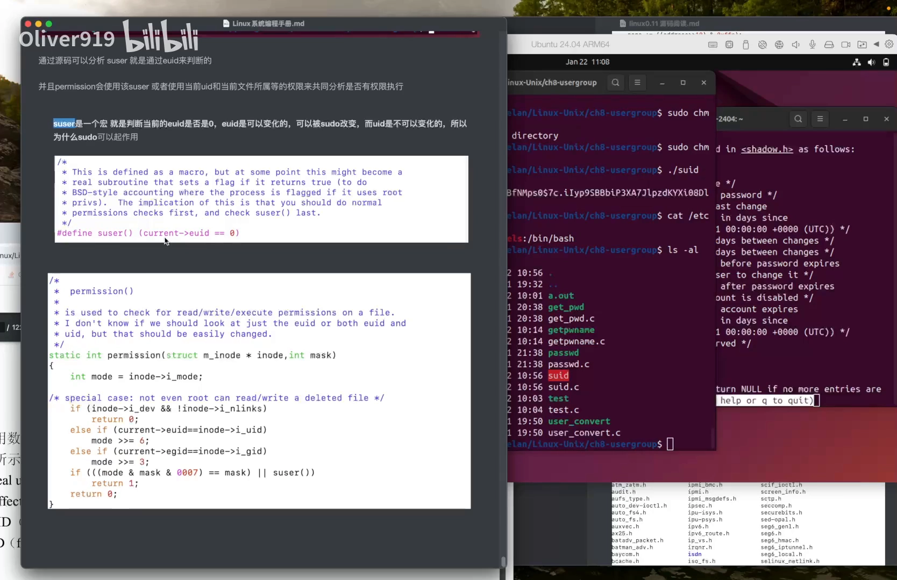

[【跳转到 07:38】](https://www.bilibili.com/video/BV1KEftYrEck/?t=458)

## 三、EUID 如何被改变：sudo 与 SUID

既然权限检查看 EUID，那"改 EUID"就是获取权限的钥匙。视频介绍了两条路径。

### 3.1 路径一：sudo

`sudo` 本身就是一个程序：它先让你输入密码，验证通过后，**把你的 EUID 变成超级用户的 EUID（0）**，于是你就能去访问那些 root 才能访问的资源。（`sudo` 的内部实现作者还没仔细研究，这里只讲到现象层。）

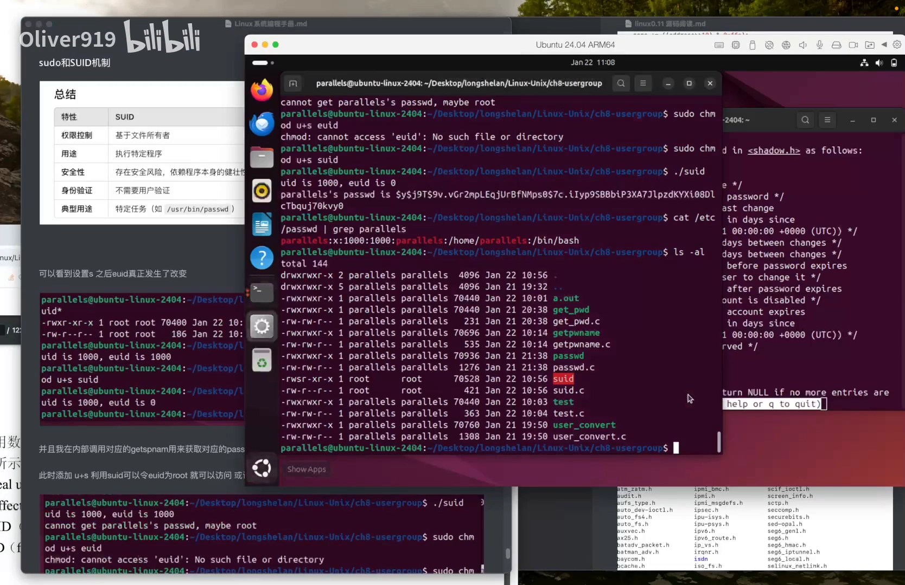

[【跳转到 08:03】](https://www.bilibili.com/video/BV1KEftYrEck/?t=483)

### 3.2 路径二：SUID 位——rws 里的那个 s

本讲的主角是 **SUID**。它是 Linux 的一种安全机制：很安全，却又给你提供一种"可以使用超级用户资源"的方式。（作者补充：它和 Linux capabilities 能力机制是什么关系，他还没读到后面——这正是本系列后面「文件 capability」条目要回答的问题。）

机制本身很简洁：

- 每个文件都有属主（owner）。权限串里的 `rwx` 是普通情形；
- 如果给文件设置了 **SUID 标志**，属主位的 `x` 就会变成 `s`，权限串成为 `rws`；
- 效果：**执行这个文件时，进程的 EUID 被设置成该可执行文件属主（owner）的 UID**——不管执行它的是谁。

反过来说，如果属主位只是 `rw`（没有 SUID），执行时 EUID 不会发生任何改变。

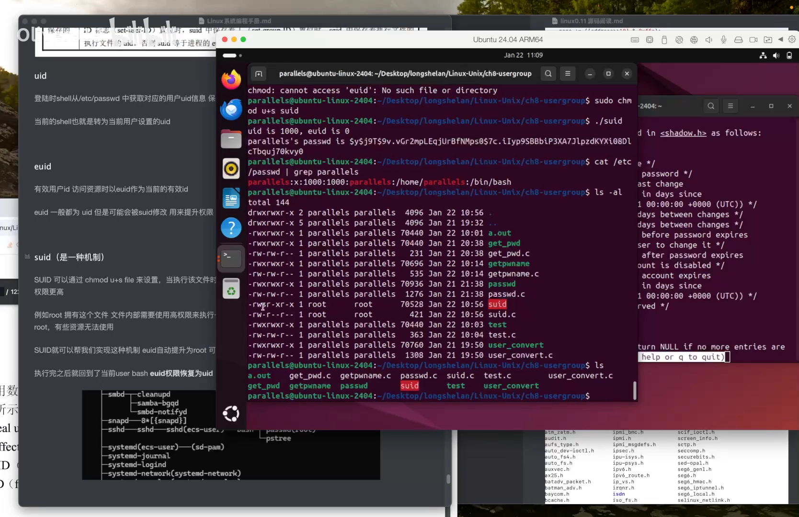

[【跳转到 09:01】](https://www.bilibili.com/video/BV1KEftYrEck/?t=541)

## 四、实战演示：普通用户如何"合法地"读到 shadow 密码

### 4.1 被测程序 suid.c

作者写了一个很小的程序 `suid.c`，只做两件事：

- 打印当前进程的 **UID** 和 **EUID**；
- 再根据用户名去获取他的密码——也就是读 `/etc/shadow`。

读 shadow 需要超级用户权限，普通用户没办法获取。所以可以先下两个断言：普通用户直接执行**肯定失败**；超级用户执行**肯定可以**。


[【跳转到 09:26】](https://www.bilibili.com/video/BV1KEftYrEck/?t=566)

### 4.2 直接执行：UID=1000，EUID=1000，失败

先把 `suid.c` 编译成可执行文件 `suid`。这里有个细节：`suid.c` 不是 paradise 的文件，而是通过 sudo（超级用户）创建的，属主是 root，所以编译也要用 `sudo` 来做。

直接执行：**UID 是 1000，EUID 也是 1000**（因为执行者现在是 paradise）。为什么会被原样带过去？在 shell 里执行这个程序时，shell 会 fork 出子进程，**fork 把我的 UID 和 EUID 复制了一份**——"我是谁"就这样被带进了新进程。EUID=1000 通不过超级用户检查，shadow 密码拿不到。

那怎么办？要么用 sudo 把权限提上去——相当于完全用 root 来执行，此时"我就是 root"；但 sudo 每次都要输密码，有时我们并不想这样。

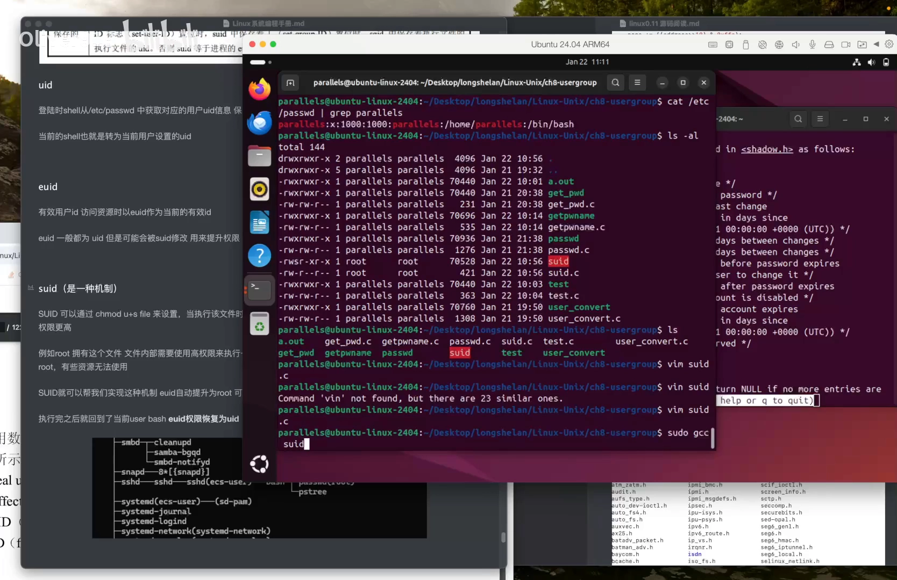

[【跳转到 10:41】](https://www.bilibili.com/video/BV1KEftYrEck/?t=641)

### 4.3 chmod u+s：给程序挂上"属主权限牌"

我们想要的效果是：任何人都能执行这个程序，不需要输密码，但执行时它能拿到 root 权限——而且**只有这一个文件**有这种待遇。

这正是 SUID 的用武之地：`chmod u+s`。设置之后，文件在终端里变红——红色就代表 SUID 已经设置。

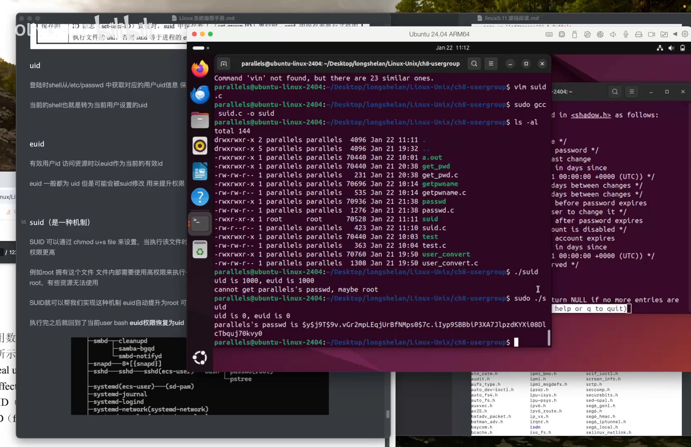

[【跳转到 11:56】](https://www.bilibili.com/video/BV1KEftYrEck/?t=716)

### 4.4 再次执行：UID=1000，EUID=0，成功

现在直接执行，"奇迹发生了"：**UID 是 1000，EUID 是 0**。

执行的那一刻，SUID 机制把进程的 EUID 设置成了文件属主 root 的 UID。于是这个进程就可以利用 owner（root）的权限去做事——shadow 里的密码顺利拿到手。

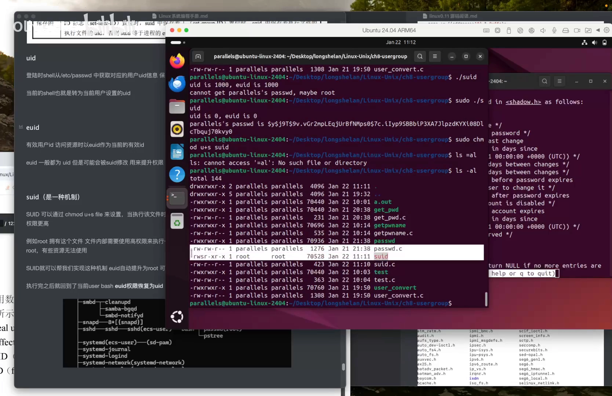

[【跳转到 12:21】](https://www.bilibili.com/video/BV1KEftYrEck/?t=741)

### 4.5 如果没有 SUID 会怎样？

反过来推：如果这个可执行文件**没有**设置 SUID，执行时 EUID 就不会发生改变（还是 1000），会通不过内核里的 `suser()` 检查——因为有些资源（比如 shadow）只有超级用户才能访问。

作者还推测：`getspnam`（按用户名读 shadow 的库函数）的底层实现里，应该也有 `suser()` 这样判断超级用户的代码——只不过 Linux 0.11 那个年代还没有 getspnam 这个函数。

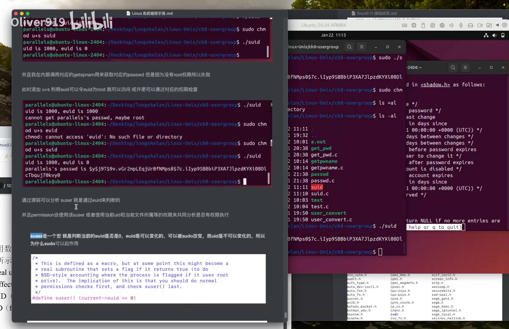

[【跳转到 12:58】](https://www.bilibili.com/video/BV1KEftYrEck/?t=778)

## 小结

- **进程凭证回答"进程是谁"**：UID/GID 是真实身份（记录在 `/etc/passwd`），EUID/EGID 是权限检查时真正被看的身份；平时二者相等。
- **内核权限检查路径**：EUID 对 inode 属主 → EGID 对属组 → 都不匹配落到 others；mask 保证只看最后三位 rwx。
- **root 万能的内核依据**是 `suser()`：`current->euid == 0` 直接放行，与用户名无关。
- **EUID 有两条改变路径**：sudo（输密码换身份，进程级）与 SUID（执行时 EUID→文件属主，文件级）。
- **SUID 的本质是"借权"**：只在"这个程序运行期间"借出属主的权限，不改变执行者的登录身份；`passwd`、`sudo` 正是靠它让普通用户完成"只有 root 能做"的事。
- **没设 SUID 的程序**，EUID 继承自执行者，永远通不过超级用户检查。

## 关键术语速查

| 术语 | 一句话解释 |
| --- | --- |
| UID / GID | 用户 / 组 ID，"真实身份"，记录在 `/etc/passwd` |
| EUID / EGID | 有效用户 / 组 ID，内核权限检查真正使用的身份 |
| SUID | 文件的 set-user-ID 位（`rws` 里的 s）：执行时把进程 EUID 设为文件属主的 UID |
| inode | 文件的内核元数据对象，含属主 `i_uid`、属组与权限位 |
| suser() | Linux 0.11 内核宏：`current->euid == 0` 即超级用户，直接放行 |
| /etc/shadow | 存放用户密码哈希的文件，仅 root 可读（passwd 中密码位显示为 x） |
| getspnam | 按用户名读取 shadow 记录的库函数 |
| sudo | 验证密码后以 root 身份执行命令的程序（把你的 EUID 换成 0） |
