# 网桥：把多个接口粘进同一个二层网络

> 本文整理自 YouTube 视频《[Linux networking #4 - Bridging, virtual bridges and bridged interfaces.](https://www.youtube.com/watch?v=yj0hXuUjPMo)》（约 16 分半，Linux networking 系列第 4 集）。视频从 IEEE 802.1D 标准讲起，梳理网桥"学习 MAC、按 MAC 存储转发"的原理；再用无线访问点与虚拟化两个场景解释桥接组和 BVI 的价值；最后在 Ubuntu 虚拟机上用 netplan 建出 br0 网桥，并用 `bridge` 命令查看转发数据库（FDB）里学到的 MAC 表。姊妹篇《[读懂 Linux 网络接口](Understanding_Linux_Network_Interfaces.md)》讲 `ip link` / `ip addr` 等接口基本功，建议先读。

## 本讲要解决的核心问题（SCQA）

**背景**：虚拟化普及之后，一台物理主机里往往同时住着多台虚拟机、多个虚拟接口；管理无线访问点（AP）时，一个设备上也常同时有以太口和射频口。

**冲突**：这些接口如果各自为政，虚拟机想"像插在同一台交换机上"那样直接互通，物理交换机鞭长莫及；而设备管理若绑死在某个物理口上，那个口一旦 down 掉就彻底失联，console 线又受串口标准的物理距离限制。

**疑问**：能不能在软件里造一台"交换机"，把主机内的多个接口粘进同一个二层网络，并让管理地址不依赖任何单一物理口？

**回答（中心思想）**：能，这就是**网桥（bridge）**。它源自 IEEE 802.1D 的存储转发思想，在 Linux 里是一个"行为像网络交换机的内核模块"：监听流量学习 MAC 地址、按 MAC 做转发决策，把接口（或虚拟机的网卡）粘进同一个二层网络、同一个 IPv4 网段；管理地址可以放在桥接虚接口（BVI / br0）上，不绑死任何物理口。创建它只需在 netplan 里声明 br0，观察它则用 `bridge` 命令查看转发数据库。

## 一、网桥从哪来：802.1D 与存储转发

### 1.1 标准：起点是 802.1D，今天是 802.1Q

一切桥接的源头是 **IEEE 802.1D**——电气电子工程师学会（IEEE）定义的标准，它描述的就是**存储转发式桥接（store-and-forward bridging）**：收到帧、查表、再决定从哪个口发出去。今天我们更常用它的后续版本 **802.1Q**（加入 VLAN 支持），但思想都从 802.1D 开始。

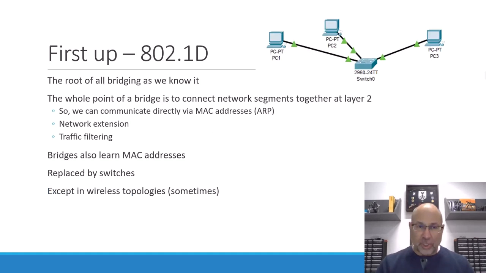

[【跳转到 00:24】](https://www.youtube.com/watch?v=yj0hXuUjPMo&t=24)

### 1.2 网桥干什么：连接网段，按 MAC 转发

网桥的基本职责是**把网段连接起来**。在它出现之前，扩展网络靠集线器（hub）和中继器（repeater）——把信号原样广播给所有口。网桥则聪明得多：

- 它维护一张**源地址表**（source address table）；
- 因为一直在"听"流量，它能**学习**到每个 MAC 地址位于哪个口；
- 转发决策按 **MAC 地址**做出，而不是无脑广播。

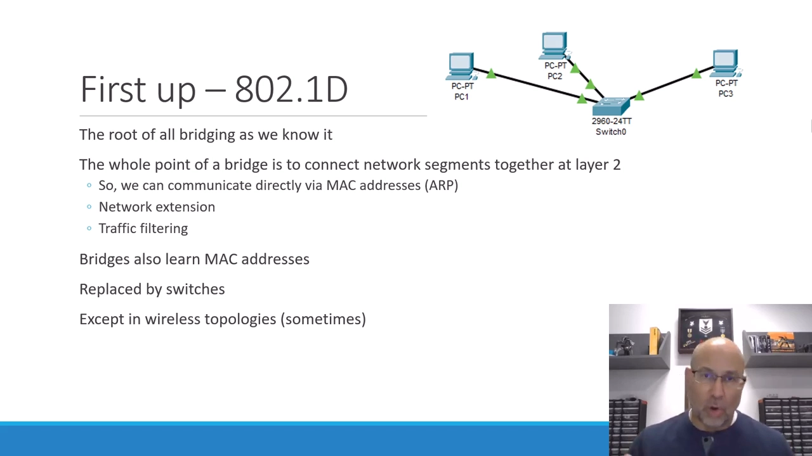

[【跳转到 00:49】](https://www.youtube.com/watch?v=yj0hXuUjPMo&t=49)

### 1.3 附带收益：切割冲突域，隔离本地流量

把网桥插进网络，一个冲突域（collision domain，可能发生信号冲突的范围）就被切成两个，原来受冲突域限制的物理距离问题随之化解——这是一种**网络扩展技术**。同时它还带来流量隔离：

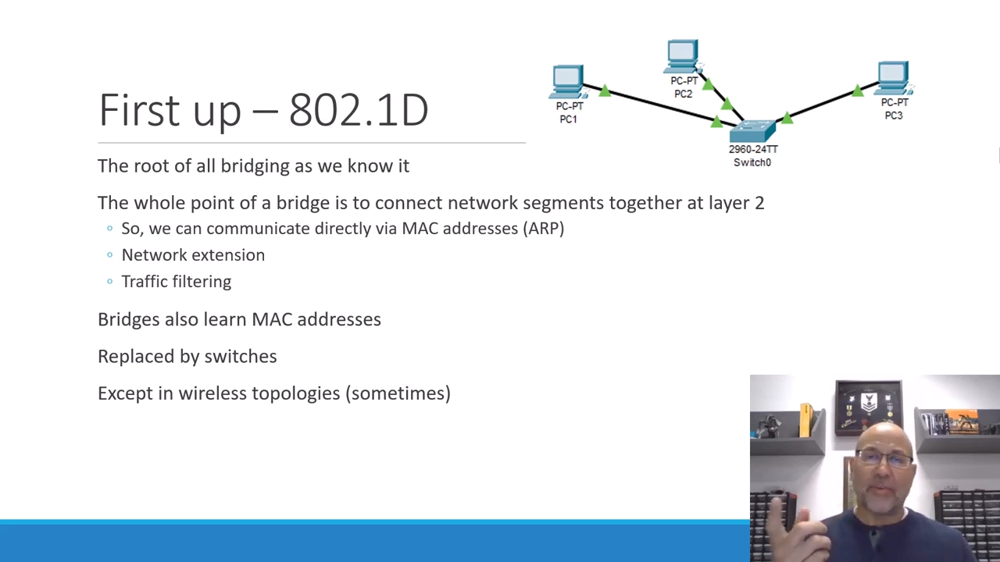

[【跳转到 01:39】](https://www.youtube.com/watch?v=yj0hXuUjPMo&t=99)

图中 PC1 和 PC2 在网桥一侧互相对话，对面的 PC3 完全不必收听这股流量——除非是**广播或组播**（这类流量本来就要到达所有节点）。网桥就此完成了基于 MAC 的流量过滤。

### 1.4 后来：交换机取代网桥，无线网桥仍在

今天单独的"网桥"设备已不多见——它被**交换机（switch）**取代（可粗略理解为多口网桥）。例外是无线拓扑，那里仍有"无线网桥"。但核心直觉一直没变，也是理解后文所有技术的钥匙：

> **接到同一个网桥/交换机上的节点，属于同一个二层网络。**

## 二、桥接组与 BVI：把接口成组，让管理地址不绑死物理口

### 2.1 两种"组"：节点成组与接口成组

**桥接组（bridge group）**可以指两种集合：

- **一组节点**：接到同一网桥/交换机的主机们，共享同一二层地址空间，可直接互通；
- **一组接口**：把设备的多个接口划入同一桥接组，由这台桥接设备负责在接口之间转发流量。

### 2.2 AP 实例：两个接口入组，IP 配在 BVI 上

视频给了一个无线访问点（AP）的配置实例：**以太网口和射频口都加入 bridge-group 1**；这两个接口本身都没有 IP 地址，管理 IP 配在**桥接虚接口（BVI，Bridge Virtual Interface）**上。

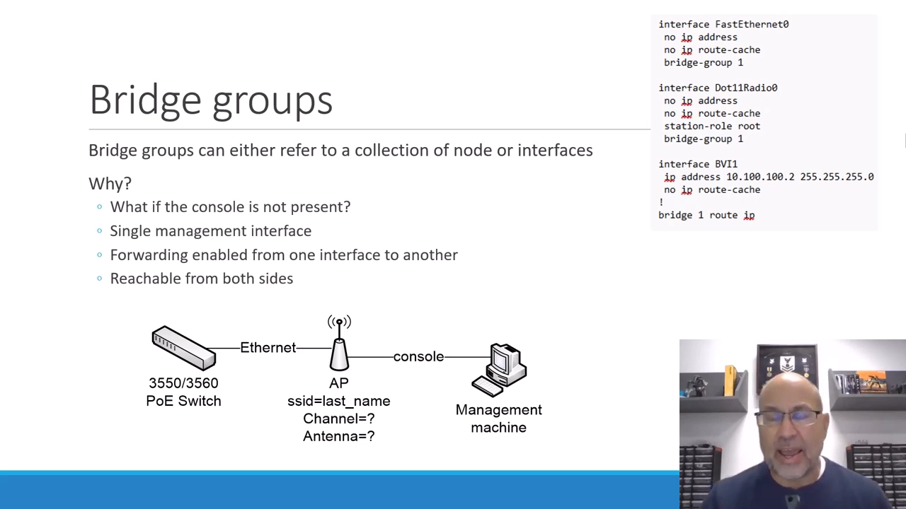

[【跳转到 03:19】](https://www.youtube.com/watch?v=yj0hXuUjPMo&t=199)

好处在于：AP 通常只需要一个管理 IP。若把它配在以太口或射频口上，就只能从那一侧管理——那一侧一旦 down 掉就失联。IP 放在 BVI 上则**不绑死任何物理口**，两个方向都能管理，两接口之间的流量由桥接设备转发。

### 2.3 顺便甩掉 console：EIA-232 的距离枷锁

有了管理 IP，就彻底告别 console 串口连接——后者受 EIA-232（串口标准）的物理距离限制，而 IP 网络管理几乎没有距离上限。

## 三、虚拟化中的桥接：NAT / host-only / bridged

### 3.1 虚机联网的三种模式

hypervisor（虚拟机监视器）负责给虚拟机提供网络连接，常见三档：

- **NAT**：VM 与外界通信经过地址转换，藏在主机后面；
- **host-only**：只能与主机互通，哪里也去不了；
- **bridged（桥接）**：VM 与主机**共享同一网络**。

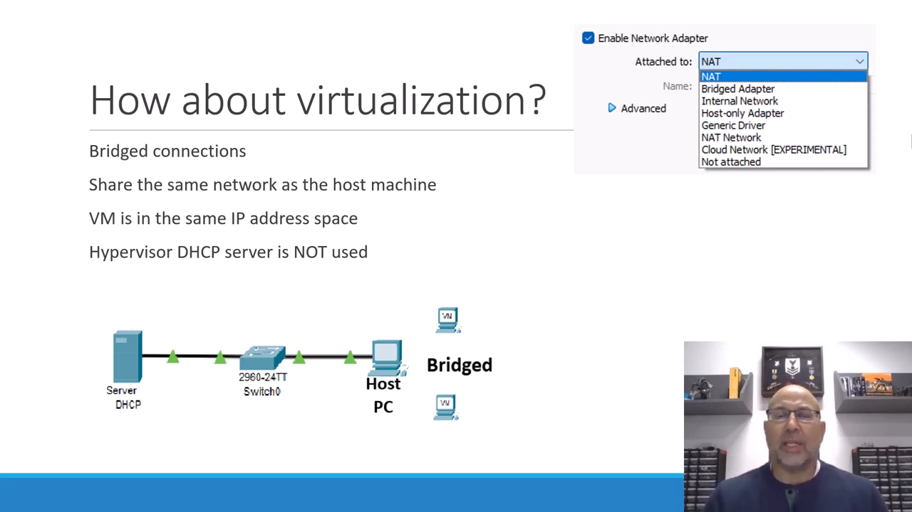

[【跳转到 04:59】](https://www.youtube.com/watch?v=yj0hXuUjPMo&t=299)

### 3.2 bridged 模式：VM 直接从物理网络的 DHCP 拿地址

对比两种模式下的地址来源：NAT 模式里 VM 拿到的是 hypervisor 内网的地址（如 10.x 网段）；**bridged 模式里，VM 直接从物理网络上的 DHCP 服务器拿地址**，hypervisor 里的 DHCP 根本不参与。

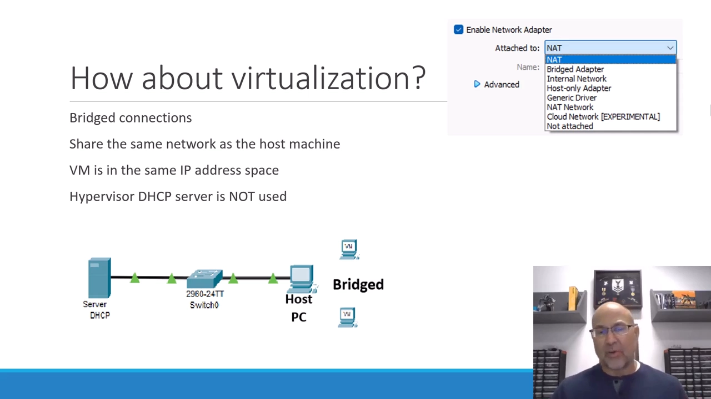

[【跳转到 05:24】](https://www.youtube.com/watch?v=yj0hXuUjPMo&t=324)

### 3.3 本质：把 VM 的连接"粘"到主机的连接上

所谓桥接，就是把 VM 的网络连接与主机的网络连接**粘合在一起**——它们进入同一个二层 MAC 地址空间，也因此落在同一个 IPv4 网段。

## 四、Linux 网桥：行为像交换机的内核模块

### 4.1 一句定义

视频引用 Red Hat 的定义：

> **A Linux bridge is a kernel module that behaves like a network switch.**
> （Linux 网桥是一个行为像网络交换机的内核模块。）

[【跳转到 06:14】](https://www.youtube.com/watch?v=yj0hXuUjPMo&t=374)

它把节点放进可直接互通的空间，并在连接的接口之间转发数据包——第一部分讲的网桥思想，在内核里原样落地。在 Proxmox 这类宿主系统上，常见形态就是：VM 的流量经网桥穿过 eth0 出主机；也可以让流量穿过某个承担特定任务（如防火墙）的 VM。

### 4.2 为什么要在单机内桥接

把同一台机器上的接口桥在一起，能搭出不少实用拓扑：

- **流量过滤**：让流量必须流经一个防火墙 VM——进一个口、过规则、出另一个口；
- **负载均衡**：把流量分发给后端服务器；
- **管理连接**：第二节 BVI 的思路；
- **VM 联网**：VM 的网卡经软件路由器、软件交换机或 hypervisor 本体桥接到外网。

### 4.3 交换机有的它也有：STP、VLAN，以及一票基于它的产品

物理交换机支持的**生成树协议（STP，防二层环路）**和 **VLAN（虚拟局域网）**，Linux 网桥同样支持。不少网络产品就直接构建在 Linux 之上：OPNsense、FRR、白盒交换机系统等。

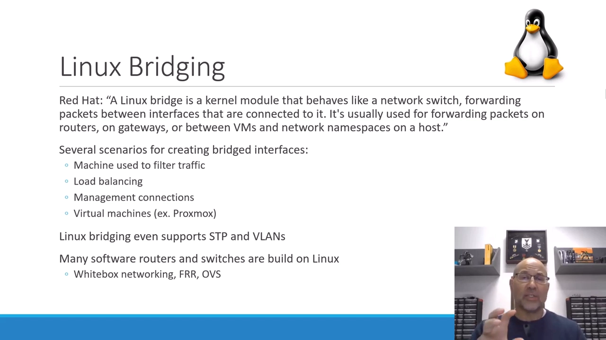

[【跳转到 07:29】](https://www.youtube.com/watch?v=yj0hXuUjPMo&t=449)

## 五、动手：在 Ubuntu 上建 br0，用 bridge 命令看 FDB

### 5.1 声明网桥：netplan YAML

Ubuntu 用 YAML 文件 + netplan 管理网络。视频的做法：从 `50-cloud-init.yaml` 复制出 `99-config.yaml` 再修改——hypervisor 上先给 VM 加了第二块网卡（"只桥一个接口没什么好演示的"），于是文件里有了：

- `enp0s3`：原有第一网卡，IP `.99`；
- `enp0s8`：新加网卡，IP `.98`；
- **`br0`**：新定义的网桥，并把上面两个接口放进桥里。

保存后执行 `netplan apply` 生效。

[【跳转到 11:49】](https://www.youtube.com/watch?v=yj0hXuUjPMo&t=709)

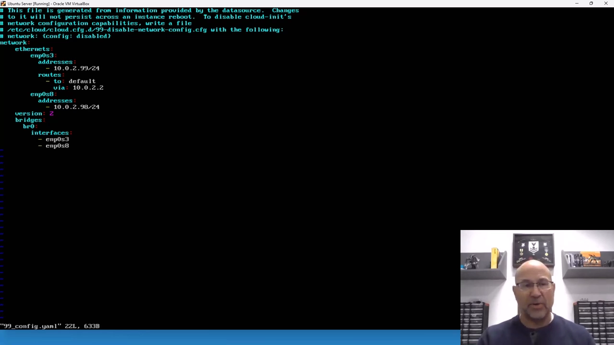

[【跳转到 12:14】](https://www.youtube.com/watch?v=yj0hXuUjPMo&t=734)

### 5.2 验证：ip a 里出现 br0

`ip a`（就是 ip addr）显示：lo、enp0s3、enp0s8 都在，最后多出一个 **br0**——网桥接口创建成功，它自己也有网络身份。

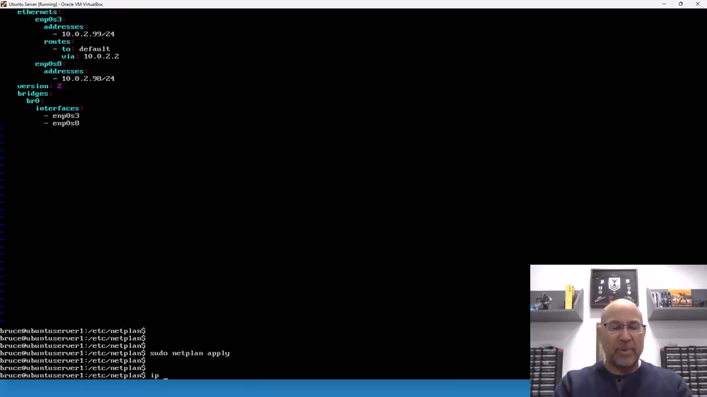

[【跳转到 12:39】](https://www.youtube.com/watch?v=yj0hXuUjPMo&t=759)

### 5.3 bridge 命令：brctl 的现代替代品

光建起来还不够，还得能看它在干什么。老一代工具 **brctl 已废弃**，现代工具是 iproute2 套件里的 **`bridge`** 命令——用于"设置、维护、检查以太网桥配置"，用法是"命令 + 选项 + 对象"。

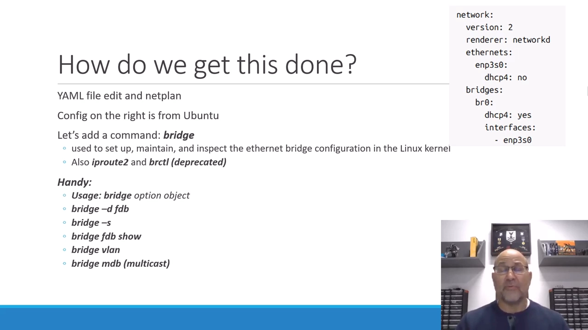

[【跳转到 09:34】](https://www.youtube.com/watch?v=yj0hXuUjPMo&t=574)

`man bridge` 一页概括其能力：显示/操作桥地址与设备，可以增删接口、VLAN 等；选项极多，也可以把这些配置直接写进 YAML 文件。

### 5.4 转发数据库（FDB）：桥真的学会了 MAC

验证桥是否在工作，看**转发数据库（forwarding database，FDB）**——第一节"源地址表"在现代工具里的名字。先从 `ip a` 记下两个接口的 MAC：enp0s3 以 `6A:E8` 结尾，enp0s8 以 `29:B4` 结尾。再看 `bridge` 命令输出：这两个 MAC 就挂在 br0 上——**桥已经学会了它们**，并将基于这些 MAC 做转发决策（还可以叠加 VLAN 之类的规则）。

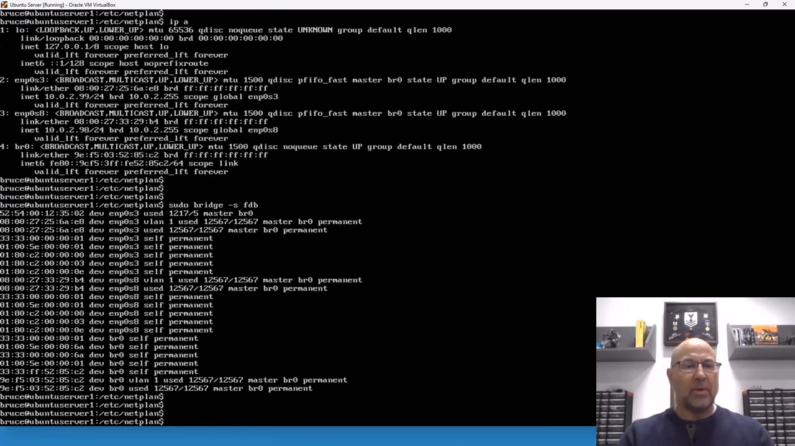

[【跳转到 14:47】](https://www.youtube.com/watch?v=yj0hXuUjPMo&t=887)

## 小结

- 网桥 = 连接网段、按 MAC 存储转发的设备；标准起点是 IEEE 802.1D，今天的 802.1Q 加入了 VLAN。
- 相比集线器/中继器，网桥靠源地址表学习 MAC、按 MAC 转发，顺带切割冲突域、隔离本地单播流量；它的现代形态是多口交换机。
- 桥接组把节点或接口成组；管理 IP 放在 BVI/br0 这类桥接虚接口上，不绑死任何物理口，任一侧 down 掉仍可管理。
- 虚拟化三模式中，NAT 藏在主机后、host-only 与世隔绝，**bridged 让 VM 直接进入物理网段**——本质是把 VM 的连接粘到主机的连接上。
- Linux 网桥是"行为像交换机的内核模块"（Red Hat 定义），支持 STP 与 VLAN，是 OPNsense、FRR、白盒系统等产品的底座。
- Ubuntu 上三步落地：netplan 声明 br0 与成员接口 → `ip a` 确认 br0 出现 → `bridge` 命令查看 FDB 中的 MAC。

## 关键术语速查

| 术语 | 一句话解释 |
| --- | --- |
| 网桥（bridge） | 连接网段、按 MAC 转发的设备；在 Linux 中是内核模块 |
| 802.1D / 802.1Q | 桥接（存储转发）的 IEEE 标准 / 加入 VLAN 的现代版本 |
| 存储转发 | 收下帧、查表、再决定从哪个口发出的工作方式 |
| 源地址表 / FDB | 网桥通过监听流量学到的"MAC → 端口"映射 |
| 冲突域 | 可能发生信号冲突的范围；桥接把它一分为二 |
| 桥接组（bridge group） | 逻辑上归入同一个桥的节点/接口集合 |
| BVI / br0 | 桥接虚接口，承载不绑死物理口的管理地址 |
| NAT / host-only / bridged | hypervisor 给 VM 供网的三种模式 |
| Linux bridge | "行为像网络交换机的内核模块"（Red Hat 定义） |
| netplan | Ubuntu 的声明式网络配置工具（YAML 驱动） |
| bridge 命令 | iproute2 中设置、维护、检查以太网桥的工具，替代已废弃的 brctl |
| STP / VLAN | 生成树协议（防二层环路）/ 虚拟局域网（划分广播域） |
