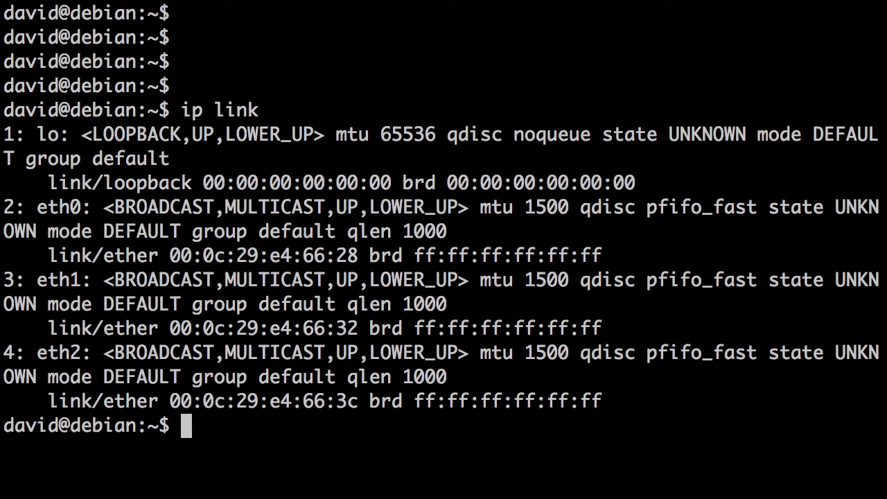
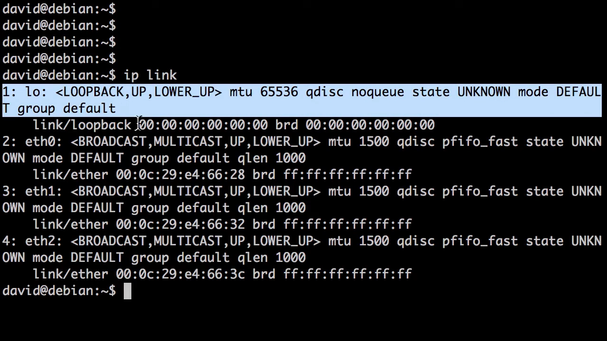
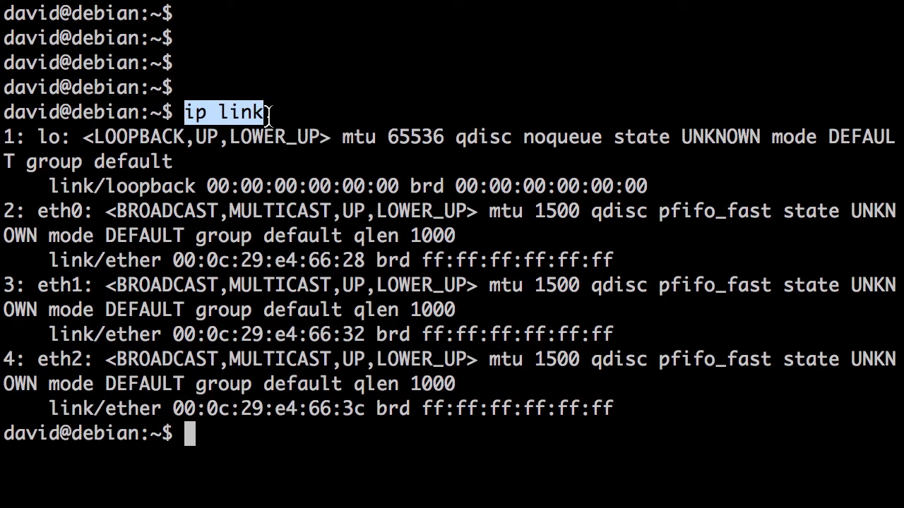
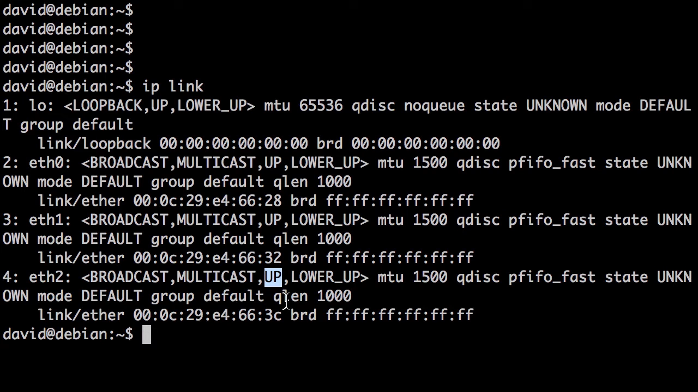
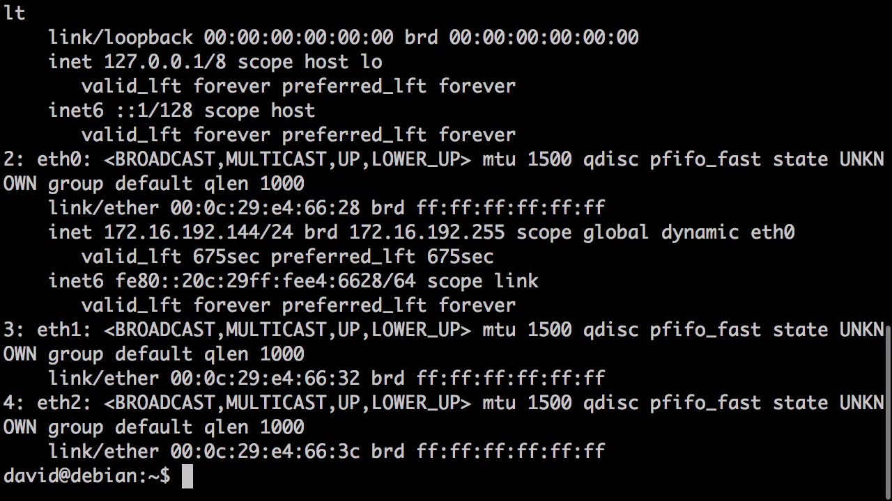
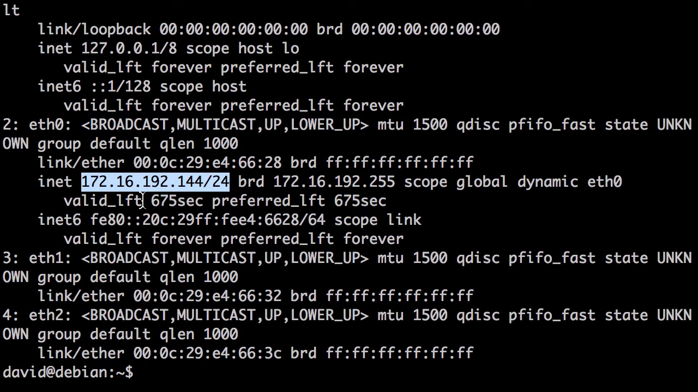
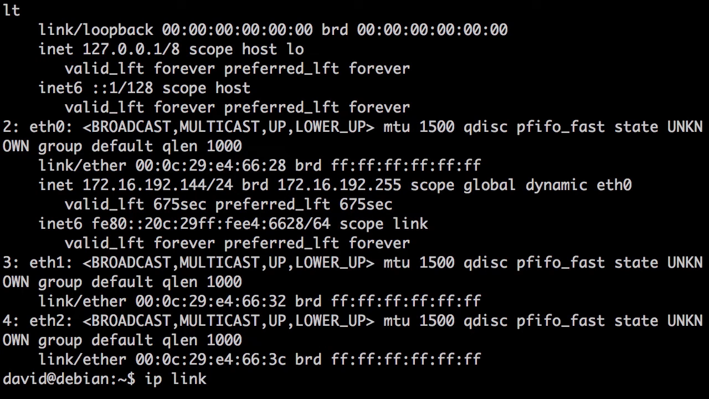
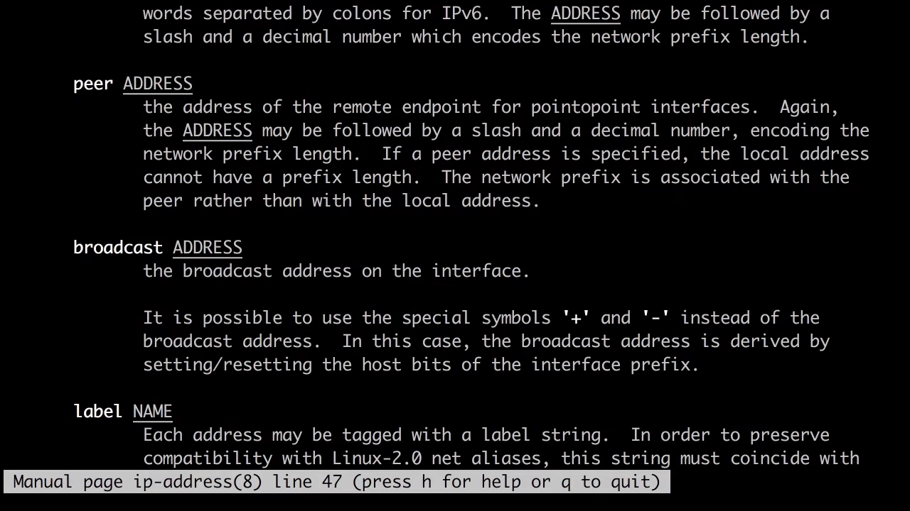
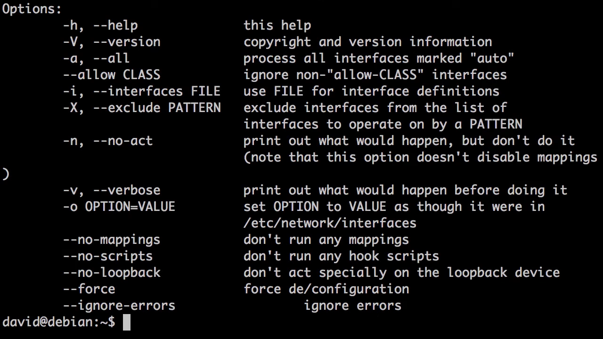

# 读懂 Linux 网络接口：一台 Debian 主机上的 ip link 与 ip addr

> 本文整理自 YouTube 视频《[Understanding Linux Network Interfaces](https://www.youtube.com/watch?v=SSLpvcIOPK0)》（约 6 分半，主讲人 David Davis，《Gorilla Guide to Linux Networking 101》作者）。视频在 Debian 上现场演示：用 `ip link` 回答"有哪些接口、状态如何"，用 `ip addr` 回答"每个接口上配了什么地址"，并逐字段解释 lo、ethN、UP/LOWER_UP 与 MAC 地址；最后给出 `ip link set`、`ifup/ifdown` 等修改配置的手段。姊妹篇《[网桥：把多个接口粘进同一个二层网络](Linux_networking_4_Bridging_virtual_bridges_and_bridged_interfaces.md)》讲如何用网桥把接口组织成一台"软件交换机"。

## 本讲要解决的核心问题（SCQA）

**背景**：想让一台 Linux 主机联网、或者排查它为什么上不了网，第一步永远是搞清楚：这台机器上有哪些网络接口？各自状态如何？有没有配置地址？

**冲突**：可新手一运行命令就懵了——`lo`、`eth0`、`UP`、`LOWER_UP`、一长串冒号分隔的十六进制，每个词都眼熟，合在一起却不知道在说什么。

**疑问**：这些字段到底怎么读？想查看接口、查看地址、修改配置，分别该用哪个命令？

**回答（中心思想）**：读懂网络接口只需要两条命令：**`ip link` 回答"有哪些接口、硬件状态如何"；`ip addr` 回答"每个接口上配了什么地址"**。再配合四个概念——lo（环回接口）、ethN（以太网命名）、UP/LOWER_UP（两级状态）、MAC 地址（硬件身份）——任何一台 Linux 主机的接口信息都能一眼读懂。

## 一、ip link：有哪些接口，状态如何

### 1.1 全貌：一个 lo，三个 eth

视频登录一台 Debian Linux（知名发行版），敲下的第一个命令就是 `ip link`——查看网络接口最直接的入口。输出显示这台主机共有 4 个接口，从左到右编号 1~4：

[【跳转到 00:31】](https://www.youtube.com/watch?v=SSLpvcIOPK0&t=31)

点名其中两类：

- **lo（loopback，环回接口）**：代表 Linux 主机本身。它不走任何物理网卡，是内核里的"自己连自己"。
- **eth0 / eth1 / eth2**：三个以太网接口，编号从 0 开始；`eth` 是 Ethernet 的缩写。

[【跳转到 00:47】](https://www.youtube.com/watch?v=SSLpvcIOPK0&t=47)

[【跳转到 01:01】](https://www.youtube.com/watch?v=SSLpvcIOPK0&t=61)

### 1.2 UP 与 LOWER_UP：两级状态，含义不同

`ip link` 显示所有接口都是 `UP`。视频特别强调：这里的"up"其实是两层意思——

- **UP**：内核认为这个接口已启用，是软件层面的开关；
- **LOWER_UP**：物理层已建立链路，网线里有电信号了，是硬件层面的连通。

[【跳转到 01:34】](https://www.youtube.com/watch?v=SSLpvcIOPK0&t=94)

**UP 不等于网线插好了**：接口可以 UP 但没有 LOWER_UP（没插线/对端没信号），也可能插着线却被管理员手动 down 掉。排查网络时，这两个标志要分开看。

同一行输出里还有 **MAC 地址**（以太网地址）——它唯一标识一块以太网接口，是这张网卡在世界上的"身份证"。

[【跳转到 01:59】](https://www.youtube.com/watch?v=SSLpvcIOPK0&t=119)

## 二、ip addr：每个接口上配了什么地址

### 2.1 lo 永远是 127.0.0.1

`ip addr`（ip address 的缩写）输出同一批接口，但多出地址信息。环回接口 lo 上永远配置着 **127.0.0.1**——"本机"的地址，发给它的包不会离开主机。

[【跳转到 02:34】](https://www.youtube.com/watch?v=SSLpvcIOPK0&t=154)

### 2.2 只有 eth0 有地址：能对外通信的接口只有一个

eth0 配有 IPv4 地址 `172.16.192.144`（还附着一个 IPv6 地址，视频未展开）。而 eth1、eth2 的输出明显更短——它们**没有配置任何 IP 地址**。

[【跳转到 02:59】](https://www.youtube.com/watch?v=SSLpvcIOPK0&t=179)

所以这台主机真正通向外部世界（局域网或互联网）的接口只有 eth0 一个。**有链路（LOWER_UP）不等于能上网，还得有 IP 地址。**

概括两个命令的分工：`ip link` 看硬件与状态，`ip addr` 看地址配置——前者是"这个接口存不存在、活着吗"，后者是"它用什么身份通信"。

## 三、两个命令不止能"看"，还能"改"

### 3.1 ip link set：启停接口、改 MTU、设混杂模式

`man ip link` 显示，`ip link set` 可以把接口 down 掉、修改 MTU（最大传输单元）、配置组播或混杂模式等。这些属于"接口级"配置。

[【跳转到 03:49】](https://www.youtube.com/watch?v=SSLpvcIOPK0&t=229)

### 3.2 ip address：地址的增、删、清空、显示

要改 IP 地址，用 `ip address`。`man ip` 能列出整个 ip 命令族（ip address、ip route……）；`man ip-address` 给出地址管理细节：add（添加）、delete（删除）、flush（清空）、show（显示）。

[【跳转到 04:54】](https://www.youtube.com/watch?v=SSLpvcIOPK0&t=294)

## 四、ifup / ifdown：另一套启停接口的工具

Debian 上还有一对老牌工具：`/sbin/ifdown` 与 `/sbin/ifup`，作用就写在名字里——把接口拉下、拉起。它们支持 `--help` 查看用法，也可以 `man ifup` 阅读手册。

[【跳转到 05:00】](https://www.youtube.com/watch?v=SSLpvcIOPK0&t=300)

[【跳转到 05:21】](https://www.youtube.com/watch?v=SSLpvcIOPK0&t=321)

注意：运行这类命令需要 **root 或超级用户权限**——普通用户执行会被拒绝。

## 五、工具从哪来：iproute2 与发行版差异

视频最后交代了工具来源：演示用的 `ip` 命令族属于 **iproute2** 包，在所有 Linux 发行版上都是标准配置；`ifup/ifdown` 同样是标配，但**不同发行版的配置文件位置与写法可能不同**——在 Debian 上学到的配置路径，到了别的发行版未必一一对应，动手前先查对应发行版的文档。

## 小结

- 看接口与状态用 `ip link`，看地址配置用 `ip addr`——两条命令覆盖接口信息的大部分问题。
- lo 是环回接口，代表主机本身，永远是 127.0.0.1；ethN 是以太网接口，从 0 开始编号。
- UP 表示内核启用了接口；LOWER_UP 表示物理层链路真的通了；两者要分开判断。
- MAC 地址唯一标识以太网接口；IP 地址决定接口能否对外通信——eth1/eth2 有链路无地址，所以上不了网。
- 改接口用 `ip link set`，改地址用 `ip address`，启停还有 `ifup/ifdown`；这些操作都需要 root 权限。
- ip 命令族来自 iproute2，各发行版标配；ifup/ifdown 的配置位置则因发行版而异。

## 关键术语速查

| 术语 | 一句话解释 |
| --- | --- |
| 网络接口（interface） | 主机收发网络数据的"端口"，如 lo、eth0 |
| lo / 环回接口 | 代表主机自身的虚拟接口，恒配 127.0.0.1 |
| ethN | 以太网接口命名，从 eth0 开始编号 |
| UP | 内核认为接口已启用（软件开关） |
| LOWER_UP | 物理层链路已建立（网线有信号） |
| MAC 地址 | 唯一标识以太网接口的硬件地址 |
| iproute2 | 提供 ip 命令族的标准工具包 |
| ifup / ifdown | 位于 /sbin 的接口启停工具 |
| MTU | 最大传输单元，单帧最多携带的字节数 |
| 混杂模式 | 让接口接收非本机 MAC 的帧（抓包常用） |
