# ARP 工作原理及完整实验：从"谁是小明"到抓包验证

> 本文整理自 B 站视频《[11.ARP 工作原理及完整实验](https://www.bilibili.com/video/BV1Q14y1n7SX)》第 11 讲（约 27 分钟，网工小帅哥）。视频分两半：前半段用"课堂点名"的类比讲透 ARP 的广播请求 / 单播应答机制与报文封装；后半段在 eNSP 模拟器里搭"三台 PC + 一台交换机"的拓扑做完整实验——改 MAC 方便辨认、`arp -a` 看缓存、`ping` 触发解析、抓包逐字段分析 request/reply、观察交换机 MAC 地址表从空到学满。知道了"包要发给哪个 IP"之后，"下一跳的 MAC 是多少"就靠 ARP 来回答，可与姊妹篇《[路由表是什么：数据包怎么知道该从哪个口出去](Routing_Tables_CCNA_Explained.md)》《[IP 路由到底怎么走：主机逻辑、路由器逻辑与逐跳封装](How_IP_Routing_Actually_Works.md)》对照阅读。

## 本讲要解决的核心问题（SCQA）

**背景**：通信双方（如主机 A 和 B）的 IP 地址是已知的（192.168.1.1 / 192.168.1.2），但 MAC 地址是 48 比特、十六进制表示的硬件身份（形如 `3c:…:8f4f`），互相都不知道。

**冲突**：数据最终要封装成以太网帧才能在链路上传输，帧头里必须填目的 MAC——不知道就发不出去。

**疑问**：只凭一个 IP 地址，怎么把对应的 MAC 地址"问"出来？问出来的过程在网络上是什么样子？

**回答（中心思想）**：ARP（地址解析协议）负责"**已知 IP，求对应 MAC**"。机制只有两步：**广播 ARP 请求**（目的 MAC 全 F，全网都听到，被点名者回应）+ **单播 ARP 应答**（只有请求者收到）。请求报文里顺带携带请求者自己的 IP↔MAC，让响应方"顺路"缓存，一举两得。

## 一、ARP 是干什么的：已知 IP，求 MAC

视频开宗明义：ARP 的全称是**地址解析协议**，作用一句话——**根据已知的 IP 地址，解析获得其对应的 MAC 地址**。这是网络入门必修协议，不会它后面寸步难行：

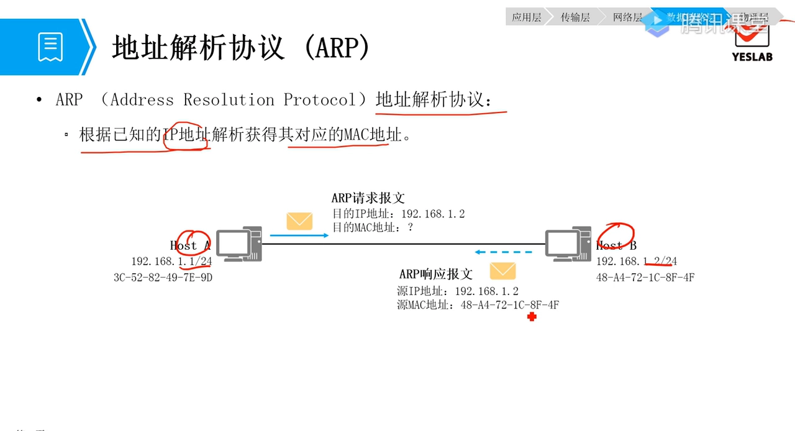

[【跳转到 00:50】](https://www.bilibili.com/video/BV1Q14y1n7SX/?t=50)

场景设定：主机 A（192.168.1.1）要跟主机 B（192.168.1.2）通信。IP 双方都知道，但 A 不知道 B 的 MAC（48 比特、16 进制的硬件地址）。于是 A 发出一个 **ARP 请求**："`192.168.1.2`，请把你的 MAC 地址告诉我。"

## 二、请求是广播：课堂点名式提问

关键机制第一条：**ARP 请求是广播**。目的 MAC 填全 F（FF:FF:FF:…），同一个广播域里的所有终端都会收到：

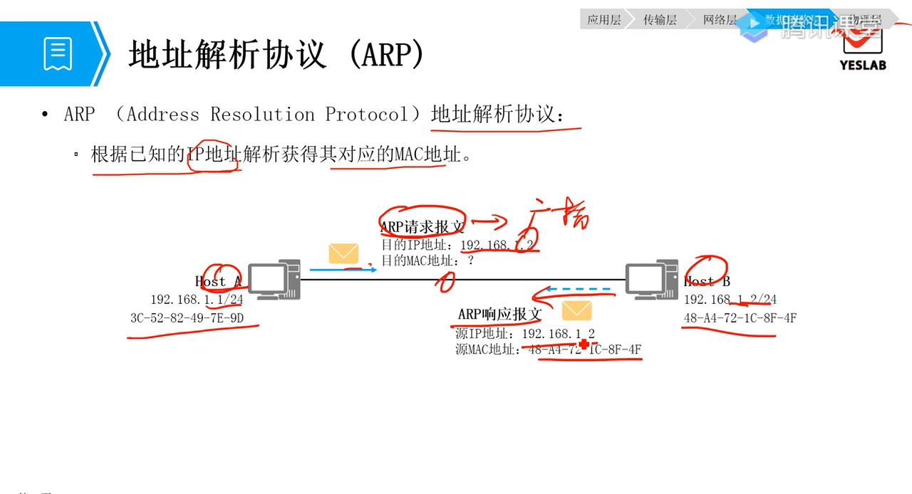

[【跳转到 02:55】](https://www.bilibili.com/video/BV1Q14y1n7SX/?t=175)

视频的类比非常传神：上课时老师喊"**谁是小明？**"——全班都听见了（广播），但只有小明本人举手回应，其他人不理会。收到请求的每台主机比对报文里询问的 IP：不是问我的，丢弃；正是问我的（主机 B），回复。

B 回复"我是 192.168.1.2，我的 MAC 是…"，这就是 **ARP 应答（reply）**。A 拿到"IP ↔ MAC"映射后，才能开始真正的数据封装：

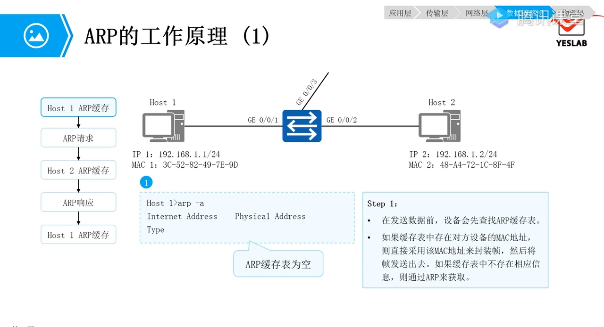

[【跳转到 03:20】](https://www.bilibili.com/video/BV1Q14y1n7SX/?t=200)

没有这个映射表项，通信根本无法完成——这就是"解析"二字的分量。

## 三、报文长什么样：request 与 reply 的封装

ARP 报文封装在以太网帧里。**请求报文（request）**的几个关键字段：

- 外层以太网帧：**目的 MAC = 全 F**，表示广播帧；
- 操作类型 = **request**；
- 发送端 MAC、发送端 IP = 请求者（A）自己的信息；
- 目的 MAC = **全零**（还不知道，占位）；目的 IP = 192.168.1.2（要问的人）。

[【跳转到 05:50】](https://www.bilibili.com/video/BV1Q14y1n7SX/?t=350)

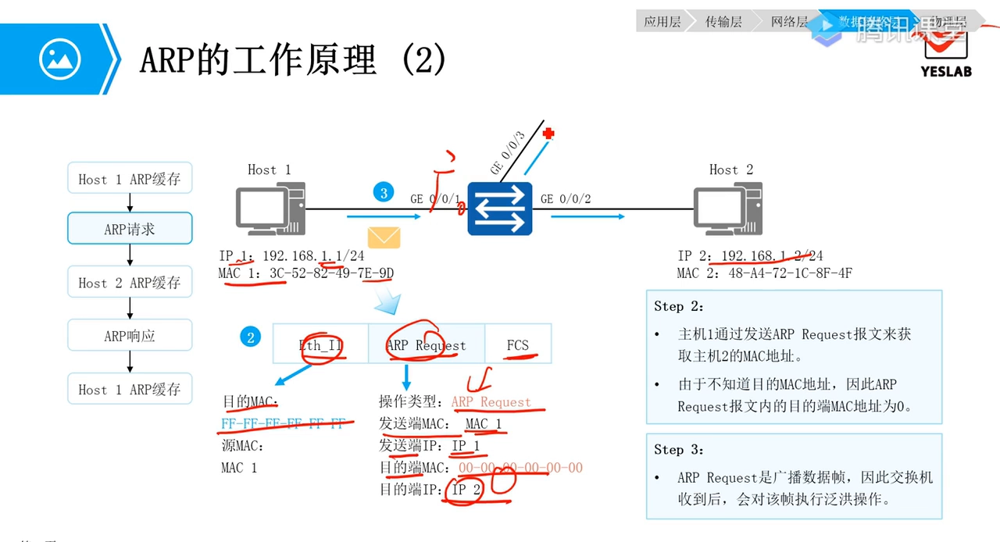

[【跳转到 06:15】](https://www.bilibili.com/video/BV1Q14y1n7SX/?t=375)

**应答报文（reply）**则反过来：操作类型 = reply，源 MAC = B、目的 MAC = A——不再是广播，而是**单播**直接送回请求者：

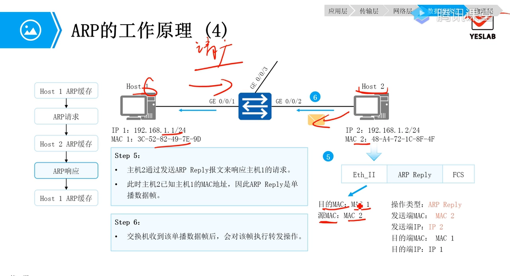

[【跳转到 09:35】](https://www.bilibili.com/video/BV1Q14y1n7SX/?t=575)

## 四、工作原理三步：查缓存 → 广播问 → 单播答

完整流程其实只有三步，发起方先**查本机 ARP 缓存**：

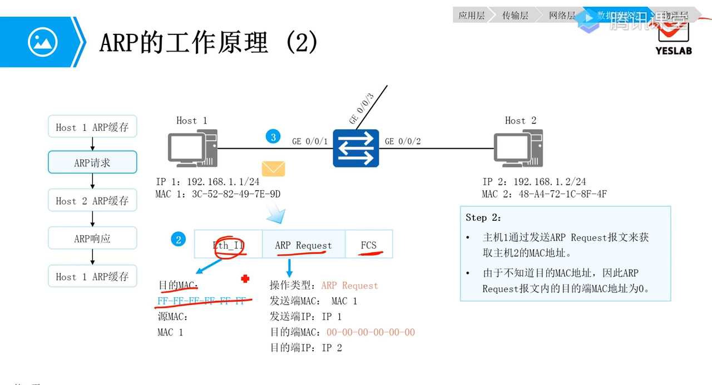

[【跳转到 05:00】](https://www.bilibili.com/video/BV1Q14y1n7SX/?t=300)

1. **查缓存**：ARP 缓存表就是"IP → MAC"的映射表。刚开机是空的（`arp -a` 什么都没有），没有命中才发请求；
2. **广播请求**：全 F 目的 MAC，广播域内人人收到；交换机对广播帧的做法是**泛洪**——除接收端口外，其余端口各复制一份发出去；
3. **单播应答**：被点名者回复 reply。请求者把"192.168.1.2 ↔ 对应 MAC"写进缓存，通信开始。

## 五、一举两得：被请求方也顺便缓存

这一步最精妙。B 在回复之前，会先从请求报文里**把 A 的 IP 和 MAC 记进自己的缓存**——因为请求报文本身就带着"我是谁、我的 MAC 是多少"。视频用寄信类比：你写信写上了收件人的邮编，对方回信时也得写上你的邮编——**双向通信，双方都要知道对方的 MAC**：

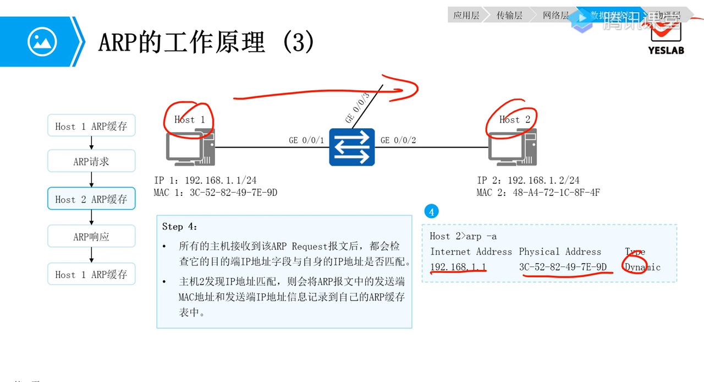

[【跳转到 08:20】](https://www.bilibili.com/video/BV1Q14y1n7SX/?t=500)

甚至**非目标主机**（比如网内的 PC3）收到广播后虽然不回复，也会把请求者的映射缓存下来——反正迟早要跟它通信，先记着，一举两得。另外注意：ARP 表项**不是永久存在的**，每条都有缓存老化时间，超时就删掉重新解析，这也是"换了网卡/换了接口就通不了"的常见原因。

## 六、完整实验：eNSP 里从空表到抓包

原理讲完，视频后半段在 eNSP（华为模拟器）里搭了一个三台 PC + 一台二层交换机的拓扑做验证：

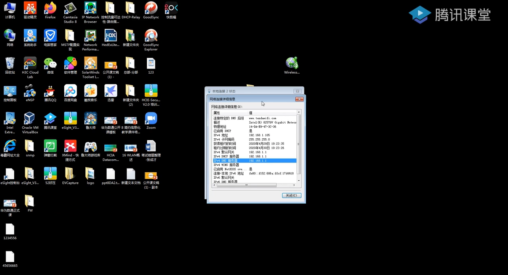

[【跳转到 13:45】](https://www.bilibili.com/video/BV1Q14y1n7SX/?t=825)

先把三台 PC 配置好：IP 分别为 192.168.1.1 / .2 / .3，掩码 255.255.255.0；为了抓包时一眼认出谁是谁，把 MAC 手工改成尾号 11 / 22 / 33：

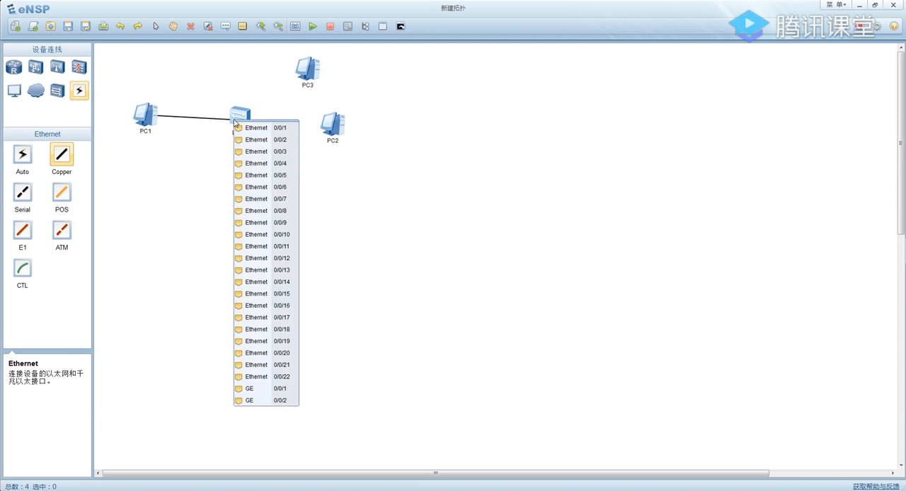

[【跳转到 14:46】](https://www.bilibili.com/video/BV1Q14y1n7SX/?t=886)

初始状态验证：所有 PC 上 `arp -a` 全空，交换机上 `display mac-address` 也是空——所有设备的表都还没学：

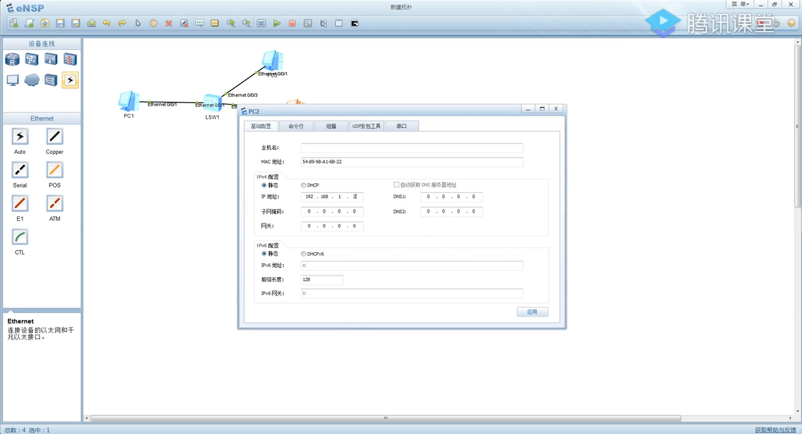

[【跳转到 15:36】](https://www.bilibili.com/video/BV1Q14y1n7SX/?t=936)

在 PC1 上 `ping 192.168.1.2`——ping 触发 ARP 解析，解析完成后包立刻通：

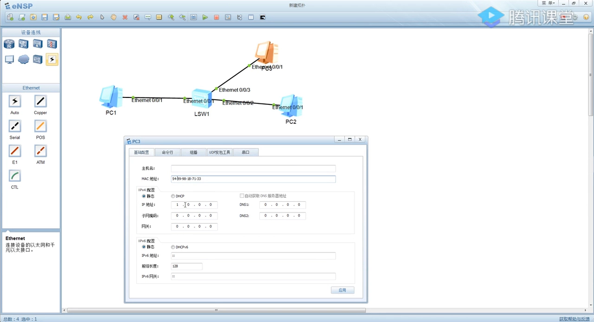

[【跳转到 16:01】](https://www.bilibili.com/video/BV1Q14y1n7SX/?t=961)

抓包看第一帧：目的 MAC 是 `broadcast`，协议是 ARP，内容翻译过来就是——**"Who has 192.168.1.2? Tell 192.168.1.1"**（谁是 1.2？请告诉 1.1）：

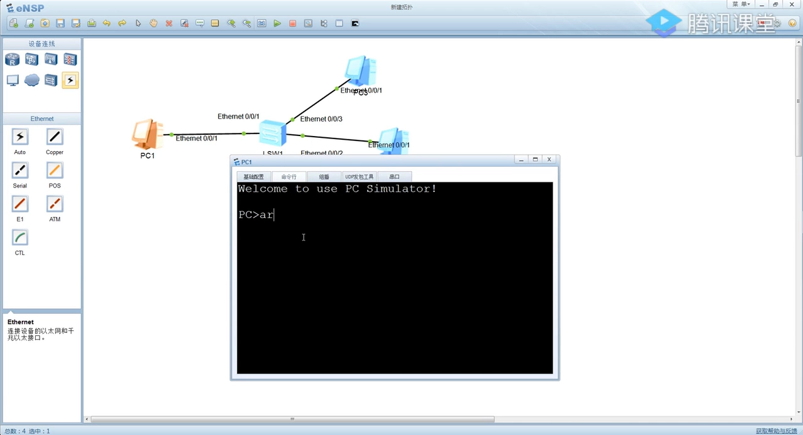

[【跳转到 16:37】](https://www.bilibili.com/video/BV1Q14y1n7SX/?t=997)

展开报文可见封装层次：外层以太网帧源 MAC 尾号 11、目的 MAC 全 F；ARP 段里操作类型是 request，发送者 MAC/IP 与"被询问的 IP"一目了然。这正是第三、四节讲的封装结构：

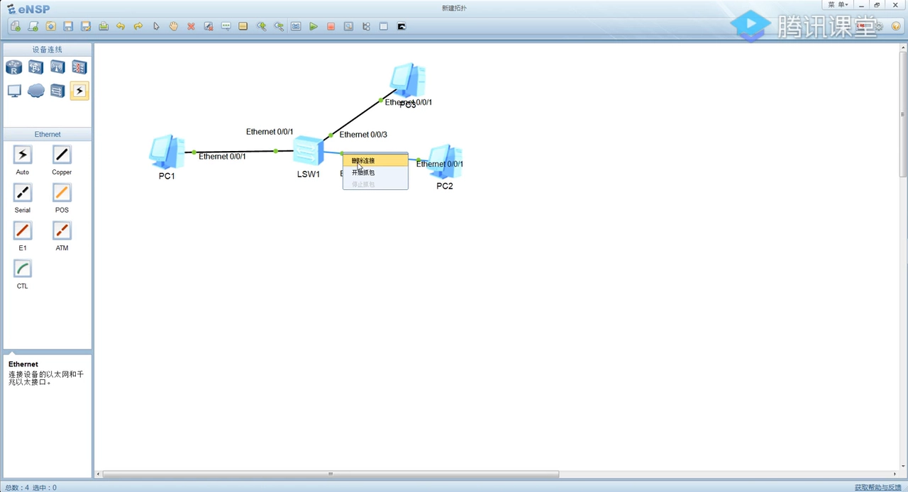

[【跳转到 17:17】](https://www.bilibili.com/video/BV1Q14y1n7SX/?t=1037)

紧接着 PC2 的抓包窗口里出现 **ARP reply**：内容是"我的 MAC 尾号 22，我的 IP 是 1.2"——单播直接发回 1.1：

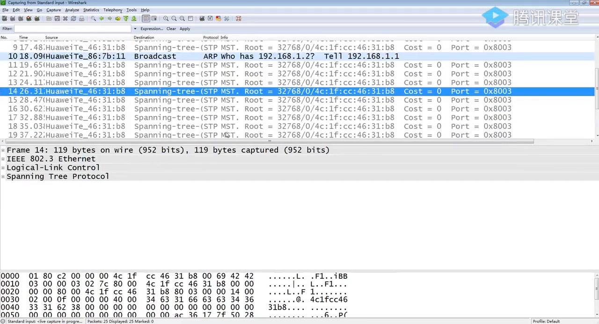

[【跳转到 18:19】](https://www.bilibili.com/video/BV1Q14y1n7SX/?t=1099)

实验还有一个隐藏观察点：PC3 收到广播后没有回复，但它的缓存里已经多了 PC1 的映射——第五节"一举两得"的现场版。

## 七、交换机为什么第二下就不泛洪了

实验里最容易疑惑的现象：第一次广播请求，交换机泛洪到所有口，**为什么 PC2 的 reply 却只送到了 PC1**？

因为 reply 到达交换机时，**MAC 地址表已经不为空了**——前面 request/reply 一来一回，交换机顺路学到了"接口 1 ↔ 尾号 11、接口 2 ↔ 尾号 22"。二层交换机转发只看**目的 MAC 查表**，查到就从对应口精确转发，不再泛洪：

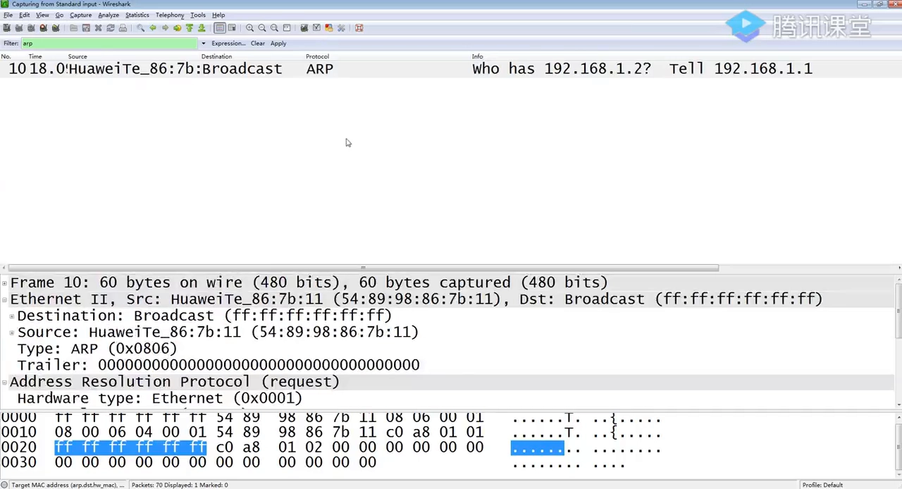

[【跳转到 19:58】](https://www.bilibili.com/video/BV1Q14y1n7SX/?t=1198)

视频用快递员类比收尾：二层交换机就像只看邮编分拣的快递员——**你告诉我邮编（MAC）就行，信封里写的什么内容（三层及以上）我不关心**。后续 PC1、PC2 之间的所有数据交互，交换机都是这样按表精确转发的。顺带一提，实验里 `ping`（ICMP echo/reply）本身就是最常用的连通性测试工具，任何 PC、路由器、交换机都自带。

## 八、小结

- **ARP = 地址解析协议**：已知 IP，求 MAC。没有 MAC 映射，以太网帧发不出去。
- **请求广播（目的 MAC 全 F，人人收到，被点名者回应），应答单播**（直接发回请求者）。
- **报文自带"顺手缓存"设计**：请求方获得对方映射，响应方（甚至旁听的非目标主机）也缓存请求方映射，双向通信无需再问一轮。
- **缓存有老化时间**，表项不是永久的；广播 MAC 全 F 是协议专用地址，不会分配给任何终端。
- **二层交换机只认 MAC**：对未知目的泛洪，学到表后精确转发；对帧里的三层内容不闻不问。

对应到 Linux/容器：`arp` 命令（或 `ip neigh`）查看的本机 ARP 缓存、容器网桥上发生的邻居解析、以及宿主机网卡的 MAC，玩的是同一套机制——容器里的包要出网桥，同样得先"喊一嗓子"问出网关的 MAC。
