# IP 路由到底怎么走：主机逻辑、路由器逻辑与逐跳封装

> 本文整理自 YouTube 视频《[How IP Routing Actually Works (Host and Router Logic Explained)](https://www.youtube.com/watch?v=a_TdHxqMaGo)》（约 18 分钟，主讲人 Wendell Odom，《CCNA 官方认证指南》作者）。视频回答一个根本问题：一个 IP 包从主机 A 出发、穿过三台路由器到达远端服务器，**每一跳到底发生了什么**——主机的两分支判断、路由表"一条记录管一片"的匹配方式、动态路由协议为何不可替代，以及最容易被忽略的细节：每一跳都要撕掉旧的以太网帧头、换上新的，所以**目的 MAC 永远是"下一跳"，目的 IP 始终是终点**。查表的条目从哪来，见姊妹篇《[路由表是什么：数据包怎么知道该从哪个口出去](Routing_Tables_CCNA_Explained.md)》；帧里的 MAC 地址怎么拿到，见《[ARP 工作原理及完整实验](ARP工作原理及完整实验.md)》。

## 本讲要解决的核心问题（SCQA）

**背景**：IP 路由是整个网络体系的核心机制，主机和路由器都在参与"转发"。

**冲突**：主机 A 发给远端服务器的包，以太网帧头里的目的 MAC 写的是谁？写服务器？写网关？很多人在这里糊涂。

**疑问**：包怎么知道下一站是谁？路由表为什么用一条记录就能覆盖上百个地址？

**回答（中心思想）**：主机只有两分支逻辑——**目的在同一子网就直接送达，不在就发给默认网关**；路由器按"目的 IP 匹配子网条目 → 出接口 + 下一跳"转发；每一跳都会**去掉旧二层帧头、重新封装**，所以帧的目的 MAC 始终指向下一跳设备，而 IP 头里的目的地址从头到尾不变。

## 一、子网划分：给路由铺路的设计

IP 编址在设计之初就为路由做了铺垫：每个子网有一个**子网 ID + 掩码**，两者一起定义了"这个子网里有哪些地址"。比如子网 ID 为 10.1.2.0、掩码 /24，含义就是"所有以 10.1.2 开头的地址"；另一台路由器 R3 挂着的子网是 10.1.3.0/24，里面的主机地址都以 10.1.3 开头：

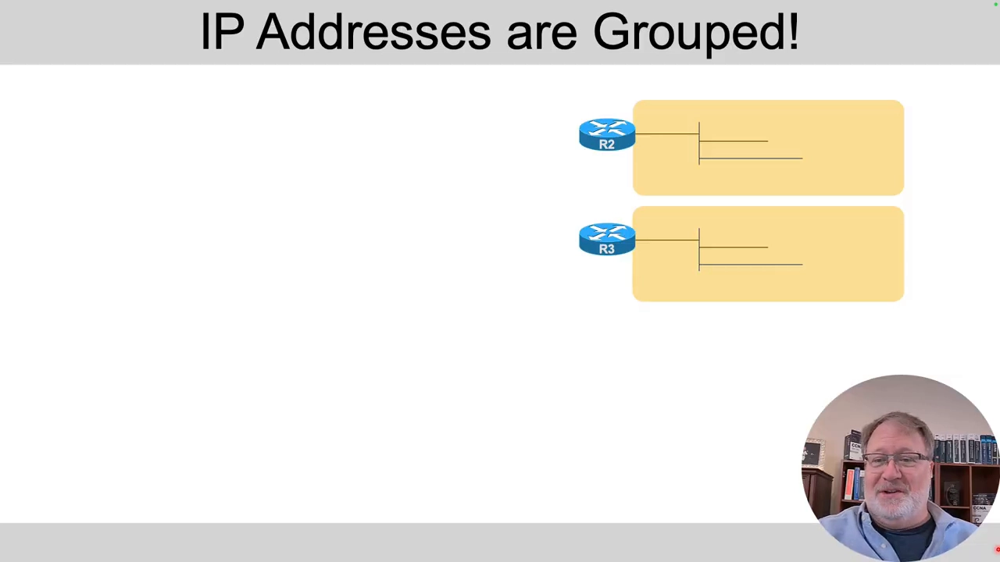

[【跳转到 01:14】](https://www.youtube.com/watch?v=a_TdHxqMaGo&t=74)

这对路由的意义巨大：路由器**不需要记住每个子网里每一个地址**，只需要记住"子网 ID + 掩码"这一行，再加"怎么把包送到那个子网"的指引。路由表里一行，就代表了整片地址：

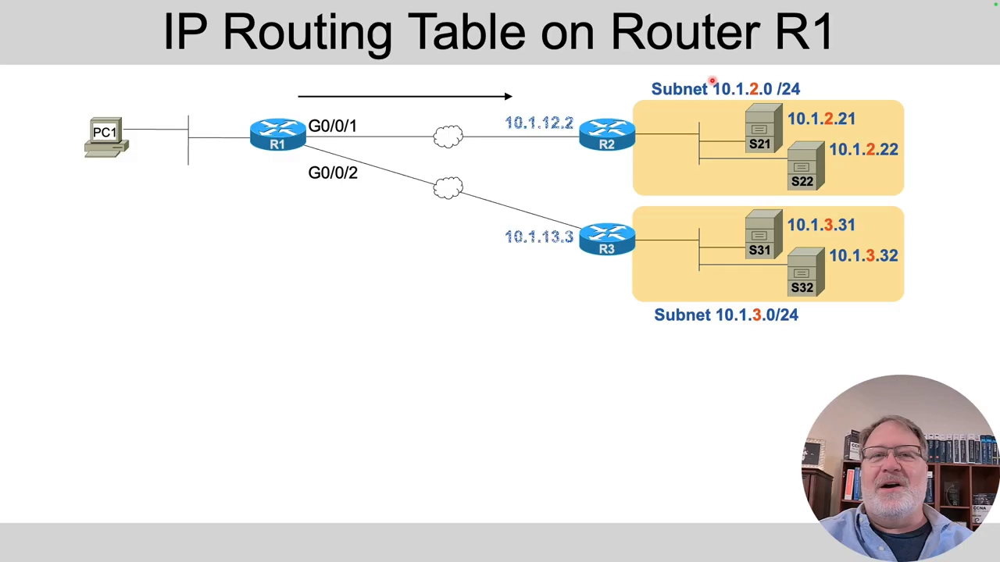

[【跳转到 02:54】](https://www.youtube.com/watch?v=a_TdHxqMaGo&t=174)

## 二、路由表条目：一行管一片，两列指路

以 R1 的路由表为例：右边那个子网里哪怕有 200 个地址，R1 的表里也**只需要一条记录**——子网 ID + 掩码。任何进入 R1、目的地址以 10.1.2 开头的包，都命中这条路由：

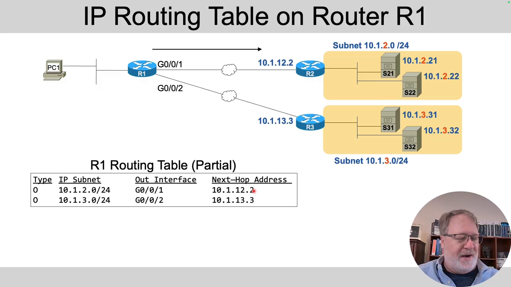

[【跳转到 03:44】](https://www.youtube.com/watch?v=a_TdHxqMaGo&t=224)

命中之后，条目的后两列就是**转发指令**：从哪个接口发出去（outgoing interface）、交给哪个下一跳 IP（next hop，即下一台路由器在这条链路上的地址）。两条表项，就足以把包送往两个各含数百台主机的子网。

## 三、静态不可行，动态来救场

这些路由条目可以手工敲（静态路由），但算一笔账就明白为什么没人这么干：100 台路由器、100 个子网，要求每台路由器都知道所有子网——

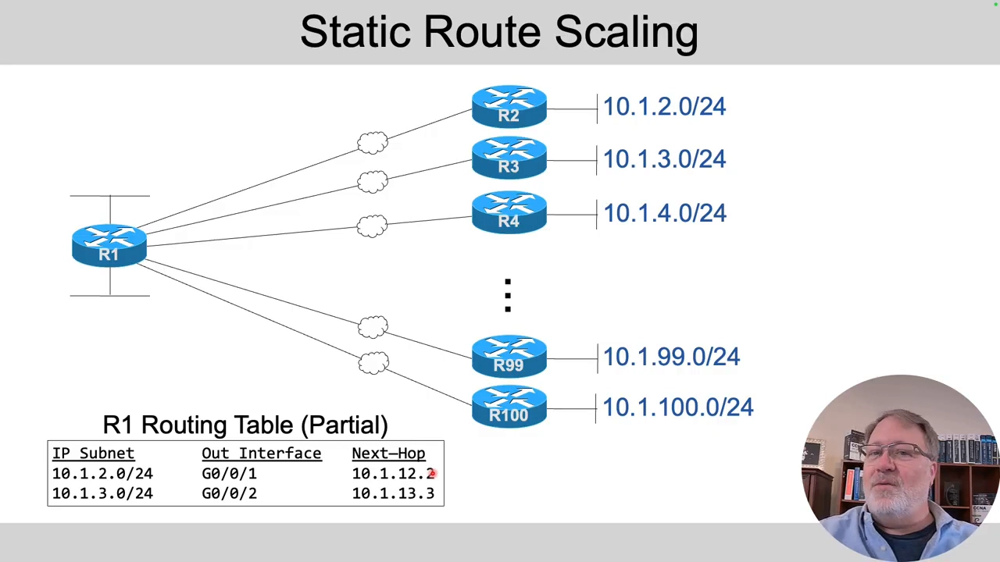

[【跳转到 04:39】](https://www.youtube.com/watch?v=a_TdHxqMaGo&t=279)

100 × 100 = **10,000 条配置命令**；200 台对 200 个子网是 40,000 条；500 台对 2,000 个子网是一百万条。完全不可行，所以实际网络都用**动态路由协议**。

动态协议的运转方式：R2 直连着 10.1.2.0/24（这类路由叫 connected route，不用协议就有），然后通过路由协议**把这个路由通告（advertise）给邻居 R1**——报文里带上子网 ID、掩码和一个度量值（metric，代表"这条路有多好"）：

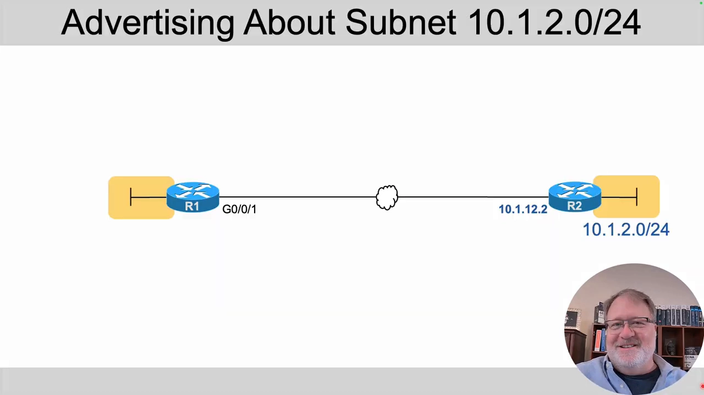

[【跳转到 05:11】](https://www.youtube.com/watch?v=a_TdHxqMaGo&t=311)

R1 据此在自己的表里生成那条我们熟悉的路由，再转发给下一台路由器，**每传一跳，metric 就加一点**——离子网越远的路由器，拿到的 metric 越高。视频归纳了动态路由协议的四大职责：

1. **通告路由、学习路由**；
2. 学到多条路径时，**选 metric 最低的那条**当最佳路由；
3. 拓扑变化时**重新收敛（convergence）**——比如 R1 原本直连 R3 取 10.1.3.0/24，链路断了，协议自动改走经过 R4 的路：

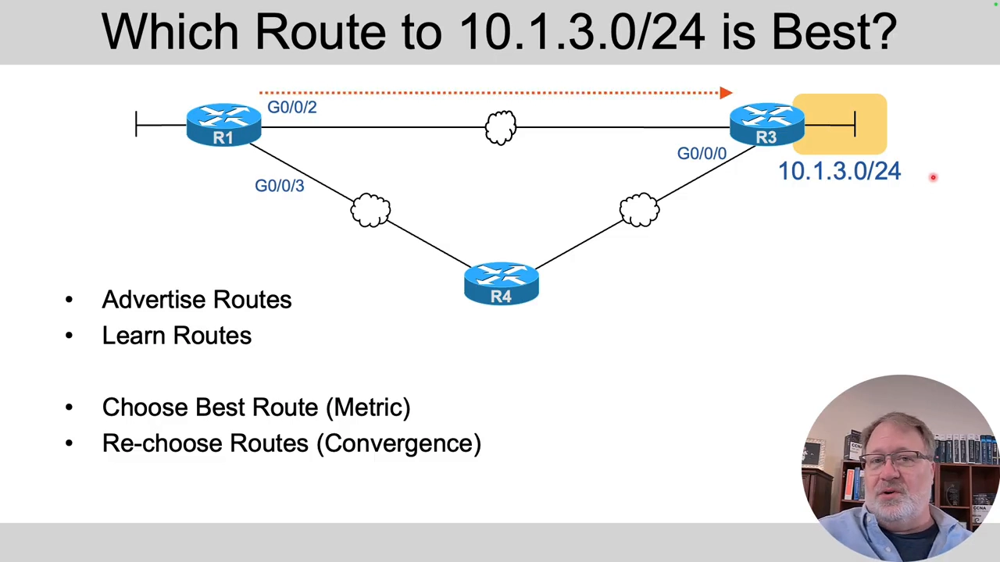

[【跳转到 07:41】](https://www.youtube.com/watch?v=a_TdHxqMaGo&t=461)

（第四点是对前三点的持续维护，视频里与收敛一并讲。）

## 四、主机的路由逻辑：只有两个分支

别以为只有路由器懂路由——**主机也有路由逻辑，也有自己的路由表**，只是极简。主机 A 配好 IP 和掩码后，会自己算出所在子网的子网 ID（10.1.1.0），在表里加一条"本链路（on-link）"路由；发包时判断只有两个分支：

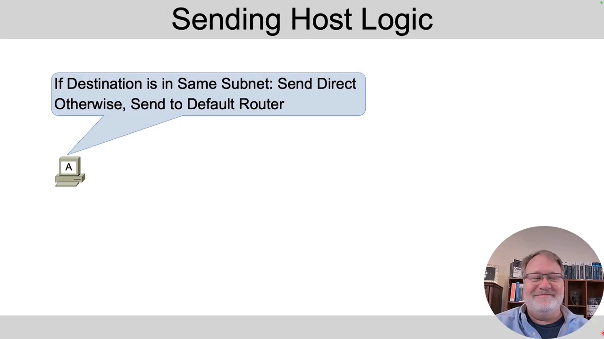

[【跳转到 08:22】](https://www.youtube.com/watch?v=a_TdHxqMaGo&t=502)

- **目的地址在本子网内** → 直接把帧发给对方主机。比如 A 发给同子网的 B：以太网帧的目的 MAC 就填 **B 的 MAC**，局域网交换机把帧转过去，B 收到的就是原始 IP 包；
- **目的地址不在本子网** → 把包交给**默认路由器（default router，俗称默认网关）**，指望它知道后续的路。

A 发给远端的 server 21 时，它并不关心对方有多远，只知道自己 IP + 掩码算出的本地子网不覆盖 10.1.2.21——"不是本地的"，于是走第二个分支：

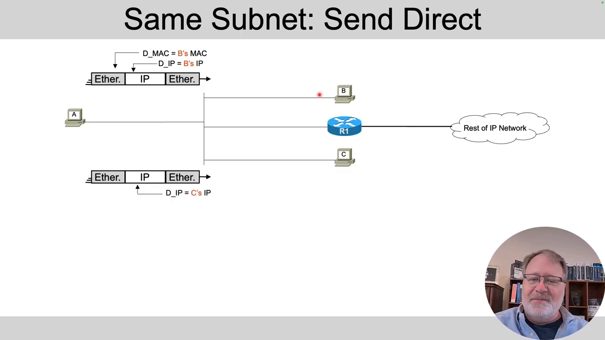

[【跳转到 10:27】](https://www.youtube.com/watch?v=a_TdHxqMaGo&t=627)

主机 A 一开机就会建好一条匹配"其他所有地址"的默认路由，下一跳就是网关 R1。

## 五、关键细节：目的 MAC 写网关，目的 IP 写终点

包要过以太网，必须套上二层帧。现在 A 要把包送到 server 21：IP 头里的目的地址是 **server 21 的 IP**，但以太网帧的目的 MAC 填的却是**网关 R1 接口的 MAC**：

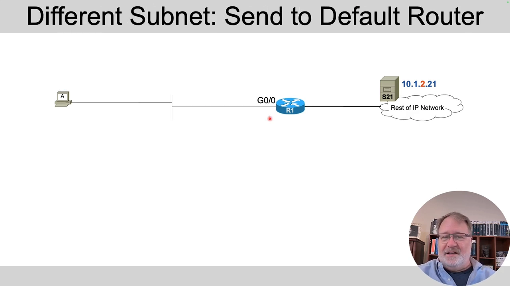

[【跳转到 11:35】](https://www.youtube.com/watch?v=a_TdHxqMaGo&t=695)

为什么？因为**路由器转发时会把这个以太网帧头整个拆掉**（de-encapsulation），取出里面的 IP 包，查表后再套一个**新**的帧头发往下一站。帧的使命从来不是"把包送到终点"，而是"**把包送过这一段链路、交给下一台路由器**"：

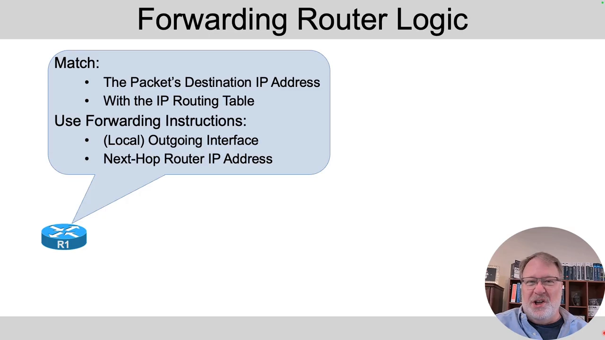

[【跳转到 12:55】](https://www.youtube.com/watch?v=a_TdHxqMaGo&t=775)

到了 R1，查表：目的 10.1.2.21 命中 10.1.2.0/24 那条路由，出接口 G0/1、下一跳是 R2 在链路上的接口地址。于是 R1 把 IP 包重新装进新以太网帧，**这个帧的目的 MAC 是 R2 接口的 MAC**：

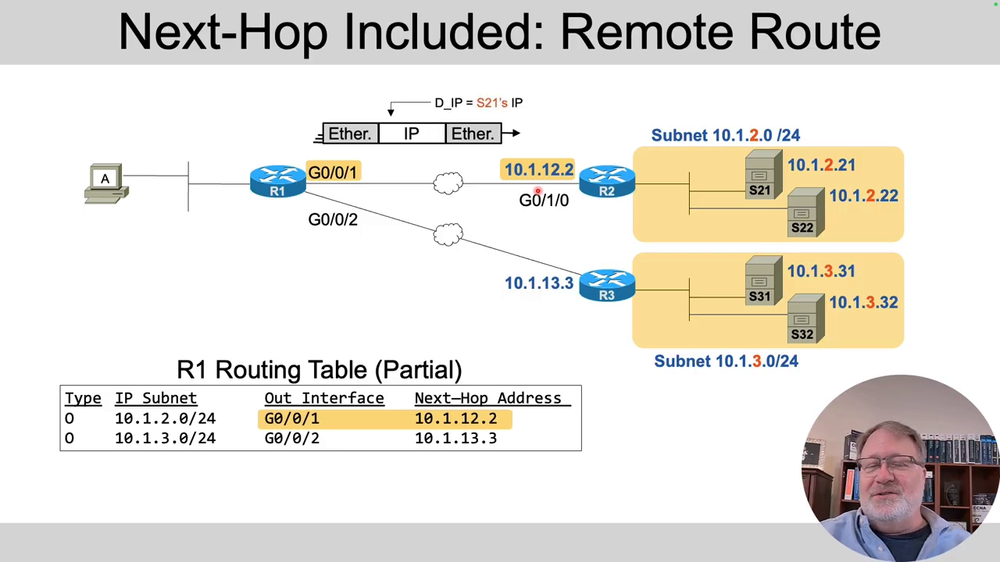

[【跳转到 14:45】](https://www.youtube.com/watch?v=a_TdHxqMaGo&t=885)

R2 收到后照旧拆帧、查表。这时表里是 **connected route（直连路由，命令行里显示为 C）**：只有出接口、**没有下一跳**——因为目的地就在直连的链路上，不用再交给谁：

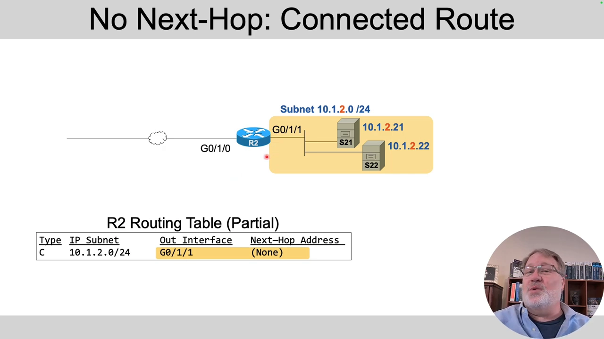

[【跳转到 15:35】](https://www.youtube.com/watch?v=a_TdHxqMaGo&t=935)

最后一步，R2 从直连接口把包直接发给 server 21，这一帧的目的 MAC 终于是**终点主机自己的 MAC**：

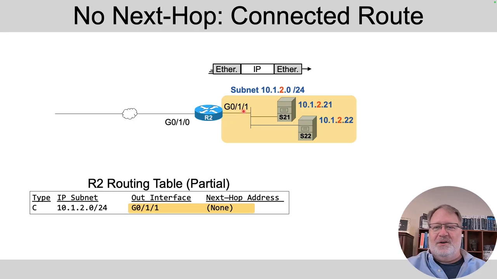

[【跳转到 16:25】](https://www.youtube.com/watch?v=a_TdHxqMaGo&t=985)

## 六、小结：一张图记住整条路

- **主机**：同子网 → 帧的目的 MAC = 对方主机；不同子网 → 帧的目的 MAC = 默认网关，包交给网关。
- **路由器**：收包 → 拆掉二层帧 → 用**目的 IP** 匹配路由表（一条记录匹配一个子网）→ 按出接口 + 下一跳**重新封装** → 发给下一跳。
- **每一跳都在换帧头**：目的 MAC 一站一换（网关 → 下一跳路由器 → …… → 终点主机），目的 IP 从始至终不变。
- **路由表条目从哪来**：直连自动生成，静态手敲，动态路由协议自动通告（还能自动收敛），规模大的网络只能靠后者。

在 Linux/容器场景里，这套逻辑原样发生在主机协议栈中：容器发出的包先过主机路由表决定"走容器网桥还是默认网关"，而"下一跳的 MAC 是多少"这个问题，正是由 ARP 回答的——详见《[ARP 工作原理及完整实验](ARP工作原理及完整实验.md)》。
