# 路由表是什么：数据包怎么知道该从哪个口出去

> 本文整理自 YouTube 视频《[Routing Tables | CCNA - Explained](https://www.youtube.com/watch?v=CGmTvukObOw)》（约 13 分钟，PowerCert Animated Videos 的动画讲解系列）。视频用"两台路由器、四个网络"的最小拓扑，把路由表的三个来源——**直连路由、静态路由、动态路由**——逐一讲透：直连路由是接口配上 IP 后自动出现的，静态路由要管理员手工一条条敲，动态路由则由路由器之间互相"交换"得来。读完本篇再读姊妹篇《[IP 路由到底怎么走：主机逻辑、路由器逻辑与逐跳封装](How_IP_Routing_Actually_Works.md)》，就能串起"查表 → 转发"的完整逻辑；《[ARP 工作原理及完整实验](ARP工作原理及完整实验.md)》解释帧在链路上如何真正送达。

## 本讲要解决的核心问题（SCQA）

**背景**：互联网是无数个网络的互联，数据包几乎总要跨网络才能到达目的地，中间负责"摆渡"的设备是路由器。

**冲突**：路由器怎么知道发往 `10.0.0.2` 的包该从哪个接口送出去？它又不可能记住世界上每一台主机的位置。

**疑问**：路由表里到底写了什么？这些条目从哪里来？谁来维护？

**回答（中心思想）**：路由表是一份"**目的网络 → 从哪个接口转发 / 交给哪个下一跳**"的规则表，数据包每到一站，路由器就查一次表。条目有三个来源：**直连路由**（接口配好 IP 自动生成）、**静态路由**（管理员手工配置）、**动态路由**（路由器之间用路由协议自动交换）。

## 一、路由表：路由器的导航地图

路由器架在网络的"路口"上，专管把数据从一个网络送到另一个网络。它做决策的依据就是路由表：

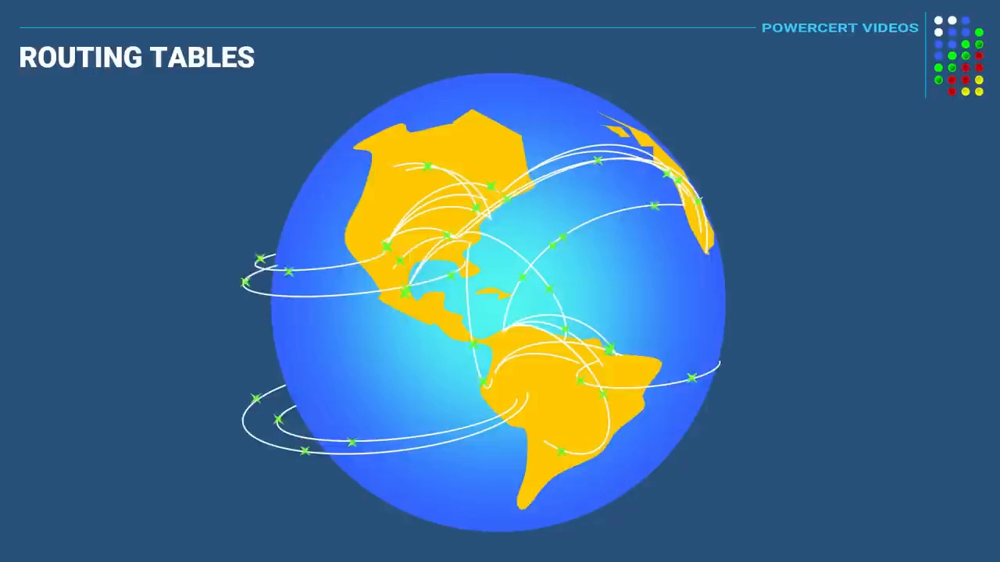

[【跳转到 00:05】](https://www.youtube.com/watch?v=CGmTvukObOw&t=5)

视频给的定义很直白：**路由表是一个包含一组规则的文件，写明数据包去往目的地该走哪条路**。数据包到达路由器时，路由器查表，把包沿着最佳路径转发出去——就像开车去陌生地方要先查导航：

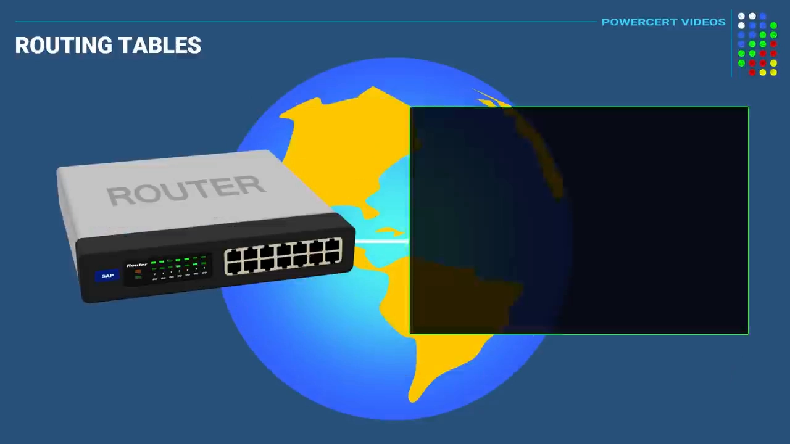

[【跳转到 00:24】](https://www.youtube.com/watch?v=CGmTvukObOw&t=24)

而这张表里的路线，来自下面三种方式。

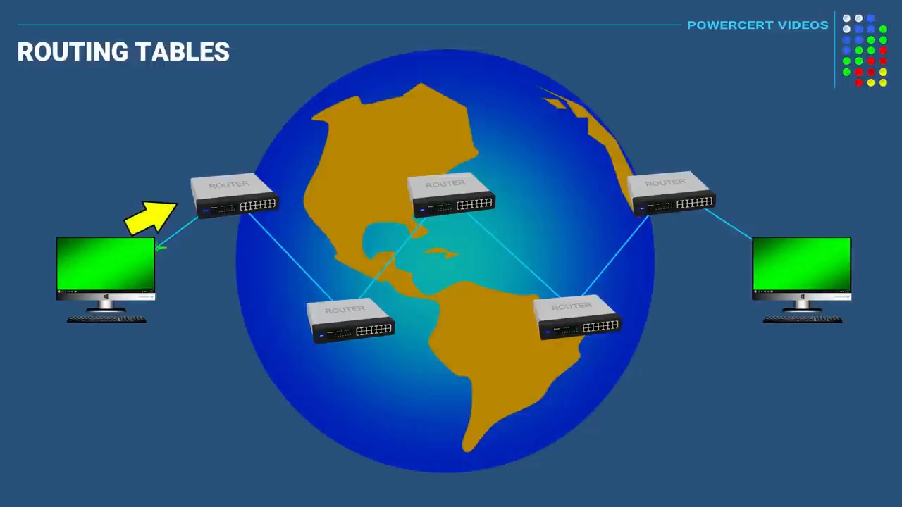

[【跳转到 01:08】](https://www.youtube.com/watch?v=CGmTvukObOw&t=68)

## 二、来源一：直连路由——配好接口就自动出现

先看最简单的场景：两个网络被一台路由器隔开，左边用 `192.168.0.0` 网段，右边用 `10.0.0.0` 网段，各自的主机只能跟同网段的机器通信：

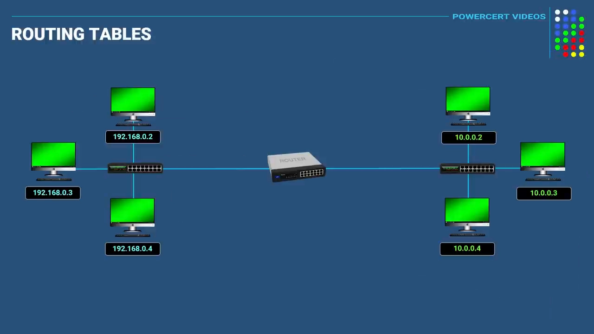

[【跳转到 01:25】](https://www.youtube.com/watch?v=CGmTvukObOw&t=85)

路由器用两个接口分别接入两边：Ethernet 0 接 192 网络，Ethernet 1 接 10 网络。给这两个接口分别配上对应网段的 IP 地址和子网掩码之后——

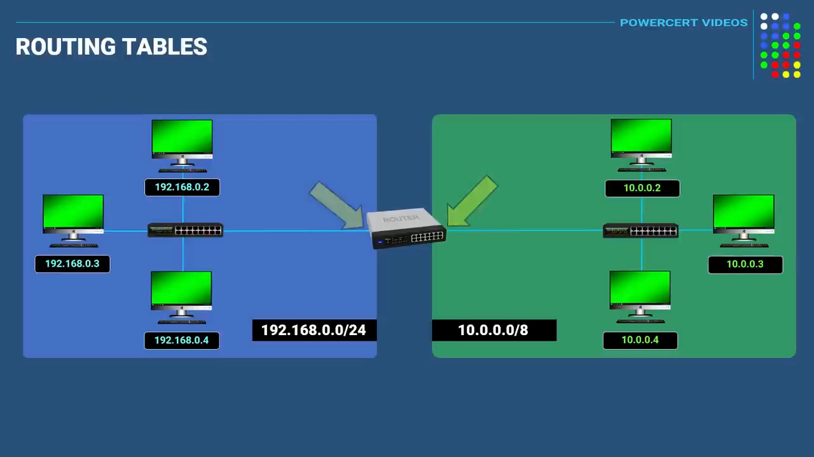

[【跳转到 02:20】](https://www.youtube.com/watch?v=CGmTvukObOw&t=140)

**路由器会自动生成直连路由（directly connected routes）**：凡是直接接在某个接口上的网络，表里自动多一条记录。此时查路由表，能看到 192 网络接在 E0、10 网络接在 E1：

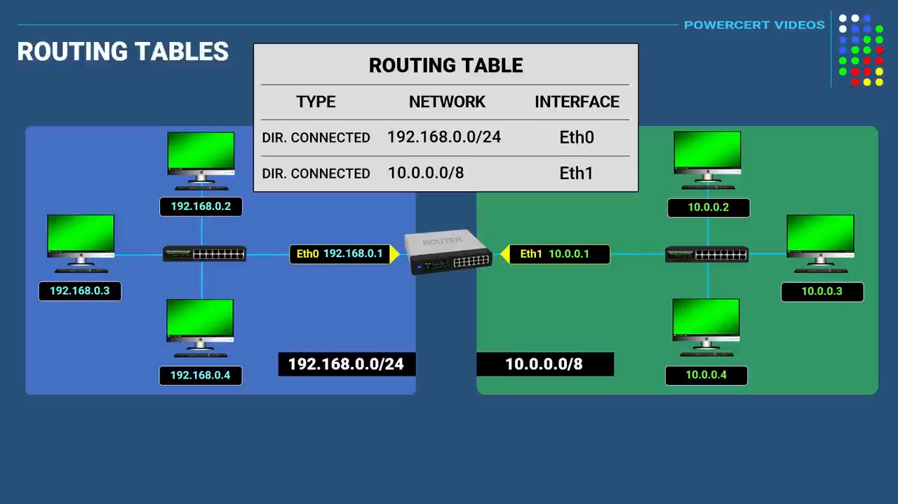

[【跳转到 02:50】](https://www.youtube.com/watch?v=CGmTvukObOw&t=170)

转发过程随之打通：192 网络的主机要访问 `10.0.0.2`，包先送到路由器；路由器看目的 IP 是 10 网段的，查表命中直连路由，把包从 E1 口送出去：

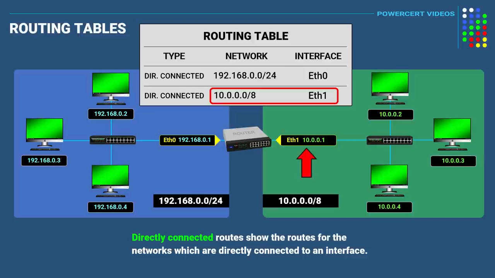

[【跳转到 03:15】](https://www.youtube.com/watch?v=CGmTvukObOw&t=195)

这就是路由表最基本的工作方式：**看目的地址 → 查表 → 从匹配的接口发出去**。

## 三、直连路由的盲区：表里没有 = 世界不存在

再把拓扑加大一点：接上第二台路由器和第三个网络 `174.16.0.0`。注意一个细节——**两台路由器之间的链路本身也要占一个网段（125.0.0.0）**，哪怕这条链路上没有主机；所以现在实际上一共有四个网络：

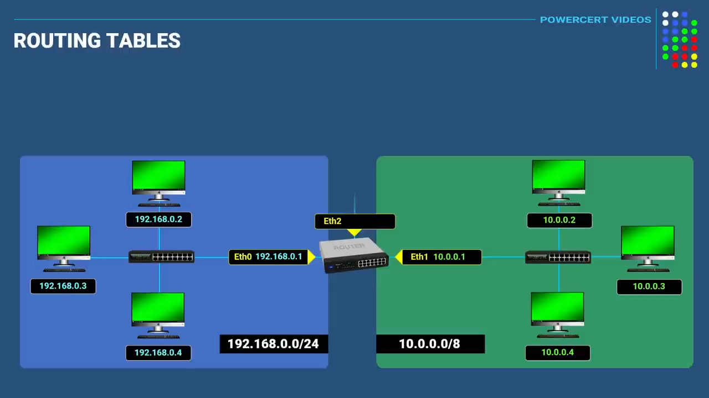

[【跳转到 04:04】](https://www.youtube.com/watch?v=CGmTvukObOw&t=244)

问题来了：左边 192 网络的主机想访问 174 网络的主机，包送到第一台路由器后，路由器查表——**直连路由里只有 192、10、125 三个网段，没有 174**。路由器的态度很干脆：表里没有，就当这个网络不存在，直接丢包：

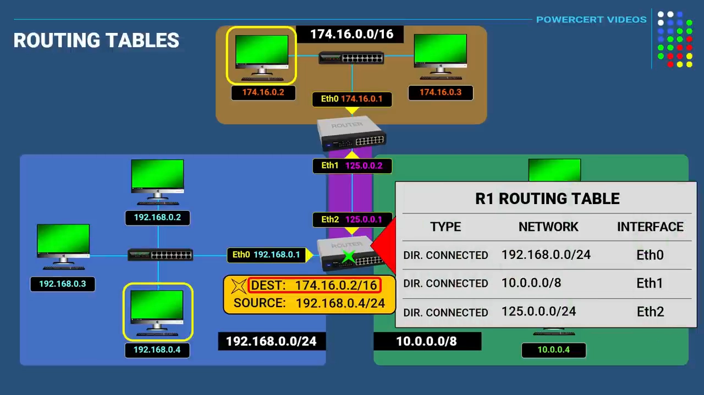

[【跳转到 05:55】](https://www.youtube.com/watch?v=CGmTvukObOw&t=555)

这就是直连路由的边界：它只负责"门口那几个网"。要去更远的地方，得往表里添条目。

## 四、来源二：静态路由——管理员手工指路

静态路由（static route）由网络管理员手工配置。给第一台路由器加一条：**目的网络 `174.16.0.0` + 掩码位数 + 下一跳 IP**——下一跳就是去往 174 网络要经过的下一站，即第二台路由器在 125 链路上的接口地址 `125.0.0.2`：

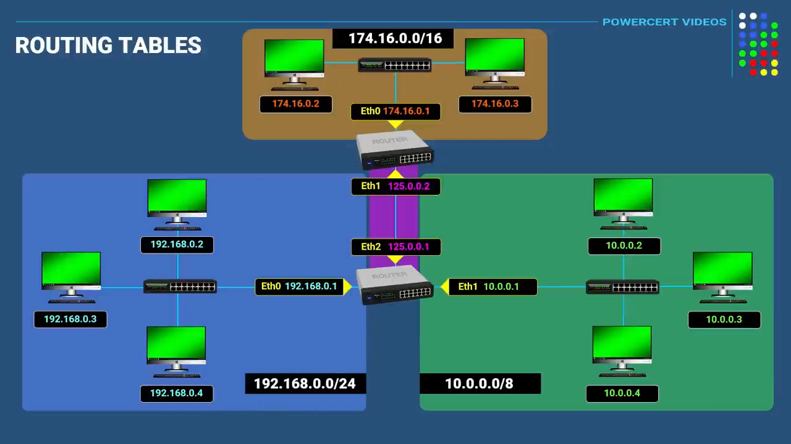

[【跳转到 06:28】](https://www.youtube.com/watch?v=CGmTvukObOw&t=388)

现在 192 网络再发往 `174.16.0.2` 的包，第一台路由器查表命中静态路由，把包**转发给下一跳** `125.0.0.2`；第二台路由器收到后，174 网络正好是它的直连网络，于是送达目标主机：

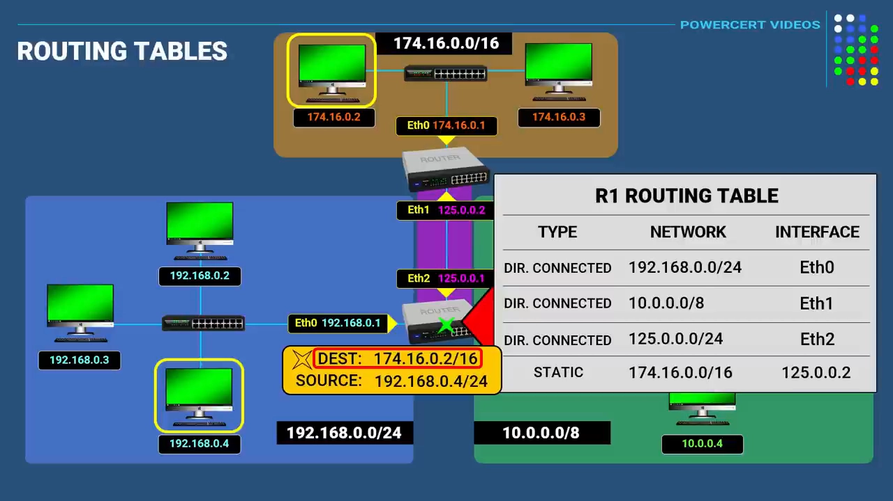

[【跳转到 07:48】](https://www.youtube.com/watch?v=CGmTvukObOw&t=468)

但注意：**此时只有去程，没有回程**。174 网络要回包给 192 网络，必须在第二台路由器上反向再配一条静态路由（目的 `192.168.0.0`，下一跳 `125.0.0.1`）：

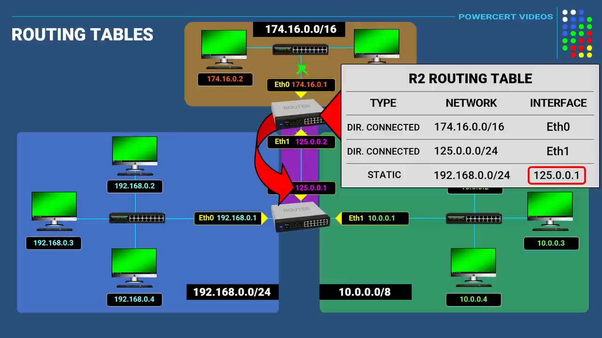

[【跳转到 09:14】](https://www.youtube.com/watch?v=CGmTvukObOw&t=554)

同理，174 与 10 网络之间想在两个方向都通，也要把缺的静态路由补上。全部配完后，四个网络之间才能真正两两互通：

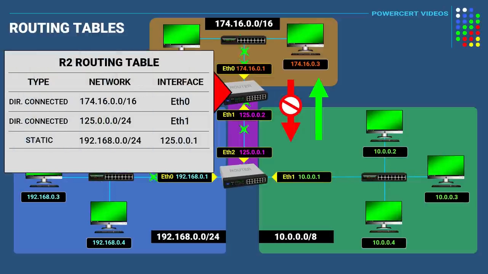

[【跳转到 09:51】](https://www.youtube.com/watch?v=CGmTvukObOw&t=591)

## 五、来源三：动态路由——路由器之间互相"通气"

网络一大，手工配静态路由就不现实了。动态路由（dynamic route）的条目不是人敲进去的，而是**邻居路由器自动送上门的**——靠的是动态路由协议，常见的有 RIP、OSPF、BGP、IS-IS、EIGRP：

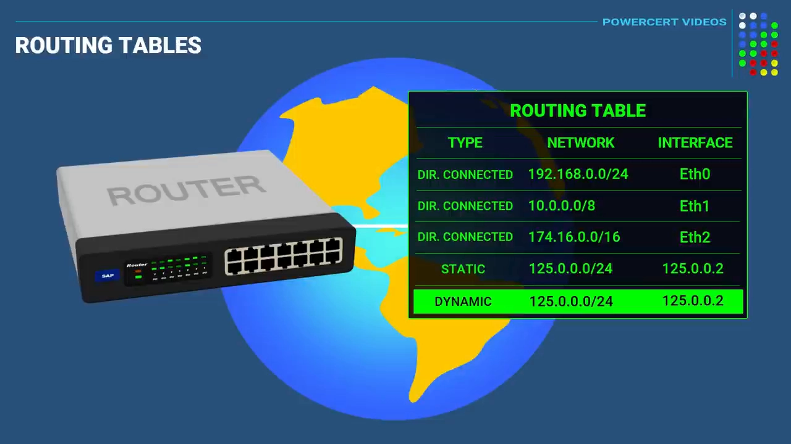

[【跳转到 10:20】](https://www.youtube.com/watch?v=CGmTvukObOw&t=620)

做法是：把前面手敲的静态路由删掉，改在两台路由器上运行动态路由协议。路由器之间会互相交换各自的路由表——第一台路由器把 192、10 网络的信息"告诉"第二台，第二台把 174 网络的信息"告诉"第一台，效果与静态路由完全一样，但全程自动：

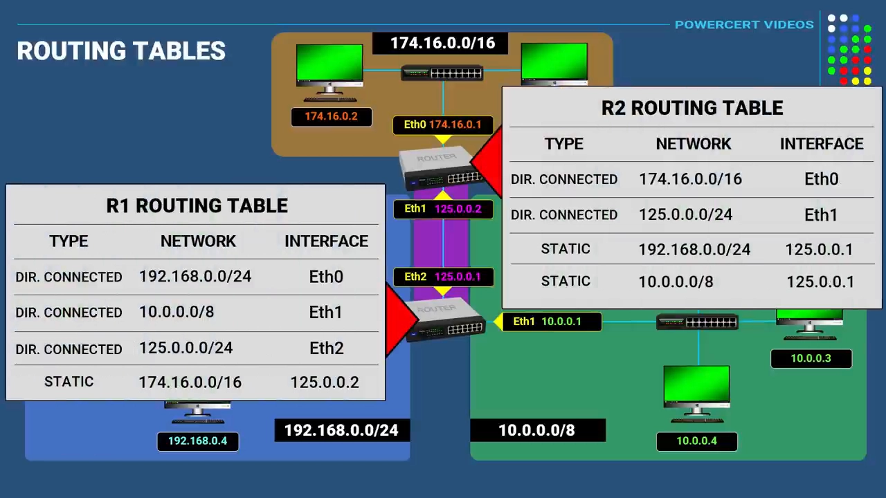

[【跳转到 10:58】](https://www.youtube.com/watch?v=CGmTvukObOw&t=658)

## 六、小结

- **路由表 = 规则文件**：数据包到达路由器 → 查目的 IP → 沿匹配条目指的接口/下一跳转发。
- **直连路由**：接口配上 IP + 掩码后自动生成，只覆盖路由器"门口"的网络；表里没有的目的地会被直接丢弃。
- **静态路由**：管理员手工添加"目的网络 + 下一跳"；必须按方向逐条配齐，去程回程各一条。
- **动态路由**：路由协议让邻居路由器自动交换路由信息，规模越大越能体现价值。

在 Linux 主机上，这套机制的本地版本就是内核里的路由表（`ip route` 可以查看）——本系列的容器主题里，容器网络正是靠主机路由表与网关把包送出/送入容器的。下一步，读《[IP 路由到底怎么走：主机逻辑、路由器逻辑与逐跳封装](How_IP_Routing_Actually_Works.md)》看清楚每一跳上"查表 + 重新封装"的细节。
