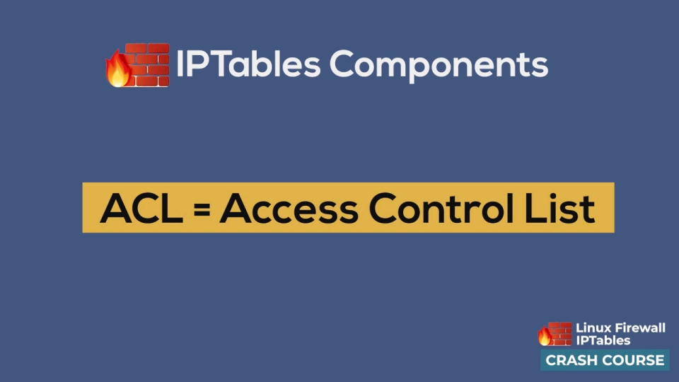
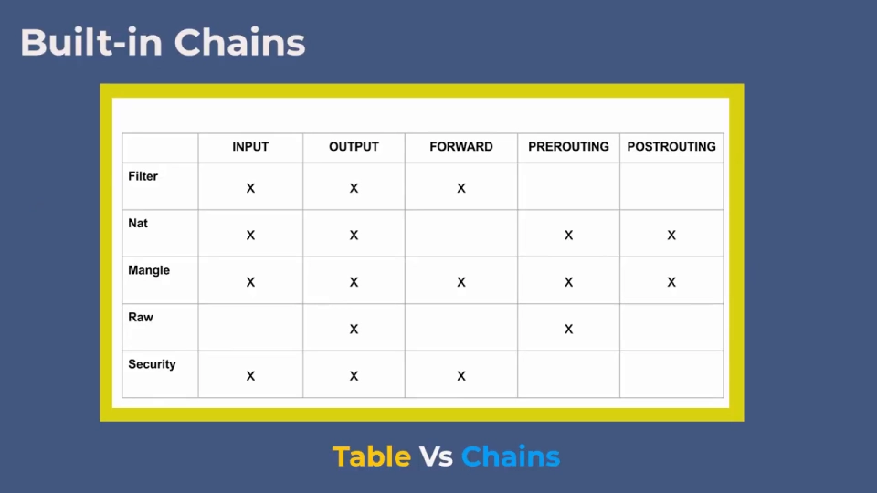
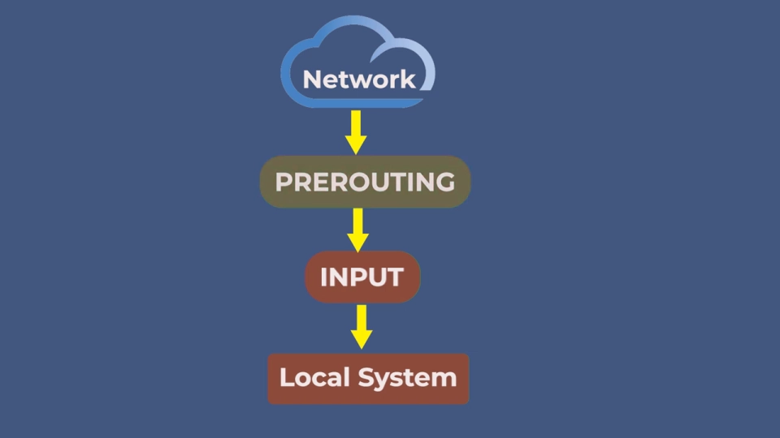
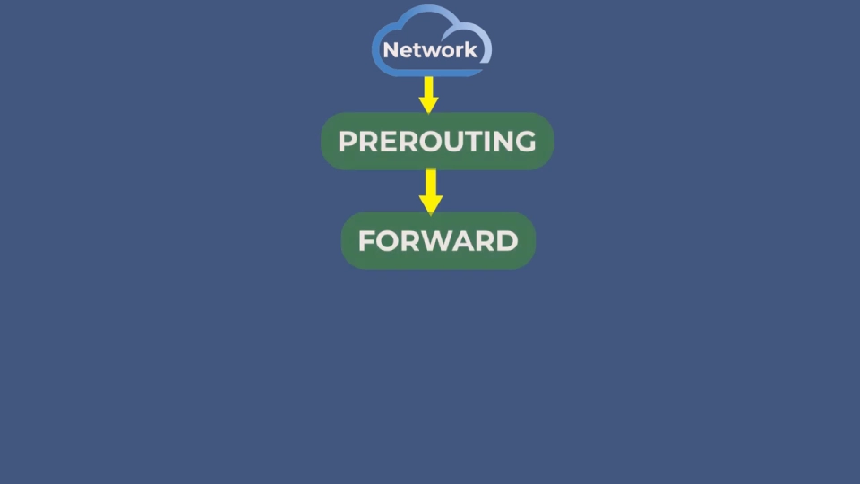
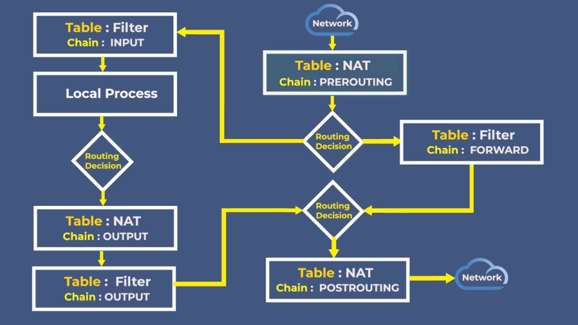
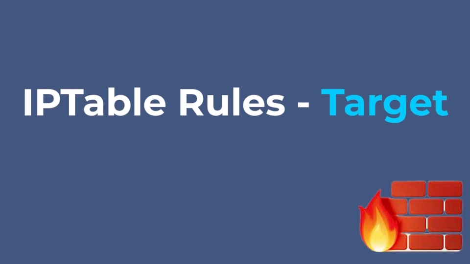

# iptables 防火墙入门：五张表、五条链与数据包的真实流向

> 本文整理自 YouTube 视频《[IPTables FIREWALL: How Packets REALLY Flow (Visual!)](https://www.youtube.com/watch?v=kvNBZhWg4gE)》（约 10.5 分钟，NetworkCoder 频道的 Linux 防火墙速成课，全程配可视化图示）。视频回答一个初学者最常卡住的问题：iptables 里的**表、链、规则**到底怎么分工，一个数据包进入 Linux 后**按什么顺序**穿过哪些检查点。包是怎么到达网卡的，见姊妹篇《[网卡、网桥与链路层](../1.4.1_网卡、网桥与链路层/Understanding_Linux_Network_Interfaces.md)》；包在检查点之间怎么决定去向，见《[路由表与 ARP](../1.4.2_路由表与ARP/How_IP_Routing_Actually_Works.md)》；中文视角的钩子全景，见《[流量进网卡瞬间谁在把守](流量进网卡瞬间谁在把守Linux_Netfilter防火墙完整拆解.md)》。

## 本讲要解决的核心问题（SCQA）

**背景**：Linux 主机暴露在网络上，数据包不停地进出网卡。前两讲已经解决"包怎么进来"（网卡、网桥）和"包往哪去"（路由表）。

**冲突**：光有路由还不够——哪些包该放行、哪些该拦截、哪些要改写地址？总得在内核的处理路径上"设卡检查"。

**疑问**：检查点设在内核里的哪些位置？规则怎么组织才不会乱成一团？一个包到底按什么顺序经过这些检查？

**回答（中心思想）**：Linux 防火墙由两部分组成——内核里的 **netfilter** 框架负责在协议栈上设检查点，命令行工具 **iptables** 负责往检查点上写规则；规则按"**表 → 链 → 规则**"三层组织；而数据包的流向只有**三条主路径**（进本机、路过转发、本机发出），每条路径按固定顺序穿过固定的表和链。

## 一、防火墙的两半：内核里的 netfilter，命令行上的 iptables

防火墙的本职是**阻止未经授权的网络访问**。Linux 内置防火墙分成两部分：

- **netfilter**：内核里的框架，真正执行检查的地方；
- **iptables**：一个命令行工具，用来配置 netfilter 防火墙——本质上由一系列**表**组成，用于检查内核里的 IP 包。

两者合在一起构成 Linux 防火墙的地基。视频里有个很实用的判断：**只要会用 iptables 配置 netfilter，市面上其他防火墙产品基本都能上手**，因为它们大多是同一套思想的封装。

[【跳转到 01:20】](https://www.youtube.com/watch?v=kvNBZhWg4gE&t=80)

## 二、规则的三层组织：表 → 链 → 规则

netfilter 用**表**来组织自己的访问控制规则。iptables 的基本结构是：**若干张预定义的表，每张表包含若干条链，每条链是一串规则**。包到达时，iptables 找到合适的表，然后**沿着链逐条跑规则，直到找到匹配**为止。

[【跳转到 02:18】](https://www.youtube.com/watch?v=kvNBZhWg4gE&t=138)

[【跳转到 02:57】](https://www.youtube.com/watch?v=kvNBZhWg4gE&t=177)

标准配置里有**五张表**，每张按"决策类型"分工：

| 表 | 职责 | 典型用途 |
| --- | --- | --- |
| **filter** | 过滤放行/阻断，**最常用** | 拦截入站连接、禁止出站连接 |
| **nat** | 网络地址转换（NAT 把一个 IP 地址空间映射到另一个） | 多台机器/虚拟机共享一个公网 IP |
| **mangle** | 改写数据包本身 | 改 TTL 等包字段 |
| **raw** | 让包**豁免连接跟踪**（很少用） | 高性能场景跳过状态记录 |
| **security** | 强制访问控制（MAC）规则 | 由 Linux 安全模块（LSM）实现 |

注意一个限制：**表不能自建**——五张是写死在框架里的；但链可以自建（见第三节）。

## 三、五条内置链：大小写敏感的检查点

表是按"决策类型"分的，而**链决定规则在什么时机被评估**。iptables 有五条内置链：

**INPUT、OUTPUT、FORWARD、PREROUTING、POSTROUTING**。

一个容易踩的坑：链名**全大写且大小写敏感**——想引用 INPUT 链就必须写大写。

[【跳转到 04:44】](https://www.youtube.com/watch?v=kvNBZhWg4gE&t=284)

每张表只用其中一部分链：**filter** 用 INPUT/FORWARD/OUTPUT；**nat** 用 PREROUTING/INPUT/OUTPUT/POSTROUTING；**mangle** 五条全用；**raw** 只用 PREROUTING/OUTPUT；**security** 用 INPUT/OUTPUT/FORWARD。

和表不同，**链可以自建**。视频给了一个典型例子：建一条 `log-and-drop` 链，先记录"这个包要被丢弃"，再真正丢弃——这样既执行了拦截，又留下了**审计轨迹**，方便排障。

[【跳转到 05:06】](https://www.youtube.com/watch?v=kvNBZhWg4gE&t=306)

## 四、数据包的真实流向：只有三条主路径

这是全片的核心。假设没有任何规则拦截，把 netfilter 的**所有检查点**画出来，任何包的走向都能归入三种场景：

[【跳转到 06:04】](https://www.youtube.com/watch?v=kvNBZhWg4gE&t=364)

1. **发给本机的包**：进网卡 → 过 **PREROUTING** 链 → 查路由表发现"目的地就是本机" → 进 **INPUT** 链 → 交付本机；
2. **路过的包**（本机当路由器/转发器）：过 **PREROUTING** → 路由发现"目的地是别的机器" → 进 **FORWARD** → 过 **POSTROUTING** → 离开本机；
3. **本机自己发出的包**：过 **OUTPUT** 链 → 过 **POSTROUTING** → 离开本机。

[【跳转到 06:29】](https://www.youtube.com/watch?v=kvNBZhWg4gE&t=389)

[【跳转到 06:54】](https://www.youtube.com/watch?v=kvNBZhWg4gE&t=414)

把"链的穿越顺序"和"表的优先级"合起来，才是完整的执行序列。完整图里 raw、mangle、security 都要经过，但日常很少碰它们，所以视频给了一张**简化路径图**：入站包先经 **nat 表的 PREROUTING**，再按路由结果走 **filter 表的 INPUT**（发本机）或 **FORWARD**（转发）；本机发出的包走 **nat OUTPUT → filter OUTPUT → nat POSTROUTING** 后离机。

[【跳转到 07:39】](https://www.youtube.com/watch?v=kvNBZhWg4gE&t=459)

## 五、规则怎么写：匹配条件 + 执行动作

规则必须放进"某张表的某条链"里，每条规则由两部分组成：

- **匹配部分（matching）**：定义包必须满足什么条件才触发动作。可用的维度有五类——**协议**（TCP/UDP/ICMP 等）、**源 IP/源网段**、**目的 IP/目的网段**、**源端口/目的端口**、**进出网络接口**（ingress/egress）；
- **目标部分（target）**：包匹配后执行什么——可以是**内置目标**（如 ACCEPT/DROP），也可以是**另一条链的名字**（跳转过去继续匹配）。

[【跳转到 08:35】](https://www.youtube.com/watch?v=kvNBZhWg4gE&t=515)

条件可以只用一个，也可以组合多个。例如"**来自 1.2.3.4 的、目的端口 80 的 TCP 包**"就是三个条件的组合；只要有一个条件不满足，这个包就算 unmatched，**接着看链里的下一条规则**——这就是"逐条尝试"的含义。

[【跳转到 09:30】](https://www.youtube.com/watch?v=kvNBZhWg4gE&t=570)

## 小结

- Linux 防火墙 = 内核 **netfilter**（执行框架）+ **iptables**（配置前端）；
- 规则三层组织：**表按决策类型分类 → 链决定评估时机 → 规则 = 匹配条件 + 目标动作**；
- 五张表：filter（过滤）、nat（地址转换）、mangle（改包）、raw（豁免连接跟踪）、security（MAC）；表不可自建，链可以；
- 五条内置链：PREROUTING/INPUT/FORWARD/OUTPUT/POSTROUTING，全大写、大小写敏感；
- 包的流向只有三条主路径：**进本机走 INPUT，路过走 FORWARD，本机发出走 OUTPUT**，PREROUTING/POSTROUTING 分别把守进出关口；
- 规则匹配不上就沿链看下一条；会用 iptables，其他防火墙产品都是熟人。

## 关键术语速查

| 术语 | 一句话解释 |
| --- | --- |
| netfilter | Linux 内核里的防火墙框架，在协议栈上提供检查点 |
| iptables | 配置 netfilter 的命令行工具，由若干张表组成 |
| 表（table） | 按决策类型分类的规则集合（filter/nat/mangle/raw/security） |
| 链（chain） | 一串规则的容器，决定规则在包流程的哪个时机被评估；可自建 |
| 规则（rule） | 匹配条件 + 目标动作，挂在链里自上而下逐条尝试 |
| PREROUTING | 路由决策**之前**的检查点，入站包必经 |
| POSTROUTING | 包离开系统**之前**的最后一个检查点 |
| FORWARD | 只处理"路过本机"的转发包 |
| NAT | 网络地址转换，把一个 IP 空间映射到另一个，实现地址共享 |
| target | 规则命中后执行的动作：内置目标（ACCEPT/DROP 等）或链名 |
