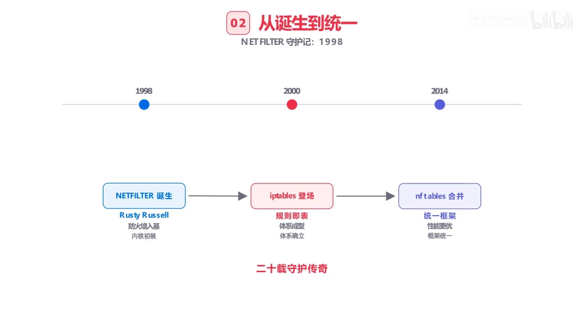
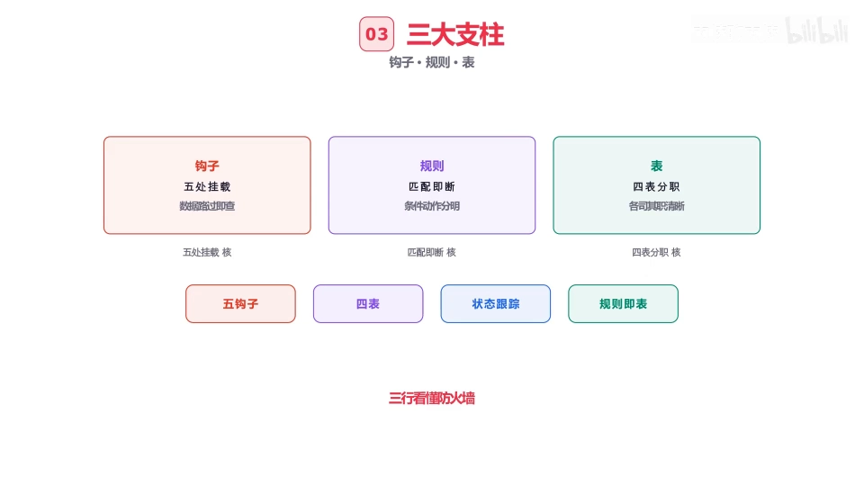
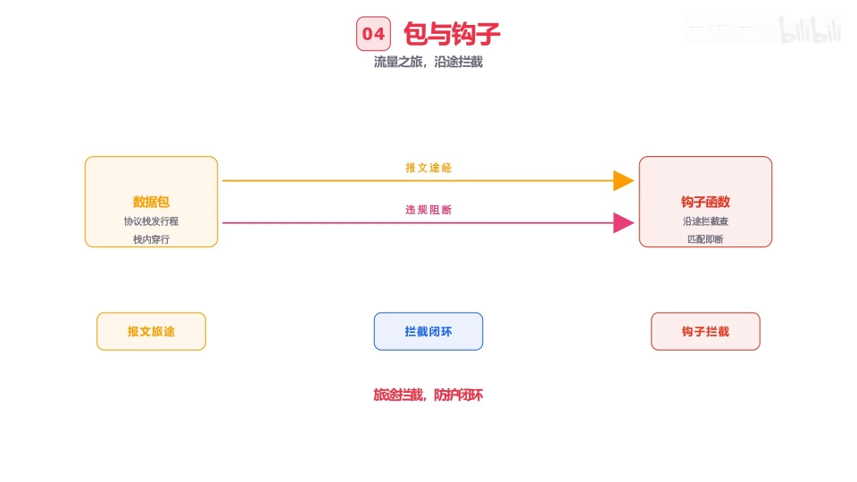
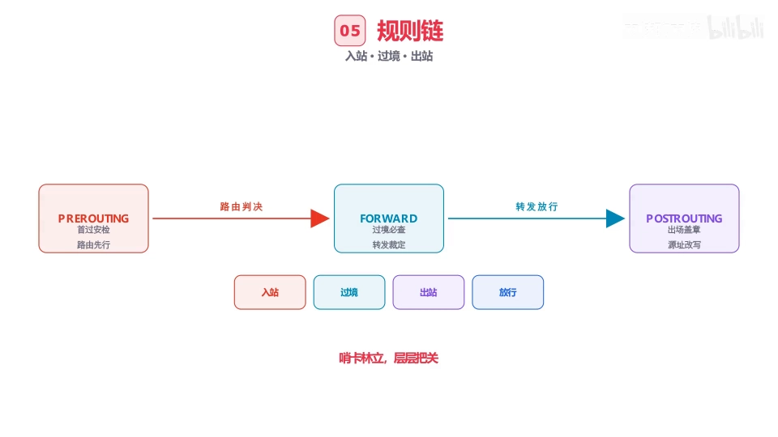
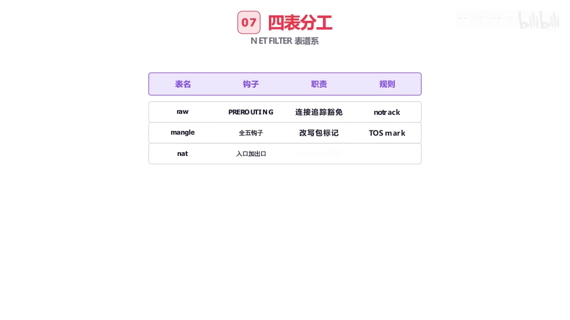
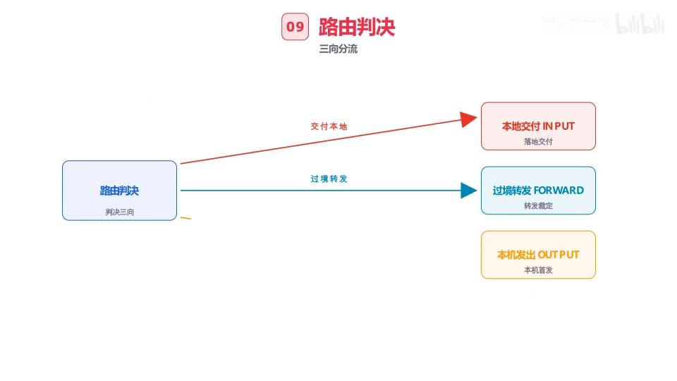
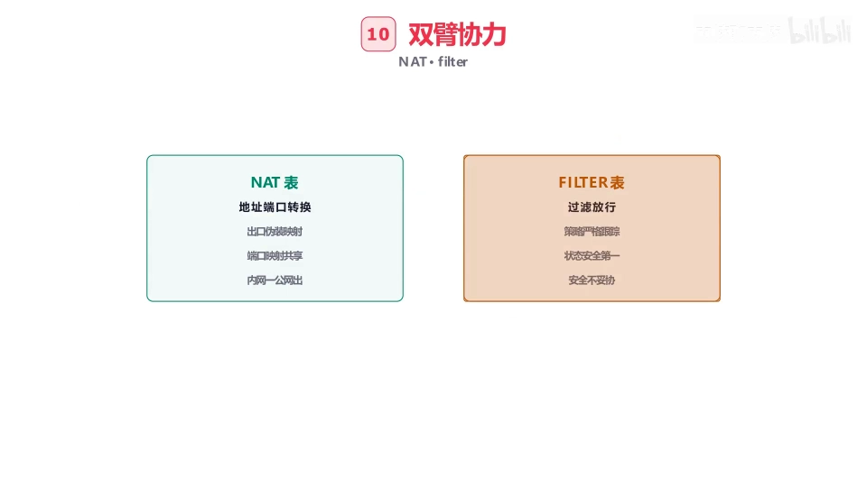
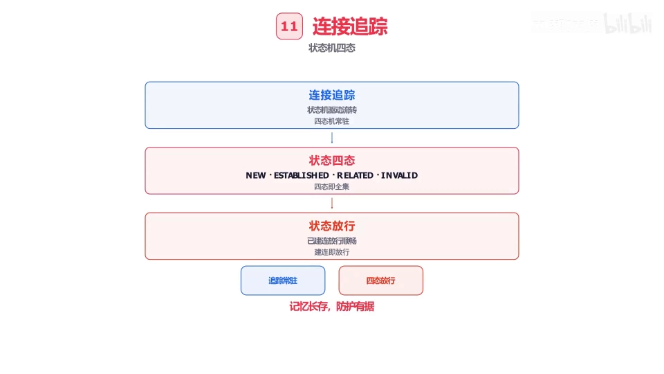
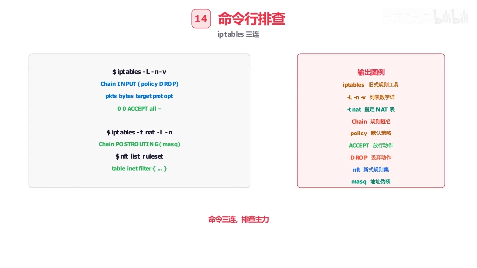

# Netfilter 拆解：五道钩子挂协议栈，四张表各司其职

> 本文整理自 B 站视频《[流量进网卡瞬间谁在把守？Linux Netfilter 防火墙完整拆解！](https://www.bilibili.com/video/BV1TunV6TE6s/)》（约 6 分钟，「内核聊内核」频道的动画拆解视频，AI 字幕错拼较多，已按上下文逐一纠正，如 EPITBOX→iptables、ANTBOX→nftables、roll 表→raw 表、陆游→路由）。视频用动画把 netfilter 的**钩子、表、规则、连接跟踪**串成一张全景图。表、链与包流向的英文系统课，见姊妹篇《[iptables 防火墙入门：五张表、五条链与数据包的真实流向](IPTables_FIREWALL_How_Packets_REALLY_Flow_Visual.md)》；包怎么进网卡，见《[网卡、网桥与链路层](../1.4.1_网卡、网桥与链路层/Understanding_Linux_Network_Interfaces.md)》；钩子之间怎么决定包的去向，见《[路由表与 ARP](../1.4.2_路由表与ARP/How_IP_Routing_Actually_Works.md)》。

## 本讲要解决的核心问题（SCQA）

**背景**：数据包从网卡进入内核，路由表决定它往哪走（前两讲的内容）。

**冲突**：可"往哪走"不等于"能不能走"——总得有人在内核路径上判断：谁放行、谁拦截、谁要改写地址？而且规则一多，执行顺序乱了就全盘失控。

**疑问**：内核靠什么机制把检查点布满协议栈？规则怎么排才不乱？防火墙怎么记住"哪个连接是熟客"？

**回答（中心思想）**：netfilter 在协议栈上挂了**五道钩子**，数据包路过即被查验；规则装进**四张表**各司其职；每条链里规则**自上而下、命中即止**，遍历未尽由**默认策略兜底**；路由判决把包分成 INPUT/FORWARD/OUTPUT 三路；连接跟踪用 **NEW / ESTABLISHED / RELATED / INVALID** 四个状态记住每一个连接。

## 一、20 年家谱：一个框架的三个节点

netfilter 的历史浓缩成三行时间轴：

[【跳转到 00:25】](https://www.bilibili.com/video/BV1TunV6TE6s/?t=25)

- **1998 年**：netfilter 诞生，Rusty Russell 奠基；
- **2000 年**：iptables 登场，"规则 + 表"从此成体系；
- **2014 年**：nftables 合并进内核，统一框架、优化性能。

它的设计哲学也只要三行：**钩子是起点，规则是载体，表是归宿**——钩子决定"在哪里查"，规则决定"查什么、怎么处理"，表决定"这批规则归哪类管"。

## 二、五道钩子：挂在协议栈上的哨卡

没有钩子，数据包就会**长驱直入协议栈**，发起流量之旅；有了钩子，钩子函数沿途拦截，报文一路被查验，违规流量即刻阻断。数据路过即查验，规则匹配即动作，条件分明、增删自如——这就是"钩子是起点"的含义：

[【跳转到 00:50】](https://www.bilibili.com/video/BV1TunV6TE6s/?t=50)

用"哨卡"来记这五道钩子最直观：

[【跳转到 01:15】](https://www.bilibili.com/video/BV1TunV6TE6s/?t=75)

[【跳转到 01:40】](https://www.bilibili.com/video/BV1TunV6TE6s/?t=100)

- **PREROUTING**（路由前安检）：数据包刚进网卡、还没查路由，先过这道卡；
- **INPUT**（落地交付）：路由判定"这包是发给本机的"，交付前再查一道；
- **FORWARD**（转发必查）：包只是路过本机，转发路上必查；
- **OUTPUT**（本机首发）：本机自己发出的包，出场先查；
- **POSTROUTING**（路由后盖章）：包离开系统前的最后一道卡。

## 三、四张表：各司其职，职责清晰不越权

规则匹配在钩子处发生，但规则本身要归入某张表。四张表的分工：

[【跳转到 02:05】](https://www.bilibili.com/video/BV1TunV6TE6s/?t=125)

| 表 | 职责 | 典型动作 |
| --- | --- | --- |
| **raw** | 豁免连接跟踪 | 打 NOTRACK 标记，让包不走状态记录 |
| **mangle** | 改写数据包 | 改包标记、TOS 服务分级 |
| **nat** | 转换地址端口 | DNAT/SNAT、MASQUERADE 伪装出口 |
| **filter** | 过滤放行 | ACCEPT 策略落定，或 DROP 丢弃 |

数据路过即查验，条件分明、增删自如——这就是"表是归宿"的含义：每个规则总有归属，每张表职责清晰不越权。

## 四、规则链机制：自上而下，命中即止，策略兜底

规则链是防火墙的精髓，执行规则只有三条：

[【跳转到 02:30】](https://www.bilibili.com/video/BV1TunV6TE6s/?t=150)

1. **自上而下逐条匹配**：条件满足即执行动作，**命中即止，不再下行**；
2. **跳转与返回**：规则可以跳到自定义链，处理完再返回，环环相扣；
3. **默认策略兜底**：遍历整条链都没有规则命中，就交给链的默认策略（policy）定音——DROP 或 ACCEPT，一锤定音。

## 五、路由判决：流量的岔口

数据包过了 PREROUTING 之后，内核做**路由判决**，把流量一分为三：

[【跳转到 02:55】](https://www.bilibili.com/video/BV1TunV6TE6s/?t=175)

- **本地交付**：目的地就是本机 → 走 INPUT，交付给本机进程；
- **过境转发**：目的地是别的机器 → 走 FORWARD，转发路必查；
- **本机发出**：包由本机产生 → 走 OUTPUT，首发出去。

岔口分明，流量有序。注意：路由判决本身不是钩子，只是钩子之间的一个决策过程。

## 六、连接跟踪：防火墙的记忆，四态状态机

nat 和 filter 是防火墙的双壁：**nat 表**转换地址端口、出口伪装、让内网共享一个公网 IP；**filter 表**过滤放行、策略严格、状态跟踪。其中"状态跟踪"靠的是**连接追踪（conntrack）**——防火墙的记忆，状态机驱动四态流转：

[【跳转到 03:20】](https://www.bilibili.com/video/BV1TunV6TE6s/?t=200)

[【跳转到 03:45】](https://www.bilibili.com/video/BV1TunV6TE6s/?t=225)

- **NEW**：新建连接，第一次露面，记一笔；
- **ESTABLISHED**：已建立连接，双向来往的"熟客"；
- **RELATED**：关联报文——由已有连接派生出来的新连接（如 FTP 数据连接）；
- **INVALID**：异常报文，判为非法即刻丢弃，不手软。

有了记忆，规则就能按状态放行："只放行 ESTABLISHED 的回包"这类有状态策略才成为可能。

## 七、攻防场景与命令行排查

防火墙的对手也很具体：**SYN 洪水**泛洪能把连接表灌满、整机瘫痪；**端口扫描**探测漏洞；**信息泄漏**风险时刻存在。对策是入侵检测盯异常、限速、丢弃，防御为本。

[【跳转到 05:00】](https://www.bilibili.com/video/BV1TunV6TE6s/?t=300)

命令行排查是管理员的听诊器：

- `iptables -L`：列表规则尽收眼底；
- `iptables -t nat -L`：查 nat 表的地址转换，一目了然；
- `nft list ruleset`：nftables 一条命令列举整个规则集。

新旧框架并行的今天，选型看需求：**iptables 生态成熟稳定**，老派管理员首选；**nftables 统一框架**、性能与语法更优，代表先进性。场景定工具，够用就是最好。

## 小结

- netfilter 三节点家谱：1998 诞生、2000 iptables 成体系、2014 nftables 统一框架；
- 设计哲学：**钩子是起点，规则是载体，表是归宿**；
- 五道钩子挂协议栈：PREROUTING / INPUT / FORWARD / OUTPUT / POSTROUTING，进站、过境、出站各有必经之路；
- 四张表各司其职：raw 豁免跟踪、mangle 改包、nat 转地址、filter 管放行；
- 链内规则自上而下、命中即止，遍历未尽默认策略兜底；
- 路由判决把流量分成 INPUT/FORWARD/OUTPUT 三路；
- 连接跟踪四态：NEW、ESTABLISHED、RELATED、INVALID——防火墙靠它记住"熟客"。

## 关键术语速查

| 术语 | 一句话解释 |
| --- | --- |
| netfilter | Linux 内核防火墙框架，在协议栈上提供钩子检查点 |
| 钩子（hook） | 协议栈上的检查点，包路过即被查验 |
| PREROUTING | 路由判决前的钩子，入站包必经 |
| POSTROUTING | 包离开系统前最后一个钩子 |
| raw 表 | 豁免连接跟踪的表（NOTRACK） |
| mangle 表 | 改写包内容（标记、TOS）的表 |
| nat 表 | 转换地址端口、MASQUERADE 伪装的表 |
| filter 表 | 过滤放行/阻断的表 |
| 默认策略（policy） | 链内规则全未命中时的兜底动作（ACCEPT/DROP） |
| conntrack | 连接跟踪机制，给每个连接记状态 |
| NEW / ESTABLISHED / RELATED / INVALID | 连接四态：新建 / 已建立 / 关联 / 非法 |
| nftables | 2014 年合并进内核的新一代统一防火墙框架 |
