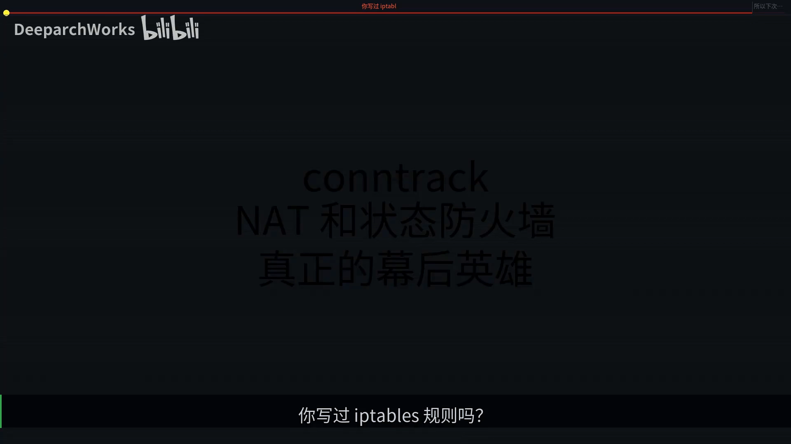
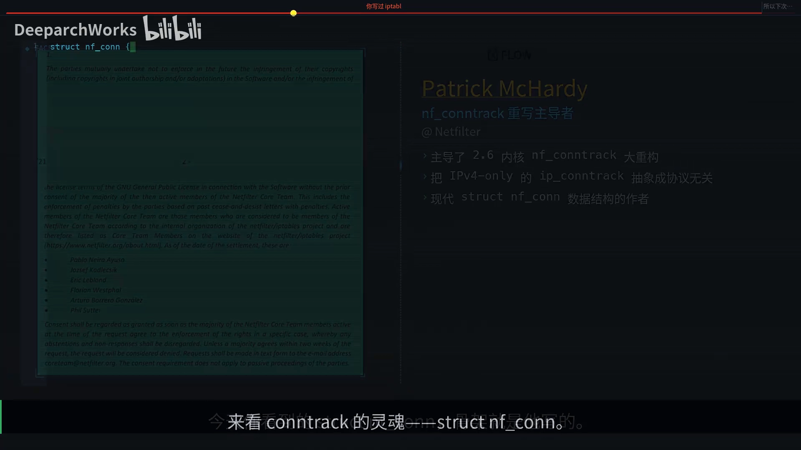
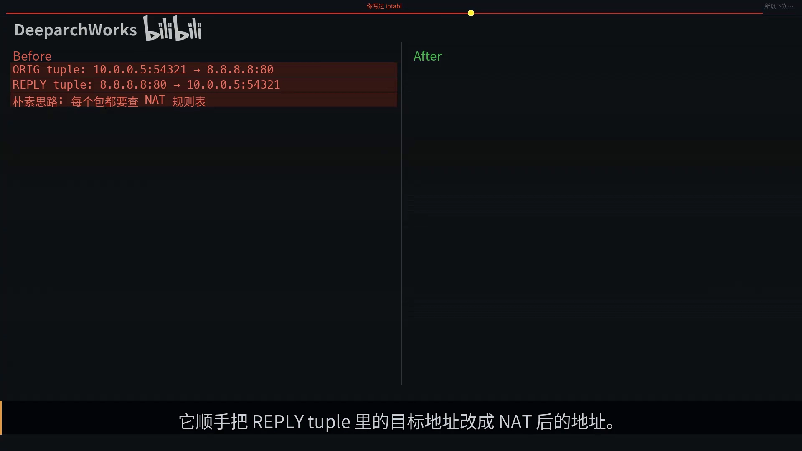
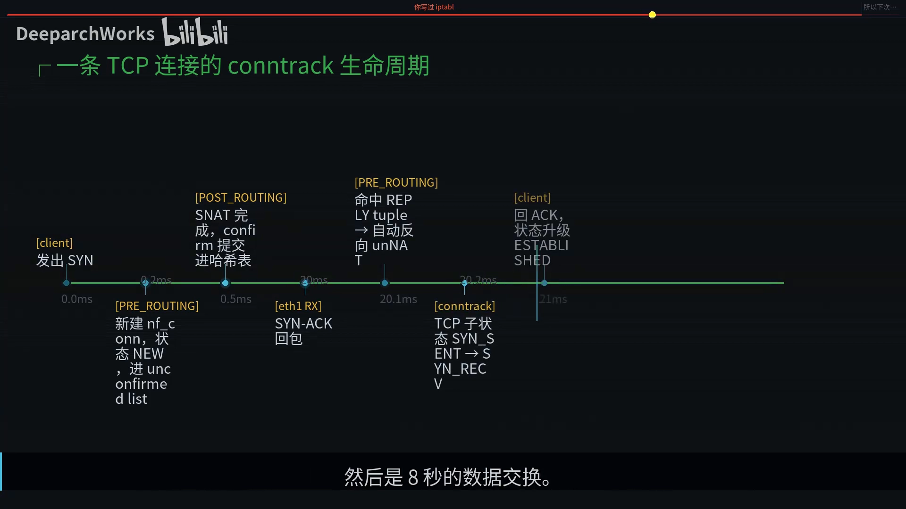
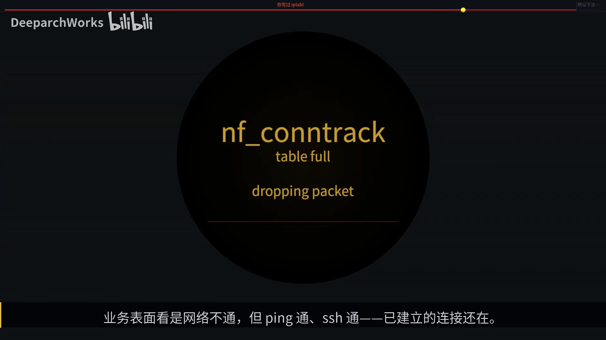
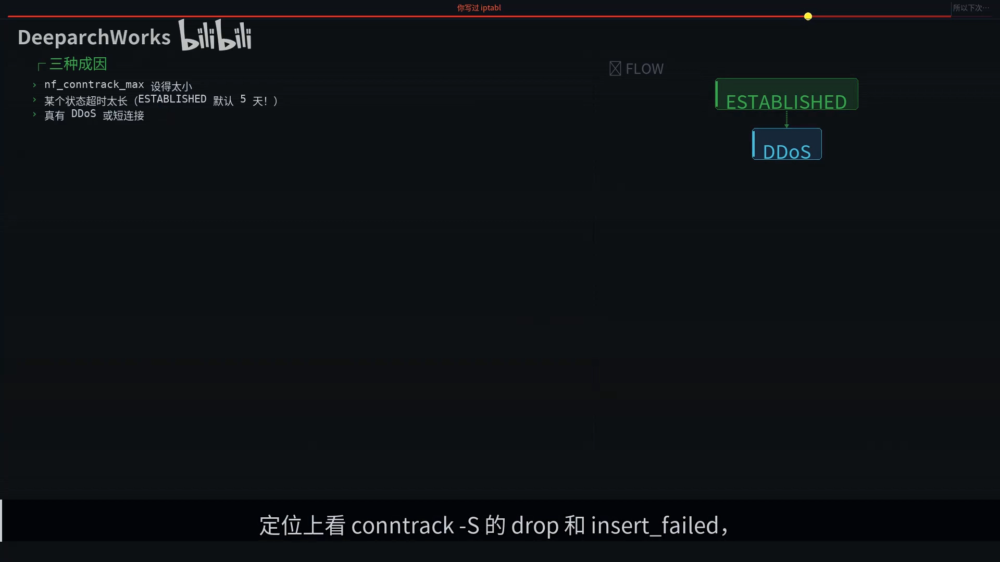
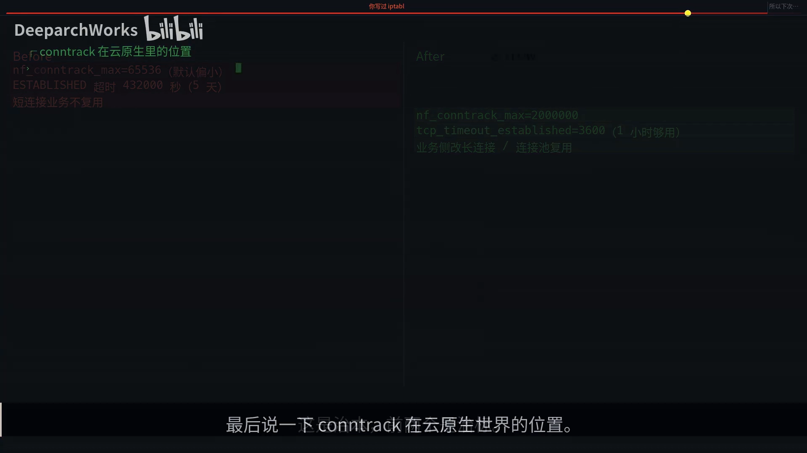

# conntrack：NAT 和状态防火墙的幕后英雄

> 视频来源：B 站 UP 主「DeeparchWorks」[《conntrack连接跟踪NAT和状态防火墙的幕后英雄》](https://www.bilibili.com/video/BV1s29YBBEqT/)（9 分 18 秒）。本文基于视频字幕与画面整理，内容均可在原视频核查。

## 本讲要解决的核心问题（SCQA）

**背景**：你写过 iptables 规则，敲过那一行 `state ESTABLISHED,RELATED accept`；你跑过 Docker，也跑过 Kubernetes。[【跳转到 00:00】](https://www.bilibili.com/video/BV1s29YBBEqT/?t=0)

**冲突**：这些事情之所以能工作，全靠 Linux 内核里一个你从来没正眼看过的子系统——**nf_conntrack（连接跟踪）**。而它的容量是一张**内核哈希表**：表只要满了，新连接就建不起来。

**疑问**：连接跟踪到底是什么？它怎么支撑状态防火墙和 NAT？为什么几乎**所有云原生网络故障**最后都能追溯到它？

**回答（中心思想）**：conntrack 是挂在 netfilter 钩子上的「连接登记处」：一条连接的档案是 `struct nf_conn`，靠**原始/回程两个 tuple** 记录方向，在 **PREROUTING 登记、POSTROUTING 提交**；NAT 与状态匹配的全部魔法都建立在这张全局哈希表之上——表满，整个网络栈就会跟你「说再见」。

## 一、酒店前台：conntrack 干的是什么

想象你开了一家酒店：每来一位客人，前台都要在大本子上记一行——证件号、房号、入住时间；客人之后每次进出大堂、点外卖、收快递，前台都翻本子核对身份；客人退房，前台在那行画上删除线，房间腾给下一位。

**conntrack 干的就是前台这件事，只不过它登记的不是客人，是网络连接。**[【跳转到 00:25】](https://www.bilibili.com/video/BV1s29YBBEqT/?t=25)

把类比的角色一一对上：[【跳转到 00:50】](https://www.bilibili.com/video/BV1s29YBBEqT/?t=50)

| 酒店前台 | conntrack |
| --- | --- |
| 新客人登记入住 | 收到 **SYN** 包，建一条 nf_conntrack 条目 |
| 每次进出核对身份 | 包到达 **PREROUTING** 时查哈希表 |
| 退房销账 | **FIN** 来了之后销毁条目 |
| 登记本写满 | dmesg 出现 `nf_conntrack: table full, dropping packet` |

## 二、挂在 netfilter 上：两段式登记，像两阶段提交

conntrack 不是独立子系统，而是挂在 **netfilter 框架**上的钩子函数。一个数据包从网卡进来到出去，要穿过五个 hook 点，conntrack 在其中两个点做关键介入：[【跳转到 01:15】](https://www.bilibili.com/video/BV1s29YBBEqT/?t=75)

- **PREROUTING**（进门）：负责「试着登记」；
- **POSTROUTING**（出门）：负责「真正归档」。

为什么建条目要拆成两步？因为包进来之后，路由可能 drop 它，防火墙也可能 drop 它——要是先把条目挂进全局哈希表、包随后被 drop，哈希表就「脏」了。

所以 conntrack 用了一个特别经典的设计：**Unconfirmed list**。包在 PREROUTING 先「预定」，等走到 POSTROUTING、真要发出去了，再 **confirm** 正式入表——这跟数据库的**两阶段提交**是一个味道。[【跳转到 01:40】](https://www.bilibili.com/video/BV1s29YBBEqT/?t=100)

## 三、三个名字：nf_conntrack 二十年的演进

conntrack 今天的样子，背后是三个关键人物：[【跳转到 01:43】](https://www.bilibili.com/video/BV1s29YBBEqT/?t=103)

- **Pablo Neira Ayuso**（西班牙）：当前 netfilter 项目核心维护者、新一代 **nftables** 的主要作者；内核里 conntrack 工具、helpers、接口表的现代化重写，大量代码与他直接相关；
- **Harald Welte**（德国）：2.4 内核时代真正把 conntrack **工程化**的人，netfilter 早期推动者，也是 GPL 合规与移动通信开源的旗手——没有他，今天的 iptables 长什么样很难说；
- **Patrick McHardy**：2.6 内核里那次让 conntrack 脱胎换骨的大重构的主要功臣——他把只支持 IPv4 的 **ip_conntrack** 抽象成协议无关的 **nf_conntrack**，让 IPv6、bridge、各种 L4 协议复用同一套连接跟踪逻辑；今天你看到的 `struct nf_conn` 骨架就是他写的。[【跳转到 02:22】](https://www.bilibili.com/video/BV1s29YBBEqT/?t=142)

## 四、struct nf_conn：双 tuple 是灵魂

来看 conntrack 的灵魂——`struct nf_conn`。最关键的不是它有多少字段，而是 **tuplehash：一个长度为 2 的数组**——两个 **tuple**（五元组元组），一个**原始方向**，一个**回程方向**，一条连接的档案就是它们俩。[【跳转到 02:43】](https://www.bilibili.com/video/BV1s29YBBEqT/?t=163)

重点来了：这两个 tuple 会被**同时插入同一张全局哈希表**，但都指向**同一个 nf_conn 节点**。这意味着无论去包还是回包，只要哈希命中，就能找到这条连接——而 **NAT 的所有魔法，全都藏在 reply tuple 这一处伏笔里**（下文第八节展开）。[【跳转到 03:08】](https://www.bilibili.com/video/BV1s29YBBEqT/?t=188)

## 五、查表为什么快：三个实现细节

conntrack 查表的核心函数有三个值得注意的细节，每一个都是「读优先」的教科书设计：[【跳转到 03:08】](https://www.bilibili.com/video/BV1s29YBBEqT/?t=188)

1. 整个**读路径在 RCU 保护下完全无锁**；
2. 用 **reciprocal_scale**（乘法加位移）代替取模运算，每个包省下几个 CPU 周期；
3. **扩容时换新表**：遍历到一半发现 bucket 变了，就跳到开头重试——查表绝不阻塞写入与扩容。

## 六、五个通用状态 + TCP 子状态机：conntrack 只是看客

conntrack 给每个包打的标签只有五个状态：[【跳转到 04:13】](https://www.bilibili.com/video/BV1s29YBBEqT/?t=253)

- **NEW**：第一次见到的连接；
- **ESTABLISHED**：双向都看到包了；
- **RELATED**：关联连接，比如 FTP 数据通道、ICMP error；
- **INVALID**：状态机判定不合法的；
- **UNTRACKED**：你显式 NOTRACK 跳过的。

你写的那行 `state ESTABLISHED,RELATED accept`，匹配的就是前面这几个状态。[【跳转到 04:38】](https://www.bilibili.com/video/BV1s29YBBEqT/?t=278)

TCP 比 UDP 复杂得多，conntrack 在 `nf_conntrack_proto_tcp.c` 里维护了一个完整的子状态机（11 个子状态）。但必须提醒一句：**这是 conntrack 在链路上看到包之后「猜」出来的状态，不是真正端点的 TCP 状态**——conntrack 只是个看客，它的状态机是包级别的近似。够用，但不要拿它替代真正的 TCP 调试。[【跳转到 04:38】](https://www.bilibili.com/video/BV1s29YBBEqT/?t=278)

## 七、NAT 的魔法：reply tuple 反向预埋

现在解开 NAT 的魔法。当一条连接被 NAT 时，conntrack 不光记原始方向，它**顺手把 reply tuple 里的目标地址改成 NAT 后的地址**。回包到达时，按 NAT 后的地址哈希就能**命中 reply tuple**，找到 nf_conn；看到 `IPS_DST_NAT` 标志，conntrack 顺手把目的地址**改回内网 IP**。[【跳转到 04:43】](https://www.bilibili.com/video/BV1s29YBBEqT/?t=283)

整个过程**只有第一个 SYN 真正跑了 NAT 规则**，后面的包全部走查表——这就是 Linux NAT 能抗住几百万 PPS 的根本原因。[【跳转到 05:08】](https://www.bilibili.com/video/BV1s29YBBEqT/?t=308)

## 八、helper/ALG：能读懂应用层，但只限明文

有些应用层协议比较「坏」——比如 **FTP、SIP、H.323**：控制连接里会临时协商出一个新端口用于数据传输，状态防火墙没法预先放行未知端口。怎么办？

conntrack 给了一个口子：**helper（也叫 ALG）**。它会解析控制连接的应用层内容，提前告诉 conntrack「等会儿有人按这个五元组来，你要把它标记成 RELATED」，这样防火墙就敢放行了。[【跳转到 05:53】](https://www.bilibili.com/video/BV1s29YBBEqT/?t=353)

但要注意：**helper 解析的是明文，对 HTTPS 完全无能为力**。

## 九、一条连接的一生：TIME_WAIT 要占表 120 秒

追一条最典型的连接，看它在 conntrack 眼里的一生：[【跳转到 06:18】](https://www.bilibili.com/video/BV1s29YBBEqT/?t=378)

- 前 0.5ms：建条目和 NAT 决策；
- 20ms：回包——reply tuple 哈希命中、自动反 NAT，子状态机推进；
- 几秒：数据交换；
- 然后 FIN 退出。

最让人意外的是最后一行：**TIME_WAIT 状态默认要等 120 秒才被 GC 真正擦掉**——这意味着每一条短连接在 conntrack 表里至少要占用两分钟。[【跳转到 06:43】](https://www.bilibili.com/video/BV1s29YBBEqT/?t=403)

## 十、表满：最难排查的「部分故障」

现在你知道为什么 `table full, dropping packet` 这行 dmesg 让无数运维做噩梦了。**conntrack 表满，意味着新连接的 SYN 全被 drop**；业务表面看似「网络不通」，但 ping 通、SSH 通、已建立的连接还在——这种**部分故障**最难排查。[【跳转到 06:43】](https://www.bilibili.com/video/BV1s29YBBEqT/?t=403)

表满有三种典型成因：[【跳转到 07:08】](https://www.bilibili.com/video/BV1s29YBBEqT/?t=428)

1. **max 参数**默认基于内存自动算，但不一定够你用；
2. **某些状态超时长得吓人**：established 默认**五天**，连接没正常关就一直占着位置；
3. **真的被打了**：DDoS、扫描、短连接风暴。

定位手段：看 `conntrack -S` 的 drop 和 insert_failed；看 `/proc/sys/net/netfilter/` 下 **count 与 max 的比例**。

应对方式无非三招：[【跳转到 07:33】](https://www.bilibili.com/video/BV1s29YBBEqT/?t=453)

1. **调大 max 和 buckets**（按四比一的比例）；
2. **缩短 established 超时**（一小时通常够了）；
3. **业务侧改长连接、连接池复用**，减少表项膨胀——这是治本，前两个是治标。

## 十一、conntrack 在云原生里的位置

- **kube-proxy 的 iptables 模式**之所以能工作，就是 cluster IP **DNAT 后的反向解地址**，全靠 conntrack 一手包办；
- conntrack 让**主备防火墙**能同步连接表、做无感切换；
- 而 **Cilium 和现代 sidecar 模式**则倾向**绕开 conntrack**，用 eBPF 自己管理连接状态——因为 conntrack 在某些极致性能场景反而成了瓶颈。[【跳转到 07:58】](https://www.bilibili.com/video/BV1s29YBBEqT/?t=478)

## 小结

- 一条连接的档案叫 **nf_conn**；两个 tuple——原始方向和回程方向；
- 五个 hook 中两个关键点：**PREROUTING 建条目、POSTROUTING 提交**（Unconfirmed list，两阶段提交）；
- 五个通用状态（NEW/ESTABLISHED/RELATED/INVALID/UNTRACKED）加 TCP 的 11 个子状态——但那是**包级别的近似**，conntrack 只是看客；
- **NAT 全靠 reply tuple 的反向预埋**：只有首个 SYN 跑规则，后续全走查表，因此能抗住几百万 PPS；
- helper 让它懂应用层语义，但**仅限明文**；RCU + hlist 让查表无锁高效；
- 一张表如果满了，整个网络栈就跟你说再见——记住那三招：**扩容、缩超时、业务侧复用**。

## 关键术语速查

| 术语 | 一句话解释 |
| --- | --- |
| nf_conntrack / conntrack | 内核连接跟踪子系统，给每条连接建档案、打状态标签 |
| netfilter | 内核包处理框架，提供五个 hook 点；conntrack 是挂在上面的钩子函数 |
| PREROUTING / POSTROUTING | conntrack 的两个关键介入点：试着登记 / 真正提交 |
| Unconfirmed list | 未确认条目列表：先预定、发包前 confirm，避免被 drop 的包弄脏全局表 |
| struct nf_conn | 一条连接的档案；tuplehash 数组存原始与回程两个 tuple |
| tuple | 五元组（协议、源/目的 IP、源/目的端口）；reply tuple 用于匹配回程包 |
| NEW / ESTABLISHED | 第一次见到的连接 / 双向都见过包的连接 |
| RELATED | 关联连接：如 FTP 数据通道、ICMP error |
| INVALID / UNTRACKED | 状态机判定不合法的包 / 显式 NOTRACK 跳过跟踪的连接 |
| IPS_DST_NAT | nf_conn 上的标志：回包需要把目的地址改回内网 IP |
| helper / ALG | 解析应用层控制连接、预告动态端口的辅助模块；只支持明文 |
| table full, dropping packet | 表满丢包：新连接 SYN 全被 drop，ping/SSH/老连接仍通的部分故障 |
| conntrack -S | 查看连接跟踪统计（drop、insert_failed 等）的命令行工具 |
