# socket 到底是什么？——从插头插座到内核 sock

> 视频来源：B 站 UP 主「小白debug」[《socket到底是什么？》](https://www.bilibili.com/video/BV12A411X7gY/)（8 分 35 秒）。本文基于视频字幕与画面整理，内容均可在原视频核查。

## 本讲要解决的核心问题（SCQA）

**背景**：做网络编程时我们每天都在用 socket——客户端 `connect`，服务端 `bind`/`listen`/`accept`，然后 `send`/`recv` 收发数据。

**冲突**：但对大多数人来说，socket 依然是个黑盒：它到底是协议？是文件？还是一条连接？

**疑问**：socket 在内核里到底是什么？应用程序调用 socket 时，真正干活的又是谁？

**回答（中心思想）**：socket 是介于应用程序和内核之间的一层**接口库**。内核里真正实现网络传输的是一组叫 `sock` 的数据结构；Linux 借「一切皆文件」把 sock 封装成文件，用一个 int 类型的 **socket fd** 交到应用手里——所谓「套接字」，就是**一套用于连接的数字**。

## 一、从插头插座说起

### 1.1 一个巧妙的巧合

故事要从一个插头说起：把插头插入插座，看起来就像是把两者连起来了。而「插座」的英文恰好叫 **socket**——巧了，我们搞网络编程时也会用到一个叫 socket 的东西，而且两者非常相似：通过 socket，我们可以与某台机器建立连接。[【跳转到 00:10】](https://www.bilibili.com/video/BV12A411X7gY/?t=10)

如果想在两端之间传送数据，流程是这样的：两端各自执行 `socket()` 得到 **fd 句柄**；之后服务端依次执行 `bind`、`listen`、`accept`，坐等客户端的连接请求；客户端执行 `connect`，向服务端发起建立连接的请求。连接建立完成后，客户端 `send` 发消息，服务端 `receive` 收消息；反过来服务器也可以 `send`，客户端 `receive`——这就是大部分程序员最熟悉的使用场景。[【跳转到 00:33】](https://www.bilibili.com/video/BV12A411X7gY/?t=33)

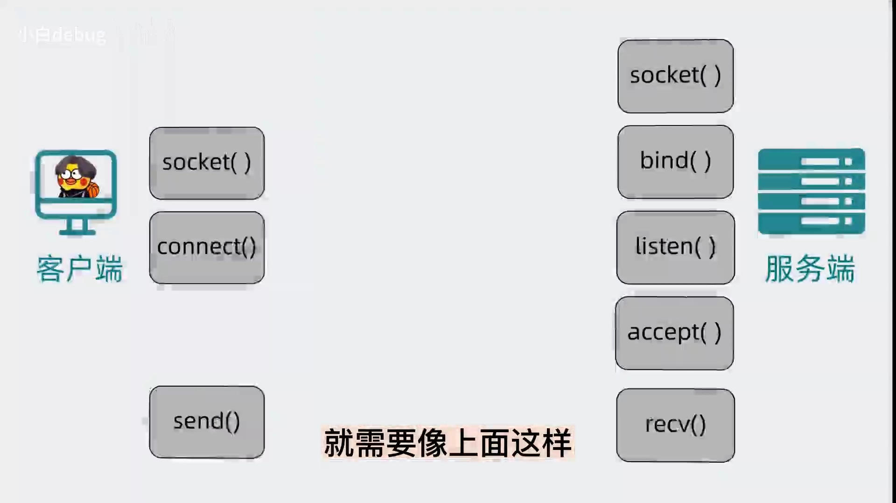

### 1.2 但它依然是个黑盒

见过、用过 socket 之后，对大多数人来说它依然是黑盒。那就索性**假设忘了 socket**，从零设计一个「内核网络传输功能」——设计完你会发现，socket 的真身自然就浮出来了。[【跳转到 01:07】](https://www.bilibili.com/video/BV12A411X7gY/?t=67)

## 二、亲手设计一个内核网络传输功能

### 2.1 从「读/写」开始：先定义 sock 结构

网络传输从操作上看，无非是两端之间互相收发数据，也就是**读数据**和**写数据**。写过代码的都知道，实现功能一般要先定义一个数据结构——这个结构就叫 **sock**。[【跳转到 01:12】](https://www.bilibili.com/video/BV12A411X7gY/?t=72)

由于接收端和发送端可能不止一个，还得加入 **IP 和端口**做区分：IP 用来定位是哪台电脑，端口用来定位这台电脑上的哪个进程。

### 2.2 协议不止一种：用「继承」复用公共逻辑

传输方式有很多种：可靠的 TCP、不可靠的 UDP，甚至还要支持基于 ICMP 的 ping 命令。这些协议各不相同，但收发数据的逻辑完全可以复用。按**面向对象编程**的思想，把不同协议当成不同的类（或结构体），把公共部分提取出来，通过继承的方式复用功能。[【跳转到 01:52】](https://www.bilibili.com/video/BV12A411X7gY/?t=112)

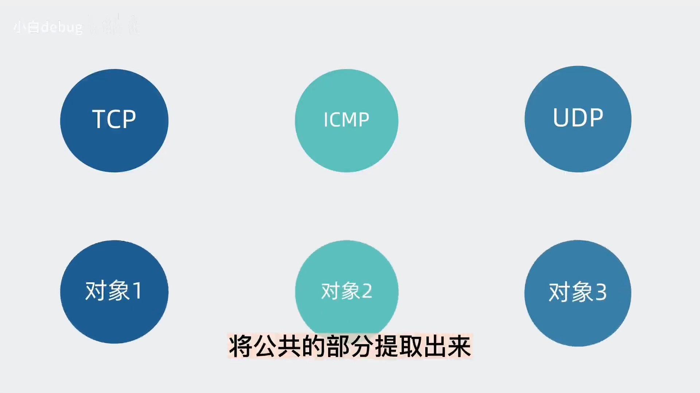

于是功能被重新划分，定义出一组层层递进的数据结构：

- **sock**：最基础的结构，维护任何协议都可能用到的**收发数据缓冲区**；
- **net_sock**：特指具备网络传输功能的 sock，在 sock 基础上加入 TTL、IP 地址、端口等网络字段。（难道还有不走网络传输的？有——**unix domain socket**，用于本机进程间通信，直接读写文件，不经过网络协议栈。）[【跳转到 02:21】](https://www.bilibili.com/video/BV12A411X7gY/?t=141)
- **net_connection_sock**：面向连接的 sock，在 net_sock 基础上加入面向连接协议里的字段，比如 **accept 队列、数据包分片大小（MSS）、握手失败重试次数**等。虽然现在提到面向连接就是指 TCP，但设计上 Linux 需要支持扩展其他面向连接的新协议，比如 SCTP。[【跳转到 02:41】](https://www.bilibili.com/video/BV12A411X7gY/?t=161)
- **tcp_sock**：正儿八经的 TCP 协议专用结构，在 net_connection_sock 基础上再加入 TCP 特有的**滑动窗口、拥塞避免**等功能。[【跳转到 03:03】](https://www.bilibili.com/video/BV12A411X7gY/?t=183)

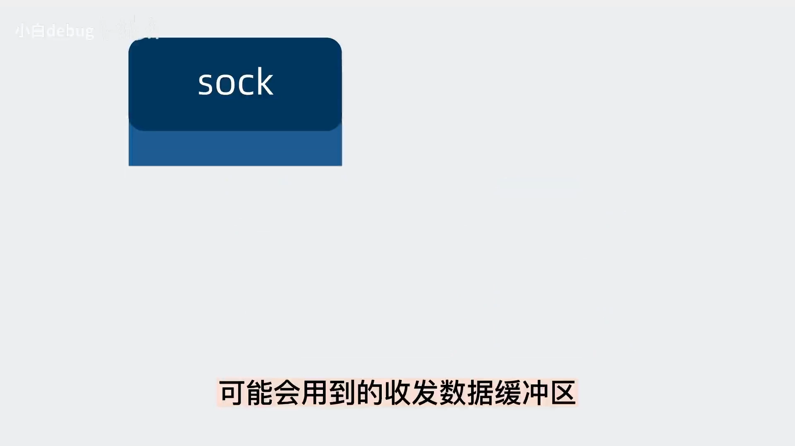

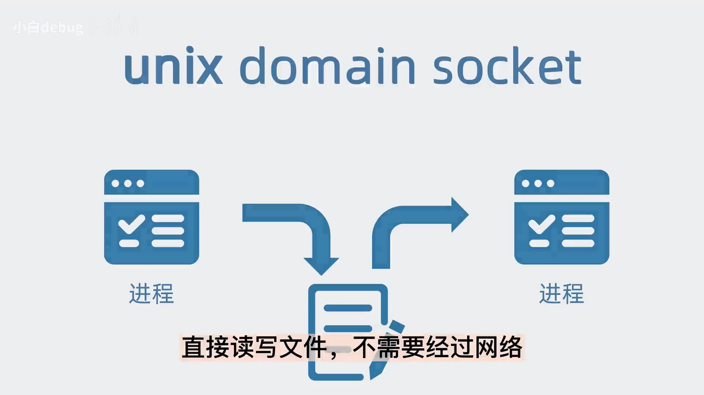

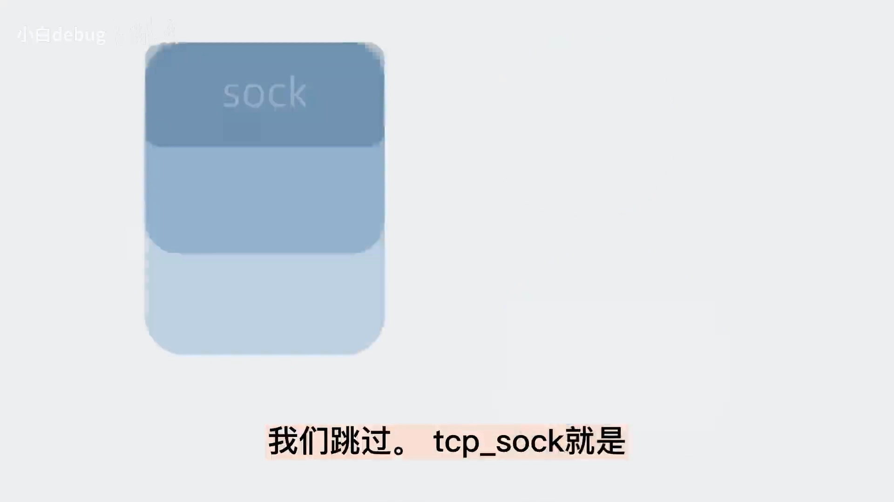

## 三、一切皆文件：sock 封装成文件，fd 就是句柄

现在这套数据结构各司其职，再跟硬件网卡对接一下，就实现了网络传输功能。可以想象这里面的代码非常复杂，而且操作网卡硬件需要比较高的操作系统权限——再考虑到性能和安全，于是决定把它放进**操作系统内核**里。[【跳转到 03:19】](https://www.bilibili.com/video/BV12A411X7gY/?t=199)

新的问题是：用户态的应用怎么用它？既然「跟远端进程收发数据」可以抽象为读和写，而「操作文件」也可以抽象为读和写，正好 Linux 有句话叫**「一切皆文件」**——那就索性把内核的 sock 结构封装成文件：创建 sock 的同时创建一个文件，文件有个句柄 **fd**（说白了就是文件系统里的身份证号），通过它可以唯一定位是哪个 sock。fd 暴露给用户后，用户操作这个句柄，文件系统就会把操作指向内核的 sock 结构。[【跳转到 03:35】](https://www.bilibili.com/video/BV12A411X7gY/?t=215)

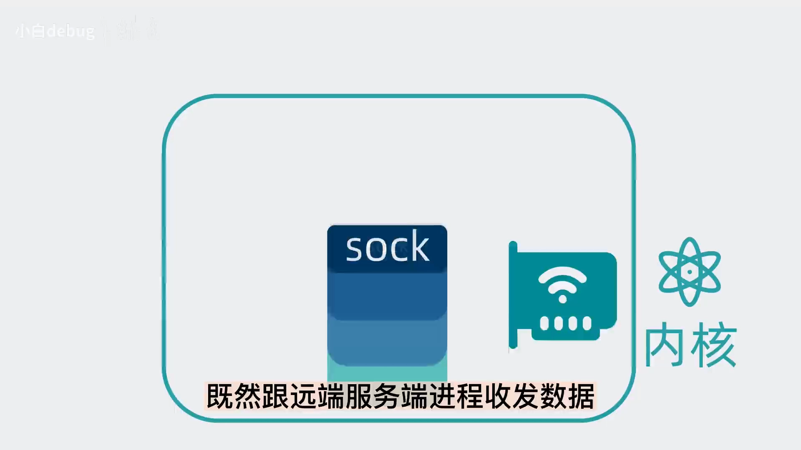

有了 sock fd 之后，再把这部分功能抽象成一个个简单的 **API 接口**：`socket`、`bind`、`listen`、`accept`、`connect`、`send`、`recv`……以后别人只需要调用这些 API，就能驱动内核里这一大堆复杂数据结构去收发数据。[【跳转到 04:00】](https://www.bilibili.com/video/BV12A411X7gY/?t=240)

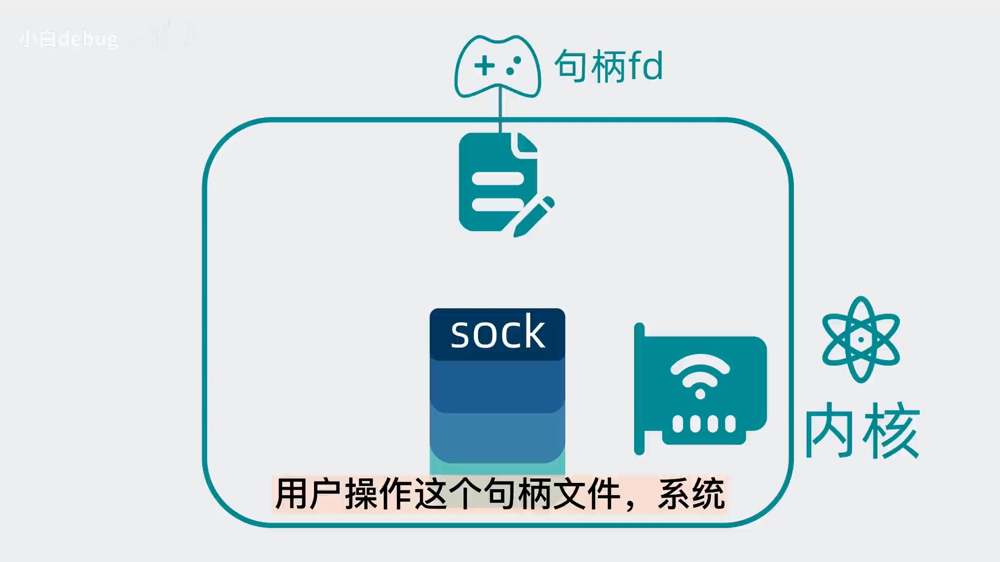

## 四、socket 的真身：接口层，与「前后端分离」的类比

是不是眼熟了？上面这些接口方法，其实就是 socket 提供出来的。所以说 **socket 其实是个代码库、一层接口**：介于内核和应用程序之间，提供高度封装过的接口，让我们去使用内核的网络传输功能。[【跳转到 04:20】](https://www.bilibili.com/video/BV12A411X7gY/?t=260)

到这里应该明白了：我们平时写的应用程序代码里虽然用了 socket 实现收发数据包，但真正执行网络通信功能的**不是应用程序，而是 Linux 内核**——相当于应用程序通过 socket 提供的接口，把网络传输这部分工作「外包」给了内核。这听起来像不像最熟悉的**前后端分离**架构？虽然不太严谨，但看上去 Linux 就像被分成了应用程序和内核两个「服务」：内核像后端，暴露好多 API（其中一类就是 send/receive 这些方法）；应用像前端，负责调用这些接口实现功能。[【跳转到 04:43】](https://www.bilibili.com/video/BV12A411X7gY/?t=283)

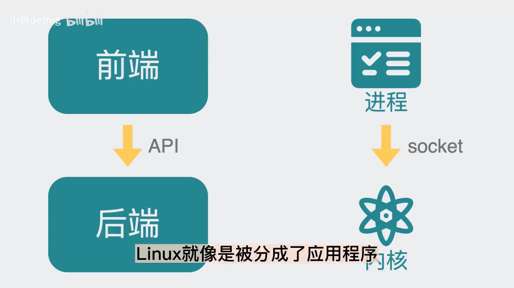

做个小总结：内核空间里实现网络传输功能的结构是 **sock**，基于不同协议和应用场景被泛化为各种类型，结合硬件共同实现传输；为了把这部分能力暴露给用户空间，引入了 **socket 层**，同时把 sock 嵌入文件系统框架，sock 变成一个特殊文件——用户在用户空间用文件句柄（socket fd，一个 **int 类型的数字**）操作内核 sock 的网络传输能力。[【跳转到 05:31】](https://www.bilibili.com/video/BV12A411X7gY/?t=331)

现在回看 socket 的中文翻译「**套接字**」——把它理解成「一套用于连接的数字」，是不是就特别合理了？

## 五、以 TCP 为例：建立连接与数据传输

上面关于「socket 怎么实现网络通信」是一笔带过的，这里用最常用的 TCP 补上，分两个阶段：**建立连接**和**数据传输**。[【跳转到 06:04】](https://www.bilibili.com/video/BV12A411X7gY/?t=364)

### 5.1 建立连接：connect 背后的三次握手

客户端代码执行 socket 提供的 `connect` 方法，传入 socket fd 和 IP 端口：内核通过 **sock fd 句柄**找到对应的文件，再根据文件里的信息找到内核的 **sock 结构**，通过这个 sock 结构主动发起**三次握手**。至此连接就算准备好了，之后就可以传输数据。[【跳转到 06:15】](https://www.bilibili.com/video/BV12A411X7gY/?t=375)

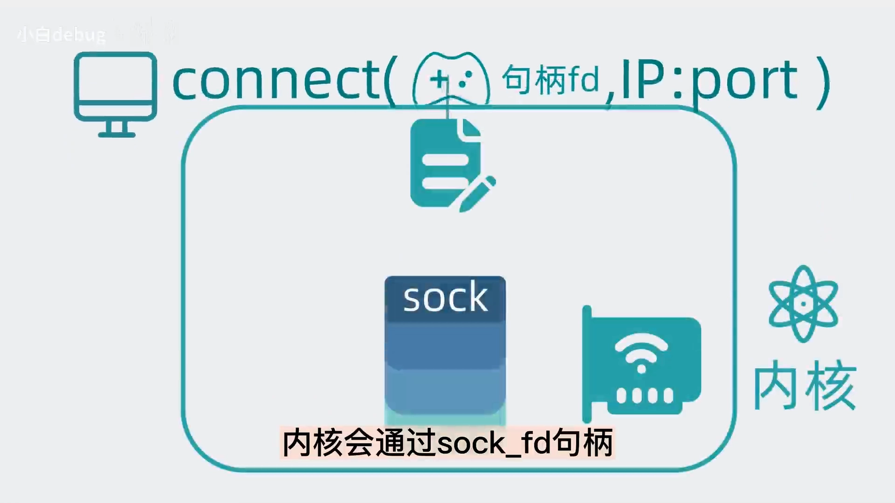

### 5.2 数据传输：send/recv 只是操作缓冲区

为了收发数据，sock 结构体里带了一个**发送缓冲区**和一个**接收缓冲区**——说是缓冲区，其实是个**链表**，上面挂着一个个准备要发送或接收的数据。

应用执行 `send` 时，同样通过 fd 找到文件、再找到 sock 结构，把数据放进**发送缓冲区**，然后流程就结束了——**内核看心情决定什么时候把这份数据真正发出去**。接收流程也类似：数据送到内核后不是立马给应用程序，而是先放在接收缓冲区里静静躺着，卑微地等应用程序执行 `recv` 来拿。[【跳转到 06:42】](https://www.bilibili.com/video/BV12A411X7gY/?t=402)

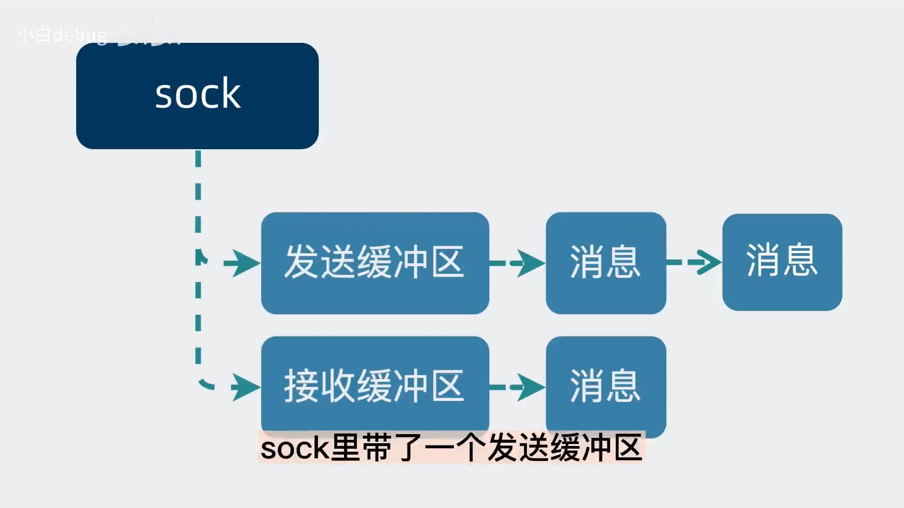

### 5.3 服务端怎么区分客户端：四元组 + hash 表

问题又来了：服务器端 `listen` 的时候，那么多数据包都发到同一个 listen socket 上，服务端是怎么区分不同客户端的？

答案是**四元组**：客户端发来的数据包上带着**源 IP、源端口、目的 IP、目的端口**，这四个元素构成四元组，可以唯一标记一个客户端。服务端会为每条连接创建一个新的内核 sock，并用四元组算出一个 **hash key** 放进一张 **hash 表**；下次再有消息进来，通过包自带的四元组生成 hash key，到表里取出对应的 sock 就好了。[【跳转到 07:32】](https://www.bilibili.com/video/BV12A411X7gY/?t=452)

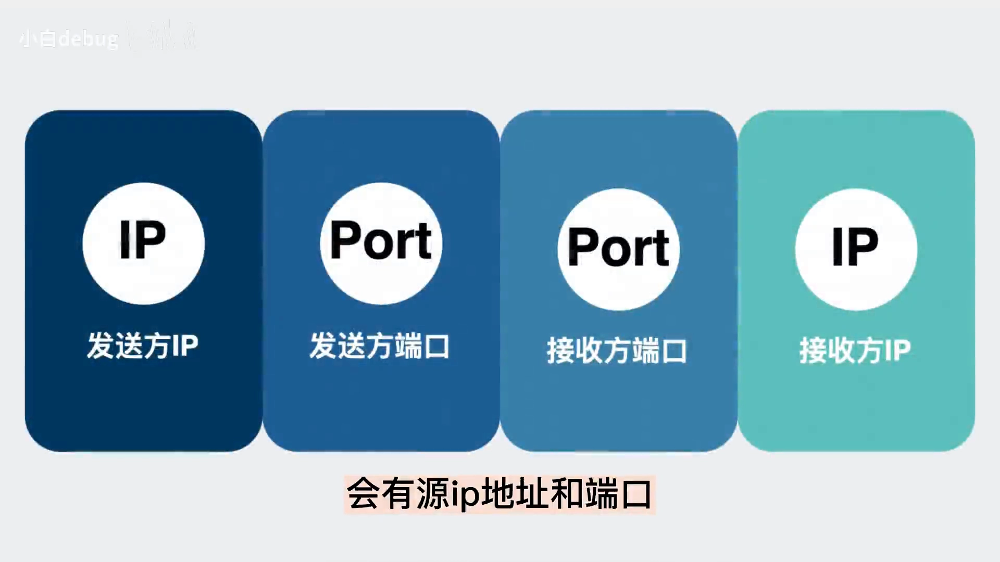

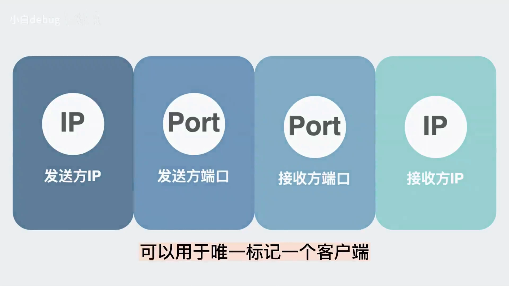

## 六、留给你的思考题

视频最后留了个问题：Linux 内核是 C 语言实现的，而 C 语言既没有类、也没有继承的特性，它是怎么做到上面这种「继承」效果的？欢迎在原视频评论区讨论。[【跳转到 07:58】](https://www.bilibili.com/video/BV12A411X7gY/?t=478)

## 小结

- socket 不是协议，也不是那条连接，而是**介于应用程序与内核之间的接口层（代码库）**；
- 内核里真正干活的是一组「继承式」数据结构：**sock → net_sock → net_connection_sock → tcp_sock**，公共能力逐层复用；
- 依托「一切皆文件」，sock 被封装成特殊文件，用户拿到的只是一个 **int 类型的 socket fd**——「套接字」就是一套用于连接的数字；
- `connect` 沿着「fd → 文件 → sock 结构」发起三次握手；`send`/`recv` 只是往**收发缓冲区（链表）**放/取数据，真正收发由内核完成；
- 服务端靠**四元组 + hash 表**从海量包里区分出每一条客户端连接。

## 关键术语速查

| 术语 | 一句话解释 |
| --- | --- |
| fd | 文件句柄，文件系统里的「身份证号」，int 类型数字，通过它唯一定位一个打开的文件（这里是 sock） |
| sock | 内核中最基础的网络数据结构，维护任何协议都可能用到的收发缓冲区 |
| net_sock | sock + 网络字段（TTL、IP、端口）；unix domain socket 属于不走网络的特例 |
| net_connection_sock | net_sock + 面向连接字段（accept 队列、MSS、握手失败重试次数等） |
| tcp_sock | TCP 专用结构，再加滑动窗口、拥塞避免等 TCP 特有功能 |
| unix domain socket | 本机进程间通信的 socket，直接读写文件，不经过网络协议栈 |
| 四元组 | 源 IP、源端口、目的 IP、目的端口，唯一标记一条连接 |
| MSS | 数据包分片的最大尺寸，net_connection_sock 里维护的字段之一 |
