# 一次 TCP 通信全过程：从三次握手到四次挥手

> 视频来源：B 站 UP 主「码上小白」[《计算机网络-一次TCP通信过程分析》](https://www.bilibili.com/video/BV1oo4y1j7Eb/)（14 分 33 秒）。本文基于视频字幕与画面整理，内容均可在原视频核查。

## 本讲要解决的核心问题（SCQA）

**背景**：TCP 是计算机网络中最重要的传输协议之一，各类网络应用都建立在它之上。

**冲突**：一次 TCP 通信要经历连接建立、数据传输、连接关闭多个阶段，还面临数据可靠性、传输效率等多重问题——网络会乱序、丢包、拥堵。

**疑问**：TCP 是如何做到可靠传输的同时兼顾传输效率的？

**回答（中心思想）**：TCP 用**序列号 + 校验和 + 确认应答 + 重传**保证可靠，用**滑动窗口 + 延迟/累计确认**提升效率，用**拥塞控制（慢启动、拥塞避免、快重传、快恢复）**保护网络本身——下面沿着一次完整通信的过程把它们串起来。

## 一、先认识 TCP 报文：五个关键字段

看懂后面的机制，先要认识 TCP 报文格式里的几个关键字段。[【跳转到 00:00】](https://www.bilibili.com/video/BV1oo4y1j7Eb/?t=0)

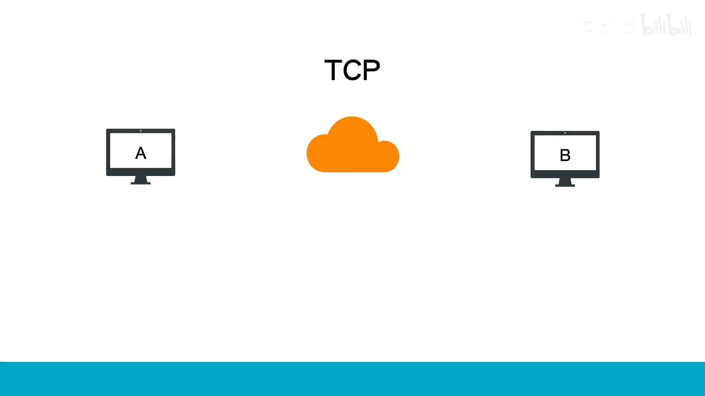

- **序列号（Sequence Number）**：一个 TCP 连接中传送的字节流里的每一个字节都按顺序编号，该字段表示本报文所发送数据的**第一个字节的序号**；
- **确认号（Acknowledgment Number）**：希望收到对方下一个报文段的第一个数据字节的序号。若确认号为 N，表明到序列号 N−1 为止的所有数据都已正确收到；

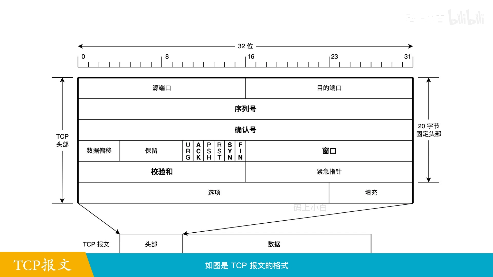

- **窗口**：通知发送端「接收端可接收的空间大小」，是后面流量控制的基础；
- **校验和**：发送端计算待发送报文段的校验和，接收端验证，用于发现数据包在传输途中是否发生变动；若接收方检测到校验和有差错，该报文会被**直接丢弃**；
- **六个标志位**：保留位右边有六个标志位，多个可同时置 1，依次为 **URG、ACK、PSH、RST、SYN、FIN**。[【跳转到 00:50】](https://www.bilibili.com/video/BV1oo4y1j7Eb/?t=50)

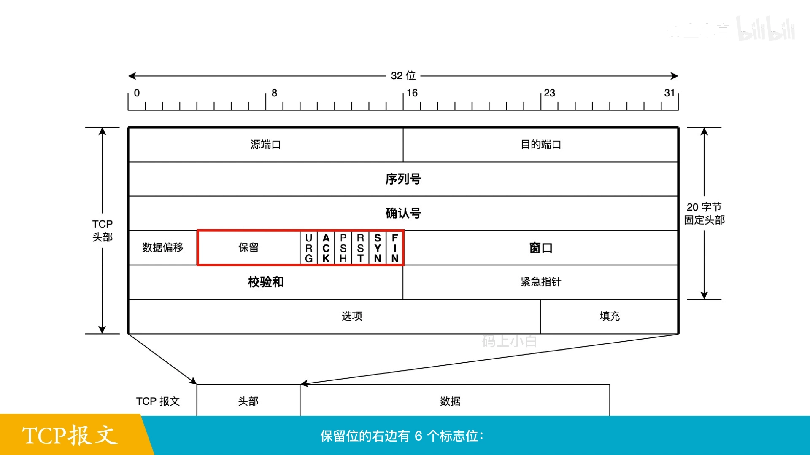

本讲重点关注的标志位行为：

- 仅当 **ACK=1** 时确认号字段才有效；连接建立后所有报文都必须把 ACK 置 1；
- **SYN** 仅在三次握手建连时有效：SYN=1 且 ACK=0 表示连接请求报文；对方同意建立连接，则在响应报文中把 SYN 和 ACK 都置 1（SYN=1 且 ACK=1 表示连接接受报文）；
- **FIN=1** 表明此报文发送方的数据已发送完毕，要求释放连接。[【跳转到 01:00】](https://www.bilibili.com/video/BV1oo4y1j7Eb/?t=60)

## 二、为什么需要「连接」：从 IP 转发说起

假设计算机 A 要把消息发给计算机 B：A 在数据包头部加上 B 的 IP 地址，通过 IP 协议从网口发出去，路由器就能根据 B 的 IP 把包转发过去。**但这并不能保证 B 一定收到**——B 可能离线，也可能正在忙别的。[【跳转到 01:25】](https://www.bilibili.com/video/BV1oo4y1j7Eb/?t=85)

为了确保 B 能收到，TCP 要求通信双方先建立一条**可靠的通信连接**。什么样的连接算可靠？简单说：通过这条连接，双方能确认**对方的存在和可用性**，并且数据能**正确地传输和被接收**。[【跳转到 01:50】](https://www.bilibili.com/video/BV1oo4y1j7Eb/?t=110)

## 三、三次握手：建立可靠连接

三次握手的过程：[【跳转到 02:30】](https://www.bilibili.com/video/BV1oo4y1j7Eb/?t=150)

1. A 向 B 发送 **SYN** 报文，请求建立连接；
2. B 收到后回复 **ACK+SYN** 报文，表示接受连接请求，并等待 A 确认；
3. A 收到 B 的 SYN+ACK，确认 B 已接受请求，回复一个 **ACK** 报文；B 收到后，连接建立成功。

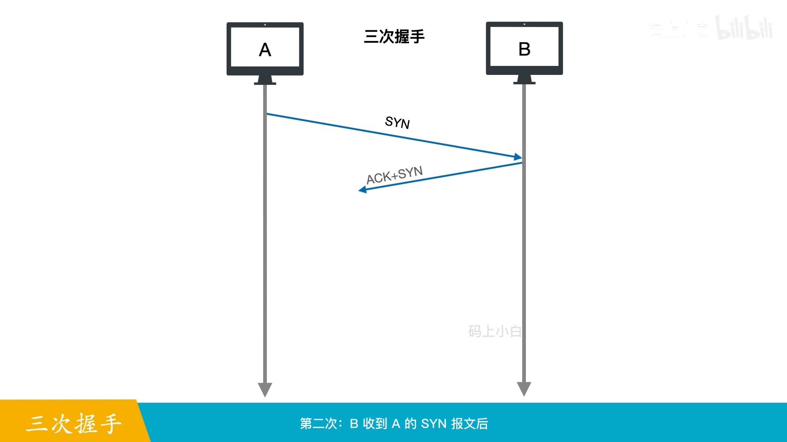

**为什么不能是两次或一次？** 假设只有两次握手：从 A 的角度看，确认了 B 存在、且自己发的数据能被正确收到；但站在 B 的角度，只能确认 A 存在，**无法确认「自己发的数据」能不能被 A 收到**。可见两次或一次握手无法建立可靠连接。[【跳转到 03:20】](https://www.bilibili.com/video/BV1oo4y1j7Eb/?t=200)

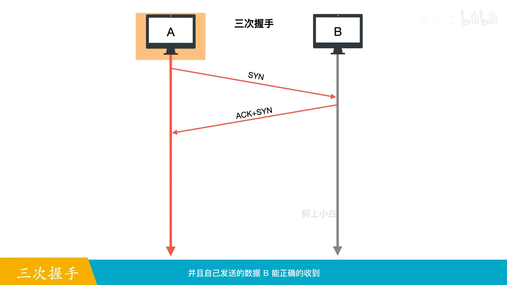

## 四、数据传输的三个问题：校验、乱序、丢包

连接建好后就可以发数据了。但一般网络不能连续传送任意长的数据，发送方 A 要把消息**分割成小块**（数据包/段）按顺序发送，最大尺寸用 **MSS** 表示，实际大小由 IP 层的**最大传输单元 MTU** 决定。[【跳转到 03:45】](https://www.bilibili.com/video/BV1oo4y1j7Eb/?t=225)

B 收到数据包后有三件事要做：

1. **查校验和**：有差错就直接丢弃——说明包在途中出错或被篡改；
2. **重组还原**：必须按分割前的顺序组装，否则无法还原原始消息；
3. **应对乱序**：顺序发送的包，经过多个路由器（速度、负载、拥塞各不相同）后**无法保证到达顺序**。

乱序问题的解法就在第一节那个字段里：TCP 用**序列号**给字节流逐字节编号，B 按序列号组装，乱序就解决了。[【跳转到 04:35】](https://www.bilibili.com/video/BV1oo4y1j7Eb/?t=275)

## 五、应答确认与超时重传

TCP 怎么保证所有包都被正确收到？靠**应答确认机制**：B 每收到数据包，回复一个携带确认号的**确认包（ACK 包）**；A 收到确认后再发下一个。[【跳转到 04:35】](https://www.bilibili.com/video/BV1oo4y1j7Eb/?t=275)

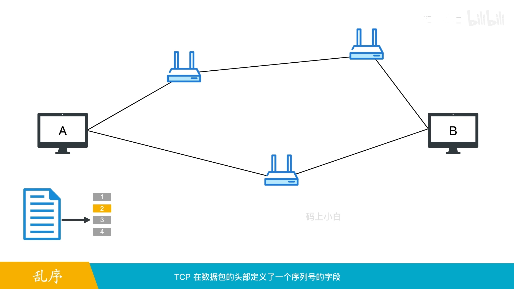

那 A 等了很久都没收到确认包怎么办？此时发送方无法知道具体原因：数据包可能丢了，B 可能崩溃/离线，也可能是 B 回了但确认包丢了。通用解法是**超时重传**：A 发包后启动一个**重传定时器**，到期仍未收到确认，就认为包丢了，重传数据包。[【跳转到 05:00】](https://www.bilibili.com/video/BV1oo4y1j7Eb/?t=300)

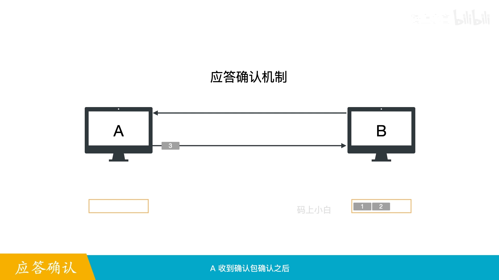

## 六、从停等协议到滑动窗口：流量控制

### 6.1 停等协议太慢

确认机制解决了可靠性，但带来效率问题：A 只有收到确认才能发下一个包——这种「发送—等待确认—再发送」的协议叫**停等协议**。发送方大部分时间都在等待，往返时间越长，吞吐量越低。[【跳转到 05:25】](https://www.bilibili.com/video/BV1oo4y1j7Eb/?t=325)

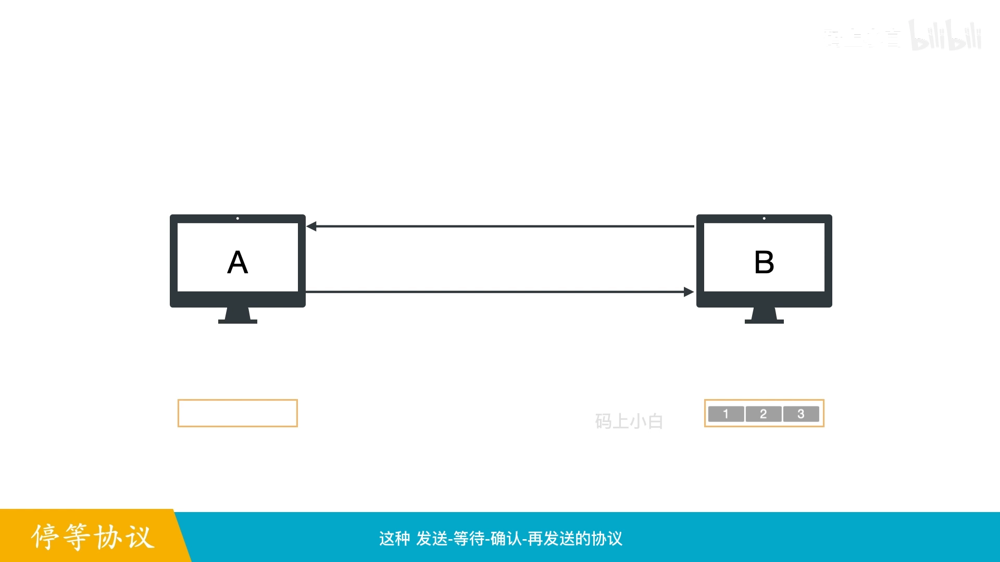

### 6.2 流水线与发送窗口

提高效率的办法：允许发送方**连发多个包而无需逐个等确认**——这种流水线式协议叫**流水线协议**。TCP 用一个「**发送窗口**」变量表示无需等待确认、可以发送的包数量。

窗口多大才合理？太小（比如 1）就退化成停等协议；太大则接收方来不及处理，丢包重传反而更慢。所以 TCP 用**滑动窗口机制**实现流量控制：接收方维护一个自己可处理的「**接收窗口**」，每次发数据都在报文头里带上窗口大小，告知自己的接收能力；发送方据此动态调整发送窗口——窗口大小不是固定的。[【跳转到 06:15】](https://www.bilibili.com/video/BV1oo4y1j7Eb/?t=375)

### 6.3 窗口里的四类包

按顺序编号，数据包可分四类：**已发送已确认、已发送未确认、待发送（未发送可发送）、未发送不可发送**。发送窗口内的待发送包被连续发送、不用等确认；收到确认后，已确认的包移出窗口，窗口向前滑动，以便发新包；接收方还会根据承受能力调整接收窗口并通知发送方。[【跳转到 06:40】](https://www.bilibili.com/video/BV1oo4y1j7Eb/?t=400)

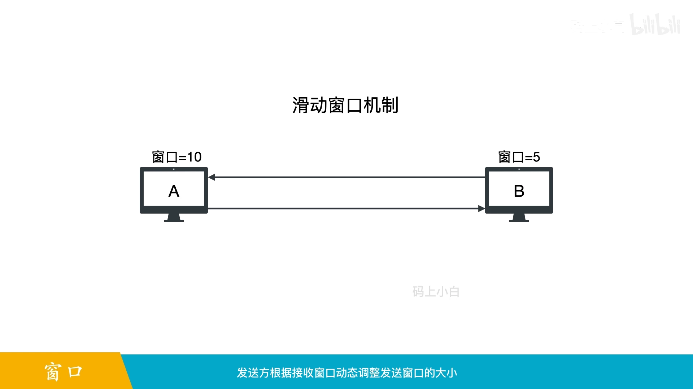

## 七、延迟确认与累计确认：别让 ACK 淹没带宽

窗口机制下发送方连续发包，接收方短时间内也连续收包。如果每个包都回一个确认包，过多的 ACK 会消耗带宽、拉低网络利用率。TCP 的解法是两招：

- **累计确认**：确认号为 X 的确认包，表示 X 之前（不含 X）的所有数据都已收到。例如连续收到序号 1~5 的五个包，只需回复一个确认号为 6 的累计确认包；[【跳转到 07:30】](https://www.bilibili.com/video/BV1oo4y1j7Eb/?t=450)
- **延迟确认**：收到包后不立即回复，而是稍等片刻，把延迟窗口内收到的多个连续包**累积到一个确认包**里一起回。[【跳转到 07:55】](https://www.bilibili.com/video/BV1oo4y1j7Eb/?t=475)

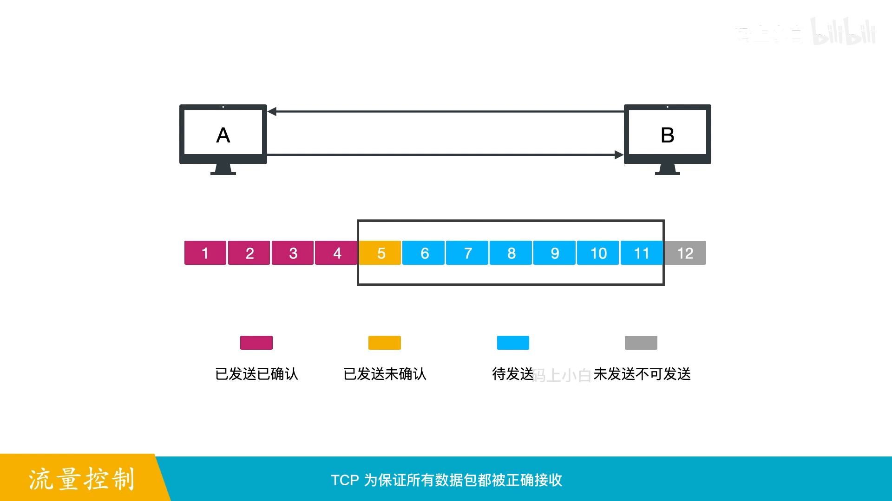

两招合起来减少了确认包数量，网络利用率就上去了。

## 八、快速重传：以数据驱动，不等超时

超时重传以时间驱动，必须干等一个超时时间，效率低。TCP 于是引入以数据驱动的**快速重传**：当接收方**连续收到三个相同的确认号**时，立即重传缺失的包，不必等超时。[【跳转到 08:20】](https://www.bilibili.com/video/BV1oo4y1j7Eb/?t=500)

什么情况下会连续收到三个相同确认号？关键在于：**确认包确认的是「最后连续收到的序列号」**。接收方收到比期望序号大的失序报文时，会回复**重复确认包**。举例：发送窗口为 5，连续发 1~5 号包，其中 2 号丢了；接收方收到 3、4、5 号时期望的都是 2 号，于是连回三个「确认号=2」的 ACK；发送端连续收到三个确认号 2，立刻触发快速重传，补发 2 号包。[【跳转到 09:10】](https://www.bilibili.com/video/BV1oo4y1j7Eb/?t=550)

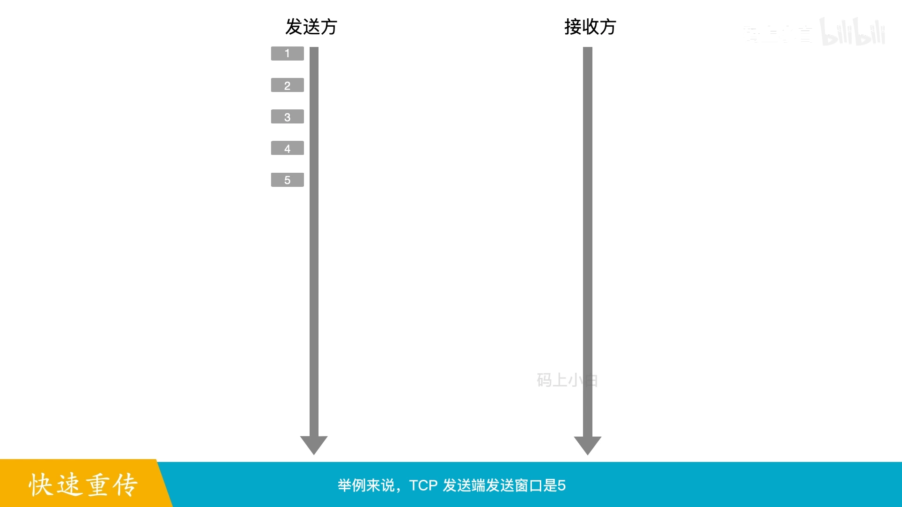

## 九、拥塞控制：慢启动、拥塞避免、快重传、快恢复

### 9.1 为什么还需要拥塞控制

滑动窗口只考虑了**接收方**的处理能力，忽略了**网络**的负载。连接一多必然拥堵；拥堵引发大量超时重传，重传又加重网络负担，形成恶性循环，甚至让整个网络不可用。所以 TCP 还要做**拥塞控制**：防止过多数据注入网络。[【跳转到 09:35】](https://www.bilibili.com/video/BV1oo4y1j7Eb/?t=575)

TCP 为此定义了「**拥塞窗口**」：网络拥堵就减小，畅通就增加。此后**发送窗口 = min(拥塞窗口, 接收窗口)**，从两端同时约束发送速率。[【跳转到 10:00】](https://www.bilibili.com/video/BV1oo4y1j7Eb/?t=600)

应用最广泛的拥塞控制算法是 **Reno**，包含四部分：慢启动、拥塞避免、快速重传、快速恢复。[【跳转到 10:25】](https://www.bilibili.com/video/BV1oo4y1j7Eb/?t=625)

### 9.2 慢启动：指数增长

刚接入网络时先发少量包探测网络，再逐步增大拥塞窗口：开始只发 1 个包并等确认；被确认后拥塞窗口 +1、发 2 个包；这 2 个被确认后，每收到一个确认就把窗口 +1，窗口变为 4……如此每经过一个 **RTT（往返时间）**，拥塞窗口**翻倍**——速率起步慢，但窗口是**指数增长**的。[【跳转到 10:50】](https://www.bilibili.com/video/BV1oo4y1j7Eb/?t=650)

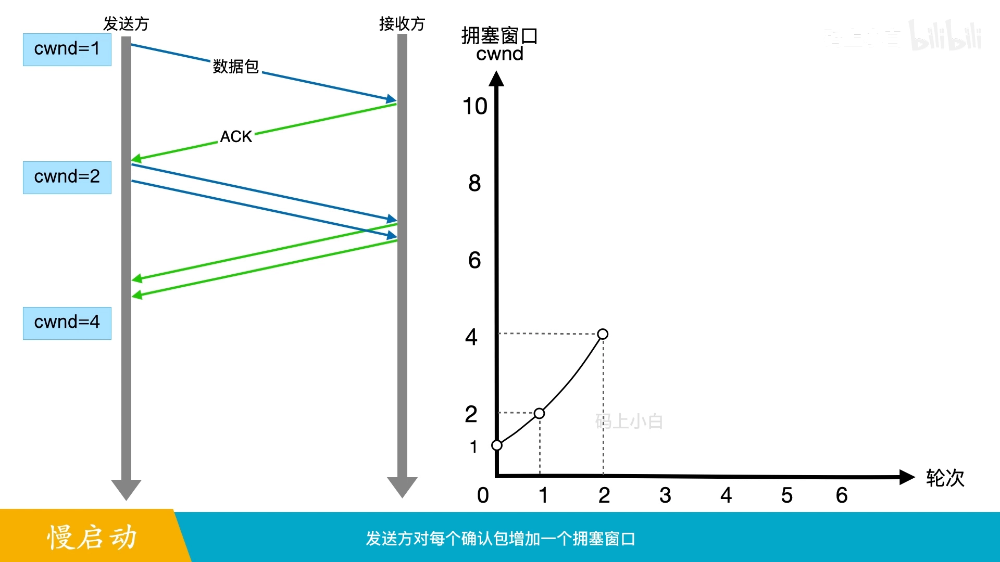

指数增长不能一直持续，两种情况会结束：网络发生拥堵；或拥塞窗口达到「**慢启动阈值**」，进入**拥塞避免**模式。[【跳转到 11:40】](https://www.bilibili.com/video/BV1oo4y1j7Eb/?t=700)

### 9.3 拥塞避免：线性增长

拥塞避免模式下，拥塞窗口每经过一个 RTT 只 **+1**。例如慢启动阈值 = 8：8 个 ACK 到来时每个确认加 1/8，8 个确认合计加 1——线性增长比指数增长更稳定，可避免拥塞发生。[【跳转到 11:55】](https://www.bilibili.com/video/BV1oo4y1j7Eb/?t=715)

### 9.4 拥塞发生了怎么调整：两种丢包，两套应对

TCP 通过**丢包**感知拥堵，分两种情况：[【跳转到 12:33】](https://www.bilibili.com/video/BV1oo4y1j7Eb/?t=753)

- **超时丢包**（重传定时器到期仍无确认）：说明拥塞比较严重——把**慢启动阈值更新为当前拥塞窗口的一半**，拥塞窗口重置为 1，重新慢启动；
- **收到三个重复 ACK**：说明只是轻微拥堵——执行**快速重传与快速恢复**，窗口不必砍那么狠。[【跳转到 12:58】](https://www.bilibili.com/video/BV1oo4y1j7Eb/?t=778)

### 9.5 快重传 + 快恢复：四步走

快重传与快恢复一般同时使用，共四步：[【跳转到 13:23】](https://www.bilibili.com/video/BV1oo4y1j7Eb/?t=803)

1. 慢启动阈值 = 当前拥塞窗口的一半，并重传丢失的包；
2. 拥塞窗口 = 慢启动阈值 + 3（+3 是因为收到了三个重复 ACK）；
3. 若再次收到重复 ACK，拥塞窗口 +1；
4. 当收到**新数据包**的 ACK 时，把拥塞窗口设回第一步的慢启动阈值——该 ACK 确认了新数据，说明重复 ACK 之前的数据都已收到，快速恢复结束，回到拥塞避免阶段。

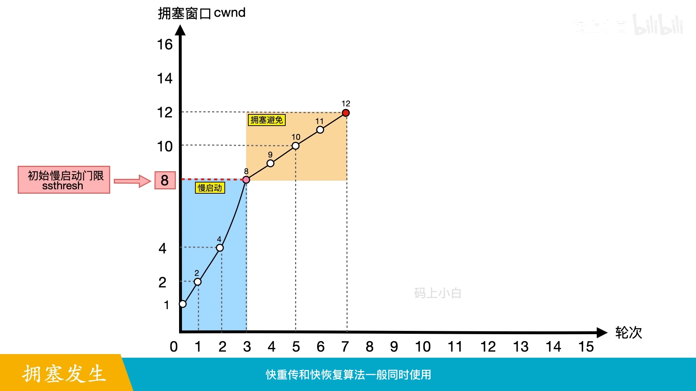

## 十、四次挥手与半关闭

数据发送完毕，双方通过**四次挥手**结束通信。TCP 连接是**全双工**的——两个方向可以同时传数据，所以每个方向要**单独关闭**：[【跳转到 13:56】](https://www.bilibili.com/video/BV1oo4y1j7Eb/?t=836)

1. 一方数据发完后，发 **FIN** 终止这个方向的传输；
2. 对方确认后，该方向进入**半关闭状态**——所谓半关闭，是指一端结束发送后，**仍能接收**另一端的数据；
3. 另一方检查自己的数据是否发完，未完则继续发送；
4. 发完后也发 FIN 终止自己的方向，对方确认后，整个连接关闭。

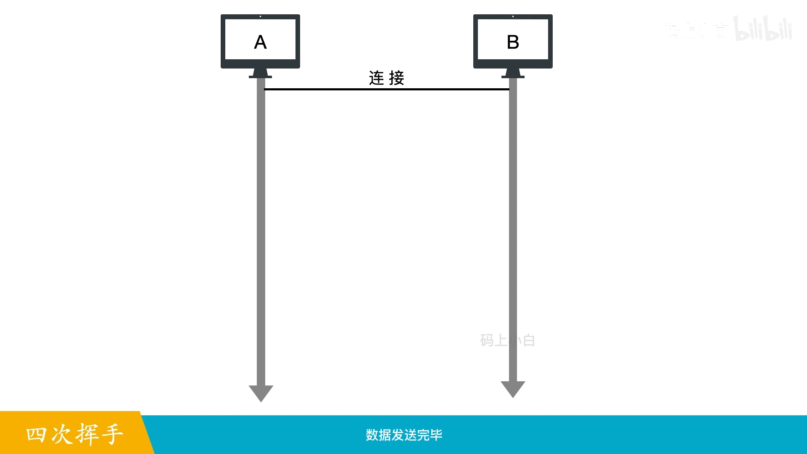

## 小结

- 一次 TCP 通信 = **连接建立（三次握手）→ 数据传输 → 连接关闭（四次挥手）**；
- 可靠性三板斧：**校验和**查错、**序列号**解决乱序、**确认应答 + 超时重传**解决丢包；
- 效率三板斧：**滑动窗口**做流量控制、**延迟/累计确认**减少 ACK、**快速重传**以数据驱动代替干等超时；
- 拥塞控制用**拥塞窗口**约束注入网络的数据量：慢启动指数增长 → 达到慢启动阈值转**拥塞避免**线性增长 → 超时丢包重置重慢启动 / 三次重复 ACK 走**快重传快恢复**；
- 发送窗口实际取 **min(拥塞窗口, 接收窗口)**，同时受接收方与网络两端约束。

## 关键术语速查

| 术语 | 一句话解释 |
| --- | --- |
| 序列号 | 对连接中字节流逐字节编号，本报文第一个字节的序号；解决乱序 |
| 确认号 | 期望收到的下一个字节序号；=N 表示 N−1 及之前全部收到 |
| MSS / MTU | TCP 数据包最大尺寸 / IP 层最大传输单元（MSS 实际由 MTU 决定） |
| SYN / FIN | 建立连接的标志 / 释放连接的标志 |
| ACK 包 | 携带确认号的确认包；确认「最后连续收到的序列号」 |
| 停等协议 | 发一个、等一个确认的协议，可靠但低效 |
| 发送窗口 / 接收窗口 | 无需确认可发送的包数量 / 接收方可处理的空间，随能力动态调整 |
| 延迟确认 | 收到包后稍等片刻，累积多个包一起确认 |
| 累计确认 | 确认号 X 表示 X 之前（不含 X）的数据全部收到 |
| 快速重传 | 连续三个相同确认号立即重传，不等超时 |
| 慢启动阈值 | 拥塞窗口超过它就从指数增长转为线性增长 |
| 拥塞窗口 | 按网络拥堵程度调节的窗口；发送窗口 = min(拥塞窗口, 接收窗口) |
| 半关闭 | 一端已结束发送、但仍可接收对方数据的状态 |
