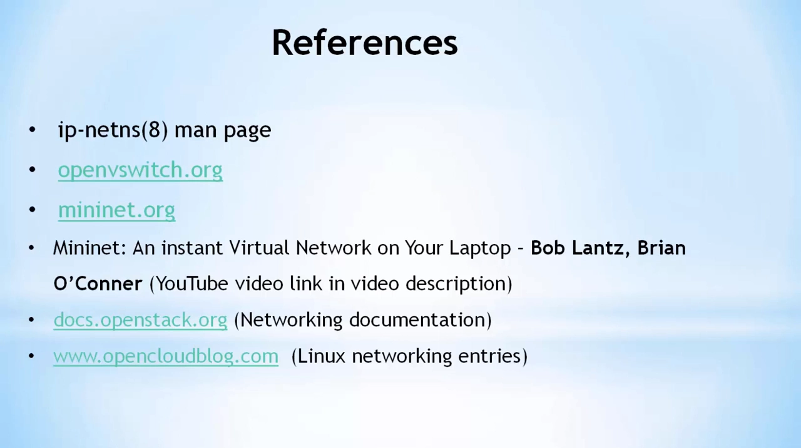
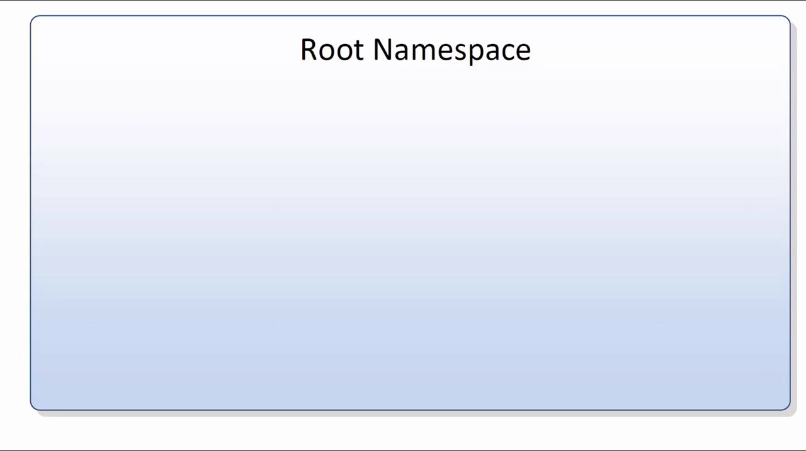
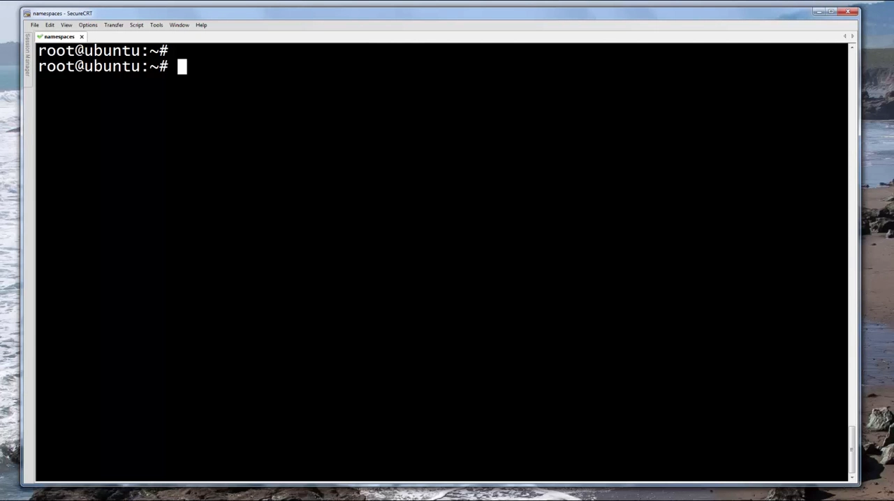
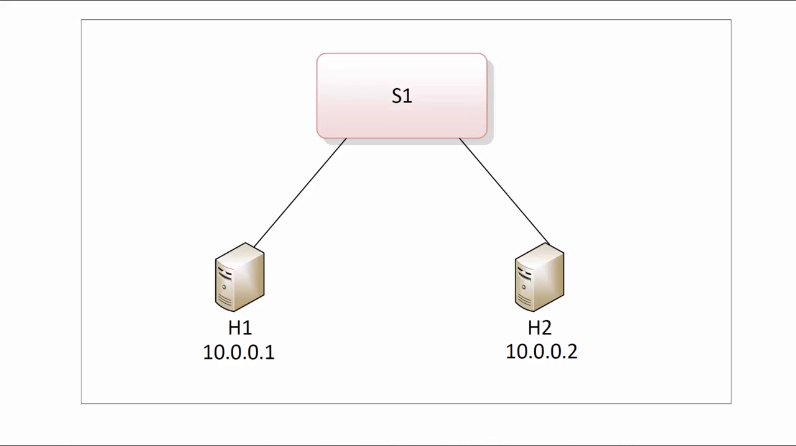
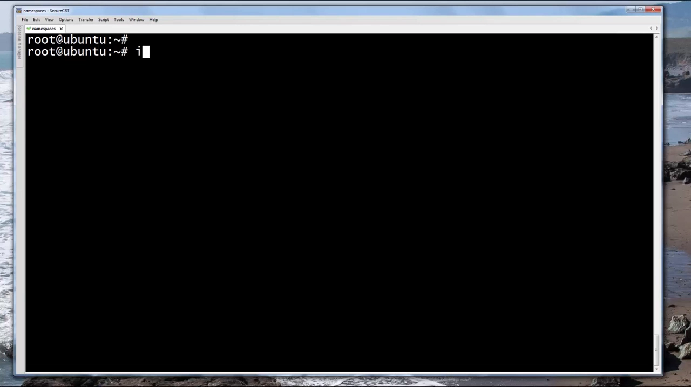
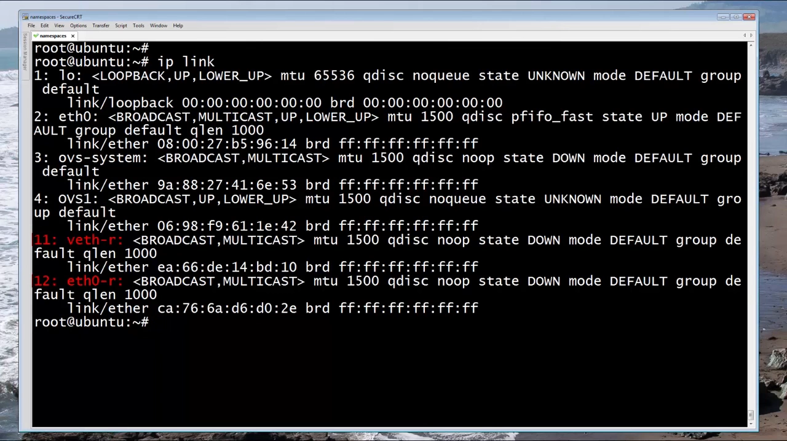
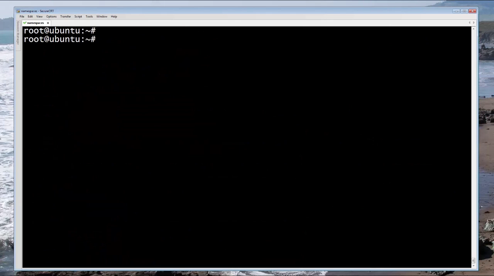
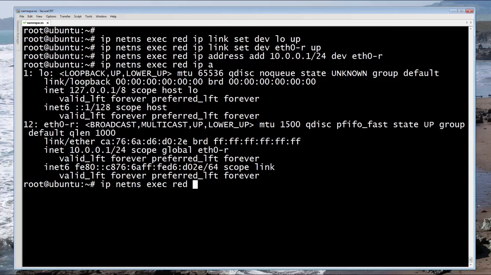
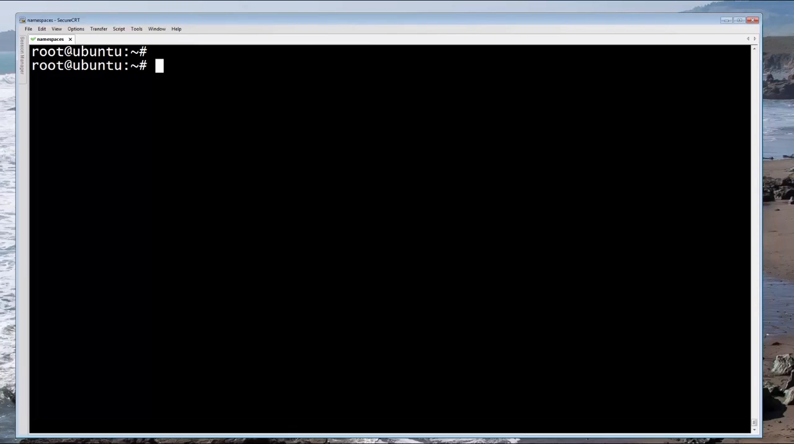
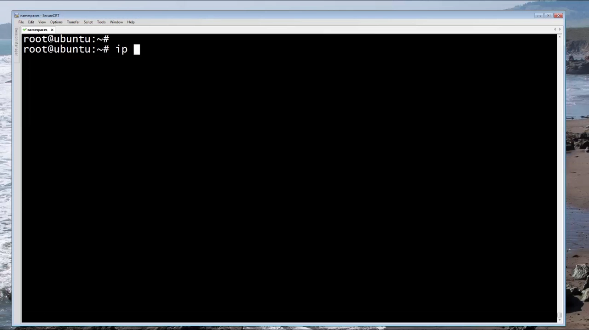

# 网络命名空间实战：一台 Linux 既能仿真"多主机网络"，又能跑"多租户 DHCP"

> 视频来源：David Mahler [《Introduction to Linux Network Namespaces》](https://www.youtube.com/watch?v=_WgUwUf1d34)（25 分 51 秒）。本文基于视频演说图文稿整理，关键处附时间戳，可跳回原视频核对。视频在 Ubuntu 14.04 虚拟机上演示，装有 Open vSwitch 与 dnsmasq。

## 本讲要解决的核心问题（SCQA）

**背景**：大家已经知道，Docker、容器、OpenStack 都靠 Linux 网络命名空间（network namespace）实现网络隔离——一台机器上可以并存多个互不相通的网络环境。

**冲突**：但"隔离"只是起点。真实系统里还有两个更实际的问题：做网络实验时，怎么在一台机器上仿真出"多台主机 + 交换机"的拓扑？云平台上，怎么给成百上千个租户各自跑一套 DHCP 服务，连 IP 段重叠都互不干扰？

**疑问**：网络命名空间除了"断网隔离"，怎么用它组网、跑真实服务？

**回答（中心思想）**：两个经典场景给出答案——① 在 root 命名空间里跑一台 **Open vSwitch 虚拟交换机**，用 **veth pair** 把 red、green 两个命名空间接上去，这就是 Mininet 仿真主机的原理；② 用 **VLAN** 把"租户"隔开，每个租户一个命名空间跑一份 **dnsmasq**（DHCP 服务），OVS **internal port** 直连命名空间，重叠 IP 也互不干扰——这就是 OpenStack 租户 DHCP 的原理。

## 一、网络命名空间是什么：一台机器上的多个独立网络环境

**网络命名空间允许在一台物理机或虚拟机上，同时运行多个相互隔离的网络环境** [【跳转到 00:50】](https://www.youtube.com/watch?v=_WgUwUf1d34&t=50)。每个隔离的网络环境都有自己的一份：

- **网络接口**；
- **路由表**；
- **转发表**；
- **防火墙等安全规则**。

进程可以被"固定"到某一个网络命名空间里，从而与其他命名空间的进程隔开。它的使用范围很广：**OpenStack、Linux 容器、Docker、Mininet** 都在用。

视频用两个实验来讲它：第一个**模仿 Mininet 如何把"主机"仿真出来**；第二个**模仿 OpenStack 如何给租户提供 DHCP 服务**。Mininet 是一款能在单台虚拟机/物理机里拉起自定义虚拟网络拓扑的软件，常用于学习、测试和讲授软件定义网络（SDN）与一般网络知识；第一个实验就是手工复刻它最简单的拓扑：**两台"主机"，通过一台 Open vSwitch 互联**。



## 二、画布：root 命名空间与 iproute2 命令

**root 命名空间**就是你在 Linux 系统里默认看到的那个网络环境，本讲的虚拟网络都画在它这张"画布"上 [【跳转到 02:46】](https://www.youtube.com/watch?v=_WgUwUf1d34&t=166)。



先认识三件套（均属新一代 iproute2 工具，取代老的 ifconfig/route/arp）：

- `ip link`：查看接口——root 里只有一块 loopback 和一块 eth0；
- `ip a`（`ip address`）：查看地址——eth0 是 192.168.1.10；
- `ip route`：查看路由表。

## 三、场景一：仿真 Mininet——两台"虚拟主机"通过 OVS 组网

### 3.1 创建 red、green 两个命名空间

```bash
ip netns add red
ip netns add green
```

`ip netns` 单独执行可以列出它们；`/var/run/netns` 目录里也能看到；想删除就把 `add` 换成 `del` [【跳转到 03:43】](https://www.youtube.com/watch?v=_WgUwUf1d34&t=223)。


red 和 green 的网络环境**彼此隔离、也和 root 隔离**。验证一下：`ip netns exec red ip link` ——在 red 里执行 `ip link`，只见一块 loopback，而且状态是 down；green 也一样 [【跳转到 04:47】](https://www.youtube.com/watch?v=_WgUwUf1d34&t=287)。



### 3.2 一台 OVS 虚拟交换机

Mininet 的拓扑是"两台主机 + 一台交换机"。交换机用 **Open vSwitch**，实例跑在 root 命名空间里 [【跳转到 05:21】](https://www.youtube.com/watch?v=_WgUwUf1d34&t=321)：

```bash
ovs-vsctl add-br ov1      # 新建一台名为 ov1 的虚拟交换机
ovs-vsctl show            # 查看
```



### 3.3 veth：跨越命名空间的"管道"

**veth pair（虚拟以太网对）像一根管道：从一端进去的包，会原样从另一端出来**。它天生适合跨命名空间布线 [【跳转到 06:42】](https://www.youtube.com/watch?v=_WgUwUf1d34&t=402)：

```bash
ip link add eth0-r type veth peer name veth-r
```

这根"管道"一端取名 `eth0-r`，准备塞进 red（当作 red 的网卡）；另一端取名 `veth-r`，留在 root、接到 OVS 上。此时两端都还在 root 里；接着"插线" [【跳转到 07:31】](https://www.youtube.com/watch?v=_WgUwUf1d34&t=451)：

```bash
ip link set eth0-r netns red      # eth0-r 移入 red
ovs-vsctl add-port ov1 veth-r     # veth-r 接到交换机 ov1
```

移动之后再在 root 里执行 `ip link`，`eth0-r` 已经不见了——因为它现在处于网络隔离的 red 命名空间里；`ip netns exec red ip link` 则能看到它。green 侧如法炮制：`eth0-g` 移入 green，`veth-g` 接上 ov1。至此，两个命名空间之间经 OVS 有了通路。





### 3.4 点亮接口、配置 IP

线连好了，还要把所有接口 `up` 起来并配地址。OVS 那侧的 `veth-r` 先 `ip link set veth-r up`；再进 red 里操作：

```bash
ip netns exec red ip link set dev lo up
ip netns exec red ip link set dev eth0-r up
ip netns exec red ip address add 10.0.0.1/24 dev eth0-r
```

此时 `ip netns exec red ip a` 可见两个接口均 up、地址就位；`ip netns exec red ip route` 显示 red 有了 10.0.0.0/24 的直连路由 [【跳转到 10:21】](https://www.youtube.com/watch?v=_WgUwUf1d34&t=621)。



**关键观察**：回到 root 再跑 `ip route`，root 命名空间对 10.0.0.0/24 **毫不知情**——这正是命名空间路由隔离的体现 [【跳转到 11:11】](https://www.youtube.com/watch?v=_WgUwUf1d34&t=671)。



green 同样配 10.0.0.2/24。这里有个省事的技巧：与其每条命令都带 `ip netns exec green` 前缀，不如直接 `ip netns exec green bash` 进到 green 的 shell 里，用完 `exit` 回到 root。

### 3.5 验证：两台"虚拟主机"互通

`ip netns exec red ping 10.0.0.2` ——通。最终状态：red、green 两个命名空间（两台仿真主机）经 veth pair 接到 root 里的 OVS 上，**ovs1 就是一台二层交换机**，负责它们之间的连通 [【跳转到 13:27】](https://www.youtube.com/watch?v=_WgUwUf1d34&t=807)。实验还可以继续——比如把 OVS 接到 SDN 控制器——但就理解网络命名空间而言，到此为止刚刚好。

## 四、场景二：复刻 OpenStack 多租户 DHCP

### 4.1 云上的 DHCP 需求：进程要隔离

OpenStack 是知名的开源云计算平台。它有一个小部件正是这样工作的：**在云的物理节点上运行大量 DHCP 进程——每个租户的每个虚拟网络各一个**。这么多 DHCP 进程跑在同一批主机上，进程之间必须隔离，隔离手段就是网络命名空间 [【跳转到 14:05】](https://www.youtube.com/watch?v=_WgUwUf1d34&t=845)。本场景在场景一的基础上搭建（真实 OpenStack 里是 KVM 虚拟机 + 宿主机，这里用仿真主机等价演示）。

### 4.2 用 VLAN 把两个"租户"隔开

现在把 red、green 看成**云里两个不同的租户**。它们都接在同一台 OVS 上，靠 **VLAN** 互不相通 [【跳转到 15:17】](https://www.youtube.com/watch?v=_WgUwUf1d34&t=917)：

```bash
ovs-vsctl set port veth-r tag=100    # red 侧端口划入 VLAN 100
ovs-vsctl set port veth-g tag=200    # green 侧端口划入 VLAN 200
```



同时把原来的静态 IP 删掉（改用 DHCP 分配）：

```bash
ip netns exec red   ip address del 10.0.0.1/24 dev eth0-r
ip netns exec green ip address del 10.0.0.2/24 dev eth0-g
```

### 4.3 OVS internal port：不用 veth 也能进命名空间

新增两个命名空间，分别承载两个租户的 DHCP 进程：

```bash
ip netns add dhcp-r     # red 租户的 DHCP
ip netns add dhcp-g     # green 租户的 DHCP
```

上一场景用 veth pair 连接命名空间和 OVS；这次用 **OVS internal port**——一种能直接移进命名空间的 OVS 端口：

```bash
ovs-vsctl add-port ovs1 tap-r
ovs-vsctl set interface tap-r type=internal
ovs-vsctl set port tap-r tag=100          # 放进 VLAN 100
ovs-vsctl add-port ovs1 tap-g
ovs-vsctl set interface tap-g type=internal
ovs-vsctl set port tap-g tag=200          # 放进 VLAN 200
ip link set tap-r netns dhcp-r            # 端口直接移入命名空间
ip link set tap-g netns dhcp-g
```

移动之后，root 里的 `ip link` 看不到 tap-r/tap-g 了，但 `ovs-vsctl show` 里它们依然挂在 OVS 上。

### 4.4 两个空间用同一套 IP：重叠也没关系

给两个 DHCP 命名空间配地址（分别进各自的 bash）：

```bash
# dhcp-r 内
ip link set dev lo up
ip link set dev tap-r up
ip address add 10.50.50.1/24 dev tap-r
# dhcp-g 内
ip link set dev lo up
ip link set dev tap-g up
ip address add 10.50.50.2/24 dev tap-g
```

注意：两个空间**故意用了同一个子网 10.50.50.0/24**。这是为了演示隔离性——云环境里每个租户想用什么私网地址就用什么，互不干扰；**IP 重叠完全没问题**，靠的正是网络命名空间 + VLAN 提供的隔离 [【跳转到 20:50】](https://www.youtube.com/watch?v=_WgUwUf1d34&t=1250)。

### 4.5 在命名空间里跑 dnsmasq：每个租户一份 DHCP

DHCP 服务用 dnsmasq。两个租户各跑一份、必须隔离，所以还是用 `ip netns exec` [【跳转到 21:38】](https://www.youtube.com/watch?v=_WgUwUf1d34&t=1298)：

```bash
ip netns exec dhcp-r dnsmasq --interface=tap-r --dhcp-range=10.50.50.10,10.50.50.100,255.255.255.0
ip netns exec dhcp-g dnsmasq --interface=tap-g --dhcp-range=10.50.50.10,10.50.50.100,255.255.255.0
```

两个 dnsmasq 进程用**完全相同的地址池**，但互不相通。可以用进程号验证归属：`ps -ef` 显示两个 dnsmasq 的 PID（视频中是 3162 和 3165）；`ip netns identify 3162` 返回 dhcp-r，`ip netns identify 3165` 返回 dhcp-g——各归各的命名空间。



### 4.6 客户端拿 IP：各租户各回各家

最后验证：让 red 作为 DHCP 客户端取地址 [【跳转到 23:15】](https://www.youtube.com/watch?v=_WgUwUf1d34&t=1395)：

```bash
ip netns exec red dhclient eth0-r
ip netns exec red ip a          # 已从 red 租户的 dnsmasq 拿到 10.50.50.x
```

green 同样操作，也拿到了地址。此时再看拓扑图：dnsmasq 分别跑在两个命名空间里，两个仿真的"租户"从各自隔离的 DHCP 进程领到了 IP——一个微缩版的 OpenStack 租户网络就此复刻完成。


## 小结

- **网络命名空间**让一台物理机/虚拟机上并存多个隔离网络环境，每个环境有独立的接口、路由表、转发表与防火墙规则；OpenStack、容器、Docker、Mininet 都在用它。
- **root 命名空间是画布**：OVS 虚拟交换机跑在 root 里，`ovs-vsctl add-br / add-port / set port tag` 三板斧管理它。
- **veth pair 是跨命名空间的管道**：一端 `ip link set ... netns <ns>` 移入命名空间当"主机网卡"，另一端接 OVS——这就是 Mininet 仿真主机的原理。
- **路由跟着命名空间走**：red 里的 10.0.0.0/24 直连路由，root 命名空间毫不知情。
- **每个命名空间可以跑自己的服务进程**：`ip netns exec <ns> dnsmasq ...` 即可让每个"租户"拥有独立的 DHCP；`ip netns identify <PID>` 能验证进程归属。
- **VLAN + 命名空间双重隔离**，让不同租户使用重叠的私网 IP 也安全无冲突。
- OVS **internal port** 可以不经 veth、直接移入命名空间，是连接"交换机与命名空间"的另一种方式。

## 关键术语速查

| 术语 | 一句话解释 |
| --- | --- |
| 网络命名空间 | 内核提供的网络隔离单位：独立接口/路由/转发表/防火墙规则 |
| root 命名空间 | 系统默认的网络环境，本讲所有虚拟网络的"画布" |
| iproute2 | `ip link / ip addr / ip route` 等新一代网络配置工具 |
| Open vSwitch（OVS） | 开源虚拟交换机；`ovs-vsctl add-br / add-port / set` 管理网桥与端口 |
| veth pair | 成对的虚拟以太网"管道"，一端进包另一端出包，用于跨越命名空间 |
| internal port | OVS 内部端口，可直接 `netns` 移入命名空间，无需 veth |
| VLAN tag | OVS 端口上的二层隔离标签（如 tag=100/200），租户间互不相通 |
| dnsmasq | 轻量 DHCP/DNS 服务，视频中每个租户命名空间各跑一份 |
| `ip netns exec` | 在指定命名空间里执行命令（或直接 `bash` 进入） |
| `ip netns identify` | 查询某个进程 PID 属于哪个网络命名空间 |
| dhclient | DHCP 客户端，向所在网络（命名空间）的 DHCP 服务申请地址 |
