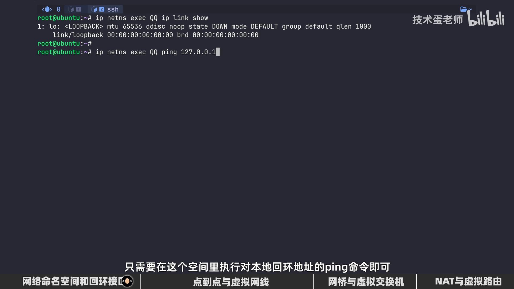
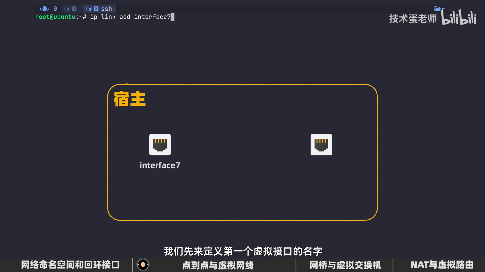
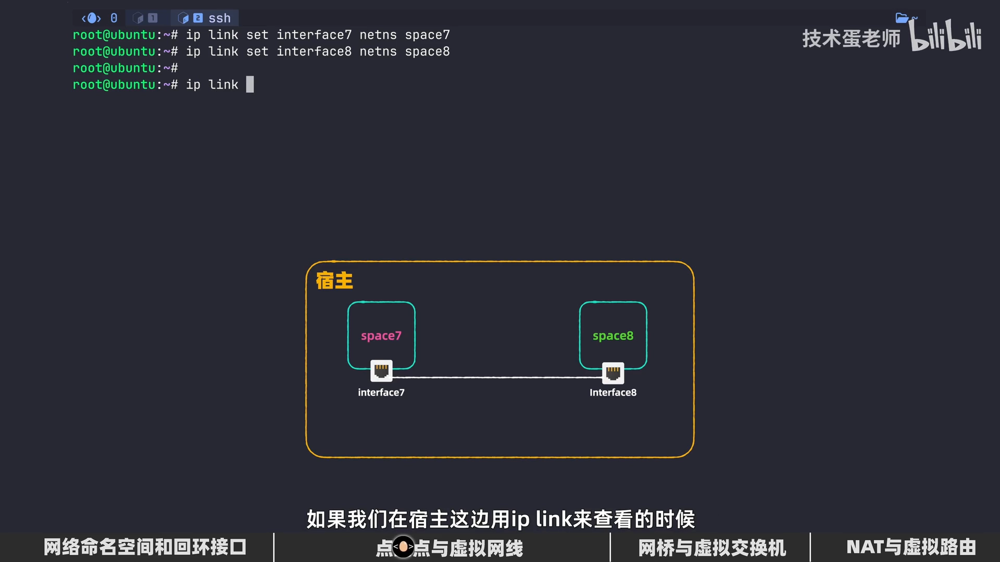
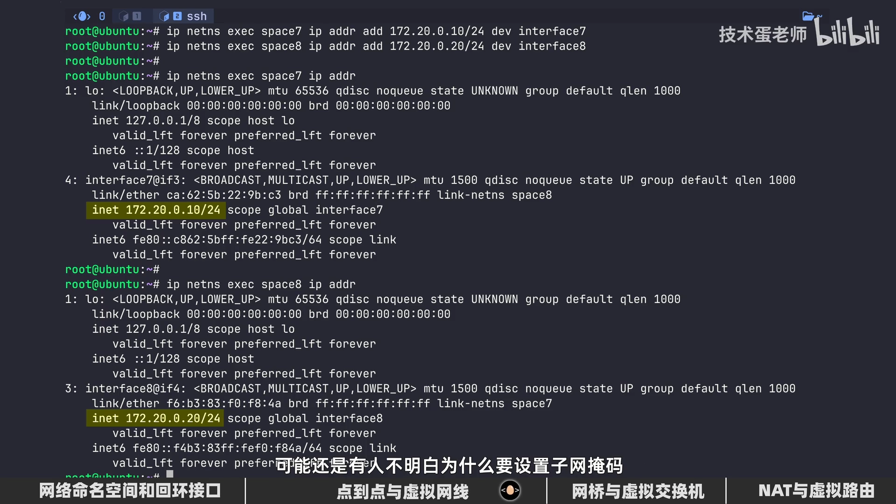
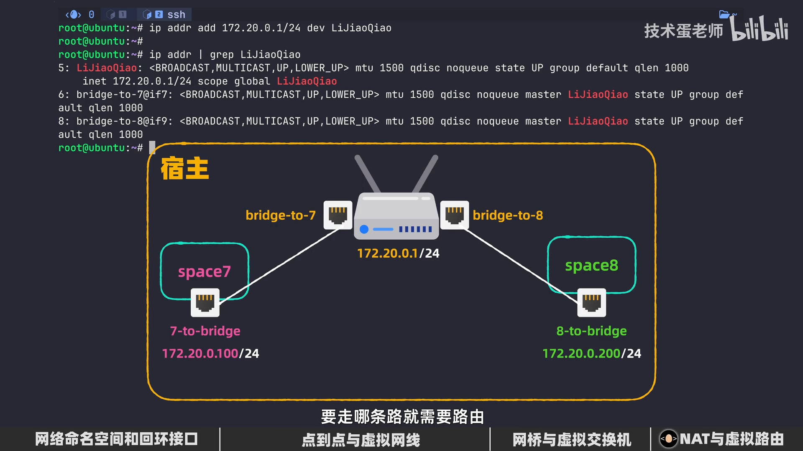

# 网络命名空间与网络设备：用一根虚拟网线、一台虚拟交换机、一台虚拟路由器搭出容器的网络世界

> 视频来源：技术蛋老师 [《Linux网络命名空间核心 | 虚拟网线、虚拟交换机、虚拟路由器》](https://www.bilibili.com/video/BV1Fd5V6VED8/)（15 分 13 秒）。本文基于视频演说图文稿整理，关键处附时间戳，可跳回原视频核对。

## 本讲要解决的核心问题（SCQA）

**背景**：用 Docker 起一个"完全不联网"的容器来保存隐私文件，是很多人听说过的安全操作——容器里的程序连不了外网，数据自然漏不出去。

**冲突**：可如果追问一句"这个『连不了网』到底是怎么做到的？"，多数人就答不上来了。更有意思的是：一个刚创建的隔离网络环境，连 ping 自己（127.0.0.1）都不通。

**疑问**：在一台 Linux 宿主机上，怎么凭空造出多个互相隔离的网络世界？它们之间想通信时，又靠什么设备连起来？

**回答（中心思想）**：靠**网络命名空间**（network namespace）加上三件"虚拟网络设备"——**veth 虚拟网线**把两个空间连起来，**网桥（bridge）**充当虚拟交换机组织局域网，**给网桥配 IP + 默认路由 + NAT** 则把它升级成虚拟路由器、让空间访问公网。本讲跟着视频用 `ip` 命令从零手工搭一遍，每一步都可以亲手复现。

## 一、网络命名空间：把网络栈"分家"

### 1.1 命名空间是内核资源的划分单位

Linux 有很多种命名空间（namespace），本质上都是**对内核不同资源进行划分**：PID 命名空间划分"看得见哪些进程"，挂载命名空间划分"看得见哪些文件系统"，而本文的主角——**网络命名空间**——划分的是整套网络资源 [【跳转到 00:20】](https://www.bilibili.com/video/BV1Fd5V6VED8/?t=20)。

一个网络命名空间里，**网卡接口、IP 地址、路由表、防火墙规则**都是独立的一份。创建与操作它的主力工具是 `ip` 命令：按 TCP/IP 五层模型看，`ip` 命令主要工作在**数据链路层和网络层**，正好覆盖"接口状态、IP 地址、路由"这些本讲要摆弄的东西 [【跳转到 00:40】](https://www.bilibili.com/video/BV1Fd5V6VED8/?t=40)。


### 1.2 先认识宿主机的网络接口

电脑要上网，最先要关注的其实不是 IP 地址，而是**网卡上网络接口的状态**——数据进进出出全靠接口。`ip link` 用来查看接口状态（link 就是"链路"）。典型宿主机上能看到两个接口 [【跳转到 01:02】](https://www.bilibili.com/video/BV1Fd5V6VED8/?t=62)：

- `lo`：**loopback 回环接口**，一个虚拟接口，供本机程序之间互相通信；
- `enp0s5`：对外的**以太网接口**。

两个接口都显示 `up`——注意这不是"up 主"的 up，而是告诉我们接口已经启动、随时可以收发数据。


### 1.3 新建的命名空间有多"空"？连自己都 ping 不通

创建网络命名空间只需一条命令（需要 root 权限）[【跳转到 01:27】](https://www.bilibili.com/video/BV1Fd5V6VED8/?t=87)：

```bash
ip netns add qq      # netns = network namespace
ip netns list        # 列出所有已创建的网络命名空间
```


新建的 qq 空间**完全被隔离**：只有宿主机有权创建、管理、销毁它。想在空间里执行命令，要通过 `ip netns exec <空间名> <命令>`（exec = execute）隔空操作。查看它的链路层信息 [【跳转到 02:17】](https://www.bilibili.com/video/BV1Fd5V6VED8/?t=137)：

```bash
ip netns exec qq ip link show
```

结果只有一块回环接口 `lo`，而且**连 `up` 状态都没有**（处于 DOWN）——这个空间不仅连不了外界，**连和自己通信的能力都没有**，就像被丢进没人找得到的牢房、再贴上一层隔音壁 [【跳转到 02:42】](https://www.bilibili.com/video/BV1Fd5V6VED8/?t=162)。


在空间里 ping 回环地址验证一下，网络完全不通 [【跳转到 03:10】](https://www.bilibili.com/video/BV1Fd5V6VED8/?t=190)：



> 顺带一提：这种"断网"本身就是一种安全能力——比如保存加密货币私钥这类敏感数据时，网络隔离就是保护措施的其中一步。

要让同一空间里的两个程序互相通信，得先把回环接口"通电"：

```bash
ip netns exec qq ip link set lo up
```

之后再 ping 127.0.0.1 就完全没问题了 [【跳转到 03:35】](https://www.bilibili.com/video/BV1Fd5V6VED8/?t=215)。

## 二、veth 虚拟网线：把两个空间连起来

### 2.1 两个空间之间需要一根"网线"

《红色警戒》联机的年代，两台电脑若不通过路由器或集线器，通常就用**交叉线**这样的网线直接互联 [【跳转到 03:52】](https://www.bilibili.com/video/BV1Fd5V6VED8/?t=232)。两个网络命名空间要联网，同样需要一根"网线"——它就是 **veth（virtual ethernet，虚拟以太网网线）**。

先创建两个空间做实验（视频里起名"七度空间"和"八度空间"），随后创建虚拟网线 [【跳转到 04:03】](https://www.bilibili.com/video/BV1Fd5V6VED8/?t=243)：

```bash
ip netns add 七度空间
ip netns add 八度空间
ip link add <接口A> type veth peer name <接口B>   # 接口名习惯带上所属空间名
```

veth 和真实网线一样**有两个接口**，一边一个：`type veth` 声明设备类型，`peer name` 给对端接口命名。创建后用 `ip link` 能看到两个新接口，接口名后面的 `@` 表示它的**对端接口** [【跳转到 04:53】](https://www.bilibili.com/video/BV1Fd5V6VED8/?t=293)。



### 2.2 把网线"插"进空间

此时网线两端都还留在宿主机上。用 `ip link set <接口> netns <空间>` 把接口**放置到指定空间**里 [【跳转到 05:18】](https://www.bilibili.com/video/BV1Fd5V6VED8/?t=318)：

```bash
ip link set <接口A> netns 七度空间
ip link set <接口B> netns 八度空间
```

执行后，宿主机的 `ip link` 里这两个接口消失了；分别到两个空间里查看，则各自多出一端——**一根虚拟网线就此贯通两个命名空间** [【跳转到 05:43】](https://www.bilibili.com/video/BV1Fd5V6VED8/?t=343)。




### 2.3 通电、配地址

插了网线不通电也没用。把两端接口设为 `up`，再分别给两个空间的接口配内网 IP（示意）[【跳转到 06:33】](https://www.bilibili.com/video/BV1Fd5V6VED8/?t=393)：

```bash
ip netns exec 七度空间 ip link set <接口A> up
ip netns exec 八度空间 ip link set <接口B> up
ip netns exec 七度空间 ip addr add 172.20.0.10/24 dev <接口A>
ip netns exec 八度空间 ip addr add 172.20.0.20/24 dev <接口B>
```

两个要点：要用**内网地址**（打算让它们走局域网通信）；**千万别忘了子网掩码**——没有掩码，系统没法判断数据包要往哪个方向走。`/24` 表示 172.20.0.0～172.20.0.255 都属于同一个局域网；`dev` 表示 device（设备），指明把地址配到哪个接口上 [【跳转到 06:58】](https://www.bilibili.com/video/BV1Fd5V6VED8/?t=418)。


### 2.4 路由表怎么"知道"对方在哪

为什么必须配掩码才能通？看七度空间的路由表：添加 IP/掩码之后，表里多了一条**直连路由**——它的目标网络范围正好覆盖八度空间的地址段，于是发往八度空间的数据包从逻辑上就会走这条路由 [【跳转到 07:23】](https://www.bilibili.com/video/BV1Fd5V6VED8/?t=443)。



现在两边互相 ping 都通了——**点到点通信**达成。在八度空间里启动一个 Web 服务并开始监听，从七度空间也能直接访问（毕竟两点之间只有这一根"网线"）[【跳转到 07:48】](https://www.bilibili.com/video/BV1Fd5V6VED8/?t=468)。这种点到点直连，常见于前端与后端服务之间的网络通信。

## 三、网桥：多空间的"虚拟交换机"

### 3.1 点到点的线路会爆炸

两个空间用一根 veth 直连很清爽；可要是空间多了，个个两两直连，线路会乱得像家门口堆的鞋子 [【跳转到 08:25】](https://www.bilibili.com/video/BV1Fd5V6VED8/?t=505)。现实中的解法是**交换机**：所有设备都插到交换机上，两两通信由交换机转接。在网络命名空间的"局域网"里，扮演交换机角色的就是**网桥（bridge）** [【跳转到 08:38】](https://www.bilibili.com/video/BV1Fd5V6VED8/?t=518)。

### 3.2 创建网桥并用 veth 接线

网桥和虚拟网线的设置是同样的道理：还是在宿主机里用 `ip link add` 添加接口，类型注明是 bridge，然后启用 [【跳转到 08:48】](https://www.bilibili.com/video/BV1Fd5V6VED8/?t=528)：

```bash
ip link add <网桥名> type bridge
ip link set <网桥名> up
```

网桥一般放在**宿主机**上，这样更方便空间通过它对外通信。把空间接到网桥，仍然靠 veth：先在宿主机创建一根新网线，一端 `netns` 塞进空间，另一端用 `master` **归属到网桥**——相当于把网线插上交换机（下述接口名为示意）[【跳转到 09:38】](https://www.bilibili.com/video/BV1Fd5V6VED8/?t=578)：

```bash
ip link add <接口C> type veth peer name <接口D>
ip link set <接口C> netns 七度空间
ip link set <接口D> master <网桥名>
```

两端都要 `up`（注意一端在空间里、一端在宿主机里，命令要分别到对应环境里执行；用 `ip link` 展示接口信息可以确认是否真的已启动）。另一个空间同样接法；新接口要配**新的、不冲突的 IP** [【跳转到 10:03】](https://www.bilibili.com/video/BV1Fd5V6VED8/?t=603)。


### 3.3 二层交换机不看 IP

有人会顺手给网桥也配个 IP——其实不必。此时的网桥相当于**二层交换机，按 MAC 地址转发**，只需分别给两个空间各自的接口配 IP。配好后跨空间 ping 立刻生效，而且此后再多接几个空间，也都桥接在这台"交换机"上 [【跳转到 10:28】](https://www.bilibili.com/video/BV1Fd5V6VED8/?t=628)。

## 四、虚拟路由器 + NAT：让空间访问公网

### 4.1 把网桥升级为路由器

局域网内部通了，但让空间去访问公网 IP 依然不行——它还缺一台**路由器**。好消息是"网线"都插好了，只要把网桥"升级"成虚拟路由器，能省很多步骤。路由的本质是**根据 IP 地址对数据包进行转发**，所以第一步是给网桥接口配一个 IP——一般路由器地址的最后一段都是 1，于是取 172.20.0.1 [【跳转到 11:18】](https://www.bilibili.com/video/BV1Fd5V6VED8/?t=678)：

```bash
ip addr add 172.20.0.1/24 dev <网桥名>
```

### 4.2 给空间加默认路由

空间怎么知道"出公网该把包交给网桥，而不是发给同网段的其他空间"？走哪条路，需要**路由规则**。路由表里一般都要有一条默认路由：目的地不在本地局域网的数据包，统统发往默认路由 [【跳转到 11:43】](https://www.bilibili.com/video/BV1Fd5V6VED8/?t=703)：

```bash
ip netns exec 七度空间 ip route add default via 172.20.0.1
```

`via` 指定**下一跳**地址，也就是刚配给网桥的 IP。这里有个容易踩的坑：查看路由表时，默认路由可能仍绑在**之前点到点那块旧接口**上（接口和网桥不一致）——把没用的旧接口关掉或删除；关掉后默认路由会一并消失，需要重新配置。经验是：**打算用网桥/路由，就先把点到点连接清理掉，以免弄混** [【跳转到 12:33】](https://www.bilibili.com/video/BV1Fd5V6VED8/?t=753)。



### 4.3 打开宿主机的转发开关

空间把包发给了宿主机上的网桥，宿主机会帮你往外转吗？在宿主机用 `sysctl` 命令查看 IP 转发的设置会发现：它的值是 0，**宿主机默认不帮任何数据包转发**——空间即使能把包路由到宿主机，宿主机也不会转出去。这其实是个安全设计：一台默认就转发数据包的电脑，一旦被黑客攻破，就会成为攻击同一局域网里其他设备的跳板。确认要当路由器用，就手动设为 1 [【跳转到 12:58】](https://www.bilibili.com/video/BV1Fd5V6VED8/?t=778)：

```bash
sysctl -w net.ipv4.ip_forward=1
```

### 4.4 NAT 伪装：让回包找得到路

转发打开后，包出得去却回不来：空间里的 IP 是**内网地址**，目标设备收到后根本没办法给你响应数据——内网地址无法在公网里转发。解决办法是 **NAT 地址转换**，用 `iptables` 改写数据包的源地址 [【跳转到 13:39】](https://www.bilibili.com/video/BV1Fd5V6VED8/?t=819)：

```bash
iptables -t nat -A POSTROUTING -s 172.20.0.0/24 -j MASQUERADE
```

拆开看：`-t nat` 操作 nat 表（-t = table）；`-A`（append）往链里追加规则；`POSTROUTING` 是"路由后"链——数据包离开宿主机网卡前的最后一关；`-s`（source）限定源地址段，覆盖整个局域网段即可；动作 `MASQUERADE`（伪装）会**自动查看宿主机上哪块网卡可以访问外部网络**，把包的源地址直接改成那块网卡的 IP——多个空间共用一条规则就行，不用手动指定 [【跳转到 14:04】](https://www.bilibili.com/video/BV1Fd5V6VED8/?t=844)。


### 4.5 验证：空间里 ping 通公网

至此，空间里的数据包终于能"出去且回得来"了。在空间里 ping 一个公网地址，收到回复就说明配置基本没问题——整条链路打通 [【跳转到 14:54】](https://www.bilibili.com/video/BV1Fd5V6VED8/?t=894)。


熟悉了这套核心，再配合 iptables 做**端口转发**和**安全隔离**，就是水到渠成的事——这正是 Docker 给容器分配网络时在幕后做的事情。

## 小结

- **网络命名空间**对内核网络资源"分家"：每个空间有自己独立的接口、IP、路由表与防火墙规则；由宿主机创建、管理、销毁。
- 新建空间只有一块 DOWN 状态的 `lo`，连 127.0.0.1 都 ping 不通；`ip link set lo up` 后才能本机互通。
- **veth = 虚拟网线**：`ip link add ... type veth peer name ...` 创建，`ip link set <接口> netns <空间>` 把一端插入空间，两端 `up` + 配内网 IP，靠直连路由即可点到点互通。
- **网桥 = 虚拟交换机**（二层、按 MAC 转发）：`type bridge` 创建，通常留在宿主机；空间用 veth 接入，一端 `netns`、一端 `master <网桥>`；不必给网桥配 IP。
- **上公网三步**：给网桥配 IP 升级为虚拟路由器 → 空间加 `default via 网桥IP` 默认路由（先清理旧点到点链路）→ 宿主机开 `ip_forward` 并配 `iptables -t nat ... MASQUERADE`。
- 这一整套"网线 + 交换机 + 路由器 + NAT"，就是容器网络隔离与组网的底层积木。

## 关键术语速查

| 术语 | 一句话解释 |
| --- | --- |
| 网络命名空间（netns） | 内核对网络资源的划分单位，每个空间拥有独立的接口/IP/路由/防火墙 |
| `ip netns add/exec/list` | 创建网络命名空间 / 在指定空间内执行命令 / 列出空间 |
| 回环接口 lo | 本机自环的虚拟接口，空间内程序互访走它，需 `up` 后才工作 |
| veth pair | 成对出现的虚拟以太网"网线"，一端进包另一端出包，用于跨越命名空间 |
| `ip link set X netns Y` | 把接口 X 移入命名空间 Y（移出后原空间不可见） |
| 网桥（bridge） | 二层虚拟交换机，按 MAC 转发；`master` 把接口挂到网桥 |
| 默认路由（default via） | 目标不在本地网段时的"出门"方向，via 指定下一跳 IP |
| `net.ipv4.ip_forward` | 内核是否转发数据包的开关（0 不转发，1 转发） |
| NAT / MASQUERADE | 改写包源地址使内网可上公网；MASQUERADE 自动选用口网卡地址 |
