# Linux ulimit 的几大天坑：为什么改了配置，进程还是 too many open files

> 视频来源：B 站 UP 主「SRETALK」[《Linux ulimit 设置的几大天坑》](https://www.bilibili.com/video/BV1xK421h7ET/)（8 分 11 秒）。本文基于视频字幕与画面整理，内容均可在原视频核查。

## 本讲要解决的核心问题（SCQA）

**背景**：有一点 Linux 经验的工程师，几乎都遇到过 `too many open files` 这个报错，有些甚至引发过线上故障。

**冲突**：明明已经在 `/etc/security/limits.conf` 里设置了文件句柄数，为什么进程还是因为打不开文件而崩溃？

**疑问**：ulimit 到底该怎么看、怎么设，才能让设置真正作用到目标进程上？

**回答（中心思想）**：ulimit 设置的坑，根源在于**「在哪看」和「在哪设」都取决于进程是怎么启动的**。正确姿势是：查看用 `/proc/<PID>/limits`，设置按启动方式对号入座——PAM 走 `limits.conf`，systemd 走 `LimitNOFILE`，其他托管工具各有各的配置；此外系统层面还有 `file-max` 这道总量闸门，要纳入监控。

> 注：ulimit 不只限制文件句柄，还有一堆其他限制项，`ulimit -a` 可以全部看到；本讲以最常出事的**文件句柄（nofile）**为例。

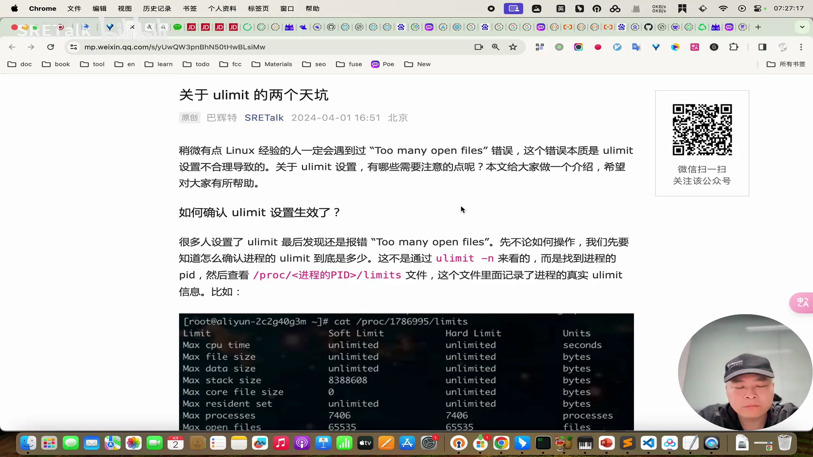

## 一、先学会「看」：进程的真实限制在 /proc/PID/limits

### 1.1 ulimit -n 看到的值不一定是进程的限制

排查句柄问题，第一步不是改配置，而是**先弄清楚这个进程真实的 ulimit 是多少**。很多人以为敲 `ulimit -n` 看到的值就是进程的限制——这是错的：进程的限制由很多因素决定（父进程、启动方式等），shell 里的值只代表当前 shell 自己。[【跳转到 01:07】](https://www.bilibili.com/video/BV1xK421h7ET/?t=67)

### 1.2 唯一可信的查看方法

真正可信的方法是**直接问内核**：找到进程的 PID，查看 `/proc/<PID>/limits` 文件。`cat` 这个文件，就能看到这个进程真实的各项限制。[【跳转到 00:55】](https://www.bilibili.com/video/BV1xK421h7ET/?t=55)

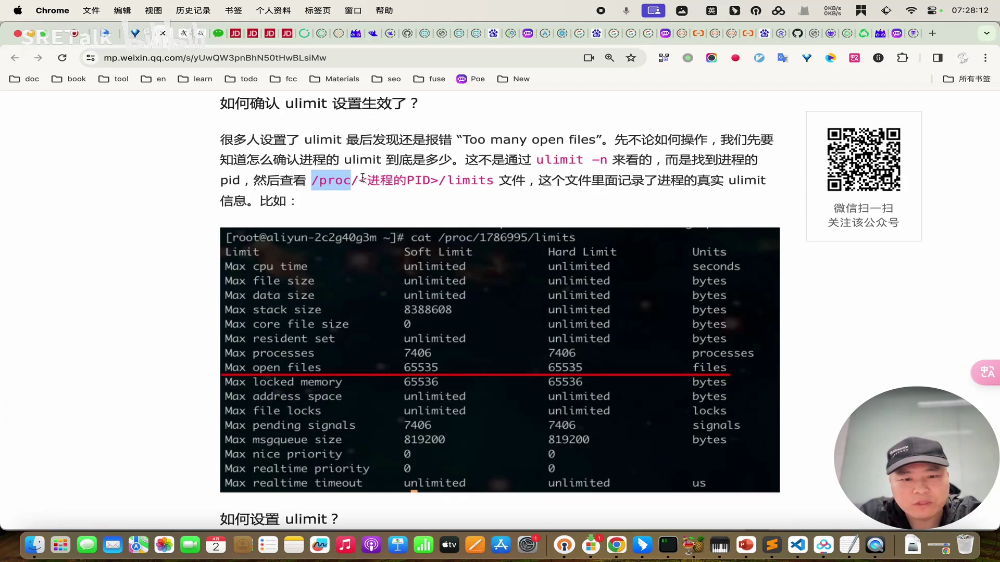

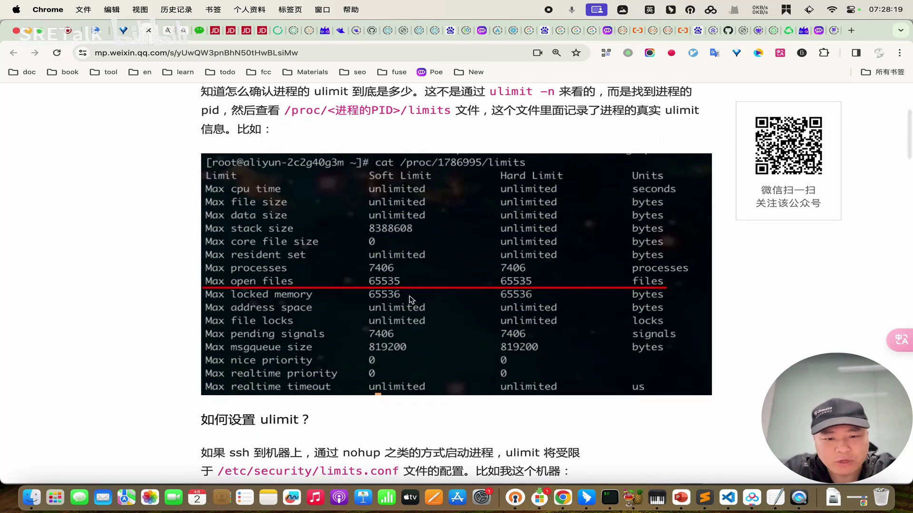

「如何查看进程真实 ulimit」本身就是关键知识——看明白了再看怎么设。

## 二、设置路径一：limits.conf，只对走 PAM 的进程生效

### 2.1 配置文件本身很直观

最广为人知的设置位置是 `/etc/security/limits.conf`。作者的环境是一台阿里云机器，出厂默认就带了每用户 6 万多的 nofile 上限，对一般机器来说足够用了，维持默认即可。[【跳转到 01:33】](https://www.bilibili.com/video/BV1xK421h7ET/?t=93)

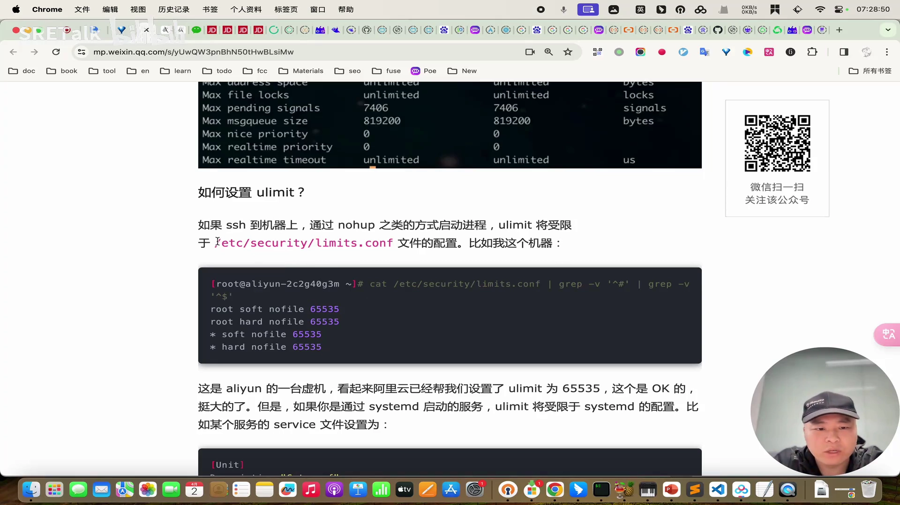

### 2.2 关键限制：它不是对所有进程生效

但注意——**在 limits.conf 里设置，并不是对所有进程生效**。[【跳转到 01:57】](https://www.bilibili.com/video/BV1xK421h7ET/?t=127)

只有走 **PAM 逻辑**的进程才受这个限制：比如你 SSH 登录到机器，再通过 `nohup` 之类的方式启动的进程，才会继承这套配置。而如果是 systemd 启动的服务，就有可能完全不受它管。

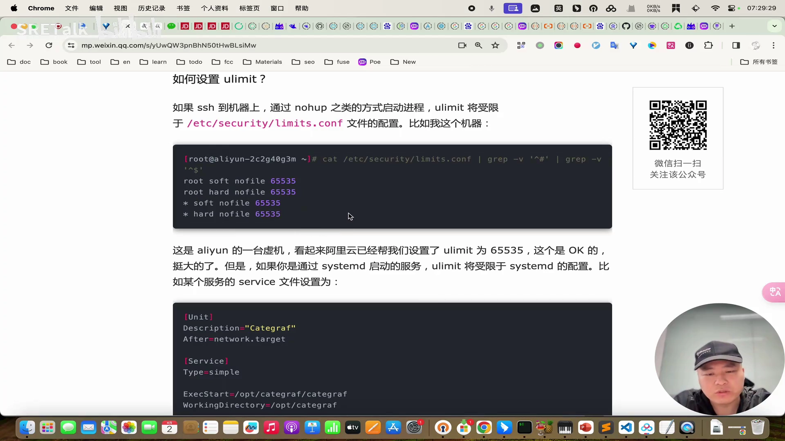

## 三、设置路径二：systemd 服务要在 service 文件里加 LimitNOFILE

### 3.1 service 文件是 systemd 服务的正确配置点

systemd 启动的服务，一般都有一个 `.service` 文件；在文件里加一行 `LimitNOFILE=<值>`，就能控制这个服务的文件句柄限制。[【跳转到 02:33】](https://www.bilibili.com/video/BV1xK421h7ET/?t=153)

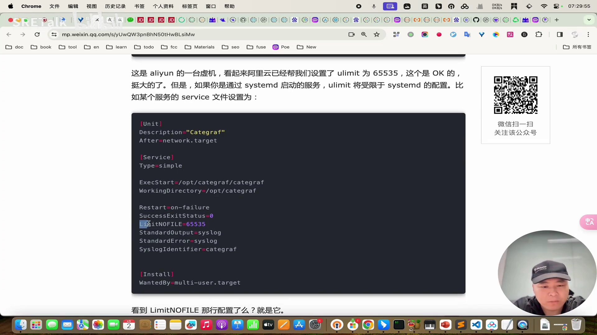

### 3.2 没配置时的默认值在 /etc/systemd 下

如果 service 文件里没写 `LimitNOFILE`，systemd 会使用默认配置。默认配置位于 `/etc/systemd` 下：对这个目录下所有 `conf` 文件 `grep` 一下，能看到两处——`system.conf`（系统服务）和 `user.conf`（用户服务），改哪个都行。不过这种改法**需要重启才能生效**。[【跳转到 03:01】](https://www.bilibili.com/video/BV1xK421h7ET/?t=181)

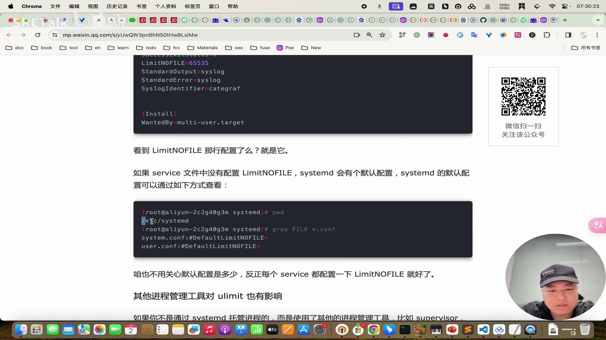

作者的观点是：默认配置在哪里其实不太重要——正常情况下，每个 service 文件里都应该带上自己的 `LimitNOFILE`，这样 limits.conf（若走 PAM）和 service 文件（若走 systemd）各管各的，理论上就不会出问题。

## 四、systemd 之外的两个「天坑」：Supervisor 与 SaltStack

如果是 systemd 托管的，上面两条路径理清楚就基本没问题了；但**其他托管方式还有各自的坑，而且这些坑反而容易引发线上故障**。[【跳转到 03:46】](https://www.bilibili.com/video/BV1xK421h7ET/?t=226)

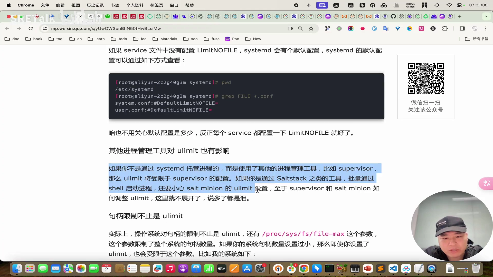

- **Supervisor 托管**：Supervisor 自己也有限制。它的配置文件里可以配置进程的文件句柄限制；如果你没设置、走了默认值，而默认值又不合理，就可能出问题。
- **SaltStack 批量启动**：用 SaltStack 之类的工具批量通过 shell 启动进程时，进程实际会受限于 **salt-minion**（SaltStack 的 agent）进程自己的句柄数量——所以还得调整 salt-minion 的 ulimit，而不只是目标进程的。

这两个坑作者都真正见过线上故障，所以视频里没有展开具体操作，只提醒：用到这两个工具时，记得去查一下它们的句柄限制配置。[【跳转到 04:41】](https://www.bilibili.com/video/BV1xK421h7ET/?t=281)

## 五、系统总量还有一道闸：file-max

### 5.1 句柄限制不止 ulimit 一层

ulimit 是进程级别的限制，但系统层面还有一道**总量闸门**：`/proc/sys/fs/file-max`，表示整个操作系统可以分配的文件句柄总量。作者的环境里这个值是 18 万左右（可能是阿里云默认设置），也够用、基本没调过。[【跳转到 05:00】](https://www.bilibili.com/video/BV1xK421h7ET/?t=300)

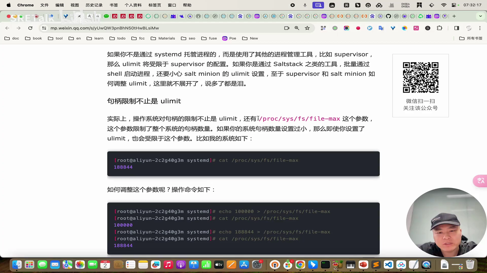

### 5.2 echo 立即生效但不持久，sysctl.conf 才持久

调整它很简单：`echo` 一个值写进这个文件，再去看就生效了（作者演示后又恢复了原值）。但要注意：**用 echo 设置，重启机器就失效**。想让配置在重启后仍然生效，要写入 `/etc/sysctl.conf`，加一行 `fs.file-max = <值>`。[【跳转到 05:23】](https://www.bilibili.com/video/BV1xK421h7ET/?t=323)

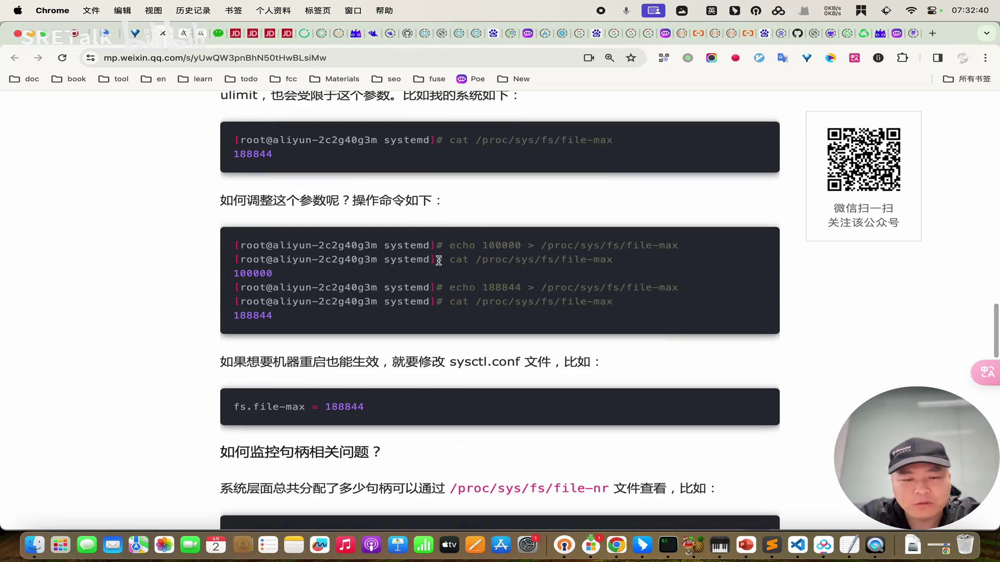

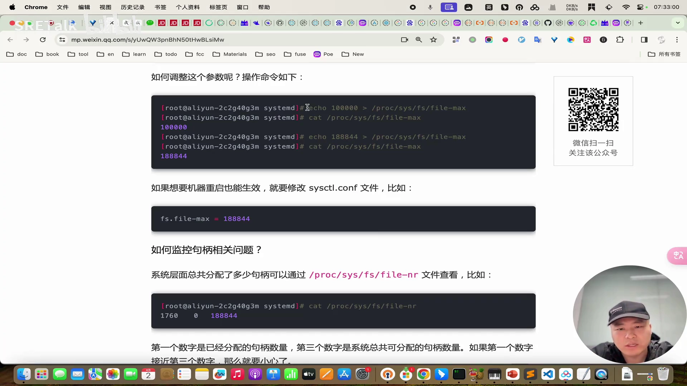

## 六、把它纳入监控：file-nr 与 procstat 指标告警

### 6.1 file-nr：当前已分配 / 总量

总量限了多少是静态的，更重要的是**当前已经分配了多少**。这个值来自 `/proc/sys/fs/file-nr`：文件里有三个值，第一个就是当前已分配的句柄数。如果已分配数量接近 file-max 总量，就意味着应该告警。[【跳转到 06:13】](https://www.bilibili.com/video/BV1xK421h7ET/?t=373)

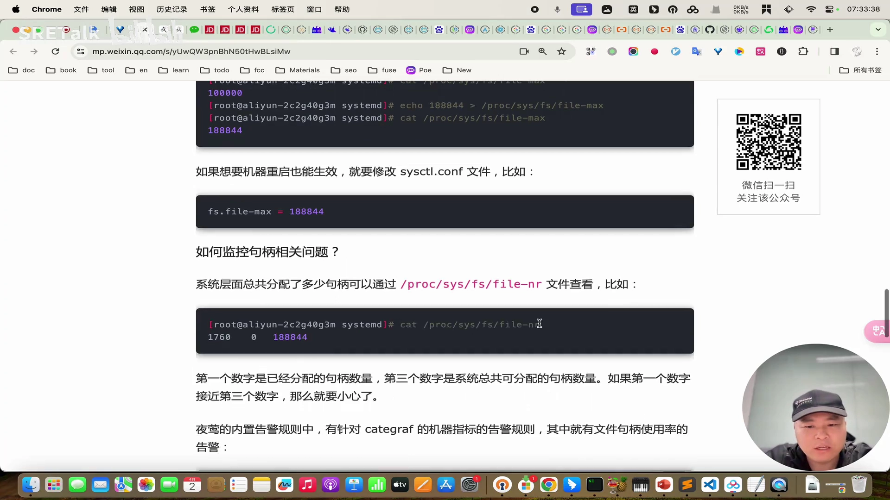

### 6.2 夜莺内置规则：两条现成的告警

如果使用**夜莺（Nightingale）**监控，它内置了 Categraf 相关的 Linux 告警规则集，其中就有一条现成的高级规则：**已分配句柄数 ÷ file-max 总量 > 90% 就报警**，导入即可使用。[【跳转到 06:33】](https://www.bilibili.com/video/BV1xK421h7ET/?t=393)

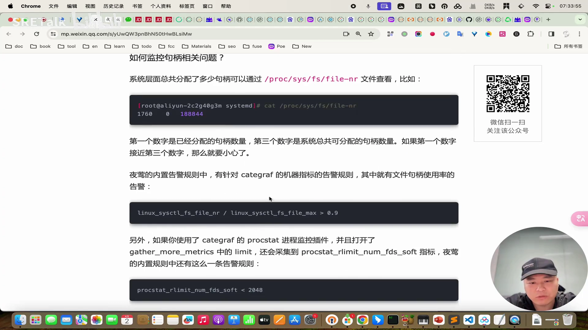

### 6.3 进程级软限制也要监控

另外，如果用 Categraf 的 **procstat** 插件采集进程，还能拿到一个进程级的指标：**procstat limit number fd soft**，也就是进程句柄的软限制。对它做监控的理由很直接：如果这个指标小于 2048，说明这台机器的默认配置（一般是 1024）从来没调过，ulimit 很可能有问题——这同样可以作为一条告警规则。[【跳转到 07:00】](https://www.bilibili.com/video/BV1xK421h7ET/?t=420)

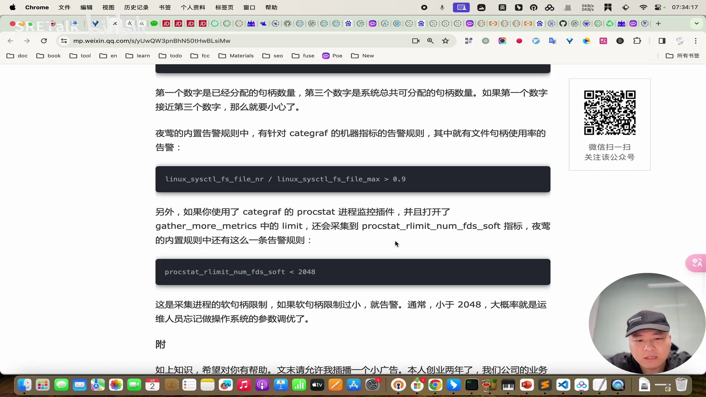

## 小结

- 排查句柄问题先「看」后「设」：**唯一可信的查看方法是 `cat /proc/<PID>/limits`**，`ulimit -n` 只反映当前 shell。
- `/etc/security/limits.conf` 只对走 **PAM** 的进程生效（如 SSH 登录 + nohup 启动）。
- systemd 服务用 service 文件里的 **LimitNOFILE**；没配时的默认值在 `/etc/systemd/system.conf`、`user.conf`，改动需重启。
- **Supervisor** 与 **SaltStack（salt-minion）** 各有独立的句柄限制链路，是容易被忽视的线上故障来源。
- 系统总量闸门 **fs.file-max**：echo 即时生效不持久，持久化写 `sysctl.conf`。
- 监控两条线：file-nr 已分配/总量 >90% 告警；procstat 句柄软限制 <2048 告警（夜莺有内置规则可导入）。

## 关键术语速查

| 术语 | 一句话解释 |
| --- | --- |
| ulimit | 进程级资源限制机制，nofile 限制可打开的文件句柄数 |
| /proc/PID/limits | 内核记录的该进程真实限制，排查时的唯一权威依据 |
| limits.conf | `/etc/security/limits.conf`，仅对走 PAM 登录链路的进程生效 |
| LimitNOFILE | systemd service 文件中的句柄限制配置项 |
| salt-minion | SaltStack 的 agent，批量启动的进程受其句柄限制约束 |
| fs.file-max | 系统全局可分配文件句柄总量（/proc/sys/fs/file-max） |
| file-nr | 已分配句柄数等三个值的只读计数文件，用于监控告警 |
| procstat | Categraf 采集进程指标的插件，可输出句柄软限制指标 |
