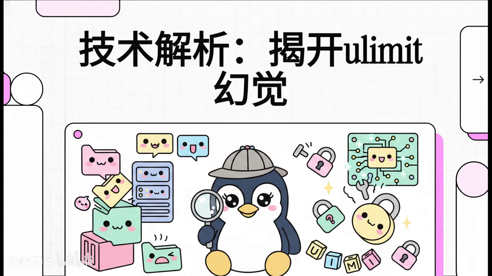
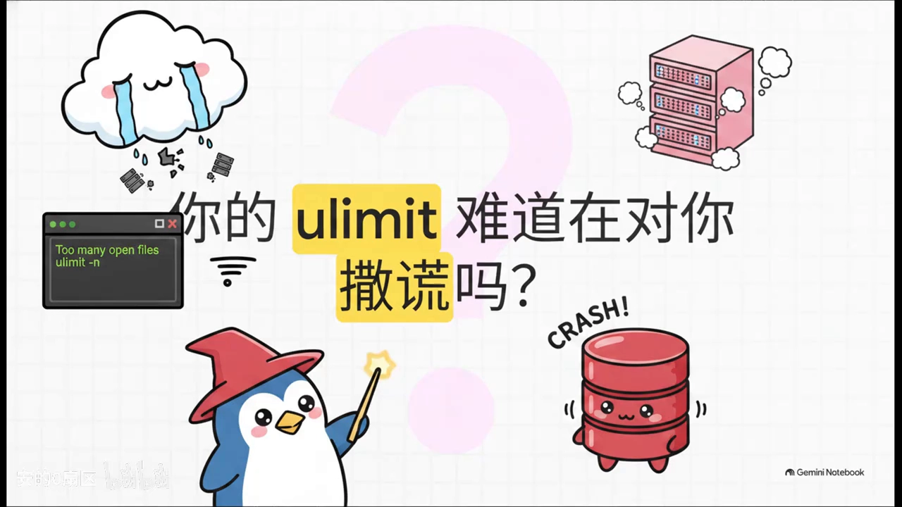
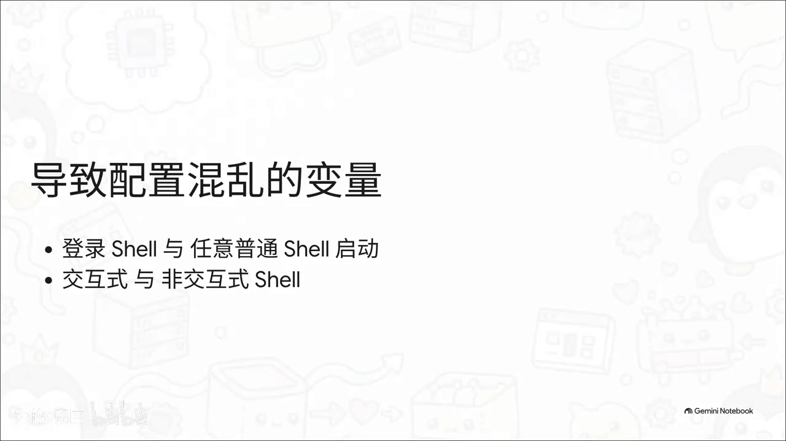
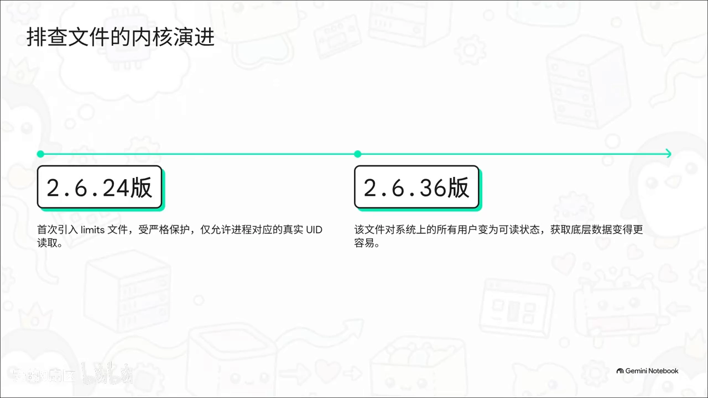
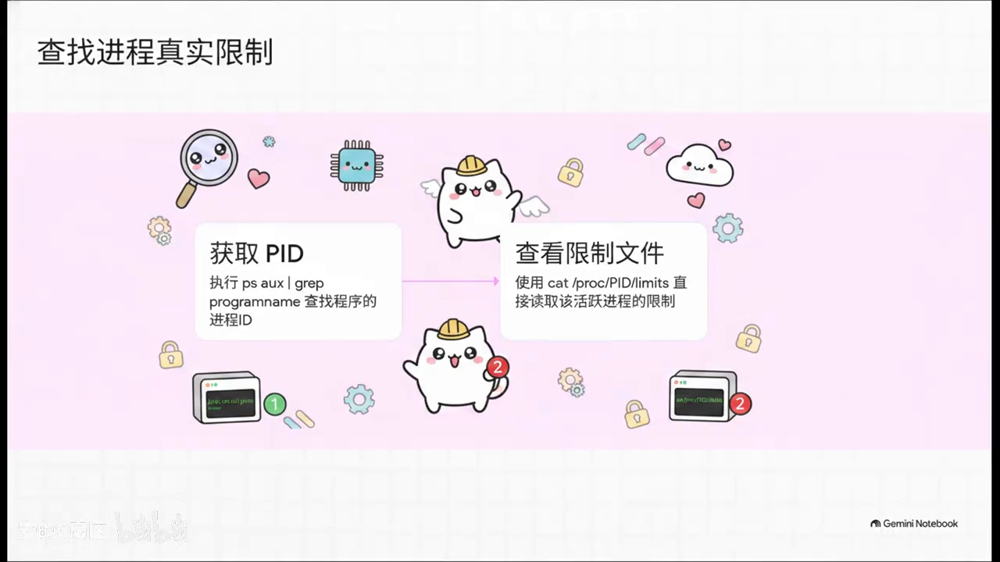
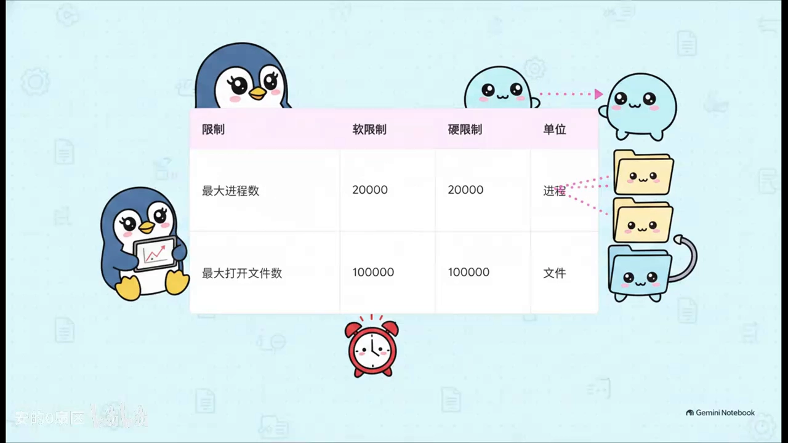
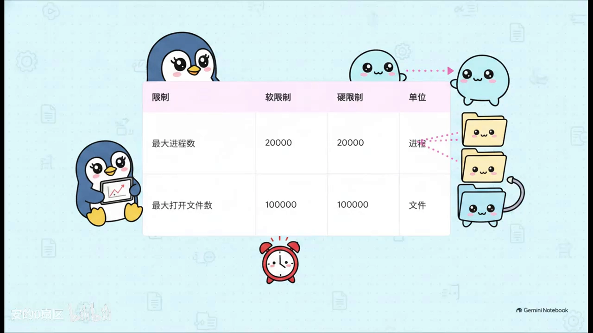
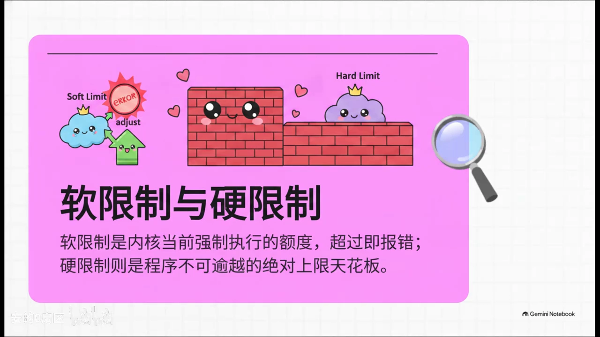
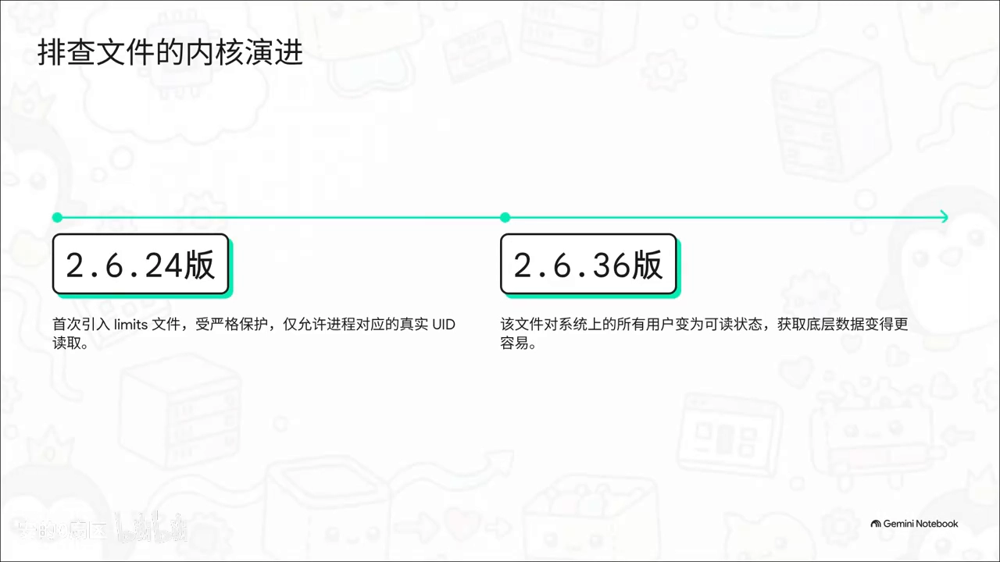
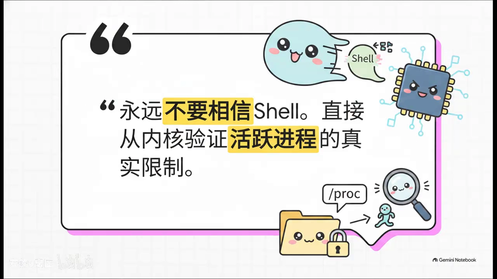

# 揭开 ulimit 幻觉：永远不要相信 shell，直接问 /proc/PID/limits

> 视频来源：B 站 UP 主「安的0扇区」[《技术解析：揭开 ulimit 幻觉》](https://www.bilibili.com/video/BV1Bxtf6qE2x/)（6 分 06 秒，系列「技术解析」第 8 期）。本文基于视频字幕与画面整理，内容均可在原视频核查。

## 本讲要解决的核心问题（SCQA）

**背景**：后端工程师大多见过这个场景——服务并发冲到几千，或程序遍历海量小文件时，日志里疯狂报错 `too many open files`。

**冲突**：你敲 `ulimit -n`，系统显示 65535；甚至早就在 limits 配置文件里改成了 1000 万。但后台程序依然稳定地在打开第 1024 个文件时崩溃——配置改了、ulimit 也看了，就是不给你句柄。

**疑问**：难道是 ulimit 在撒谎？

**回答（中心思想）**：ulimit 没撒谎，是**shell 骗了你**。终端里看到的数值只属于当前 SSH 会话；真正生效的限制取决于**进程是怎么被启动的**——systemd、Docker 这类父进程根本不理会你改的常规配置，自带一套默认（通常 1024）。唯一可信的答案是直接问内核：`cat /proc/<PID>/limits`。

## 一、幻觉是怎么产生的：限制靠继承，而 shell 的继承是假象

### 1.1 你看到的 65535 只属于当前会话

Linux 的资源限制依赖**继承机制**：子进程的限制来自父进程。你在终端里敲 `ulimit -n` 看到的高数值，只针对当前 SSH 登录的 shell 会话。如果你在终端里手动启动服务，它确实会继承这 65535——**但这在生产环境是个巨大的假象**：谁会用前台 shell 启动核心服务呢？[【跳转到 01:05】](https://www.bilibili.com/video/BV1Bxtf6qE2x/?t=65)

### 1.2 真正的根源：父进程是谁，限制就听谁的

生产环境的服务，要么被 **systemd** 托管，要么跑在 **Docker 容器**里。systemd 和 Docker 守护进程作为父进程拉起子进程时，**根本不理会你写在常规配置文件里的参数**，它们有自己独立的一套默认限制规则——而且这个默认值通常极其保守：**1024**。这就是程序「不明不白被困在隐形牢笼里」的根本原因。[【跳转到 01:41】](https://www.bilibili.com/video/BV1Bxtf6qE2x/?t=101)

> 注：00294 帧对应「从根源解决」一节，见第五部分。

## 二、唯一可信的答案：去问内核本人

既然终端环境靠不住、常规配置不能信，排查这类问题唯一绝对正确的做法是：**直接问内核，这个进程到底被分配了多少额度**。这本绝对权威、无法造假的「资源账本」，就藏在 `/proc` 目录里——真正的答案只存在于**运行中的进程**本身。[【跳转到 02:06】](https://www.bilibili.com/video/BV1Bxtf6qE2x/?t=126)

操作只要两步：

1. 查出程序的进程 ID（PID）；
2. 直接打印它的 limits 文件：`cat /proc/<PID>/limits`。

这一行命令能绕过所有 shell 制造的幻觉，一针见血地拿到内核对这个活跃进程施加的全部边界数据。[【跳转到 02:41】](https://www.bilibili.com/video/BV1Bxtf6qE2x/?t=161)

## 三、读懂这张表：盯住两行、认准两列

### 3.1 先盯两行：Max open files 与 Max processes

回车之后内核会给出一张工整的表格。排查崩溃问题时必须死死盯住两行：

- **Max open files**：最大打开文件数，决定程序能维持多少网络并发连接、能同时打开多少个文件；
- **Max processes**：最大进程数，决定程序最多能创建多少个线程——别忘了在 Linux 底层，**线程本质上就是轻量级进程**。[【跳转到 03:13】](https://www.bilibili.com/video/BV1Bxtf6qE2x/?t=193)

### 3.2 再认两列：Soft Limit 与 Hard Limit

每项限制都有两列数值：

- **Soft Limit（软限制）**：内核**当前真正用来卡你**的那条红线，程序消耗超过它立刻报错。如果这里 Max open files 的软限制只有 1024，那前面说的崩溃就太正常了——跟你的终端环境毫无关系。
- **Hard Limit（硬限制）**：绝对天花板。程序运行时可以通过系统调用（setrlimit）自己把软限制往上提，但**无论怎么折腾都不能跨越硬限制**这道铜墙铁壁。[【跳转到 03:47】](https://www.bilibili.com/video/BV1Bxtf6qE2x/?t=227)

补充一个历史细节：早期内核版本里查看这个文件还有权限门槛，从 **Linux 2.6.36** 开始它对系统所有用户完全可读，获取底层真相变得极为容易。

## 四、查出问题后怎么改：热修改 + 根源治理

如果出问题的是线上高可用核心服务，**千万别随便重启**。可以用 `prlimit` 命令直接**热修改**：一条命令把文件句柄的软硬限制同时拉升，立即生效，完美救场。[【跳转到 04:29】](https://www.bilibili.com/video/BV1Bxtf6qE2x/?t=269)

但为了防止下次重启打回原形，必须**从根源解决**：

- systemd 托管的：改 service 文件，加上 `LimitNOFILE` 配置；
- Docker 里跑的：在运行参数里加上限制参数。

## 五、一条铁律 + 四大排查链路

**铁律：永远不要相信 shell。遇到资源限制问题，必须直接从内核验证活跃进程的真实情况。**[【跳转到 05:12】](https://www.bilibili.com/video/BV1Bxtf6qE2x/?t=312)

视频最后还回顾了本系列（/proc 排查）阶段的四大核心排查链路：

1. 查线程真实状态与切换开销 → 看 `task` 目录；
2. 查死锁和假死原因 → 看 `WCHAN` 和 `stack`；
3. 查容器物理资源限制 → 进 `cgroup` 读底层配置；
4. 查并发连接与句柄限制 → 认准 `limits`（即 /proc/PID/limits）。

只要掌握这四个抓手，多线程与容器环境里的绝大多数疑难杂症都将无所遁形。下一系列将进入网络栈：包收发延迟、丢包、TIME_WAIT 堆积在内核里留下的痕迹（`/proc` 的 net 目录）。

## 小结

- ulimit 幻觉的本质：**限制靠进程继承**，shell 会话的数值只对「你手动前台启动」的东西有效。
- 生产服务的父进程是 systemd/Docker，它们**自带默认限制（通常 1024）**，不理会常规配置文件。
- 排查唯一正解：**`cat /proc/<PID>/limits`**，直接问内核。
- 表格重点：**Max open files**（并发连接）、**Max processes**（线程=轻量级进程）；每项分 **Soft/Hard** 两列，软限制是现行红线、硬限制是天花板（setrlimit 可提软不可越硬）。
- 修复分两层：急救用 **prlimit 热修改**；根治改 systemd `LimitNOFILE` 或 Docker 运行参数。
- 铁律：**永远不要相信 shell**。

## 关键术语速查

| 术语 | 一句话解释 |
| --- | --- |
| ulimit | 进程级资源限制；shell 里的显示值只代表当前会话 |
| 限制继承 | 子进程限制来自父进程；父进程是谁决定限制听谁的 |
| /proc/PID/limits | 内核对该进程真实限制的权威记录，排查首选 |
| Max open files | 最大打开文件数，决定并发连接与文件句柄上限 |
| Max processes | 最大进程数；线程是轻量级进程，同受此限 |
| Soft/Hard Limit | 软限制=当前生效红线；硬限制=不可逾越的天花板 |
| setrlimit | 程序运行中上调自己软限制的系统调用（不越硬限制） |
| prlimit | 对运行中进程热修改软硬限制的命令行工具 |
| LimitNOFILE | systemd service 文件中的句柄限制配置项 |
