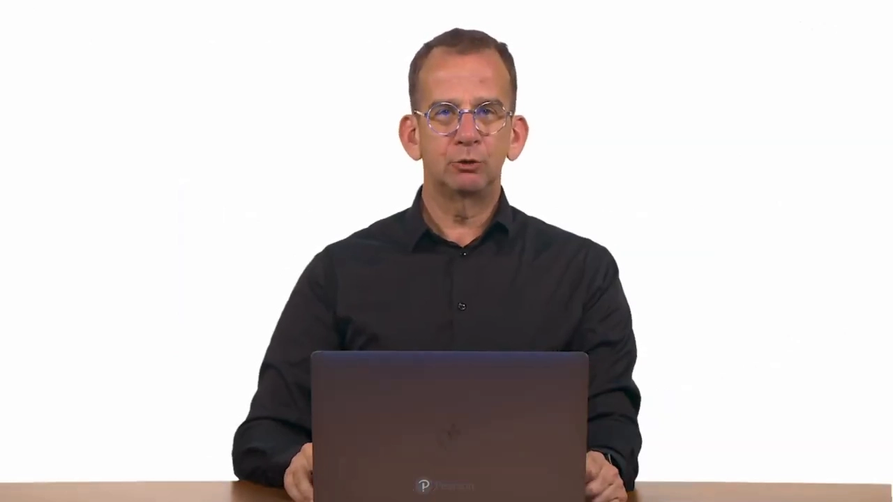
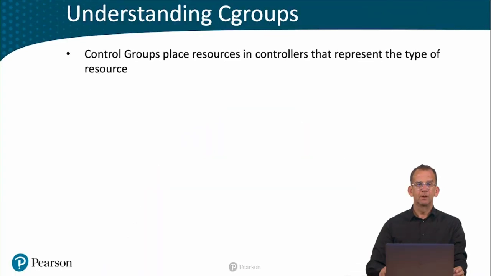
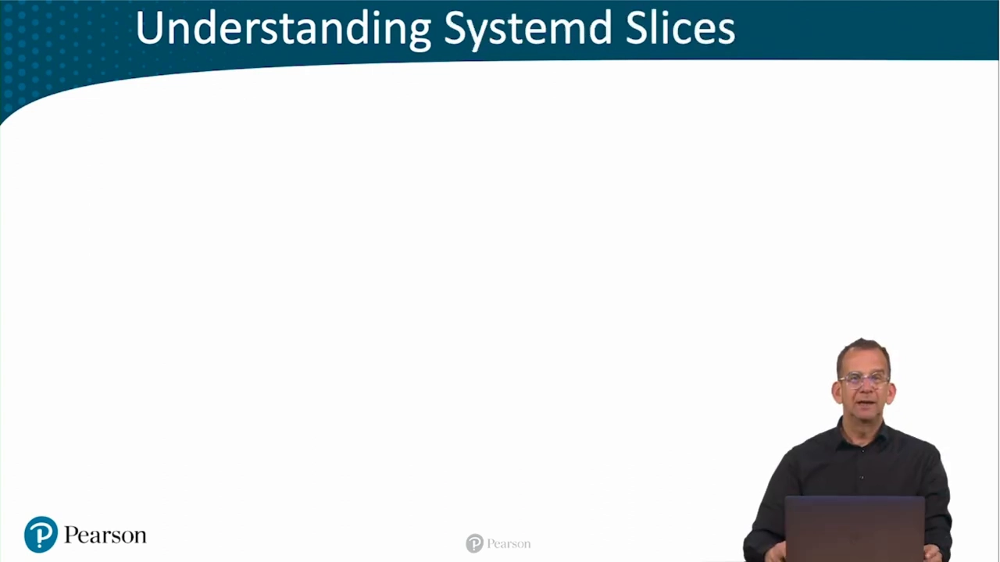
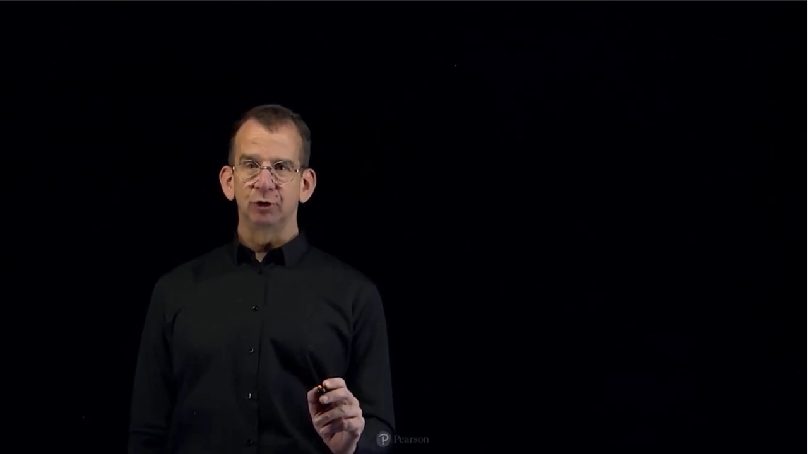
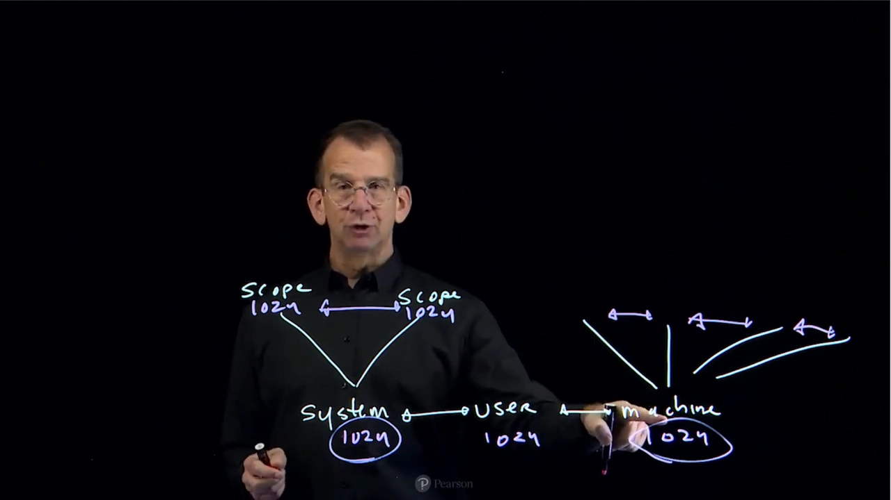
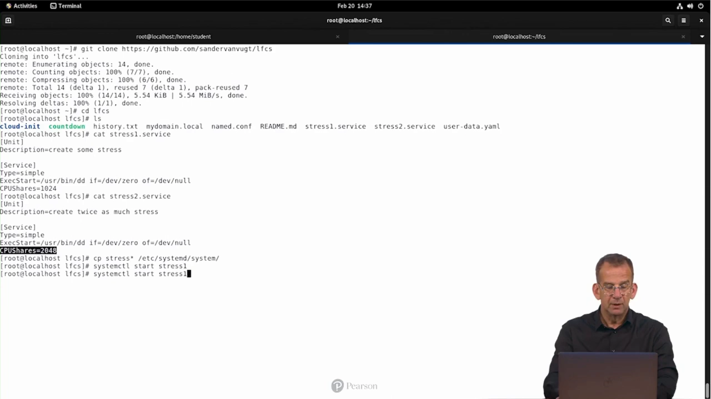
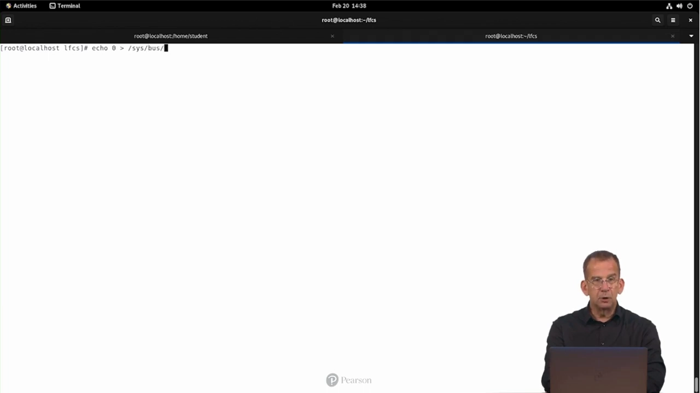
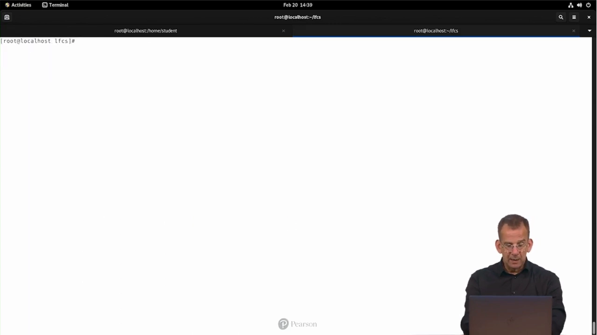
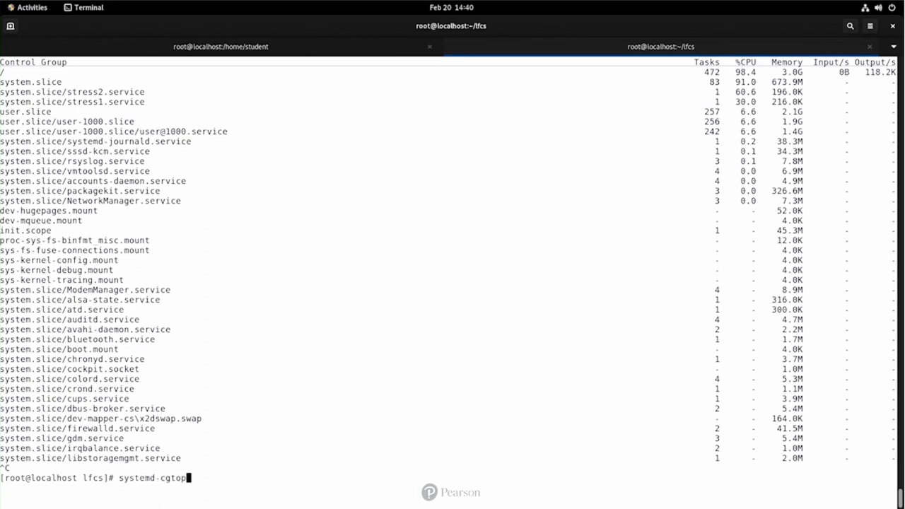
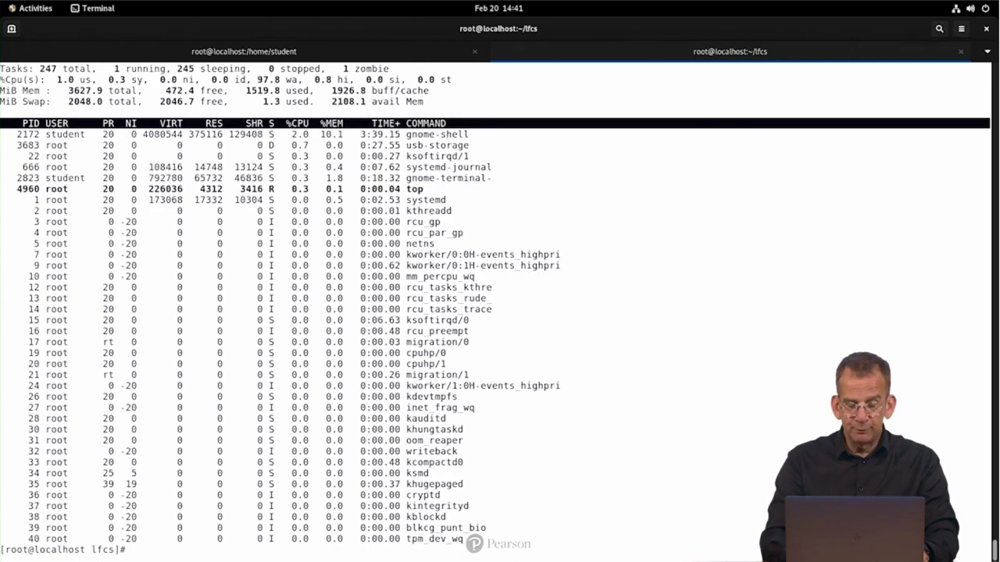

# Understanding Systemd Cgroups：systemd 是怎样替内核管住资源的

> 视频来源：[Understanding Systemd Cgroups | LFCS Video Course](https://www.youtube.com/watch?v=FTHz3PktxTA)（Sander van Vugt，约 12 分 40 秒）
> 本文是条目「1.5.2 systemd 对 cgroup 的管理」的配套博客之一，基于视频字幕与画面逐段整理。

## 本讲要解决的核心问题（SCQA）

**背景**：一台 Linux 服务器上同时跑着系统服务、用户会话，可能还有虚拟机和容器，它们共享同一份 CPU、内存和块设备 IO。

**冲突**：内核提供的 cgroup（控制组）机制虽然能限制资源，但它只是一套底层记账设施——谁来建立层级、把进程挂到哪个分支、给谁设多少限额？如果靠管理员手动维护，既繁琐又容易失控。

**疑问**：现代 Linux 发行版里，这套 cgroup 层级由谁接管？管理员日常应该怎么用、怎么查？

**回答（中心思想）**：systemd 作为 PID 1 接管了 cgroup 的管理：它用 slice / scope / service 三种 unit 搭起资源层级，默认创建三大顶级 slice 并让它们平分资源；管理员只需要在 unit 里配 `CPUShares`、`MemoryMax` 等参数，再配合 `systemd-cgtop` / `systemd-cgls` 观察占用，就能完成从限制到监控的闭环。

## 一、cgroup 是内核的资源"账本"，systemd 是记账人

cgroup（control groups，控制组）是现代 Linux 的一项重要特性，它要解决的事情就三件：资源的**分配**（allocation）、**预留**（reservation）和**限制**（limitation），而在 systemd 环境里，这件事由 systemd 负责打理 [【跳转到 00:05】](https://www.youtube.com/watch?v=FTHz3PktxTA&t=5)。

cgroup 的组织方式是"控制器 + 树"：

- 资源按类型放进不同的 **controller（控制器）**，最重要的默认控制器是 **CPU、内存、块设备 IO**，分别对应 CPU 限制、内存限制和块 IO 限制 [【跳转到 00:20】](https://www.youtube.com/watch?v=FTHz3PktxTA&t=20)；
- 每个控制器内部再细分成一棵**树**，树的每个分支就是一个 cgroup，不同的权重或限额施加在不同的分支上；一个或多个进程被分配到某个 cgroup 里 [【跳转到 00:45】](https://www.youtube.com/watch?v=FTHz3PktxTA&t=45)。





这套层级可以手动从命令行维护，也可以交给 systemd。在 systemd 成为主流之前（大约 2000 年代初），人们用 `cgconfig` 服务和 `cgexec` 命令手动创建 cgroup。但无论谁来管，**所有 cgroup 设置最终都写进 `/sys/fs/cgroup`**——这就是之前介绍过的 sysfs 伪文件系统，用于管理硬件属性；想弄清楚底层发生了什么，直接去这个目录看就行 [【跳转到 01:00】](https://www.youtube.com/watch?v=FTHz3PktxTA&t=60)。

## 二、三大顶级 slice：system、machine、user

在 systemd 的 cgroup 环境里，最顶层的划分单位叫 **slice**。slice 是操作系统的第一级划分，同样作用于 CPU、块 IO 和内存。默认有三个 [【跳转到 01:30】](https://www.youtube.com/watch?v=FTHz3PktxTA&t=90)：

| slice | 管什么 |
| --- | --- |
| `system.slice` | 系统进程与守护进程（daemon） |
| `machine.slice` | 虚拟机和容器 |
| `user.slice` | 用户会话——每个用户默认有自己的 slice |



每个用户拥有独立 slice 的好处是：一个用户分到的资源与另一个用户完全隔离，并且每个用户对系统资源的"主张份额"是相同的。除了这三个默认 slice，管理员也可以创建自定义 slice [【跳转到 01:55】](https://www.youtube.com/watch?v=FTHz3PktxTA&t=115)。

## 三、层级化 CPU 分配：slice → scope → service

讲师在白板上画了一张图来解释三大 slice 之间的关系 [【跳转到 02:16】](https://www.youtube.com/watch?v=FTHz3PktxTA&t=136)：



- **slice 之间是同级的（peer）**。cgroup 里可以用 **CPU shares** 表达相对权重：如果三个 slice 的 CPUShares 都是 1024，那么在三个 slice 都满负载时，每个 slice 各得全部 CPU 的三分之一 [【跳转到 02:21】](https://www.youtube.com/watch?v=FTHz3PktxTA&t=141)。
- **slice 内部还可以再分 scope**，每个 scope 也能设置自己的 CPUShares [【跳转到 02:46】](https://www.youtube.com/watch?v=FTHz3PktxTA&t=166)。
- **层级约束是"份额在每层重新分配"**：就算 machine.slice 里挂了 4 个 scope，slice 这一层仍然只算 1024。如果 machine.slice 里有 4 个进程、user.slice 里有 2 个进程，那么 user.slice 的进程合起来拿一半，machine.slice 里的进程合起来拿另一半 [【跳转到 03:11】](https://www.youtube.com/watch?v=FTHz3PktxTA&t=191)。
- **service（最典型的 systemd unit）也有自己的 CPUShares**，比如 1024、512、2048——这些数字只表达**同一层级内部**的相对权重，且仍然受上层 slice 限额的约束 [【跳转到 04:01】](https://www.youtube.com/watch?v=FTHz3PktxTA&t=241)。



这种层级带来一个值得警惕的现象：假设系统里只有一个用户 Bob，他启动了一个非常活跃的任务——此时会为 Bob 创建属于他的 user slice 分支，这个任务能**吃满 user.slice 的全部份额**。也就是说，一个普通用户拿到的 CPU 份额，可能与 `system.slice` 里所有 unit 加起来一样多 [【跳转到 04:26】](https://www.youtube.com/watch?v=FTHz3PktxTA&t=266)。这一点后文实验会亲眼看到 [【跳转到 05:16】](https://www.youtube.com/watch?v=FTHz3PktxTA&t=316)。

## 四、实验：两个 dd 服务，CPUShares 1024 对 2048

光说不练假把式。讲师准备了两个自定义服务（来自课程的 git 仓库）[【跳转到 05:30】](https://www.youtube.com/watch?v=FTHz3PktxTA&t=330)：

- `stress1.service`：类型 `simple`，跑一个 `dd` 进程，会制造 100% 的 CPU 负载；关键参数 **`CPUShares=1024`** [【跳转到 05:57】](https://www.youtube.com/watch?v=FTHz3PktxTA&t=357)；
- `stress2.service`：内容几乎一样，唯一区别是 **`CPUShares=2048`**——含义是它应分到的 CPU 周期是前者的两倍 [【跳转到 06:22】](https://www.youtube.com/watch?v=FTHz3PktxTA&t=382)。


自定义服务应拷贝到 `/etc/systemd/system`：`/usr/lib/systemd/system` 放的是软件包自带的 unit 文件（不要动），`/etc/systemd/system` 才是放自己的东西的地方。随后 `systemctl start stress1 stress2` 把两个服务跑起来 [【跳转到 06:47】](https://www.youtube.com/watch?v=FTHz3PktxTA&t=407)。

## 五、多核让演示"失灵"？先把一个 CPU 下线

在 `top` 里观察时出现了意外：两个 dd 进程**各自都占了接近 100%**，完全看不出 2:1 的份额差 [【跳转到 07:12】](https://www.youtube.com/watch?v=FTHz3PktxTA&t=432)。原因很简单：这是一台多核机器，两个进程各占一个核，cgroup 根本不需要去争抢。



解决办法体现了一次 sysfs 的妙用：在 `top` 里按 `1` 展开每颗 CPU，确认有 cpu0 和 cpu1 两颗核；然后执行

```bash
echo 0 > /sys/devices/system/cpu/cpu1/online
```

`/sys/devices/system/cpu/cpu1/online` 这个文件就是用来启用/停用 CPU 1 的开关。写入 0 之后，系统瞬间从"双核"变成"单核" [【跳转到 08:02】](https://www.youtube.com/watch?v=FTHz3PktxTA&t=482)。



回到 top 再按 `1`，确认只剩一颗 CPU。这次 cgroup 的效果立刻显形：**一个 dd 进程拿到的 CPU 周期是另一个的两倍**——CPUShares 2:1 生效了 [【跳转到 08:27】](https://www.youtube.com/watch?v=FTHz3PktxTA&t=507)。


实验结束后别忘了恢复：向同一个文件写回 1（`echo 1 > /sys/devices/system/cpu/cpu1/online`）即可把 CPU1 重新上线。停掉高压负载后，系统负载（load average）会慢慢回落到 1 以下 [【跳转到 11:09】](https://www.youtube.com/watch?v=FTHz3PktxTA&t=669)。

## 六、警惕：一个 while 循环就能吃掉一半 CPU

接下来是全场最有教育意义的实验。讲师新开一个终端窗口（挪到屏幕右下角，保证还能看到 top），以**普通用户**身份执行：

```bash
while true; do true; done
```

这是一个死循环，目的就是持续吃 CPU。观察 top 的结果：这个 bash 进程拿走了约 **50%** 的 CPU，而两个 dd 进程**合计**只剩约 50% [【跳转到 08:50】](https://www.youtube.com/watch?v=FTHz3PktxTA&t=530)。


为什么？因为这个 while 循环运行在**用户会话所属的 user.slice** 里，而两个 dd 运行在 `system.slice` 里；默认情况下这两个顶级 slice 的权重相等。于是"一个普通用户进程"就能把系统服务挤到一边——如前文所说，这正是 slice 层级设计的天然结果，部署多用户系统时必须心里有数 [【跳转到 09:15】](https://www.youtube.com/watch?v=FTHz3PktxTA&t=555)。演示完毕后 Ctrl-C 结束循环 [【跳转到 09:40】](https://www.youtube.com/watch?v=FTHz3PktxTA&t=580)。

## 七、监控工具：systemd-cgtop 与 systemd-cgls

systemd 自带两个观察 cgroup 的命令 [【跳转到 09:54】](https://www.youtube.com/watch?v=FTHz3PktxTA&t=594)：

- **`systemd-cgtop`**：像 top 一样按活跃度排序，直观显示**当前谁最忙**——演示里可以清楚看到 stress2.service 和 stress1.service 排在最前面；
- **`systemd-cgls`**：列出所有 cgroup 里发生的一切。它不适合实时监控"谁最忙"，但非常适合**总览**整棵 slice/service 树 [【跳转到 10:19】](https://www.youtube.com/watch?v=FTHz3PktxTA&t=619)。





收尾时讲师想用 `killall` 清理 dd 进程，没成功，改在 top 里用 `k` 逐个杀掉了 [【跳转到 10:44】](https://www.youtube.com/watch?v=FTHz3PktxTA&t=644)。

## 八、内存限制也是 cgroup：MemoryMax

课程早前给 `sshd.service` 做过一处修改，这里再次展示：unit 里配置了 **`MemoryMax=4M`**。这同样是 cgroup 的功能——在进程层面可以设定内存使用上限 [【跳转到 11:50】](https://www.youtube.com/watch?v=FTHz3PktxTA&t=710)。



最后讲师点题：cgroup 还有一个重量级应用场景——**容器**。容器隔离进程的几大支柱中，cgroup 与 namespace 并列 [【跳转到 12:14】](https://www.youtube.com/watch?v=FTHz3PktxTA&t=734)，本系列后续内容会展开。

## 小结

- cgroup 负责资源的分配、预留与限制；控制器（CPU/内存/块 IO）组织成树，设置最终落在 `/sys/fs/cgroup`。
- systemd 作为 PID 1 接管了 cgroup 层级的创建与维护，管理员只需在 unit 里写配置。
- 三大顶级 slice：`system.slice`（系统服务）、`machine.slice`（虚拟机与容器）、`user.slice`（用户会话）。
- CPUShares 表达的是**同层相对权重**；层级每一层都按份额重新分配，父层限额约束所有子层。
- 实验铁证：单核下 CPUShares 1024 vs 2048 呈现严格 2:1；多核时先下线多余 CPU 才能看清份额。
- 默认 user.slice 与 system.slice 权重相等——一个普通用户的死循环就能占掉一半 CPU。
- 监控用 `systemd-cgtop`（看谁最忙）与 `systemd-cgls`（看整棵树）；内存用 `MemoryMax` 限制。
- 容器的资源隔离同样建立在 cgroup 之上。

## 关键术语速查

| 术语 | 一句话解释 |
| --- | --- |
| cgroup（控制组） | 内核按"控制器+树"组织资源限制的机制，每个分支是一个控制组，进程挂在分支上 |
| controller（控制器） | 按资源类型划分的限制器：CPU、内存、块 IO 是最常用的三个 |
| slice | systemd cgroup 层级的第一级划分；默认有 system / machine / user 三个顶级 slice |
| scope | 存放**外部创建**的一组进程（如登录会话）的 cgroup 单元，进程通过 fork 启动/终止 |
| service | systemd 管理的守护进程单元，通常作为整体启动/停止，scope 内进程则可单独启停 |
| CPUShares | CPU 的相对权重（默认 1024）；同层之间按权重比例瓜分 CPU 时间 |
| /sys/fs/cgroup | sysfs 伪文件系统中的 cgroup 挂载点，所有 cgroup 设置的真实落脚点 |
| systemd-cgtop | 类似 top 的 cgroup 监控命令，按资源活跃度排序 |
| systemd-cgls | 递归列出 cgroup 树内容的命令，适合总览层级结构 |
| MemoryMax | unit 中设置的内存使用上限（如 `MemoryMax=4M`），底层同样是 cgroup |
| /sys/devices/system/cpu/cpuN/online | sysfs 开关文件：写 0/1 下线/上线对应 CPU，实验中用于将多核压成单核 |
