# cgroup 配置梳理：systemd 时代如何创建、配置、监控 cgroup

> 视频来源：[cgroup配置梳理](https://www.bilibili.com/video/BV14T411o7MK/)（peaqe，约 57 分钟，演示环境为 CentOS 7.6）
> 本文是条目「1.5.2 systemd 对 cgroup 的管理」的主博客，基于视频字幕与画面逐段整理。

## 本讲要解决的核心问题（SCQA）

**背景**：无论普通进程的资源分配，还是容器引擎、Kubernetes 这类系统，都用 cgroup 来监控、限制进程/用户/虚拟机/容器的资源。

**冲突**：cgroup 是内核提供的能力，但在 systemd 出现之前要靠 libcgroup 软件包（cgconfig 等工具）手动搭建层级，门槛高、易出错；而现代系统（RHEL/CentOS 7 起）的 cgroup 已经由 systemd 接管，很多人对新玩法并不熟悉。

**疑问**：在 systemd 环境下，cgroup 的层级长什么样？怎么创建临时的和永久的 cgroup？配置写在哪里？又该怎么监控、怎么查证？

**回答（中心思想）**：systemd 用 **slice / scope / service** 三种 unit 维护一棵以 `-.slice` 为根的 cgroup 树，默认三大顶级 slice 平分资源；创建临时 cgroup 用 `systemd-run`（落到 `/run`），创建永久 cgroup 靠 unit 配置文件或 `systemctl set-property`（落到 `/etc/systemd`）；监控则交给 `systemd-cgls`、`systemd-cgtop`、`/proc`、`/sys/fs/cgroup` 与 unit 配置文件这一整套工具箱。

## 一、cgroup 是什么：层级制的进程资源控制组

cgroup（control group，控制组）是**内核提供的一个功能**，本质是一种层级制（树形）的进程组 [【跳转到 00:50】](https://www.bilibili.com/video/BV14T411o7MK/?t=50)：

- 它通过 systemd 的三种 unit 类型来控制不同的进程、应用程序，以及每个用户会话所使用的系统资源 [【跳转到 01:14】](https://www.bilibili.com/video/BV14T411o7MK/?t=74)；
- 系统管理员借助它可以对资源做分类、分配、管理、监控，并进行精细化的控制 [【跳转到 01:19】](https://www.bilibili.com/video/BV14T411o7MK/?t=79)。

为什么会有"层级"的概念？因为 cgroup 作用的对象是程序、应用，而应用本身就有层级和调用关系——按应用的组织方式来划资源控制的层级，是最自然的选择 [【跳转到 02:01】](https://www.bilibili.com/video/BV14T411o7MK/?t=121)。

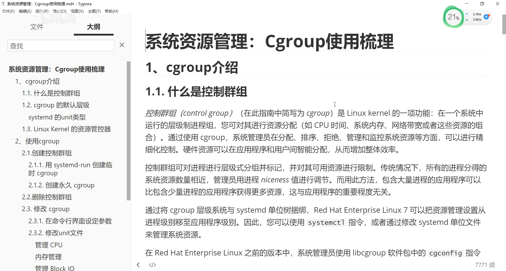

## 二、从 libcgroup 到 systemd：cgroup 管理权的交接

**systemd 出现之前**：cgroup 用 **libcgroup** 软件包管理，其中的 `cgconfig` 工具负责建立层级结构 [【跳转到 01:56】](https://www.bilibili.com/video/BV14T411o7MK/?t=116)。

**systemd 出现之后**：systemd 取代了 SysV init 的进程/服务管理方式，cgroup 也一并被 systemd 接管 [【跳转到 03:16】](https://www.bilibili.com/video/BV14T411o7MK/?t=196)。本视频以 Red Hat Enterprise Linux 7 / CentOS 7 为例，介绍两者的关系。

现在的日常操作就是：**通过 systemctl，或者修改 systemd 的 unit 文件，来管理系统资源、管理 cgroup**——这就是 systemd 时代 cgroup 管理的核心方式 [【跳转到 04:06】](https://www.bilibili.com/video/BV14T411o7MK/?t=246)。

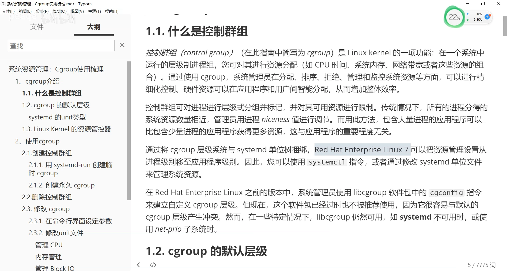

## 三、读懂 cgroup 树：`-.slice` 根、三大顶级 slice 与三种 unit

### 3.1 三大顶级 slice：装完系统就自动存在

系统启动以后（准确说：安装完系统、还没装任何应用之前），systemd 会自动创建**三个顶级的 slice** [【跳转到 04:31】](https://www.bilibili.com/video/BV14T411o7MK/?t=271)。slice 下面可以放 scope、service 这样的单元，slice 下面还可以再有 slice。这三个 systemd unit 类型是专门服务于 cgroup 功能的 [【跳转到 04:56】](https://www.bilibili.com/video/BV14T411o7MK/?t=296)。

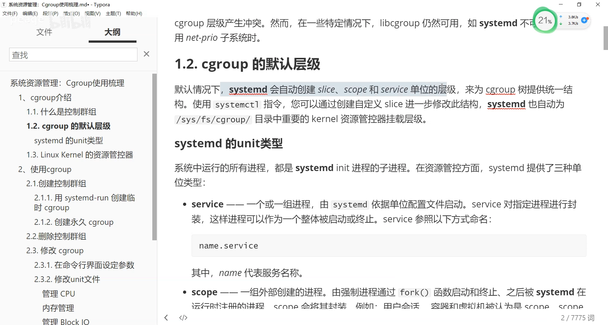

### 3.2 先看树：systemd-cgls 的第一印象

视频在 CentOS 7.6 上用 `systemd-cgls` 打印了整棵树 [【跳转到 06:34】](https://www.bilibili.com/video/BV14T411o7MK/?t=394)：

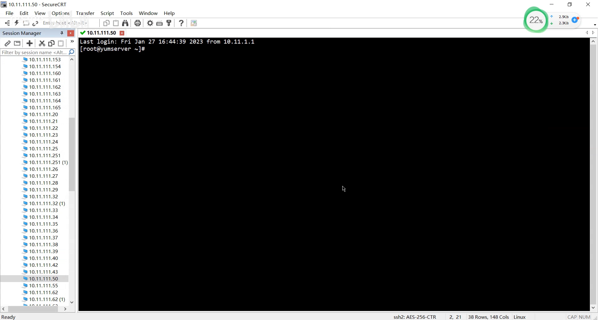

- 第一个分支就是 **PID 1 唯一的 systemd 进程**，单独一支 [【跳转到 06:59】](https://www.bilibili.com/video/BV14T411o7MK/?t=419)；
- 下面能看到 **docker** 一支——因为这台机器装了 Docker 还跑着容器，一点不奇怪；
- 顶级分支归纳起来就是 **docker（machine.slice）、user（user.slice）、system（system.slice）** [【跳转到 07:44】](https://www.bilibili.com/video/BV14T411o7MK/?t=464)。

`user.slice` 是**用户会话**：每次登录服务器都会产生一个会话（session），每个会话组成一个 **scope**，会话下面挂的就是你的程序；不同会话产生不同的会话 ID，以 `user-<UID>.slice` 加会话 ID、用 scope 这个 unit 包装起来 [【跳转到 08:07】](https://www.bilibili.com/video/BV14T411o7MK/?t=487)。

`system.slice` 管理**系统服务**（service），当然也能管理 scope [【跳转到 09:00】](https://www.bilibili.com/video/BV14T411o7MK/?t=540)；`docker` 挂在 **machine.slice** 下；另外还有 systemd 自身的一支 [【跳转到 09:08】](https://www.bilibili.com/video/BV14T411o7MK/?t=548)。

### 3.3 slice：只搭架子、不管进程

三种 unit 里先看 **slice**：它是一个**不包含应用程序、也不包含进程**的单元概念，不是一个实质的程序，而是用来**组成树形结构、管理层级中每个分支**的"骨架" [【跳转到 09:18】](https://www.bilibili.com/video/BV14T411o7MK/?t=558)。

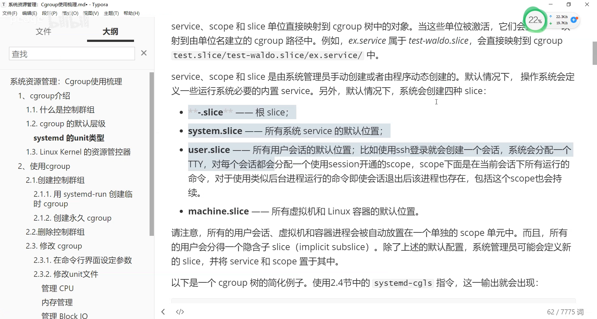

命名规则上：根是 `-.slice`（横杠点 slice）；下面再分 slice 就用 `.slice` 加 name 的形式；再往下的层级则出现 `parent-name`、`name-name` 之类不带 `.slice` 后缀的命名。根 `-.slice` 在 `systemd-cgls` 输出里通常看不到，因为它对所有层级都是同一种表示方式，一般被隐藏、只显示顶级 slice [【跳转到 10:08】](https://www.bilibili.com/video/BV14T411o7MK/?t=608)。

### 3.4 service 与 scope：谁在管进程

- **service**：systemd 管理进程的后台服务方式，大家最熟悉；它一般**作为一个整体**被启动或终止 [【跳转到 11:17】](https://www.bilibili.com/video/BV14T411o7MK/?t=677)。
- **scope**：由**一组外部创建的进程**组成，一般通过 fork 启动和终止；scope 里的多个命令可以**个别独立地**启动、终止。最典型的例子就是登录会话 [【跳转到 12:07】](https://www.bilibili.com/video/BV14T411o7MK/?t=727)。

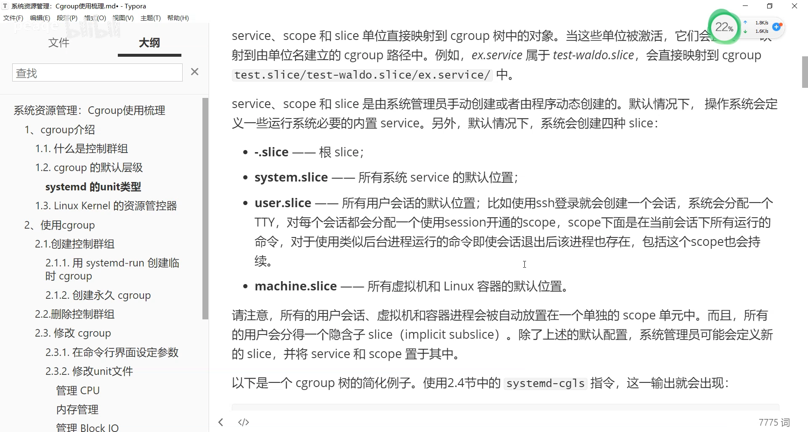

也就是说，systemd 结合 cgroup 提供这三种 unit，搭出了整棵层级树状结构；那么具体靠什么来做资源控制呢？[【跳转到 13:08】](https://www.bilibili.com/video/BV14T411o7MK/?t=788)

## 四、资源管控器：内核按资源类型提供的"旋钮"

资源管控的执行者是**内核**：内核本身具备资源管控功能，内置多种**资源管控器（resource controller）**，每种管控器代表一种单一资源，比如 CPU 时间、内存等 [【跳转到 05:21】](https://www.bilibili.com/video/BV14T411o7MK/?t=321)。具体的资源控制，就是针对每种管控器的具体配置做限制和精细化调节 [【跳转到 05:46】](https://www.bilibili.com/video/BV14T411o7MK/?t=346)。

RHEL 7 / CentOS 7 里可用的管控器包括 [【跳转到 13:58】](https://www.bilibili.com/video/BV14T411o7MK/?t=838)：

| 管控器 | 作用 |
| --- | --- |
| `blkio` | 对块设备输入输出访问的控制 |
| `cpu` | CPU 时间 |
| `memory` | 内存 |
| `cpuacct` | 生成 CPU 资源使用的报告 |
| `cpuset` | 多核系统中给 cgroup 的任务分配独立 CPU |
| `devices` | 禁止/允许 cgroup 中任务存取设备 |
| `freezer` | 暂停或恢复 cgroup 中的任务 |
| `net_cls` | 网络流量打标记 |

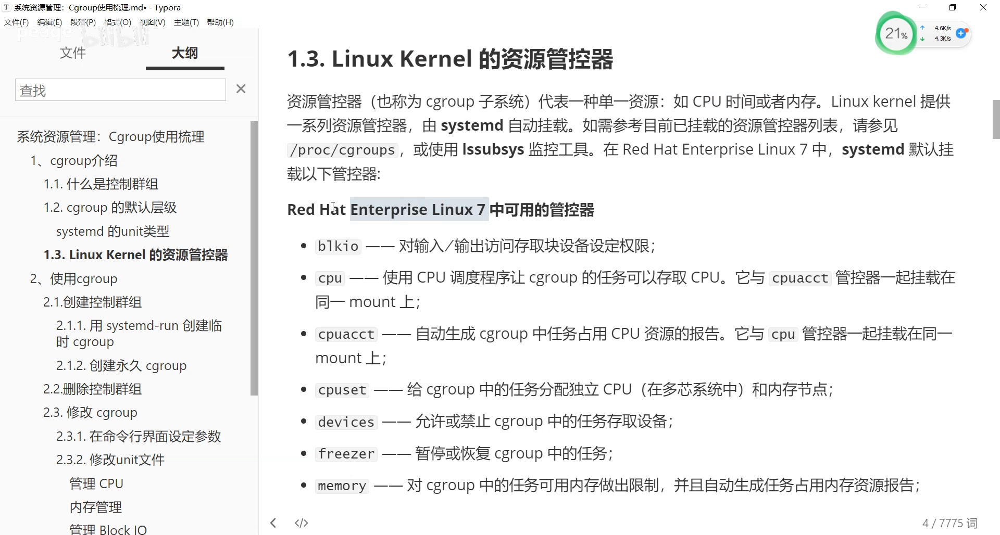

### 4.1 例子：cpu.shares 是相对比例

以 cpu 控制器为例，`cpu.shares` 配置的是**两个 cgroup 之间的相对比例**：一个组设 100，另一个组设 200，那么后者的 CPU 占用时间就是前者的两倍 [【跳转到 17:11】](https://www.bilibili.com/video/BV14T411o7MK/?t=1031)。注意 shares 并不是"把资源扩大"，而是配置一个**相对占用率** [【跳转到 18:15】](https://www.bilibili.com/video/BV14T411o7MK/?t=1095)。

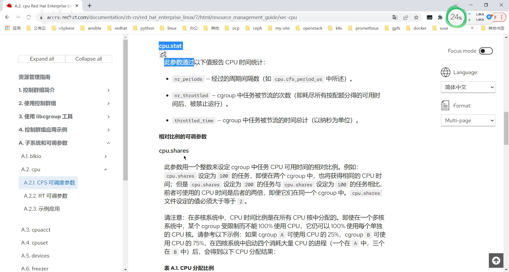

## 五、创建临时 cgroup：systemd-run

### 5.1 两种创建方式

知道了 cgroup，怎么使用、怎么创建？systemd 提供两种创建方式：**临时的**和**永久生效的** [【跳转到 18:46】](https://www.bilibili.com/video/BV14T411o7MK/?t=1126)。

临时创建用 `systemd-run`：它会在 `/run` 目录下生成与 cgroup 相关的文件。`/run` 下的文件在服务停止或系统重启后就消失——它们是存在于 tmpfs、配合内存的临时文件，不落盘 [【跳转到 19:11】](https://www.bilibili.com/video/BV14T411o7MK/?t=1151)。

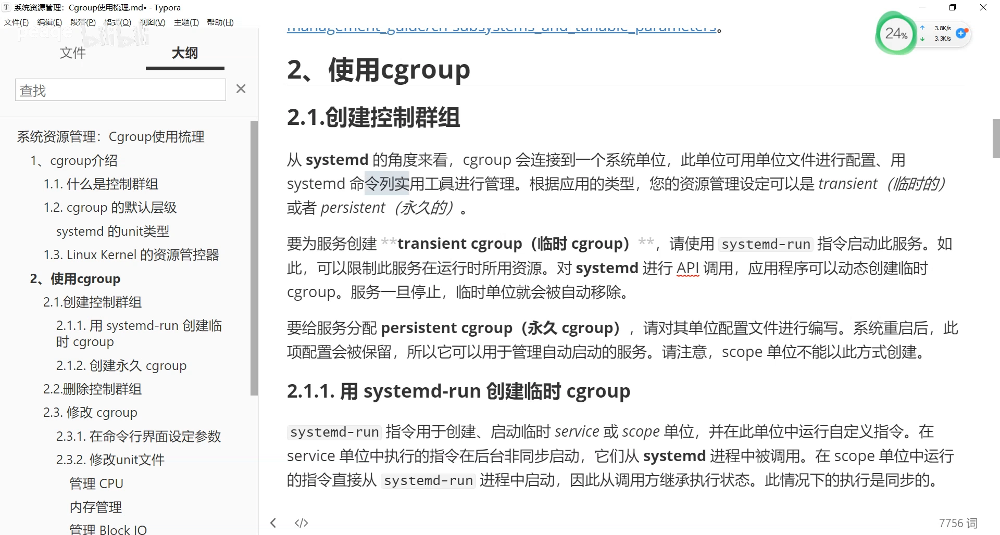

### 5.2 实操：用 systemd-run 跑一个 toptest

`systemd-run` 的关键参数 [【跳转到 20:26】](https://www.bilibili.com/video/BV14T411o7MK/?t=1226)：

- 包含应用的单元只有两种：**scope 和 service**。`--unit=` 指定单元名，`--scope` 指定类型（不指定则默认 service），再指定要放在哪个 slice（`--slice=`，不存在会自动创建）；
- 原理：如果命令在**后台**运行，systemd 会以该命令名创建一个 **service** 单元；对 scope 则创建 scope 单元。

演示：`systemd-run --unit=toptest --slice=testslice top -b`——以 service 方式生成一个持续刷新系统资源（每两秒刷新）的 top，跑在新建的 `testslice` 里 [【跳转到 21:43】](https://www.bilibili.com/video/BV14T411o7MK/?t=1303)。

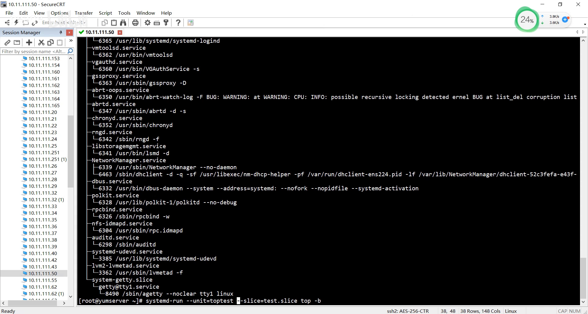

用 `systemd-cgls` 验证：树里多了自己定义的 `test.slice`，下面多了 `toptest` 服务，跑的正是 `top -b` [【跳转到 23:46】](https://www.bilibili.com/video/BV14T411o7MK/?t=1426)。再复制一个会话用 scope 方式跑同样的命令，则出现 `toptest.scope` 单元——这就是**临时 cgroup** 的创建 [【跳转到 24:36】](https://www.bilibili.com/video/BV14T411o7MK/?t=1476)。

### 5.3 临时 cgroup 的清理

- service 型：`systemctl stop toptest` 即可，`toptest.service` 随之消失 [【跳转到 30:01】](https://www.bilibili.com/video/BV14T411o7MK/?t=1801)；
- scope 型：`.scope` 还在，因为里面的应用程序还在前端跑着；Ctrl-C 退出应用后，`toptest.scope` 也随之消失。退出应用或服务，就只是删除了临时的控制组 [【跳转到 30:26】](https://www.bilibili.com/video/BV14T411o7MK/?t=1826)。

## 六、创建永久 cgroup：set-property 与 unit 文件

永久 cgroup 有两条路（视频手册 2.3 节）[【跳转到 24:58】](https://www.bilibili.com/video/BV14T411o7MK/?t=1498)：

### 6.1 命令行：systemctl set-property

```bash
systemctl set-property <单元名> <资源参数>=<值> ...
```

单元名后面跟上资源控制器的配置参数——不同资源控制器（cpu、memory 等）里关于资源限制的参数与取值，写在这个参数列表里；参数可以是多个、是一个列表 [【跳转到 25:15】](https://www.bilibili.com/video/BV14T411o7MK/?t=1515)。注意这个命令**也能用于临时创建的 cgroup** [【跳转到 25:40】](https://www.bilibili.com/video/BV14T411o7MK/?t=1540)。

临时与永久的区别就在于落地位置：临时的自动放在 `/run` 下；永久创建的服务放在 `/etc/systemd` 下 [【跳转到 26:21】](https://www.bilibili.com/video/BV14T411o7MK/?t=1581)。set-property 执行后会在 `/etc/systemd/system` 下对应目录生成 unit 配置文件，比如设置 `CPUShares=多少` [【跳转到 26:55】](https://www.bilibili.com/video/BV14T411o7MK/?t=1615)。

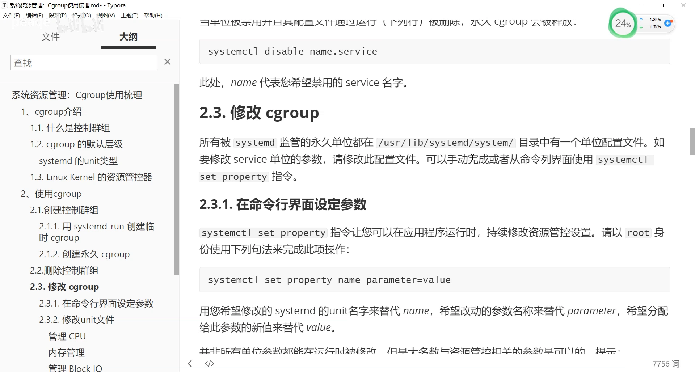

### 6.2 unit 配置文件 + daemon-reload

在 unit 配置文件里写资源配置参数（如 `CPUShares`——即前面说的相对占用比例），对 service 就配在 service 文件里，对 slice 就配在 slice 文件里；改完执行 `systemctl daemon-reload`，再重启服务即可生效。这就实现了**永久的创建** [【跳转到 27:44】](https://www.bilibili.com/video/BV14T411o7MK/?t=1664)。

思路是：先创建一个服务，服务文件是永久的，服务所属的 cgroup 自然也是永久的；服务配置里的资源控制参数，本质上就是在配置 cgroup [【跳转到 28:32】](https://www.bilibili.com/video/BV14T411o7MK/?t=1712)。

### 6.3 永久 cgroup 的删除

删除走对称流程：先 kill/停止服务，再用 `systemctl disable` 删除配置文件，永久的 cgroup 随之释放——这一步与 systemd 的服务管理完全一致、绑定在一起 [【跳转到 31:11】](https://www.bilibili.com/video/BV14T411o7MK/?t=1871)。补充：传统的 libcgroup 方式与"创建 unit + 资源控制器参数"方法本质类似，只是多了一层手动管理，因此视频没有展开 [【跳转到 29:11】](https://www.bilibili.com/video/BV14T411o7MK/?t=1751)。

## 七、三大顶级 slice 平分资源的规则与例外

默认情况下，**三个顶级 slice 平分系统资源**：三大 slice 下的服务如果都满负载运行，各占约三分之一 [【跳转到 32:52】](https://www.bilibili.com/video/BV14T411o7MK/?t=1972)。但这只是"下限、不是上限"：

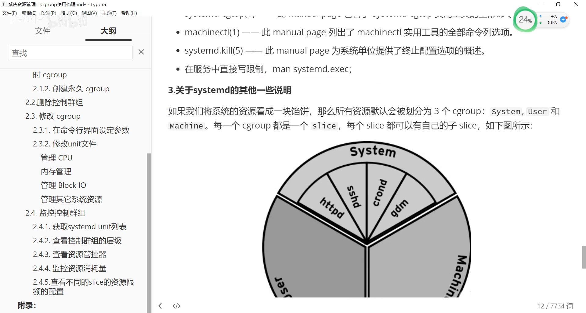

- 如果某个 slice 下面没跑东西（比如 machine.slice 里没有虚拟机、没有容器），剩下的 slice 就可能**各占 50%**——因为只定义了下限，没定义上限 [【跳转到 33:18】](https://www.bilibili.com/video/BV14T411o7MK/?t=1998)；
- 反过来，一旦"空"slice 里有服务启动，由于下限资源有保障，它会**抢占**其他 slice 占用的资源 [【跳转到 33:51】](https://www.bilibili.com/video/BV14T411o7MK/?t=2031)。

## 八、层级配额：slice 定总额，set-property 控下层

资源的配置方式在树状结构上一目了然 [【跳转到 34:18】](https://www.bilibili.com/video/BV14T411o7MK/?t=2058)：

- 以 CPU 配置为例，把配额（如 CPUShares/配额参数）配在**一个 slice 上**，那这个 slice 下面的**所有服务共享**这个配额——比如十个服务就一起瓜分 [【跳转到 34:43】](https://www.bilibili.com/video/BV14T411o7MK/?t=2083)；
- 若 slice 下某个特定服务占用资源较多，可以对**下层单独配置**：`systemctl set-property <某服务>` 指定它的资源控制。前提是该服务在 slice 的资源范围内、占用 slice 的配额 [【跳转到 35:08】](https://www.bilibili.com/video/BV14T411o7MK/?t=2108)。参数可以用 Tab 补全查看 [【跳转到 35:08】](https://www.bilibili.com/video/BV14T411o7MK/?t=2108)；
- set-property 对 service 会在 `/etc/systemd/system` 下对应位置生成参数；也可以加 `--runtime` 做临时修改，持久的则写到 `/etc` 下、生成关于该 slice 的配置文件，参数最终写入 slice 这个单元 [【跳转到 35:33】](https://www.bilibili.com/video/BV14T411o7MK/?t=2133)。

总结成一句：systemd 的资源占用支持**层级化配置**——不同层级有不同的配额，每个具体服务占用的是它所属 slice 的配额 [【跳转到 37:04】](https://www.bilibili.com/video/BV14T411o7MK/?t=2224)。

## 九、监控与查看的完整工具箱

### 9.1 systemd-cgls / systemd-cgtop

- `systemd-cgls`：查看整棵 cgroup 树状结构（前文已演示）[【跳转到 37:07】](https://www.bilibili.com/video/BV14T411o7MK/?t=2227)；
- `systemd-cgtop`：按**资源占用**排序，显示任务数、各 slice 下的服务/命令以及内存占用情况，一眼看出谁最忙（演示中 docker 占用最多）[【跳转到 41:08】](https://www.bilibili.com/video/BV14T411o7MK/?t=2468)。

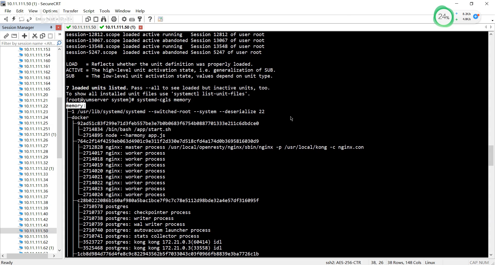

### 9.2 进程视角：/proc

`/proc` 下可以查看**每个进程**使用了哪些 cgroup、哪些资源控制器，与 systemd 配置的 unit 保持一致 [【跳转到 40:13】](https://www.bilibili.com/video/BV14T411o7MK/?t=2413)。

### 9.3 查 slice 列表：systemctl list-units

`systemctl list-units --type=slice` 可以列出所有 slice 及其类型；顺带能看出有没有 scope——scope 一般由会话生成、是**动态生成**的，系统重启后就没有了；而 service 会随系统重启启动 [【跳转到 37:37】](https://www.bilibili.com/video/BV14T411o7MK/?t=2257)。

### 9.4 查资源限额：/sys/fs/cgroup

想知道不同 slice 的资源限额，可以进 `/sys/fs/cgroup` 按控制器目录查看 [【跳转到 47:18】](https://www.bilibili.com/video/BV14T411o7MK/?t=2838)。比如看 CPU：进 `cpu` 目录找 docker（machine.slice）：

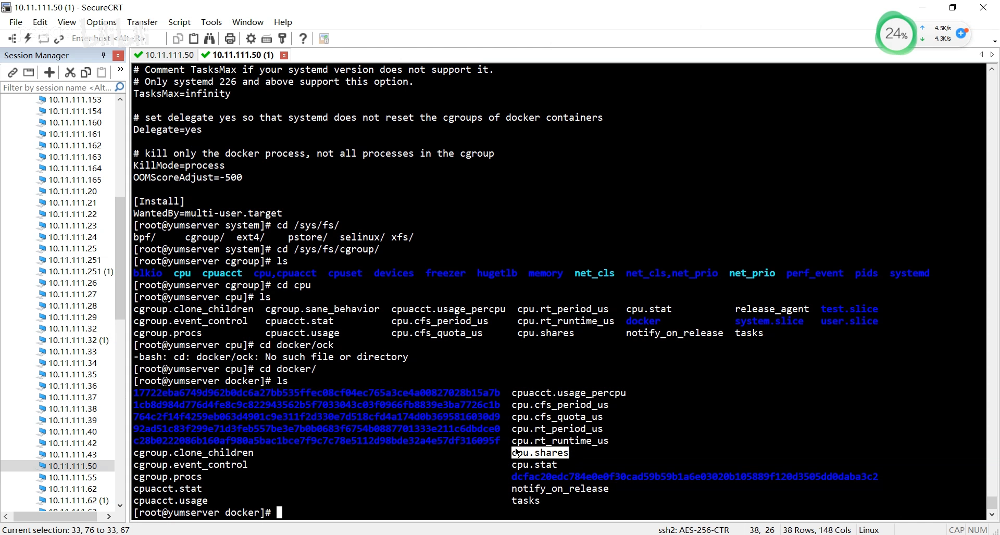

演示机器上 docker.slice 的 `cpu.shares` 就是**默认的 1024**，没有额外限制 [【跳转到 43:33】](https://www.bilibili.com/video/BV14T411o7MK/?t=2613)。三个顶级 slice 共享系统资源，docker 看起来占得多，只是因为其它 slice 当前占用得少 [【跳转到 44:01】](https://www.bilibili.com/video/BV14T411o7MK/?t=2641)。小知识：`systemd-cgls` 的显示还与当前所在目录有关——它本质上是 `ls` 行为 [【跳转到 46:04】](https://www.bilibili.com/video/BV14T411o7MK/?t=2764)。

### 9.5 查配置来源：/etc/systemd 与 man 文档

`/sys/fs/cgroup` 只能"看现状"；要知道**为什么这么配**，去 `/etc/systemd` 下的配置文件里找 [【跳转到 48:36】](https://www.bilibili.com/video/BV14T411o7MK/?t=2916)。手动配置无非两种来源：`set-property` 生成的配置，或手写的 unit 配置文件。所以所有 systemd 管理的 service 的资源配置，**找到它的 unit 文件或对应配置文件就能查证** [【跳转到 49:01】](https://www.bilibili.com/video/BV14T411o7MK/?t=2941)。最后别忘了 man 文档里的"资源控制（Resource Control）"章节，各参数说明都在那里 [【跳转到 55:03】](https://www.bilibili.com/video/BV14T411o7MK/?t=3303)。

## 十、两套参数名：cgroup 文件 vs systemd unit

一个容易踩的坑：**同一个参数，两边的名字不一样** [【跳转到 50:19】](https://www.bilibili.com/video/BV14T411o7MK/?t=3019)。

- 在 systemd 的 unit 配置里叫 **`CPUShares`**——没有 `cpu.` 这个分隔符 [【跳转到 50:38】](https://www.bilibili.com/video/BV14T411o7MK/?t=3038)；
- 在 cgroup 文件系统里则是"cpu 控制器 + `cpu.shares`"的表示方式，`/sys/fs/cgroup/cpu` 下可以看到 `cpu.shares` 等参数 [【跳转到 51:19】](https://www.bilibili.com/video/BV14T411o7MK/?t=3079)。

`systemctl show` 里还能看到 CPU scheduling、CPU affinity 等更多参数 [【跳转到 52:11】](https://www.bilibili.com/video/BV14T411o7MK/?t=3131)。对应关系是：unit 里的 `CPUShares` 最终控制的就是 cgroup 的 `cpu.shares` 配置 [【跳转到 54:31】](https://www.bilibili.com/video/BV14T411o7MK/?t=3271)。

## 小结

- cgroup 是内核提供的层级制资源控制组；systemd 出现后，管理权从 libcgroup 交接到 systemd。
- systemd 用 slice / scope / service 三种 unit 维护 cgroup 树：slice 只搭架子、scope 管外部进程组（如会话）、service 管守护服务。
- 默认三大顶级 slice（system / machine / user）平分资源——但这只是下限，空 slice 的份额会被别人占用，新服务启动时会抢占回来。
- 临时 cgroup 用 `systemd-run` 创建，落在 `/run`，重启即逝；service 型用 stop 清理，scope 型退出应用即消失。
- 永久 cgroup 用 `systemctl set-property` 或 unit 配置文件 + `daemon-reload` 创建，落在 `/etc/systemd`，删除与 disable 服务对称。
- 资源管控器（cpu、memory、blkio、cpuacct、cpuset、devices、freezer、net_cls）是内核提供的"旋钮"；`cpu.shares` 是相对比例而非绝对扩容。
- 层级配额：配在 slice 上的配额由下层所有服务共享；对单个服务可再用 set-property 细控。
- 监控工具箱：`systemd-cgls`（看树）、`systemd-cgtop`（看占用）、`/proc/<pid>/cgroup`（看进程归属）、`/sys/fs/cgroup`（看现状）、unit 配置文件与 man 文档（查来源）。
- 参数名对照：unit 里 `CPUShares` = cgroup 文件 `cpu.shares`；两套命名不要混用。

## 关键术语速查

| 术语 | 一句话解释 |
| --- | --- |
| cgroup | 内核提供的层级制进程资源控制组，可限制/监控进程、用户、虚拟机、容器的资源 |
| slice | 不含进程的"骨架"单元，专门组成 cgroup 树；根为 `-.slice`，默认三大顶级 slice |
| scope | 承载外部创建进程组的单元（如登录会话），进程经 fork 启停，可独立控制 |
| service | systemd 管理的守护服务单元，通常作为整体启停，对应后台进程 |
| 资源管控器（controller） | 内核按资源类型提供的控制器：cpu、memory、blkio、cpuacct、cpuset、devices、freezer、net_cls 等 |
| cpu.shares | cpu 控制器下的相对权重参数（默认 1024），表达 cgroup 间 CPU 占用的相对比例 |
| systemd-run | 创建**临时** cgroup 的命令，生成 /run 下的临时 unit（service 或 scope） |
| systemctl set-property | 运行时修改单元资源参数的命令；持久化时在 /etc/systemd 下生成配置 |
| daemon-reload | unit 配置变更后通知 systemd 重新加载的命令 |
| systemd-cgls / systemd-cgtop | 查看 cgroup 树 / 按资源占用排序监控的官方命令 |
| /proc/&lt;pid&gt;/cgroup | 记录每个进程所属 cgroup 及所用资源控制器的 procfs 文件 |
| /sys/fs/cgroup | cgroup 文件系统挂载点，各控制器的限额与统计文件都在这里 |
| CPUShares | unit 配置中的 CPU 权重参数，落地即 cgroup 的 cpu.shares |
