# Revamping libcontainers systemd driver：容器运行时如何接入 cgroup v2

> 视频来源：[Revamping libcontainer's systemd driver](https://www.youtube.com/watch?v=PPc_WGmdRtk)（All Systems Go!，Filipe Brandenburger——时属 Facebook，此前在 Google 参与 kubelet 与 cgroup v2，systemd 贡献者，约 27 分钟）
> 本文是条目「1.5.3 根 cgroup 与容器管理器的边界」的配套博客之一，基于视频字幕与画面逐段整理。

## 本讲要解决的核心问题（SCQA）

**背景**：systemd 已经成为 cgroup 事实上的用户态 API——通过 D-Bus 与 unit 属性暴露资源控制；Fedora 31 起默认切换到 cgroup v2 的 unified hierarchy。

**冲突**：容器栈里却只有 Podman（借助 crun）原生支持 v2。kubelet、CRI-O、Docker 依赖的 libcontainer，其 systemd 驱动"半进半出"——建组走 systemd 的 D-Bus，改限额却绕过 systemd 直写 cgroupfs，两套真相并存。

**疑问**：libcontainer 如何既兼容装着老 systemd 的存量系统、又全面接入 cgroup v2？容器管理器与 systemd 之间的这条边界应该怎么划？

**回答（中心思想）**：把 cgroup 驱动**一分为二**——legacy 驱动（覆盖 v1/hybrid，沿用现有代码）与 unified 驱动（新实现，所有操作一律经 systemd D-Bus），仅在检测到统一层级时才启用新实现，从而甩掉对老版本的向后兼容包袱。配套条件是：systemd 的 D-Bus 需支持"可选属性"（未知不报错、事后回报），内核 5.2+ 提供 v2 freeze 等能力，设备控制器交给 systemd 的 eBPF 实现；OCI 规范里绑死 v1 模型的资源字段也需同步演进。

---

## 一、cgroup 的用户态版图

### 1.1 systemd 是事实 API；三种层级模式

演讲者 Filipe 来自 Facebook（此前在 Google 做 kubelet、专注 cgroup v2，2014 年起参与 systemd）。他先给现状定调：今天可以把 systemd 视为 cgroup 的**主要用户态 API**——当然也能绕开它直写 cgroupfs，但 systemd 通过 D-Bus 和 unit 提供了一层好用的封装 [【跳转到 01:22】](https://www.youtube.com/watch?v=PPc_WGmdRtk&t=82)。

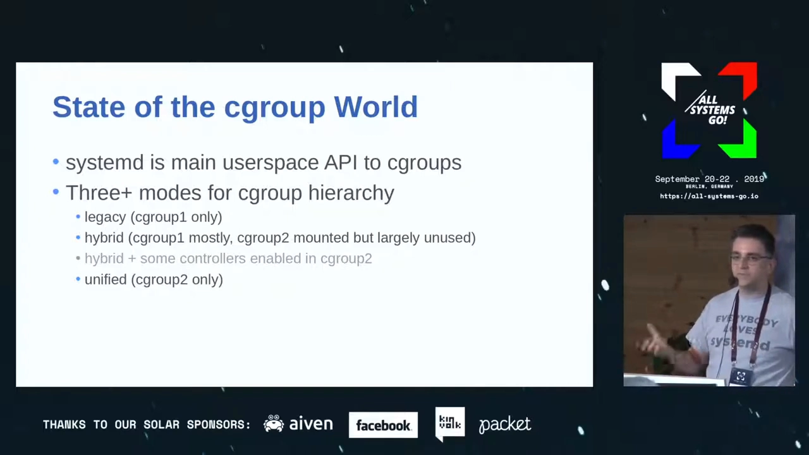

层级有三种模式 [【跳转到 01:44】](https://www.youtube.com/watch?v=PPc_WGmdRtk&t=104)：

| 模式 | 含义 |
| --- | --- |
| **legacy** | 只用 cgroup v1 |
| **hybrid** | v2 已挂载，但控制器仍都跑在 v1 上（理论上可把部分控制器挪进 v2，实际没人这么做） |
| **unified** | 只用 cgroup v2 |

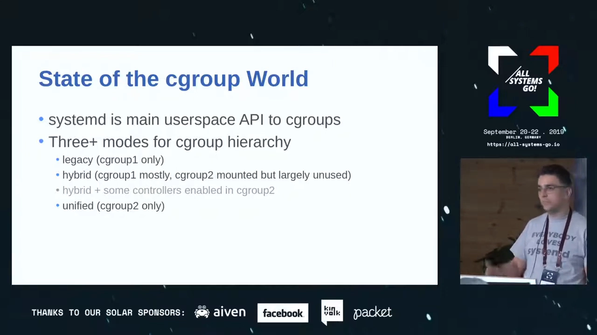

当时大多数发行版处于 hybrid（近两三年已稳定），但目标显然是 unified。

### 1.2 为什么迁向 v2

动机清单 [【跳转到 02:41】](https://www.youtube.com/watch?v=PPc_WGmdRtk&t=161)：v1 多层级的混乱已被诟病许久；v2 的**委托**（delegation）更好用；新控制器能力涌现（`memory.low` 已有、`io.weight` 在路上）；大量 BPF 特性正与 cgroup v2 结合；**Fedora 31 将默认启用 unified hierarchy**，是推动其他发行版跟进的强心针；此外 v2 显著改善了**嵌套容器 / rootless 容器**的支持。

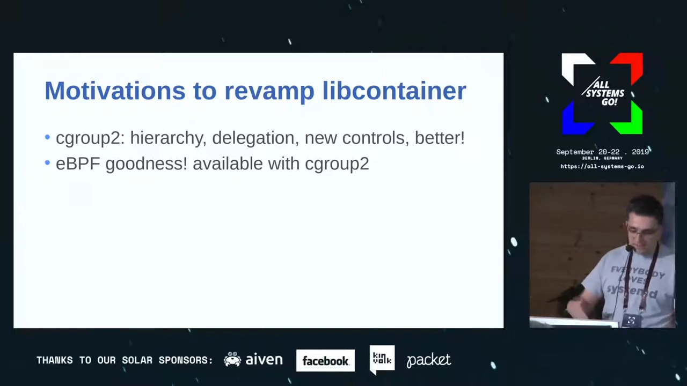

## 二、容器栈与 libcontainer 的两个驱动

### 2.1 谁在用 libcontainer

容器管理器的版图 [【跳转到 04:31】](https://www.youtube.com/watch?v=PPc_WGmdRtk&t=271)：

- **Podman、Docker**：面向用户的容器管理器；
- **CRI-O、containerd**：常驻后端/守护进程；
- **kubelet** 通过 CRI 协议与 CRI-O 或 containerd 通信；
- 而真正把容器跑起来的，是 **runc**——它使用 **libcontainer**（两者同属一个项目、同一套源码）。

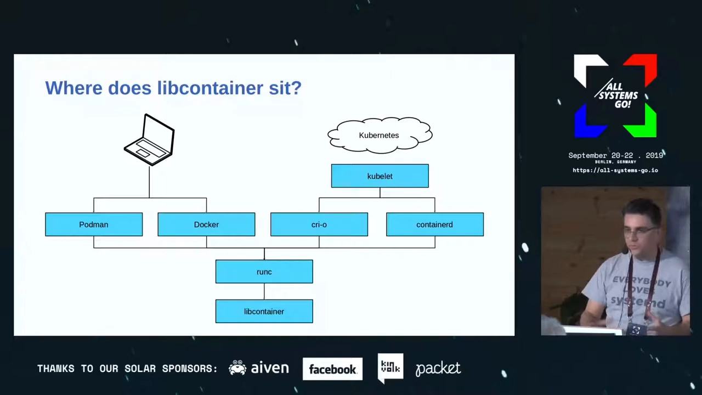

### 2.2 只有一个玩家原生支持 v2

彼时栈里**只有 Podman 原生支持 unified hierarchy**——因为它默认用 **crun**（runc CLI 的独立实现，为单一层级树而生）。但换运行时救不了全场：其余组件都依赖 libcontainer 这个**库**，只换 CLI 无济于事 [【跳转到 05:07】](https://www.youtube.com/watch?v=PPc_WGmdRtk&t=307)。

libcontainer 为 Linux 的容器原语（namespaces、capabilities、cgroups……）提供抽象。其 cgroup 部分有两个驱动 [【跳转到 05:56】](https://www.youtube.com/watch?v=PPc_WGmdRtk&t=356)：

- **cgroupfs 驱动**：直接写 `/sys/fs/cgroup` 文件系统；
- **systemd 驱动**：通过 D-Bus 与 systemd 通信。

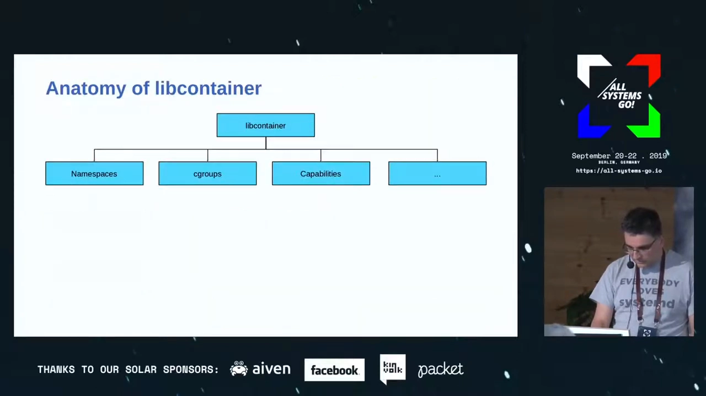

### 2.3 病根：systemd 驱动"半进半出"

如果 systemd 驱动**永远**走 systemd，本不会有问题——D-Bus 接口会替你屏蔽 legacy/hybrid/unified 的差异，暴露一致的 API。坏就坏在：libcontainer 的 systemd 驱动**部分操作走 systemd，改限额时又绕过它直写 cgroupfs**，两套真相并存 [【跳转到 06:51】](https://www.youtube.com/watch?v=PPc_WGmdRtk&t=411)。

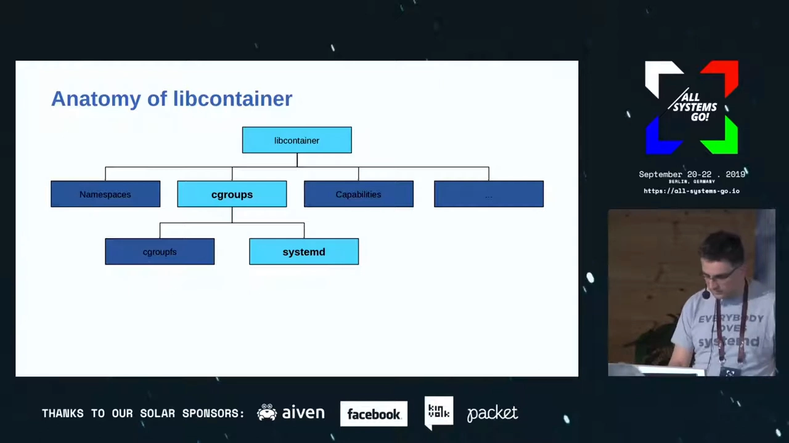

## 三、第一次尝试：全走 D-Bus，为何失败

思路直接：重写 systemd 驱动，让所有操作都经 D-Bus。PR 开了，**却失败了** [【跳转到 07:33】](https://www.youtube.com/watch?v=PPc_WGmdRtk&t=453)。

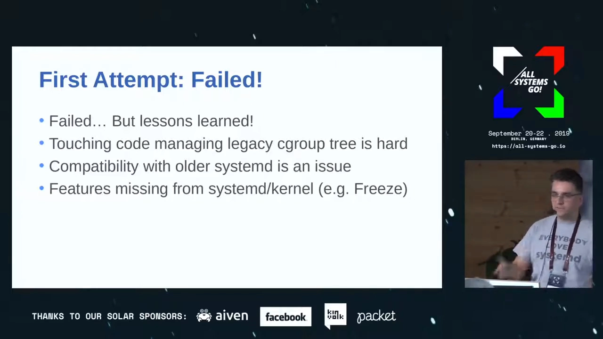

- **老代码难动**：这套驱动诞生时 systemd 还不支持许多限额设置，作者当年正是因此绕道直写；
- **版本兼容**：新代码在 systemd 244/245 上没问题，放到 Ubuntu 18.04 那样的老 systemd 上就翻车；
- **能力缺口**：一些特性当时内核/systemd 还没就绪——例如 v2 的 **freeze**（冻结）直到内核 5.2 才可用，此前无从实现。

## 四、分治方案：legacy 与 unified 双驱动

### 4.1 一拆了之，按层级选实现

新提案不再硬改旧代码，而是**把 systemd 驱动拆成两个独立实现** [【跳转到 09:10】](https://www.youtube.com/watch?v=PPc_WGmdRtk&t=550)：

- **legacy 实现**：覆盖 v1/hybrid 场景，基本沿用现有代码；
- **unified 实现**：新写，**所有操作一律通过 systemd**。

关键的好处：libcontainer 在运行时检测所处层级，**只有在 unified 层级上才启用新实现**——于是完全不必兼容老 systemd（247、218 乃至更早都无需操心）。

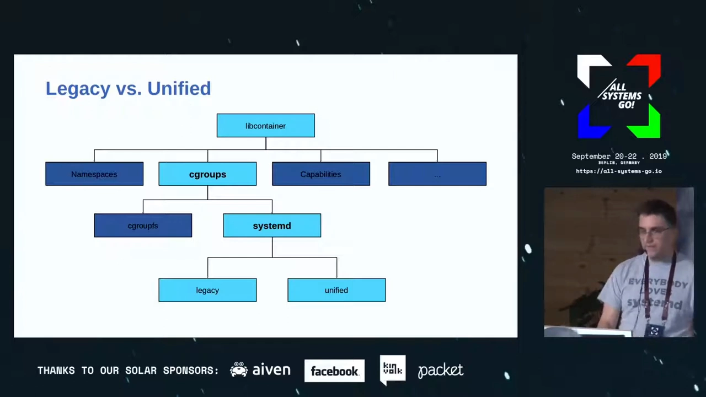

### 4.2 systemd 侧要补的课：D-Bus 可选属性

还有个系统性问题要 systemd 修：写 unit 文件时，systemd 对不认识的指令**默默忽略**（向后兼容的合理设计）；但走 D-Bus 建 unit 时，传入一个它不认识的属性（比如尚在路上的 `io.weight`），**整个调用直接失败**。正确姿势是 D-Bus 协议支持"可选属性"——未知就跳过，并回报哪些没生效 [【跳转到 10:22】](https://www.youtube.com/watch?v=PPc_WGmdRtk&t=622)。

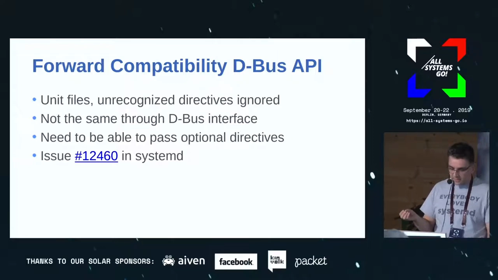

### 4.3 内核与 systemd 的配套条件

能力清单在快速补齐：v2 的 freeze 已随内核 5.2 落地；设备控制器在 v2 下基于 **eBPF** 实现——这正是"改走 systemd"的又一理由：让 systemd 替 libcontainer 生成 BPF 程序，而不是把 eBPF 再实现一遍 [【跳转到 11:45】](https://www.youtube.com/watch?v=PPc_WGmdRtk&t=705)。结论：需要一套较新的 **内核 + systemd** 组合，而这恰与发行版切换 unified 的时间点重合——所有组件可以一起升级、一起就位。

### 4.4 落地：Giuseppe 的 PR

演讲时 slide 上的清单还有红项，但会前会后形势突变：Red Hat 的 Giuseppe Scrivano 把"legacy/unified 驱动分离"的 PR 合了——它解除了 kubelet、CRI-O 接入 v2 的主要阻塞（部分操作仍直写 cgroupfs，属于遗留）[【跳转到 13:30】](https://www.youtube.com/watch?v=PPc_WGmdRtk&t=810)。问答环节确认：kubelet 经 containerd/CRI-O 已可用上 cgroup v2。

## 五、替代方案与遗留问题

### 5.1 systemd 官方推荐的委托式接法

systemd 文档其实给容器管理器指过另一条路 [【跳转到 14:39】](https://www.youtube.com/watch?v=PPc_WGmdRtk&t=879)：要么用原生的 slice/scope unit，要么**开启委托**——由容器管理器的服务在自身子树内自建层级，或新建一个带委托的 scope 再往下搭。这样容器管理器整棵树对 systemd 而言只是**一个 unit、一个 cgroup**。代价也明显：systemd 对该 unit 采取任何行动时，看到的是"机器上所有容器挤成的一坨"，无法逐容器精细管理。

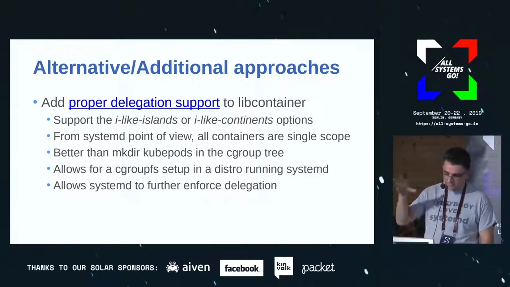

### 5.2 OCI 规范绑死了 v1 模型

更大的遗留问题在规范层：OCI（镜像与运行时规范）里的资源约束字段**深度绑定 cgroup v1 的模型**，而 v2 的控制器模型变化很大、且仍在演进。后续工作包括引入更新的、更高层的控制字段，以及可扩展机制 [【跳转到 15:50】](https://www.youtube.com/watch?v=PPc_WGmdRtk&t=950)。

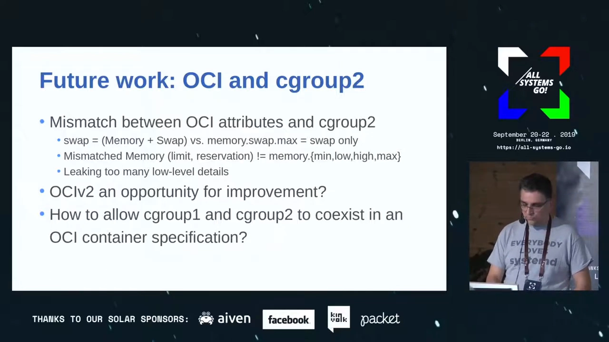

## 六、问答精华

- **runc 会变成 systemd 的包装器吗？** 不会。runc 必须支持没有 systemd 的场景（大规模容器、容器内未必有 systemd 作 PID 1）；且 libcontainer 的职责远不止 cgroups——namespaces、capabilities 等都与 systemd 无关 [【跳转到 17:17】](https://www.youtube.com/watch?v=PPc_WGmdRtk&t=1037)。
- **OCI 的 v1 倾向也影响 systemd 吗？** 有映射错位的案例（如内存限额对应 `memory.max`，语义接近但不完全一致）；systemd 的资源控制与 cgroup v2 是并行开发的，某些 v1 指令干脆没暴露、坐等 v2 [【跳转到 18:46】](https://www.youtube.com/watch?v=PPc_WGmdRtk&t=1126)。
- **Kubernetes 社区为何一度抵制 v2？** （当年的）Google 认为 v1 够用了；态度转变的最大推手是 **eBPF 热潮**——想要 BPF 就得来 v2 [【跳转到 20:17】](https://www.youtube.com/watch?v=PPc_WGmdRtk&t=1217)。

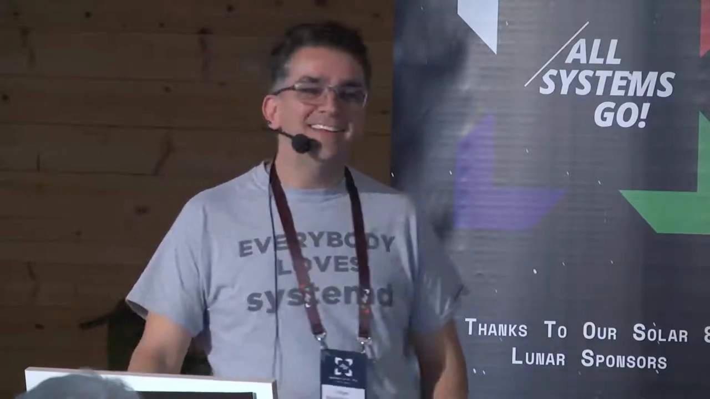

- **hybrid 模式值得留恋吗？** systemd 开发者直言：回头看 hybrid 是个**错误**——一个没有未来的权宜之计（stopgap），资源投进去就打了水漂 [【跳转到 23:00】](https://www.youtube.com/watch?v=PPc_WGmdRtk&t=1380)。
- **干脆全换 crun？** crun 是独立容器**运行器**，libcontainer 是被大多数组件依赖的**库**（kubelet 还用它创建自己的 slice）；换 crun 对 CRI-O 行得通，对全局不成立 [【跳转到 23:29】](https://www.youtube.com/watch?v=PPc_WGmdRtk&t=1409)。

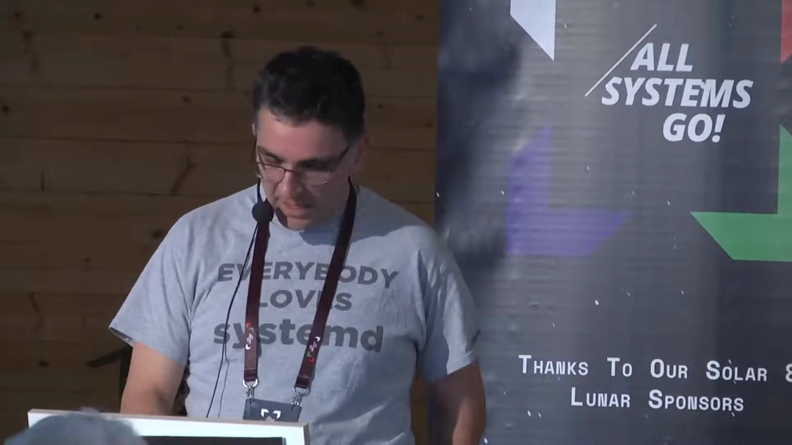

## 小结

- systemd 是 cgroup 事实上的用户态 API；层级分 legacy/hybrid/unified 三模式，方向是 unified（Fedora 31 起默认）；
- 容器栈的症结在 libcontainer：systemd 驱动"半进半出"（建组走 D-Bus、限额直写 cgroupfs），只有 Podman+crun 原生支持 v2；
- 第一次"全走 D-Bus"的重写败于老 systemd 兼容与内核能力缺口；胜出的是**分治**：legacy 沿用旧码、unified 全走 systemd、按层级检测结果切换；
- 配套条件：D-Bus 可选属性、内核 5.2+ 的 v2 freeze、设备控制器复用 systemd 的 eBPF 实现；Giuseppe 的 PR 让 kubelet/CRI-O 接入 v2 落地；
- 边界的另一面：systemd 推荐的"委托式接法"让容器管理器整树缩成一个 unit——安全但粒度粗；OCI 资源字段与 v1 绑定，规范层的演进仍在路上。

## 关键术语速查

| 术语 | 一句话解释 |
| --- | --- |
| legacy / hybrid / unified | v1 独用 / v2 挂载但控制器仍在 v1 / 纯 v2 |
| libcontainer | runc 背后的库，抽象 namespaces、capabilities、cgroups 等 |
| cgroupfs 驱动 | 直写 `/sys/fs/cgroup` 的驱动 |
| systemd 驱动 | 经 D-Bus 与 systemd 通信的驱动（重构后 unified 模式下全走 D-Bus） |
| crun | runc CLI 的独立实现，为单一层级树而生，Podman 默认运行时 |
| D-Bus 可选属性 | 未知属性不报错、事后回报——老版本兼容的关键 |
| cgroup v2 freeze | 冻结整个 cgroup 的能力，内核 5.2 起可用 |
| 委托式接法 | 容器管理器在 systemd 让渡的子树内自治；代价是 systemd 视角粒度变粗 |
| OCI | 开放容器规范；其资源字段历史上绑定 cgroup v1 模型 |
