# Whats new in control groups cgroups version 2：cgroup v2 到底新在哪里

> 视频来源：[What's new in control groups (cgroups) version 2?](https://www.youtube.com/watch?v=yZpNsDe4Qzg)（linux.conf.au，Michael Kerrisk——Linux man-pages 项目维护者，约 45 分钟）
> 本文是条目「1.5.3 根 cgroup 与容器管理器的边界」的配套博客之一，基于视频字幕与画面逐段整理。

## 本讲要解决的核心问题（SCQA）

**背景**：cgroup（control groups，控制组）是 Linux 内核用来做资源限制与记账的机制。v1 已经服役多年，systemd、容器运行时等用户态管理器都构建在它之上。

**冲突**：v1 的设计哲学是"完全自由"——13 个控制器可以随意挂到任意多棵层级树上。但这种自由在实践中制造了一堆麻烦：维护平行层级要把同一个操作重复 N 遍、移动进程不具原子性、层级里"谁都能写"却没有任何约束。

**疑问**：cgroups v2 把这些乱象改成了什么样？新层级怎么挂载、控制器怎么启用？根 cgroup 上还能不能做控制？一段子树能不能交给别的程序去管理？

**回答（中心思想）**：v2 用**一棵统一层级**取代了 v1 的多层级自由。控制器通过 `cgroup.controllers` / `cgroup.subtree_control` 自顶向下逐级启用，想要什么粒度就在哪一层启用；**根 cgroup 不再提供任何资源控制接口**——根是"分蛋糕的人"待的地方，不是"吃蛋糕的进程"待的地方；"进程与已启用控制器不得同居一组的约束"后来又催生了 threaded（线程级）模式；空组通知从昂贵的 release_agent 助手进程改为监听 `cgroup.events`；最后，v2 把"把一段子树交给别的程序管"正式化为**委托（delegation）**：只移交管理文件、绝不移交资源分配文件——这正是 systemd 等管理器与其他用户（包括容器）共享一台机器时的边界划分机制。

---

## 一、v1 的"自由"为什么成了灾难

### 1.1 多层级设计：13 个控制器随意挂

讲师 Michael Kerrisk（Linux 手册页项目维护者、《The Linux Programming Interface》作者）开宗明义：cgroups v2 诞生于 2016 年初，研发花了约三年半，原因只有一个——**v1 成了"不折不扣的一团糟"（an almighty mess）** [【跳转到 01:24】](https://www.youtube.com/watch?v=yZpNsDe4Qzg&t=84)。

v1 的核心设计是：可以有**多棵完整的层级树**，当时共有 13 个控制器（controller，即按资源类型划分的"管理器"，如 memory、cpu、pids），理论上每个控制器可以挂到不同的层级树上，也可以多个控制器共挂一棵树，完全随心所欲 [【跳转到 02:53】](https://www.youtube.com/watch?v=yZpNsDe4Qzg&t=173)。

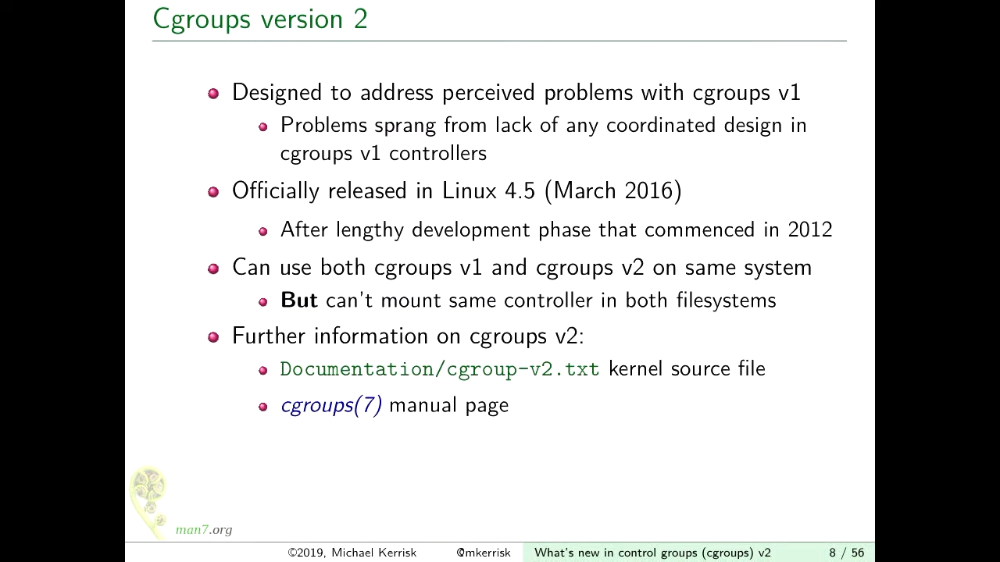

这些控制器由不同团队在不同时期加入，没有统一设计。五六年后社区意识到：这是一套互相不一致的大杂烩，唯一的修复方式就是推倒重来 [【跳转到 01:30】](https://www.youtube.com/watch?v=yZpNsDe4Qzg&t=90)。

### 1.2 粒度与原子性不可兼得

v1 的"自由"至少带来两难。讲师用 memory 与 cpu 两个控制器举了第一种方案：**每个控制器各挂一棵层级树** [【跳转到 04:01】](https://www.youtube.com/watch?v=yZpNsDe4Qzg&t=241)。

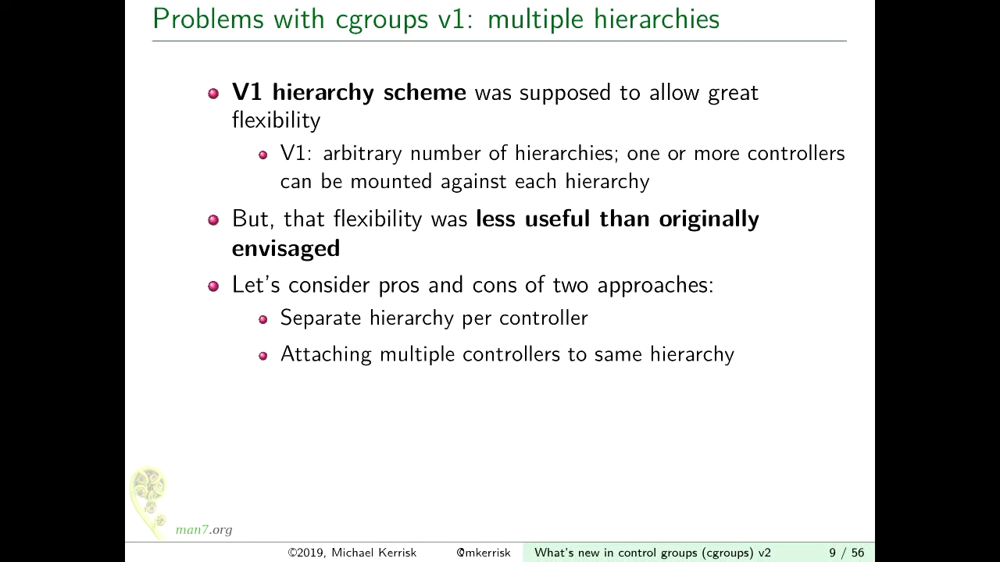

- 好处：不同控制器可以有**不同的控制粒度**。比如内存希望对 P2 与 P3/P4 分别精细控制，而 CPU 只需要 P2、P3、P4 共享一个额度——两棵树各管各的，互不干扰。
- 坏处：一旦要把进程 P2 从 cgroup N 移到 cgroup M，就必须在**每一棵层级树上重复一遍同样的操作**。这不仅繁琐、缓慢，而且**不具原子性**（atomic，即"要么全做要么不做"的整体性）——移动到一半时，进程在不同控制器下的归属是不一致的 [【跳转到 06:01】](https://www.youtube.com/watch?v=yZpNsDe4Qzg&t=361)。

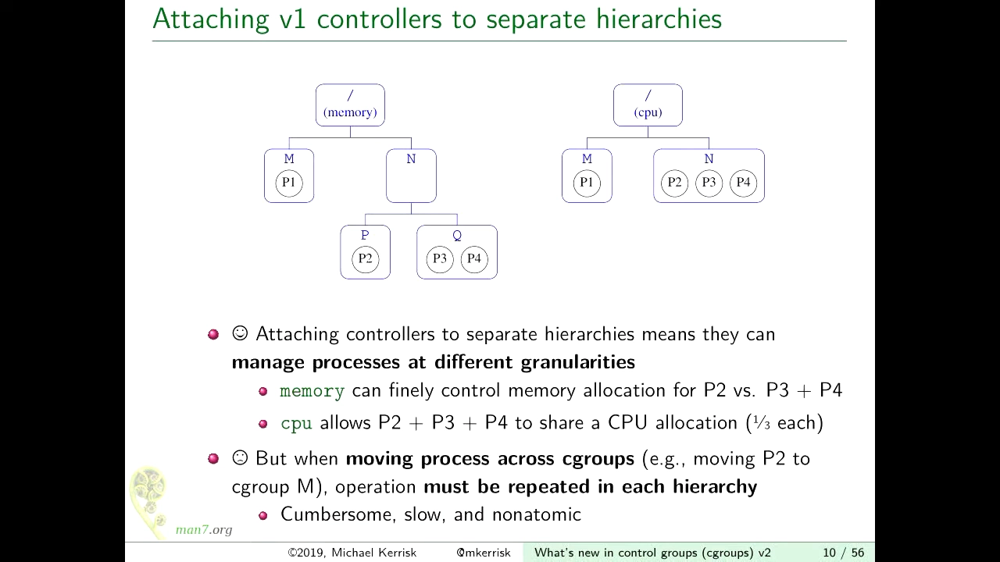

反过来，第二种方案是**所有控制器挂同一棵树** [【跳转到 06:41】](https://www.youtube.com/watch?v=yZpNsDe4Qzg&t=401)：

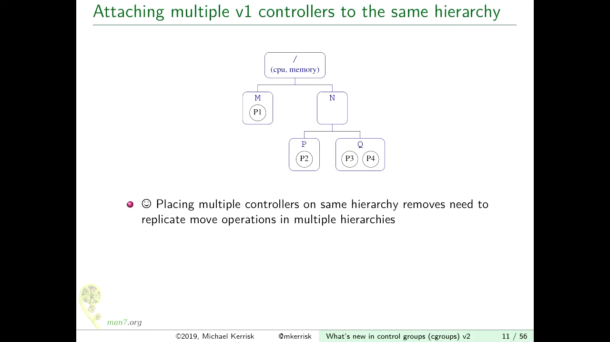

- 好处：移动进程只做一次，天然原子。
- 坏处：所有控制器被迫使用**同一个粒度**，粒度变成"全有或全无"——内存想细、CPU 想粗，做不到。

两难的本质是：v1 把"层级组织"和"控制器启用"绑死在一起，二者无法独立调整。

### 1.3 没有人约束"谁在写"

v1 还有第三个坑：**层级没有任何写入约束**。内核不阻止多个互不相关的程序同时往层级里写——你想建组就建组，想挪进程就挪进程。谁来保证大家遵守同一套规则？没有人。v2 要解决的头号问题正是这个（后续 systemd 演讲里称其为 single-writer 规则，见本系列另一篇博客）。

## 二、统一层级：v2 的新世界

### 2.1 一棵树，控制器全部随行

v2 是**单一统一层级**（unified hierarchy）：全系统只有一棵 cgroup 树，所有控制器都挂在它上面。v1 与 v2 可以并存，但**同一个控制器不能同时用于两个版本**——要么 v1、要么 v2 [【跳转到 02:14】](https://www.youtube.com/watch?v=yZpNsDe4Qzg&t=134)。

挂载方式也简化了。v1 要用 `-o` 指明想把哪些控制器挂上来；v2 一棵树通吃，直接：

```bash
mount -t cgroup2 none /mnt/cgroup2
```

挂载后**所有控制器自动可用**，无需逐个声明 [【跳转到 19:46】](https://www.youtube.com/watch?v=yZpNsDe4Qzg&t=1186)。在使用 systemd 的现代发行版上，这一步通常已经由 systemd 替你完成——它把统一层级挂在了 `/sys/fs/cgroup/unified` [【跳转到 20:04】](https://www.youtube.com/watch?v=yZpNsDe4Qzg&t=1204)。

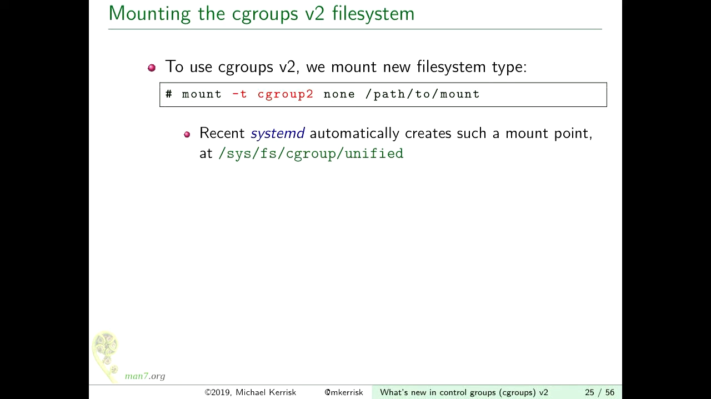

### 2.2 控制器的"可用"与"启用"：两个关键文件

v2 里每个 cgroup 目录下都有两个管理文件：

- **`cgroup.controllers`**：本级**可用**哪些控制器；
- **`cgroup.subtree_control`**：本级已经为**下一级**启用了哪些控制器。

读一下根目录的 `cgroup.controllers`，你可能会发现里面一个控制器都没有 [【跳转到 21:27】](https://www.youtube.com/watch?v=yZpNsDe4Qzg&t=1287)。原因很直白：这些控制器全都被 v1 的层级占着，而一个控制器不能同时在 v1 和 v2 使用。

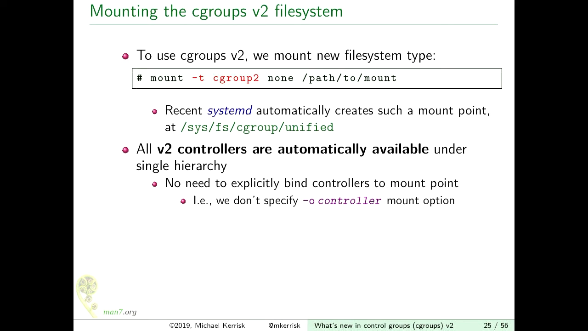

想让控制器"回到" v2，得先从 v1 侧释放它：

1. `umount` 对应的 v1 层级——但卸载有苛刻前提：该层级内所有进程必须都在根 cgroup、没有任何子 cgroup、也没有进程的工作目录或打开文件描述符指向该层级内的对象。systemd 早已在里面建了一堆东西，你得从最深处开始**自底向上**逐层删除、逐个移进程 [【跳转到 22:20】](https://www.youtube.com/watch?v=yZpNsDe4Qzg&t=1340)；
2. 有些控制器（比如 memory）即使这样也卸不下来，讲师怀疑与 eventfd 机制有关；
3. 终极手段：用内核启动参数 **`cgroup_no_v1=all`**（或列出想禁用的控制器）直接禁用 v1——systemd 会"有点伤心"，但能照常工作 [【跳转到 23:57】](https://www.youtube.com/watch?v=yZpNsDe4Qzg&t=1437)。

重启后 `cgroup.controllers` 里就有货了。

### 2.3 subtree_control：控制器是"给下一级"启用的

v2 与 v1 最大的操作差异在这里 [【跳转到 25:46】](https://www.youtube.com/watch?v=yZpNsDe4Qzg&t=1546)。在根 cgroup 下建两个子目录 A、B，先看 A 里面：只有 `cgroup.*` 系列管理文件，**没有任何控制器接口文件**。

现在向父目录的 `cgroup.subtree_control` 写入 `+memory`：

```bash
echo +memory > cgroup.subtree_control
```

再看 A：一整套 `memory.*` 接口文件（`memory.max` 等）**凭空出现**了 [【跳转到 27:23】](https://www.youtube.com/watch?v=yZpNsDe4Qzg&t=1643)。写 `-memory` 则会在子级撤下这批文件。

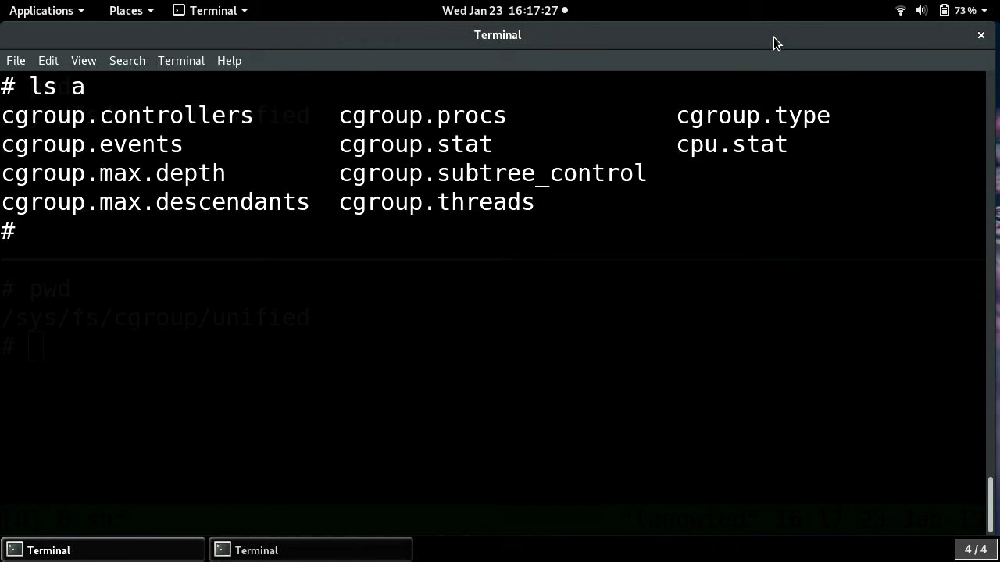

三个关键语义 [【跳转到 27:00】](https://www.youtube.com/watch?v=yZpNsDe4Qzg&t=1620)：

1. **subtree_control 启用的是"下一级"的控制权**：在 X 目录里写 `+memory`，意味着 X 的**子目录**获得 memory 接口文件——接口文件是"从上一级往下分蛋糕"用的 [【跳转到 29:09】](https://www.youtube.com/watch?v=yZpNsDe4Qzg&t=1749)；
2. **逐级传递，粒度自选**：想让某控制器只管到树的某一层，就在那一层的父级启用、更深处不启用——这正是 v1 想要却做不到的"每控制器不同粒度" [【跳转到 28:26】](https://www.youtube.com/watch?v=yZpNsDe4Qzg&t=1706)；
3. **自上而下的可用性**：一个控制器在某一层没被启用，就更深的地方也启用不了。演示里 `+cpu` 直接报错，因为根的 `cgroup.controllers` 里只有 memory 和 pids [【跳转到 31:21】](https://www.youtube.com/watch?v=yZpNsDe4Qzg&t=1881)。

进程的放置倒是与 v1 一致：写 `cgroup.procs` 移动进程，子进程继承父组，空组可删 [【跳转到 32:30】](https://www.youtube.com/watch?v=yZpNsDe4Qzg&t=1950)。

## 三、根 cgroup 的边界：根上不许"控制"

### 3.1 根 cgroup 没有任何接口文件

v2 的一条铁律：**根 cgroup 里没有任何控制器接口文件**——你不能对"住在根里的进程"做任何资源控制 [【跳转到 33:14】](https://www.youtube.com/watch?v=yZpNsDe4Qzg&t=1994)。

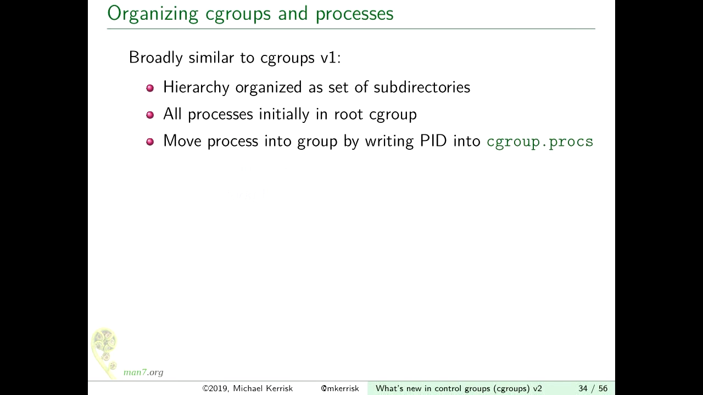

v1 里这一点是混乱的：有些控制器允许在根上控制，有些不允许。v2 把它统一成"根上不许控制"，把根变成纯粹的**组织与分发层**：想被管理，就下树。

### 3.2 no-internal-process：进程与控制器不得同居

v2 早期文档写的是"只有叶子节点能放进程"，但真实规则更微妙 [【跳转到 34:04】](https://www.youtube.com/watch?v=yZpNsDe4Qzg&t=2044)：

> **一个 cgroup 不能同时拥有成员进程、并在 `cgroup.subtree_control` 中启用控制器。**

拆开说：

- cgroup **可以**既有成员进程、又有子 cgroup——只要你不在这个组里启用控制器 [【跳转到 34:58】](https://www.youtube.com/watch?v=yZpNsDe4Qzg&t=2098)；
- 想启用控制器？先把进程挪进子组，再写 `subtree_control` [【跳转到 35:00】](https://www.youtube.com/watch?v=yZpNsDe4Qzg&t=2100)；
- 这条规则与根 cgroup 的"无接口文件"是同一逻辑的两面：**管人的组不分资源，分资源的组不直接管人**。

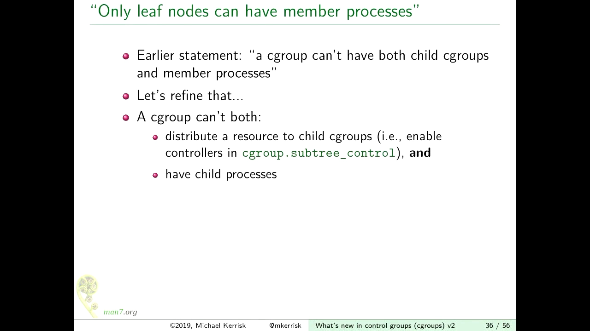

（讲师顺带预告：内核 4.14 起部分控制器支持 threaded 模式，规则会有例外——线程级控制的完整故事在 systemd 一讲中展开。）

## 四、空组通知：从 release_agent 到 cgroup.events

### 4.1 v1：每空一个组就 fork 一个帮手进程

"某个 cgroup 里的进程全部退出"是个重要事件——systemd 靠它重启崩掉的守护进程，容器管理器靠它感知容器退出。v1 的做法：组变空时，内核自动**拉起一个用户态助手进程**（release_agent 机制），告诉它哪个组空了 [【跳转到 14:38】](https://www.youtube.com/watch?v=yZpNsDe4Qzg&t=878)。

问题是代价：如果每秒有几千个 cgroup 变空，内核就要每秒拉起几千个进程。而且整个层级只能配**一个**通知程序，无法按子树区分 [【跳转到 15:28】](https://www.youtube.com/watch?v=yZpNsDe4Qzg&t=928)。

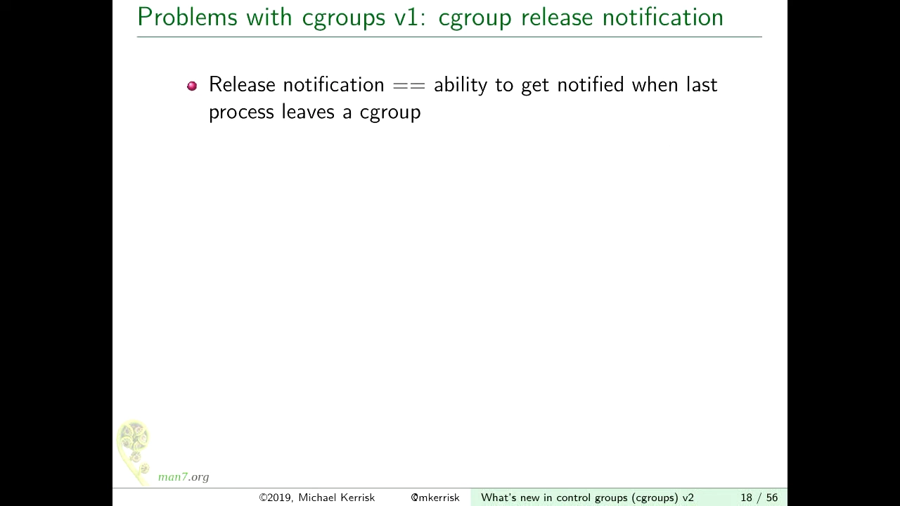

### 4.2 v2：cgroup.events + inotify/poll

v2 的每个 cgroup 目录下有个键值文件 `cgroup.events`，目前只有一个键 **`populated`**：1 表示该子树还有活进程，0 表示空了 [【跳转到 36:21】](https://www.youtube.com/watch?v=yZpNsDe4Qzg&t=2181)。用 inotify / poll / epoll 监听这个文件即可，一个预先存在的进程可以同时监听成千上万个组 [【跳转到 37:06】](https://www.youtube.com/watch?v=yZpNsDe4Qzg&t=2226)。

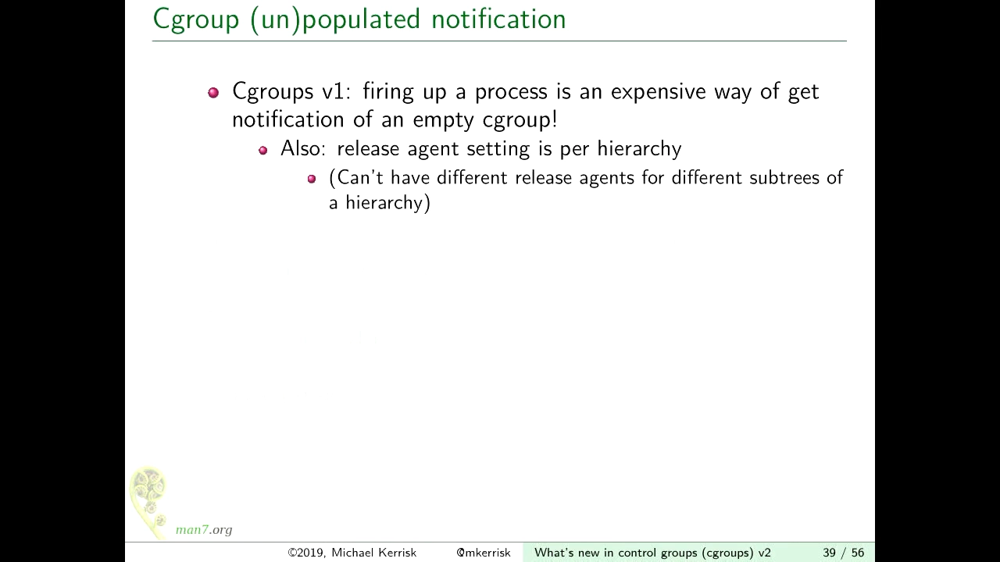

更妙的是通知也可以"委托"：层级的不同部分可以由**不同进程分别监听**——比如每个容器一个监视进程。这与下一节的委托机制正好配套。

## 五、委托：把一段子树交给别的管理者

### 5.1 为什么需要委托，术语是什么

想象 uid 1000 的普通用户要跑一个**非特权容器**：容器需要在自己的子树里建组、挪进程，但它无权写系统级的层级。v2 的答案是**委托（delegation）**：把层级中某一段子树的所有权交给非特权用户，由它自行管理 [【跳转到 38:12】](https://www.youtube.com/watch?v=yZpNsDe4Qzg&t=2292)。

两个术语 [【跳转到 38:53】](https://www.youtube.com/watch?v=yZpNsDe4Qzg&t=2333)：

- **delegator（委托方）**：特权进程，管理被委托子树的**父级**——它决定分多少资源给这段子树；
- **delegate（受托方）**：低特权进程（如 uid 1000），拿到子树后自行建组、挪进程。

### 5.2 移交什么、绝不移交什么

委托的实现非常朴素——**改文件属主**（chown）[【跳转到 39:16】](https://www.youtube.com/watch?v=yZpNsDe4Qzg&t=2356)。但哪些文件能改，哪些不能改，是这套机制的精髓：

- **移交**：cgroup 目录本身、`cgroup.procs`、`cgroup.subtree_control`、`cgroup.threads` 等**管理文件**——受托方靠它们建子组、挪进程、决定深处启用哪些控制器；
- **绝不移交**：`pids.max`、`cpu.max` 等**资源控制接口文件**——它们是委托方从上一级往这段子树里**分发资源**用的，受托方若能改写，就能给自己偷偷加资源。

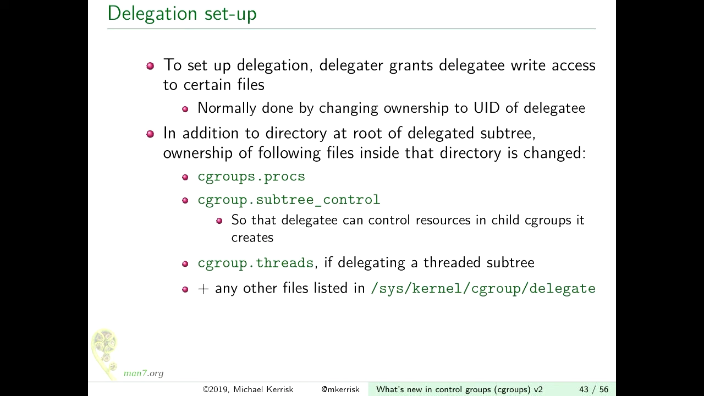

受托方新建的子 cgroup 自动归它所有 [【跳转到 41:18】](https://www.youtube.com/watch?v=yZpNsDe4Qzg&t=2478)。

### 5.3 委托隔离（containment）规则

拿到子树不等于为所欲为。v2 定义了**委托隔离规则**：受托方可以在子树**内部**随意建组、挪进程，但**不能把进程挪进或挪出这段子树**——边界之外的世界依然归委托方管 [【跳转到 41:52】](https://www.youtube.com/watch?v=yZpNsDe4Qzg&t=2512)。

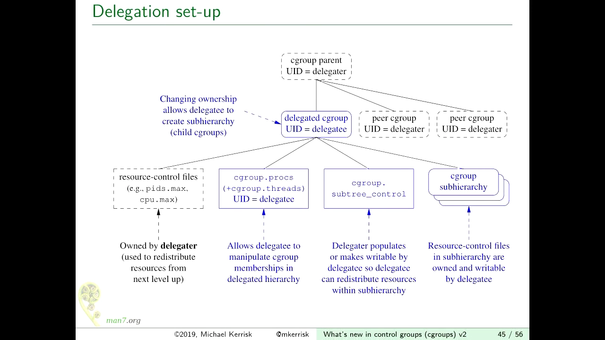

### 5.4 v1 的委托只是"意外的副产品"

v1 里这类操作并非不存在，但完全是**设计外的巧合**：没有正式的移交语义，也没有隔离规则——同一个用户跑两个容器时，进程可以互相串门，谈不上安全边界 [【跳转到 42:08】](https://www.youtube.com/watch?v=yZpNsDe4Qzg&t=2528)。v2 把它升格为一等公民机制，这正是"根 cgroup 与容器管理器边界"在内核层面的最终答案。

## 小结

- v1 的多层级自由导致粒度与原子性不可兼得、层级无写入约束，v2 以**单一统一层级**推倒重来；
- v2 用 `cgroup.controllers`（可用）与 `cgroup.subtree_control`（为下一级启用）两个文件实现**自顶向下、逐级可选粒度**的控制器管理；
- **根 cgroup 无接口文件**：根只组织、分发，不直接控制进程；no-internal-process 约束要求"启用控制器的组不得有成员进程"；
- 空组通知从 release_agent 助手进程改为监听 `cgroup.events` 的 `populated` 键，廉价且可按子树分派；
- **委托**= 改属主移交管理文件（procs/subtree_control/threads），资源分配文件留在委托方手里，配以"进程不得跨越子树边界"的隔离规则——这就是根与容器管理器之间那条清晰的界线。

## 关键术语速查

| 术语 | 一句话解释 |
| --- | --- |
| controller（控制器） | 按资源类型划分的内核管理器，如 memory、cpu、pids |
| unified hierarchy（统一层级） | v2 的单棵 cgroup 树，所有控制器共享 |
| `cgroup.controllers` | 本级**可用**的控制器清单 |
| `cgroup.subtree_control` | 本级为**下一级**启用的控制器；写 `+x`/`-x` 启停 |
| no-internal-process | 启用了控制器的 cgroup 不得同时容纳成员进程 |
| `cgroup.events` / populated | 空组通知：监听该文件即可感知子树是否还有活进程 |
| delegation（委托） | 通过改属主把子树的管理权交给低特权用户/程序 |
| delegator / delegate | 委托方（管父级、分资源）/ 受托方（管子树内部） |
| containment（隔离规则） | 受托方只能在子树内部移动进程，不得跨越边界 |
