# systemd cgroup delegation and control processes：single-writer 规则下的子树让渡

> 视频来源：[systemd cgroup delegation and control processes - Michal Koutný](https://www.youtube.com/watch?v=9esNyooc5rg)（Linux Plumbers Conference，Michal Koutný——SUSE/systemd 维护者，约 27 分钟）
> 本文是条目「1.5.3 根 cgroup 与容器管理器的边界」的配套博客之一，基于视频字幕与画面逐段整理。

## 本讲要解决的核心问题（SCQA）

**背景**：systemd 按 **single-writer 规则**管理 cgroup 层级——树的每一段都必须有唯一的所有者负责配置。根 cgroup 及其下的一切都由 systemd 管理（cgroup v2 的统一层级与委托机制，见本系列 cgroups v2 一讲）。

**冲突**：服务自己、容器运行时这些"别的管理器"也需要在层级里建组、挪进程。可按规则，它们默认什么都不许动；即便开了委托，"控制进程该放哪"也会撞上 no-internal-process 约束。

**疑问**：systemd 如何把一段子树安全地让渡出去？委托之后，服务的辅助进程、reload 命令这些"控制进程"究竟该住哪个 cgroup？

**回答（中心思想）**：systemd 用 `Delegation=` 把 service/scope unit 的子树交给服务自身——受托方获得 `cgroup.subtree_control` 等文件的写权限，可在子树内自建层级；而控制进程与载荷并存引发的"内部节点约束"难题，systemd 先用**包装 cgroup**（wrapper cgroup）兜住，本演讲进一步提出**显式声明控制进程所在 cgroup** 的新指令，并配合 threaded 模式解决实时服务场景；这套"边界舞步"同样决定着容器如何被进入（`docker exec` 式操作要先找到 `init.scope`）。

---

## 一、single-writer 规则与委托

### 1.1 根及以下都归 systemd，所以需要"让渡"

演讲者 Michal Koutný（SUSE，内核与用户态两侧都碰 cgroup）先铺背景：single-writer 规则要求层级每段有**清晰的所有者**。根 cgroup 和它下面的一切都由 systemd 管理，照此推论"一切都归 systemd"——但实践上让别的管理器（服务自身、容器运行时）也有自己的一亩三分地更合理，于是有了**委托（delegation）** [【跳转到 00:48】](https://www.youtube.com/watch?v=9esNyooc5rg&t=48)。

他引用 systemd 手册页的定义：委托允许把**子树**交给另一个实体，由它管理子树内的**控制器与进程**——对 service 和 scope 两类 unit 都适用 [【跳转到 01:28】](https://www.youtube.com/watch?v=9esNyooc5rg&t=88)。

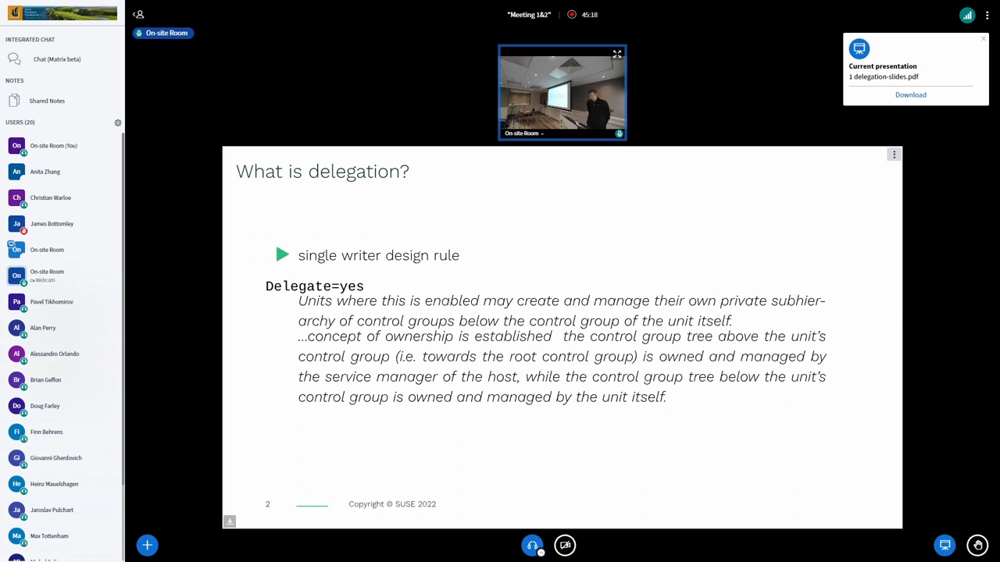

### 1.2 默认不委托：服务的一切都挤在一个组里

以一个普通服务为例。默认（未委托）时，服务**不能创建自己的层级、不能迁移进程**——否则会把 systemd 搞糊涂。此时服务的 cgroup 里住着两类进程：`ExecStart` 拉起的**主载荷（payload）**，和一个生命周期独立、可能与载荷并行的**控制进程（control process）** [【跳转到 02:07】](https://www.youtube.com/watch?v=9esNyooc5rg&t=127)。

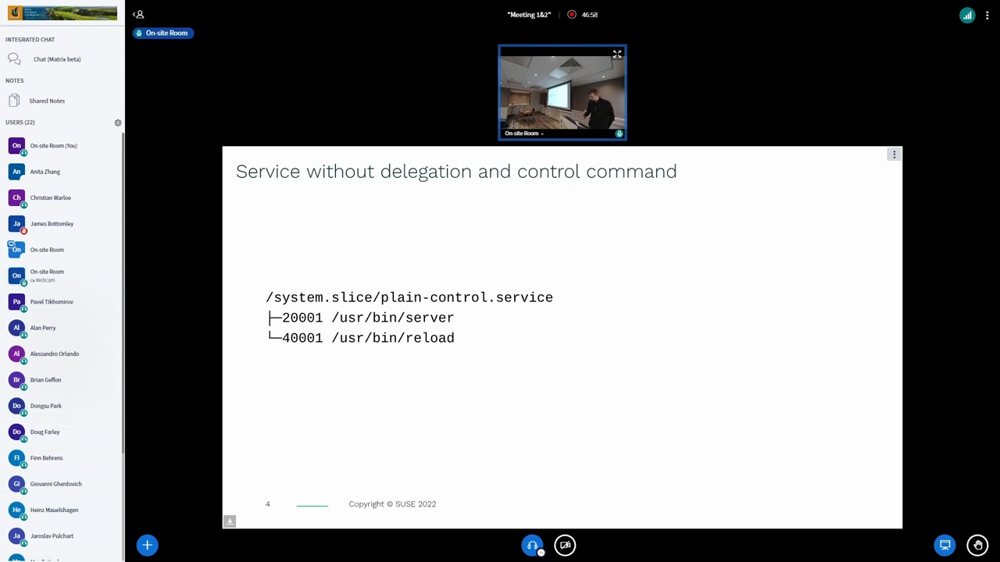

与载荷并存的控制命令不止 `ExecReload`，还有一串同类指令（`ExecStartPre/Post` 等在主进程之前跑，其余与载荷并存）[【跳转到 03:13】](https://www.youtube.com/watch?v=9esNyooc5rg&t=193)。它们与载荷挤在同一组，通常正是我们想要的。

### 1.3 委托之后：服务自己搭两层

打开 `Delegation=` 后，层级视图变了：systemd 为服务建一个顶层 cgroup，把 `cgroup.subtree_control` 置为**可写（RW）**交给服务用户；服务随即自建两个子 cgroup——一个放主载荷，一个放辅助进程 [【跳转到 03:52】](https://www.youtube.com/watch?v=9esNyooc5rg&t=232)。

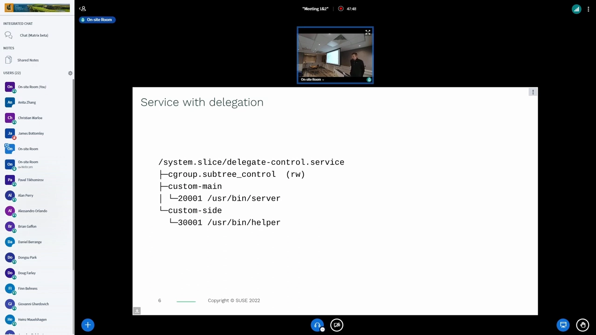

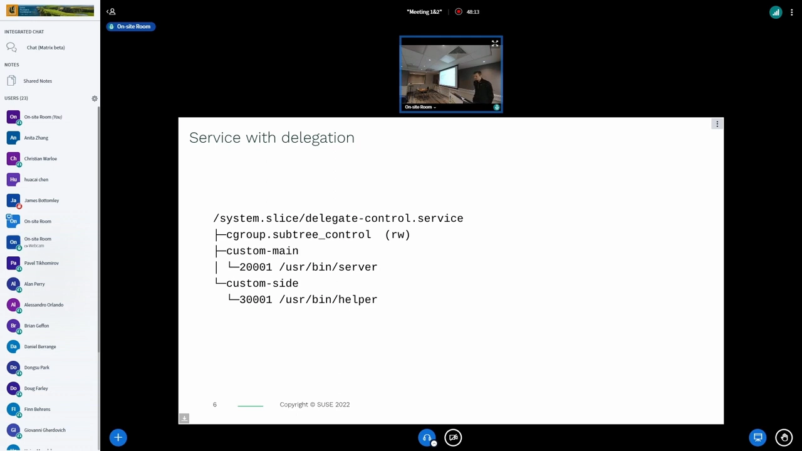

一个注脚：不少服务以 root 运行，理论上"无所不能"、并不需要这层授权——但仍建议走委托：这让层级**井然有序、可一眼看清"什么属于谁"**（advisory，建议性）[【跳转到 04:49】](https://www.youtube.com/watch?v=9esNyooc5rg&t=289)。

## 二、控制进程撞上 no-internal-process 约束

### 2.1 问题：控制命令想住进载荷组，住不进去

统一层级有条硬规则：**进程只能放在叶子节点**（internal node constraint，内部节点约束——即"启用了控制器的组不得有成员进程"）。麻烦来了：控制命令通常要和服务一起启动，按惯例应放进主载荷的 cgroup——可一旦那里启用了控制器，这就违反约束，直接行不通 [【跳转到 05:26】](https://www.youtube.com/watch?v=9esNyooc5rg&t=326)。

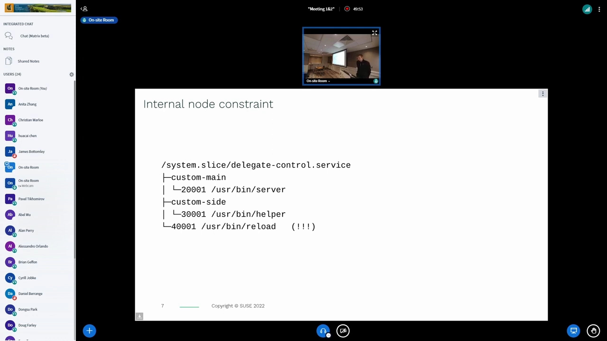

### 2.2 systemd 的现行对策：包装 cgroup

systemd 目前的解法很务实：**在服务自建组旁边再造一个包装 cgroup（wrapper cgroup）**，把控制进程塞进去——载荷归载荷、控制归控制，谁也不违反约束 [【跳转到 06:15】](https://www.youtube.com/watch?v=9esNyooc5rg&t=375)。

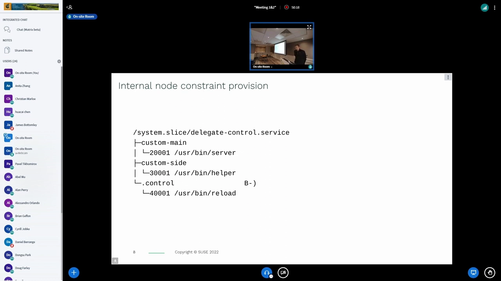

### 2.3 约束并非铁板一块

有意思的是，这条约束**有条件放宽**：当某层**没有启用新控制器**时，进程是允许待在那里的。例子：服务声明了委托却根本没使用（没建子层级），进程就直挺挺住在顶层组里；此时 systemd 照样为控制命令建组并成功——因为"未启用控制器"的场景约束松弛 [【跳转到 06:39】](https://www.youtube.com/watch?v=9esNyooc5rg&t=399)。根源在于约束本身是**为控制器**服务的（后文讨论环节还会回到这点）。

## 三、实时服务与 threaded 模式：约束的深水区

### 3.1 双载荷示例：敏感的与辅助的

把例子升级成实时（RT）服务：两个载荷部分——**敏感部分**要求 2 个专属 CPU、线程带实时优先级；**辅助部分**用剩下的 1 个 CPU [【跳转到 07:39】](https://www.youtube.com/watch?v=9esNyooc5rg&t=459)。

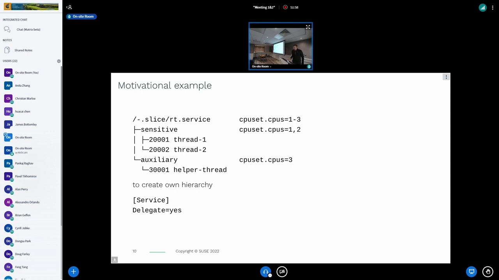

### 3.2 threaded 控制器与 domain cgroup

统一层级引入了线程级控制：有些控制器支持到线程粒度，有些不支持——比如 memory 就不可能，因为同一地址空间的线程共享内存，分开管没有意义 [【跳转到 08:41】](https://www.youtube.com/watch?v=9esNyooc5rg&t=521)。于是：

- 不支持线程的控制器只在**较高层**启用，这些组称为 **domain（域）cgroup**；
- 只有支持线程的控制器可以在其下启用 **threaded（线程型）cgroup**，这类组被显式标记，里面的线程可各自独立迁移 [【跳转到 09:27】](https://www.youtube.com/watch?v=9esNyooc5rg&t=567)。

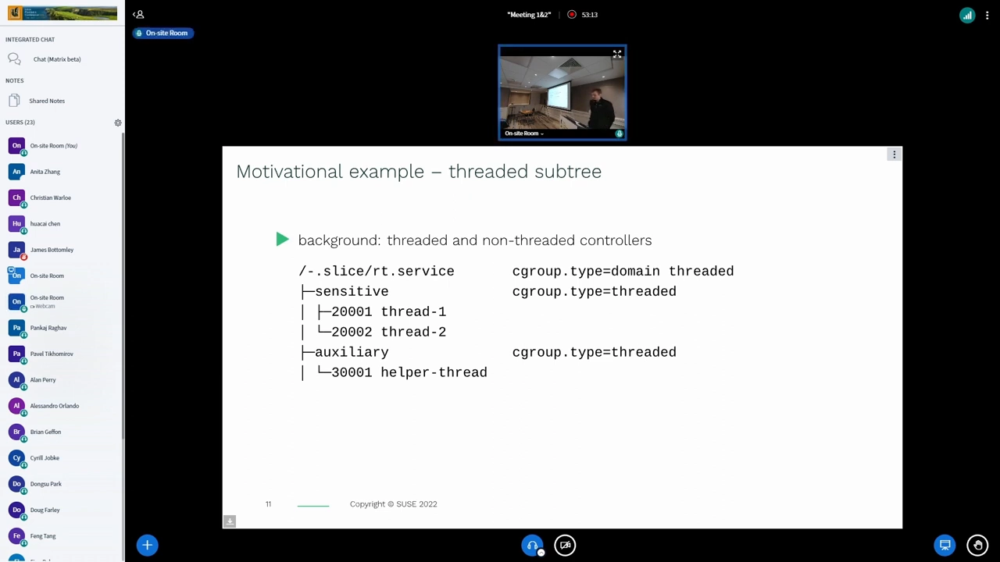

### 3.3 包装组"类型无效"：控制命令起不来

深水区出现了：控制命令的包装 cgroup 默认**类型无效（invalid）**——没人显式把它切成 threaded 模式。要把控制进程迁移进去时，内核拒绝：目标是无效类型的组，**控制命令直接启动失败** [【跳转到 10:03】](https://www.youtube.com/watch?v=9esNyooc5rg&t=603)。

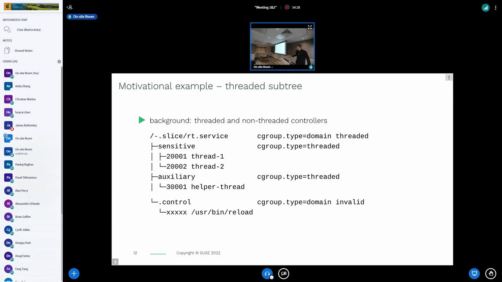

### 3.4 更深的坑：CPU 是"非弹性"资源

即便解决了类型问题，还有一笔账：像 CPU 这种**非弹性资源**，载荷和控制命令必须挤在同一个组（同一个 cpuset）里分——预留了 3 个 CPU 给服务，控制命令用哪几个？会不会稀释敏感载荷的保证？内存这种**弹性资源**尚可折中通融，CPU 没得商量 [【跳转到 10:46】](https://www.youtube.com/watch?v=9esNyooc5rg&t=646)。

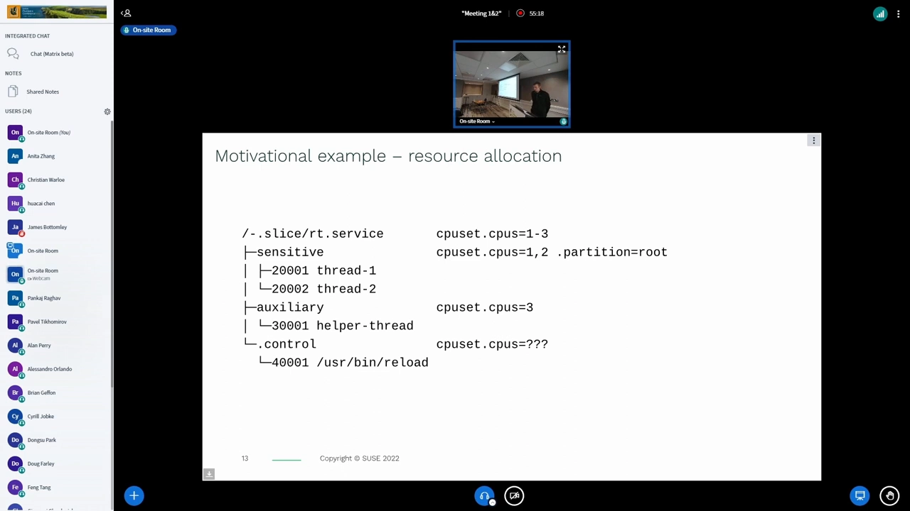

## 四、提案：把"控制进程住哪"写进配置

### 4.1 显式指定双方的家

讲者的提案相当直接：新增一个指令（演示用名），允许**显式指定控制进程与载荷各自的 cgroup** [【跳转到 12:01】](https://www.youtube.com/watch?v=9esNyooc5rg&t=721)。默认写法等价于现状（控制命令在 systemd 的包装组、载荷在顶层组）；也可以把载荷包进指定组、把控制命令挪去别处；必要时控制命令所在组自动切换到 threaded 模式，迁入不再报错 [【跳转到 12:40】](https://www.youtube.com/watch?v=9esNyooc5rg&t=760)。

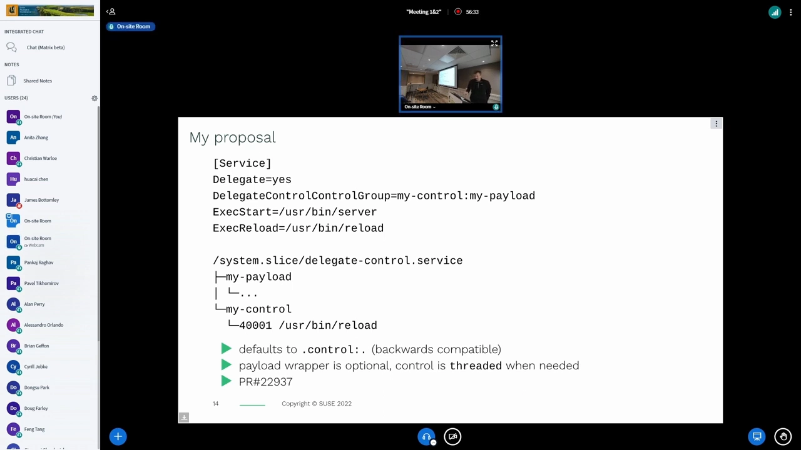

配套示例是 systemd 自带的 `user@.service`：`ExecStart` 拉起用户实例、没有 reload 命令——可以声明它跑在 `init.scope` 里、与子树的主服务同处 [【跳转到 14:04】](https://www.youtube.com/watch?v=9esNyooc5rg&t=844)。讲者也评估过另外两种思路——为委托子树预建固定的载荷/控制分组，或把所有控制命令丢进全局 scope——结论是都"看着别扭"；而"加开关启用 threaded 委托"也走不通：threaded 与否**无法靠文件权限约束**（能建 scope 就能自行切换），管不住 [【跳转到 14:44】](https://www.youtube.com/watch?v=9esNyooc5rg&t=884)。

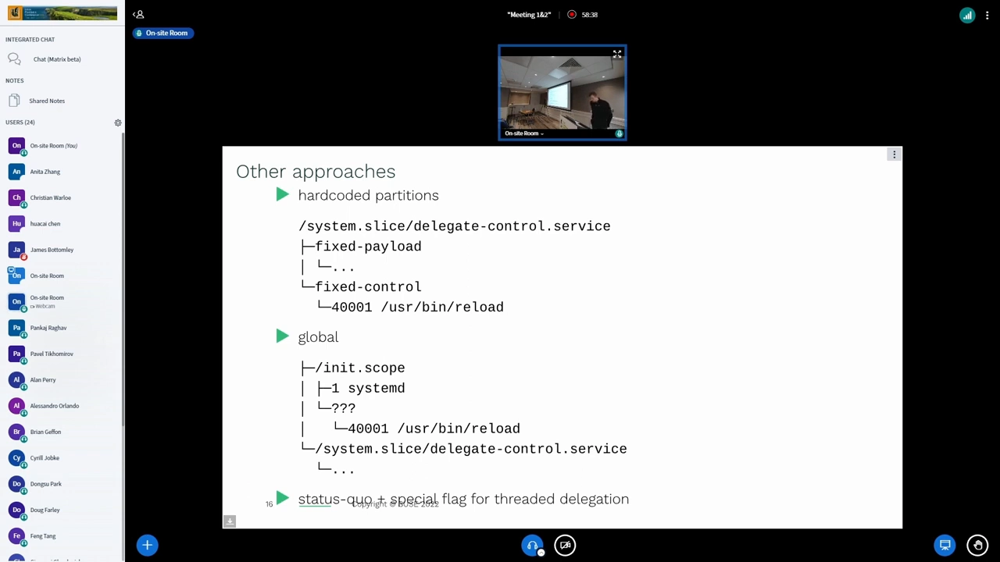

### 4.2 讨论环节：建议性 vs 强制性

问答区火力集中在一点：**哪些规则该由内核强制，哪些只是建议** [【跳转到 16:21】](https://www.youtube.com/watch?v=9esNyooc5rg&t=981)。Lennart（Poettering）回忆：曾设想过由内核强制 single-writer，后来放弃——不实用；也有声音建议干脆**放宽内核的 no-internal-process 约束**，让"半合法"层级也能跑、内核尽力记账，追求极致资源管理时再搭干净布局；还有人指出根 cgroup 里通常只有内核线程，"进程留在根里与子组竞争资源"的行为并未被充分测试，不宜回退到 v1 时代的做法 [【跳转到 17:18】](https://www.youtube.com/watch?v=9esNyooc5rg&t=1038)。

另一个共识：委托服务的"标准舞步"很滑稽——**进程一出生就要把自己挪到别处**（如 PID 1 挪进 `init.scope`、`systemd --user` 同样如此）。与其如此，不如提供 `DefaultControlGroup=` 之类设置，让 systemd 拉起任何进程时直接放进正确组（内核已支持 fork 进指定 cgroup，只是用户态尚未用上）；更进一步还可让 unit 声明一整棵要预建的 cgroup 层级 [【跳转到 19:35】](https://www.youtube.com/watch?v=9esNyooc5rg&t=1175)。

## 五、对容器的启示：进入容器的"边界舞步"

这套约束直接塑造了容器工具的行为。类比 `docker exec`：外部命令要"进入"容器并运行——v1 层级下随便放；v2 下，往容器进程所在的 cgroup 里塞新进程就会违反内部节点约束 [【跳转到 25:03】](https://www.youtube.com/watch?v=9esNyooc5rg&t=1503)。

实践中的舞步是：先尝试加入**容器子树的根 cgroup**——失败（`EBUSY`，约束所致），因为容器内的 systemd 已把 PID 1 挪进了 `init.scope`、根组里启用了控制器；于是退而求其次，找到 `init.scope` 加入其中 [【跳转到 25:26】](https://www.youtube.com/watch?v=9esNyooc5rg&t=2526)。没跑 systemd 的系统（如 OpenRC）根组反而直接可进。配合 cgroup 命名空间，容器内的"根"视图又与宿主机的边界进一步隔离——这正是"根 cgroup 与容器管理器边界"在操作层面的日常体现。

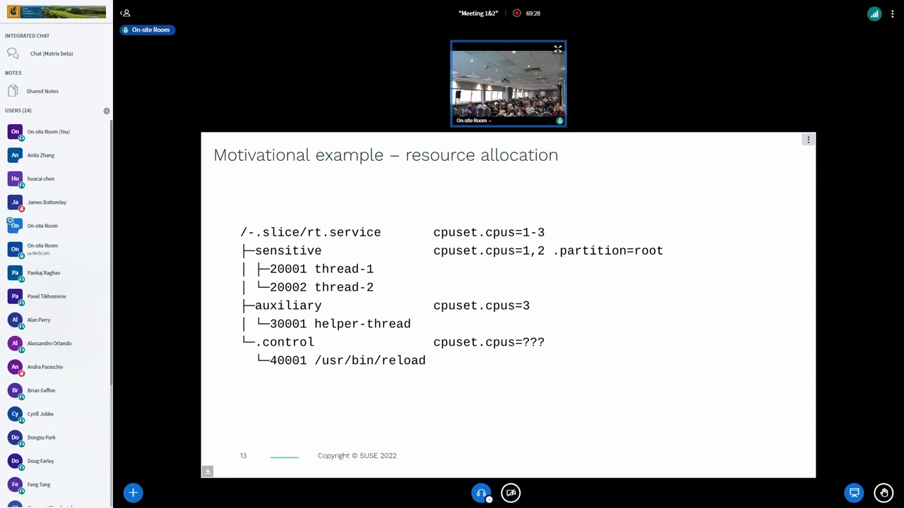

## 小结

- single-writer 规则让 systemd 拥有整棵层级；**委托**是它把子树让渡给服务/容器的正规通道：交出 `subtree_control` 等管理文件的写权限，受托方在子树内自治；
- 控制进程（reload 等）与载荷并存，撞上 no-internal-process 约束；systemd 以**包装 cgroup**兜底，约束在"未启用控制器"时放宽；
- threaded 模式让线程级控制成为可能，但也带来"包装组类型无效、控制命令启动失败"的新坑；CPU 这类**非弹性资源**让"载荷与控制命令共处一组"的保证更难做；
- 提案方向：让 unit 显式声明控制进程与载荷的 cgroup（必要时自动切 threaded），替代"进程自己先搬家"的滑稽舞步；
- 容器侧的映射：进入容器的命令遵循"先试根组、`EBUSY` 后入 `init.scope`"的固定舞步——约束决定行为。

## 关键术语速查

| 术语 | 一句话解释 |
| --- | --- |
| single-writer 规则 | 层级每段必须有唯一所有者；根及以下默认归 systemd |
| Delegation= | systemd 的委托开关：把 unit 子树交由服务自身管理 |
| 载荷（payload）/ 控制进程 | 服务主程序 / ExecReload 等辅助命令 |
| 包装 cgroup（wrapper） | systemd 为控制进程临时建的"隔壁"组，规避内部节点约束 |
| no-internal-process | 启用了控制器的组不得有成员进程（进程只住叶子） |
| domain / threaded cgroup | 域组（常规控制器）/ 线程型组（仅线程感知控制器可入） |
| init.scope | systemd 为 PID 1（及用户实例）准备的家，容器进入时的"合法门牌" |
| containment | 委托隔离：进程只能在被让渡的子树内部移动 |
