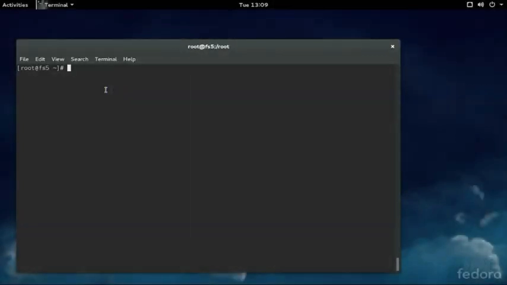
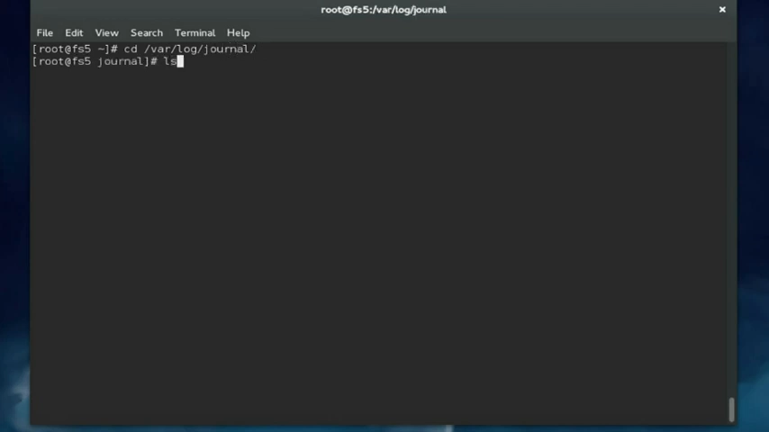
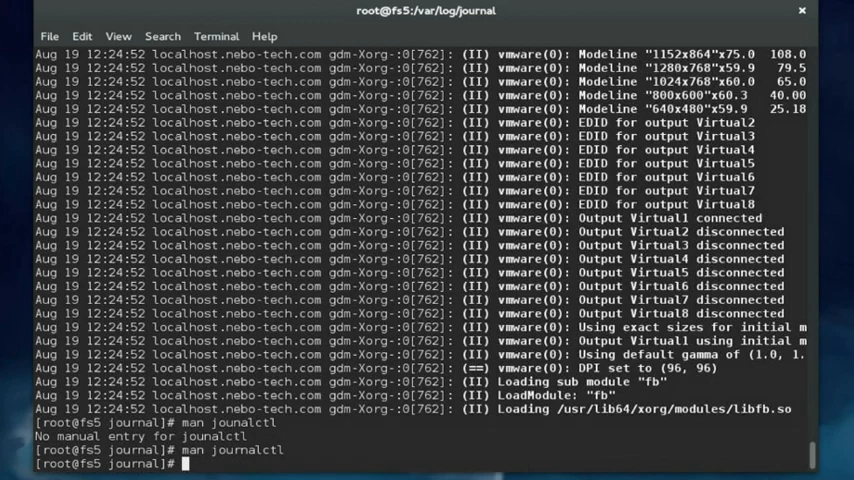
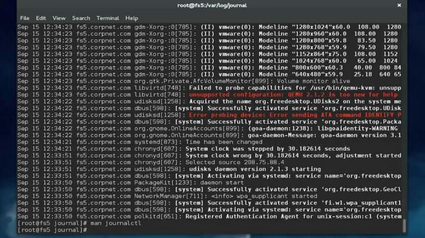
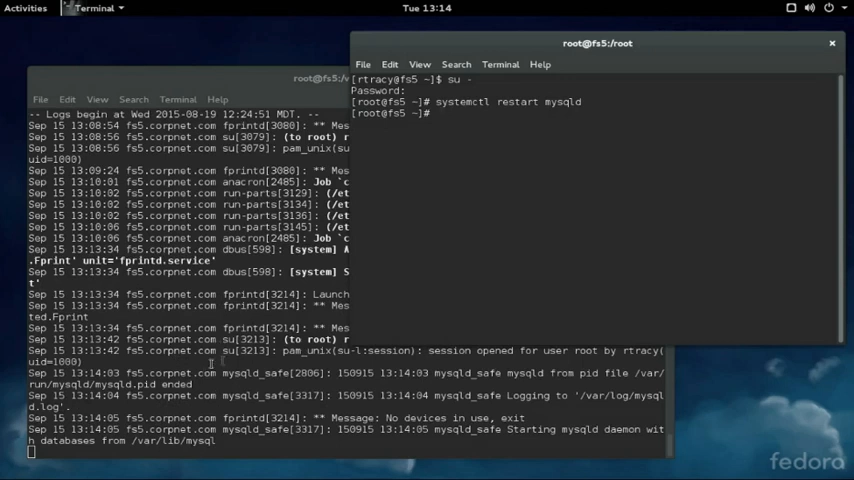
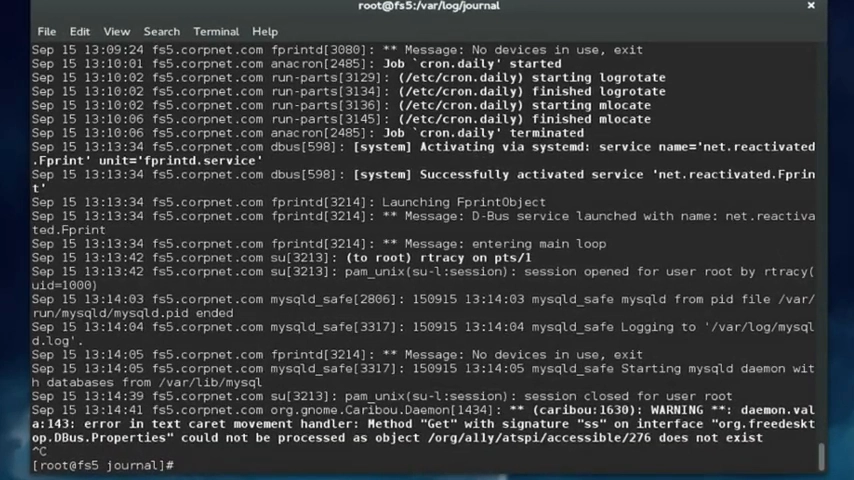
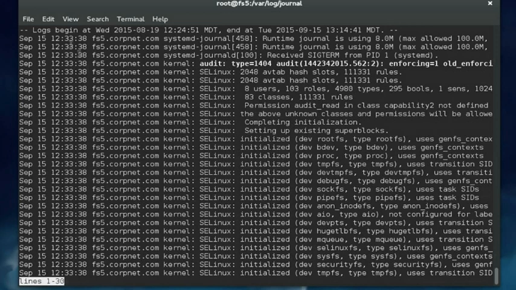
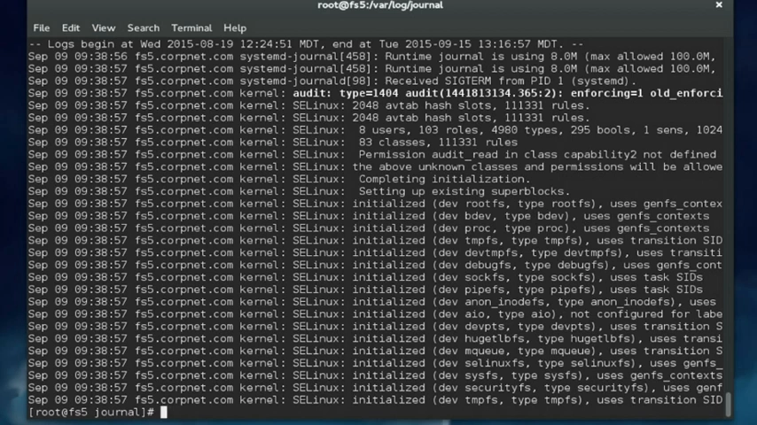
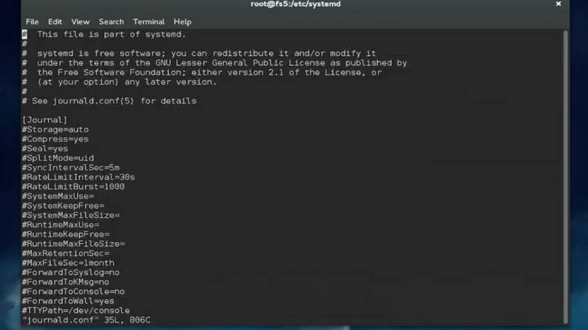

# Configuring journald：journal 存在哪、怎么看、怎么配

> 视频来源：[Configuring journald](https://www.youtube.com/watch?v=Wf7opjZ__Fs)（约 8.5 分钟，英文演示）
> 本文是条目「1.5.4 日志与 journald 基础」的配套博客，基于视频字幕与画面逐段整理。

## 本讲要解决的核心问题（SCQA）

**背景**：新式 Linux 发行版使用 systemd 守护进程管理系统，日志通常由 journald 守护进程接管；老式 Linux 系统用 init 时则靠 syslog 守护进程 [【跳转到 00:05】](https://www.youtube.com/watch?v=Wf7opjZ__Fs&t=5)。

**冲突**：journald 维护的系统日志叫 **journal**，存放在 `/var/log/journal`，但它不是纯文本——想用 cat、less、head、tail 随便翻是行不通的，必须用专门命令；而且直接查看时最旧的条目排在最前面，系统跑得越久翻起来越费劲 [【跳转到 00:30】](https://www.youtube.com/watch?v=Wf7opjZ__Fs&t=30)、[【跳转到 01:04】](https://www.youtube.com/watch?v=Wf7opjZ__Fs&t=64)。

**疑问**：journal 到底存在哪里？如何高效查看（最新优先、实时跟踪、启动消息、按服务过滤）？journald 的行为（单文件轮转、保留时长、存储级别）又在哪里配置？

**回答（中心思想）**：journal 由 journald 维护、以二进制格式存于 `/var/log/journal`；查看靠 `journalctl` 的四个高频选项——`-r` 最新优先、`-f` 实时跟踪、`-b` 启动消息、`-u` 按服务过滤；行为配置集中在 `/etc/systemd/journald.conf` 的 `MaxFileSec`、`MaxRetentionSec`、`MaxLevelStore` 三个参数。

## 一、从 syslog 到 journald：journal 是什么、存在哪

- 使用 systemd 的新发行版通常用 journald 记日志；使用 init 的老系统用 syslog 守护进程 [【跳转到 00:05】](https://www.youtube.com/watch?v=Wf7opjZ__Fs&t=5)；
- journald 维护的系统日志文件叫 journal，位于 `/var/log/journal`，里面的子目录存放真正的 journal 文件 [【跳转到 00:05】](https://www.youtube.com/watch?v=Wf7opjZ__Fs&t=5)；
- 旧时代（init + syslog）的日志文件叫 messages，是纯文本，用任何文本工具都能看；journal 则是二进制格式，必须用专门命令查看——这个命令就是 `journalctl` [【跳转到 00:30】](https://www.youtube.com/watch?v=Wf7opjZ__Fs&t=30)、[【跳转到 00:55】](https://www.youtube.com/watch?v=Wf7opjZ__Fs&t=55)。

## 二、journalctl 的四个高频选项

### 2.1 无参数与 -r：从「最旧在前」到「最新在前」

不带参数运行 `journalctl` 会显示整个 journal，从最旧条目开始逐条向后 [【跳转到 00:55】](https://www.youtube.com/watch?v=Wf7opjZ__Fs&t=55)。这不太实用：排障时你想看的多半是最近的条目，而不是一个月前的；系统跑了很久的话，一路翻下来要花不少时间 [【跳转到 01:04】](https://www.youtube.com/watch?v=Wf7opjZ__Fs&t=64)。

`-r`（reverse）反转输出顺序，最新条目排在最前 [【跳转到 01:38】](https://www.youtube.com/watch?v=Wf7opjZ__Fs&t=98)、[【跳转到 01:54】](https://www.youtube.com/watch?v=Wf7opjZ__Fs&t=114)。空格键逐页下翻，`q` 退出。

### 2.2 -f：实时跟踪，等价于当年的 tail -f

`-f`（follow）先拉出 journal 中最近的条目显示在屏幕上，然后不退出——系统上一有动静，新条目就追加到输出底部 [【跳转到 02:25】](https://www.youtube.com/watch?v=Wf7opjZ__Fs&t=145)。过去要看住 `/var/log/messages` 得用 `tail -f`，如今用 `journalctl -f` 可以达成同样效果，是非常出色的排障工具 [【跳转到 02:37】](https://www.youtube.com/watch?v=Wf7opjZ__Fs&t=157)、[【跳转到 02:57】](https://www.youtube.com/watch?v=Wf7opjZ__Fs&t=177)。

演示环节：一个终端跑着 `journalctl -f`，另一个终端先切换到 root 用户——journal 里立即多出新条目；再执行 `systemctl restart mysqld` 重启 MySQL 数据库服务——服务停止、重启的过程中条目源源不断写入 [【跳转到 03:15】](https://www.youtube.com/watch?v=Wf7opjZ__Fs&t=195)、[【跳转到 03:40】](https://www.youtube.com/watch?v=Wf7opjZ__Fs&t=220)。排障时开一个终端盯日志、另一个终端做操作，日志随操作实时滚动，非常好用。

### 2.3 -b：查看启动消息

journald 还能查看系统启动消息——排查启动问题时很有用 [【跳转到 04:10】](https://www.youtube.com/watch?v=Wf7opjZ__Fs&t=250)。`journalctl -b` 显示最近一次系统启动的消息（演示机上最近一次启动在下午 12:30）[【跳转到 04:10】](https://www.youtube.com/watch?v=Wf7opjZ__Fs&t=250)、[【跳转到 04:35】](https://www.youtube.com/watch?v=Wf7opjZ__Fs&t=275)。

带数字可以翻历史启动 [【跳转到 04:35】](https://www.youtube.com/watch?v=Wf7opjZ__Fs&t=275)：

- `journalctl -b 1`：journal 开头记录的第一次启动——演示机上是 8 月 19 日，大概就是装系统那天 [【跳转到 04:35】](https://www.youtube.com/watch?v=Wf7opjZ__Fs&t=275)、[【跳转到 05:00】](https://www.youtube.com/watch?v=Wf7opjZ__Fs&t=300)；
- `journalctl -b -2`：负数表示从 journal 末尾倒数——`-2` 即前两次启动（9 月 9 日）产生的消息 [【跳转到 05:00】](https://www.youtube.com/watch?v=Wf7opjZ__Fs&t=300)、[【跳转到 05:25】](https://www.youtube.com/watch?v=Wf7opjZ__Fs&t=325)。

### 2.4 -u：只看某个服务

`journalctl -u 服务名` 只显示与该服务相关的日志条目 [【跳转到 05:50】](https://www.youtube.com/watch?v=Wf7opjZ__Fs&t=350)。演示机上跑着 MySQL 数据库服务，用 `journalctl -u mysqld` 就能只看 mysqld 守护进程相关的消息 [【跳转到 05:50】](https://www.youtube.com/watch?v=Wf7opjZ__Fs&t=350)、[【跳转到 06:15】](https://www.youtube.com/watch?v=Wf7opjZ__Fs&t=375)。

## 三、配置 journald：/etc/systemd/journald.conf

journald 守护进程的行为由 `/etc/systemd` 目录下的 `journald.conf` 配置文件控制 [【跳转到 06:15】](https://www.youtube.com/watch?v=Wf7opjZ__Fs&t=375)——想定制 journald 的工作方式，编辑的就是这个文件。视频把它加载进 vi 编辑器逐个讲解 [【跳转到 06:47】](https://www.youtube.com/watch?v=Wf7opjZ__Fs&t=407)。

视频重点介绍了三个参数：

| 参数 | 作用 |
| --- | --- |
| `MaxFileSec` | 单个 journal 文件保存的最长时间，到点轮转、另起新文件 [【跳转到 06:47】](https://www.youtube.com/watch?v=Wf7opjZ__Fs&t=407) |
| `MaxRetentionSec` | journal 条目的保留时长，超过指定时间的条目自动删除 [【跳转到 07:12】](https://www.youtube.com/watch?v=Wf7opjZ__Fs&t=432) |
| `MaxLevelStore` | 允许存储的最高日志级别，高于该级别的消息直接丢弃 [【跳转到 07:21】](https://www.youtube.com/watch?v=Wf7opjZ__Fs&t=441) |

`MaxLevelStore` 值得多说两句：默认设为 `debug`，即所有消息都存；日志级别从高到低依次为 **debug → info → notice → warning → error → crit → alert → emerg**（debug 最高）。如果想减少实际存储的日志量，可以把它设为 `error`——此时 warning、notice、info 级别的消息不再保存、直接丢弃 [【跳转到 07:21】](https://www.youtube.com/watch?v=Wf7opjZ__Fs&t=441)、[【跳转到 07:46】](https://www.youtube.com/watch?v=Wf7opjZ__Fs&t=466)。

## 小结

- journal 是二进制格式，存于 `/var/log/journal`，查看必须用 journalctl（老系统的 messages 是纯文本、随便看）；
- `-r` 最新优先，解决「最旧在前翻不动」的痛点；`-f` 实时跟踪，顶替当年的 `tail -f /var/log/messages`；
- `-b` 看启动消息，`-b 1` 翻第一次启动、`-b -2` 从末尾倒数翻前两次启动；
- `-u 服务名` 按服务过滤，如 `-u mysqld`；
- journald 行为在 `/etc/systemd/journald.conf` 配置：`MaxFileSec` 管单文件轮转时长、`MaxRetentionSec` 管条目保留时长、`MaxLevelStore` 管入库级别（默认 debug，可设 error 砍掉低级别消息）。

## 关键术语速查

| 术语 | 一句话解释 |
| --- | --- |
| journald | systemd 的日志守护进程，维护二进制 journal |
| journal | journald 维护的系统日志，位于 /var/log/journal，二进制格式 |
| journalctl | 查看 journal 的专门命令（journal 是二进制，不能用文本工具直接读） |
| -r / -f / -b / -u | journalctl 四个高频选项：反序 / 跟踪 / 启动消息 / 按服务 |
| tail -f | 老时代跟踪 /var/log/messages 的命令，如今由 journalctl -f 替代 |
| journald.conf | /etc/systemd/journald.conf，journald 行为配置文件 |
| MaxFileSec / MaxRetentionSec | 分别控制单文件轮转时长与条目保留时长 |
| MaxLevelStore | 控制入库的最高日志级别，默认 debug，从 debug 到 emerg 共 8 级 |
