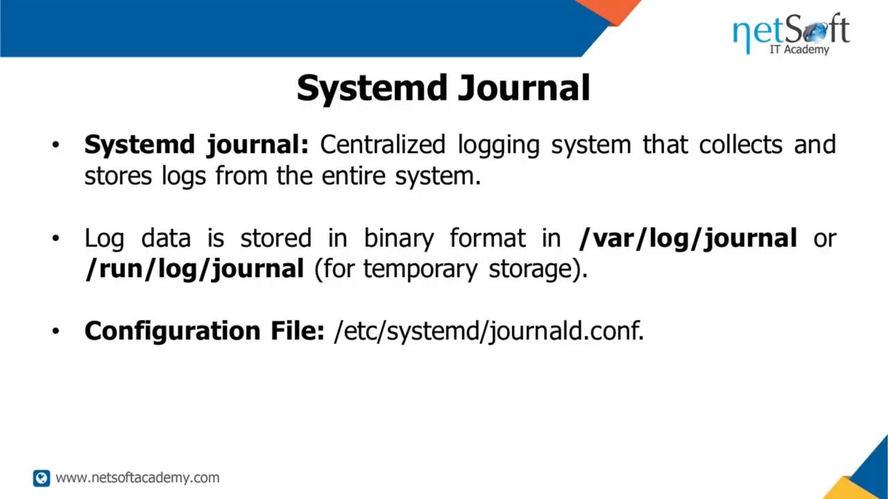
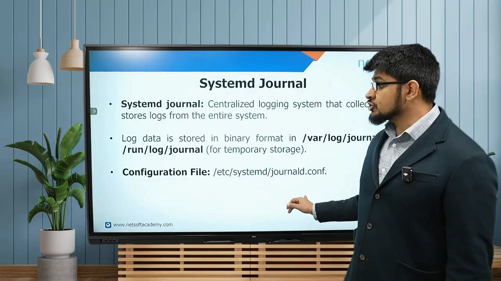
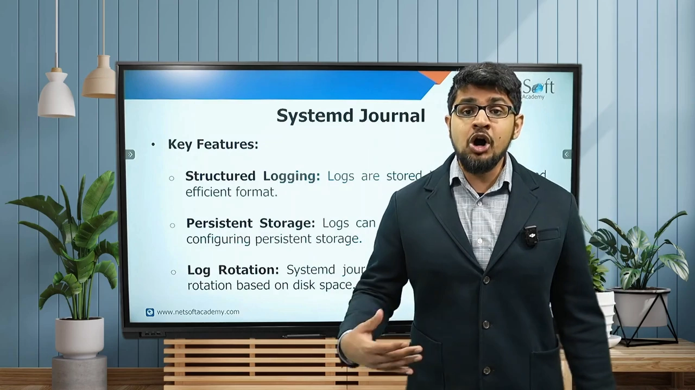
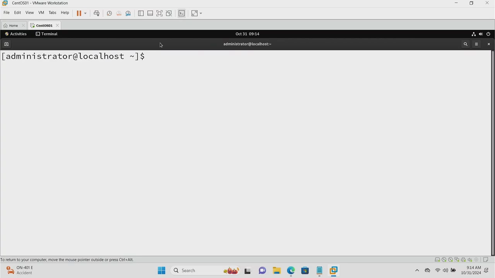
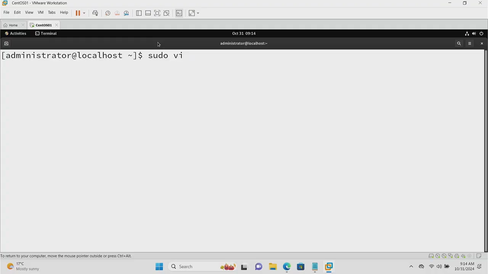
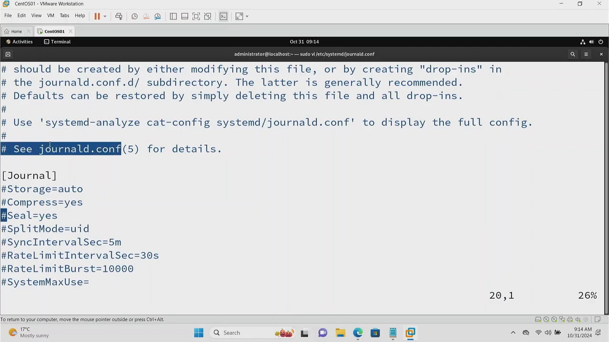
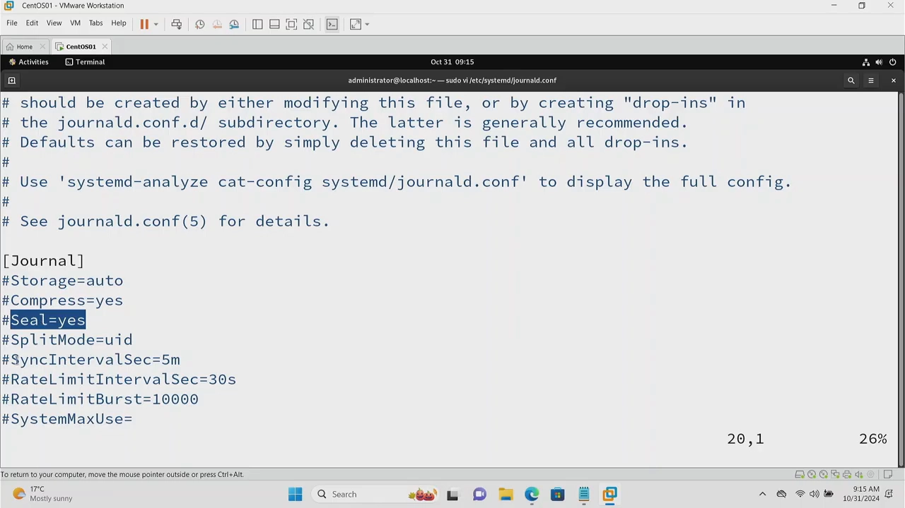

# Systemd Journal 解析：集中式二进制日志，以及它与 rsyslog 的分工

> 视频来源：[Systemd Journal Explained](https://www.youtube.com/watch?v=RKB9FnzQz4g)（约 5.2 分钟，英文讲解）
> 本文是条目「1.5.4 日志与 journald 基础」的配套博客，基于视频字幕与画面逐段整理。

## 本讲要解决的核心问题（SCQA）

**背景**：systemd 之外，系统还有一个专门的日志服务——journal。它与 syslog 类似，但由 **systemd-journald** 管理，把整个系统的日志集中收集、集中存储 [【跳转到 00:10】](https://www.youtube.com/watch?v=RKB9FnzQz4g&t=10)、[【跳转到 00:25】](https://www.youtube.com/watch?v=RKB9FnzQz4g&t=25)。

**冲突**：journal 看似与 rsyslog 相似，实际有三处关键不同：数据以**单一二进制格式**存储；存放位置可能在持久的 `/var/log/journal`，也可能只在 `/run/log/journal` 临时存放；系统关机时部分日志直接消失——journal 默认并不天然持久 [【跳转到 00:32】](https://www.youtube.com/watch?v=RKB9FnzQz4g&t=32)、[【跳转到 00:37】](https://www.youtube.com/watch?v=RKB9FnzQz4g&t=37)。

**疑问**：journal 与 rsyslog 到底如何分工？日志存在哪里、何时才算持久化？配置文件里 `Storage=auto` 又是什么意思？

**回答（中心思想）**：journald 是集中式结构化日志服务：以可搜索的二进制格式收集全系统日志，存于 `/run/log/journal`（临时）或 `/var/log/journal`（持久），并随 systemd 的日志轮转按磁盘空间自动管理；同时把消息转发给 rsyslog，落成 `/var/log` 下的传统文本日志。`Storage=auto` 时，`/var/log/journal` 目录存在与否决定 journal 是否跨重启持久。

## 一、journal 是什么：systemd 的集中式日志服务

- journal 是一种日志服务，与 syslog 类似，但由 **systemd-journald** 这个守护进程管理 [【跳转到 00:15】](https://www.youtube.com/watch?v=RKB9FnzQz4g&t=15)、[【跳转到 00:20】](https://www.youtube.com/watch?v=RKB9FnzQz4g&t=20)；
- 它是集中式日志系统，收集并存储**整个系统**的日志；与 rsyslog 的区别在于：日志数据以**单一二进制格式**存放 [【跳转到 00:25】](https://www.youtube.com/watch?v=RKB9FnzQz4g&t=25)、[【跳转到 00:32】](https://www.youtube.com/watch?v=RKB9FnzQz4g&t=32)；
- 存放位置：`/var/log/journal`；临时存放则在 `/run/log/journal`；配置文件位于 `/etc/systemd/journald.conf` [【跳转到 00:37】](https://www.youtube.com/watch?v=RKB9FnzQz4g&t=37)。

## 二、journal 的四个特性

服务器开机后，journal 立即开始记录消息；这些消息随后转发给 rsyslog，其中一部分在系统关机时被直接移除 [【跳转到 00:51】](https://www.youtube.com/watch?v=RKB9FnzQz4g&t=51)、[【跳转到 01:00】](https://www.youtube.com/watch?v=RKB9FnzQz4g&t=60)。它的主要特性包括 [【跳转到 01:05】](https://www.youtube.com/watch?v=RKB9FnzQz4g&t=65)：

- **结构化日志**：所有日志存于单一、可搜索的二进制格式 [【跳转到 01:13】](https://www.youtube.com/watch?v=RKB9FnzQz4g&t=73)；
- **持久与否可配置**：可以持久化，也可以非持久化，以节省存储空间或按需管理存储 [【跳转到 01:18】](https://www.youtube.com/watch?v=RKB9FnzQz4g&t=78)；
- **随 systemd 日志轮转**：journal 包含在 systemd 的日志轮转机制中，基于磁盘空间自动管理轮转 [【跳转到 01:29】](https://www.youtube.com/watch?v=RKB9FnzQz4g&t=89)、[【跳转到 01:34】](https://www.youtube.com/watch?v=RKB9FnzQz4g&t=94)。

（视频预告：随后的实验课将演示系统如何用这个日志服务收集并管理系统日志，其中一部分会传给第二个日志服务 rsyslog [【跳转到 01:40】](https://www.youtube.com/watch?v=RKB9FnzQz4g&t=100)。）

## 三、易失性：journal 默认不跨重启

除了日志服务本身，systemd（作为服务器管理器）也用 journal 记录一切。journal **并非天然持久**，但可以采取措施使其跨重启保留 [【跳转到 02:06】](https://www.youtube.com/watch?v=RKB9FnzQz4g&t=126)。

通常 journal 存放在 `/run` 目录；从这个运行时目录，journal 记录的某些消息被转发给 rsyslog 服务，由后者写入 `/var/log` 目录的传统日志 [【跳转到 02:29】](https://www.youtube.com/watch?v=RKB9FnzQz4g&t=149)、[【跳转到 02:39】](https://www.youtube.com/watch?v=RKB9FnzQz4g&t=159)。所以系统 journal 本质上是 **ephemeral（易失的）**——只在系统运行期间存在 [【跳转到 02:39】](https://www.youtube.com/watch?v=RKB9FnzQz4g&t=159)。

## 四、读 journald.conf：Storage=auto 决定持久与否

配置文件位于 `/etc/systemd/journald.conf`——`journald` 其实就是这个服务的名字 [【跳转到 03:04】](https://www.youtube.com/watch?v=RKB9FnzQz4g&t=184)。用 `sudo vi` 打开后可以逐条查看它使用的指令，也可以读 man page 深入理解各指令的含义 [【跳转到 03:04】](https://www.youtube.com/watch?v=RKB9FnzQz4g&t=184)、[【跳转到 03:29】](https://www.youtube.com/watch?v=RKB9FnzQz4g&t=209)。

最需要理解的是 `Storage=auto` 的语义 [【跳转到 03:29】](https://www.youtube.com/watch?v=RKB9FnzQz4g&t=209)：

- `auto` 意味着 journal 天然先看 `/run` 目录——即**运行时存储，不持久**；`/run` 就是 runtime，里面的所有文件在每次重启时都会重建 [【跳转到 03:29】](https://www.youtube.com/watch?v=RKB9FnzQz4g&t=209)、[【跳转到 03:54】](https://www.youtube.com/watch?v=RKB9FnzQz4g&t=234)；
- 如果 `/var/log` 下存在 journal 目录，存储才是持久的；否则保持非持久，留在 `/run/log/journal` [【跳转到 04:19】](https://www.youtube.com/watch?v=RKB9FnzQz4g&t=259)；
- 其余指令则规定是否压缩 journal、写入间隔等细节 [【跳转到 04:19】](https://www.youtube.com/watch?v=RKB9FnzQz4g&t=259)、[【跳转到 04:44】](https://www.youtube.com/watch?v=RKB9FnzQz4g&t=284)。

最后把分工说全：journald 服务与 rsyslog 并行工作，基于 facility（设施）与 priority（优先级）以及 rsyslog 自身的规则，把消息转发出去 [【跳转到 04:44】](https://www.youtube.com/watch?v=RKB9FnzQz4g&t=284)；journal 则以结构化形式保存一切，默认不持久，但可以采取措施使其持久化 [【跳转到 05:03】](https://www.youtube.com/watch?v=RKB9FnzQz4g&t=303)。

## 小结

- journald 是 systemd 的集中式日志服务，以单一二进制结构化格式收集全系统日志；
- 位置二选一：`/run/log/journal`（临时、易失）或 `/var/log/journal`（持久）；
- 消息按 facility 与 priority 转发给 rsyslog，落成 `/var/log` 下的传统文本日志；
- `Storage=auto`：`/var/log/journal` 存在 → 持久；否则留在 `/run`，重启即失；
- journal 随 systemd 日志轮转，基于磁盘空间自动管理；
- journal 默认易失，但可以采取措施跨重启保留。

## 关键术语速查

| 术语 | 一句话解释 |
| --- | --- |
| systemd journal | systemd 的集中式日志，单一二进制结构化格式 |
| systemd-journald | 管理 journal 的守护进程（服务名即 journald） |
| /run/log/journal | 运行时（易失）journal 存储位置，重启即重建 |
| /var/log/journal | 持久 journal 存储位置；存在与否决定 Storage=auto 的行为 |
| rsyslog | 传统 syslog 日志服务，接收 journal 转发并写入 /var/log |
| Storage=auto | journald.conf 指令：在 /run 与 /var/log/journal 之间自动选择 |
| facility / priority | syslog 消息的两个分类字段，决定转发与过滤规则 |
| ephemeral | 易失的：journal 默认只在系统运行期间存在 |
