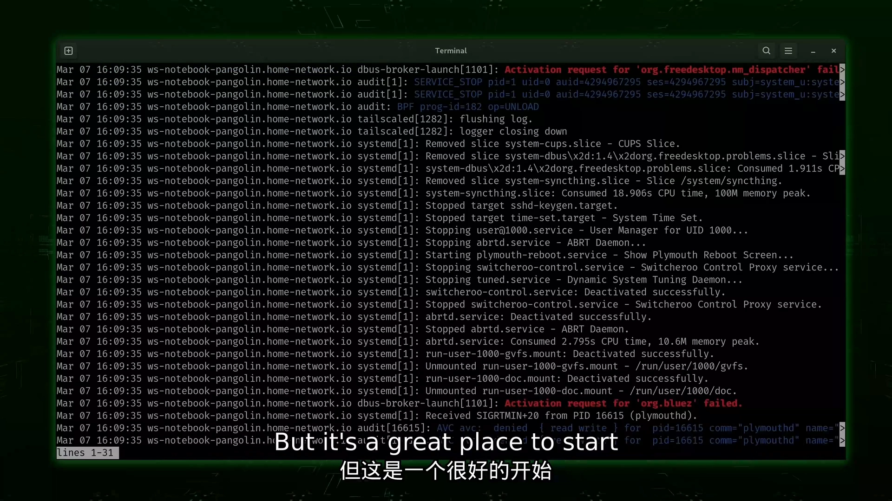
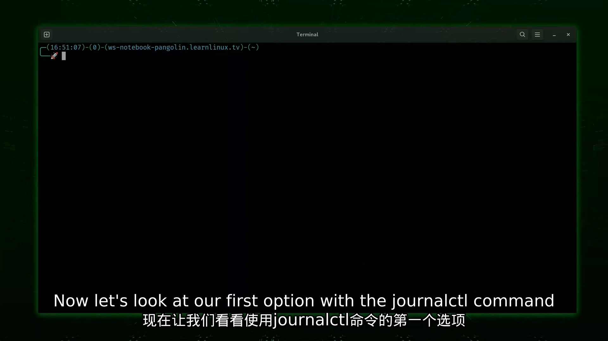
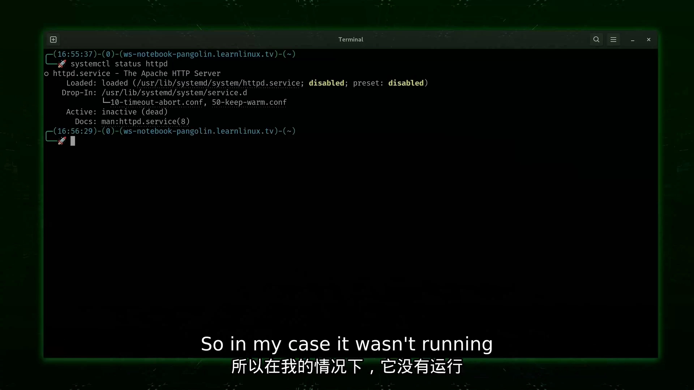
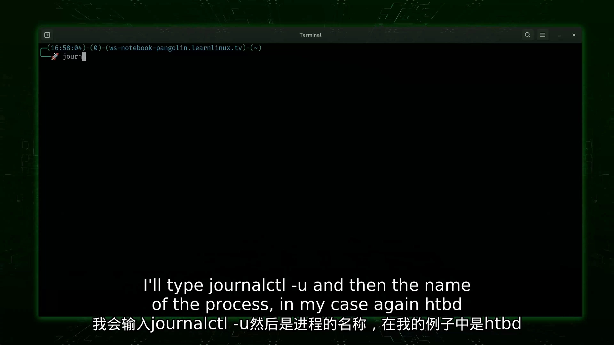
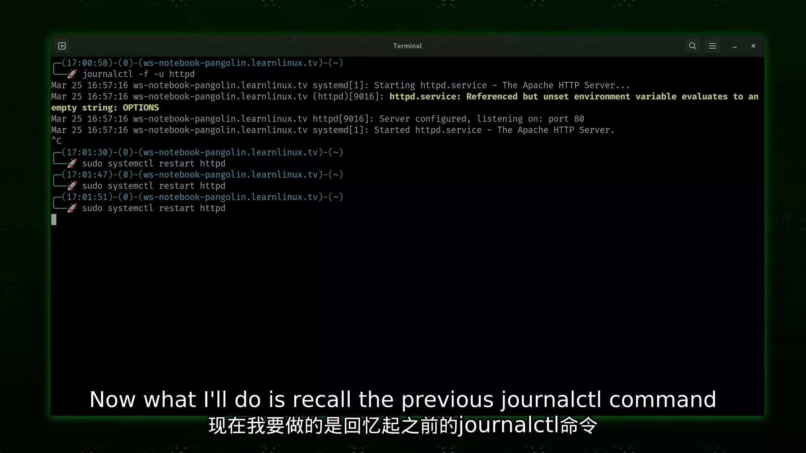
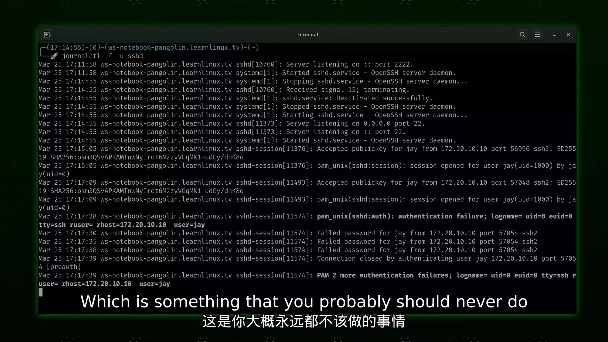
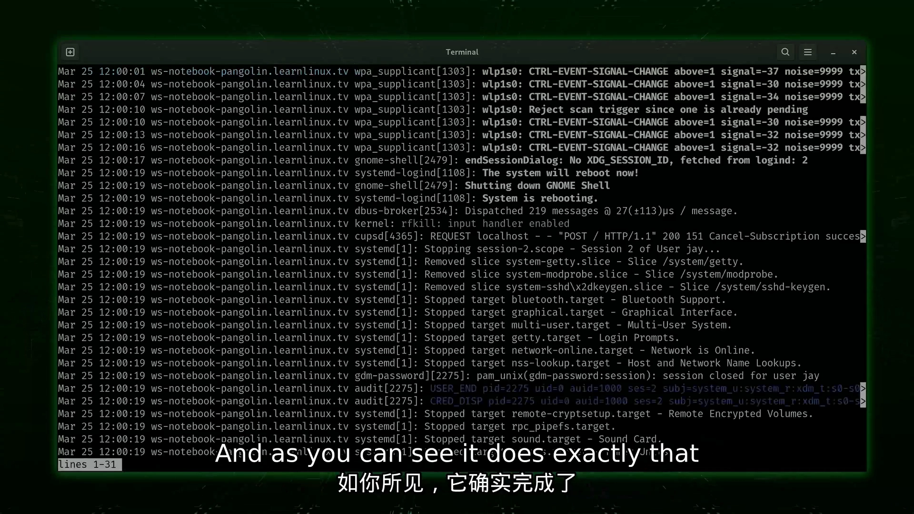
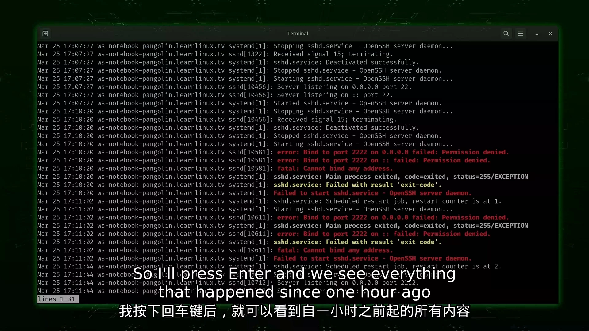
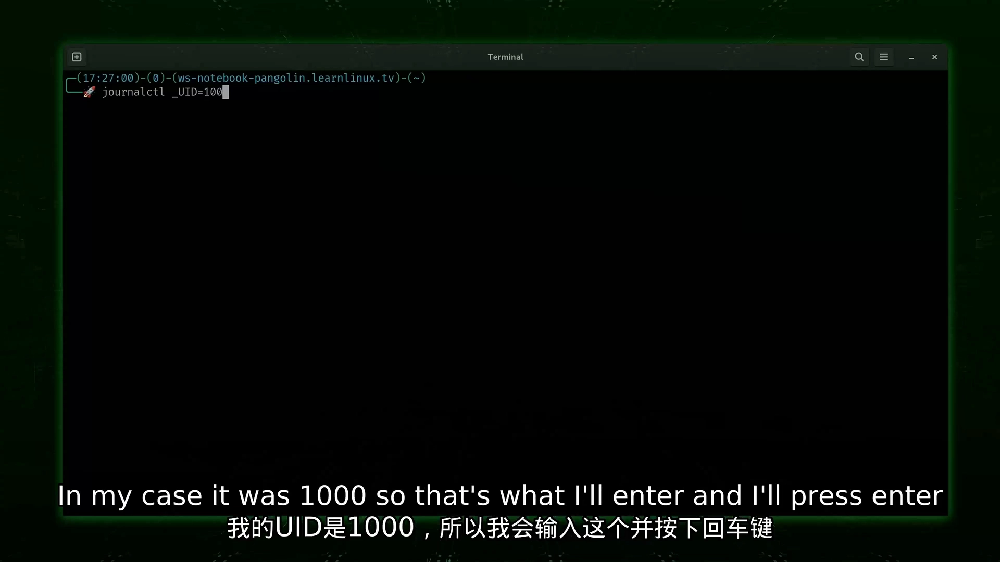
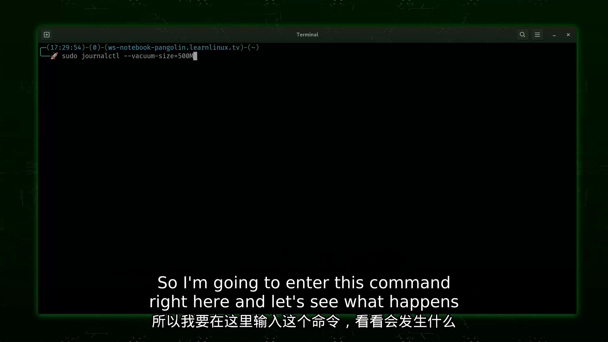

# journalctl 基础教程：在 systemd 系统上轻松查看 Linux 日志

> 视频来源：[journalctl基础教程：轻松查看Linux日志](https://www.bilibili.com/video/BV1wbZ2YXE6n/)（Learn Linux TV「Linux 速成课程」系列，中文配音，约 19.5 分钟）
> 本文是条目「1.5.4 日志与 journald 基础」的主博客，基于视频字幕与画面逐段整理。

## 本讲要解决的核心问题（SCQA）

**背景**：每个 Linux 系统上都有大量后台进程在干活——小到让你播放音频，大到 OpenSSH、Apache 这类服务器服务。它们运行时会把信息写进日志文件；排查故障、分析入侵、改完配置验证服务状态，都离不开日志 [【跳转到 01:24】](https://www.bilibili.com/video/BV1wbZ2YXE6n/?t=84)。

**冲突**：日志又多又杂，直接翻文件既慢又容易漏；而且这套查看能力建立在 systemd 之上——systemd 是控制所有其他进程的 init 系统，journalctl 随 systemd 而来，不熟悉它的用法就只能对着海量输出干瞪眼 [【跳转到 02:39】](https://www.bilibili.com/video/BV1wbZ2YXE6n/?t=159)。

**疑问**：在 systemd 系统上，如何快速查看全部日志？如何实时跟踪、只盯一个服务、按时间或按用户过滤？日志把存储占满时又该怎么办？

**回答（中心思想）**：journalctl 是 systemd 系统上查看日志的主入口，大多数发行版开箱即用：不带选项看全部，`-f` 实时跟踪，`-u` 聚焦服务，`--since` 按时间过滤，`_UID=` 按用户过滤，`--vacuum-size` 压缩旧日志释放空间。

## 一、journalctl 是什么：随 systemd 而来的日志查看器

### 1.1 为什么需要日志

- 每个系统都有大量后台进程，运行时把信息输出到日志文件，管理员靠检查日志确保一切正常运行 [【跳转到 01:24】](https://www.bilibili.com/video/BV1wbZ2YXE6n/?t=84)；
- 日志在处理入侵等情况时至关重要，能帮我们了解系统发生了什么变化 [【跳转到 01:49】](https://www.bilibili.com/video/BV1wbZ2YXE6n/?t=109)；
- 服务管理同样离不开它：比如更改配置后重启 Apache，需要查看服务产生的日志来确认状态 [【跳转到 01:49】](https://www.bilibili.com/video/BV1wbZ2YXE6n/?t=109)。

### 1.2 journalctl 与 systemd 的关系

journalctl 命令随 systemd 提供。systemd 是一个被称为 **init 系统** 的特殊进程——简单来说，初始化系统就是控制所有其他进程的进程 [【跳转到 02:39】](https://www.bilibili.com/video/BV1wbZ2YXE6n/?t=159)。大多数发行版如今已切换到 systemd，journalctl 命令也随之成为标配 [【跳转到 02:39】](https://www.bilibili.com/video/BV1wbZ2YXE6n/?t=159)。

Arch Linux、Ubuntu、Debian、Linux Mint、Fedora、Rocky、AlmaLinux、openSUSE 等许多流行发行版都使用 systemd 作为 init 系统 [【跳转到 03:04】](https://www.bilibili.com/video/BV1wbZ2YXE6n/?t=184)。这意味着对初学者来说 journalctl 是现成的：任何使用 systemd 的系统上，这个命令都会自动提供，不需要额外安装任何东西 [【跳转到 03:29】](https://www.bilibili.com/video/BV1wbZ2YXE6n/?t=209)。

## 二、上手三步：看全部、实时跟踪、聚焦服务

### 2.1 不带选项：看全部日志

最基本的用法是不带任何选项直接运行 `journalctl` [【跳转到 03:54】](https://www.bilibili.com/video/BV1wbZ2YXE6n/?t=234)。它会把几乎所有内容的日志都给出来：可以用上下方向键滚动、PgUp/PgDn 翻页，看完按 `q` 键退出、返回命令提示符 [【跳转到 04:24】](https://www.bilibili.com/video/BV1wbZ2YXE6n/?t=264)。

### 2.2 -f：跟随模式，实时滚动

加 `-f`（follow）选项后启用跟随模式 [【跳转到 04:54】](https://www.bilibili.com/video/BV1wbZ2YXE6n/?t=294)：不必手动滚动，新的日志条目产生时输出会自动滚动。不过如果不缩小范围、只看感兴趣的部分，屏幕上会是一堆无关信息；按 `Ctrl+C` 即可退出跟随模式 [【跳转到 05:19】](https://www.bilibili.com/video/BV1wbZ2YXE6n/?t=319)。

### 2.3 -u：只看一个服务

为了让演示有东西可看，视频先安装了 Apache：Fedora 上用 `sudo dnf install httpd`，基于 Debian 的系统上用 `sudo apt install apache2` 达到同样效果 [【跳转到 05:44】](https://www.bilibili.com/video/BV1wbZ2YXE6n/?t=344)。再用 `systemctl status httpd` 确认服务在运行、`sudo systemctl start httpd` 启动它——状态变为「活跃（运行中）」即说明 Web 服务器已跑起来 [【跳转到 06:34】](https://www.bilibili.com/video/BV1wbZ2YXE6n/?t=394)。

然后运行 `journalctl -u httpd`：`-u` 这个选项告诉 journalctl 我们要聚焦特定的单元（unit，即服务），输出里只有与该服务相关的条目——演示中刚启动，所以只有 4 行 [【跳转到 07:49】](https://www.bilibili.com/video/BV1wbZ2YXE6n/?t=469)。

### 2.4 -fu 组合：盯着服务重启的全过程

把 `-f` 和 `-u` 组合成 `journalctl -fu httpd`：既启用跟随模式，又只看 httpd [【跳转到 08:53】](https://www.bilibili.com/video/BV1wbZ2YXE6n/?t=533)。接着多次重启服务，日志里实时出现「服务器已配置、开始停止 httpd 服务、然后又开始」等条目——每次重启都记录在案 [【跳转到 09:43】](https://www.bilibili.com/video/BV1wbZ2YXE6n/?t=583)。

## 三、实战案例：盯着 sshd 看登录尝试

OpenSSH 是 Linux 远程管理的主要方式，大多数系统都装了它。运行 `journalctl -fu sshd` 后，从另一台计算机发起 SSH 连接，日志文件里立刻写入新信息 [【跳转到 10:33】](https://www.bilibili.com/video/BV1wbZ2YXE6n/?t=633)。

为了让例子更有趣，演示启用了 SSH 的密码验证（生产环境大概永远不该这么做），然后故意多次输入错误密码：每次尝试都实时出现在监控输出里 [【跳转到 11:23】](https://www.bilibili.com/video/BV1wbZ2YXE6n/?t=683)。这是非常常见的排障场景——有人问你为什么无法 SSH 登录服务器，你先监控 SSH 日志、让对方再试一次，输出往往能直接解释问题（比如这里的「输入了错误的密码」）[【跳转到 11:48】](https://www.bilibili.com/video/BV1wbZ2YXE6n/?t=708)。

## 四、按时间过滤：--since

排查发生在特定时间段内的问题时，用 `--since "日期字符串"` 让输出从指定时刻开始 [【跳转到 12:13】](https://www.bilibili.com/video/BV1wbZ2YXE6n/?t=733)。完整命令形如 `journalctl --since "2025-03-25 12:00:00"`，时间可随意调整 [【跳转到 12:38】](https://www.bilibili.com/video/BV1wbZ2YXE6n/?t=758)。执行后屏幕顶部第一条记录就是 3 月 25 日中午——输出确实从该时刻开始 [【跳转到 12:54】](https://www.bilibili.com/video/BV1wbZ2YXE6n/?t=774)。这样排查时就不必翻看比目标事件更早的条目 [【跳转到 13:08】](https://www.bilibili.com/video/BV1wbZ2YXE6n/?t=788)。

日期字符串还能大大简化 [【跳转到 13:33】](https://www.bilibili.com/video/BV1wbZ2YXE6n/?t=813)：

- 知道事情发生在昨天但不知道确切时间 → `--since yesterday`，第一条记录立即变为昨天（录制当天是 3 月 25 日，所以显示的是 3 月 24 日）[【跳转到 13:58】](https://www.bilibili.com/video/BV1wbZ2YXE6n/?t=838)；
- 怀疑问题发生在过去一小时内 → `--since "1 hour ago"`，输出即最近一小时的全部条目，其中还能看到 SSH 的失败登录尝试 [【跳转到 14:23】](https://www.bilibili.com/video/BV1wbZ2YXE6n/?t=863)、[【跳转到 14:48】](https://www.bilibili.com/video/BV1wbZ2YXE6n/?t=888)。

## 五、按用户过滤：_UID=

想查某个不熟悉的用户账号在做什么，先要找到它的用户 ID（UID）：输入 `id -u 用户名`，演示者的 UID 是 1000——系统上第一个创建的用户通常就是 1000 [【跳转到 15:24】](https://www.bilibili.com/video/BV1wbZ2YXE6n/?t=924)。

然后运行 `journalctl _UID=1000`——下划线加 UID、等号，再跟上用户的 UID——即可查看该用户专属的日志输出 [【跳转到 15:49】](https://www.bilibili.com/video/BV1wbZ2YXE6n/?t=949)。桌面用户的日志可能非常多（完整桌面环境的各类消息），大多数情况下你查的是系统用户，例如 httpd、SSH 之类的服务账号；但系统中的任何用户都可以这样检查 [【跳转到 16:19】](https://www.bilibili.com/video/BV1wbZ2YXE6n/?t=979)。

## 六、控制日志体积：--vacuum-size

日志会随时间推移占用越来越多空间，取决于发行版如何配置，systemd 日志可能膨胀得很大 [【跳转到 16:51】](https://www.bilibili.com/video/BV1wbZ2YXE6n/?t=1011)。好在可以指定一个大小上限，把日志条目压缩到该大小以内：`sudo journalctl --vacuum-size=500M` [【跳转到 17:16】](https://www.bilibili.com/video/BV1wbZ2YXE6n/?t=1036)。

执行前要小心：公司服务器通常要求日志保留一段时间（涉及保留要求），只有获得许可才该运行这种指令；私人机器则无所谓 [【跳转到 17:41】](https://www.bilibili.com/video/BV1wbZ2YXE6n/?t=1061)。演示中命令执行后释放了 166MB 的归档日志 [【跳转到 18:06】](https://www.bilibili.com/video/BV1wbZ2YXE6n/?t=1086)。总有一天你会遇到存储卷快满、不得不清理日志的情况 [【跳转到 18:31】](https://www.bilibili.com/video/BV1wbZ2YXE6n/?t=1111)。

## 小结

- journalctl 随 systemd 提供，Arch/Ubuntu/Debian/Fedora 等主流发行版开箱即用，是查看日志的主入口；
- 不带选项看全部日志，`q` 退出；`-f` 实时跟踪，`Ctrl+C` 退出；
- `-u 服务名` 聚焦单个单元，与 `-f` 组合成 `-fu` 是最常用的盯日志姿势；
- `--since` 支持精确时刻、`yesterday`、`"1 hour ago"` 等日期字符串，按时间缩小排查范围；
- `_UID=1000`（配合 `id -u`）按用户过滤日志；
- `--vacuum-size=500M` 压缩归档日志释放空间，公司服务器先确认保留政策。

## 关键术语速查

| 术语 | 一句话解释 |
| --- | --- |
| journalctl | 查询 systemd journal 日志的命令行工具，本讲的绝对主角 |
| systemd | 现代 Linux 的 init 系统，控制所有其他进程，journalctl 随其提供 |
| init 系统 | 系统启动后运行的第一个特殊进程，负责控制所有其他进程 |
| 跟随模式（-f） | 实时显示新写入的日志条目，类似 tail -f |
| 单元（unit，-u） | systemd 管理的对象（如 httpd 服务），-u 按单元过滤日志 |
| --since | 按起始时间过滤日志，支持精确时刻、yesterday、"1 hour ago" 等 |
| _UID= | systemd 日志字段过滤：只看某 UID 产生的条目 |
| --vacuum-size | 将归档日志压缩到指定大小以内 |
