# 容器是由什么组成的：namespaces 决定"看得见什么"，cgroups 决定"用得了多少"——Jérôme Petazzoni 亲手拼一个容器给你看

> 视频来源：Jérôme Petazzoni [《Cgroups, namespaces, and beyond: what are containers made from?》](https://www.youtube.com/watch?v=sK5i-N34im8)（54 分 25 秒，讲者当时就职于 Docker，是 Docker 前身 dotCloud 平台团队的成员）。本文基于视频演说图文稿整理，关键处附时间戳，可跳回原视频核对。演讲结尾有一段"不用 Docker 亲手拼容器"的现场演示，强烈建议对照原视频观看。

## 本讲要解决的核心问题（SCQA）

**背景**：容器用起来很像一台轻量虚拟机：能 `docker exec` 进去敲命令，`ps` 只看到自己的进程，`ip addr` 只看到自己的网卡。

**冲突**：但"容器 = 轻量虚拟机"恰恰是个应该扔掉的错觉——容器不是虚拟机，只是普通 Linux 进程加了几项内核特性。把这个错觉当真，就会误解隔离的边界：比如容器里的 PID 1 是谁、OOM 会杀谁、容器里的 root 到底有多大权力。

**疑问**：剥开 Docker 的外壳，容器到底由什么组成？这些东西能不能脱离 Docker，直接用系统调用拼出来？

**回答（中心思想）**：容器 = **namespaces + cgroups + 写时复制** 三块积木的组合——**namespaces 限制进程"能看见什么"（质量问题）**：PID、NET、MNT、UTS、IPC、USER 各管一摊；**cgroups 限制进程"能用多少"（数量问题）**：memory、cpu、cpuset、blockio、freezer 等子系统逐项记账设限；再叠加**写时复制**让 `docker run` 秒开。讲者最后用 btrfs + chroot + `unshare` + `pivot_root` 亲手拼出一个不依赖 Docker 的"真容器"，把三块积木全部落到命令行 [【跳转到 02:03】](https://www.youtube.com/watch?v=sK5i-N34im8&t=123)。

## 一、"像虚拟机"的错觉从哪来

讲者开场先承认这个错觉的存在：容器确实**感觉上**像轻量虚拟机——可以进去拿 shell，可以 SSH；`ps`、`htop` 只看到自己的进程；`ifconfig`、`ip addr` 只看到自己的本地网卡 [【跳转到 02:38】](https://www.youtube.com/watch?v=sK5i-N34im8&t=158)。

但他紧接着划清界限：**别这么想，这会把你带进错误的思维模式** [【跳转到 02:38】](https://www.youtube.com/watch?v=sK5i-N34im8&t=158)。这些"像虚拟机"的体验，全部来自内核特性对进程视野的裁剪——理解了裁剪的手法，就理解了容器。

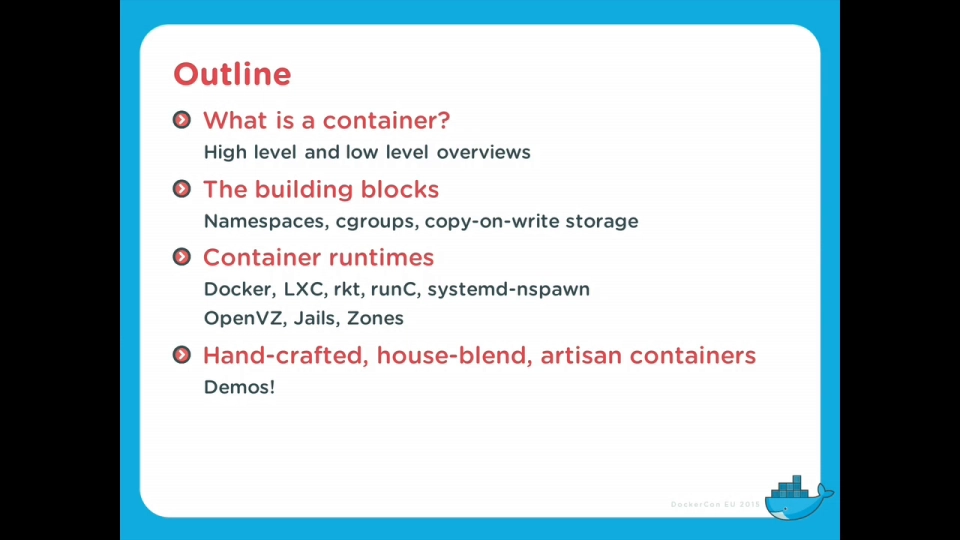

讲者的大纲是四步：什么是容器 → 容器的构建块（namespaces、cgroups、写时复制）→ 基于这些块的容器运行时 → 现场疯狂演示 [【跳转到 02:03】](https://www.youtube.com/watch?v=sK5i-N34im8&t=123)。

## 二、namespaces：限制"能看见什么"（质量）

讲者用一句话把两大机制分工讲透：**cgroups 限制你能用多少（quantity，数量），namespaces 限制你能看见什么（quality，质量）** [【跳转到 24:42】](https://www.youtube.com/watch?v=sK5i-N34im8&t=1482)。

namespaces 有多种类型（PID、NET、MNT、IPC、USER 等），而且**每个进程在每一类命名空间里都恰好属于一个**——一个进程同时身处某个 PID 命名空间、某个网络命名空间、某个挂载命名空间…… [【跳转到 24:54】](https://www.youtube.com/watch?v=sK5i-N34im8&t=1494)

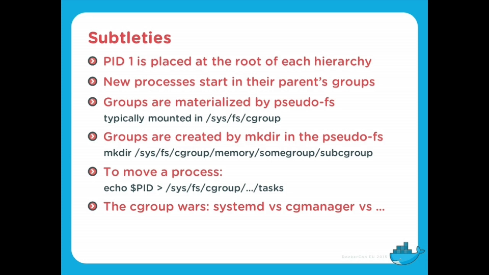

### 2.1 PID 命名空间：只看得见自己人的进程列表

PID 命名空间让一个进程**只看见同一命名空间里的其他进程**。进了 PID 命名空间后，里面还有一个"本地 PID 1"——它显然不等于整台机器的 PID 1 [【跳转到 25:19】](https://www.youtube.com/watch?v=sK5i-N34im8&t=1519)。

更有趣的是视角差：**从宿主机能看到容器里的进程，但从容器里看不到宿主机的进程**。于是同一个进程在不同层级上可以有多个 PID；容器套容器的话，每一层都有一个自己的 PID [【跳转到 25:37】](https://www.youtube.com/watch?v=sK5i-N34im8&t=1537)。初学时容易晕，但这正是"隔离"的本义：每一层只能看到自己那层的编号体系。

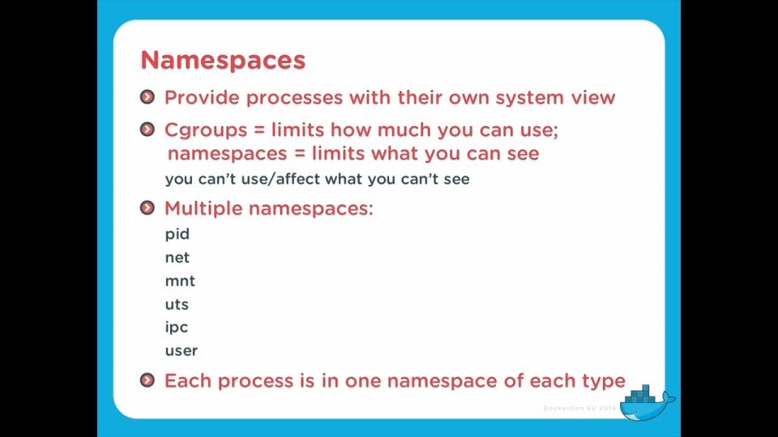

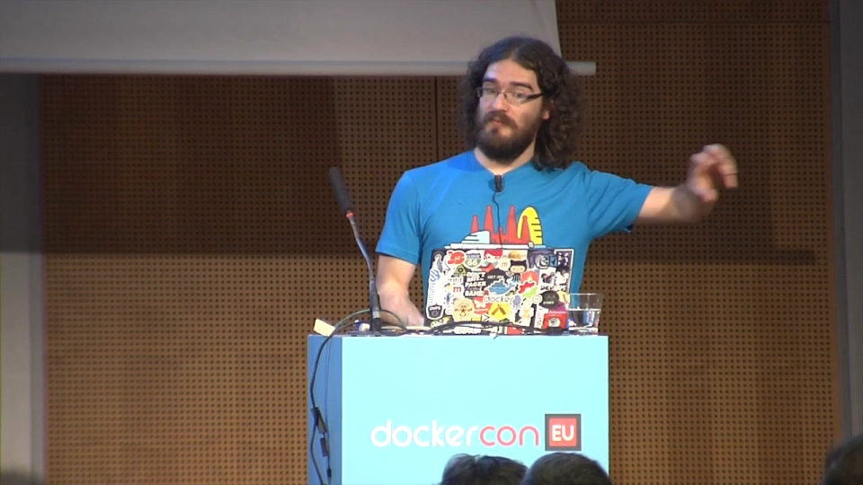

### 2.2 NET 命名空间：一人一套网络栈

网络命名空间让每个容器拥有**自己的网络资源**：自己的 localhost、自己的 eth0、自己的路由表、自己的 iptables 规则、自己的 IPVS 转发表（IPVS 早就适配了网络命名空间）、自己的 socket [【跳转到 26:07】](https://www.youtube.com/watch?v=sK5i-N34im8&t=1567)。

两个亮点值得单独记：

- **网络接口可以在命名空间之间"搬家"**：在某处创建一个接口，然后移动到另一个容器里——比如先在一个容器里配好 VPN 接口，再把接口整体搬走 [【跳转到 26:13】](https://www.youtube.com/watch?v=sK5i-N34im8&t=1573)。
- **容器组网的标准姿势是 veth pair**：一对虚拟接口，像一根交叉网线两头直连；一端塞进容器，另一端留在宿主机的网桥上——宿主机里因此有了一台"虚拟交换机"，所有容器都插在它上面 [【跳转到 26:38】](https://www.youtube.com/watch?v=sK5i-N34im8&t=1598)。

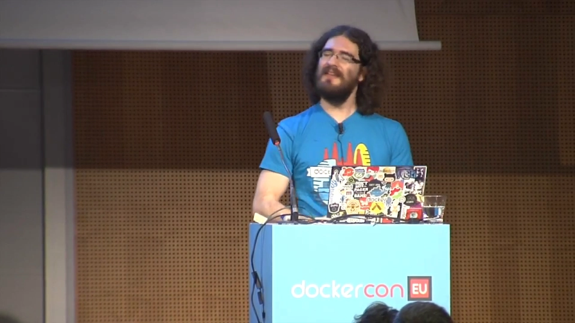

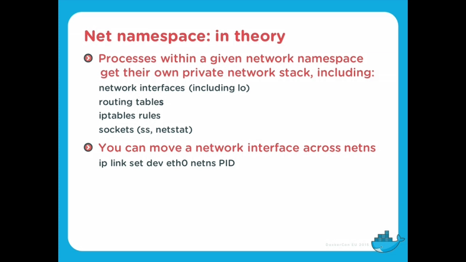

### 2.3 MNT 命名空间：各自挂载、互不可见

MNT（mount）命名空间"基本上就是让每个容器都能挂载点什么，而别人看不见它挂的东西" [【跳转到 27:22】](https://www.youtube.com/watch?v=sK5i-N34im8&t=1642)。

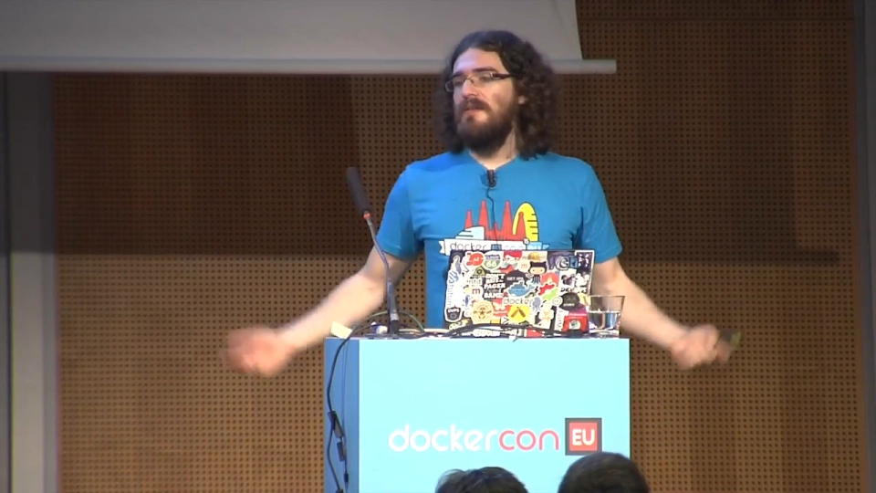

讲者顺手给了一个安全应用：**给每个用户分配自己的 /tmp**（有了 mnt 命名空间后每个用户有自己的一份），安全风险大幅降低 [【跳转到 27:53】](https://www.youtube.com/watch?v=sK5i-N34im8&t=1673)。

### 2.4 UTS 命名空间：自己的主机名

UTS 命名空间最简单：让容器有自己的主机名 [【跳转到 27:53】](https://www.youtube.com/watch?v=sK5i-N34im8&t=1673)。`docker run --hostname` 改的就是它。

### 2.5 IPC 命名空间：别让两台 PostgreSQL 打架

IPC 命名空间管的是**进程间通信资源**：信号量（semaphores）、共享内存（shared memory）、消息队列（message queues）[【跳转到 28:13】](https://www.youtube.com/watch?v=sK5i-N34im8&t=1693)。讲者举了个历史事故级的例子：早年（PostgreSQL 9.x 之前）PostgreSQL 依赖 System V IPC 资源，若没有 IPC 命名空间，一台机器上的两个 PostgreSQL 实例可能互相撞上对方的 IPC 资源；有了它才彻底安全。

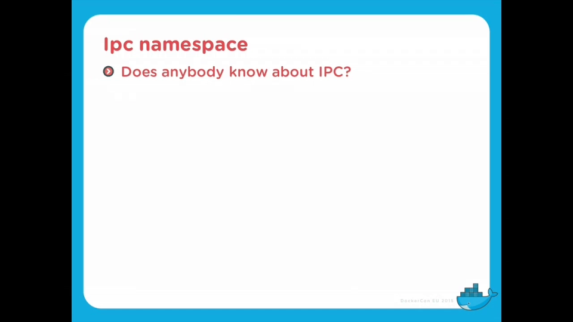

### 2.6 USER 命名空间：容器里的 root，容器外的普通人

USER 命名空间做的是 **UID 映射**：你在容器里可以是 UID 0——"我是 root，我无所不能"；但在容器外，你其实只是某个普通用户（UID 1234），什么都干不了 [【跳转到 28:48】](https://www.youtube.com/watch?v=sK5i-N34im8&t=1728)。

讲者强调这是"**可用性安全（usable security）**"的典范：安全措施若不可用，人们只会绕过它（比如把 15 位密码贴在便利贴上）；而 USER 命名空间让"容器内当 root"用起来毫无负担——不必折腾 UID 重映射——容器外却依然不拥有 root 权力 [【跳转到 29:39】](https://www.youtube.com/watch?v=sK5i-N34im8&t=1779)。他也坦承这条路走得不快：往 Docker 里集成时发现了大量安全问题，得先修完才能用（当时刚进入 Docker experimental 分支，他呼吁大家多测试提 bug）[【跳转到 30:23】](https://www.youtube.com/watch?v=sK5i-N34im8&t=1823)。

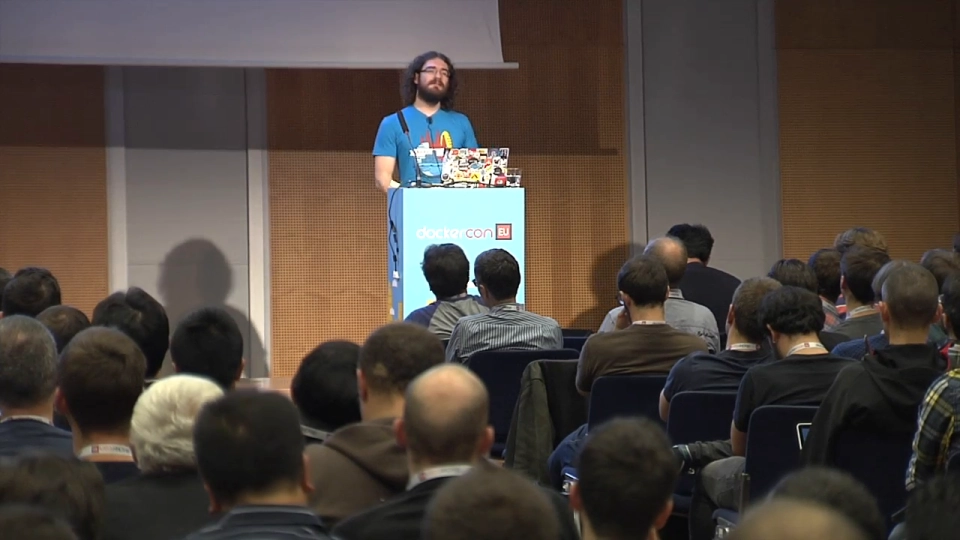

### 2.7 命名空间的创建与"续命"

怎么操作命名空间？**在创建新进程时顺便创建**——给创建进程的系统调用加上额外标志（`CLONE_NEW*`），新进程就出生在指定的新命名空间里 [【跳转到 30:50】](https://www.youtube.com/watch?v=sK5i-N34im8&t=1850)。

命名空间的生命周期有一条铁律：**当某命名空间里的最后一个进程消失时，命名空间也随之消失**。想给它续命，用 bind mount 把 `/proc/<PID>/ns/` 下对应的伪文件挂住即可 [【跳转到 31:25】](https://www.youtube.com/watch?v=sK5i-N34im8&t=1885)。典型场景：配好一套带路由的网络命名空间，想稍后复用——bind mount 之后，哪怕容器没了、内存都释放了，内核仍保留对它的引用，随时回来接着用 [【跳转到 31:41】](https://www.youtube.com/watch?v=sK5i-N34im8&t=1901)。

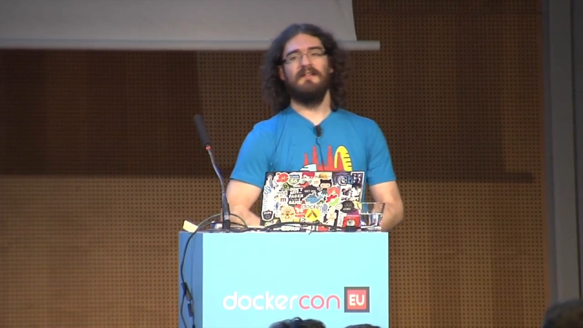

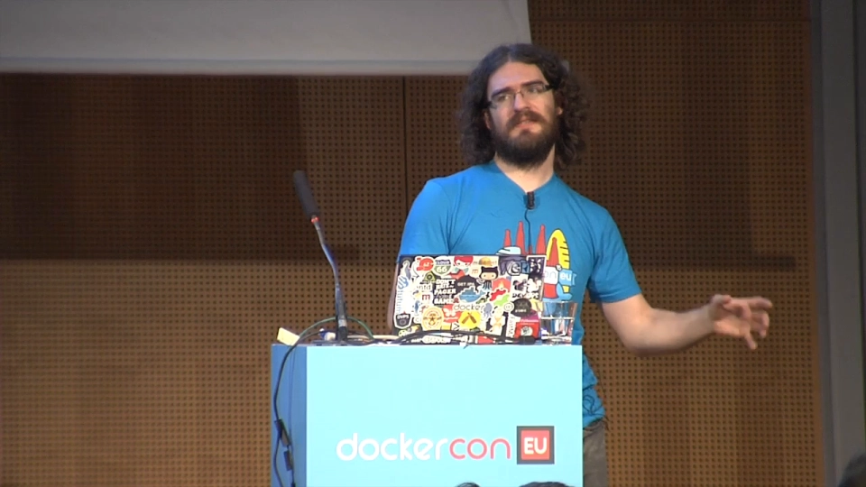

## 三、cgroups：限制"能用多少"（数量）

### 3.1 层级与 tasks：一个目录一个组

cgroups 让你对一组进程做**监控与限额**。每个子系统维护一棵层级树；系统里创建的第一个进程（init/systemd）位于每棵树的根，**新进程出生在父进程所在的组**；想把进程挪组，把 PID echo 进目标组的 `tasks` 文件即可；想建组，`mkdir` 一个目录就行 [【跳转到 23:15】](https://www.youtube.com/watch?v=sK5i-N34im8&t=1395)。

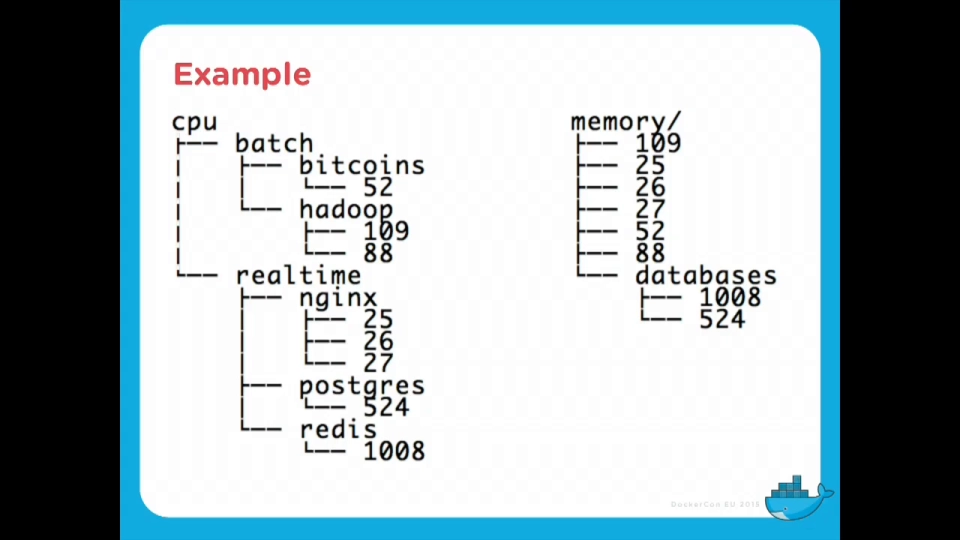

讲者还提醒了"cgroup 墙"问题：直接操作这套底层接口时，所有使用者必须协商一致——比如你想给某个应用保留 3 号 CPU，就得保证别人都不用它；更现实的做法是走 systemd、cgmanager 这类**高层协调层**，由它统一分配 [【跳转到 23:52】](https://www.youtube.com/watch?v=sK5i-N34im8&t=1432)。

### 3.2 memory：记账页粒度、两种限额

内存控制组的记账粒度是**内存页**（多数架构 4KB）[【跳转到 07:07】](https://www.youtube.com/watch?v=sK5i-N34im8&t=427)。页分两类：**文件页**（内容能对应到磁盘上的位置，内存紧张时直接丢弃即可，不必换出）与**匿名页**（如 malloc 出来的内存，磁盘上没有对应物，回收前必须先换出到 swap）。内核把页放进 **active/inactive** 两个池子粗略轮转：默认进 active，内存吃紧时从 inactive 里挑，每次被访问就回到 active [【跳转到 08:32】](https://www.youtube.com/watch?v=sK5i-N34im8&t=512)。

多个组共享同一页时**不拆账**——整页记在其中一个组头上，其他组"看不见"这笔账；若那个组退出，账目转移到别的组 [【跳转到 09:07】](https://www.youtube.com/watch?v=sK5i-N34im8&t=547)。限额分两种：**硬限制**超了就杀进程——但只杀本组内的，"某个容器内存超额，被 OOM 的是它自己，而不是随机干掉别人家的 MySQL"——这也是"**一个容器一个服务**"这条最佳实践的出处：粒度清晰，进程死得其所 [【跳转到 10:10】](https://www.youtube.com/watch?v=sK5i-N34im8&t=610)；**软限制**不强制，但内存吃紧时，超额最多的组会被优先拿走内存页 [【跳转到 10:50】](https://www.youtube.com/watch?v=sK5i-N34im8&t=650)。

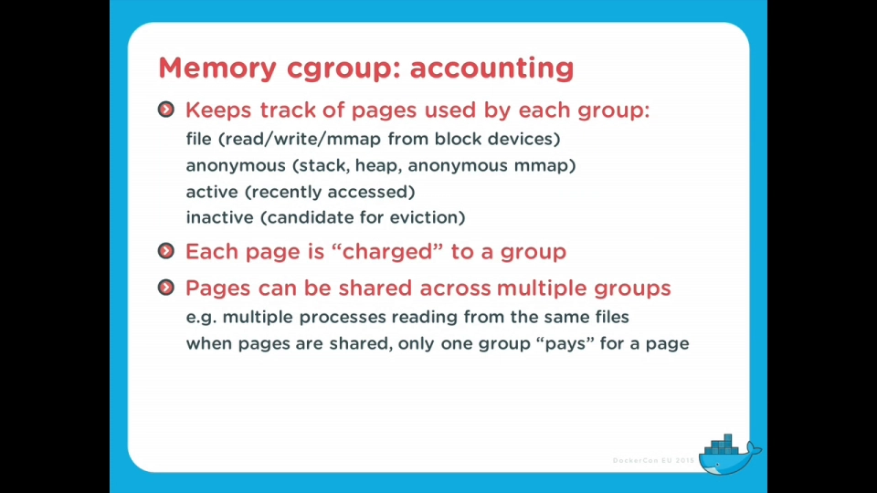

### 3.3 cpu：为什么没法按"百分比"限额

CPU 控制组能分组追踪、能设**权重（weights）**，却**不能设"最多用 10% CPU"这种限制**——讲者花了两分钟解释为什么这不是偷懒 [【跳转到 14:52】](https://www.youtube.com/watch?v=sK5i-N34im8&t=892)：现代 CPU 会动态调频（省电或加速），你只观察到 10% 占用，处理器可能正在降频；按周期数或指令数计数也不行，因为 CISC 指令的成本天差地别。所以 CPU 侧的正确姿势是**权重与共享**。

### 3.4 cpuset 绑核、blockio 的坑、freezer 冻结整机

- **cpuset** 把一组进程钉在指定的 CPU 上，适合低延迟场景与 NUMA 大机器（内存挂在特定 CPU 旁边，跨 socket 访问慢——"60GB 内存飞快、加到 150GB 反而变慢"的怪事就是这么来的）[【跳转到 16:30】](https://www.youtube.com/watch?v=sK5i-N34im8&t=990)。
- **blockio** 按块设备统计和限制 IO，区分读/写、同步/异步。注意坑：写操作先落页缓存，"限了 1MB/s 却瞬间写出 10MB"其实是缓冲效果，刷盘才是被限速的环节；对容器里跑虚拟机或自己做 direct IO 的场景效果最好 [【跳转到 18:12】](https://www.youtube.com/watch?v=sK5i-N34im8&t=1092)。
- **freezer** 相当于"整个容器的 SIGSTOP"。为什么不直接对容器里所有进程发 SIGSTOP？因为进程能感知自己被停过，而且与 ptrace 之类的调试操作互相干扰；freezer 让你把整个容器冻住再解冻，对作业调度、进程迁移都干净利落 [【跳转到 22:29】](https://www.youtube.com/watch?v=sK5i-N34im8&t=1349)。

## 四、写时复制：让 `docker run` 秒起的第三块积木

只有 cgroups 和 namespaces 还不够——**光有它们，容器照样能跑，但 `docker run` 不会"秒开"**。镜像若每次都要完整复制一份，容器启动与构建都会慢到没法用。写时复制（copy-on-write）让 `docker run` 几乎即时可用、`docker build`/`commit` 飞快，是容器普及的幕后功臣 [【跳转到 32:16】](https://www.youtube.com/watch?v=sK5i-N34im8&t=1936)。实现选项很多：AUFS、overlay、btrfs、ZFS、device mapper 等，想深挖可以搜 "deep dive into docker storage drivers" [【跳转到 33:01】](https://www.youtube.com/watch?v=sK5i-N34im8&t=1981)。

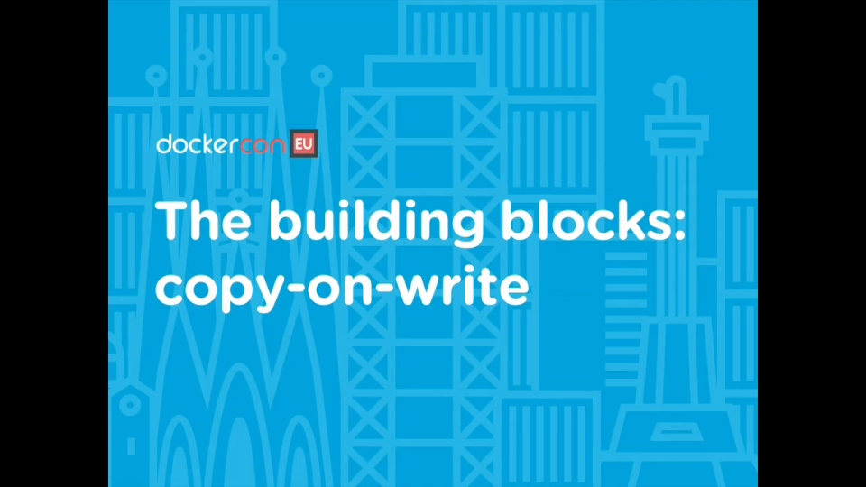

## 五、疯狂演示：不用 Docker，亲手拼一个容器

演讲的压轴戏：从一块空的 btrfs 卷开始，只用 chroot、unshare、pivot_root 和一串 mount/umount，现场拼出一个容器（讲者给它起名 Tupperware——"史上最好的容器"，因为 Tupperware 是保鲜盒品牌）[【跳转到 41:26】](https://www.youtube.com/watch?v=sK5i-N34im8&t=2486)。

### 步骤 1：准备"可私有"的挂载点

先把挂载点设为 **private**——否则接下来在容器里做的挂载会"渗透"到宿主机上，非常危险 [【跳转到 41:26】](https://www.youtube.com/watch?v=sK5i-N34im8&t=2486)。

### 步骤 2：准备 rootfs

为了省事，讲者借用 Docker 拿了一个 alpine 基础镜像：`docker export` 导出 tar 包，解包到 `images/alpine/`，再用 btrfs 快照克隆出 `containers/tupperware`——写时复制在这里已经登场：快照瞬间完成，几乎不占额外空间 [【跳转到 42:04】](https://www.youtube.com/watch?v=sK5i-N34im8&t=2524)。

### 步骤 3：chroot + unshare

`chroot` 进 alpine 目录（这时已经能用 apk 了，但它还不是容器）；然后 `unshare --mount --pid --ipc --uts`——"除了 user namespace，把其它命名空间全给我来一份" [【跳转到 43:18】](https://www.youtube.com/watch?v=sK5i-N34im8&t=2598)。顺手改主机名为 tupperware 再 exec bash——提示符一变，"我进容器了"。

### 步骤 4：PID 命名空间的"怪象"

这时 `ps` 应该只显示容器里的进程，PID 却乱七八糟、不是从 1 开始——**这不是 bug**：`/proc` 挂的还是宿主机那套，看到的还是系统的进程视图 [【跳转到 44:01】](https://www.youtube.com/watch?v=sK5i-N34im8&t=2661)。验证方法很妙：拿宿主机某进程的 PID 去 kill，报"no such process"——**那个 PID 在这个命名空间里不存在** [【跳转到 44:26】](https://www.youtube.com/watch?v=sK5i-N34im8&t=2666)。重新 `mount proc`，`ps` 干净了。

### 步骤 5：pivot_root 换根与一连串"小怪癖"

chroot 只是换了进程的根目录视角，要"把宿主机文件系统彻底藏起来"得用 `pivot_root`。规矩是：先建好 old root 目录，再执行 pivot_root 把新根换进去 [【跳转到 45:16】](https://www.youtube.com/watch?v=sK5i-N34im8&t=2716)。讲者现场踩了一串坑，每一坑都是真实容器技术的日常：

- pivot_root 不生效——因为目标得先是个**真正的挂载点**，解决办法是先把 btrfs 卷 bind mount 一遍 [【跳转到 45:41】](https://www.youtube.com/watch?v=sK5i-N34im8&t=2741)；
- 卸载宿主机遗留挂载时把 /proc 也带走了——重新挂；
- old root 卸不掉、报 busy——上 lazy unmount 的"魔法标志" [【跳转到 46:21】](https://www.youtube.com/watch?v=sK5i-N34im8&t=2781)。

全部收拾完：`ps` 干净、`mount` 干净——**一个不依赖 Docker 的容器诞生了**。

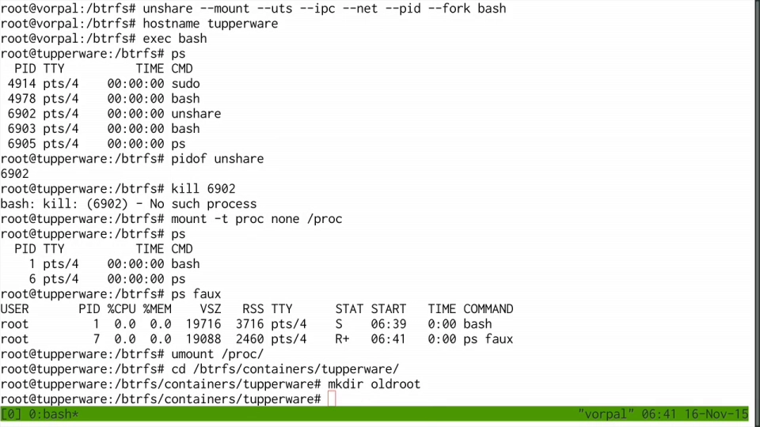

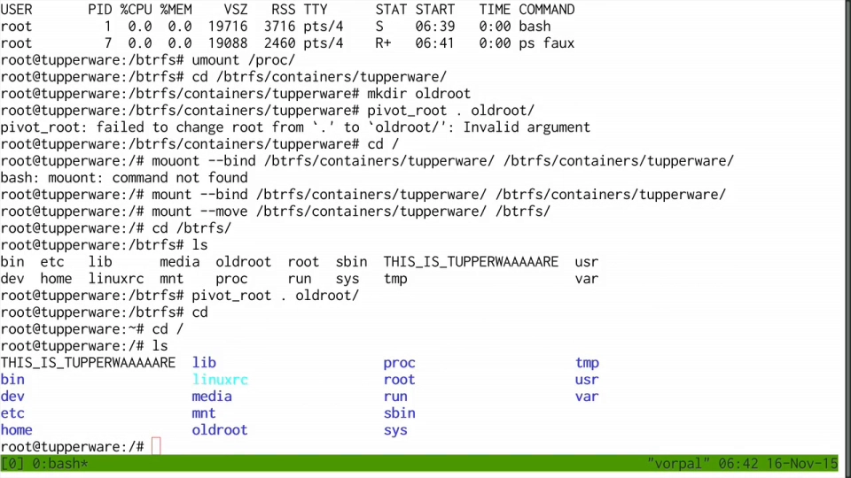

### 步骤 6：接上网——veth pair 搬进容器

最后联网：`ip link add ... type veth peer name ...` 造一对虚拟网卡，把一端 `ip link set <接口> netns <容器PID>` **搬进容器的网络命名空间**（还记得 2.2 节"接口可以搬家"吗），另一端挂到现成的 docker0 网桥上；进容器把接口改名为 eth0、配 IP、加默认路由 [【跳转到 47:30】](https://www.youtube.com/watch?v=sK5i-N34im8&t=2850)。这套动作正是 Docker 每次启动容器都在做的事。

## 六、运行时生态：Docker/LXC 只是"用户态工具栈"

演示之后讲者把视野拉回生态：基于 cgroups + namespaces 的运行时不少，**LXC 并不在内核里——它就是一組利用 cgroups 和 namespaces 的用户态工具**；Docker 同理；此外也存在完全不基于这些机制的运行时 [【跳转到 35:50】](https://www.youtube.com/watch?v=sK5i-N34im8&t=2150)。换句话说，"容器"没有神秘内核模块，拼积木的方式可以有很多种。

## 小结

- 容器 = **namespaces + cgroups + 写时复制**，三者都是内核特性；容器不是轻量虚拟机 [【跳转到 02:03】](https://www.youtube.com/watch?v=sK5i-N34im8&t=123)。
- **namespaces 限制"看得见什么"**：PID（只看同层进程、每层一套编号）、NET（自己的 localhost/eth0/路由/iptables）、MNT（自己的挂载视图）、UTS（主机名）、IPC（信号量/共享内存/消息队列）、USER（容器内 root、容器外普通人）[【跳转到 24:42】](https://www.youtube.com/watch?v=sK5i-N34im8&t=1482)。
- 网络接口能在命名空间间"搬家"，veth pair + 网桥是容器组网的标准配方 [【跳转到 26:13】](https://www.youtube.com/watch?v=sK5i-N34im8&t=1573)。
- **cgroups 限制"用得了多少"**：memory 页粒度记账、文件页/匿名页、硬限制组内 OOM（"一容器一服务"的出处）、软限制按超额回收；CPU 只有权重没有百分比；cpuset 绑核治 NUMA；blockio 当心页缓存；freezer 冻整箱 [【跳转到 07:07】](https://www.youtube.com/watch?v=sK5i-N34im8&t=427)。
- 命名空间随"最后一个进程"消亡，bind mount `/proc/<PID>/ns` 可续命 [【跳转到 31:25】](https://www.youtube.com/watch?v=sK5i-N34im8&t=1885)。
- 亲手拼容器六步：挂载点设 private → 备好 rootfs → chroot → `unshare` 出命名空间 → `mount proc` + `pivot_root` 换根 → veth 接网；一路上的小怪癖就是容器运行时要处理的日常 [【跳转到 41:26】](https://www.youtube.com/watch?v=sK5i-N34im8&t=2486)。
- LXC、Docker 都是用户态工具栈，不是内核模块——积木相同，拼法自选 [【跳转到 35:50】](https://www.youtube.com/watch?v=sK5i-N34im8&t=2150)。
