# 容器的三块积木：cgroups 管用量、namespaces 管可见性——Samuel Karp 逐块拆解并亲手演示

> 视频来源：Samuel Karp [《Linux Container Primitives: cgroups, namespaces, and more!》](https://www.youtube.com/watch?v=x1npPrzyKfs)（LinuxFest Northwest 2020 线上演讲，34 分 27 秒）。本文基于视频演说图文稿整理，关键处附时间戳，可跳回原视频核对。讲者全程在真实 Linux 终端上演示，所有命令都可以在自己机器上复现。

## 本讲要解决的核心问题（SCQA）

**背景**：`docker run` 一敲，容器就跑起来了——大家每天都在用容器，也知道容器"隔离"了进程、网络和文件系统。

**冲突**：可一旦出问题——进程数暴涨把机器拖垮、容器里看不到期望的网卡、或者想搞清楚"容器里到底在跑什么"——把容器当黑盒就无从下手。而且这些内核机制本来就能自由组合，只会"一个容器一套全家桶"这一种用法，等于手里有积木却只会搭一种房子。

**疑问**：容器究竟由哪些内核原语拼成？每一块各自负责什么？不借助 Docker，能不能直接动手操作它们？

**回答（中心思想）**：容器 = 用特定方式组合起来的 **Linux 普通进程 + 三大内核原语**——**cgroups** 负责"跟踪、分组、限制进程能用多少资源"，**namespaces** 负责"控制进程能看见哪些资源、能碰哪些资源"，**分层文件系统**负责提供容器自己的那套文件 [【跳转到 01:20】](https://www.youtube.com/watch?v=x1npPrzyKfs&t=80)。本讲逐块拆解（文件系统部分点到为止，细节归镜像章节），重点讲清 namespaces 的概念、类型与 `clone`/`unshare`/`setns` 三个系统调用，并用 `ip netns`、`nsenter` 演示"钻进命名空间排障"的标准姿势。

## 一、容器不是轻量虚拟机：三块积木拼出来的普通进程

讲者给容器下的定义非常克制：**容器是一种让 Linux 进程带一定程度的隔离与分隔运行的机制** [【跳转到 01:02】](https://www.youtube.com/watch?v=x1npPrzyKfs&t=62)。没有"虚拟机"、没有"新内核"，就是把普通的 Linux 进程，用几种内核原语包起来。

构成容器核心的是三块积木 [【跳转到 01:45】](https://www.youtube.com/watch?v=x1npPrzyKfs&t=105)：

1. **cgroups（control groups，控制组）**——管理进程组"能用多少"资源；
2. **namespaces（命名空间）**——管理进程"能看见什么"资源；
3. **文件系统（容器镜像与分层）**——提供容器自己的那套文件。

为什么要学这些底层原语？讲者给出三个理由：**排障**时能钻到 Docker 抽象之下看真相；**设计系统**时能明白容器边界从哪来；更重要的是这些原语可以**自由混搭**——"搭出容器"只是其中一种用法 [【跳转到 01:20】](https://www.youtube.com/watch?v=x1npPrzyKfs&t=80)。

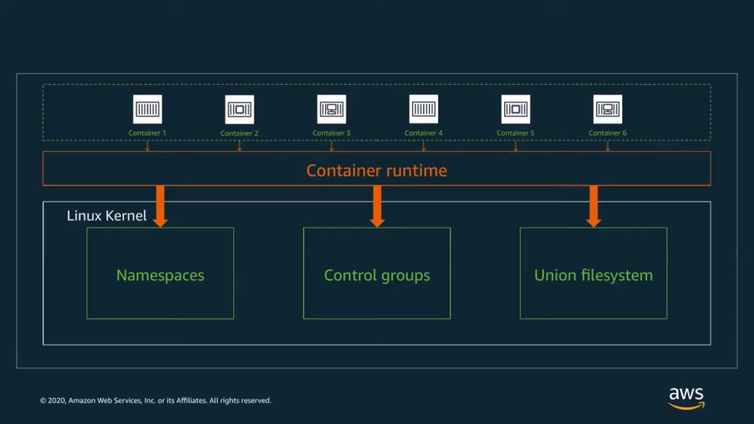

## 二、cgroups：给进程组记账与设限

### 2.1 是什么：跟踪、分组、组织进程

cgroups 是 Linux 内核用来**跟踪（track）、分组（group）、组织（organize）进程**的机制 [【跳转到 02:10】](https://www.youtube.com/watch?v=x1npPrzyKfs&t=130)。两个关键认知：

- **所有进程都被 cgroups 跟踪**，不管它在不在容器里；
- cgroups 通常用来把进程组和资源关联起来：既能**统计**一组进程用了多少某类资源，也能**限制或调整**一组进程能拿到多少资源 [【跳转到 02:35】](https://www.youtube.com/watch?v=x1npPrzyKfs&t=155)。

cgroups 本身是个抽象框架，具体能力由挂在各类资源上的**子系统（subsystem）**实现，绝大多数子系统都是"资源控制器"，能统计或限制某一类资源 [【跳转到 02:35】](https://www.youtube.com/watch?v=x1npPrzyKfs&t=155)。一个容易被忽略的要点：**各子系统相互独立、各自维护一棵层级树**——同样两个进程，可以在同一个 cpu 控制组里，却在两个不同的 memory 控制组里 [【跳转到 03:00】](https://www.youtube.com/watch?v=x1npPrzyKfs&t=180)。这种独立性让"共享内存限额、但 CPU 配额不同"这类组合变得很简单 [【跳转到 03:25】](https://www.youtube.com/watch?v=x1npPrzyKfs&t=205)。

进程的继承规则也很朴素：**新进程一出生就在它父进程所在的 cgroups 里** [【跳转到 03:50】](https://www.youtube.com/watch?v=x1npPrzyKfs&t=230)。

### 2.2 怎么操作：一个虚拟文件系统

与 cgroups 交互的界面是挂在 `/sys/fs/cgroup` 的**虚拟文件系统**：里面看到的文件和目录并非真实数据，而是内核 cgroups 数据结构的接口；**每个子系统的根目录下，一个目录就是一个控制组**；每个目录里都有个 `tasks` 文件，记录着该控制组里的全部进程 PID；其余文件用来读写配置与用量数据 [【跳转到 03:50】](https://www.youtube.com/watch?v=x1npPrzyKfs&t=230)。把进程挪进某个控制组，只需把它的 PID 写进目标组的 `tasks` 文件 [【跳转到 04:40】](https://www.youtube.com/watch?v=x1npPrzyKfs&t=280)。

讲者现场演示了完整流程 [【跳转到 05:50】](https://www.youtube.com/watch?v=x1npPrzyKfs&t=350)：`mkdir` 一个新目录（哪怕没建任何文件，内核也会自动生成一套虚拟文件）→ 把当前 shell 的 PID 写进 `tasks` → 从 `/proc/<PID>/cgroup` 反向确认 shell 已被挪入 `pids:/lfnw` 组。同一个 `tasks` 文件里还能看到多出来的另一个 PID——那是正在运行的 `cat` 子进程，因为**子进程继承父进程的 cgroups** [【跳转到 07:05】](https://www.youtube.com/watch?v=x1npPrzyKfs&t=425)。

### 2.3 演示：用 pids 控制器防住 fork 炸弹

pids 控制器限制的是**进程数量**。讲者的解释很点题：进程本身就是一种内核资源，进程太多会耗尽资源；pids 控制器让我们能**限制失误或攻击（比如 fork 炸弹）的影响范围** [【跳转到 07:30】](https://www.youtube.com/watch?v=x1npPrzyKfs&t=450)。写一个上限进 `pids.max`，再开第三个进程——直接被拒绝 [【跳转到 07:55】](https://www.youtube.com/watch?v=x1npPrzyKfs&t=475)。

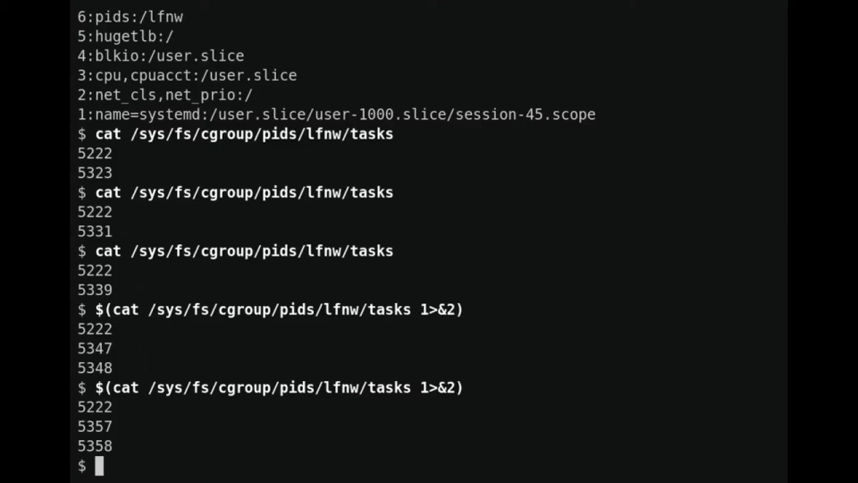

### 2.4 Docker 怎么用 cgroups

后台跑一个带 CPU 限制的容器，`docker exec` 进去看 `/sys/fs/cgroup/cpu`：顶层没有任何子目录，`cpu.shares` 却已经生效——**这只是容器自己的视角**；从宿主机看，Docker 把容器的 cgroups 挂在 `/sys/fs/cgroup/cpu/docker/<容器ID>/` 下，同一个值写在容器对应的组里 [【跳转到 08:34】](https://www.youtube.com/watch?v=x1npPrzyKfs&t=514)。

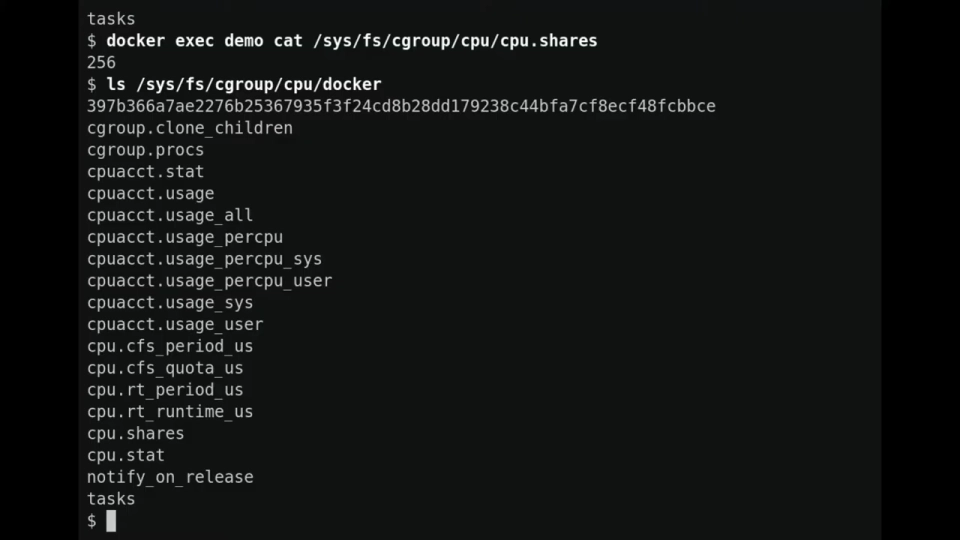

cgroups 到此为止——它是容器的重要支柱，但对普通进程同样好用 [【跳转到 09:34】](https://www.youtube.com/watch?v=x1npPrzyKfs&t=574)。资源限制的深水区（内存、CPU、IO 各子系统）见本系列 cgroups 章节。

## 三、namespaces：决定进程"看得见什么"

### 3.1 概念：可见性与访问控制

与 cgroups 并列的另一类内核原语就是 namespaces。讲者的定义值得逐字读 [【跳转到 10:04】](https://www.youtube.com/watch?v=x1npPrzyKfs&t=604)：

> namespaces 关注的是**资源的可见性（visibility）与访问控制**。它能造成一种表象：这个进程拥有某个资源属于自己的一份隔离副本；另一些场景下，它把命名空间外的资源映射进命名空间，同时顺手改掉一些属性（比如名字或权限）。

效果是：**进程在自己的命名空间里对资源做的改动，只有同一命名空间里的进程看得见**——对命名空间外的进程，这些改动等于没发生过。进程相当于拿到了资源的"私有副本"。

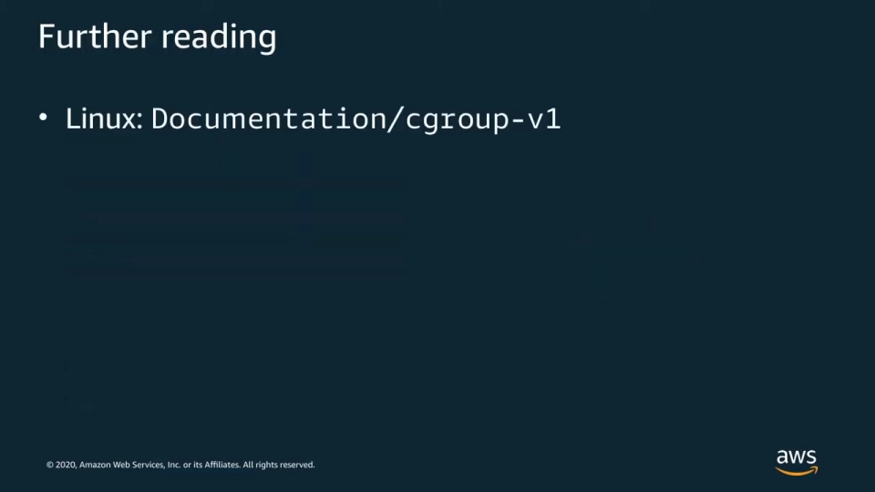

### 3.2 类型清单：一类资源一种命名空间

Linux 提供了一组命名空间，各管一类资源；幻灯片列出的是较新版本内核可用的全部类型，而且**新类型还在增加**（当时 time namespace 即将进入新内核）[【跳转到 10:29】](https://www.youtube.com/watch?v=x1npPrzyKfs&t=629)。本系列后续小节会逐个深入，这里先给全景：

| 命名空间 | 管的是什么 |
|---|---|
| mnt | 挂载点——进程看到哪棵文件树 |
| pid | 进程编号——进程能看见哪些进程 |
| net | 网络栈——网卡、路由、防火墙规则 |
| uts | 主机名与域名 |
| ipc | System V/POSIX 进程间通信对象 |
| user | 用户/组 ID 的映射 |
| cgroup | cgroup 根目录视角 |
| time | 系统时钟偏移 |

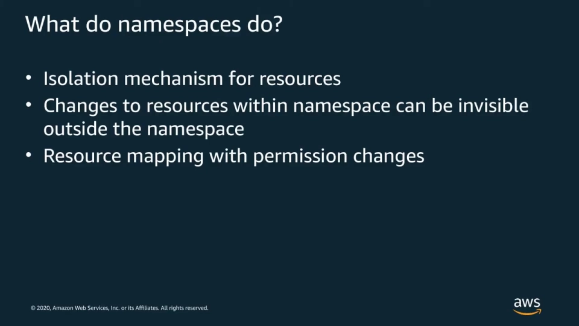

### 3.3 组合自由：命名空间可以按需拼装

和 cgroups 一样，**进程可以处于任意组合的命名空间中**。幻灯片上的示意图想说明的是：不同进程之间可以共享不同集合的命名空间——比如大部分进程共享同一个 mnt 命名空间，只把某一个进程放进独立的 net 或 pid 命名空间；也可以让一个进程全套自备，那就是一个容器 [【跳转到 10:54】](https://www.youtube.com/watch?v=x1npPrzyKfs&t=654)。

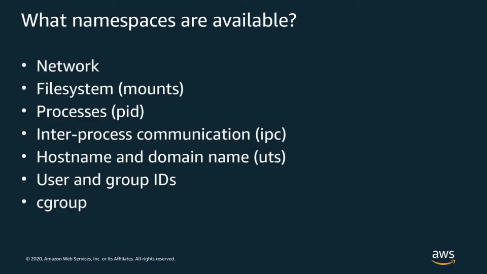

### 3.4 两个最常用的例子：网络与挂载

**网络命名空间**给进程一份**分隔的网络视图**：自己的网络接口、自己的路由规则 [【跳转到 11:19】](https://www.youtube.com/watch?v=x1npPrzyKfs&t=679)。命名空间之间用 **veth pair**（虚拟以太网线对）连接。Docker 的默认玩法正是：**每个容器一个独立网络命名空间**，再给它配一对 veth，接到 Linux 网桥上打通出去。但这不是唯一方案——Kubernetes Pod 和 ECS task 就是让同一组容器**共享**同一个网络命名空间，对外只暴露一个 IP [【跳转到 11:19】](https://www.youtube.com/watch?v=x1npPrzyKfs&t=679)。

**挂载命名空间**则是容器"独立文件系统视图"的来源：容器镜像被挂载为容器的根文件系统，宿主机的文件系统被藏起来 [【跳转到 11:44】](https://www.youtube.com/watch?v=x1npPrzyKfs&t=704)。跨容器或与宿主机共享数据用的卷（volume），本质就是**往容器的挂载命名空间里加的一个挂载**。

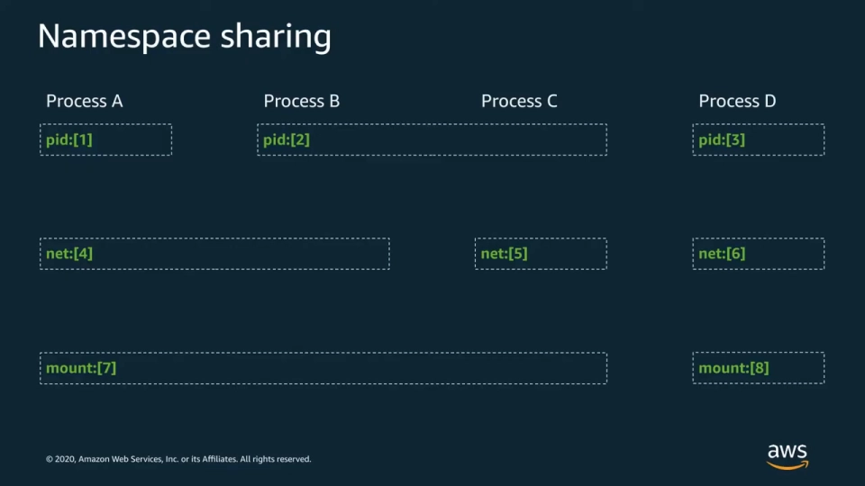

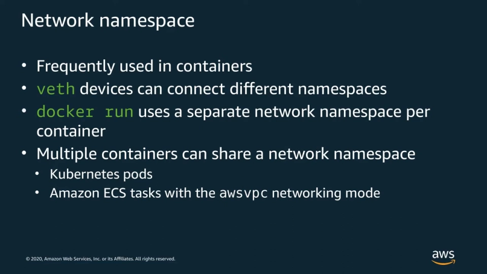

### 3.5 怎么识别：/proc/&lt;PID&gt;/ns

`/proc` 虚拟文件系统是内核提供的自我透视窗口，其中就包括每个进程所属的命名空间：`/proc/<PID>/ns/` 目录下是一组符号链接，**链接的结构里记录着命名空间类型和内核用来标识它的 inode 号** [【跳转到 12:34】](https://www.youtube.com/watch?v=x1npPrzyKfs&t=754)。号本身没什么含义，但对比两个进程的链接就能判断**它们是否在同一个命名空间里**——排障时非常实用。

### 3.6 怎么创建、怎么进入：clone / unshare / setns

与 cgroups 走虚拟文件系统不同，**命名空间的操作走系统调用**，共三个 [【跳转到 12:59】](https://www.youtube.com/watch?v=x1npPrzyKfs&t=779)：

1. **`clone(2)`**——创建进程的系统调用，顺带能让新进程出生在新命名空间里，创建哪些由一组 `CLONE_NEW*` 标志控制；
2. **`unshare(2)`**——让**已经在跑的进程**把自己挪进新命名空间，支持与 clone 相同的标志；
3. **`setns(2)`**——进入一个**已存在**的命名空间，需要一个文件描述符来指认目标——打开 `/proc/<PID>/ns/` 里的符号链接、或打开它在别处的 bind mount 都能拿到 [【跳转到 13:49】](https://www.youtube.com/watch?v=x1npPrzyKfs&t=829)。

还有一条冷知识但很关键：**命名空间不能为空**——必须有东西"占着"它才存在，没有持有者时内核会自动关掉它。持有方式只有两种：**一个还在运行的进程，或一个 bind mount** [【跳转到 13:24】](https://www.youtube.com/watch?v=x1npPrzyKfs&t=804)。bind mount 之后，即使创建它的初始进程退出了，命名空间也还活着；同理，进程一旦用 setns 进了某个命名空间，哪怕原来的符号链接或 bind mount 消失了，它也替命名空间续着命。把这两个"续命"操作封装好的现成工具有两个：**`nsenter`** 和 **`ip netns`** [【跳转到 14:14】](https://www.youtube.com/watch?v=x1npPrzyKfs&t=854)。

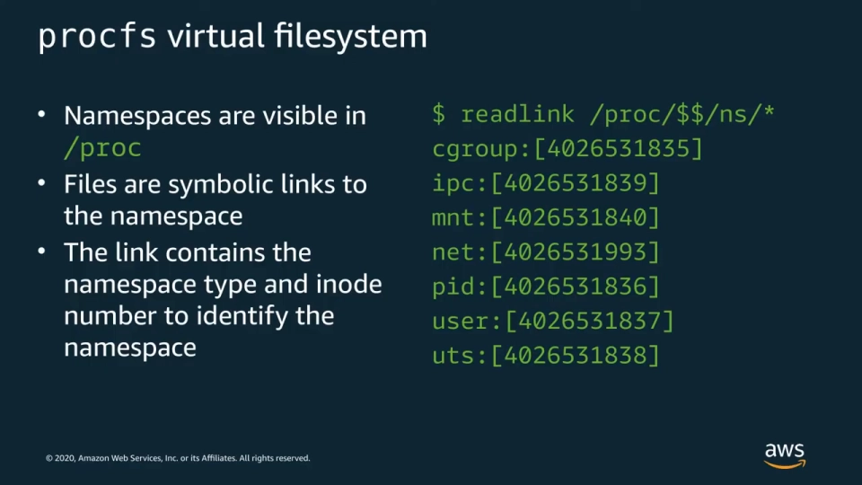

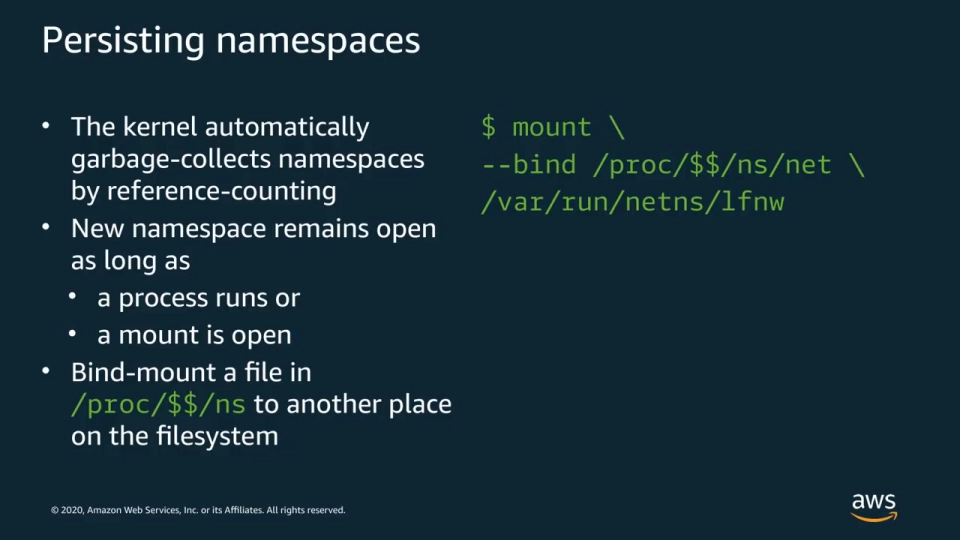

## 四、动手演示：命名空间怎么玩

### 4.1 用 bind mount 给网络命名空间"续命"

讲者先 `unshare` 进一个新的网络+挂载命名空间，再把 `/proc/self/ns/net` bind mount 到 `/var/run/netns/<名字>` 下——这正是 `ip netns` 期望的存放位置。之后哪怕退出了那个 shell，`ip netns list` 依然能列出这个命名空间，并正确识别出**当前 shell 已不在其中**；再进去检查，一切如初 [【跳转到 16:29】](https://www.youtube.com/watch?v=x1npPrzyKfs&t=989)。没有这个 bind mount，命名空间早就随进程一起蒸发了。

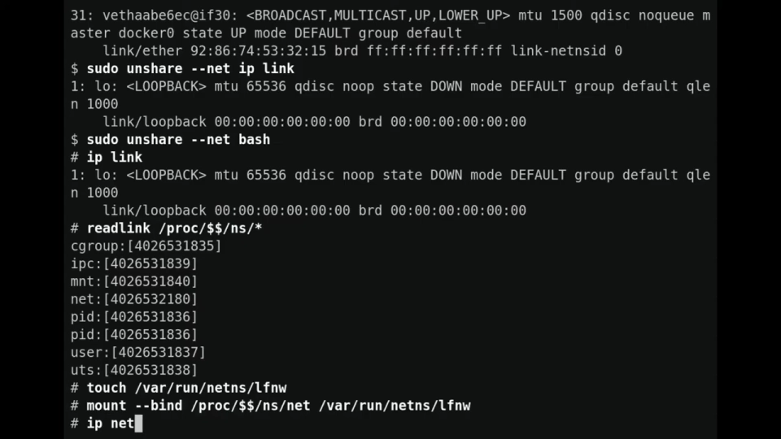

### 4.2 把 nginx 塞进 redis 容器的网络命名空间

后台跑一个 redis 容器，取 Docker 认为的 IP，再钻进它的网络命名空间核对——IP 对得上；veth pair 的另一端就挂在 docker0 网桥上 [【跳转到 17:17】](https://www.youtube.com/watch?v=x1npPrzyKfs&t=1037)。接着玩个花活：**抓 redis 容器的 PID，借它进入同一个网络命名空间，在里面启动宿主机的 nginx** [【跳转到 17:42】](https://www.youtube.com/watch?v=x1npPrzyKfs&t=1062)。

nginx 确实起来了，但 `curl localhost` 却不通——在这个命名空间里 localhost 是 redis 容器自己的网络，nginx 监听的不是这个地址；换容器 IP 访问，一下就通 [【跳转到 18:07】](https://www.youtube.com/watch?v=x1npPrzyKfs&t=1087)。

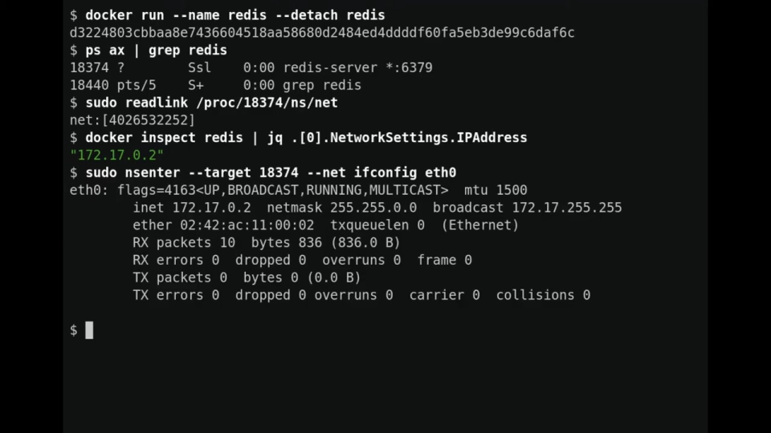

### 4.3 nsenter：在宿主机上运行容器里的程序

反向再来一次：redis **二进制只在容器里**、宿主机上没装，但宿主机可以把容器里的 redis 跑起来——用 nsenter 挂上容器进程的**挂载命名空间**，redis 就启动了，宿主机上直接用它的文本 API（`PING` → `PONG`）验证通过 [【跳转到 19:20】](https://www.youtube.com/watch?v=x1npPrzyKfs&t=1160)。程序来自容器的文件系统，命名空间却全是宿主机的——原语自由组合的威力就在这。

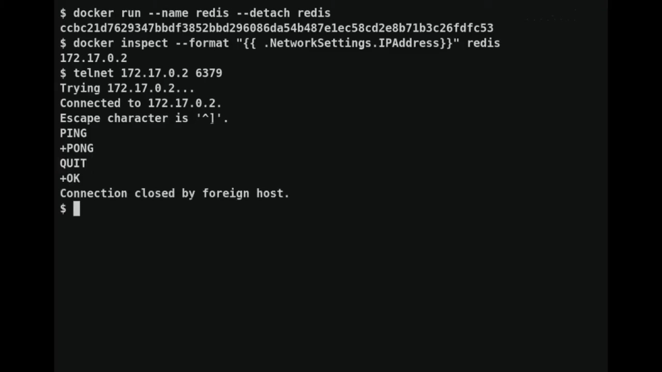

## 五、排障视角与延伸阅读

把这套原语用熟之后，`nsenter` 和 `ip netns` 就是钻进命名空间、查看其中可见资源的两把钥匙 [【跳转到 20:10】](https://www.youtube.com/watch?v=x1npPrzyKfs&t=1210)：容器行为不符合预期时，进去看看它眼中的网络、文件和进程；也可以借此监控容器到底在干什么。想查手册，看 Linux 程序员手册第 7 节（`man 7 namespaces`），多数发行版默认自带 [【跳转到 20:15】](https://www.youtube.com/watch?v=x1npPrzyKfs&t=1215)。

## 小结

- 容器不是轻量虚拟机，而是**普通 Linux 进程 + cgroups + namespaces + 分层文件系统**的特定组合 [【跳转到 01:45】](https://www.youtube.com/watch?v=x1npPrzyKfs&t=105)。
- cgroups 通过 `/sys/fs/cgroup` 虚拟文件系统操作：目录即控制组，`tasks` 文件装 PID，写文件即配置；各子系统层级独立，子进程继承父进程的组 [【跳转到 03:50】](https://www.youtube.com/watch?v=x1npPrzyKfs&t=230)。
- pids 控制器限制进程数，是防 fork 炸弹这类事故的第一道闸 [【跳转到 07:30】](https://www.youtube.com/watch?v=x1npPrzyKfs&t=450)。
- namespaces 管的是**可见性与访问控制**：进程对资源私有副本的改动，只有同命名空间的进程看得见 [【跳转到 10:04】](https://www.youtube.com/watch?v=x1npPrzyKfs&t=604)。
- 命名空间按资源分类（mnt/pid/net/uts/ipc/user/cgroup/time…），进程可以任意组合共享或独占 [【跳转到 10:54】](https://www.youtube.com/watch?v=x1npPrzyKfs&t=654)。
- 操作接口只有三个系统调用：`clone`（带 `CLONE_NEW*` 出生即隔离）、`unshare`（自我隔离）、`setns`（进入既有命名空间）[【跳转到 12:59】](https://www.youtube.com/watch?v=x1npPrzyKfs&t=779)。
- 命名空间不能为空：靠运行中的进程或 bind mount 持有；`ip netns` 的持久化、`nsenter` 的进入都建立在这条规则上 [【跳转到 13:24】](https://www.youtube.com/watch?v=x1npPrzyKfs&t=804)。
