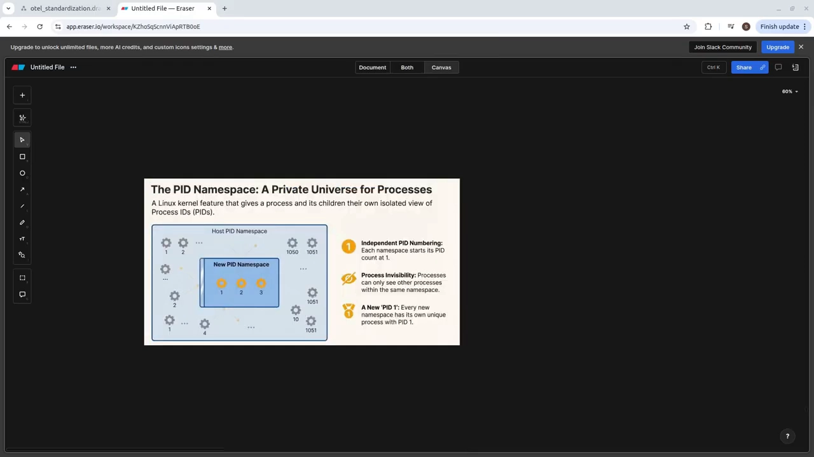
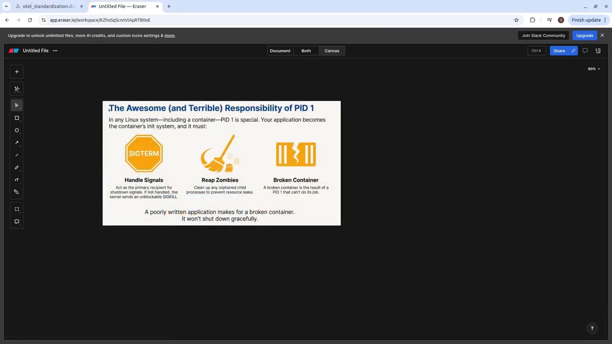
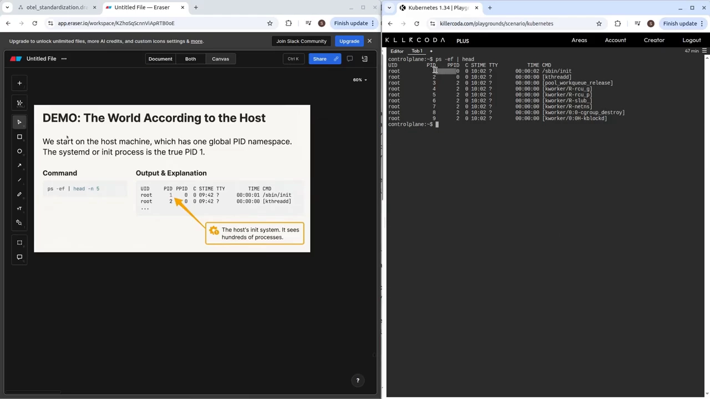
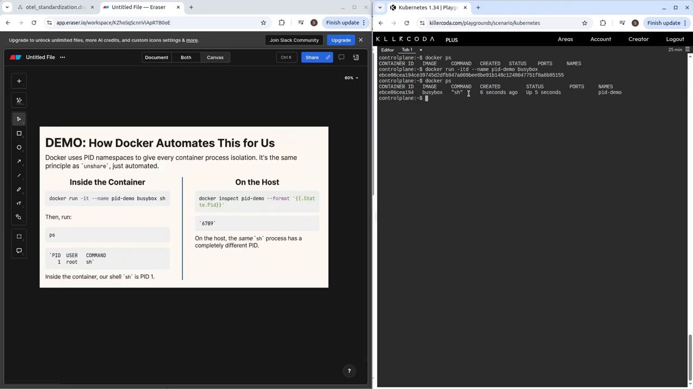
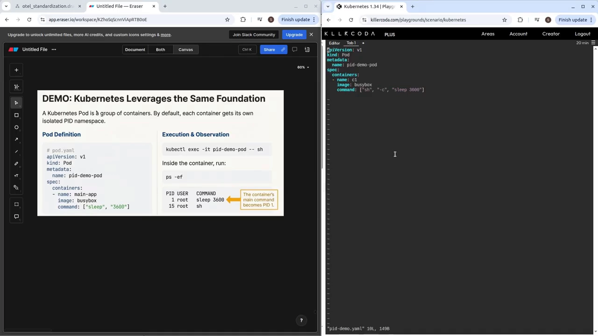
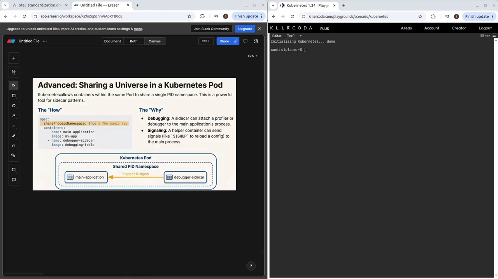
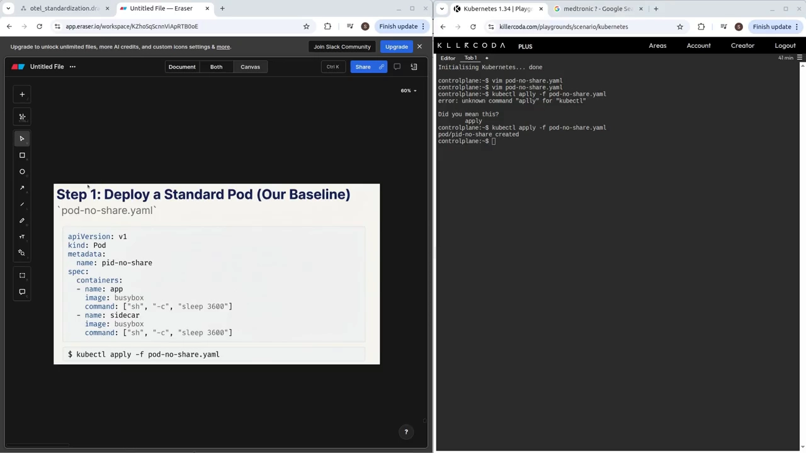
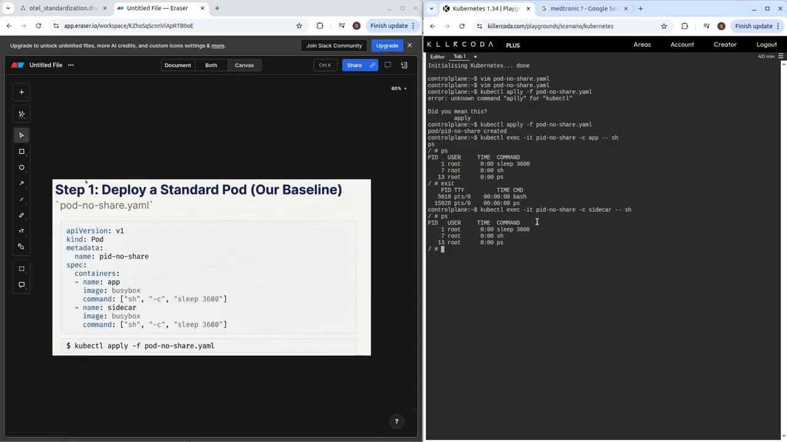
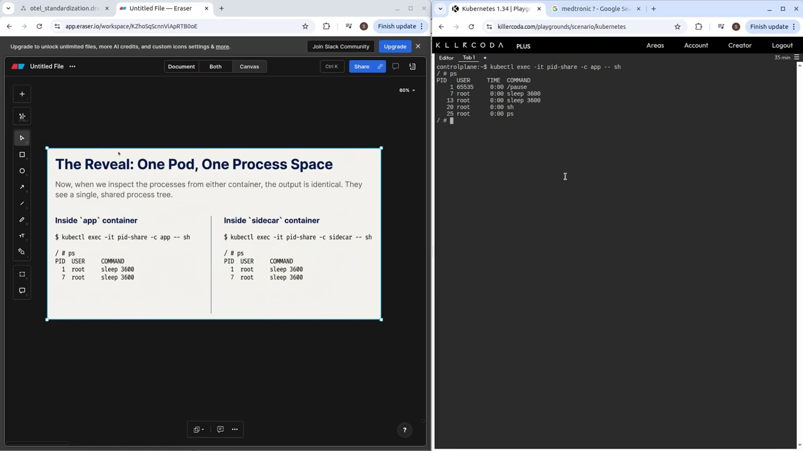
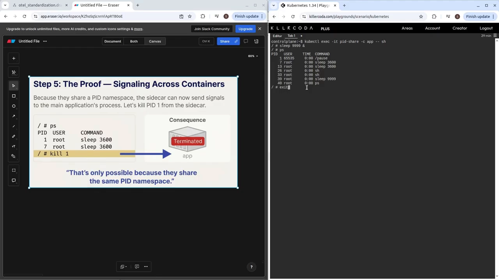

# Containers Are Processes — PID Namespace in Docker and Kubernetes

> 视频源：[Containers Are Processes — PID Namespace in Docker & Kubernetes (Part 2 of 4 Namespaces)](https://www.youtube.com/watch?v=5kRARwlbu-M)（YouTube，13 分 12 秒）。这是"命名空间四部曲"的第二部，主讲人用一连串终端演示把 PID 命名空间讲透。本文基于视频演说图文稿整理，时间戳可跳转到原视频对应位置。

## 本讲要解决的核心问题（SCQA）

**背景**：容器本质上只是 Linux 进程。上一集我们看到 UTS 命名空间让容器拥有了自己的主机名。

**冲突**：但容器里的进程看不到宿主机上成百上千的其它进程——每个容器都以为"全世界只有我自己"，而且自己的应用还是 PID 1。应用在不知不觉中承担了 PID 1 的全部职责，不管你有没有为此做打算；写得不好的容器会在关机时出问题。

**疑问**：Docker 和 Kubernetes 到底是用什么内核特性，制造出这种"每个容器只有自己"的错觉的？

**回答（中心思想）**：靠 **PID 命名空间**——它给每组进程一个**私有的进程 ID 视图**。Docker 用它隔离容器进程；Kubernetes 默认给每个容器独立的 PID 视图，还可以用 `shareProcessNamespace: true` 让同一个 Pod 里的容器共享同一个视图，于是 Pod"感觉像一台机器"。

[【跳转到 00:41】](https://www.youtube.com/watch?v=5kRARwlbu-M&t=41)



## 一、PID 命名空间是什么

### 1.1 一句话定义

**PID 命名空间给进程一个属于自己的、私有的进程 ID 视图**：在容器内部，PID 1 不是宿主机的 init 系统，而是你的应用程序。

[【跳转到 00:41】](https://www.youtube.com/watch?v=5kRARwlbu-M&t=41)

### 1.2 为什么 PID 1 特殊

PID 1 承担两件事：

- **接收信号**：比如 SIGTERM 这类终止信号；
- **回收僵尸进程**（reaping zombie processes）。

所以"坏的 PID 1"等于"损坏的容器"（a bad PID 1 is equal to a broken container）——这正是写得不好的容器在关机时失败的原因：你的应用成为 PID 1，不管你计划过没有。

[【跳转到 00:58】](https://www.youtube.com/watch?v=5kRARwlbu-M&t=58)



## 二、先看宿主机：真正的 PID 1 是 systemd

在宿主机（比如 Ubuntu）上用 `ps -el` 查看所有进程：这里的 PID 1 是 systemd / init 进程——宿主机真正的 init 系统。它能看见几百个进程。

[【跳转到 01:23】](https://www.youtube.com/watch?v=5kRARwlbu-M&t=83)



记住这个"全景视角"，接下来对比容器内的世界。

## 三、Docker 演示：同一进程，两种视图

### 3.1 容器内：只有自己

用 busybox 镜像起一个简单容器，`exec` 进去执行 `ps`：输出里**只有一个进程——sh**。容器内的进程空间干干净净，仿佛全世界只有它。

[【跳转到 02:25】](https://www.youtube.com/watch?v=5kRARwlbu-M&t=145)



### 3.2 宿主机上：同一个进程的另一个身份

退出容器，用 `docker inspect` 查到该容器进程的 PID：**24671**。回到宿主机再 `ps`：能看到 sh 正带着这个 PID 跑在宿主机上。

[【跳转到 02:50】](https://www.youtube.com/watch?v=5kRARwlbu-M&t=170)


于是结论水到渠成：**容器内的 shell 是 PID 1，宿主机上它是 24671——同一个进程，两种视图**。这就是 Docker 所利用的 PID 命名空间。Docker 把我们手工用 `unshare` 做的事情全部自动化了。

[【跳转到 03:15】](https://www.youtube.com/watch?v=5kRARwlbu-M&t=195)


## 四、Kubernetes：Pod 里的容器也以为自己是 PID 1

Kubernetes 建立在同样的基础之上。跑一个 Pod（busybox 镜像，只跑一个 `sleep`），`exec` 进去执行 `ps`：sleep 进程显示为 **PID 1**——Pod 定义里的命令成了容器内的 PID 1。

Kubernetes 依赖的同样是 Linux 的 PID 命名空间特性，没有任何魔法。

[【跳转到 04:10】](https://www.youtube.com/watch?v=5kRARwlbu-M&t=250)



## 五、共享 PID 命名空间：shareProcessNamespace

### 5.1 默认行为：同一个 Pod 也互不可见

Kubernetes 还提供了一个特性：让 Pod 内的容器**共享 PID 命名空间**——互相看见进程、互相发信号。打开方式是在 Pod spec 里加 `shareProcessNamespace: true`。

[【跳转到 05:00】](https://www.youtube.com/watch?v=5kRARwlbu-M&t=300)



先看默认行为：**Kubernetes 默认给每个容器一个私有的 PID 命名空间**——即使在同一个 Pod 里，进程也互相不可见。容器 A 看不到容器 B 的进程 ID，反之亦然。

实验：创建一个带两个容器（app + sidecar）的 Pod，**不开**共享。分别 `exec` 进两个容器看 `ps`：各自有各自的进程 ID，谁也不知道对方的 PID。

[【跳转到 06:15】](https://www.youtube.com/watch?v=5kRARwlbu-M&t=375)

有意思的现象出现了：**两个容器都认为自己是 PID 1，却看不见对方**。默认情况下，Kubernetes 给每个容器独立的 PID 命名空间——哪怕在同一个 Pod 里。

[【跳转到 07:23】](https://www.youtube.com/watch?v=5kRARwlbu-M&t=443)





### 5.2 共享实验：从 sidecar 杀死 app 的进程

现在把默认行为改掉：用 `shareProcessNamespace: true` 部署——它告诉 Kubernetes 把 Pod 里的所有容器放进**同一个共享的 PID 命名空间**。

[【跳转到 07:46】](https://www.youtube.com/watch?v=5kRARwlbu-M&t=466)

```bash
kubectl apply -f pod-share.yaml
```

进入共享 Pod 观察：

- app 容器里 `ps`：能看到两个 sleep 进程（PID 7 和 13）；
- sidecar 容器里 `ps`：**同样的进程从两个容器里都可见**。

[【跳转到 08:32】](https://www.youtube.com/watch?v=5kRARwlbu-M&t=512)



再来一个"控制权"实验：在 app 容器里后台起一个 `sleep 999 &`，`ps` 记下它的 PID（39）；切到 sidecar 容器，对这个 PID 执行 kill——**app 容器里那个 sleep 被杀掉了**。

一个容器能看到、并能对另一个容器里启动的进程发信号，这就证明它们共享同一个 PID 命名空间。

[【跳转到 09:22】](https://www.youtube.com/watch?v=5kRARwlbu-M&t=562)



## 六、为什么要共享：四个真实用例

- **调试 sidecar**：用 sidecar 去调试主容器；
- **监控代理**：轻量级 agent 跑在 sidecar 里，监控主应用的进程；
- **日志收集**：sidecar 可以跟踪（tail）日志文件或管理日志相关进程；
- **高级健康检查**：从 sidecar 实现进程级的自定义健康检查，比标准的 liveness probe 检查得更深。

[【跳转到 09:47】](https://www.youtube.com/watch?v=5kRARwlbu-M&t=587)

## 七、总结：Kubernetes 不发明概念，只做抽象

Kubernetes 并没有发明这些概念——它是对 Linux 内核核心特性的强力抽象。理解这层映射是掌握它的关键：

- **PID 命名空间**解释了为什么容器感觉彼此隔离；
- **共享 PID 命名空间**（Kubernetes 的 `shareProcessNamespace`）解释了为什么 Pod 感觉像一台机器。

被面试问到"为什么要开共享进程命名空间"，标准答案是：**让同一个 Pod 内的容器（比如 sidecar）能够检查、监控主容器的进程或向其发信号——这是高级调试与监控模式的基础。**

[【跳转到 10:44】](https://www.youtube.com/watch?v=5kRARwlbu-M&t=644)

PID 命名空间回答了一个简单但有力的问题：**为什么每个容器都以为自己是世界上唯一的进程？因为 Linux 让它如此（Because Linux made it so）。**

[【跳转到 11:39】](https://www.youtube.com/watch?v=5kRARwlbu-M&t=699)

| 环节 | 我们手工做的 | Docker 做的 | Kubernetes 做的 |
| --- | --- | --- | --- |
| 创建 PID 视图 | `unshare` 创建命名空间 | 自动化 `unshare` 的等价操作，为容器创建 PID 命名空间 | Pod 默认拥有自己的 PID 命名空间 |
| PID 1 是谁 | —— | Dockerfile 里 CMD / ENTRYPOINT 指定的应用成为 PID 1 | Pod 内容器里 CMD / ENTRYPOINT 指定的应用成为 PID 1 |
| 共享视图 | —— | —— | `shareProcessNamespace: true` 让 Pod 内容器共享 PID 命名空间 |

[【跳转到 11:49】](https://www.youtube.com/watch?v=5kRARwlbu-M&t=709)

视频下一集将从进程隔离走向网络隔离：每个容器如何拥有自己的 IP 地址。

## 小结

- 容器只是 Linux 进程，但 PID 命名空间让它"看不见"宿主机上的几百个进程；
- PID 命名空间 = 进程 ID 的私有视图；容器内 PID 1 是你的应用，不是宿主机的 init；
- PID 1 要接收信号、回收僵尸进程——坏的 PID 1 等于损坏的容器，应用成为 PID 1 往往身不由己；
- Docker 演示：容器内 sh 是 PID 1，宿主机上同一进程是 24671——同一进程，两种视图；Docker 是 `unshare` 的自动化；
- Kubernetes 默认给每个容器独立 PID 命名空间：同 Pod 内两个容器都以为自己是 PID 1，互不可见；
- `shareProcessNamespace: true` 让 Pod 内容器共享一个 PID 命名空间——从 sidecar 能看到并杀死 app 里的进程，即为共享的铁证；
- 共享的真实用例：调试 sidecar、监控代理、日志收集、进程级健康检查；
- Kubernetes 不发明概念：PID 命名空间解释容器为何隔离，共享 PID 命名空间解释 Pod 为何像一台机器。

## 关键术语速查

| 术语 | 一句话解释 |
| --- | --- |
| PID 命名空间 | 给一组进程一个私有的进程 ID 视图，容器"看不见别人"的原因 |
| PID 1 | 命名空间内的第一个进程，负责收信号、回收僵尸进程；容器里往往是你的应用 |
| 僵尸进程回收（reap） | PID 1 的核心职责之一：收尸已退出的子进程，否则僵尸堆积 |
| `docker inspect` | 查询容器元数据，可拿到容器进程在宿主机上的真实 PID |
| `shareProcessNamespace` | Kubernetes Pod 字段，置 true 时 Pod 内所有容器共享同一个 PID 命名空间 |
| sidecar | 与主容器同 Pod 部署的辅助容器，共享 PID 视图后可用于调试、监控、日志 |
| liveness probe | Kubernetes 标准存活探针；共享 PID 视图可做比它更深的进程级健康检查 |
| `unshare` | 手工创建新命名空间的命令/系统调用；Docker 创建容器进程空间的等价自动化 |
| CMD / ENTRYPOINT | Dockerfile 指定的容器启动命令，在容器 PID 命名空间里成为 PID 1 |
