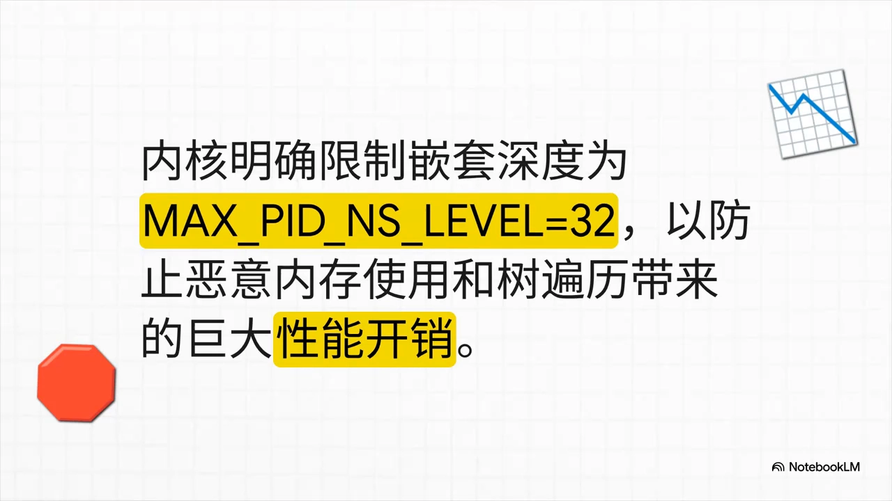
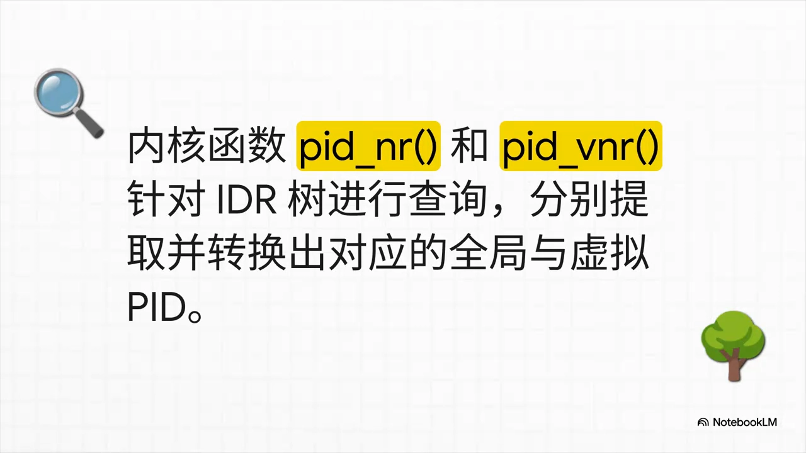
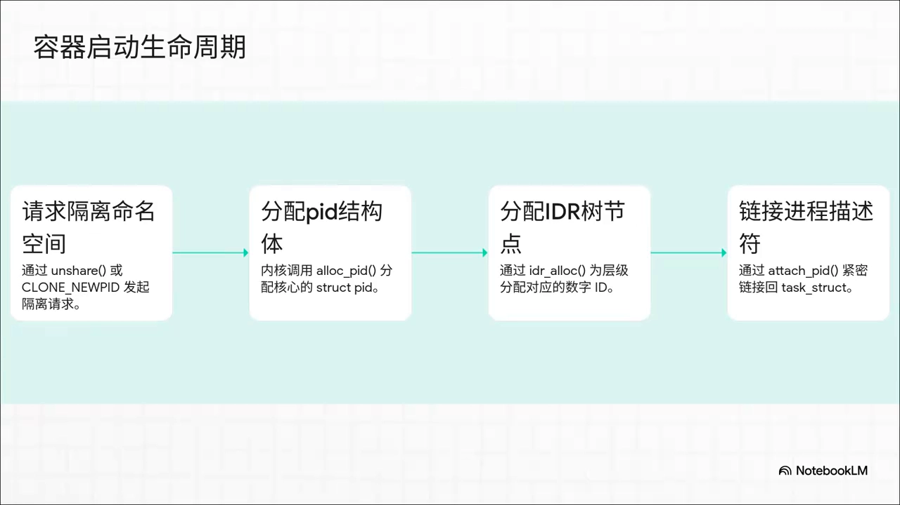
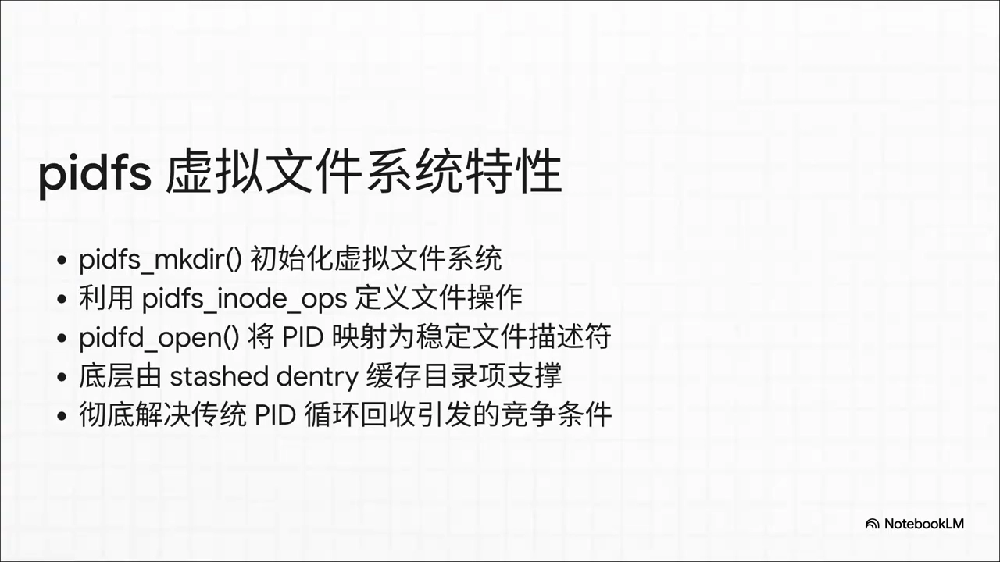
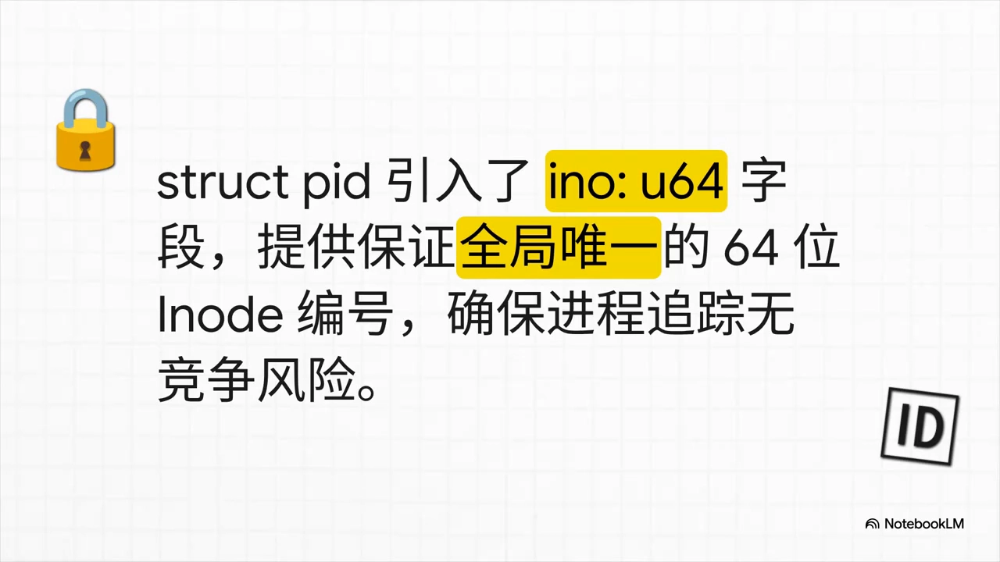

# Linux进程PID命名空间和架构

> 视频源：[Linux进程PID命名空间和架构](https://www.bilibili.com/video/BV1QnGB64ENP/)（B 站 @内核聊内核，9 分 36 秒）。本文基于视频演说图文稿整理，时间戳可跳转到原视频对应位置。

## 本讲要解决的核心问题（SCQA）

**背景**：在容器里执行 `ps`，你的应用进程显示为 PID 1；在宿主机上看同一个进程，它却是一个毫不相干的大数字，比如 PID 34582。

**冲突**：同一个进程不可能同时持有两个"身份证号"。我们在用户空间习惯了 `getpid`、`unshare` 这些系统调用，以为拿到一个 ID 就万事大吉；但实际上，内核为了维持这个"错觉"，在幕后维护着一套极其复杂的层级结构和一套极其精密的 IDR 内存分配机制——表面风平浪静，底层暗流涌动。

**疑问**：内核究竟用什么数据结构，才能让一个物理进程在不同命名空间里拥有不同的 PID，并且还能跨层级精准追踪它？

**回答（中心思想）**：靠三个数据结构的"三位一体"——`task_struct` 只是引路人，`pid_namespace` 划定隔离层级，真正的核心 `struct pid` 用 `numbers[]` 数组为每一层保存一个 UPID，让全局唯一的进程"分身"到每个层级；再配合 IDR 分配、四类 ID 的哈希链表追踪，以及 Linux 6.18 pidfs 的 64 位 `ino` 全局唯一锚点，内核才能既让容器进程"以为自己是 PID 1"，又能在宿主机侧无懈可击地管理一切。

[【跳转到 00:21】](https://www.bilibili.com/video/BV1QnGB64ENP/?t=21)

## 一、嵌套层级：俄罗斯套娃与 32 级上限

PID 命名空间的层级结构好比俄罗斯套娃：从宿主机最顶层的零级——也就是 `init_pid_ns`——开始，一路向下，像树根一样延伸到一个一个嵌套的容器内部。

[【跳转到 01:55】](https://www.bilibili.com/video/BV1QnGB64ENP/?t=115)

那内核允许你无限地嵌下去吗？当然不行。作为严谨的系统，内核明确把这个深度限制死了：**最多 32 级**。系统设计里从来没有免费的午餐——设置这个上限，一方面是防止恶意程序无底线地消耗内存，另一方面是避免内核在遍历这棵树时被巨大的性能开销拖垮。

[【跳转到 02:10】](https://www.bilibili.com/video/BV1QnGB64ENP/?t=130)

那么，这些层级到了内存里究竟长什么样子？这就引出了内核的核心数据结构。

## 二、三大核心数据结构：PID 管理的"三位一体"

这是整个机制的骨架。在内核态，一切的起点可能是我们最眼熟的老朋友 `task_struct`——但真正的主角另有其人。

[【跳转到 02:40】](https://www.bilibili.com/video/BV1QnGB64ENP/?t=160)

### 2.1 task_struct：只是个引路人

`task_struct` 作为基础的进程描述符，里边确实存了基础的 PID 和 TGID。但注意了：**它并不能算是看清整个命名空间全貌的"上帝视角"**。它更像一个引路人——通过里边的 `thread_pid` 这个指针，把我们一步步引向内核视角的真正核心。

[【跳转到 02:51】](https://www.bilibili.com/video/BV1QnGB64ENP/?t=171)

### 2.2 pid_namespace：绝对的隔离边界

顺着指针摸过去，接下来是 `pid_namespace`。这个结构体非常关键，因为它**划定了绝对的隔离边界**。里面记录了：

- 当前的**层级**（level）；
- 指向**父节点**的指针；
- 一个负责给孤儿进程"收尸"的关键任务 `child_reaper`；
- 一个用来分配 PID 的 **IDR 根节点**。

如果是零级的 `init_pid_ns`，它的 `child_reaper` 指向的就是大名鼎鼎的 `init_task`——整个系统的终极定海神针。

[【跳转到 03:16】](https://www.bilibili.com/video/BV1QnGB64ENP/?t=196)

### 2.3 struct pid：numbers[] 数组是"分身术"的秘密

接下来是整个架构里最精妙的设计——真正的 `struct pid` 结构体。它里面有引用计数、有层级记录、有自旋锁，但最最核心的是：**它内置了一个叫 `numbers` 的数组，里面装的都是 upid 结构体**。

[【跳转到 03:41】](https://www.bilibili.com/video/BV1QnGB64ENP/?t=221)

这个数组完美解答了开头的问题：一个唯一的物理进程，正是靠着这个数组持有了好几个"身份"，非常优雅地把自己映射到了不同层级的命名空间里。

[【跳转到 04:06】](https://www.bilibili.com/video/BV1QnGB64ENP/?t=246)

![struct pid 与 numbers[] 数组：一个进程持有多个身份](assets/Linux进程PID命名空间和架构/00246.webp)

## 三、PID 与 UPID：把全局实体"翻译"成每层视角

把 `struct pid` 和 `upid` 的嵌套关联可视化出来，底层的组合魔法就一目了然了。

[【跳转到 04:31】](https://www.bilibili.com/video/BV1QnGB64ENP/?t=271)

同一个进程，在零级宿主机环境里 PID 是 34582，它的 UPID 结构体老老实实地记录了这一点；可是当你把它切换到一级容器环境里，它摇身一变，数字就变成了 1。这里的 UPID 结构体，简直就像一个个精准的**翻译官**：把那个全局唯一的核心实体，无缝翻译成每个层级里局部的、特定上下文的 PID 数字。

[【跳转到 04:43】](https://www.bilibili.com/video/BV1QnGB64ENP/?t=283)

## 四、跨命名空间的进程追踪

内核的工作显然不可能只是死记硬背几个 ID。更复杂的活儿是**跨命名空间的进程追踪**。

[【跳转到 05:13】](https://www.bilibili.com/video/BV1QnGB64ENP/?t=313)

### 4.1 tasks[]：四条哈希链表

当内核在处理进程组或者会话的时候，控制精度要求是极高的。在 `struct pid` 里有一个专门的 `tasks` 哈希链表数组，大小是 4，分别对应：

1. **进程 ID**（PID）；
2. **线程组 ID**（TGID）；
3. **进程组 ID**（PGID）；
4. **会话 ID**（SID）。

有了这四个分类，内核就能确保：哪怕你跨越了好几个命名空间，各种信号投递或者状态变更，都能无比精准地路由到目标进程头上。

[【跳转到 05:26】](https://www.bilibili.com/video/BV1QnGB64ENP/?t=326)

### 4.2 pid_nr 与 pid_vnr：看人下菜碟

那如果是系统本身需要去查询这些 ID 呢？内核准备了两个非常聪明的函数：`pid_nr` 和 `pid_vnr`——一个用来抓取全局 PID，一个用来提取虚拟 PID。

内核查 ID 的时候完全是"看人下菜碟"的：它会根据**现在是谁在问**——也就是当前的命名空间上下文——自动提取并转换出完全正确、符合你当前视角的那个 ID 数值。

[【跳转到 05:56】](https://www.bilibili.com/video/BV1QnGB64ENP/?t=356)

## 五、动态视角：容器启动的生命周期数据流

静态的数据结构摸得差不多了，跑点动态的：启动一个全新的容器时，内核底层的数据流是怎么跑起来的？这是一套严丝合缝的、C 语言级别的流水线操作。

[【跳转到 06:28】](https://www.bilibili.com/video/BV1QnGB64ENP/?t=388)

1. 首先，用户空间调用 `unshare` 请求隔离；
2. 内核接到指令，立马调用 `alloc_pid`，在内存里划出一块核心的 `struct pid`；
3. 紧接着在 IDR 树里给**每一个层级**都分配好属于它的数字 ID；
4. 最后一步也是最关键的一步：`attach_pid` 登场，把刚刚建好的这些结构死死地铆回 `task_struct` 身上。

砰！任务、PID、UPID 瞬间紧密交织，一个全新的容器进程空间就这样诞生了，非常干脆利落。

[【跳转到 06:43】](https://www.bilibili.com/video/BV1QnGB64ENP/?t=403)

## 六、Linux 6.18 pidfs：终结 PID 复用的竞争条件

随着云原生规模的爆发式增长，旧的机制肯定不够用了。搞并发的工程师肯定都懂那种痛：

[【跳转到 07:23】](https://www.bilibili.com/video/BV1QnGB64ENP/?t=443)

**传统的 PID 是个整数，它会循环复用**。这就导致了非常棘手的竞争条件（race condition）漏洞：你发信号过去，原来的进程死了，PID 被一个新进程复用了，结果信号发错了人——简直是灾难。

但在 Linux 6.18 里，pidfs 彻底革新了这一点：

- 它直接把 PID 映射成了**稳定的文件描述符**，底层还有专门的目录项缓存（dentry cache）做支撑。这么一来，发信号稳如老狗，直接从根本上拔除了 PID 复用这个历史遗留毒瘤；
- 秘密在于：现代的 `struct pid` 里多了一个极其关键的新成员——一个 **64 位的 `ino` 字段**。这个 64 位数字保证了全局绝对唯一，像一块坚不可摧的压舱石，成了 pidfs 里不可变的锚点。

只要认准了这个数字，内核追踪容器进程就变得无懈可击，彻底告别了竞争风险。

[【跳转到 07:40】](https://www.bilibili.com/video/BV1QnGB64ENP/?t=460)

[【跳转到 08:23】](https://www.bilibili.com/video/BV1QnGB64ENP/?t=503)

## 七、留给你的挑战题

结束之前，视频留了一道烧脑题：如果在极其庞大的 Kubernetes 集群里，你把 `pid_max` 参数拉满、拉到 40 多万的极值，同时把嵌套层级也拉满到 32 层——那么这颗错综复杂的 IDR 树，在底层究竟会吃掉多少隐形的内存开销？

理解了本文拆解的数据流（层级结构、`struct pid`/`upid`、IDR 分配），你已经有足够的理论武器去计算它。

[【跳转到 08:53】](https://www.bilibili.com/video/BV1QnGB64ENP/?t=533)

## 小结

- 容器里的 PID 1 与宿主机上的 PID 34582 是同一个进程的两个视角，这正是 PID 命名空间的"错觉"；
- 嵌套层级从零级 `init_pid_ns` 出发，像俄罗斯套娃一样深入容器，深度上限 32 级，防止内存与遍历开销失控；
- `task_struct` 通过 `thread_pid` 指针指向真正的核心 `struct pid`；`pid_namespace` 记录层级、父指针、`child_reaper` 与 IDR 根；
- `struct pid` 的 `numbers[]` 数组为每一层保存一个 upid——这是"一个进程多个身份"的实现机制；
- `tasks[]` 四条哈希链表（PID/TGID/PGID/SID）保证跨命名空间的信号投递与状态变更精准路由；`pid_nr`/`pid_vnr` 按提问者所在命名空间返回正确数值；
- 容器启动 = `unshare` → `alloc_pid` → 每层分配数字 → `attach_pid` 铆回 `task_struct`；
- Linux 6.18 的 pidfs 把 PID 映射为稳定文件描述符，`struct pid` 新增 64 位 `ino` 全局唯一锚点，根治 PID 复用竞争条件。

## 关键术语速查

| 术语 | 一句话解释 |
| --- | --- |
| PID 命名空间 | 给一组进程一个私有的进程 ID 视图，是容器进程隔离的内核基础 |
| `init_pid_ns` | 零级（宿主机）PID 命名空间，所有嵌套层级的树根 |
| `task_struct` | 进程描述符，存基础 PID/TGID，经 `thread_pid` 指针指向 `struct pid` |
| `pid_namespace` | 划定隔离边界：记录层级、父指针、`child_reaper`、IDR 根节点 |
| `child_reaper` | 命名空间内负责回收孤儿进程的角色，零级指向 `init_task` |
| `struct pid` | 内核视角的进程 ID 实体，内含 `numbers[]` 数组（每层一个 upid） |
| `upid` | "翻译官"：把全局唯一的进程实体翻译成某一层命名空间里的局部 PID |
| IDR | 内核的基数树式 ID 分配机制，用于分配各层级的数字 ID |
| `pid_nr` / `pid_vnr` | 取全局 PID / 按当前命名空间取虚拟 PID 的内核函数 |
| `unshare` | 用户空间请求新隔离环境的系统调用，触发整套分配流水线 |
| `alloc_pid` / `attach_pid` | 分配 `struct pid` 与各层数字、并把它铆回 `task_struct` 的内核步骤 |
| pidfs | Linux 6.18 引入：把 PID 映射为稳定文件描述符，以 64 位 `ino` 根治 PID 复用竞争 |
