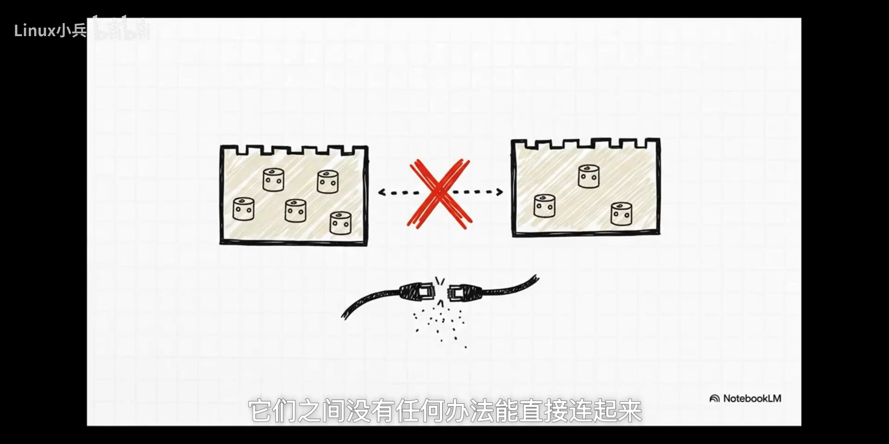
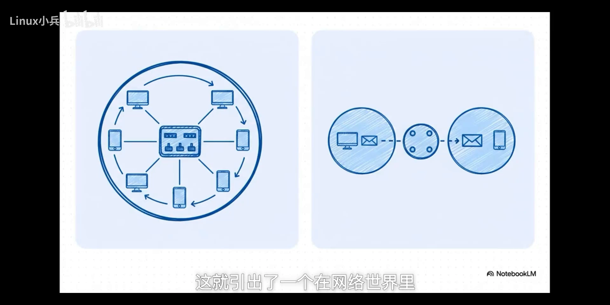

# Linux 网络命名空间概述：不是虚拟化，而是把物理网络在内核里重建一遍

> 源视频：[Linux网络命名空间核心 | 虚拟网线、虚拟交换机、虚拟路由器（实际标题：Linux网络命名空间概述）](https://www.bilibili.com/video/BV19pfjBmEP1/)（B站，Up 主：DeeparchWorks，时长 8:16）

## 本讲要解决的核心问题（SCQA）

**背景**：容器隔离的基石是命名空间，其中网络命名空间（network namespace，下称 netns）负责给每个容器一套独立的网络视图。

**冲突**：这里藏着一个看似矛盾的悖论——netns 被设计出来的初衷就是**隔离**（建一堵墙），可我们建好墙之后，第一件事却是想办法在墙上打个洞，让容器和外界通信；而承担"打洞"任务的 veth pair，恰恰是**跨越命名空间边界**存在的。隔离的设计里为什么长出一个专门"破隔离"的组件？

**疑问**：veth pair 到底是巧妙的功能，还是隔离模型里的一个 bug？

**回答（中心思想）**：Linux 的网络设计不是我们通常理解的"虚拟化"，而是一种**重构**——内核用软件把熟悉的物理网络（主机、网卡、网线、交换机、路由器）在内核里重新搭建了一遍。理解了三块积木和一条铁律，"隔离却要打洞"的悖论自然消解：veth pair 不是缺陷，而是深思熟虑后的必然设计。

[【跳转到 00:16】](https://www.bilibili.com/video/BV19pfjBmEP1/?t=16)

## 一、先认识内核给的两块积木

要解开谜题，得先返璞归真，看看内核到底给了我们哪些最基本的积木。

### 1.1 积木一：网络命名空间（struct net）

在内核里，网络命名空间对应的数据结构叫 `struct net`。理解它最好的方式，是把它想象成一个**独立的网络世界**：在这个世界里，你有自己独立的路由表、防火墙规则、网络设备，一切都是独立的。

但关键点来了——它**不是一个独立的内核，更不是一台微型虚拟机**，它只是同一个系统里的一个不同视角而已。[【跳转到 01:34】](https://www.bilibili.com/video/BV19pfjBmEP1/?t=94)

### 1.2 积木二：net device 与那条铁律

第二个积木叫 **net device**。这个概念很重要：在内核的世界里，不管是什么，只要它能收发数据包，它就是一个 net device——你的物理网卡是它，无线网卡是它，后面要讲的虚拟 veth 接口，还是它。它是内核对**所有网络接口的通用抽象**。[【跳转到 02:06】](https://www.bilibili.com/video/BV19pfjBmEP1/?t=126)

现在最关键的规则来了，一条**不可打破的铁律**：每一个 net device，必须、也只能属于**一个**网络命名空间，没得商量。

这其实很好理解，做个类比就明白了：物理世界里，一块网卡能同时插在两台电脑上吗？不能。内核里的逻辑和现实世界是完全一样的。[【跳转到 02:31】](https://www.bilibili.com/video/BV19pfjBmEP1/?t=151)

## 二、反证法：veth pair 跨越边界是必然设计，不是 bug

了解了基本规则，我们做一个思想实验，用经典的**反证法**来验证开头那个"看似矛盾"的设计是否必不可少。大胆假设：[【跳转到 02:53】](https://www.bilibili.com/video/BV19pfjBmEP1/?t=173)

> 如果——veth pair 必须严格遵守命名空间的边界，它的两端绝对不能被放到不同的命名空间里，会发生什么？

结果对我们今天的整个 IT 基础设施来说简直就是一场灾难：

- 两个独立的 netns 就真的成了**孤岛**，彼此没有任何办法直接连起来；
- 我们今天所说的**容器间网络**直接没法实现；
- 更根本的是，内核连模拟一个现实世界里最简单的东西——**一根网线**——的能力都失去了。[【跳转到 03:11】](https://www.bilibili.com/video/BV19pfjBmEP1/?t=191)

所以结论是：veth 能够跨越命名空间边界的能力，根本不是什么设计缺陷或漏洞，而是一个**经过深思熟虑的、不可或缺的、必然的设计**。[【跳转到 03:36】](https://www.bilibili.com/video/BV19pfjBmEP1/?t=216)

## 三、核心理念：用软件重构物理网络

看这张对照表，它揭示了 Linux 网络设计的核心：

| 物理世界 | 内核里的软件实现 |
| --- | --- |
| 一台电脑 | 一个 netns |
| 一块网卡 | 一个 net device |
| 一根网线 | 一根 veth pair |
| 一台二层交换机 | 一个 bridge 设备（比如我们熟悉的 `docker0`） |

物理世界的所有组件，在内核里都有对应的软件实现。所以 Linux 并没有发明一种全新的网络——它更像是一种**重构**：把我们熟悉的物理网络世界，在内核里用代码重新搭建了一遍。[【跳转到 04:11】](https://www.bilibili.com/video/BV19pfjBmEP1/?t=251)

## 四、跟着一个数据包走一遍（SKB 之旅）

这个模型到底对不对？实际检验一下：追踪一个数据包——在内核里它叫 **SKB（socket buffer）**——看它从一个容器出发到另一个容器，中间经历了什么。[【跳转到 04:49】](https://www.bilibili.com/video/BV19pfjBmEP1/?t=289)

1. 容器 A 的 netns 里，一个应用发出数据包（SKB），包首先到达容器 A 的虚拟网卡，也就是 veth pair 的一端；
2. 神奇的事情发生了：包**瞬间穿过这根虚拟网线**，出现在另一端——主机的 netns 里；
3. 为什么能做到几乎零成本？因为在内核里，这两个 net device 通过一个**指针**互相连接，数据包的传递就是一次内存操作；[【跳转到 05:32】](https://www.bilibili.com/video/BV19pfjBmEP1/?t=332)
4. 包到了主机，接收它的是 bridge（那台软件交换机）：交换机查看包的**目标 MAC 地址**，把它从正确的端口发出去，而这个端口正好连着通往容器 B 的那根虚拟网线；
5. 就这样，SKB 最终抵达容器 B 的 netns。整个过程**完美复刻了物理世界**。

## 五、二层与三层：交换机管同网段，路由管跨网络

数据包旅程还引出了一个网络世界里至关重要的区别——二层和三层，内核也严格遵守：

- **bridge 是二层设备**，像个交换机，工作就是连接**同一个子网**里的设备，它只关心 MAC 地址；
- 如果要连接**不同的网络**——比如从一个节点上的容器网络连到另一个节点上的容器网络——光靠 bridge 就不行了，这时候需要**三层**功能上场：路由、IP forwarding，它关心的是 IP 地址。

二层和三层各司其职，和物理世界里的交换机、路由器分工一模一样。[【跳转到 06:10】](https://www.bilibili.com/video/BV19pfjBmEP1/?t=370)

## 小结

顺着"从一个悖论出发，到追踪一个数据包的旅程"这条逻辑链，可以总结出 Linux 网络栈背后真正的架构思想，这几条是整个设计的基石：[【跳转到 06:59】](https://www.bilibili.com/video/BV19pfjBmEP1/?t=419)

- **netns 隔离的是网络的"视图"，而不是物理资源**——它只是同一内核的不同视角，不是微虚拟机；
- **veth pair 不是黑科技**，它就是内核对一根点对点物理网线最纯粹的软件抽象，能跨越命名空间边界是必然设计；
- **二层的 bridge 与三层的路由职责泾渭分明**，就像物理世界里的交换机和路由器；
- 一句话总结：**Linux 没有发明全新的网络，只是把物理网络的全部组件（主机、网卡、网线、交换机、路由器）搬进内核，用代码重新实现了一遍**。[【跳转到 07:29】](https://www.bilibili.com/video/BV19pfjBmEP1/?t=449)
- 留下的开放问题：既然这些积木都变成了内核里可随意组合的软件，你还能搭出怎样复杂强大的网络拓扑？[【跳转到 07:48】](https://www.bilibili.com/video/BV19pfjBmEP1/?t=468)

## 关键术语速查

| 术语 | 一句话解释 |
| --- | --- |
| netns（struct net） | 网络命名空间；一套独立的路由表/防火墙规则/设备视图，不是独立内核 |
| net device | 内核对所有能收发包的接口的通用抽象（物理网卡、veth 等都算） |
| veth pair | 虚拟以太网设备对，相当于一根虚拟网线，两端可分属不同 netns |
| bridge | 内核软件二层交换机，按 MAC 地址在同子网内转发（如 docker0） |
| SKB（socket buffer） | 数据包在内核里的表示形式 |
| 路由 / IP forwarding | 三层功能，依据 IP 地址在不同网络间转发 |
