# 网络命名空间动手课：隔离是起点，连通才是难点

> 源视频：[Network Namespaces Basics Explained in 15 Minutes](https://www.youtube.com/watch?v=j_UUnlVC2Ss)（YouTube，时长 15:31）

## 本讲要解决的核心问题（SCQA）

**背景**：容器（如 Docker）用 Linux 命名空间实现与宿主机、与其他容器之间的隔离；网络命名空间（network namespace，下称 netns）负责隔离"网络视图"。

**冲突**：可是一旦隔离，麻烦跟着就来——新创建的命名空间里看不到宿主机的网卡、路由表、ARP 表，命名空间之间彼此不通，更访问不了外网；反过来，外网也进不来。

**疑问**：如何一步步让隔离的命名空间互相连通、安全出网，又能被外界定向访问？

**回答（中心思想）**：沿着"创建与观察 → veth 直连 → bridge 组网 → 宿主机当网关 → NAT 出网 → 端口转发入网"这条路径，每个连通性问题在 netns 模型里都有对应的解法；学完后你还能在动手实验环境里完成一组实战练习。

[【跳转到 00:00】](https://www.youtube.com/watch?v=j_UUnlVC2Ss&t=0)

## 一、网络命名空间到底隔离了什么

### 1.1 房子与房间：命名空间的心智模型

如果你的宿主机是一栋房子，命名空间就是分给每个孩子的**房间**：每个孩子只能看到自己房间里的东西，看不到房间外发生的事；就他自己的感觉而言，他是这栋房子里唯一的人。但作为家长（宿主机/管理员），你可以看到所有房间，愿意的话还可以在两个房间之间打通连接。[【跳转到 00:40】](https://www.youtube.com/watch?v=j_UUnlVC2Ss&t=40)

### 1.2 先看进程侧：同一个进程，两个 PID

创建容器时要保证它隔离——看不到宿主机上的其他进程或其他容器，所以用命名空间为它造一个专属房间。对容器而言，它只看到自己跑的进程，以为自己独占一台主机；而宿主机能看到**所有**进程，包括容器里的。

验证方法：在容器里列进程，只能看到一个 PID 为 1 的进程；用 root 在宿主机上列同样的进程，能看到全部进程——包括容器里那个，只是 PID 不同。**同一个进程，在容器内外是不同的 PID**，这就是命名空间的工作方式。[【跳转到 01:30】](https://www.youtube.com/watch?v=j_UUnlVC2Ss&t=90)

### 1.3 网络侧：接口、路由表、ARP 表都被封进房间

到网络这一侧：宿主机有自己的网卡接口连着局域网，有自己的路由表和 ARP 表记录着去往其余网络的路径。这些细节我们都要对容器"封存"：容器创建时为它创建一个网络命名空间，它就看不到宿主机上任何网络信息；在自己的命名空间里，容器可以有**自己的虚拟接口、路由表和 ARP 表**。[【跳转到 02:15】](https://www.youtube.com/watch?v=j_UUnlVC2Ss&t=135)

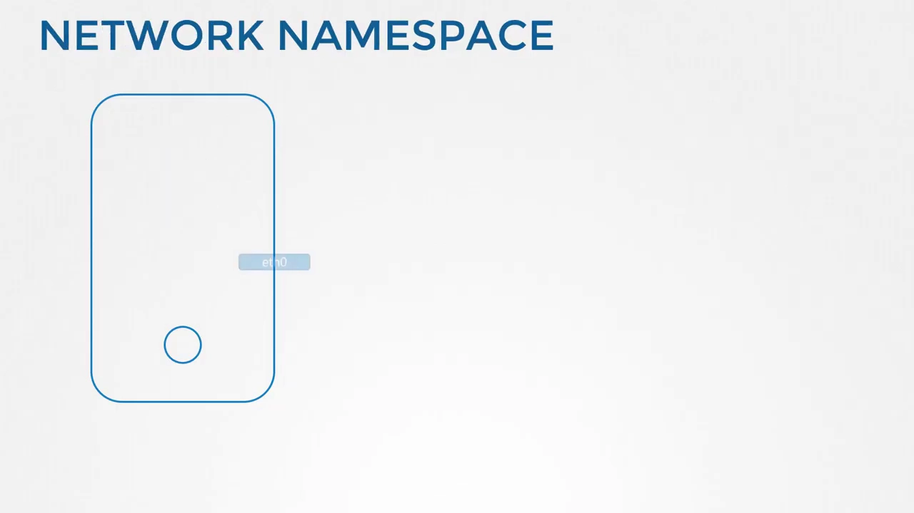

## 二、创建与观察：ip netns 三板斧

### 2.1 创建与列举

在 Linux 主机上创建新的网络命名空间，用 `ip netns add` 命令——这里创建两个（red 和 blue）；列出命名空间用 `ip netns`：[【跳转到 02:40】](https://www.youtube.com/watch?v=j_UUnlVC2Ss&t=160)

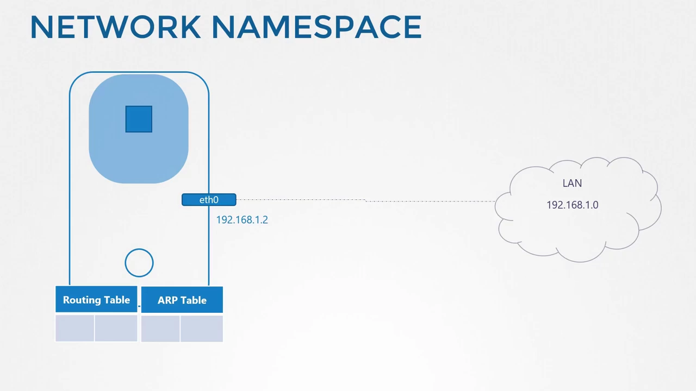

### 2.2 进去执行命令：ip netns exec

在宿主机上执行 `ip link` 能看到 loopback 和 eth0 接口。那如何在命名空间里执行同样的命令？在命令前加 `ip netns exec`，后跟命名空间名（如 red），命令就在 red 命名空间内执行。另一种写法是给原命令加 `-n` 选项（如 `ip -n red link`），两者等价——但注意 `-n` 只适用于 ip 命令本身。[【跳转到 03:11】](https://www.youtube.com/watch?v=j_UUnlVC2Ss&t=191)

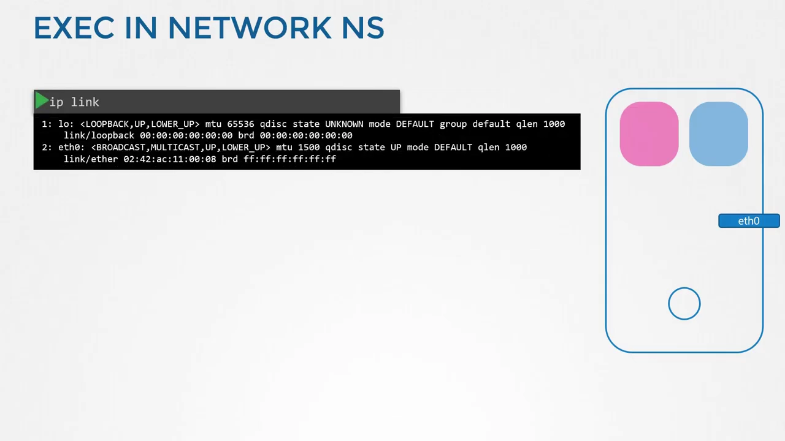

### 2.3 隔离的验证

在命名空间里执行 `ip link`，只能看到 loopback 接口，看不到宿主机的 eth0——用命名空间成功阻止了容器看到宿主机接口。ARP 表同理：宿主机上 `arp` 有一串条目，容器里执行则一条都没有；路由表也一样。[【跳转到 03:36】](https://www.youtube.com/watch?v=j_UUnlVC2Ss&t=216)

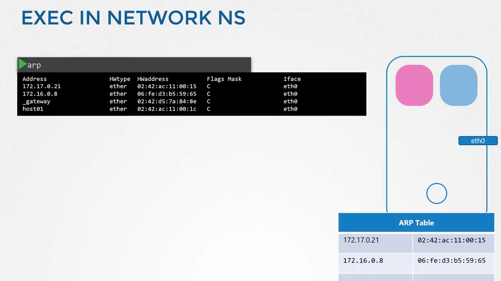

## 三、两两直连：veth pair 就是一根虚拟网线

### 3.1 创建网线

此刻两个命名空间毫无网络连通性：没有自己的接口，也看不到宿主机网络。先解决两个命名空间**彼此直连**的问题。

就像用一根网线连接两台物理机器的以太网口一样，可以用**虚拟以太网对（veth pair）**连接两个命名空间——它常被称作 pipe，这里更愿意叫它一根**两端各有一个接口的虚拟网线**。创建命令：`ip link add`，type 设为 veth，并指定两端的名字 veth-red 和 veth-blue。[【跳转到 04:37】](https://www.youtube.com/watch?v=j_UUnlVC2Ss&t=277)

### 3.2 一端塞进命名空间，配 IP 并拉起

下一步把每个接口接到对应的命名空间：`ip link set veth-red netns red`，blue 端同理。然后用惯常的 `ip addr` 命令（在命名空间内）给两端分配 IP：red 得到 192.168.15.1，blue 得到 192.168.15.2；再用 `ip link set ... up` 把各自命名空间里的设备拉起来。[【跳转到 04:58】](https://www.youtube.com/watch?v=j_UUnlVC2Ss&t=298)

### 3.3 互通验证与 ARP

链路起来后，两个命名空间就能互相访问了。从 red 里 ping blue 的 IP，能通。此时看 red 的 ARP 表，里面记录了它的邻居 blue（192.168.15.2）的 MAC 地址；blue 的 ARP 表里也记着 red 这个邻居。[【跳转到 05:34】](https://www.youtube.com/watch?v=j_UUnlVC2Ss&t=334)

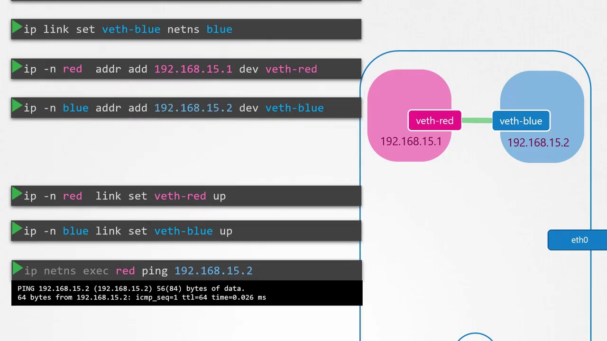

但对比宿主机的 ARP 表会发现：宿主机对我们新建的命名空间、以及命名空间里创建的接口**一无所知**。[【跳转到 05:51】](https://www.youtube.com/watch?v=j_UUnlVC2Ss&t=351)

两个命名空间时这样直连没问题，命名空间一多怎么办？如何让它们全都互相通信？

## 四、多命名空间组网：需要一台虚拟交换机

### 4.1 虚拟交换机与 Linux Bridge

和物理世界一样：要组一个网络，就需要一台交换机；虚拟网络自然需要**虚拟交换机**——在宿主机里创建一台，把命名空间都接上去。虚拟交换机有多种方案：原生的 **Linux Bridge**、Open vSwitch 等，本例用 Linux Bridge。[【跳转到 06:12】](https://www.youtube.com/watch?v=j_UUnlVC2Ss&t=372)

### 4.2 创建 bridge：v-net-0

用 `ip link add` 命令、type 设为 bridge，在宿主机上新增一个接口，命名为 **v-net-0**。对宿主机来说它只是又一个接口（和 eth0 一样出现在 `ip link` 输出里），目前是 down 状态，用 `ip link set dev v-net-0 up` 拉起。而对命名空间来说，这个接口就像一台**可以接入的交换机**——一物两用：对主机是接口，对命名空间是交换机。[【跳转到 06:37】](https://www.youtube.com/watch?v=j_UUnlVC2Ss&t=397)

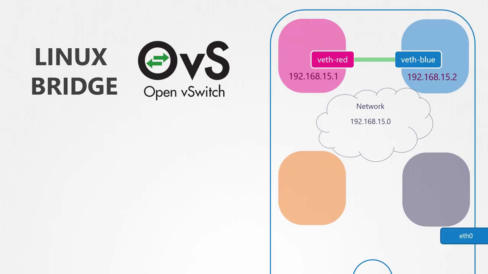

### 4.3 换线重连

既然所有命名空间都要接到 bridge 网络，原来那根直连网线就没用了：用 `ip link delete` 删掉——删除 veth 的一端，另一端会自动消失（因为它们是一对）。然后为每个命名空间创建新网线：一端仍叫 veth-red，另一端连 bridge，命名叫 **veth-red-br**（命名约定帮助我们一眼识别接口归属）。[【跳转到 07:28】](https://www.youtube.com/watch?v=j_UUnlVC2Ss&t=448)

把 veth-red 一端接入 red 命名空间（`ip link set veth-red netns red`），另一端接 bridge：对 veth-red-br 执行 `ip link set`，把它的 **master** 指定为 v-net-0。blue 侧照做。[【跳转到 08:18】](https://www.youtube.com/watch?v=j_UUnlVC2Ss&t=498)

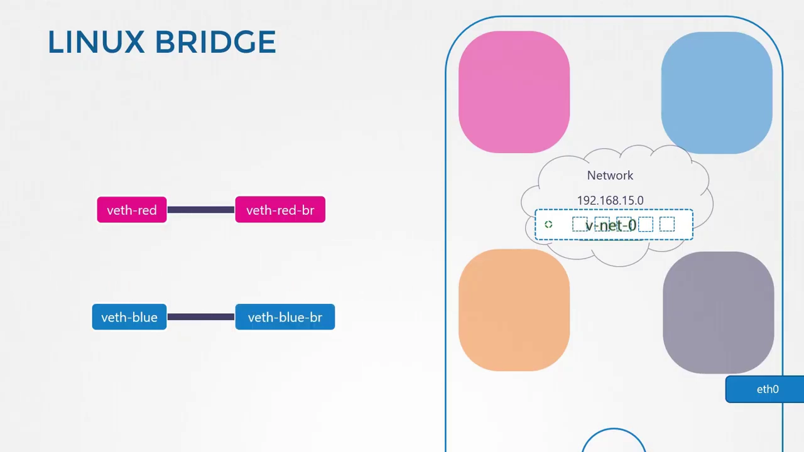

### 4.4 四个命名空间互通

给这些链路配上与之前相同的 IP（192.168.15.1 与 .2）并拉起设备，容器间恢复互通。用同样的步骤把另外两个命名空间也接进来：现在四个命名空间全部挂在内网 bridge 上，IP 分别是 192.168.15.1、2、3、4，彼此都能通信。[【跳转到 08:51】](https://www.youtube.com/watch?v=j_UUnlVC2Ss&t=531)

## 五、走出家门：宿主机当网关

### 5.1 给 v-net-0 配 IP，让主机加入私有网

宿主机自己的 IP 是 192.168.1.2（外部网络），命名空间在另一个网段，宿主机直接 ping 命名空间里的接口是通不了的。怎么办？别忘了 bridge 对宿主机来说就是一个接口，而我们说过 v-net-0 接在 192.168.15 这个网段上——只要给它分配一个 IP，宿主机就能通过它访问命名空间。执行 `ip addr` 给 v-net-0 配上 192.168.15.5，宿主机现在可以 ping 通 red 了。[【跳转到 09:21】](https://www.youtube.com/watch?v=j_UUnlVC2Ss&t=561)

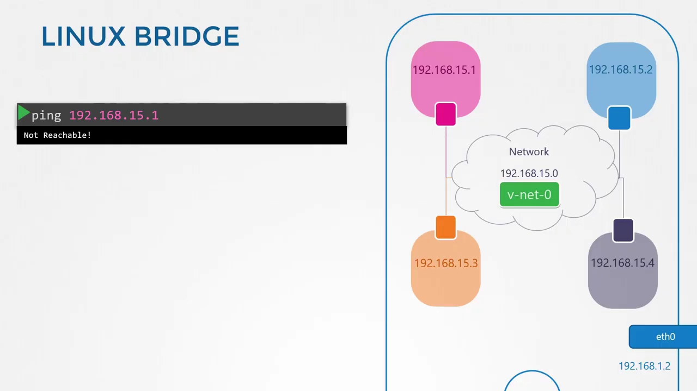

但要记住：这整张网络仍然是**私有且被限制在宿主机内**的。命名空间出不去，外面的世界也进不来——通往外界的唯一大门是宿主机上的以太网口。如何配置，才能让 bridge 网络穿过这道门到达局域网（LAN）？[【跳转到 10:08】](https://www.youtube.com/watch?v=j_UUnlVC2Ss&t=608)

### 5.2 加默认路由：网关必须在本网段可达

假设局域网上还有另一台主机，地址 192.168.1.3。从 blue 命名空间里 ping 它会怎样？blue 发现目标在 192.168.1 网段，与自己所在的 192.168.15 不同，于是查路由表找路径——路由表里没有其他网络的信息，返回 **network unreachable**。[【跳转到 10:40】](https://www.youtube.com/watch?v=j_UUnlVC2Ss&t=640)

所以要在路由表里加一条条目，为外部世界提供一个**网关（gateway）**。网关是什么？是本地网络上**连接着另一个网络**的系统。哪个系统既有一个接口在 blue 所在的 192.168.15 网络、又连着外部 LAN？逻辑视图一看便知——正是这些命名空间所在的**本地宿主机**：它有接口接入私有网（所以能 ping 通各命名空间），就是连接两个网络的网关。[【跳转到 11:02】](https://www.youtube.com/watch?v=j_UUnlVC2Ss&t=662)

于是在 blue 命名空间加路由：凡去往 192.168.1 网段的流量，都经过 192.168.15.5 这个网关。注意宿主机有两个 IP（私有网 192.168.15.5 和外部网 192.168.1.2），路由里能不能随便用？不能——**网关必须从你的命名空间可达**，blue 只能触达它本地网络里的 192.168.15.5。[【跳转到 11:53】](https://www.youtube.com/watch?v=j_UUnlVC2Ss&t=713)

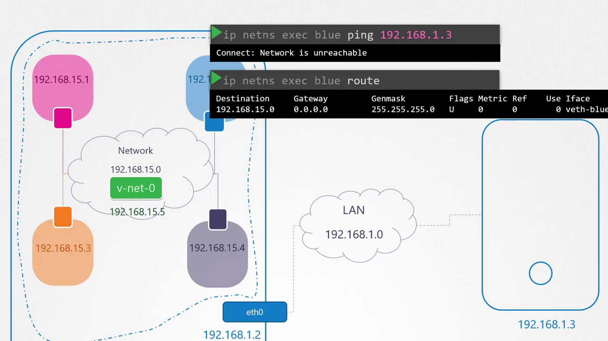

### 5.3 还是 ping 不通：该 NAT 上场了

加了路由再 ping，"network unreachable"没了，但依然**收不到任何回应**。问题在哪？之前讲过的类似场景：家庭网络通过路由器访问外部互联网——家里用的是外部网络不认识的私有 IP，目的网络无法把回应送回来。解决之道是在充当网关的宿主机上启用 **NAT**：让宿主机**用自己的名字、自己的地址**把消息发往局域网。[【跳转到 12:27】](https://www.youtube.com/watch?v=j_UUnlVC2Ss&t=747)

具体用 iptables 实现：在 NAT 表的 **POSTROUTING** 链加一条规则，对来自源网络 192.168.15.0 的所有包做 **MASQUERADE**（伪装）——把源地址替换成宿主机自己的 IP。这样外界收到包，会以为它们来自宿主机，而不是命名空间内部。再 ping，就能到达外部世界了。[【跳转到 12:58】](https://www.youtube.com/watch?v=j_UUnlVC2Ss&t=778)

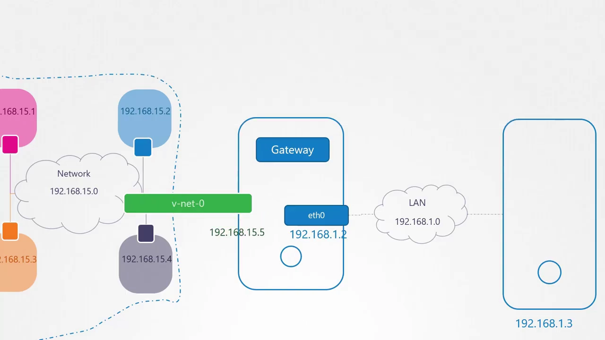

### 5.4 默认路由指向主机：互联网可达

最后假设 LAN 已连上互联网，命名空间也想上网。从 blue ping 互联网上的某台服务器，又见到熟悉的 "network unreachable"——现在我们已经知道原因：查路由表，只有去往 192.168.1 的路由，别的都没有。既然命名空间能到达主机能到达的任何网络，那就简单了：去任何外部网络都"问主机"。加一条**默认网关**指向宿主机，命名空间从此可以到达外部世界。[【跳转到 13:48】](https://www.youtube.com/watch?v=j_UUnlVC2Ss&t=828)

## 六、从外面进来：端口转发

反过来，命名空间里的服务如何被外界访问？比如 blue 在 80 端口跑着一个 Web 应用。目前命名空间在内部私有网络上，外界无人知晓，只有宿主机自己能访问它们；从另一个网络的主机去 ping blue 的私有 IP，显然不通——那台主机根本不知道这个私有网络的存在。[【跳转到 14:11】](https://www.youtube.com/watch?v=j_UUnlVC2Ss&t=851)

要打通"外进"有两条路（之前课程都见过）：

1. **把私有网络的身份告诉对端**：在对端主机上加一条 IP 路由，声明 192.168.15 网段可经由 192.168.1.2 到达——但我们不想这么做（要动别人的主机）；
2. **端口转发**：用 iptables 加一条转发规则——凡是到达本机 80 端口的流量，一律转发给 blue 命名空间 IP 的 80 端口。[【跳转到 14:50】](https://www.youtube.com/watch?v=j_UUnlVC2Ss&t=890)

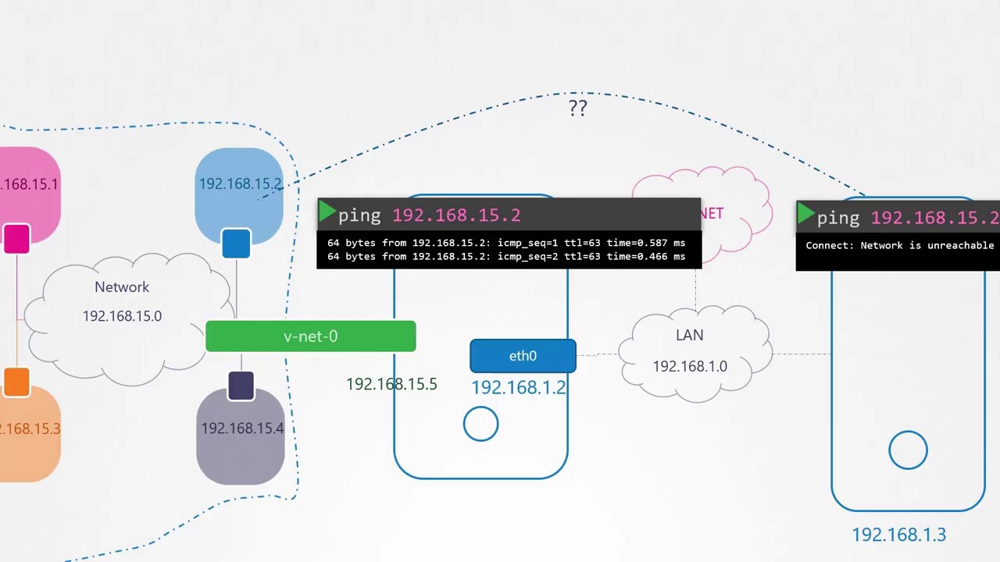

本节内容到此结束——接下来到练习实验室（practice labs）里完成一组网络命名空间的挑战题，把学到的内容动手练一遍。

## 小结

- **netns 隔离的是网络视图**：接口、路由表、ARP 表都封在"房间"里；`ip netns add` 创建、`ip netns exec`（或 `ip -n`）进入执行；
- **两个命名空间直连用 veth pair**：`ip link add type veth` 造线、`ip link set ... netns` 塞线、`ip addr` 配 IP、`ip link set up` 拉起，ARP 表各记各的邻居，宿主机一无所知；
- **多命名空间组网用虚拟交换机**：Linux Bridge（v-net-0）一物两用——对宿主机是接口、对命名空间是交换机，veth 一端以 `master` 挂到 bridge；
- **出网靠宿主机当网关**：给 v-net-0 配私有网 IP，命名空间加默认路由（网关必须本地可达），宿主机用 iptables POSTROUTING MASQUERADE 做 NAT，再配默认路由即可上互联网；
- **入网靠端口转发**：外部主机不知道私有网，最佳方案是在宿主机上用 iptables 把 80 端口流量转发给命名空间内的服务，而不是要求对端加路由。

## 关键术语速查

| 术语 | 一句话解释 |
| --- | --- |
| network namespace | 网络命名空间；隔离接口、路由表、ARP 表等网络视图的"房间" |
| ip netns | 管理网络命名空间的 iproute2 子命令（add/list/exec/-n） |
| veth pair | 虚拟以太网对，一根两端各带接口的"虚拟网线"，可跨命名空间 |
| Linux Bridge | 内核原生虚拟交换机；对宿主机是接口，对命名空间是交换机 |
| master | 把接口（如 veth-red-br）挂到 bridge 下的指定方式 |
| gateway / 默认网关 | 本网段内连接其他网络的系统；必须从本命名空间可达 |
| NAT / MASQUERADE | 在 POSTROUTING 链把私有源地址替换为宿主机地址，让回应能送回 |
| 端口转发（DNAT） | 把到达宿主机某端口的流量转发给命名空间内服务的端口 |
