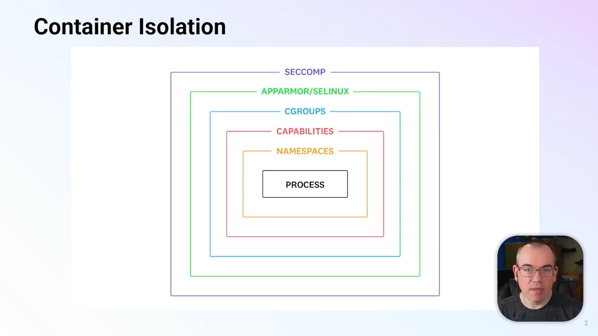
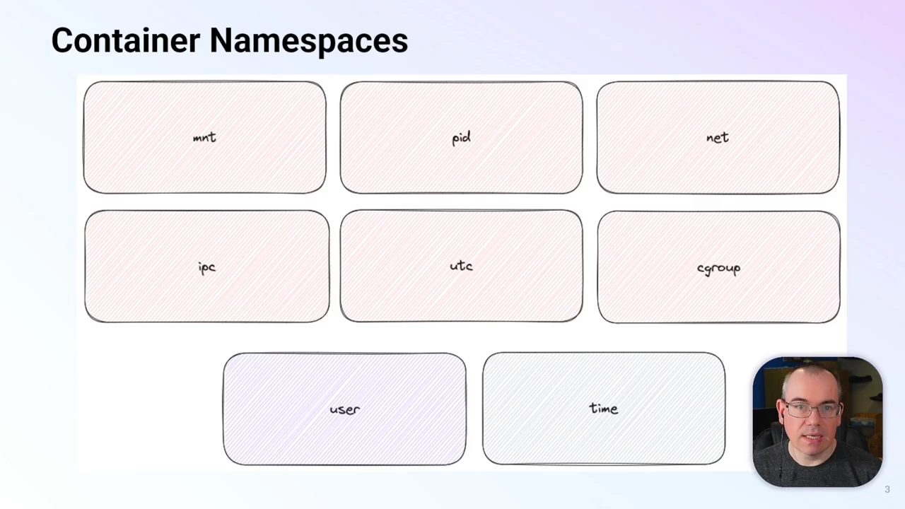
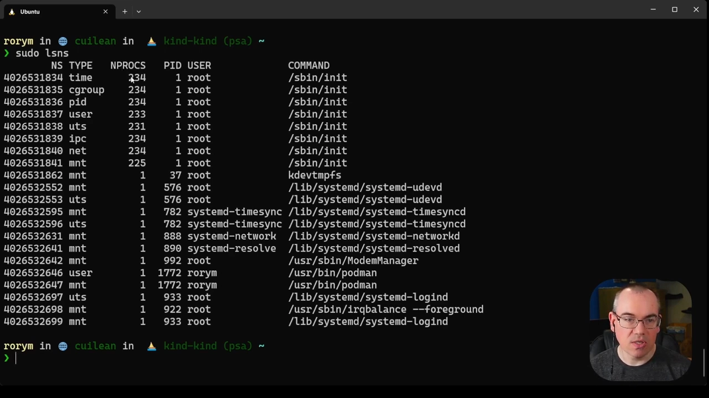
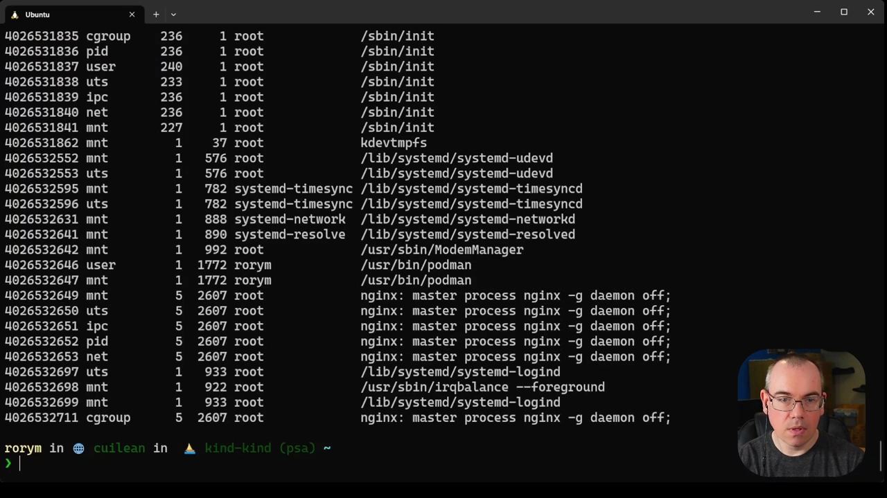
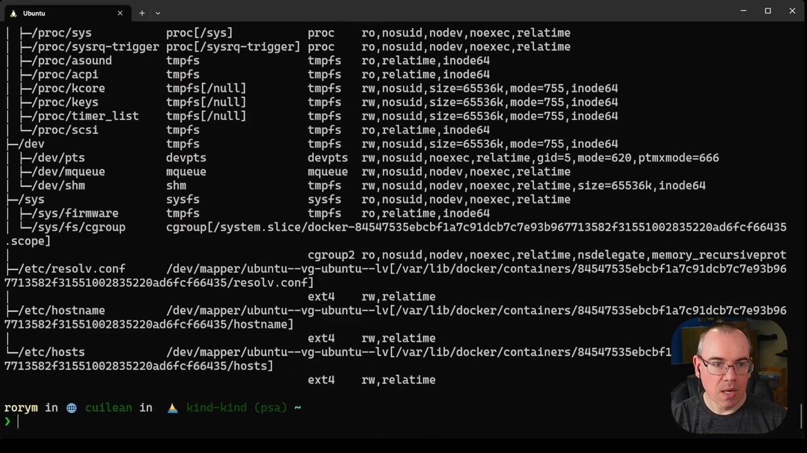
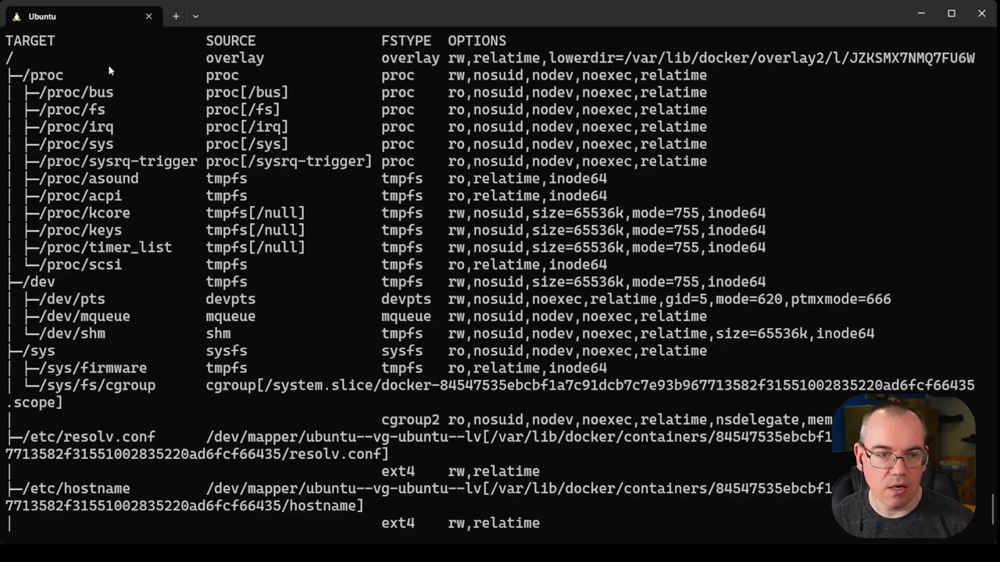
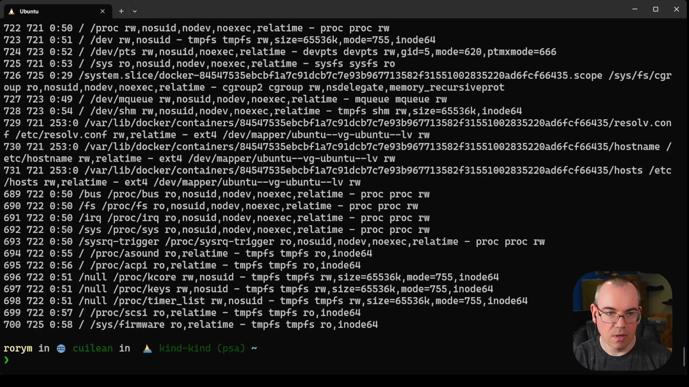
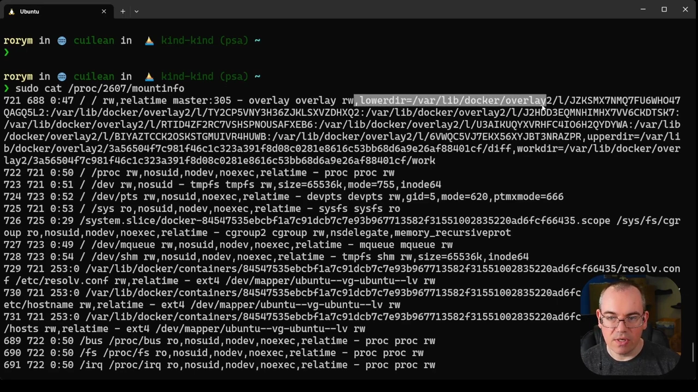

# Container Security Fundamentals — Linux Namespaces (Part 1): The Mount Namespace

> 视频源：[Container Security Fundamentals - Linux Namespaces (Part 1): The Mount Namespace](https://www.youtube.com/watch?v=BwI89OnYm-4)（YouTube，8 分 23 秒，Datadog《容器安全基础》系列）。这一集是系列命名空间专题的上篇，聚焦 **Mount（挂载）命名空间**：它如何隔离文件系统视图，以及如何用标准 Linux 工具观察、进入容器的挂载命名空间。本文基于视频演说图文稿整理，时间戳可跳转到原视频对应位置。

## 本讲要解决的核心问题（SCQA）

**背景**：容器本质上只是 Linux 进程——上一集我们已经看到，容器和普通进程的差别并没有想象中大。

**冲突**：可一旦 `docker run` 启动一个 nginx，它看到的文件系统就和宿主机完全不同：有自己的根目录、自己的 /proc，宿主机上成千上万个文件它"看不见"。这种文件系统层面的隔离，是用什么机制做出来的？

**疑问**：Linux 靠什么给每个容器一份独立的文件系统视图？普通 Linux 工具能不能看到、甚至"进入"这份视图？

**回答（中心思想）**：靠 **Mount（挂载）命名空间**——它给进程一份独立的"挂载点列表"视图。Docker 默认为容器启用 6 种命名空间（MNT、PID、NET、IPC、UTS、cgroup），容器根文件系统实际来自宿主机的 `/var/lib/docker/overlay2`。用 `lsns`、`findmnt`、`/proc/<PID>/mountinfo`、`nsenter` 这些标准 Linux 工具，不用 Docker 命令也能观察并进入容器的挂载命名空间。

## 一、命名空间：容器隔离的地基

### 1.1 隔离有很多层，本集聚焦命名空间这一层

[【跳转到 00:36】](https://www.youtube.com/watch?v=BwI89OnYm-4&t=36)

上集的这张图展示了容器用来与宿主机、与其他容器相互隔离的多层机制。本集聚焦其中一层：**Linux 命名空间（namespace）**。

### 1.2 命名空间 = 资源的"隔离视图"，目前共 8 种

初学者可以把命名空间理解为**给进程戴上的过滤眼镜**：同一台机器、同一个内核，不同命名空间里的进程看到的资源各不相同。命名空间的本质，就是**提供宿主机上资源的一份隔离视图**。

[【跳转到 00:41】](https://www.youtube.com/watch?v=BwI89OnYm-4&t=41)

目前 Linux 一共有 **8 种**命名空间。其中 **6 种在 Docker 容器中默认启用**：MNT（挂载）、PID、NET（网络）、IPC、UTS、cgroup。

[【跳转到 01:06】](https://www.youtube.com/watch?v=BwI89OnYm-4&t=66)

**user 命名空间**可以启用但默认关闭；**time 命名空间**最年轻，目前还用不到容器里。

## 二、动手观察：lsns 列出机器上的命名空间

### 2.1 还没跑容器，命名空间早已在服役

[【跳转到 02:21】](https://www.youtube.com/watch?v=BwI89OnYm-4&t=141)

演示环境是一台跑着 Docker 的标准 Linux 主机。命令 `lsns` 列出机器上的命名空间，其中 **NPROCS 列是正在使用该命名空间的进程数量**。

可以看到，机器上绝大多数进程共用同一套命名空间——符合预期，因为大多数进程并不做隔离。但请注意：**还没跑任何容器，就已经有进程在用独立命名空间了**。比如一些 systemd 服务，会隔离自己的 mount 命名空间和 UTS 命名空间。

这说明**命名空间是通用的 Linux 特性，不是容器专属**；容器只是大量利用了这些现成的内核能力。

### 2.2 跑一个 nginx，底部立刻多出一套命名空间

先 `docker run` 一个标准 nginx 容器，然后重新执行 `lsns`。

[【跳转到 03:21】](https://www.youtube.com/watch?v=BwI89OnYm-4&t=201)

列表底部出现了一整套新命名空间：Mount、UTS、IPC、PID、net，以及最底部的 cgroup。Docker 在幕后把 nginx 进程放进了它们**自己的命名空间**，于是这些进程只能看到一份被隔离的资源视图。而宿主机上可用的 user 和 time 命名空间，默认并没有为容器启用。

## 三、拆解容器的 Mount 命名空间

### 3.1 第一步：docker inspect 拿到容器主进程的 PID

[【跳转到 04:09】](https://www.youtube.com/watch?v=BwI89OnYm-4&t=249)

想用 Linux 进程工具和容器打交道，先要拿到容器主进程在**宿主机**上的 PID：对 web server 容器执行 `docker inspect`，得到 **PID 2607**（这个数字随机器、随运行时刻变化）。

### 3.2 findmnt：查看这个进程的挂载列表

有了 PID，就可以用 `findmnt` 配合它，列出该进程看到的所有挂载。

[【跳转到 04:57】](https://www.youtube.com/watch?v=BwI89OnYm-4&t=297)

最重要的发现：**容器的根文件系统挂载自 `/var/lib/docker/overlay2`**。

这里有一条重要的安全常识：`/var/lib/docker` 是 Docker 默认存放**所有**容器文件的地方——镜像、运行中的容器，全部位于这个目录（或其子目录）中。实际位置可能随实现不同而变化，但用 `findmnt` 就能找到；无论在哪个实现里，**控制并审计对该目录的访问**都很重要。

[【跳转到 05:47】](https://www.youtube.com/watch?v=BwI89OnYm-4&t=347)

继续看 findmnt 输出：`/proc` 被挂进了容器，宿主机上的若干文件也被挂载进来——这些都是 Docker 幕后完成的，findmnt 让我们看清了它的工作痕迹。

### 3.3 另一条路：/proc/<PID>/mountinfo

[【跳转到 06:23】](https://www.youtube.com/watch?v=BwI89OnYm-4&t=383)

不用额外命令也能看：`sudo cat /proc/2607/mountinfo`。它给出的信息与 findmnt 基本一致，只是格式不同、某些部分更详细。

[【跳转到 06:34】](https://www.youtube.com/watch?v=BwI89OnYm-4&t=394)

这个视图更容易看清：**组成容器根挂载的那些目录，全部位于 /var/lib/docker 下的 overlay2 中**。这与容器文件系统（OverlayFS）的组织方式有关，系列后续剧集会专门展开。

## 四、nsenter：不借 Docker 工具，直接进入容器的挂载命名空间

[【跳转到 06:55】](https://www.youtube.com/watch?v=BwI89OnYm-4&t=415)

`nsenter` 可以在指定进程的命名空间里执行命令。用法：`sudo nsenter -t 2607 --mount ls -al`——`-t` 指定目标进程 PID，`--mount` 表示进入它的挂载命名空间，最后是要执行的命令。

[【跳转到 07:20】](https://www.youtube.com/watch?v=BwI89OnYm-4&t=440)

回显的正是 **nginx 容器的根文件系统**。这个技巧对宿主机上任何使用命名空间的程序都有效；对容器尤其有用：**检查一台机器上的容器时，不一定需要 Docker 工具，用 nsenter 就够了**。

视频结尾预告：下一集继续讲 Linux 容器用到的其余命名空间；本集更多细节可参考 Datadog Security Labs 站点上的配套博客。

## 小结

- 命名空间 = 给进程一份资源的隔离视图；Linux 目前共 8 种，Docker 默认启用 6 种（MNT、PID、NET、IPC、UTS、cgroup），user 可选、time 尚未进容器。
- 命名空间是通用 Linux 特性：systemd 的部分服务早就在隔离 mount、UTS 命名空间，容器只是把它用到极致。
- `lsns` 观察全局：NPROCS 列显示使用每个命名空间的进程数；跑一个容器，底部就多出一套属于它的命名空间。
- 容器根文件系统来自宿主机 `/var/lib/docker/overlay2`——这是安全上需要重点守护与审计的目录。
- `findmnt` 与 `/proc/<PID>/mountinfo` 都能查看某个进程的挂载视图，后者格式不同、细节更多。
- `nsenter -t <PID> --mount <命令>` 可直接在容器挂载命名空间里执行命令，无需 Docker 工具。

## 关键术语速查

| 术语 | 一句话解释 |
| --- | --- |
| 命名空间（namespace） | 给进程一份系统资源的隔离视图，目前共 8 种 |
| Mount 命名空间 | 隔离"挂载点列表"：每个空间有自己的"什么挂在哪" |
| NPROCS | `lsns` 输出的列：正在使用该命名空间的进程数量 |
| `lsns` | 列出机器上所有命名空间及其使用进程数 |
| `findmnt` | 查看挂载信息，可配合指定进程查看其挂载命名空间 |
| `/proc/<PID>/mountinfo` | 内核为每个进程导出的挂载信息，格式不同、细节更多 |
| `nsenter` | 进入指定进程的命名空间执行命令（`-t` 指定 PID，`--mount` 进入挂载命名空间） |
| `/var/lib/docker` | Docker 默认存放镜像层与容器文件的目录，安全审计重点 |
