# Mount Namespace — Docker Internals（12/19）

> 视频源：[Mount Namespace - Docker Internals - 12/19](https://www.youtube.com/watch?v=P7nVxYvIelg)（YouTube，13 分 27 秒，Docker Internals 系列第 12 集，共 19 集）。主讲人用三个 C 程序实验，讲清 Mount 命名空间为什么"最复杂"：从挂载传播模式，到 Docker 不用 chroot 做隔离的真相。本文基于视频演说图文稿整理，时间戳可跳转到原视频对应位置。

## 本讲要解决的核心问题（SCQA）

**背景**：这是 Docker Internals 系列第 12 集。前面几集已经讲过 PID 命名空间和网络命名空间，本集轮到系列作者口中"可能是最复杂的一个"——Mount 命名空间。

**冲突**：程序里明明创建了新的 Mount 命名空间，子进程列出的挂载点却和父进程**一模一样**——新命名空间好像完全没生效。

**疑问**：为什么新建的 Mount 命名空间会继承父进程的全部挂载？怎样才能让子进程的挂载真正独立？

**回答（中心思想）**：根源在**挂载传播（propagation）模式**：内核启动时挂载点本应是 private（不跨命名空间传播），但 systemd 启动后把它们全部改成了 shared（挂载事件跨命名空间传播），子进程因此共享父进程的挂载。解法是在 `unshare` 之前，先把子进程的根**递归地**重新标为 private。Docker 正是用这种"挂载点监狱"（而非 chroot）来隔离容器的文件系统。

## 一、先补课：Linux 挂载的传播模式

Mount 命名空间回答的问题是"**什么挂在哪**"：每个命名空间有自己的挂载点列表。要看懂它，得先理解 Linux 挂载的"传播模式"。

### 1.1 内核启动时：挂载点默认 private

[【跳转到 00:30】](https://www.youtube.com/watch?v=P7nVxYvIelg&t=30)

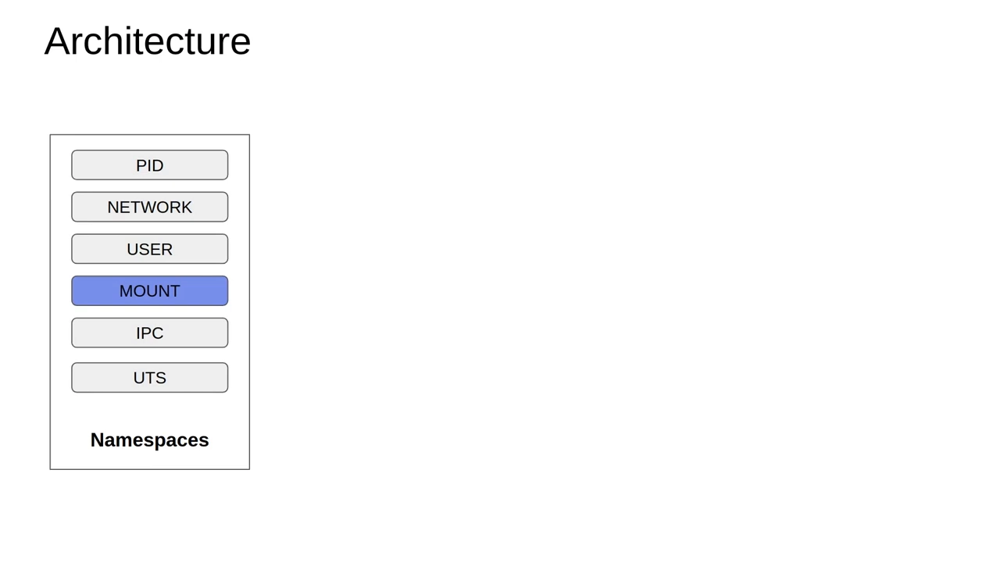

系统启动时，内核会创建一批挂载点——其中一些可能来自系统管理员，一些可能来自 shell 的历史操作，这些都不必细究。关键在于：**内核让它们全部处于 private 模式**。

[【跳转到 00:55】](https://www.youtube.com/watch?v=P7nVxYvIelg&t=55)

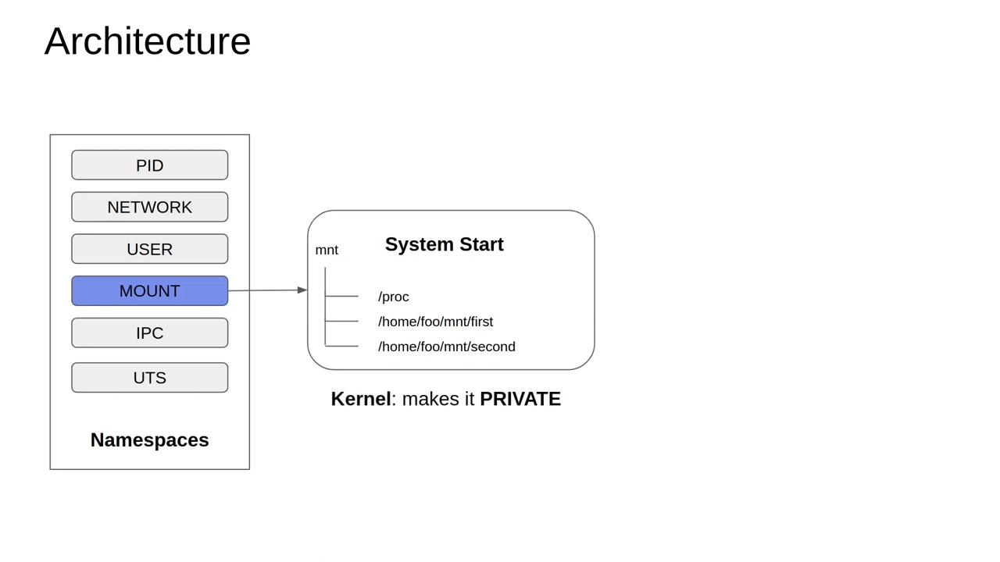

private 的含义：**启动时创建的这些挂载点，不会出现在之后新建立的任何命名空间里**。这听上去很理想——但有一个转折。

### 1.2 systemd 上场：把挂载点全部改成 shared

[【跳转到 01:45】](https://www.youtube.com/watch?v=P7nVxYvIelg&t=105)

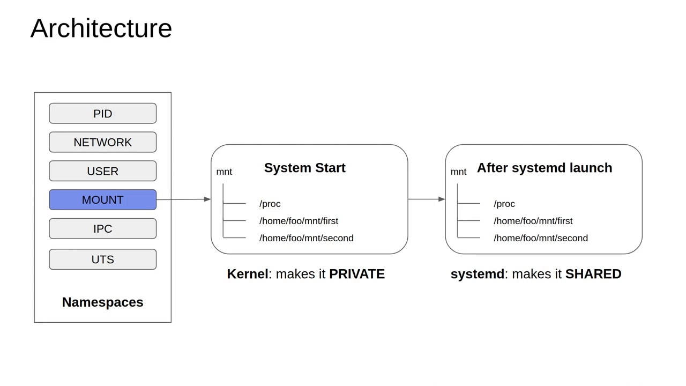

启动流程中，init 进程之后 **systemd 守护进程立刻启动**。它把内核以 private 模式创建的那些挂载点**全部改成 shared**。shared 意味着挂载事件会在相关命名空间之间传播——这正是下一节实验里"子进程看到父进程全部挂载"的原因。

## 二、实验一：clone 出新命名空间，子进程却看到父进程的全部挂载

### 2.1 创建 Mount 命名空间的旗标叫 CLONE_NEWNS

[【跳转到 03:32】](https://www.youtube.com/watch?v=P7nVxYvIelg&t=212)

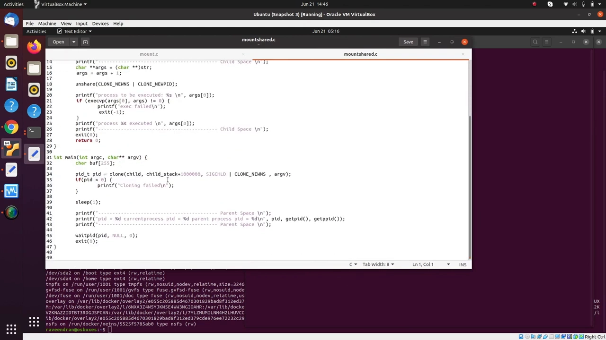

作者的实验程序在启动时调用 `clone()`——创建 PID 命名空间、网络命名空间用的都是这同一个系统调用；这次要创建 Mount 命名空间，用的是 **`CLONE_NEWNS`**（new namespace）这个旗标。很多人以为它会叫 CLONE_NEWMOUNT 之类的名字，但事实并非如此。

程序还把另一个程序作为参数传入：运行 `./a.out` 并传 `mount`，让子进程 fork-exec 之后执行 `mount` 命令，列出它看到的挂载点。

[【跳转到 04:47】](https://www.youtube.com/watch?v=P7nVxYvIelg&t=287)

这里有一个值得注意的点：虽然 clone 已经复制出了子进程，但要把新挂载命名空间真正关联到子进程、并忽略父进程的挂载命名空间，还需要用到 **`unshare`**。

### 2.2 结果：父子进程的挂载列表一模一样

[【跳转到 05:28】](https://www.youtube.com/watch?v=P7nVxYvIelg&t=328)

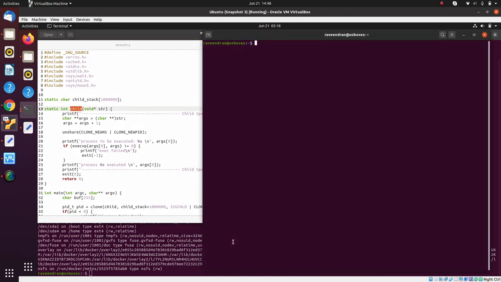

[【跳转到 05:58】](https://www.youtube.com/watch?v=P7nVxYvIelg&t=358)

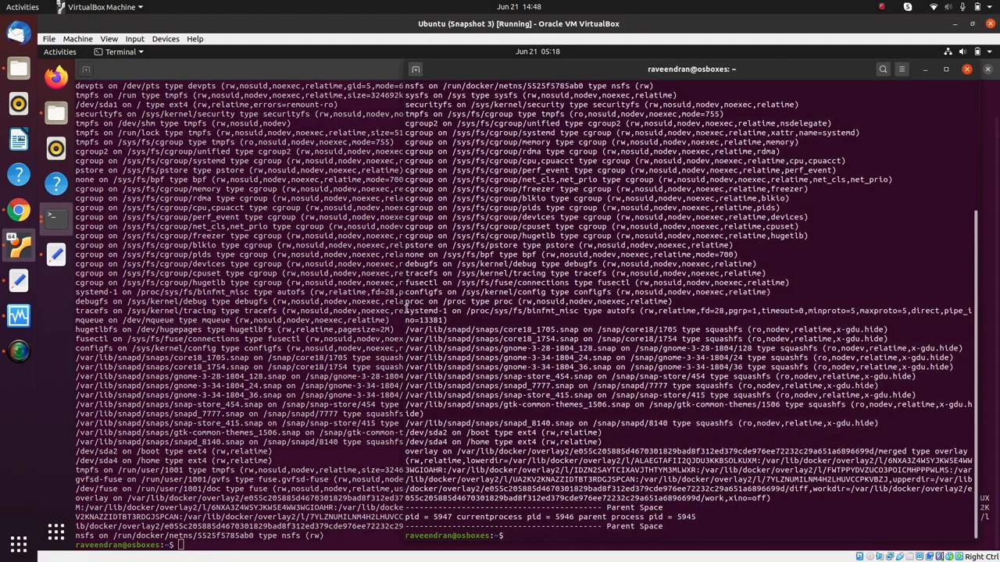

运行结果：子进程打印出的挂载点，与原来的 shell（父进程）**完全相同**——尽管子进程已经身处新的 Mount 命名空间。

但这不是我们想要的。我们想要的是子进程拥有一份**独立**的挂载空间，不受父进程影响。

## 三、问题与解法：递归 make-rprivate，再 unshare

### 3.1 问题定位：clone 时挂载被"复制/共享"

[【跳转到 06:47】](https://www.youtube.com/watch?v=P7nVxYvIelg&t=407)

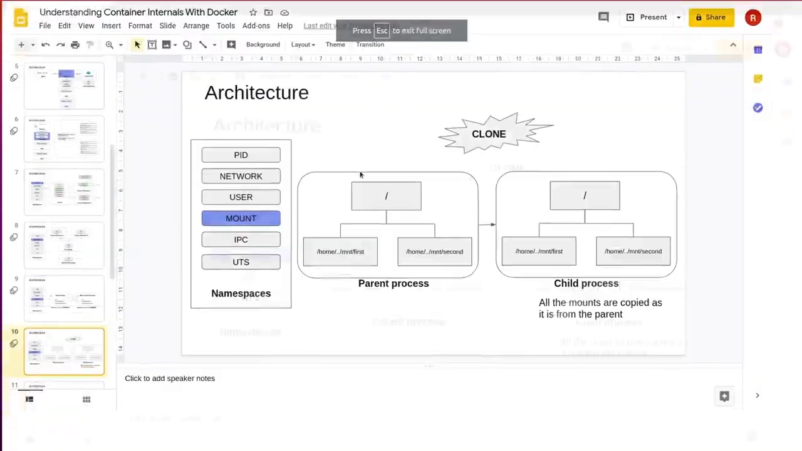

梳理一下机制：父进程启动时带着一套挂载点；clone 发生时，这些挂载**按原样共享**给子进程——父子进程共享同一份挂载，这正是我们不想要的"问题"。

[【跳转到 07:17】](https://www.youtube.com/watch?v=P7nVxYvIelg&t=437)

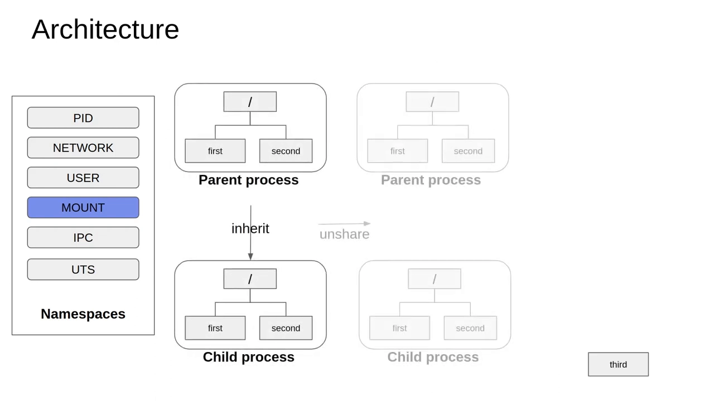

期望的行为是：子进程独立于父进程，**子进程里新建的挂载点，父进程看不见**。怎么做到？

### 3.2 解法：unshare 之前，先把根"递归地"标为 private

[【跳转到 08:14】](https://www.youtube.com/watch?v=P7nVxYvIelg&t=494)

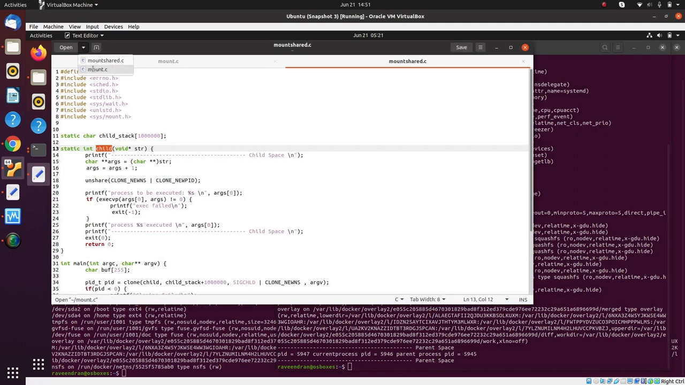

Linux 给出的做法：在调用 unshare 关联新命名空间**之前**，先"把我（子进程）的根设为 private，并且递归地做"。效果是：子进程根之下**所有**挂载点都变为 private，不会再出现在父进程的命名空间里；随后 unshare 把子进程挂到新的 Mount 命名空间上。（把整棵挂载树递归标为 private，对应 `mount --make-rprivate /` 的语义。）

### 3.3 实验三：为子进程重建 /proc 与 devpts

[【跳转到 09:59】](https://www.youtube.com/watch?v=P7nVxYvIelg&t=599)

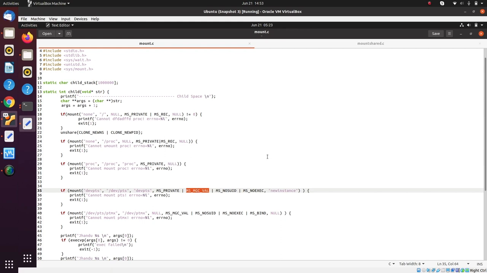

为了演示隔离效果，程序还为子进程做了两件"配套"事：把 `/proc` 卸载（用 none 覆盖）后**重新挂载一个全新的 /proc**；再为子进程创建 **devpts** 挂载（/dev 下的伪终端设备文件系统，pts 与 ptmx 都对子进程私有）。其中两个细节值得注意：

- **不要从设备文件里执行程序**（对应 noexec 的思路），也不沿用父进程传来的 UID/GID 位——只认子进程自己文件上的设置；
- **MS_MGC_VAL 这个"魔数"旗标**：作者本以为它已被废弃，但在他用的 Ubuntu 上它是**必需**的——没有它程序根本跑不起来。

### 3.4 验证：子进程有 /dev/pts，父进程没有

[【跳转到 11:11】](https://www.youtube.com/watch?v=P7nVxYvIelg&t=671)

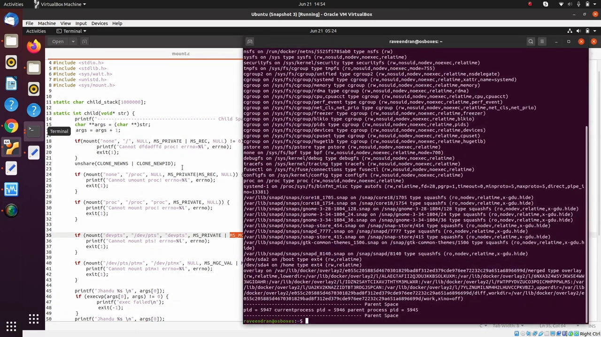

编译运行：`cc mount.c`，然后 `sudo ./a.out mount`。子进程打印出的挂载里出现了 **/dev/pts**——它对子进程可见。

[【跳转到 11:41】](https://www.youtube.com/watch?v=P7nVxYvIelg&t=701)

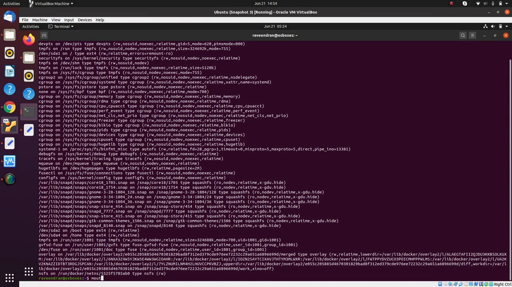

再到父进程里执行 `mount` 检查：**刚才创建的那个挂载并不存在**。隔离生效了。

## 四、这才是 Docker 的"监狱"：挂载点监狱，而非 chroot

[【跳转到 12:31】](https://www.youtube.com/watch?v=P7nVxYvIelg&t=751)

本集最重要的结论：**子进程里的任何挂载操作都不会"泄漏"到宿主机**——所有"污染"都被限制在容器进程内部，这就是 Mount 命名空间的工作方式。

[【跳转到 12:56】](https://www.youtube.com/watch?v=P7nVxYvIelg&t=776)

系列早前说过：Docker **不用 chroot** 来构造隔离空间。本集给出了它真正的做法——创建外界不可见的挂载点，造出一个"类似监狱、但不是 chroot 式监狱"的空间：**chroot 是文件系统级的监狱，这是挂载点级的监狱**。Docker 就是这样把容器进程从全局命名空间里"解绑"出来的。

## 小结

- 内核启动时挂载点默认 private；systemd 随后把它们全部改成 shared——这就是"新命名空间继承父挂载"的根源。
- clone 创建 Mount 命名空间用的旗标是 `CLONE_NEWNS`，不是想象中的 CLONE_NEWMOUNT。
- 想让子进程挂载独立：**先递归地把根标为 private，再 unshare**。
- 子进程内可重建 /proc、挂载 devpts（pts/ptmx 私有）；`MS_MGC_VAL` 在某些系统上仍是必需的魔数。
- 验证方法：子进程 mount 里有 /dev/pts，父进程里没有——隔离生效。
- 容器内的一切挂载操作都不会影响宿主机：污染被限制在容器进程内部。
- Docker 不用 chroot 做隔离，而是用 Mount 命名空间造"挂载点监狱"，把容器进程与全局命名空间解耦。

## 关键术语速查

| 术语 | 一句话解释 |
| --- | --- |
| Mount 命名空间 | 隔离"什么挂在哪"：每个空间有自己的挂载点列表 |
| private / shared | 挂载传播模式：private 不跨命名空间传播，shared 会传播挂载事件 |
| `clone()` | 创建（子）进程的系统调用，创建各类命名空间都用它 |
| `CLONE_NEWNS` | clone/unshare 中用于新建 Mount 命名空间的旗标 |
| `unshare` | 让进程脱离共享命名空间、关联新命名空间的系统调用/命令 |
| make-rprivate | 递归地把挂载树标为 private（对应 `mount --make-rprivate /`） |
| `MS_MGC_VAL` | mount 调用中的魔数旗标，作者的系统上为必需项 |
| devpts | /dev/pts 下的伪终端设备文件系统 |
| chroot | 改变进程根目录的文件系统级"监狱"，Docker 未采用它做隔离 |
