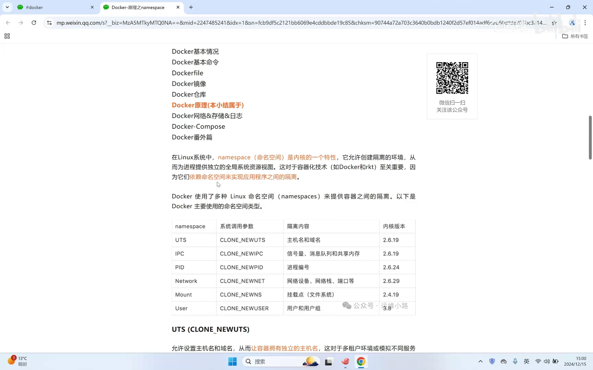
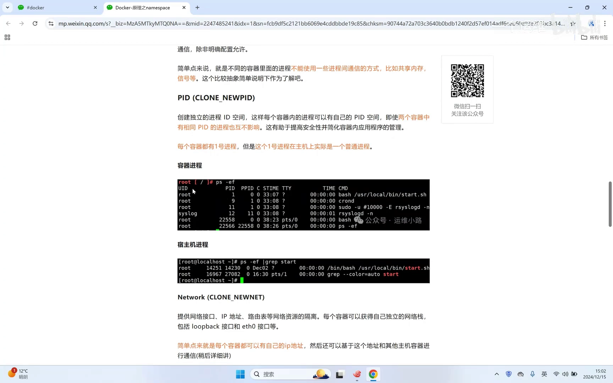
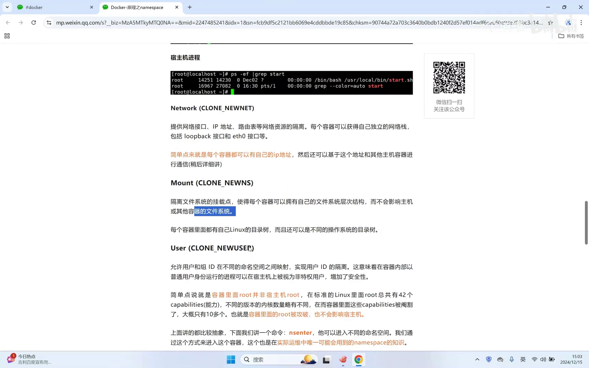
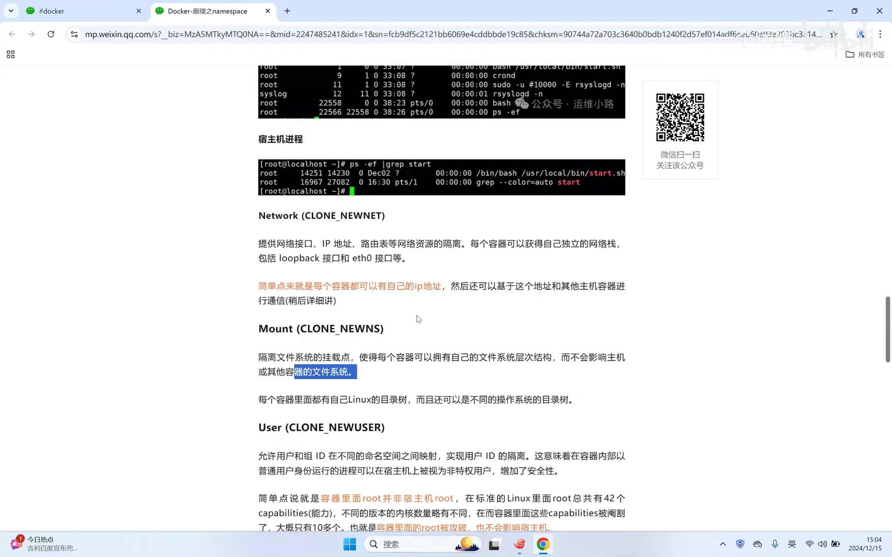
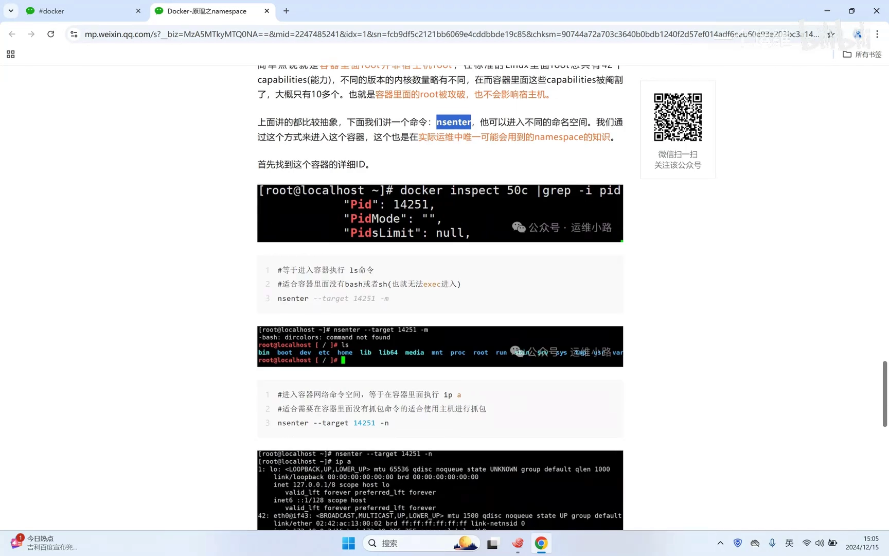
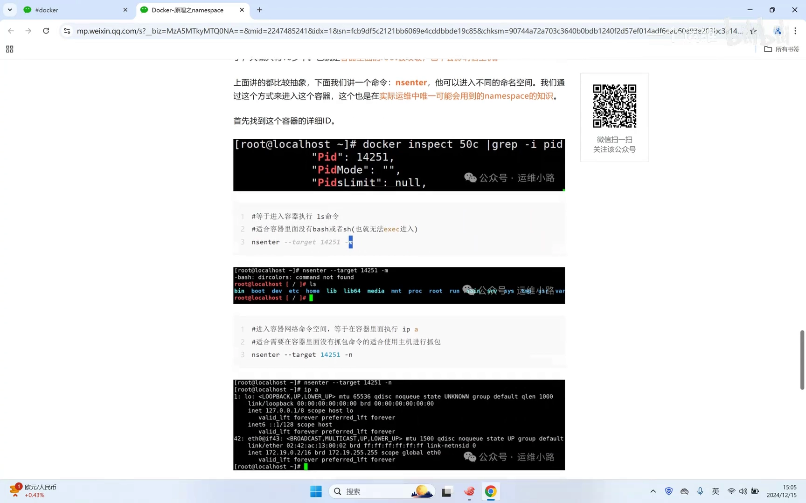
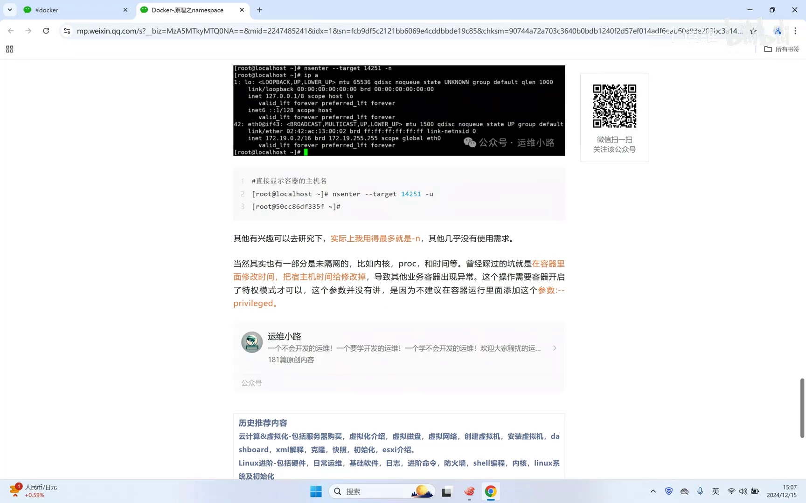
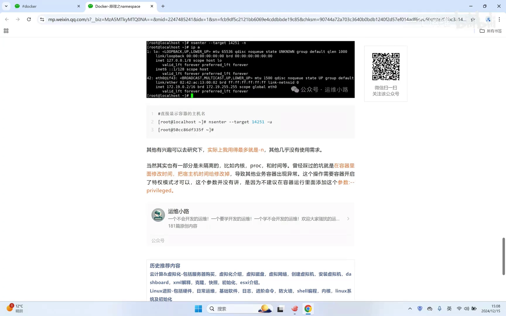

# Docker原理-命名空间namespace

> 视频源：[Docker原理-命名空间namespace](https://www.bilibili.com/video/BV1vE6VYzESd/)（B 站 @运维小路，9 分 55 秒）。本文基于视频演说图文稿整理，时间戳可跳转到原视频对应位置。

## 本讲要解决的核心问题（SCQA）

**背景**：一台 Linux 服务器上用 Docker 跑起十几个容器，每个容器都有自己的主机名、自己的进程列表、自己的 IP 地址，甚至自己的 root 用户——看起来就像一台台独立的小机器。

**冲突**：可容器并不是虚拟机：它们没有自己的内核，全部共用宿主机这一颗内核。既然内核只有一份，这些"独立"到底是从哪来的？

**疑问**：容器究竟靠什么机制，让每个容器"看到"一个只属于自己、互不打扰的系统？

**回答（中心思想）**：靠 Linux 内核的命名空间（namespace）——它为进程提供一份**独立的全局资源视图**，让进程以为自己在独立的系统里，实际上仍跑在宿主机上；Docker 只是把这套内核能力封装得更易用。同时也要清醒：namespace 只隔离主机名、进程号、网络、挂载、用户这些"视图"，而内核、`/proc/sys` 内核参数和时间是所有容器共享的——这三处最容易踩坑。

[【跳转到 00:00】](https://www.bilibili.com/video/BV1vE6VYzESd/?t=0)

## 一、命名空间是什么：给进程一份"独立的全局资源视图"

在 Linux 系统中，namespace（命名空间）是内核的一个特性：它允许创建隔离的环境，为进程提供**独立的全局资源视图**。也就是说，把资源隔离开，让进程"看到的东西"使它以为自己运行在一个独立的系统、独立的私密空间里——而实际上，它只是宿主机上的一个普通进程。

[【跳转到 00:09】](https://www.bilibili.com/video/BV1vE6VYzESd/?t=9)

值得一提的是，容器技术并不是 Docker 发明的：基于 namespace 的容器技术早就存在，Docker 差不多是十年前才出现的，它做的事是把这套底层技术**封装得更加简单易用**。

[【跳转到 00:34】](https://www.bilibili.com/video/BV1vE6VYzESd/?t=34)

另外要注意，这些特性是"对应的内核版本才有的"：新的内核从 3.8、3.10 开始逐步具备这些能力，更早的内容则出现得更早。

[【跳转到 01:49】](https://www.bilibili.com/video/BV1vE6VYzESd/?t=109)

## 二、Docker 用到的六种命名空间

Docker 使用了 Linux 的多种命名空间来做资源隔离，主要有以下六种。

[【跳转到 00:59】](https://www.bilibili.com/video/BV1vE6VYzESd/?t=59)

### 2.1 UTS：主机名与域名

一个主机正常情况下只有一个主机名。通过 UTS 命名空间的隔离，**每个容器都有自己的主机名**：

- 不指定的情况下，容器会使用自己的 ID（就是很常说的容器 ID）作为主机名；
- `docker run` 时可以用 `-h` 参数为容器指定主机名；
- 用 `docker ps` 也能看到每个容器自己的主机名。

[【跳转到 02:14】](https://www.bilibili.com/video/BV1vE6VYzESd/?t=134)

### 2.2 IPC：进程间通信资源

IPC 这一块相对抽象：Linux 里进程间通信有几种方式，包括**共享内存、信号量、消息队列**等。对初学者来说，只需要知道：这些资源在容器之间是隔离的。

[【跳转到 02:44】](https://www.bilibili.com/video/BV1vE6VYzESd/?t=164)

### 2.3 PID：容器里重新从 1 号开始数进程

正常情况下，宿主机里的进程编号从 1 开始一直往后加。而有了 PID 命名空间，**每个容器里都有自己的 1 号进程**。

视频里在容器里执行了 `ps`：容器内的 1 号进程是一个 bash 进程，后面是 9 号、11 号、12 号等等——注意编号**并不严格连续**（不是有一就必有二、有二必有三），但肯定会有一号。

[【跳转到 03:01】](https://www.bilibili.com/video/BV1vE6VYzESd/?t=181)

更有意思的是宿主机视角：**容器里的 1 号进程，在宿主机里只是一个普通进程**（编号是宿主机里的另一个数字）。这和 KVM 虚拟机有本质区别——KVM 的宿主机完全看不到虚拟机里面的东西；而容器里的进程，在宿主机上是看得见、管得着的。

[【跳转到 03:26】](https://www.bilibili.com/video/BV1vE6VYzESd/?t=206)

### 2.4 NET：每个容器有自己的 IP 地址

网络比较好理解：通过 NET 命名空间的隔离，**每个容器都有自己的 IP 地址**。

[【跳转到 03:52】](https://www.bilibili.com/video/BV1vE6VYzESd/?t=232)

### 2.5 MNT：每个容器有独立的挂载/磁盘视图

mount 就是文件挂载点：**每个容器有自己的根目录、独立的磁盘系统**。比如在一台 CentOS 宿主机里安装了一个 Ubuntu 容器，那么容器里面的磁盘格式就是按 Ubuntu 来的，而不会按 CentOS 来。

[【跳转到 04:04】](https://www.bilibili.com/video/BV1vE6VYzESd/?t=244)

### 2.6 USER：容器里的 root 只是"部分 root"

USER 命名空间稍微抽象，简单来说：**容器里面也有 root**——在里面执行 `id`，显示的同样是 root。

[【跳转到 04:27】](https://www.bilibili.com/video/BV1vE6VYzESd/?t=267)

但这个 root **不具备完整的 root 权限**，只具备一部分。Linux 里一共有 42 个能力（capability），容器里的 root 相当于只分到了其中一部分。这带来一个安全上的好处：**风险可控**——就算容器的 root 被攻破，实际上也影响不到宿主机，因为容器里的 root 权限是受限的。

[【跳转到 04:43】](https://www.bilibili.com/video/BV1vE6VYzESd/?t=283)

## 三、动手验证：用 nsenter 进入容器的命名空间

这些概念平时用得到吗？会。核心工具是 **nsenter**：通过它可以在宿主机上"进入"容器的不同命名空间。

[【跳转到 05:08】](https://www.bilibili.com/video/BV1vE6VYzESd/?t=308)

用法分两步：

1. 先用 `docker inspect` 找到目标容器的 PID（宿主机视角的进程号）；
2. 再用 `nsenter -t <PID>` 指定目标进程，配合不同参数进入对应命名空间。

[【跳转到 05:24】](https://www.bilibili.com/video/BV1vE6VYzESd/?t=324)

- **`-m`：进入挂载命名空间**。执行后终端里显示的就是容器里面的目录，可以直接看到容器里的磁盘挂载信息。
- **`-n`：进入网络命名空间**。执行后再看 IP，看到的就是容器自己的 IP 地址，不再是宿主机的 IP。
- 再配合 `hostname` 命令，可以直接看到容器的主机名（UTS）。

[【跳转到 05:29】](https://www.bilibili.com/video/BV1vE6VYzESd/?t=329)

[【跳转到 06:08】](https://www.bilibili.com/video/BV1vE6VYzESd/?t=368)

nsenter 的参数还有很多，但视频里重点演示的这三个用法相对最好理解，也最常用。

[【跳转到 07:04】](https://www.bilibili.com/video/BV1vE6VYzESd/?t=424)

### 实战价值：给"被阉割"的容器抓包

为什么这个命令在实际运用中用得多？举个例子：有时需要在容器里做**抓包**操作，但容器本身就是被精简（"阉割"）过的，`tcpdump` 这种需要额外安装的命令默认并不自带——除非你做镜像的时候特意把它打进去。这时就可以从宿主机用 nsenter 进入容器的网络命名空间，在容器的网络视角里抓包，对后面的排错很有好处。

[【跳转到 06:40】](https://www.bilibili.com/video/BV1vE6VYzESd/?t=400)

## 四、namespace 不隔离的东西：内核、/proc/sys 与时间

讲了这么多隔离，还要清醒地看到：**有一部分东西 namespace 并没有隔离**，所有容器仍然和宿主机共享它们。

[【跳转到 07:19】](https://www.bilibili.com/video/BV1vE6VYzESd/?t=439)

### 4.1 内核

所有容器用的都是**宿主机的内核**——这也正是"容器不是虚拟机"的根源。

### 4.2 /proc/sys：内核参数

容器里看到的 `/proc/sys`（虚拟文件系统）和宿主机里看到的实际上是一样的。这可能带来实际冲突：宿主机上跑的业务对某个内核参数有要求（比如需要把它从 0 改成 1），而容器里跑的应用对同一参数也有自己的要求——两个要求相互冲突时，要么容器里的业务用不了，要么就得去改宿主机的内核参数，左右为难。

[【跳转到 07:49】](https://www.bilibili.com/video/BV1vE6VYzESd/?t=469)

### 4.3 时间与时区

容器里的时间和宿主机**是同一份**：宿主机是 15:08，容器里也是 15:08。唯一的区别在**时区**——容器默认时区是伦敦的格林威治标准时间（UTC），比北京时间慢 8 小时；如果把容器时区改成东八区，看到的时间就和北京时间一致了。

[【跳转到 08:14】](https://www.bilibili.com/video/BV1vE6VYzESd/?t=494)

这里有一个真实的生产事故：以前在生产环境里，运维在容器里操作时本想**查看**时间，误操作变成了**修改**时间——这一改就把宿主机的时间改掉了，宿主机上其他容器的时间也跟着变了，业务直接出了问题。

[【跳转到 08:39】](https://www.bilibili.com/video/BV1vE6VYzESd/?t=519)

要注意的是：用普通命令创建的容器（非特权模式）是**改不了**这类参数的——就算你在里面用 `date` 这类系统命令去改，也改不动；只有 `docker run` 运行容器时显式加上了 `--privileged` 参数（等于打开了特权模式），容器里才具备这种修改能力。这也是"容器 root 权限受限"的一个直观体现。

[【跳转到 09:04】](https://www.bilibili.com/video/BV1vE6VYzESd/?t=544)

## 小结

- 命名空间是内核特性：为进程提供独立的全局资源视图，让进程"以为"自己在独立系统里；容器技术早于 Docker，Docker 只是把 namespace 封装得更易用。
- Docker 用到六种命名空间：UTS（主机名/域名）、IPC（共享内存/信号量/消息队列）、PID（容器内从 1 号开始）、NET（独立 IP）、MNT（独立挂载视图）、USER（受限的 root）。
- 容器里的 1 号进程在宿主机里只是普通进程——这是容器与 KVM 虚拟机的本质区别之一。
- USER 命名空间下，容器 root 只有 42 个能力中的一部分，被攻破也难以波及宿主机。
- nsenter（配合 docker inspect 拿 PID）可从宿主机进入容器的挂载、网络命名空间，是给精简容器抓包排错的利器。
- namespace 不隔离：内核、/proc/sys 内核参数、时间与时区——参数冲突和时间误改是最常见的坑；非特权容器改不了系统时间，特权模式（--privileged）才有这个能力。

## 关键术语速查

| 术语 | 一句话解释 |
| --- | --- |
| namespace（命名空间） | 内核特性，为进程提供隔离的全局资源视图 |
| UTS | 隔离主机名与域名，每个容器有自己的主机名 |
| IPC | 隔离共享内存、信号量、消息队列等进程间通信资源 |
| PID | 隔离进程编号空间，每个容器有自己的 1 号进程 |
| NET | 隔离网络栈，每个容器有自己的 IP 地址 |
| MNT | 隔离挂载点，每个容器有自己的根目录/磁盘视图 |
| USER | 隔离用户与能力，容器 root 只拥有部分 capability |
| capability（能力） | Linux 把 root 权限拆成的细粒度能力项，共 42 个 |
| nsenter | 在宿主机上进入其他进程（如容器）命名空间的命令 |
| --privileged | Docker 的特权模式，放开容器的大部分权限限制 |
