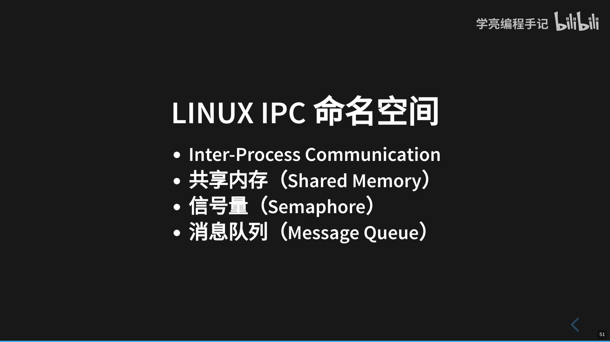

# Linux IPC 命名空间

> 视频源：[Linux IPC 命名空间](https://www.bilibili.com/video/BV1pj411h7q9/)（B 站 @学亮编程手记，3 分 51 秒）。本文基于视频演说图文稿整理，时间戳可跳转到原视频对应位置。

## 本讲要解决的核心问题（SCQA）

**背景**：Linux 提供多种进程间通信（IPC）手段——共享内存、信号量、消息队列，同一台主机上的进程靠它们协作。

**冲突**：可当一台主机上要跑多个互相隔离的环境（比如多个容器）时，如果所有进程共用同一套 IPC 资源，彼此就能看到、甚至误用对方的通信资源，隔离就无从谈起。

**疑问**：怎么让不同的进程组各自拥有一套独立的 IPC 资源、互不干扰？

**回答（中心思想）**：用 IPC 命名空间——Linux 命名空间的一种。它允许在同一主机上创建多个隔离的 IPC 实例，每个实例都有自己的共享内存、信号量和消息队列；进程只能访问和操作属于自己命名空间的 IPC 资源。容器正是借助这一点，让每个容器拥有自己的"一片天地"。

[【跳转到 00:00】](https://www.bilibili.com/video/BV1pj411h7q9/?t=0)

## 一、IPC 命名空间是什么

IPC 就是 inter process communication，即**进程间通信**；IPC 命名空间隔离的就是进程间通信的资源，具体包括**共享内存、信号量、消息队列**这几类。

[【跳转到 00:00】](https://www.bilibili.com/video/BV1pj411h7q9/?t=0)

Linux 命名空间有很多种类，IPC 命名空间是其中一种。它允许在**同一个主机上创建多个隔离的 IPC 实例**，每个实例都有自己的一套 IPC 资源；通过这种隔离，不同命名空间中的进程可以各自创建、使用 IPC 资源，而不会相互干扰。

[【跳转到 00:25】](https://www.bilibili.com/video/BV1pj411h7q9/?t=25)

## 二、为什么容器离不开它

IPC 命名空间对容器化应用和虚拟化环境非常有用——因为它们可以在同一主机上运行多个隔离的进程，且每个进程都拥有自己的 IPC 资源。

以 Docker 容器为例：实现容器化技术最核心的就是利用了 Linux 的 namespace（命名空间）和 cgroup，而 IPC 命名空间就是 namespace 下的其中一种。

[【跳转到 00:50】](https://www.bilibili.com/video/BV1pj411h7q9/?t=50)

容器本质上就是一个 Linux 下的进程；经过 IPC 命名空间的隔离后，这个进程就拥有了自己的这块天地——进程间不会相互干扰。所以容器化和虚拟化都是借助这个机制来实现的。

[【跳转到 01:40】](https://www.bilibili.com/video/BV1pj411h7q9/?t=100)

## 三、三类 IPC 资源如何被隔离

[【跳转到 01:15】](https://www.bilibili.com/video/BV1pj411h7q9/?t=75)

### 3.1 共享内存（shared memory）

在 IPC 命名空间中，**每个命名空间都有自己的共享内存区域**；进程只能访问和操作属于同一命名空间的共享内存段。

[【跳转到 02:05】](https://www.bilibili.com/video/BV1pj411h7q9/?t=125)

### 3.2 信号量（semaphore）

同样，**每个 IPC 命名空间都有自己的信号量**；进程只能访问和操作属于同一命名空间的信号量。

[【跳转到 02:30】](https://www.bilibili.com/video/BV1pj411h7q9/?t=150)

### 3.3 消息队列（message queue）

消息队列也按命名空间隔离：**IPC 命名空间隔离了不同命名空间的消息队列**，进程只能访问和操作同一命名空间的消息队列。

[【跳转到 02:55】](https://www.bilibili.com/video/BV1pj411h7q9/?t=175)

要注意区分：这里的消息队列是内核里的 IPC 机制，**不是**我们平时说的 Kafka 那类"消息中间件"——虽然它们做的事情类似（收发消息），但场景不一样。

[【跳转到 02:55】](https://www.bilibili.com/video/BV1pj411h7q9/?t=175)

## 小结

- IPC = 进程间通信；IPC 命名空间隔离的是共享内存、信号量、消息队列三类资源。
- 它是 Linux 多种命名空间中的一种，允许同一主机上存在多个互相隔离的 IPC 实例。
- 进程只能访问和操作属于自己命名空间的 IPC 资源——这一节能感受到的关键词就两个字：隔离。
- 容器本质是 Linux 进程，借助 namespace + cgroup 实现隔离；IPC 命名空间让每个容器拥有独立的进程间通信资源。

## 关键术语速查

| 术语 | 一句话解释 |
| --- | --- |
| IPC（进程间通信） | 进程之间交换数据/协同的机制，如共享内存、信号量、消息队列 |
| IPC 命名空间 | Linux 命名空间的一种，隔离 IPC 资源 |
| 共享内存段 | 一块可被多个进程映射访问的内存，按命名空间隔离 |
| 信号量 | 进程间同步/互斥的计数机制，按命名空间隔离 |
| 消息队列 | 内核提供的消息收发队列，不同于 Kafka 等消息中间件 |
| namespace（命名空间） | 内核特性，为进程提供隔离的全局资源视图 |
