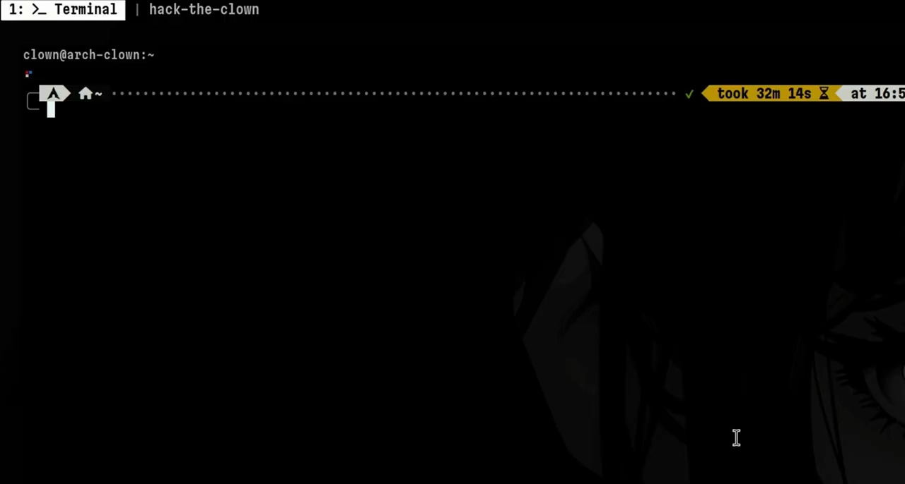
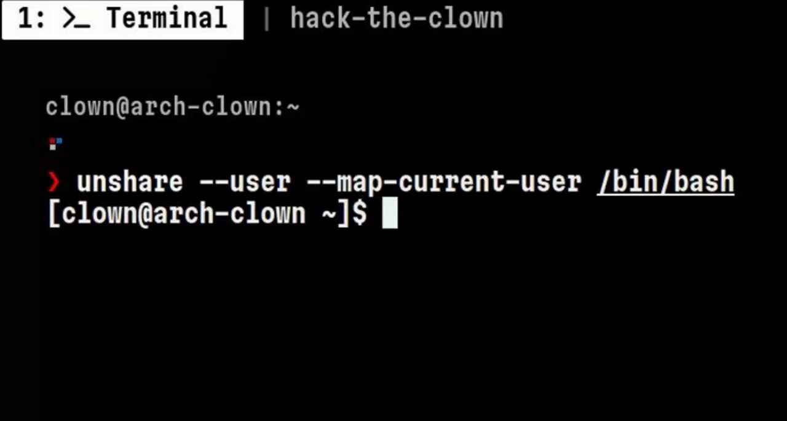
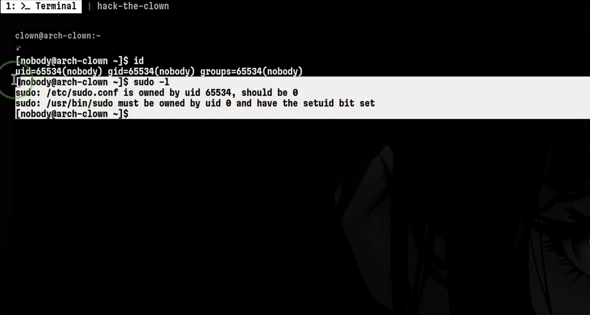
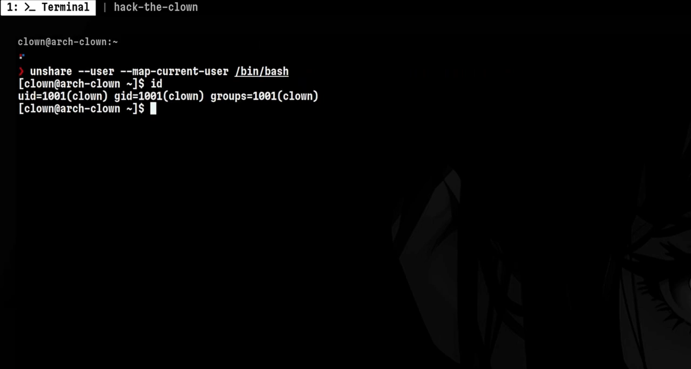
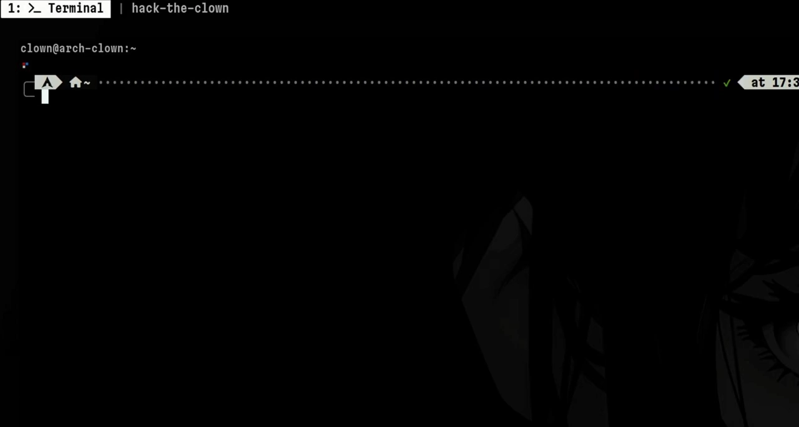
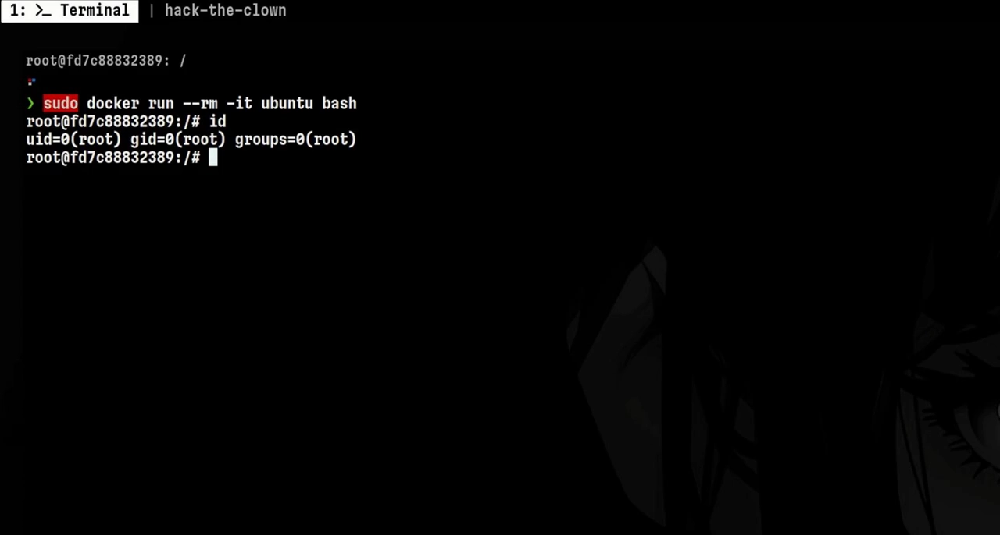
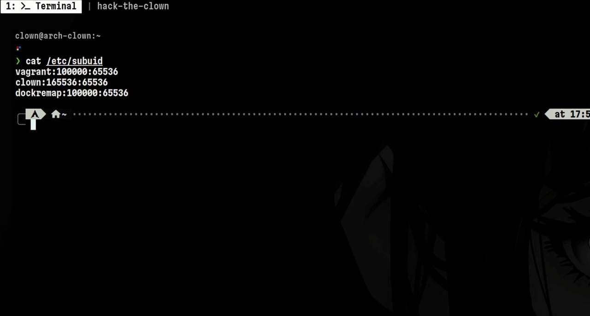
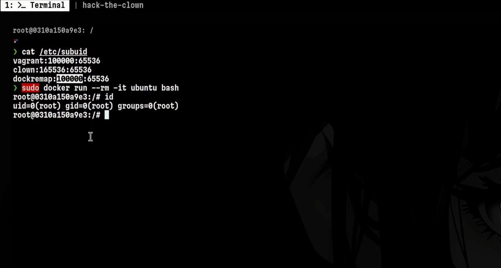

# 容器内的 root 不该是真 root：用用户命名空间做权限降级

> 源视频：[Container Security 101: User Namespaces](https://www.youtube.com/watch?v=MWG8lWQpE4Q)（YouTube，时长 4:52）

## 本讲要解决的核心问题（SCQA）

**背景**：容器（如 Docker）靠 Linux 命名空间实现隔离。本系列前面的视频已经讲过命名空间的总体工作方式和 PID 命名空间的进程隔离；用户命名空间（user namespace）隔离的对象是"用户身份"——UID/GID。视频开头有个反直觉的场景：黑客攻陷了一台 Arch 机器，明明已经拿到 root，却做不了特权操作，连 `/etc/shadow`（存放用户口令散列的文件）都读不了。

**冲突**：谜底就藏在用户命名空间里——他这个 root 是"命名空间内的 root"，权力带不进来。反观 Docker，默认并不给容器创建独立的用户命名空间：容器里看到的 root，用的就是宿主机真正的 root。默认配置再叠加 `--pid=host`、`privileged` 这类危险参数时，进入容器的攻击者可以用 `nsenter` 直接逃逸到宿主机。

**疑问**：如何让"容器内的 root"不再拥有宿主机 root 的特权？

**回答（中心思想）**：启用用户命名空间重映射（userns-remap）：把容器内的 root 映射成宿主机上一个"不存在"的大号 UID（如 100000），即使攻击者逃逸成功，在宿主机上也没有任何权限。这是一条低成本、高收益的容器加固措施。[【跳转到 00:00】](https://www.youtube.com/watch?v=MWG8lWQpE4Q&t=0)

## 一、用户命名空间：隔离"用户身份"的命名空间

### 1.1 它隔离什么

与其他命名空间一样，用户命名空间也提供隔离，但对象是用户身份：**同一个用户可以存在于不同的命名空间中**，并且该用户的权限被限制在其所在的命名空间之内，出了这个命名空间就不再有效。[【跳转到 00:33】](https://www.youtube.com/watch?v=MWG8lWQpE4Q&t=33)

### 1.2 动手实验：创建与观察

用本系列前几集就出现的 `unshare` 命令创建命名空间，这次加 `--user` 参数，并在新命名空间里运行一个 bash。[【跳转到 00:43】](https://www.youtube.com/watch?v=MWG8lWQpE4Q&t=43)

创建前后各跑一次 `lsns`（列出系统中的命名空间）：创建前系统里只有一个用户命名空间——开机时自动创建的默认实例；创建后变成两个。此时命名空间内的用户显示为 `nobody`，因为还没有做任何身份映射（权限问题稍后展开）。[【跳转到 00:48】](https://www.youtube.com/watch?v=MWG8lWQpE4Q&t=48)

### 1.3 身份映射的两个开关

`unshare` 提供了映射选项：想让命名空间内的用户与外部当前用户一致，加 `--map-current-user`；想直接映射成 root，加 `--map-root`。[【跳转到 01:19】](https://www.youtube.com/watch?v=MWG8lWQpE4Q&t=79)

## 二、映射 ≠ 授权：命名空间内的 root 没有外部特权

### 2.1 关键实验

在命名空间外，我可以用 sudo 以 root 身份执行所有命令；进入用户命名空间后就不行了。而且**即使**把命名空间内的用户映射成我当前的账号，甚至映射成 root，特权命令照样失败。[【跳转到 01:34】](https://www.youtube.com/watch?v=MWG8lWQpE4Q&t=94)

### 2.2 机制解释

用户映射并不会自动把外部用户的权限"带进"命名空间。这就是用户命名空间在权限维度上提供隔离的方式：**身份可以映射，权力带不进来**。[【跳转到 01:45】](https://www.youtube.com/watch?v=MWG8lWQpE4Q&t=105)

## 三、Docker 的默认行为：容器 root 就是宿主机 root

### 3.1 一个实验验证默认行为

启动一个 Ubuntu 容器并立即 exec 进入；在另一个终端再跑一次 `lsns`——仍然只看到一个用户命名空间。如果 Docker 为容器创建了新的用户命名空间，这里应该出现两个。也就是说：**容器内的 root 与宿主机系统上的 root 是同一个**。[【跳转到 02:10】](https://www.youtube.com/watch?v=MWG8lWQpE4Q&t=130)

这是 Docker 的默认行为，同时也是一个安全隐患——视频随后会用具体场景说明风险。

## 四、userns-remap：把容器 root 映射成"不存在的用户"

### 4.1 配置方法

想让 Docker 为每个容器创建独立的用户命名空间，需要先修改守护进程配置文件 `daemon.json`：加入 `"userns-remap": "default"`，然后重启 Docker 守护进程（视频中的做法是修改后 restart daemon）。[【跳转到 02:35】](https://www.youtube.com/watch?v=MWG8lWQpE4Q&t=155)

### 4.2 验证映射结果

再次启动容器并查看 `lsns`：现在能看到两个用户命名空间，而且新命名空间里的用户 ID 是 **100000**——对 Linux 系统来说非常罕见。这个大数字把我们引向 Docker 用户命名空间重映射的底层机制：`/etc/subuid` 文件。[【跳转到 03:00】](https://www.youtube.com/watch?v=MWG8lWQpE4Q&t=180)

### 4.3 /etc/subuid 与副用户 ID（subordinate IDs）

`/etc/subuid` 文件里记录着各个用户的条目。第二列的数字**不是**用户 ID，而是"副用户 ID"（subordinate IDs），它们被特意设计得非常大。注意 `dockremap` 用户（启用 `userns-remap: default` 时自动创建的映射用户）的副用户 ID，正是刚才 `lsns` 输出里的那个大数。数值如此之大，意味着**该 ID 对应的用户在宿主机上根本不存在**。于是启动容器时，容器内的 root 会被映射到这个宿主机上不存在的用户身上。[【跳转到 03:25】](https://www.youtube.com/watch?v=MWG8lWQpE4Q&t=205)

### 4.4 为什么这能挡住逃逸

既然容器内的 root 在宿主机上只是一个不存在的普通 ID，攻击者即使尝试 Docker 逃逸或任何内核漏洞利用，**在宿主机上也做不了任何事**。

对照组更能说明问题：因为没有默认启用重映射，容器可以用脆弱配置启动——例如共享宿主机 PID 命名空间（`--pid=host`）再加 privileged 特权模式。这种情况下，落进容器的攻击者可以用 `nsenter` 轻松逃逸到宿主机系统。而启用用户命名空间重映射后，启动这类脆弱容器变得困难得多，容器内的 root 永远被映射成宿主机上不存在的用户。[【跳转到 03:50】](https://www.youtube.com/watch?v=MWG8lWQpE4Q&t=230)

## 小结

- 用户命名空间隔离的是 **UID/GID 身份**：同一用户可存在于多个命名空间，权限仅限本命名空间。
- `unshare --user` 创建用户命名空间；`--map-current-user` / `--map-root` 控制身份映射；未映射时内部用户显示为 `nobody`。
- 关键原则：**映射 ≠ 授权**——命名空间内的 root 拿不到外部的特权（视频开头的"root 却读不了 shadow"正是这个原理）。
- Docker **默认不隔离用户命名空间**：容器内 root 就是宿主机 root，存在逃逸风险。
- 在 `daemon.json` 中设置 `"userns-remap": "default"` 并重启 Docker 即可启用；此后容器 root 被映射为宿主机上不存在的用户（如 100000）。
- 底层依赖 `/etc/subuid` 的副用户 ID 机制：大号 ID 在宿主机上无对应账户，逃逸后"无身可附"。
- 开启后，`--pid=host`、`privileged` 等危险配置的利用难度大幅提高——是一项低成本、高收益的加固实践。

## 关键术语速查

| 术语 | 一句话解释 |
| --- | --- |
| 用户命名空间（user namespace） | 隔离 UID/GID 的命名空间；同一用户可在多个命名空间中存在，权限仅限本命名空间 |
| `unshare --user` | 创建新用户命名空间并在其中运行命令 |
| `lsns` | 列出系统中的命名空间；`-t user` 只看用户命名空间 |
| `--map-current-user` / `--map-root` | `unshare` 的身份映射选项：把命名空间内用户映射为当前用户或 root |
| userns-remap | Docker 守护进程配置项，为容器启用用户命名空间重映射 |
| `/etc/subuid` 与副用户 ID | 记录每个用户可用的副 UID 范围；数值特意很大，通常在宿主机上不存在对应用户 |
| `nsenter` | 进入指定进程所在命名空间执行命令；危险配置下被用于容器逃逸 |
