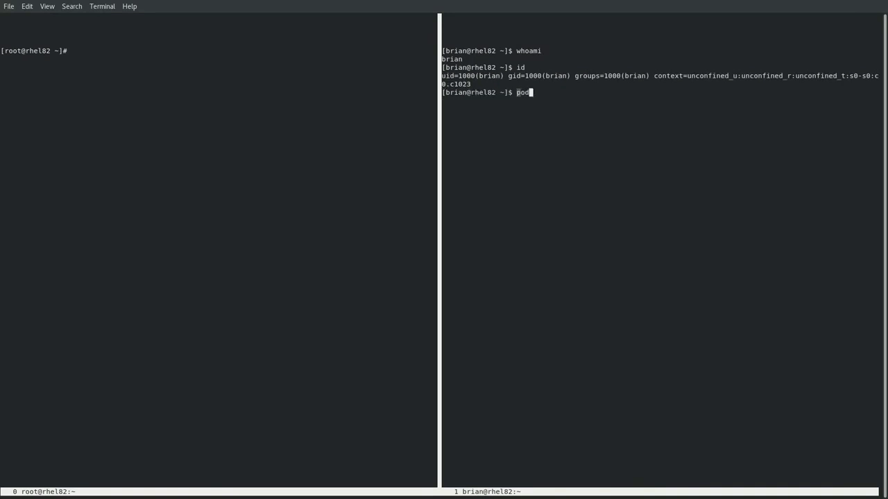
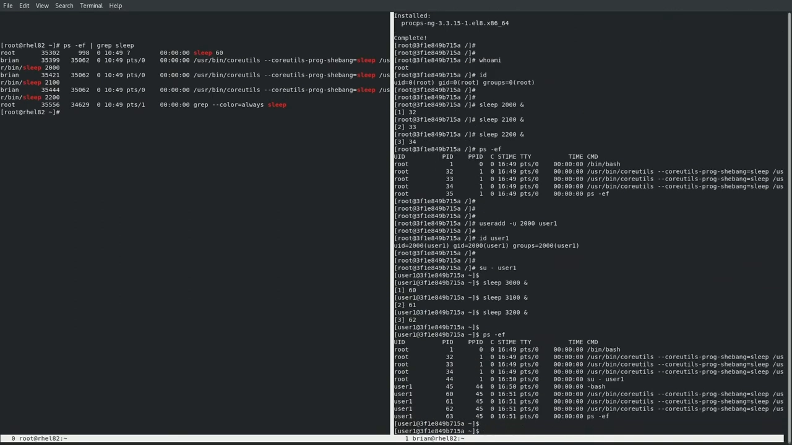
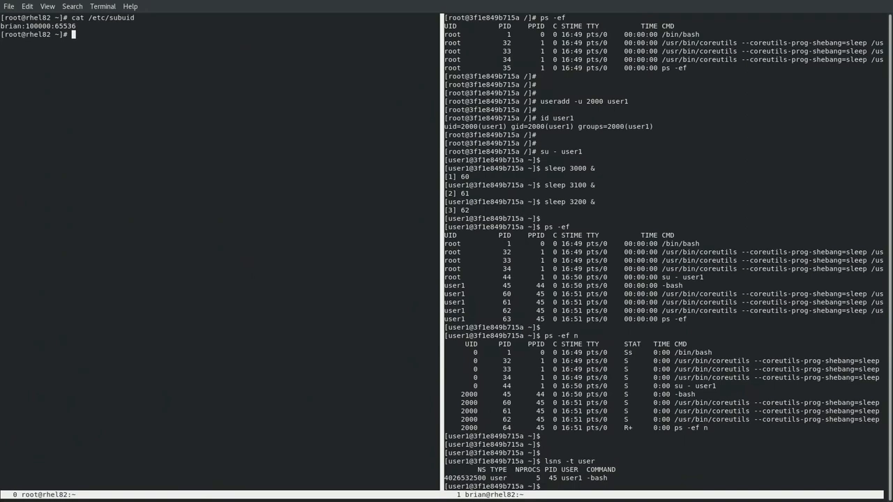
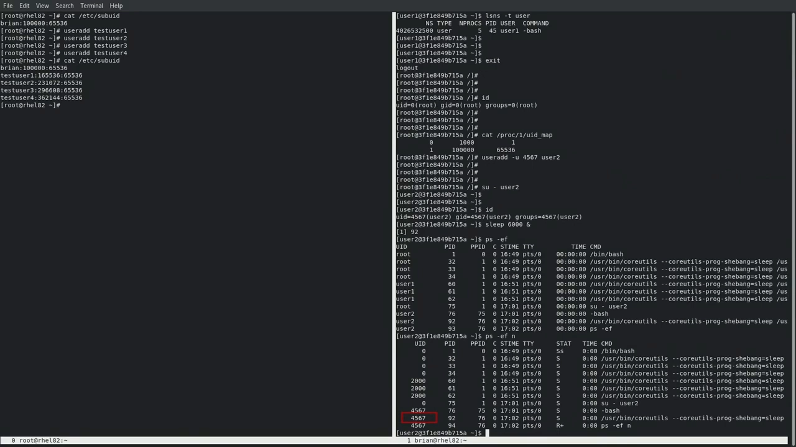
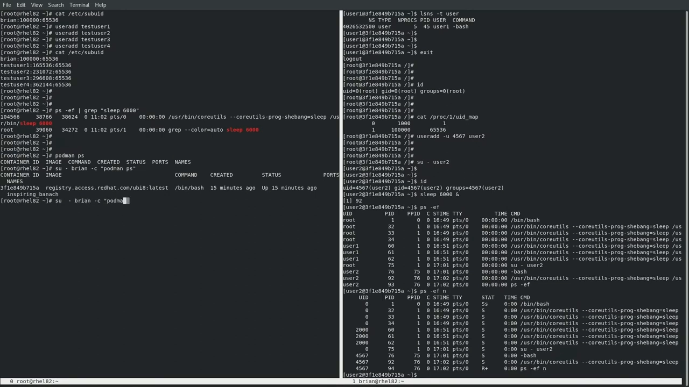
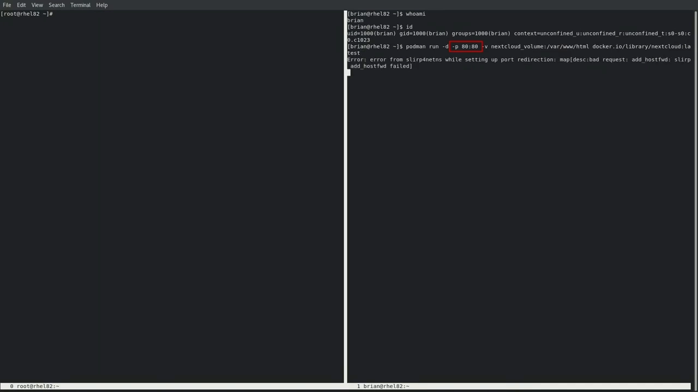
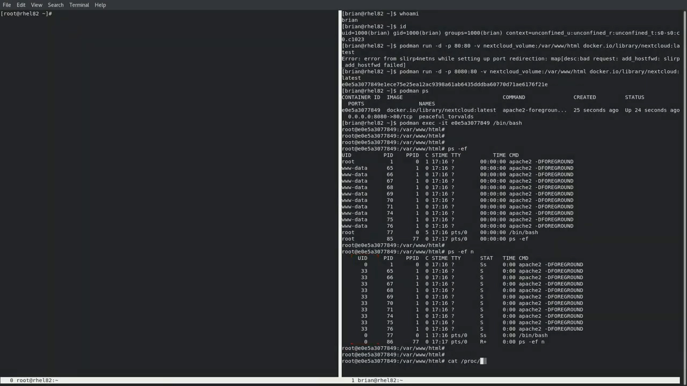
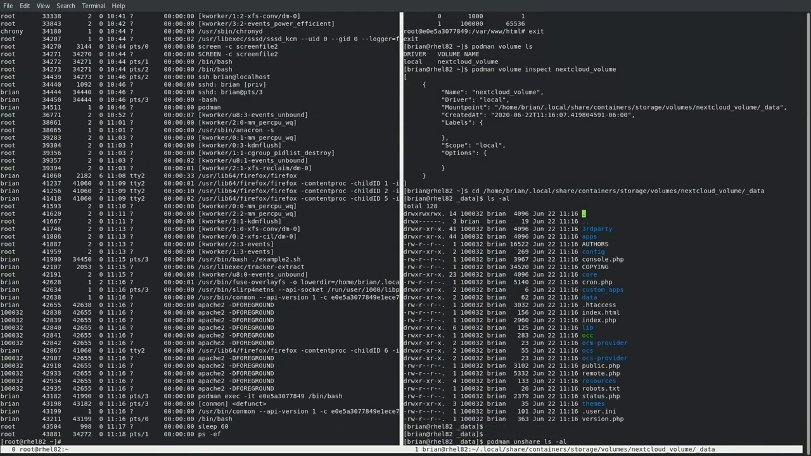

# 同一个进程，两个身份：rootless 容器的 UID 映射全解

> 源视频：[Rootless Podman: How user namespaces work in Rootless containers (part 2)](https://www.youtube.com/watch?v=Ac2boGEz2ww)（YouTube，时长 11:25）

## 本讲要解决的核心问题（SCQA）

**背景**：Podman 容器既可以由 root 用户启动，也可以由普通用户启动——后者就是 rootless 模式。容器有自己的 `/etc/passwd` 与 `/etc/group`，容器内的进程看起来是 root（UID 0）或镜像里定义的其它用户。[【跳转到 00:05】](https://www.youtube.com/watch?v=Ac2boGEz2ww&t=5)

**冲突**：可同一批进程，两边的"花名册"对不上：容器内看是 root，宿主机上看却是 brian 这样的普通账号；文件属主还会出现 101999、100032 这类罕见大数字。算不清这层映射，你就无法回答两个关键问题——容器内的 root 到底有多大权力？宿主机上这些文件到底归谁？

**疑问**：容器内外的 UID/GID 到底如何映射？rootless 容器靠什么机制决定映射？

**回答（中心思想）**：靠**用户命名空间 + `/etc/subuid` 副用户 ID 段**。Podman 为 rootless 容器自动创建用户命名空间，按启动者在宿主机上分到的副 UID 段（65536 个）建立 `uid_map`：容器内 UID 0 映射为启动者本人，容器内 UID 1~65536 映射为副段 100000~165535；换算规律是**容器内 UID + 99999 = 宿主机 UID**。

## 一、实验设定：容器内外的两双眼睛

### 1.1 rootless 模式是自动启用的

演示者以普通用户 brian 登录，用 `podman run` 启动 ubi8 容器。Podman 检测到当前是非特权用户，**自动以 rootless 模式运行容器**。第一件事是在容器内安装 `procps-ng` 包，以便稍后能使用 ps 命令。[【跳转到 00:05】](https://www.youtube.com/watch?v=Ac2boGEz2ww&t=5)

在容器内执行 `whoami`：从**容器的视角**看，自己正以 root 用户（UID 0）运行——尽管容器是被非 root 用户启动的。[【跳转到 00:30】](https://www.youtube.com/watch?v=Ac2boGEz2ww&t=30)

### 1.2 同一批进程的两份名单

在容器内启动几个 sleep 进程（`sleep 2000、2100、2200`），运行 `ps -ef`：容器视角下它们都挂在 root 账户下。切到宿主机窗口执行 `ps -ef | grep sleep`：**宿主机视角下，这些进程的属主是 brian 账户**。[【跳转到 00:55】](https://www.youtube.com/watch?v=Ac2boGEz2ww&t=55)

接着在容器里创建 UID 2000 的新用户 user1，切到该账号再启动 sleep 3000、3100。容器内 `ps -ef -n`（以数字显示 UID）看到的是 UID 0 和 UID 2000；宿主机上 `ps -ef | grep sleep` 看到的却是 **brian 账户和 UID 101999**。[【跳转到 01:05】](https://www.youtube.com/watch?v=Ac2boGEz2ww&t=105)

这组对照就是本文要解释的现象。**用户命名空间**（Linux 内核特性）允许把用户账户隔离在命名空间里，让进程在命名空间内外拥有**不同的 UID/GID 编号**——上面的例子正是它的效果。

## 二、映射的地基：用户命名空间与 subuid

### 2.1 两边各看到什么命名空间

在容器内运行 `lsns -t user`：容器位于一个编号以 500 结尾的用户命名空间里——这是 Podman 以 rootless 模式启动容器时**自动创建**的。切回宿主机运行 `lsns -t user`：宿主机既能看到自己最初的（root）命名空间（编号以 837 结尾），也能看到容器的那个（500 结尾）。[【跳转到 01:55】](https://www.youtube.com/watch?v=Ac2boGEz2ww&t=155)

### 2.2 /etc/subuid：每个用户的"副 UID 预算"

`/etc/subuid` 文件定义了用户被允许在用户命名空间（如 rootless 容器）中使用的**副 UID（subordinate UID）范围**；另有对应的 `/etc/subgid` 管 GID，机制相同（本视频聚焦 UID）。[【跳转到 02:00】](https://www.youtube.com/watch?v=Ac2boGEz2ww&t=180)

文件每行三列：**用户名、范围起始 UID、范围长度**。RHEL 8.2 上新建用户时，默认自动分配 **65536 个副 UID**：brian 的记录从 100000 开始，也就是 100000~165535。视频现场又创建了 4 个测试用户，再次查看 `/etc/subuid`——每个新用户都自动拿到 65536 个副 UID，且各段**互不重叠**。如需调整分配数量与起止范围，可在 `/etc/login.defs` 中配置。[【跳转到 02:05】](https://www.youtube.com/watch?v=Ac2boGEz2ww&t=205)

## 三、读懂数字：/proc/1/uid_map

### 3.1 uid_map 的三列格式

回到容器内 root shell，`cat /proc/1/uid_map` 查看 PID 1 的 UID 映射。Podman 创建 rootless 容器时，就是**依据宿主机的 `/etc/subuid`** 来设置这份映射。文件每行三列：命名空间内的起始 UID、父命名空间的起始 UID、范围长度。[【跳转到 02:40】](https://www.youtube.com/watch?v=Ac2boGEz2ww&t=280)

本例第一行长度为 1：容器内 UID 0（root）一对一映射到父命名空间的 UID 1000——正是启动容器的宿主机 brian 账户。第二行长度 65536：容器内 UID 1 起的 65536 个 UID，映射到宿主机 100000 起的 65536 个副 UID。[【跳转到 03:05】](https://www.youtube.com/watch?v=Ac2boGEz2ww&t=305)

### 3.2 换算练习：4567 + 99999 = 104566

在容器内新建 UID 4567 的用户 user2，切换过去运行 `sleep 6000`；容器内 `ps -ef -n` 确认它以 UID 4567 运行。根据 uid_map 可以**推算**它在宿主机上的 UID：宿主机段从 100000 起、容器段从 1 起，两者相差 **99999**；4567 + 99999 = **104566**。[【跳转到 03:47】](https://www.youtube.com/watch?v=Ac2boGEz2ww&t=347)

切到宿主机窗口 `ps -ef | grep 6000`：该进程果然以 UID 104566 运行，与推算一致。[【跳转到 03:57】](https://www.youtube.com/watch?v=Ac2boGEz2ww&t=397)

## 四、rootless 的行为差异与限制

### 4.1 root 看不到 brian 的容器

非 root 用户运行的容器，root 账户用 `podman ps` **看不到**：root 执行 `podman ps` 输出为空，因为 ubi8 容器属于 brian。要看 brian 的容器，得 `su - brian -c 'podman ps'`。再用 `su - brian -c` 执行 `podman top <容器ID> user huser args`：输出列出容器内进程，并展示**用户账号在容器与宿主机之间的映射**——第一列是容器视角的用户名，第二列是宿主机视角的用户。[【跳转到 04:07】](https://www.youtube.com/watch?v=Ac2boGEz2ww&t=447)

### 4.2 非 root 默认不能转发 1024 以下端口

rootless 容器有一些限制（详见 Red Hat 文档）：默认情况下**非 root 用户不能把小于 1024 的端口转发进容器**。演示中先尝试把宿主机 80 端口转发到容器 80 端口——Podman 报错"设置端口重定向失败"；改用 8080（>1024）转发到容器 80 就成功了。同时创建名为 nextcloud-volume 的卷，挂载到容器内 `/var/www/html`；容器创建成功，浏览器访问 `localhost:8080` 能看到 Nextcloud 配置页。[【跳转到 04:57】](https://www.youtube.com/watch?v=Ac2boGEz2ww&t=497)

## 五、Nextcloud 实战：从进程到卷的映射

### 5.1 容器内两组身份的宿主机真身

进入 Nextcloud 容器执行 `ps -ef`：既有 root 进程，也有 www-data 用户的进程；`ps -ef -n` 显示 UID 分别为 0 和 33。对照 `/proc` 下的 uid_map：按第一行，容器 root 进程应表现为宿主机 UID 1000（brian 账户）；按第二行，容器 www-data（UID 33）的进程应表现为宿主机 UID **100032**——还是那个偏移 99999：33 + 99999 = 100032。宿主机 `ps -ef` 确认 www-data 进程果然以 UID 100032 运行，与推算一致。[【跳转到 05:33】](https://www.youtube.com/watch?v=Ac2boGEz2ww&t=558)

### 5.2 卷上文件的属主：两种视角

退出容器，`podman volume ls` 与 `podman volume inspect nextcloud-volume` 找到卷的挂载点；进入目录 `ls -al`：文件的属主正是刚才那个 **UID 100032**（宿主机视角）。[【跳转到 06:08】](https://www.youtube.com/watch?v=Ac2boGEz2ww&t=608)

再用 `podman unshare` 在容器的用户命名空间内执行同一目录的 `ls`：这次文件属主显示为 **33**——正是容器内的视角。想确认 33 是谁，可以 `podman run <镜像> cat /etc/passwd | grep 33`：Nextcloud 镜像里 UID 33 对应 **www-data**。也就是说，卷里这些文件在容器运行时归 www-data 所有。[【跳转到 06:33】](https://www.youtube.com/watch?v=Ac2boGEz2ww&t=633)

## 小结

- rootless 是自动的：非特权用户运行 Podman 即进入 rootless 模式，Podman 自动创建用户命名空间。
- 同一批进程有**两份身份**：容器内是 root/镜像用户，宿主机上是启动者账户与副 UID 段里的编号。
- `/etc/subuid` 是地基：每用户名下一段 65536 个副 UID（如 brian：100000~165535），新用户自动分配、段间不重叠，数量与范围可在 `/etc/login.defs` 调整。
- `/proc/1/uid_map` 三列：命名空间内起始、父命名空间起始、长度；rootless 容器第一行把容器 root 一对一映射给启动者，第二行把容器 1~65536 映射给副段。
- 换算口诀：**容器内 UID + 99999 = 宿主机 UID**（4567→104566，33→100032 两次验证成立）。
- rootless 的可见性与限制：root 的 `podman ps` 看不到别人的容器，`podman top` 的 `user/huser` 列并排展示映射；非 root 默认不能转发 1024 以下端口。
- 卷上文件的属主在两个视角下不同：宿主机看到副 UID（100032），`podman unshare` 内看到容器 UID（33=/etc/passwd 里的 www-data）。

## 关键术语速查

| 术语 | 一句话解释 |
| --- | --- |
| rootless 容器 | 由非特权用户启动的容器；进程在宿主机上以启动者及其副 UID 运行 |
| 用户命名空间（user namespace） | 让进程在命名空间内外拥有不同 UID/GID 的内核特性；rootless 的映射基础 |
| `/etc/subuid` / `/etc/subgid` | 记录每用户可用的副 UID/GID 段：用户名、起始值、长度（默认 65536） |
| 副 UID（subordinate UID） | 分配给普通用户、专供用户命名空间内使用的大号 UID 段 |
| `/etc/login.defs` | 可调整新用户副 UID 分配数量与起止范围的配置文件 |
| `/proc/<PID>/uid_map` | 进程所在用户命名空间的 UID 映射表：内起始、外起始、长度 |
| `podman top ... user huser args` | 并排显示容器内用户与宿主机用户（huser）的进程视图 |
| `podman unshare` | 在容器的用户命名空间内执行命令，用于以"容器视角"查看文件属主 |
