# 用户命名空间：让普通用户安全当"root"，非特权容器的基石

> 源视频：[Understanding Linux user namespaces](https://www.youtube.com/watch?v=XgThPoL9mPE)（YouTube，时长 51:31；演讲者 Michael Kerrisk——Linux man-pages 项目多年维护者、《The Linux Programming Interface》作者）

## 本讲要解决的核心问题（SCQA）

**背景**：容器的隔离由 Linux 命名空间实现。传统 Unix 权限模型只有两档：普通用户（处处受限）与超级用户 root（绕过所有限制）；给进程提权的传统做法是 set-user-ID-root 程序。用户命名空间是 eight 种命名空间类型中最新、也最特殊的一类，它是构建**非特权容器**的基石（cornerstone），也是浏览器沙箱、Firejail、Flatpak/Snap 等一系列技术的地基。[【跳转到 00:05】](https://www.youtube.com/watch?v=XgThPoL9mPE&t=5)

**冲突**：set-user-ID-root 是"全有或全无"——程序一旦被攻破，攻击者就拿到全部权力，系统上没有损害上限。而且按默认规则，创建大多数命名空间都需要 CAP_SYS_ADMIN 特权，普通用户似乎根本没资格玩命名空间、更别提"安全地当 root"。[【跳转到 08:14】](https://www.youtube.com/watch?v=XgThPoL9mPE&t=494)

**疑问**：能不能让普通用户也创建隔离环境，在其中拥有"root 身份"，却对宿主机毫无特权？

**回答（中心思想）**：能——靠用户命名空间。它为 UID/GID 提供**按命名空间的映射**（uid_map/gid_map）：进程在命名空间内可以是 UID 0，在命名空间外仍是普通用户；内核给新用户命名空间的第一个进程全套 capabilities，**但仅在本命名空间内有效**；再配合"非用户命名空间由用户命名空间拥有"的归属规则，内核就能精确判定"这次特权操作到底查谁的能力"。这套机制让 Docker/LXC 的非特权容器、浏览器沙箱成为可能。

## 一、铺垫（上）：命名空间是什么、怎么观察和操作

### 1.1 定义：把全局资源"包起来"做隔离

命名空间很难下精确定义，Kerrisk 给出的说法是：**命名空间把某种全局资源包装起来，为它提供隔离**。目前有 8 种命名空间类型且还在增加（最新一种出现在 2020 年前后）。[【跳转到 00:55】](https://www.youtube.com/watch?v=XgThPoL9mPE&t=55)

举例：UTS 命名空间隔离主机名与域名；挂载命名空间隔离挂载列表（不同进程组看到不同的已挂载文件系统）；网络命名空间隔离网络基础设施——每个容器可以有自己的网络设施。[【跳转到 01:34】](https://www.youtube.com/watch?v=XgThPoL9mPE&t=94)

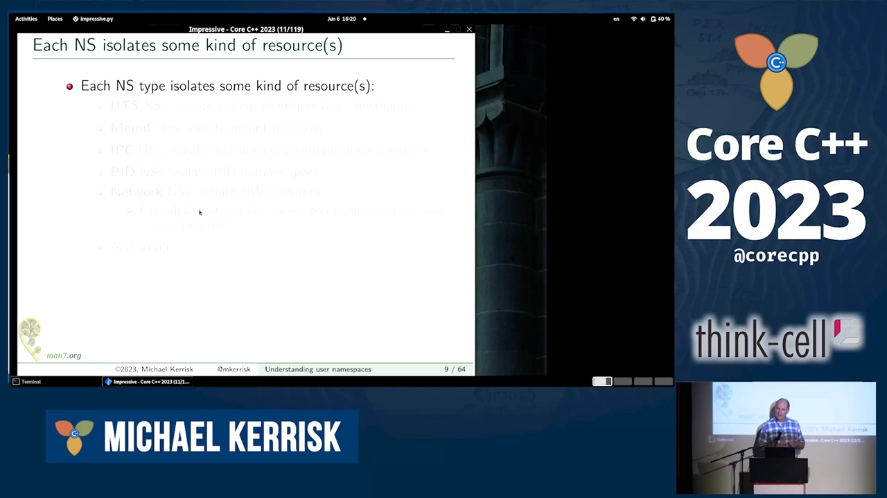

### 1.2 初始实例：每个进程同时身处 8 个命名空间

每种命名空间类型可以有**多个实例**。系统启动时，每类只有一个实例，称为**初始命名空间实例**（initial namespace instance）；每个进程在 8 类命名空间中各身处一个实例。同一实例内的进程共享该全局资源的同一视图：资源被修改，实例内全体可见，实例外不可见。[【跳转到 01:59】](https://www.youtube.com/watch?v=XgThPoL9mPE&t=119)

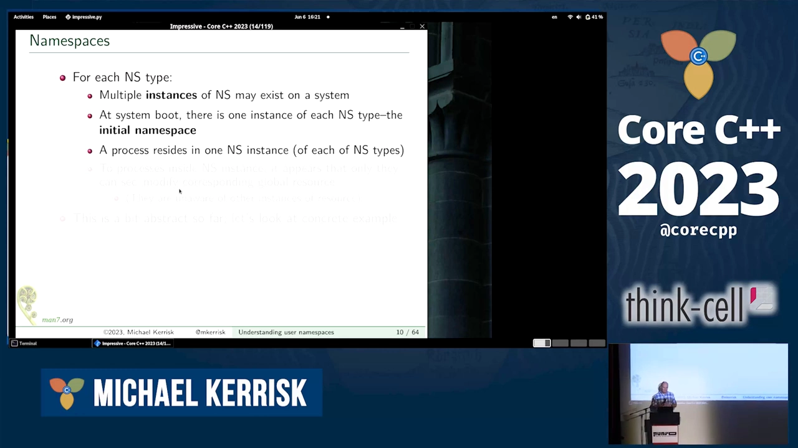

### 1.3 热身例子：UTS 命名空间

UTS 名字源自远古的 `utsname` 结构（Unix Time-Sharing System）。隔离主机名/域名的实用价值：每个容器可以有自己的主机名，还能通过 DHCP 广播拿到独立 IP。图中三个 UTS 命名空间实例各自看到不同的主机名，互不可见。[【跳转到 04:29】](https://www.youtube.com/watch?v=XgThPoL9mPE&t=269)

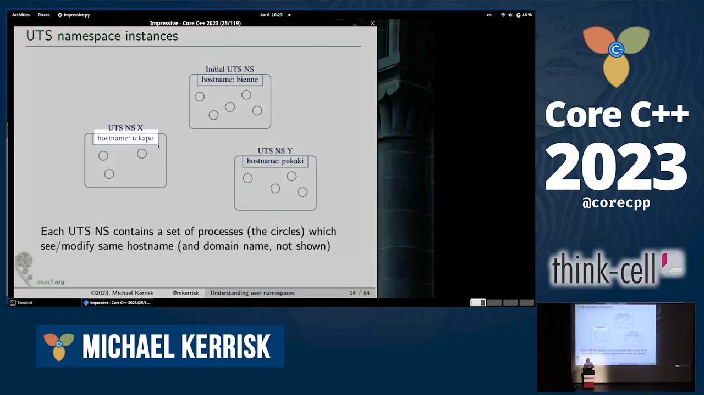

### 1.4 观察工具：/proc/PID/ns

每个 `/proc/PID` 目录下有 `ns` 子目录，里面每类命名空间对应一个符号链接。链接内容不是路径，而是"类型: [数字]"——数字是 **inode 号**，来自内核内部用于实现命名空间的文件系统（用户态不可见）。同一实例的进程，这个 inode 号相同；因此比对两个进程的链接内容即可判断它们是否同属一个命名空间实例。[【跳转到 04:54】](https://www.youtube.com/watch?v=XgThPoL9mPE&t=294)

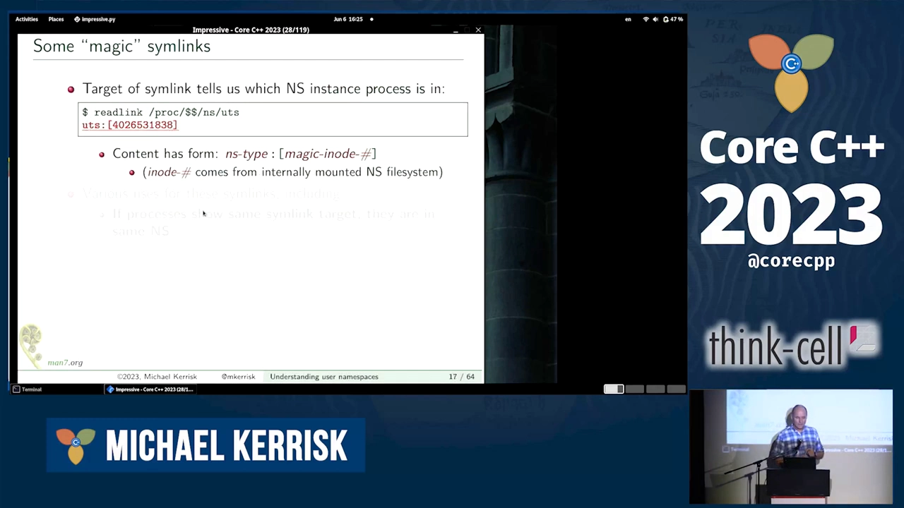

### 1.5 操作工具：unshare 与 nsenter

两个核心命令：`unshare` 创建新命名空间（用选项指定类型，可同时在其内运行命令，缺省运行 shell）；`nsenter` 进入**已存在**的命名空间（`-t PID` 指定参照进程）。两个命令对每种命名空间类型使用**相同的选项字母**（如 UTS 是 `-u`）。[【跳转到 07:17】](https://www.youtube.com/watch?v=XgThPoL9mPE&t=437)

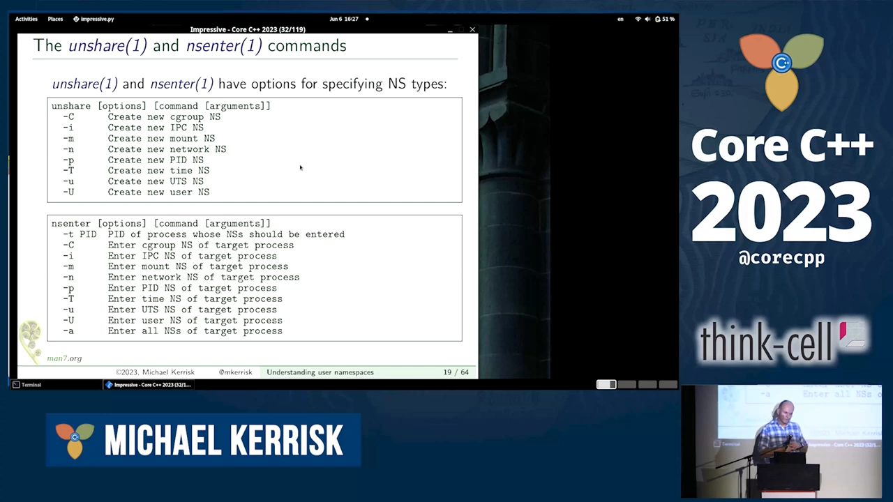

### 1.6 UTS 实验：创建、改名、进入

两个 shell 都在初始 UTS 命名空间，主机名相同（"bien"）；`unshare -u`（配合 sudo，因为创建大多数命名空间需要 CAP_SYS_ADMIN）新建 UTS 命名空间后，新命名空间**继承主机名副本**，但改名（"langvid"）后只影响本实例；宿主侧 shell 不受影响。再用 `readlink /proc/PID/ns/uts` 可见两个不同的 inode 号；最后 `nsenter -t <PID> -u` 进入对方命名空间，readlink 结果一致——进入成功。[【跳转到 08:06】](https://www.youtube.com/watch?v=XgThPoL9mPE&t=486)

## 二、铺垫（下）：capabilities——把 root 的权力切块

### 2.1 传统模型的粗粒度问题

传统 Unix 模型只有普通用户和超级用户两档；提权靠 set-user-ID-root 程序（`chown root` + `chmod u+s`，执行时进程 UID 变为 0）。它强大也危险：一旦程序被攻破，攻击者获得**全部**超户权力，损害无上限。[【跳转到 12:05】](https://www.youtube.com/watch?v=XgThPoL9mPE&t=725)

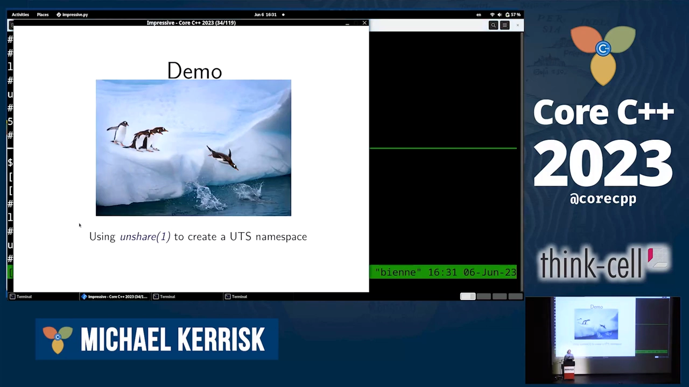

### 2.2 41 项 capabilities

Capabilities 把超户权力拆成 **41 项**能力（见 capabilities 手册页）。例如：`CAP_DAC_OVERRIDE` 可绕过文件权限检查；`CAP_SYS_TIME` 可任意改系统时钟；`CAP_SYS_ADMIN` 能做的事多得离谱（"那是另一天的故事"）。[【跳转到 14:24】](https://www.youtube.com/watch?v=XgThPoL9mPE&t=864)

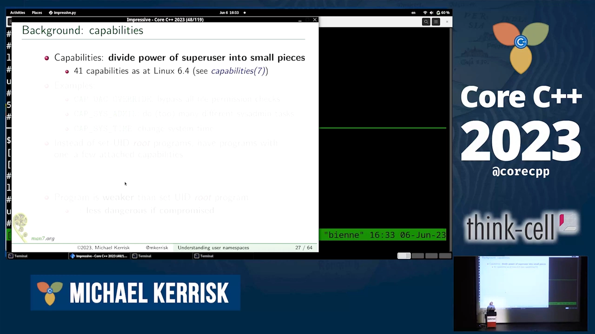

### 2.3 思路：更弱的二进制

不给程序整套 root 权力，而是给二进制挂**一两项** capabilities，让它只做某个特定特权操作。程序被攻破时攻击者权力更小、损害更可控——这就是"更弱的二进制"。[【跳转到 15:14】](https://www.youtube.com/watch?v=XgThPoL9mPE&t=914)

## 三、用户命名空间：UID/GID 的按命名空间映射

### 3.1 核心思想

**每个命名空间可以有自己的 UID/GID 映射**：同一进程，命名空间内是一套凭证（UID/GID），命名空间外是另一套。最有趣的用法：进程**在用户命名空间内是 UID 0，在外是普通用户**——它拥有超户权力，但只在那个命名空间里。[【跳转到 16:04】](https://www.youtube.com/watch?v=XgThPoL9mPE&t=964)

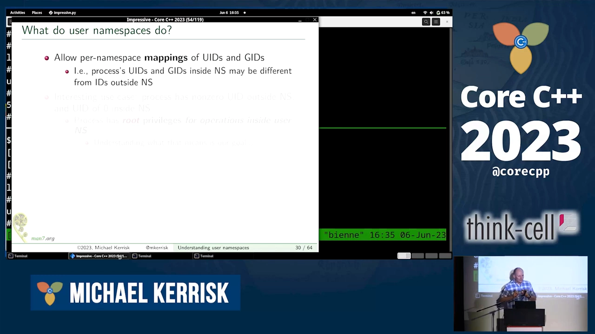

### 3.2 层次关系

用户命名空间之间是**层级结构**：每个用户命名空间有父命名空间，一直上溯到初始用户命名空间。创建新用户命名空间时，其父 = 创建者进程所在的用户命名空间。这个父子关系决定了命名空间内 capabilities 的工作方式。[【跳转到 17:19】](https://www.youtube.com/watch?v=XgThPoL9mPE&t=1039)

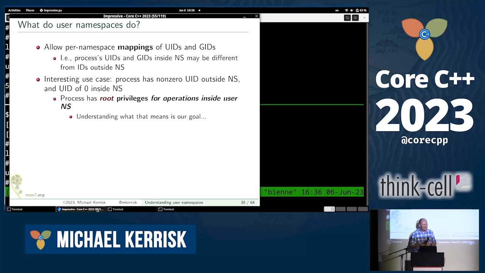

### 3.3 内核的"魔法"：第一个进程获得全套能力

新用户命名空间中的**第一个进程**自动获得全部 41 项 capabilities（内核直接这么规定）——即超户权力，但**仅限该命名空间之内**。[【跳转到 18:09】](https://www.youtube.com/watch?v=XgThPoL9mPE&t=1089)

### 3.4 映射怎么写：uid_map / gid_map

映射通过向 `/proc/PID/uid_map` 与 `/proc/PID/gid_map` 写入字符串建立（更新规则很多，涉及时机与权限，详见手册页）。每行三列：**命名空间内起始 ID、（父侧）映射的起始 ID、映射长度**。常见写法：命名空间内 UID 0 → 外部某个普通 UID，长度 1；若长度写 10，则内部 0~9 依次映射到外部 1000~1009。[【跳转到 19:24】](https://www.youtube.com/watch?v=XgThPoL9mPE&t=1164)

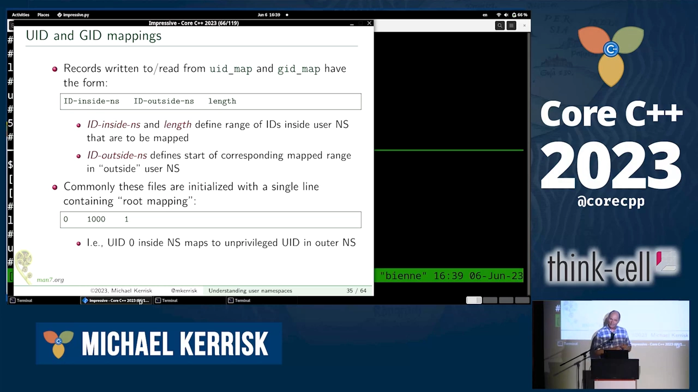

## 四、动手实验：普通用户创建"内 root、外普通"的命名空间

### 4.1 unshare -U -r：一步成为"命名空间内的 root"

演示者以普通用户（UID 1000/GID 1000）执行 `unshare -U -r`：`-U` 创建用户命名空间（不需要任何特权），`-r` 表示 root 映射——把自己的 UID/GID 映射为命名空间内的 0。进入后 `id` 显示 UID 0/GID 0；`/proc/PID/uid_map` 写着 `0 → 1000`（长度 1）。[【跳转到 21:03】](https://www.youtube.com/watch?v=XgThPoL9mPE&t=1263)

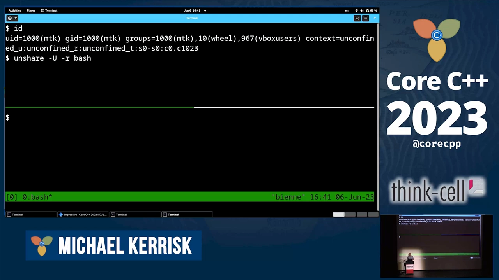

### 4.2 确认能力：十六进制掩码与 getpcaps

查 `/proc/PID/status` 的 CapEff/CapPrm 等字段是 41 位的十六进制位掩码，显示 permitted 与 effective 全开——命名空间内的超户。更好读的方式是 `getpcaps <PID>`：输出中的 `=ep` 表示 effective+permitted 全部能力齐备。[【跳转到 23:46】](https://www.youtube.com/watch?v=XgThPoL9mPE&t=1426)

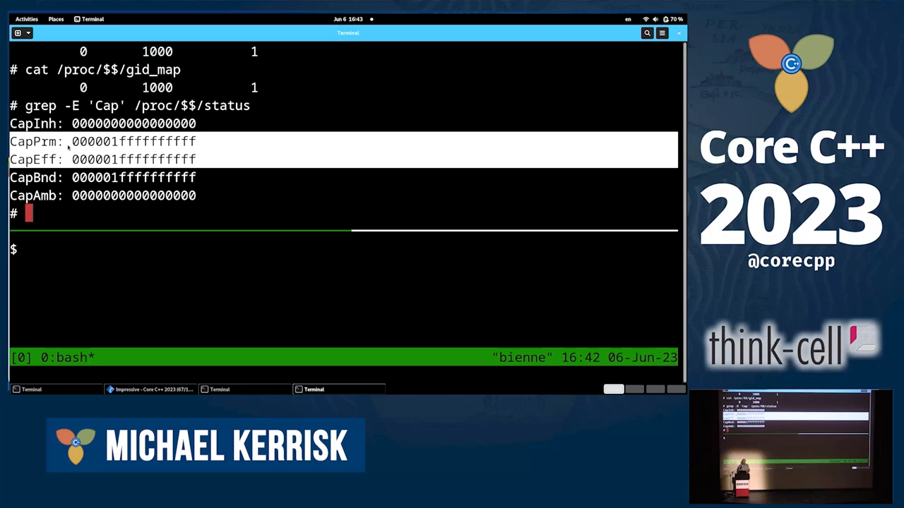

### 4.3 换一双眼睛：外部视角

同一个 shell（PID 5356），从初始命名空间看是 **UID 1000/GID 1000** 的普通进程——内外两套凭证并存。[【跳转到 24:21】](https://www.youtube.com/watch?v=XgThPoL9mPE&t=1461)

### 4.4 一个悬念：命名空间内的 root 改不了主机名？

命名空间内既然有超户权力，试着改主机名——**失败**。为什么？这正是下一节要解答的。[【跳转到 25:11】](https://www.youtube.com/watch?v=XgThPoL9mPE&t=1511)

## 五、权力边界：capabilities 只在本用户命名空间有效

### 5.1 内核的权限检查模型

规则：内核授予新用户命名空间第一个进程全套 capabilities，**但这些能力只能施加于"由该用户命名空间管辖的对象"**。每种非用户命名空间管辖一类资源（UTS 管主机名/域名、mount 管挂载点、network 管网络设施），而**每个非用户命名空间都由某个用户命名空间拥有**——归属关系在创建非用户命名空间时确立：其拥有者 = 创建者进程所在的用户命名空间。于是当进程对某全局资源做特权操作时，内核的检查链是：该资源由哪个非用户命名空间管辖 → 该命名空间被哪个用户命名空间拥有 → **进程在"那个"用户命名空间里有没有所需 capability**。[【跳转到 25:41】](https://www.youtube.com/watch?v=XgThPoL9mPE&t=1541)

### 5.2 图示：unshare -U -r -u 之后的格局

命令 `unshare -U -r -u bash` 同时创建新用户命名空间与新 UTS 命名空间：新用户命名空间是初始用户命名空间的**子**；新 UTS 命名空间由新用户命名空间**拥有**；进程其余 6 类命名空间成员关系不变（仍在初始网络/挂载/PID 命名空间等）。[【跳转到 27:51】](https://www.youtube.com/watch?v=XgThPoL9mPE&t=1671)

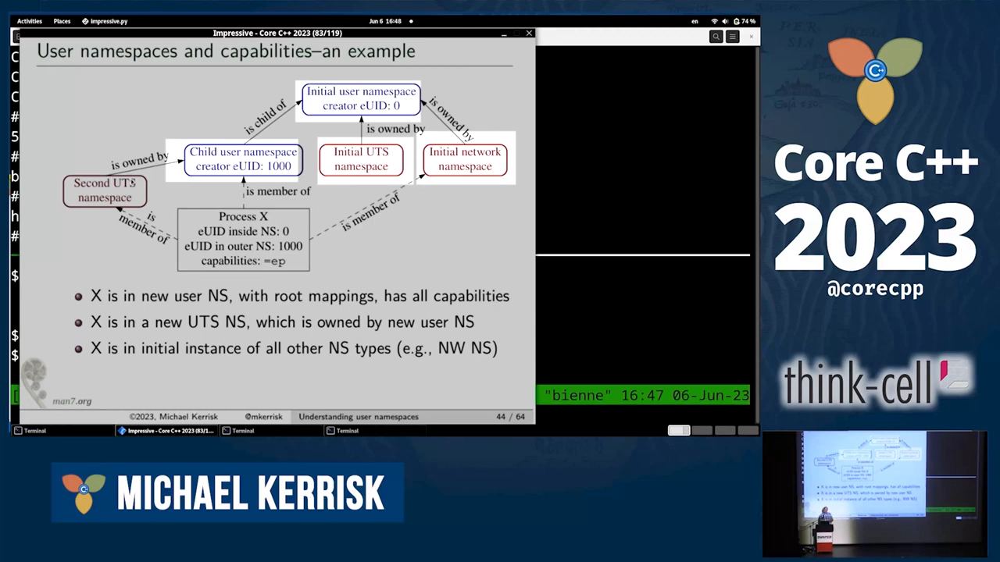

### 5.3 对照实验：能改主机名，不能动网络

- **改主机名（CAP_SYS_ADMIN）**：内核问"该进程属于哪个 UTS 命名空间？"→ 新 UTS；"谁拥有它？"→ 新用户命名空间；"进程在那里有 CAP_SYS_ADMIN 吗？"→ 有 → **放行**。
- **关掉 lo 网卡（CAP_NET_ADMIN）**：内核问"属于哪个网络命名空间？"→ **初始**网络命名空间；"谁拥有它？"→ 初始用户命名空间；"进程在初始用户命名空间里有能力吗？"→ **没有**（能力只在它自己的用户命名空间里）→ **拒绝**。[【跳转到 30:10】](https://www.youtube.com/watch?v=XgThPoL9mPE&t=1810)

### 5.4 推广到容器

容器就是"新用户命名空间 + 拥有其余每类命名空间的一个实例"：新用户命名空间拥有容器专属的 PID、UTS、mount、network 命名空间等，容器内的 init 进程（PID 1）就在其中运行。[【跳转到 32:08】](https://www.youtube.com/watch?v=XgThPoL9mPE&t=1928)

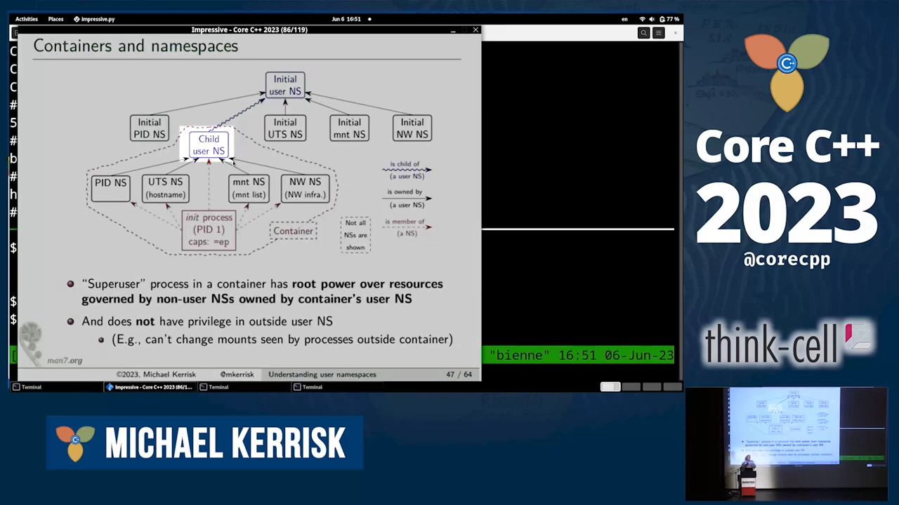

### 5.5 可视化与复验

用层级树程序（缩进表示父子关系或拥有关系）可直观看到：初始 mount/network/UTS 命名空间都归初始用户命名空间所有；新的 UTS 命名空间归新用户命名空间所有；同时可见各进程的命名空间成员关系。复验：**不带 sudo** 执行 `unshare -U -r -u`——创建用户命名空间不需要任何能力，而新进程自动获得全套能力，于是还能顺带创建 UTS 等其它命名空间；此时改主机名**成功**（UTS 归自己管）；而对 lo 网卡做 `ip link set dev lo down` 仍**失败**（网络命名空间归初始用户命名空间管）。[【跳转到 34:18】](https://www.youtube.com/watch?v=XgThPoL9mPE&t=2058)

## 六、为什么它是"非特权容器的基石"

### 6.1 无特权容器成为现实

这整套机制的**原动力**就是非特权容器：不需要超户就能启动容器、做容器的事。Docker、LXC 等都在用用户命名空间实现非特权容器。[【跳转到 40:03】](https://www.youtube.com/watch?v=XgThPoL9mPE&t=2403)

### 6.2 浏览器沙箱：替换掉危险的 setuid helper

浏览器用这套基础设施沙箱化渲染进程。历史上靠 set-user-ID-root 辅助程序实现，而这类程序可能被本地攻破；改用用户命名空间后，系统里不再有 set-user-ID-root 程序这个攻击点，安全性更高。[【跳转到 40:28】](https://www.youtube.com/watch?v=XgThPoL9mPE&t=2428)

### 6.3 一个漂亮的技巧：映射表里没有 UID 0

还可以构造这样的映射：普通 ID 映射为**命名空间外的同一个 ID**，长度 1。此时该命名空间里**根本不存在 UID 0**——进程想通过切换到 UID 0 获得超户权力都无路可走，因为"0 号用户"在这个命名空间里不存在。这是一种非常有趣的保证。[【跳转到 41:18】](https://www.youtube.com/watch?v=XgThPoL9mPE&t=2478)

### 6.4 同源技术：Firejail、Flatpak/Snap

- **Firejail**：通用沙箱工具，用命名空间 + cgroups + seccomp 等搭建；安装即带大量常见应用的预置 profile，开箱即可给应用加沙箱。
- **Flatpak/Snap**：应用打包工具，把应用连同全部依赖打包；用户装好 Flatpak、下载包即可直接运行——同样建在这套基础设施上。[【跳转到 42:33】](https://www.youtube.com/watch?v=XgThPoL9mPE&t=2553)

### 6.5 延伸资料

Kerrisk 在 LWN 写过命名空间系列文章，也写了相关手册页；另一篇值得读的是《Linux containers in 500 lines of code》——逐行注释"把一个进程隔离成容器样式需要哪些步骤"。有意思的结论：隔离本身**用不了多少代码**；Docker 之大，大在配套的基础设施与编排，而非隔离代码本身。[【跳转到 43:23】](https://www.youtube.com/watch?v=XgThPoL9mPE&t=2603)

## 七、Q&A 精选

- **要多个进程才能有多个命名空间吗？** 不用。系统调用可用标志同时创建多类命名空间；多数类型需要 CAP_SYS_ADMIN，但**用户命名空间是例外**——普通用户可创建，而新进程随即获得全套能力，所以可以"先建用户命名空间，同一命令里再建其它命名空间"，一步完成。演示：新建用户 + UTS + 网络命名空间后，在新网络命名空间里能成功关闭 lo（网络命名空间这次归自己管）。[【跳转到 44:38】](https://www.youtube.com/watch?v=XgThPoL9mPE&t=2678)
- **SELinux 会怎么配合？** SELinux 策略可以拒绝特权操作，但据其所知 SELinux 策略**不做命名空间化**——无法按用户命名空间区分策略。[【跳转到 46:13】](https://www.youtube.com/watch?v=XgThPoL9mPE&t=2773)
- **外面的进程能看到新网络命名空间里的设备吗？** 看不到；想看只能自己进入那个网络命名空间。[【跳转到 47:03】](https://www.youtube.com/watch?v=XgThPoL9mPE&t=2823)
- **文件权限如何与映射互动？** 做文件类操作时，进程凭证会**映射回初始用户命名空间的等价值**再判定：命名空间内 UID 0，落到初始命名空间是 UID 1000，所以在根目录创建文件这类事依然做不了。[【跳转到 47:28】](https://www.youtube.com/watch?v=XgThPoL9mPE&t=2848)
- **能移动别的进程进命名空间吗？** 底层系统调用是 `setns`：进程**只能移动自己**进入另一个（已存在的）命名空间，前提是有相应特权。[【跳转到 47:53】](https://www.youtube.com/watch?v=XgThPoL9mPE&t=2873)
- **nsenter 进去后凭证怎么定？** 由**已有的映射**决定：nsenter 进入目标用户命名空间时，按 `uid_map` 换算——外面 UID 1000，进去就是 UID 0（演示中 sudo nsenter 后 id 显示 0/0）。[【跳转到 49:58】](https://www.youtube.com/watch?v=XgThPoL9mPE&t=2958)

## 小结

- 用户命名空间给 UID/GID 引入**按命名空间的映射**：同一进程，命名空间内可拥有 UID 0，命名空间外仍是普通用户。
- 两个配套文件 `/proc/PID/uid_map`、`/proc/PID/gid_map` 以"内起始、外起始、长度"三列描述映射；`unshare -U -r` 一条命令即可体验"内 root 外普通"。
- 内核给新用户命名空间的第一个进程**全套 capabilities，但仅限本命名空间**；映射 ≠ 授权，权力出不了命名空间。
- 特权检查模型：资源 → 所属非用户命名空间 → 拥有它的用户命名空间 → 检查该命名空间内的能力。改主机名成功、关 lo 失败的对照实验就是这条链的体现。
- 创建用户命名空间**不需要任何能力**——这是普通用户能玩转命名空间、实现非特权容器的关键；还可借新进程的全套能力一步创建多类命名空间。
- 它是非特权容器（Docker/LXC）、浏览器沙箱、Firejail、Flatpak/Snap 的共同基石；"映射表里没有 UID 0"更是把"提权到 root"这条路直接堵死。

## 关键术语速查

| 术语 | 一句话解释 |
| --- | --- |
| 用户命名空间（user namespace） | 为 UID/GID 提供按命名空间映射的命名空间类型；非特权容器的基石 |
| 初始命名空间实例 | 系统启动时每类命名空间的第一个实例；每个进程在 8 类命名空间中各属一个实例 |
| `/proc/PID/ns` | 每类命名空间一个符号链接，内容为实例唯一的 inode 号，可判断进程归属 |
| `unshare` / `nsenter` | 创建新命名空间 / 进入已存在命名空间的命令；`-t PID` 指定参照进程 |
| capabilities | 把 root 权力拆成的 41 项能力；可单独赋予二进制以缩小攻击面 |
| `CAP_SYS_ADMIN` / `CAP_NET_ADMIN` | 管理类/网络类特权能力；实验中分别对应"改主机名"与"动网卡" |
| `/proc/PID/uid_map`、`gid_map` | 描述命名空间内外 ID 映射的文件：内起始、外起始、长度 |
| 层级与归属 | 用户命名空间之间有父子层级；非用户命名空间由创建者所在的用户命名空间拥有 |
| `setns` | 把**自己**移入另一个已存在命名空间的系统调用；不能移动别的进程 |
