# Linux Namespaces 深入：容器的"隔离"地基（八种命名空间全解）

> 视频来源：[Linux Namespaces Deep Dive - The Isolation Foundation（YouTube，MattOps）](https://www.youtube.com/watch?v=kHTzpq1uGxM)，约 23 分钟。本篇严格基于视频内容（含全部演示命令与输出）整理。

## 本篇要解决的核心问题

**背景**：`docker run nginx` 一敲，容器瞬间启动；在容器里 `ps aux`，只能看到区区两三个进程。

**冲突**：可宿主机上明明跑着一大堆进程。容器和宿主机用的是**同一个内核、同一套硬件、同一份内存**，凭什么容器看到的是完全不同的"现实"？它到底运行在什么之上？

**疑问**：这种"同一内核、不同世界"的魔法，内核是怎么做到的？一共有几种"世界"，又是怎么创建和进入的？

**回答（中心思想）**：答案是 **namespace——Linux 内核中创建"系统资源隔离视图"的机制**。Linux 一共提供**八种** namespace，每种隔离一种内核资源；用 **clone / unshare / setns** 三个系统调用创建和进入。要特别记住：namespace 提供的是**可见性隔离，不是安全边界**——它让进程互相"看不见"，但不负责"防攻击"。

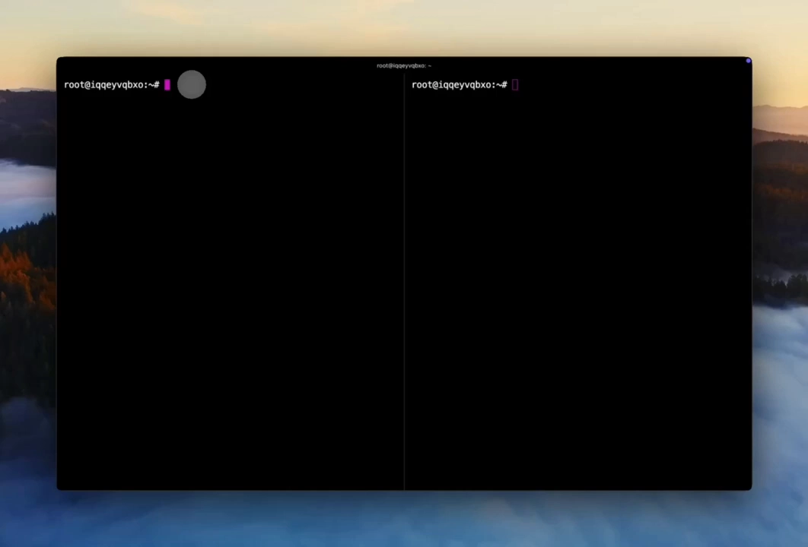

## 一、为什么需要 namespace：从 chroot 到内核机制

回到 2000 年代初，想在 Linux 上做进程隔离，选择很有限：

- **chroot**：能做文件系统隔离，但进程之间仍然互相可见；
- **虚拟机**：隔离彻底，但开销巨大。

于是 2002 年起，Linux 开发者开始在内核中加入 namespace 支持：第一个是 **mount namespace（内核 2.4.19）**；到 **2013 年**，随着 user namespace 补齐，所有拼图才凑齐；最新的 **time namespace 于 2020 年落在内核 5.6**。

[【跳转到 00:32】](https://www.youtube.com/watch?v=kHTzpq1uGxM&t=32)

## 二、同一内核，不同现实：namespace 的工作原理

namespace 强大的原因在于：**它在内核层运作，不靠包装或模拟任何东西**。当一个进程发起系统调用——比如 `getpid` 想拿自己的进程号——内核会**根据这个进程所属的 namespace 返回不同的答案**。同一个内核，不同视角的现实。

[【跳转到 01:44】](https://www.youtube.com/watch?v=kHTzpq1uGxM&t=104)

这正是容器的基础：当你运行 docker、containerd 或 podman 时，它们就是在**调用内核函数创建 namespace**；Kubernetes 创建 Pod 时，编排的也是 namespace 的创建与共享。理解了 namespace，才理解容器在最低层到底是什么。

## 三、八种 namespace 全景

Linux 恰好提供**八种** namespace，每种隔离一种不同的内核资源。"隔离"的精确定义是：**不同 namespace 里的进程，向内核询问该资源时，会得到不同的答案**。

[【跳转到 02:34】](https://www.youtube.com/watch?v=kHTzpq1uGxM&t=154)

| # | namespace | 隔离的内核资源 |
| --- | --- | --- |
| 1 | **PID** | 进程号编号空间 |
| 2 | **mount** | 文件系统挂载表 |
| 3 | **network** | 整个网络协议栈 |
| 4 | **IPC** | System V / POSIX 进程间通信对象 |
| 5 | **UTS** | 主机名与 NIS 域名 |
| 6 | **user** | UID/GID 映射 |
| 7 | **cgroup** | cgroup 层级的视图 |
| 8 | **time** | 系统时钟 |

再次强调（视频说这是最常见的误解）：**namespace 提供可见性隔离，不提供安全边界**——它防止进程互相看见，但不防止攻击。安全来自其他机制：cgroups、seccomp、AppArmor、SELinux。

[【跳转到 02:59】](https://www.youtube.com/watch?v=kHTzpq1uGxM&t=179)

### 3.1 逐个要点

- **PID namespace**：隔离进程号空间。新 namespace 里第一个进程成为 **PID 1（init 进程）**；里面的进程看不到外面，外面的也看不到里面。内核为每个 namespace 维护一棵**独立的 PID 树**；`getpid` 时内核沿 namespace 层级向上"翻译" PID。父 namespace 能看到子 namespace 的进程（以父层的 PID 显示）；而从子 namespace 看，**父层的其他进程根本不存在**。

  [【跳转到 03:36】](https://www.youtube.com/watch?v=kHTzpq1uGxM&t=216)

- **mount namespace**：隔离文件系统挂载表，每个 namespace 有自己的挂载点集合。关键细节是**传播模式**：`MS_SHARED`、`MS_PRIVATE`、`MS_SLAVE`——容器运行时使用 `MS_PRIVATE`，确保容器内的挂载不会传播到宿主机；这就是 Docker 挂载卷却"不弄脏"宿主机挂载表的原理。

  [【跳转到 04:51】](https://www.youtube.com/watch?v=kHTzpq1uGxM&t=291)

- **network namespace**：隔离整个网络栈——网络接口、IP 地址、路由表、iptables 规则、套接字。每个网络 namespace 有自己的 loopback、自己的路由决策、自己的防火墙规则。**这是容器网络的地基**：每个容器拿到一个网络 namespace，通过 veth pair 连接宿主机。

  [【跳转到 05:16】](https://www.youtube.com/watch?v=kHTzpq1uGxM&t=316)

- **IPC namespace**：隔离 System V IPC 对象——共享内存段、信号量、消息队列，以及 POSIX 消息队列。没有 IPC 隔离的话，不同容器的进程可以通过共享内存通信，隔离就被打破了。

  [【跳转到 06:06】](https://www.youtube.com/watch?v=kHTzpq1uGxM&t=366)

- **UTS namespace**（Unix Time Sharing）：隔离主机名和 NIS 域名。简单但必不可少：让每个容器有自己的主机名——你在容器里设置 hostname，改的只是这个 UTS namespace 里的值。

  [【跳转到 06:31】](https://www.youtube.com/watch?v=kHTzpq1uGxM&t=391)

- **user namespace**：安全关键型。它提供 namespace 之间的 **UID/GID 映射**：可以把 namespace **内部的 UID 0（root）映射为外部的非特权 UID**。这是 **rootless 容器**的根基：进程在 namespace 内拥有 root 特权（许多应用需要），在外却毫无特权。映射通过 `/proc/self/uid_map` 和 `/proc/self/gid_map` 配置，内核会检查父 namespace 中的 `CAP_SETUID` 以允许映射。

  [【跳转到 06:56】](https://www.youtube.com/watch?v=kHTzpq1uGxM&t=416)

- **cgroup namespace**（本篇主角之一）：隔离 **cgroup 层级的视图**。cgroup namespace 里的进程，会把自己**当前所在的 cgroup 看作根**；这就防止了容器查看或修改**宿主机的 cgroup 层级**。

  [【跳转到 07:41】](https://www.youtube.com/watch?v=kHTzpq1uGxM&t=441)

- **time namespace**：只隔离系统时钟，是今天生产环境中使用最少的 namespace。

  [【跳转到 07:46】](https://www.youtube.com/watch?v=kHTzpq1uGxM&t=466)

## 四、三个系统调用与"调试超能力"

namespace 由三个系统调用控制：

- **clone**：在新的 namespace 中创建新进程——容器运行时用的就是它；
- **unshare**：把调用进程自己移入新的 namespace；
- **setns**：加入已存在的 namespace——`nsenter`、`docker exec`、`kubectl exec` 全靠它。

[【跳转到 08:11】](https://www.youtube.com/watch?v=kHTzpq1uGxM&t=491)

每个进程都会通过 **`/proc/<pid>/ns` 目录**暴露自己的 namespace。里面是特殊的符号链接，**方括号里的数字就是 namespace 的 inode 号**：两个进程在某个 namespace 上 inode 相同 = 它们共享该 namespace。这就是排查容器隔离问题的"超能力"——比如 Pod 里的容器之间不通，就查它们的网络 namespace inode 是否一致。

[【跳转到 09:06】](https://www.youtube.com/watch?v=kHTzpq1uGxM&t=546)

另外，大多数 namespace 是**扁平**的（没有父子关系），但 **PID 和 user namespace 是层级的**：PID 父 namespace 能看到子进程，子看不到父；user namespace 可嵌套，实现级联 UID 映射——这是"嵌套容器"的原理，实际很少用。

[【跳转到 09:48】](https://www.youtube.com/watch?v=kHTzpq1uGxM&t=588)

## 五、实验一：PID 命名空间与 PID 1 的责任

视频用与容器运行时相同的工具手动创建 namespace——**每条命令都是你运行容器时幕后发生的事**。

先看宿主机：一大堆进程。然后：

```bash
unshare --pid --fork --mount-proc bash
```

参数逐个解释：`--pid` 创建新 PID namespace；`--fork` 在执行 bash 前先 fork——**关键**，因为 fork 出的子进程会成为 PID 1；`--mount-proc` 重新挂载 /proc 目录，让它只显示本 namespace 的进程。

[【跳转到 10:53】](https://www.youtube.com/watch?v=kHTzpq1uGxM&t=653)

结果：从一大堆进程变成**只剩两个**，而且 bash 就是 **PID 1**——本 namespace 的 init 进程。

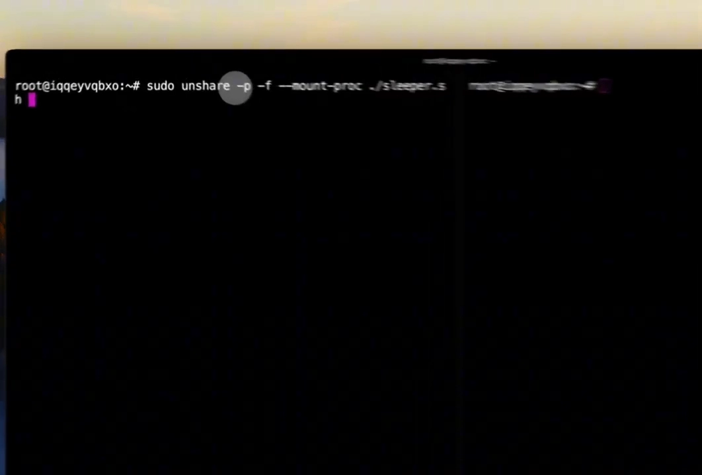

从宿主机视角查同一个进程：**同一个进程，两个不同的 PID**——这就是 namespace 的"翻译"：内核根据提问者所在的 namespace 给出不同答案。

**PID 1 是有责任的**：当 PID 1 退出时，内核会终止该 namespace 里的**所有**进程。这正是 `docker stop` 容器时发生的事——容器的 PID 1 退出，所有进程被清理。

[【跳转到 11:59】](https://www.youtube.com/watch?v=kHTzpq1uGxM&t=719)

两个易踩的坑（视频原话）：
- **不 `--fork`**：unshare 进程自己会成为 PID 1，然后 exec bash——就没有进程来维持这个 namespace 了；
- **不重挂 /proc**：你仍然会看到宿主机的进程——因为 /proc 还是从父 mount namespace 挂载的；需要新的 mount namespace 加重挂的 /proc，才能"只看到自己 namespace 的进程"。

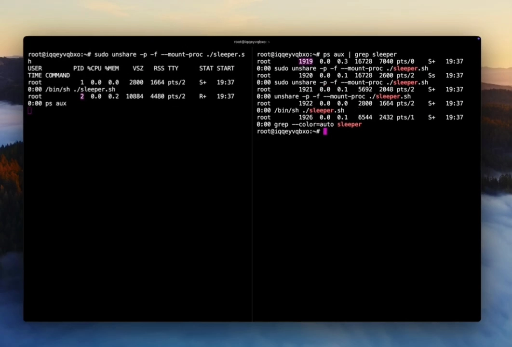

## 六、实验二：网络命名空间与 veth pair——Docker 网络的真相

网络 namespace 是容器网络的地基，视频完整演示了 Docker 连接容器到网络的方式。

先创建两个**持久化**网络 namespace（挂载在 `/var/run/netns` 目录下，即使没有进程运行也能存活）：

```bash
ip netns add ns1
ip netns add ns2
```

看看里面：**完全的网络隔离**——除了 loopback 没有任何接口，这个 namespace 无法与任何东西通信。

[【跳转到 13:05】](https://www.youtube.com/watch?v=kHTzpq1uGxM&t=785)

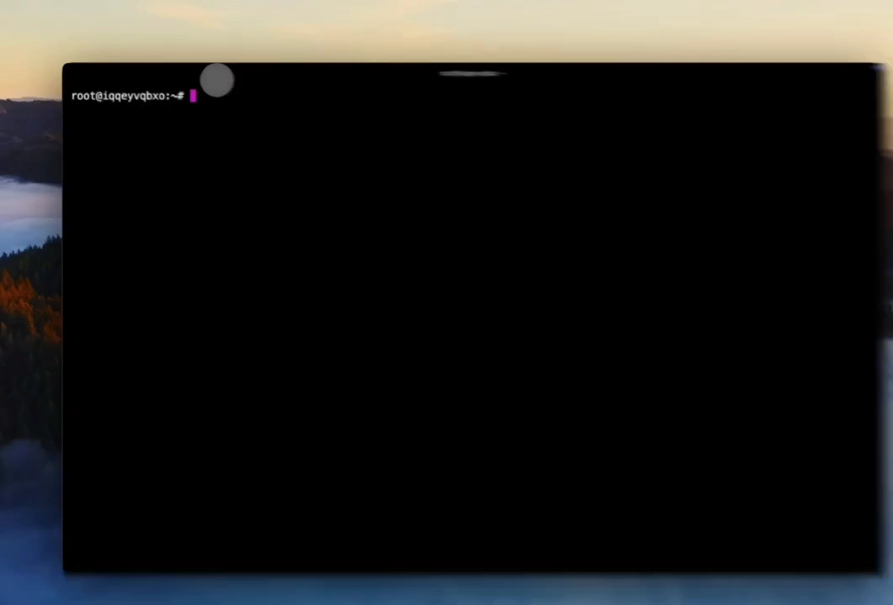

接下来创建一对**虚拟以太网（veth）**——把它想成一根虚拟网线：veth1 和 veth2 相连，从一端发出去的包会从另一端出来。把两端分别**移入**两个 namespace：它们从宿主机上消失，进入了 namespace 内部。配好 IP 后，"见证时刻"——ns1 能 ping 通 ns2 吗？

[【跳转到 14:31】](https://www.youtube.com/watch?v=kHTzpq1uGxM&t=871)

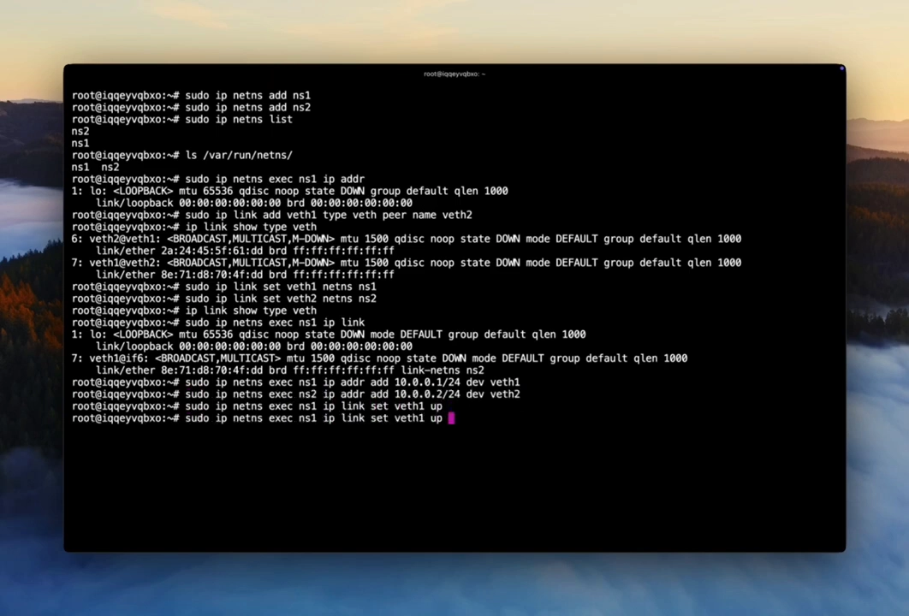

完美连通。**这正是 Docker 的做法**：为每个容器创建一个网络 namespace，创建一对 veth，一端放进容器，另一端接在宿主机的 **docker0 网桥**上。每个 namespace 都有自己的路由表、iptables 规则、套接字——真实的网络隔离。Kubernetes 创建 Pod 时，地基同样是这个：一个隔离的网络栈连入集群网络。

[【跳转到 14:51】](https://www.youtube.com/watch?v=kHTzpq1uGxM&t=891)

## 七、实验三：mount 命名空间——只属于你的文件系统视图

mount namespace 改变文件系统视图而不影响宿主机：

```bash
unshare -m   # -m 创建新的 mount namespace
```

进入新的 mount namespace 后，挂载一个 tmpfs 文件系统并写入一些数据；然后退出这个 namespace——**目录还在，但空的**：挂载消失了。挂载只存在于那个 namespace 里，宿主机文件系统原封不动。

[【跳转到 15:55】](https://www.youtube.com/watch?v=kHTzpq1uGxM&t=955)

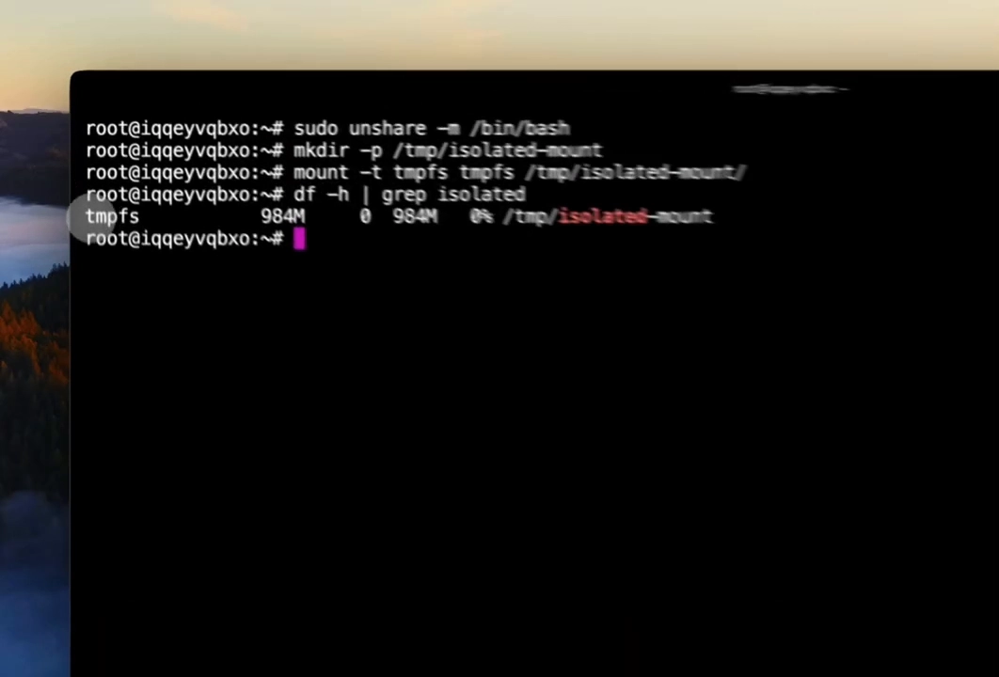

容器能挂载卷、创建 overlay 文件系统、修改自己的文件系统视图而不影响宿主机——原理就是它。

## 八、实验四：user 命名空间——rootless 容器的根基

user namespace 是安全关键型，它让你**在 namespace 内以 root 运行进程，在外却是非特权用户**。最神奇的是：普通用户即可创建，**不需要 sudo**：

```bash
unshare -U -r   # -U 创建 user namespace；-r 把当前用户映射为 root
```

检查：namespace 内确实是 root。但试图影响宿主机时——**Permission denied**。所以，其实并不是真的 root。

[【跳转到 16:49】](https://www.youtube.com/watch?v=kHTzpq1uGxM&t=1009)

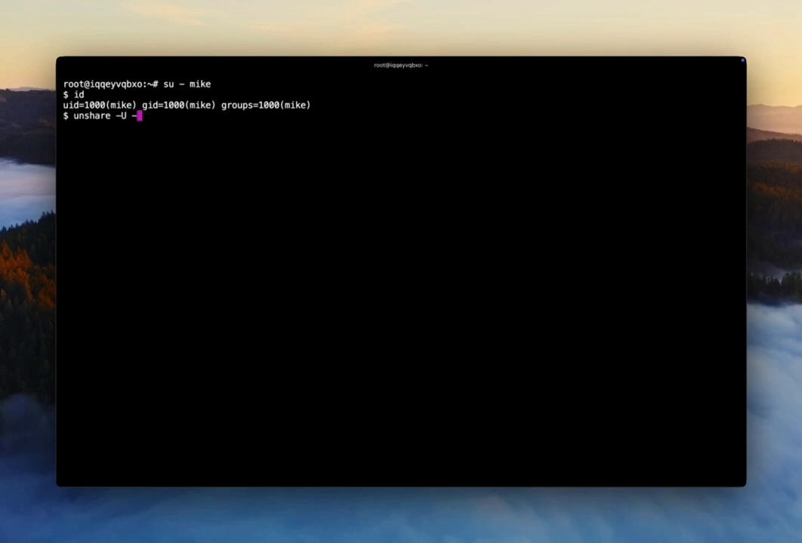

查看 UID 映射：**namespace 内的 UID 0 映射到外面的 UID 1000**，映射范围为 1 个 UID。

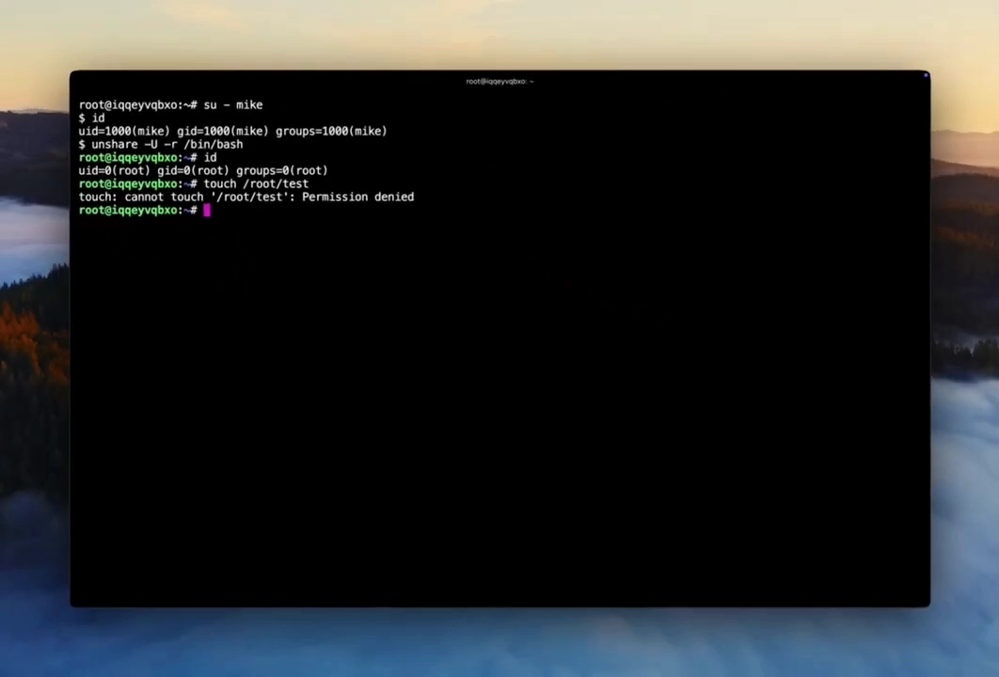

应用场景：需要 root 特权的应用可以在 namespace 内以 root 运行——绑定特权端口、修改自己的 UID、管理自己的进程；但一旦"逃出" namespace 或试图影响宿主机，特权为零。这就是 **rootless 容器**（Podman、rootless Docker）的根基：容器进程在内是 root，在外无特权。

[【跳转到 17:36】](https://www.youtube.com/watch?v=kHTzpq1uGxM&t=1056)

## 九、连回真实容器与 Kubernetes

### 9.1 检查真实容器的 namespace

运行一个 docker 容器并检查它的 namespace（看 inode 号），与当前进程对比：容器拥有**不同的 PID、mount、network、IPC、UTS 和 cgroup namespace**，但**相同的 user namespace 和 time namespace**——Docker 默认不使用 user namespace，因为太复杂。

[【跳转到 18:14】](https://www.youtube.com/watch?v=kHTzpq1uGxM&t=1094)

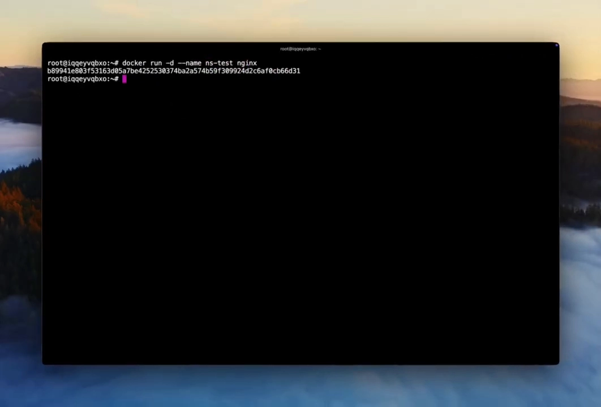

接下来用 nsenter 进入容器的网络 namespace，**不用 docker exec** 就能看到容器的网络接口。`docker exec` 和 `kubectl exec` 的工作原理正是如此：**用 setns 系统调用进入容器的 namespace**。掌握这一点，你就有了调试超能力——不依赖任何容器工具，只用 `/proc` 目录和 nsenter 就能检查任何容器的 namespace。`lsns` 命令则能列出系统上的所有 namespace，关键时刻非常有用。

[【跳转到 18:43】](https://www.youtube.com/watch?v=kHTzpq1uGxM&t=1123)

### 9.2 Kubernetes Pod：一组共享 namespace 的容器

Kubernetes 的 Pod **不是单个容器**，而是**一组共享特定 namespace 的容器**。创建 Pod 时的顺序是：

1. kubelet 调用容器运行时（例如 containerd）创建 sandbox；
2. 运行时创建 **pause 容器**——一个除了睡眠什么都不做的最小容器；
3. **pause 容器创建 network、IPC 和 UTS namespace**；
4. Pod 里所有应用容器**加入这些共享 namespace**，但**各自拥有独立的 PID 和 mount namespace**。

[【跳转到 19:32】](https://www.youtube.com/watch?v=kHTzpq1uGxM&t=1172)

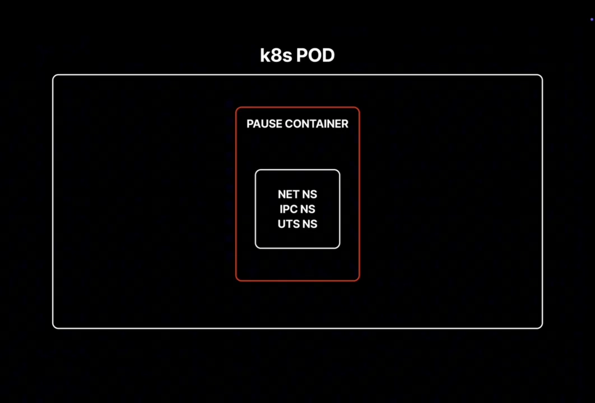

这就是 Pod 内容器能用 **localhost** 互相通信的原因：它们共享同一个网络 namespace——同一个网络栈、同一个 loopback、同一个 IP 地址。

PID namespace 共享是可选的：在 Pod spec 里设置 `shareProcessNamespace: true`，开启后所有容器能看到 Pod 内所有进程——讲者表示他从来不用。另外，namespace 操作有性能影响：**每经过一次 veth pair 的包都有上下文切换开销**；使用 eBPF 的 CNI 插件（如 Cilium）能在内核层、namespace 边界检查之前处理数据包，降低网络 namespace 的开销。

[【跳转到 20:30】](https://www.youtube.com/watch?v=kHTzpq1uGxM&t=1230)

## 十、小结：隔离 + 限制 = 完整的容器地基

回顾本篇要点：

- namespace 是 Linux 内核**创建系统资源隔离视图**的机制，**恰好八种**：PID、mount、network、IPC、UTS、user、**cgroup**、time；
- 手动创建 namespace 用的系统调用，与容器运行时**完全相同**（clone/unshare/setns）；
- **`/proc/<pid>/ns` 目录是你的调试接口**：比较 inode 号，即可知道哪些进程共享哪些 namespace；
- 生产关联：Kubernetes Pod 是共享 network/IPC/UTS namespace 的容器组；`kubectl exec` 用 setns 进入；排查网络问题 = 排查 namespace 隔离与 veth pair 配置。

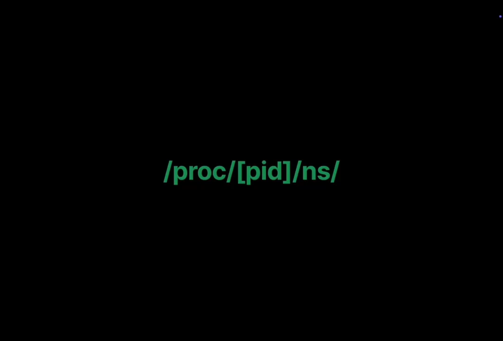

最后是全片的**关键洞见**：**容器不是魔法——容器就是进程**：通过 namespace 获得内核资源的隔离视图，通过 cgroup 获得资源限制（下一讲的主题）。**namespace 给隔离，cgroup 给限制，合在一起才是完整的容器地基**。理解内核层的 namespace，就理解了容器；理解了容器，就理解了 Kubernetes Pod。视频的后续还将深入容器网络原语：veth pair、Linux bridge，以及建立在它们之上的 CNI 插件。

[【跳转到 21:01】](https://www.youtube.com/watch?v=kHTzpq1uGxM&t=1261)

## 关键术语速查

| 术语 | 一句话解释 |
| --- | --- |
| namespace | 内核机制：为系统资源创建隔离视图，进程按所属 namespace 获得不同的"答案" |
| PID namespace | 独立进程号空间；第一个进程是 PID 1，退出时内核终止全 namespace 进程 |
| mount namespace | 独立挂载表；传播模式 MS_SHARED/PRIVATE/SLAVE，运行时用 PRIVATE 防向宿主传播 |
| network namespace | 独立网络栈：接口、IP、路由表、iptables、套接字 |
| IPC namespace | 独立的共享内存、信号量、（POSIX）消息队列 |
| UTS namespace | 独立主机名与 NIS 域名 |
| user namespace | UID/GID 映射：内为 root、外为非特权；rootless 容器的根基 |
| cgroup namespace | 隔离 cgroup 层级视图：ns 内把当前 cgroup 视为根，看不到宿主机层级 |
| time namespace | 隔离系统时钟；生产中最少使用 |
| clone / unshare / setns | 新 ns 中建进程 / 把自己移入新 ns / 加入已有 ns（exec 类工具的原理） |
| /proc/&lt;pid&gt;/ns | 每个进程的 namespace 符号链接；inode 相同 = 共享该 namespace |
| lsns | 列出系统上所有 namespace |
| veth pair | 虚拟网线：一端发包另一端收；Docker 用它连接容器与 docker0 网桥 |
| pause 容器 | Pod 中只睡眠的最小容器，持有 Pod 共享的 network/IPC/UTS namespace |
| shareProcessNamespace | Pod spec 选项：开启后 Pod 内所有容器共享 PID namespace |
