# Linux 中的 namespace 与 cgroup：容器隔离与限制的两块地基

> 视频来源：[Linux中的namespace与cgroup（Bilibili，UP 主：wharton0）](https://www.bilibili.com/video/BV1zX4y147fv/)，约 30 分钟。视频逐段精读 Nginx（F5）的文章 *What Are Namespaces and Cgroups, and How Do They Work?* 并上手演示。本篇严格基于视频内容整理。

## 本篇要解决的核心问题

**背景**：容器早已是日常——`docker run` 一敲，应用就跑在"独立环境"里；Docker、Kubernetes 已经改变了现代应用的开发与交付方式，让你无需构建单独的虚拟机就能快速部署和运行软件。

**冲突**：但容器并不是虚拟机。它就是运行在这台服务器上的一个普通进程，和宿主机共用同一个内核、同一份内存。不用第二个操作系统，一个进程凭什么既能"看不见别人"，又能"用不超量"？

**疑问**：容器的隔离和资源限制，底层到底是什么？两者如何分工、如何配合？

**回答（中心思想）**：容器由两项 Linux 内核技术撑起——**namespace 负责"隔离"，决定一组进程能"看到"哪些资源；cgroup 负责"限制"，决定这组进程"能用多少"资源。前者是进程视角，后者是资源视角**。理解这两块地基，容器的一切行为都有据可查。

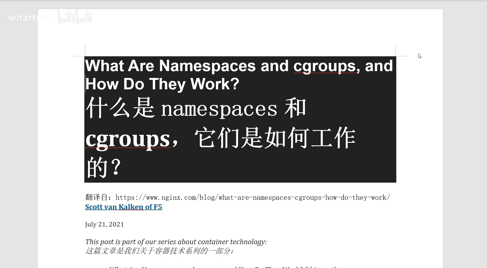

## 一、容器幕后的两项内核技术

### 1.1 容器的流行史，就是 namespace 的翻身史

namespace 自 2002 年起就是 Linux 内核的一部分，此后内核不断加入更多工具和 namespace 类型；而真正让这套机制"被大众接受"的转折点，是 2013 年前后 Docker 兴起——当容器火起来，namespace 的价值才被彻底放大。

[【跳转到 02:21】](https://www.bilibili.com/video/BV1zX4y147fv/?t=141)

视频精读的文章作者来自 Nginx 所属的 F5 公司，是一位架构师；他研究自家开源的多语言应用服务器 NGINX Unit 时注意到，Unit 同时支持 namespace 和 cgroups 来做进程隔离——这正是"不止容器在用这两项技术"的一个活例子（结论部分还会回到这一点）。

### 1.2 容器的本质：一个被"换了视角"的进程

在讲机制之前先校准一个认知：**容器不是虚拟机，而是一个进程**。开发人员启动两个容器，实际上就是在一台服务器的某处运行了两个进程，只是它们相互隔离。

[【跳转到 04:51】](https://www.bilibili.com/video/BV1zX4y147fv/?t=291)

隔离的动机也很直白：一台服务器上跑着许多服务时，把每个服务及其关联进程与其他服务隔开——某个服务变动的影响范围小了，安全暴露面也小了，管理也更简单。这正好符合 Martin Fowler 所描述的微服务架构风格。

对开发者来说，容器用起来"感觉像一台完整的虚拟机"——那只是因为隔离做得好，让你产生了整机的错觉。

## 二、namespace：让每个进程活在自己的世界里

### 2.1 定义：给内核资源"分区"

维基百科的定义比较"硬"：namespace 是 Linux 内核的一项功能，**对内核资源进行分区，使一组进程看到一组资源，而另一组进程看到不同的一组资源**。

[【跳转到 03:36】](https://www.bilibili.com/video/BV1zX4y147fv/?t=216)

说白了就是：不同进程各看各的资源、彼此看不见。namespace 的关键特性就是**让进程彼此隔离**。

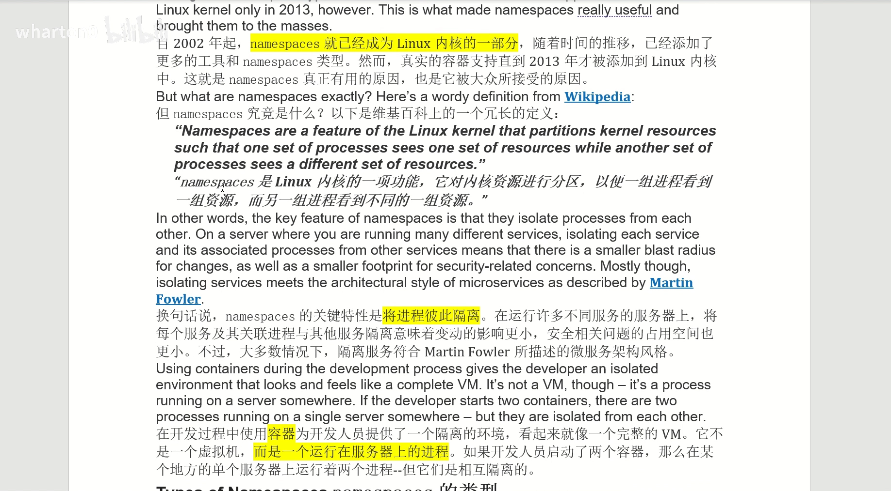

### 2.2 视频中讲到的六种 namespace

Linux 内核里有多种类型的 namespace，每种都有自己独特的属性。视频重点讲了六种：

[【跳转到 05:41】](https://www.bilibili.com/video/BV1zX4y147fv/?t=341)

| 类型 | 隔离什么 |
| --- | --- |
| **user（用户）** | 一套独立的用户 ID / 组 ID。一个进程可以在自己的 user namespace 里拥有 root 权限，而在其他 user namespace 中没有 |
| **PID（进程号）** | 一套独立的 PID 编号。新 namespace 里第一个进程是 PID 1，子进程依次编号；同一个进程在不同 namespace 里 PID 不同 |
| **network（网络）** | 整个网络协议栈：专用路由表、IP 地址池、套接字列表、连接跟踪表、防火墙 |
| **mount（挂载）** | 一份独立的挂载点列表。可以在自己的 mount namespace 里挂载/卸载文件系统，不影响宿主机 |
| **IPC（进程间通信）** | 独立的 IPC 资源，比如 POSIX 消息队列——实际主要用在消息队列这类场景 |
| **UTS（主机名）** | 主机名和 NIS 域名。让单个系统对不同的进程显示为不同的主机名/域名 |

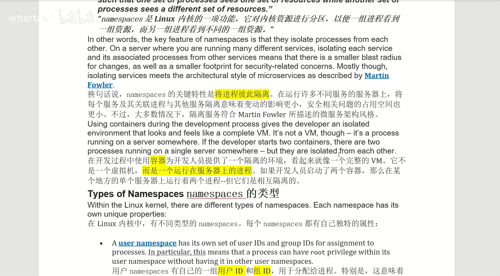

这些 namespace 的主要目的都是**隔离进程**：进程需要的各类属性，被切成了一个个"独立的视角"。

### 2.3 用一张图看懂 PID namespace 的层级

namespace 之间不是孤岛，PID namespace 有父子层级。视频用一张图讲解了三个 PID namespace（一个父 + 两个子）的关系：

[【跳转到 08:51】](https://www.bilibili.com/video/BV1zX4y147fv/?t=531)

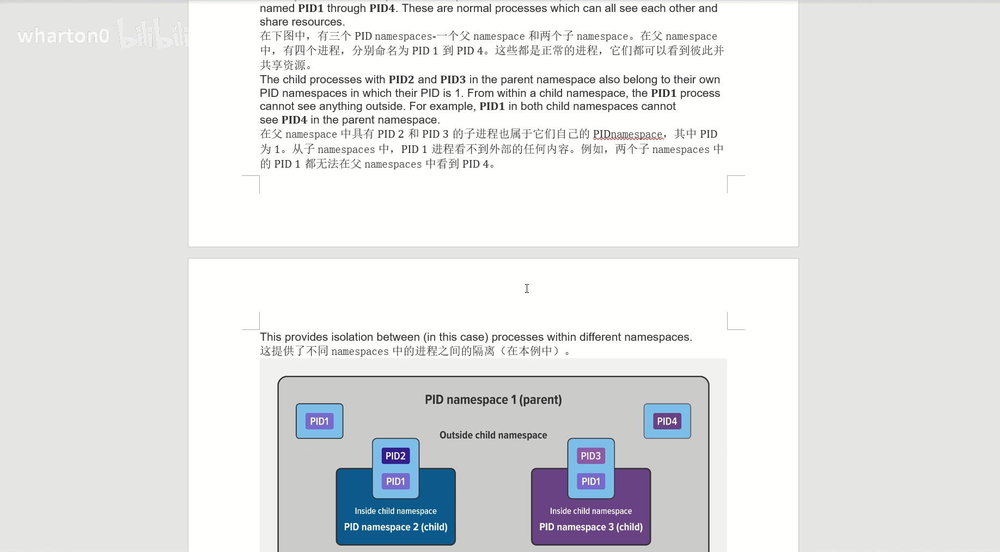

- 父 namespace 里有四个进程：PID1、PID2、PID3、PID4；
- PID2 和 PID3 的子进程又各自属于新的 PID namespace（图中两个子 namespace）；
- **可见性规则**：父 namespace 能看到子 namespace 里的进程（以父层的 PID 编号显示）；反过来，从子 namespace 往外看，父层的其他进程"不存在"；两个兄弟子 namespace 之间也互相看不见；
- 从 PID namespace 2 内部看，只能看到自己 namespace 里的东西（比如它自己）。

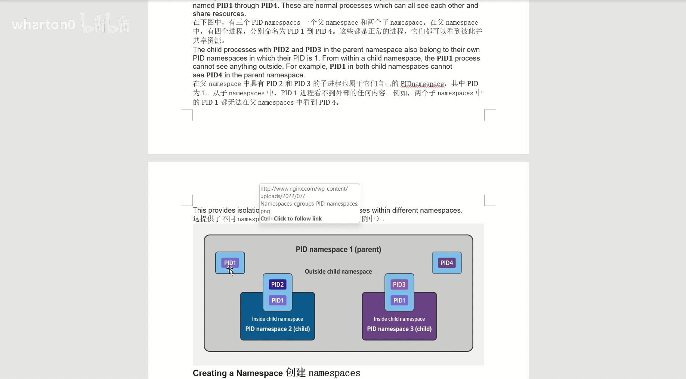

一句话总结：**namespace 就是在里面做隔离**——进去之后，世界只剩下你的 namespace 允许你看到的部分。

## 三、动手实验：用 unshare 亲手创建 namespace

理论讲完，视频用 `unshare` 命令实际创建了一个新 namespace 来巩固理解。手册页对它的解释正合需求：**run program in a new namespace——在新的 namespace 里运行程序**。

[【跳转到 11:54】](https://www.bilibili.com/video/BV1zX4y147fv/?t=714)

### 3.1 实验准备

作者以普通用户 `svk` 身份登录：有自己的用户 ID 和组 ID，**没有 root 权限**（用 `id` 命令可以确认自己不在 root 组里）。也就是说，下面的实验不需要 root。

### 3.2 一条命令创建 namespace

```bash
unshare --user --pid --map-root-user --fork --mount-proc bash
```

这条命令做了几件事：

1. `--user`：创建新的 user namespace；
2. `--pid`：创建新的 PID namespace；
3. `--map-root-user`：把 root 用户映射到新 namespace——换句话说，"我"在新的 namespace 里拥有 root 权限；
4. `--fork` + `--mount-proc`：fork 出一个 bash 进程，并挂载一个新的 /proc 文件系统。

[【跳转到 12:40】](https://www.bilibili.com/video/BV1zX4y147fv/?t=760)

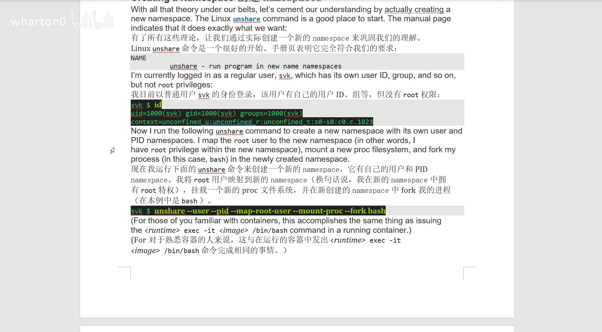

熟悉容器的人马上会发现：这条命令做的事，跟 `docker exec -it <image> /bin/bash` 进入一个容器是完全一样的。

### 3.3 从里面看：一个小世界

进入新 namespace 后：

- `ps -ef` 只显示**两个进程**：一个是 bash，一个是 ps 命令自己；
- `id` 显示现在是 **root**。

关键点来了：**在这个 namespace 里只能看到这两个进程，系统上任何其他进程都看不见**——完全被隔离在自己的 namespace 里。相当于在系统里给自己挖了一块独立空间，在里面你就是 root；而外面那些常驻的 housekeeping（系统维护）进程，从这里完全不可见。

[【跳转到 13:53】](https://www.bilibili.com/video/BV1zX4y147fv/?t=833)

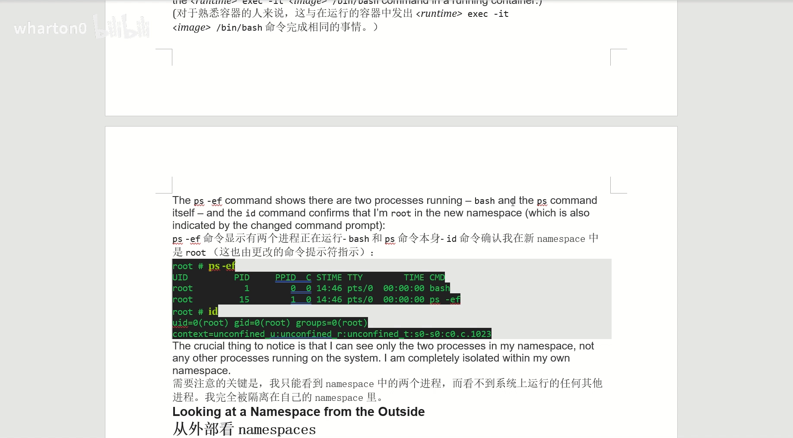

### 3.4 从外面看：lsns 揭示真相

从宿主机（以 root 身份）看这个 namespace：

```bash
lsns
```

`lsns`（list namespaces）能列出系统上所有可用的 namespace 并显示它们的信息。输出显示有三个 namespace（inode 号 90、91、92），类型分别是 **user、mount、pid**——正好对应 unshare 命令用到的参数。

[【跳转到 15:39】](https://www.bilibili.com/video/BV1zX4y147fv/?t=939)

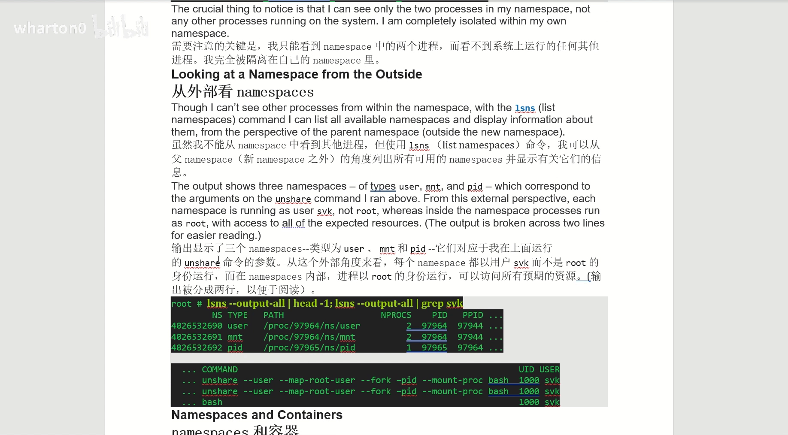

有意思的是：从外面看，每个 namespace 的**所有者都是用户 svk 而不是 root**；但从里面看，进程就是以 root 身份在跑，可以访问它权限范围内的资源。身份是"映射"出来的：外面 svk，里面 root。

## 四、容器运行时：替你把这些打包好

我们已经展示了怎么手动创建 namespace，但没人想在每次启动服务时手敲这些命令。Docker、rkt、Podman 这样的**容器运行时会替我们创建 namespace**，把底层机制打包成一个好用的接口——就像 NGINX Unit 对"隔离应用对象"做的包装一样。

[【跳转到 16:55】](https://www.bilibili.com/video/BV1zX4y147fv/?t=1015)

包装方式不同，但**底层都是 namespace 和 cgroup**。namespace 介绍完了，接下来看 cgroup。

## 五、cgroup：控制"能用多少"

namespace 解决了"看到什么"，但还有一个维度没管：资源**用量**。两个进程即使互相看不见，仍可能把 CPU、内存吃光，互相拖垮。这就是 cgroup 登场的地方。

### 5.1 定义与四大功能

cgroup 是 **control groups（控制组）** 的缩写，是 Linux 内核的一项功能，用来**限制、记录和隔离一组进程的资源使用**（CPU、内存、磁盘、网络等）。

[【跳转到 18:15】](https://www.bilibili.com/video/BV1zX4y147fv/?t=1095)

它提供四大功能：

1. **资源限制**：配置一个 cgroup，限制进程能使用多少特定资源（比如内存上限、CPU 配额）——所以 CPU 隔离除了 namespace 的"视角隔离"，也可以用 cgroup 做"用量限制"；
2. **优先级**：资源相互争用时，控制一个进程相对于另一个 cgroup 里的进程能使用多少——谁多用、谁少用；
3. **记账（accounting）**：在 cgroup 级别监控和报告资源使用情况；
4. **控制**：用一条命令改变 cgroup 里所有进程的状态——冻结、停止、重新启动。

一句话概括 cgroup 解决的问题：**给定的关键资源（CPU、内存、网络、磁盘）有多少，可以被一个进程或一组进程访问或使用**。它不是把某类资源整个"划走"，而是规定同一批资源里，允许某个进程或一组进程用多少。

### 5.2 容器与 Kubernetes 中的应用

cgroup 是容器的关键组件：**一个容器里经常有多个进程在跑，需要"一次统一控制"这些进程**——这正是 cgroup 以"组"为单位的价值。在 Kubernetes 环境里，cgroup 用于在 Pod 级别实现资源请求（request）和限制（limit），以及相应的 QoS 等级（服务质量分级）。

[【跳转到 19:55】](https://www.bilibili.com/video/BV1zX4y147fv/?t=1195)

### 5.3 一张图看懂资源配比

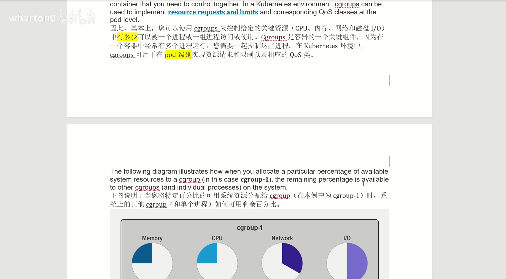

[【跳转到 20:27】](https://www.bilibili.com/video/BV1zX4y147fv/?t=1227)

图中 cgroup 1 拿到：内存 25%、CPU 25%、网络 33%、IO 50%；系统剩余的部分就是 75%、75%、67%、50%——这就是"从百分之百里划出去"的直观含义。

## 六、cgroup v1 与 v2

### 6.1 版本时间线

- **v1**：2007 年底 / 2008 年初被合并进 Linux 内核主线；
- **v2**：文档 2016 年首次出现在内核中（Linux 4.6）。

[【跳转到 21:15】](https://www.bilibili.com/video/BV1zX4y147fv/?t=1275)

### 6.2 v2 最大的变化

v2 的众多变化中最大的一个：**更简化的单一树形架构**（一个统一的层级），加上新的功能和接口，以及**更好地适配无根容器（以非零 UID 运行）**。作者还说，v2 里他最喜欢的新接口是 **PSI（压力失速信息，Pressure Stall Information）**。

[【跳转到 21:40】](https://www.bilibili.com/video/BV1zX4y147fv/?t=1300)

### 6.3 PSI：内存压力的"体检报告"

PSI 以比之前更精细的方式，提供对每个进程内存使用和分配情况的洞察。它度量的是**内存压力导致的性能问题**：当系统内存使用量过高时，会出现"压力失速"（stall），系统性能随之下降。典型场景：

- 物理内存使用量接近总量 → 换页调度增多，CPU 花更多时间在换页上，调不过来就出现"颠簸"（thrashing）；
- 交换分区使用量过高 → 频繁的页面交换，降低系统性能；
- 文件缓存被压缩 → 更多磁盘 IO，同样拖慢系统。

说白了，就是系统有点要 OOM（内存耗尽）的意思了。检查手段：用 `free` 看剩余内存、看交换分区用量等；缓解办法：增加内存、优化内存使用、使用更快的交换设备。内存对性能影响很大，所以内核对它做了专门的监控与调度。

[【跳转到 22:43】](https://www.bilibili.com/video/BV1zX4y147fv/?t=1363)

## 七、动手实验：给进程套上 50MB 内存限制

视频最后用一个完整实验演示 cgroup v1 的用法。

### 7.1 创建受限的 cgroup

下面的命令创建了一个名为 `foo` 的 v1 cgroup（从路径名格式就能判断是 v1），把它放在 memory 层级下（`/sys/fs/cgroup/memory/` 底下），并将其内存限制为 **50MB**。

[【跳转到 24:39】](https://www.bilibili.com/video/BV1zX4y147fv/?t=1479)

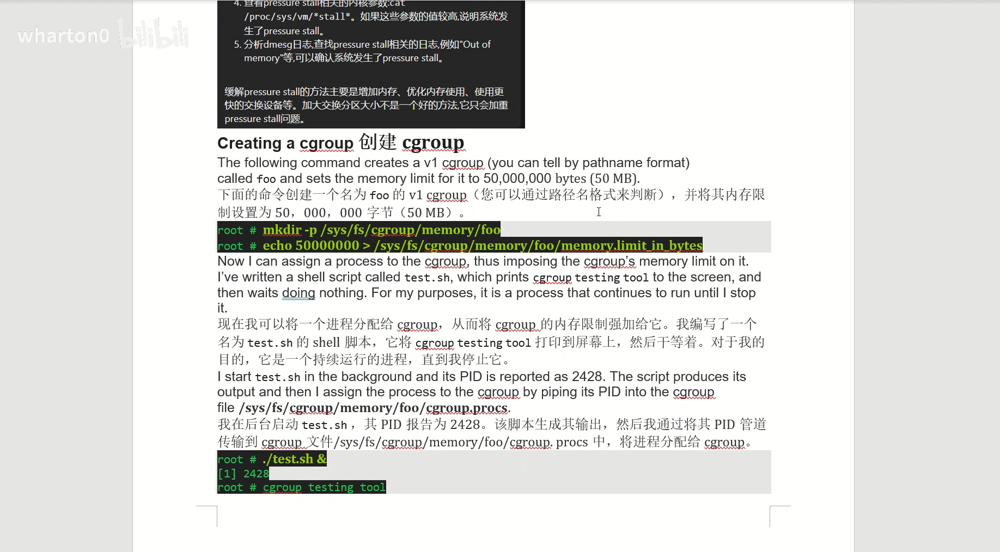

### 7.2 把进程"扔进" cgroup

作者写了一个 `test` 脚本：打印一行标识文本后就一直挂着——它是一个持续运行的进程，直到被停止。在后台启动它，得到 **PID 2428**。接着把 PID 写入 cgroup 的属性文件（`cgroup.procs`）——表示"我要限制这个进程"。

[【跳转到 25:35】](https://www.bilibili.com/video/BV1zX4y147fv/?t=1535)

### 7.3 验证与"死刑"

```bash
ps -o cgroup 2428
```

输出确认它的内存 cgroup 是 `memory:/foo`——进程确实被放进了 foo，50MB 的限制已经生效。

[【跳转到 26:36】](https://www.bilibili.com/video/BV1zX4y147fv/?t=1596)

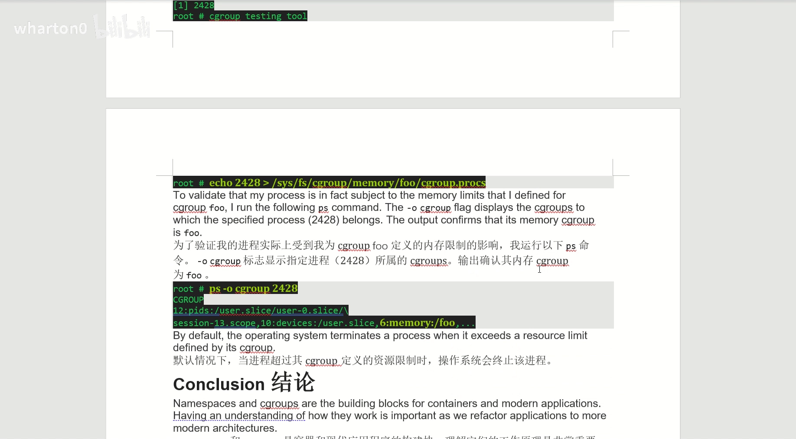

而**默认情况下，当进程超过其 cgroup 的资源限制时，操作系统会直接终止该进程**——这就是内存超限的"死刑判决"。

## 八、小结：隔离与限制，一个都不能少

回到文章的结论，也是全视频最有价值的总结：

[【跳转到 28:27】](https://www.bilibili.com/video/BV1zX4y147fv/?t=1707)

- **namespace 提供系统资源的隔离**：把资源"类别"分开——哪些资源给 A、哪些给 B，把 A 进程和 B 进程相互隔开。它是**进程视角**。
- **cgroup 提供细粒度的用量控制**：百分之多少的资源给谁、百分之多少又给谁，并且可以强制执行。它是**资源视角**。
- 两者可以结合使用，但分工不同，**一定要分清楚**。

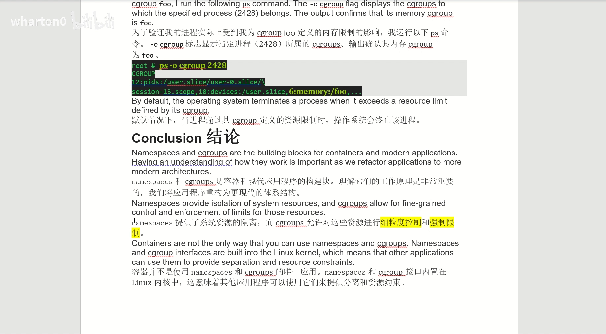

另外两点同样重要：namespace 和 cgroup 是容器和现代应用的构建块，理解它们的工作原理，才能把应用重构为更现代的体系结构；而且**容器并不是使用它们的唯一应用**——两者的接口内置于 Linux 内核，任何程序都可以用它们做隔离与资源约束。

## 关键术语速查

| 术语 | 一句话解释 |
| --- | --- |
| namespace | 内核对资源的"分区"机制：一组进程看到一组资源，彼此隔离 |
| user namespace | 独立的用户/组 ID；进程可以在 namespace 内是 root、在外不是 |
| PID namespace | 独立的进程号体系；新 namespace 第一个进程是 PID 1 |
| network namespace | 独立的网络栈：路由表、IP、套接字、连接跟踪、防火墙 |
| mount namespace | 独立的挂载点列表，挂载/卸载不影响宿主机 |
| IPC / UTS namespace | 独立的进程间通信资源（消息队列等）/ 独立的主机名与域名 |
| unshare | 在新 namespace 中运行程序的命令；实验用 `--user --pid --map-root-user --fork --mount-proc` |
| lsns | 列出系统上所有 namespace（类型、属主、inode） |
| cgroup | control groups：限制、记录、隔离一组进程的资源使用（CPU/内存/磁盘/网络） |
| cgroup 四大功能 | 资源限制、优先级、记账、控制（冻结/停止/重启） |
| cgroup v2 | 2016 年（Linux 4.6）文档首现；单一树形架构，更好支持无根容器 |
| PSI | 压力失速信息：度量内存等资源压力导致的性能失速 |
| cgroup.procs | 把进程 PID 写入该文件，即把进程分配给 cgroup |
| OOM 终止 | 进程超出 cgroup 资源限制时，操作系统默认终止该进程 |
