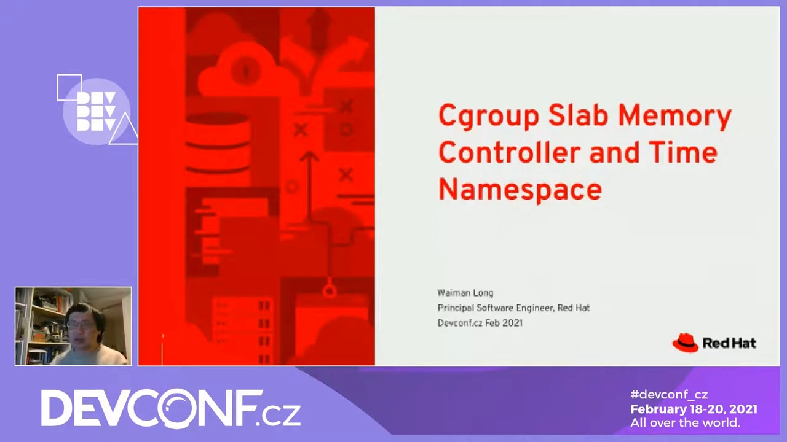
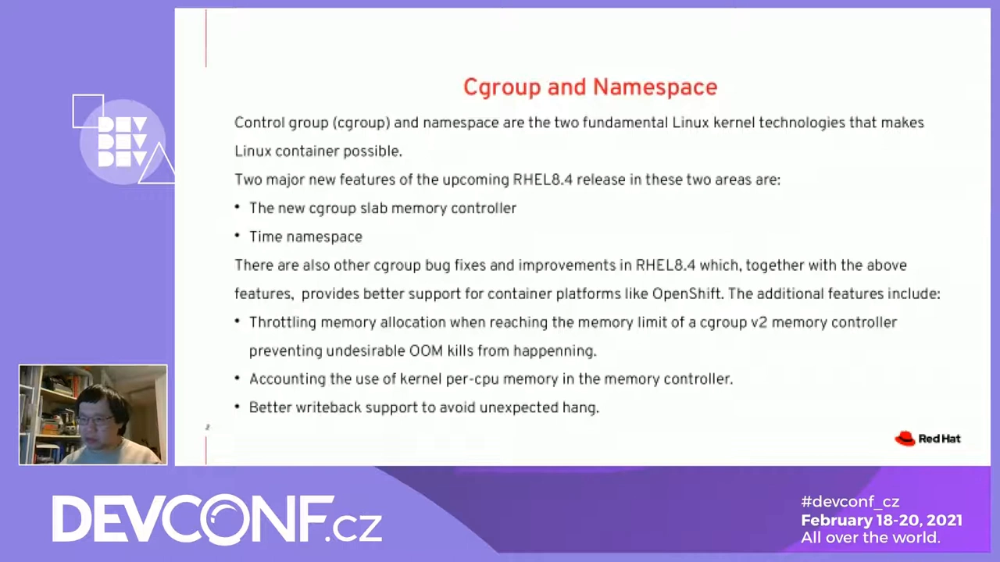
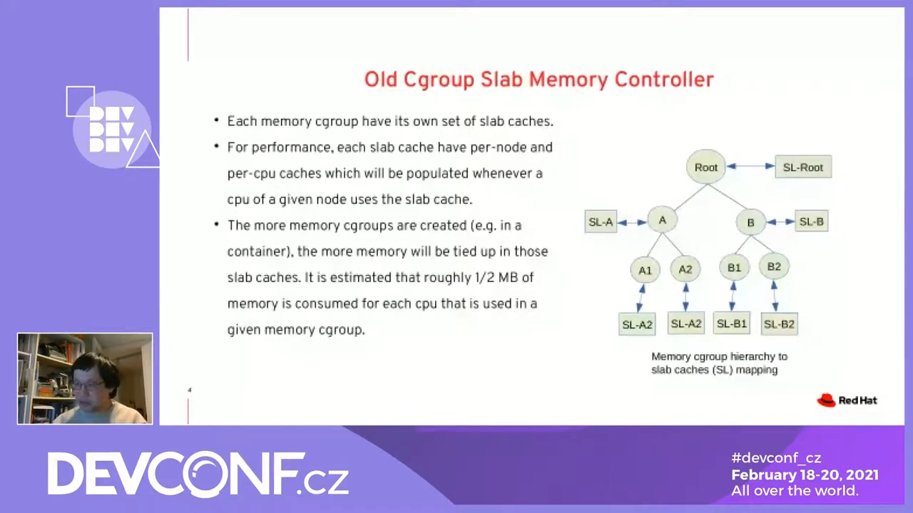
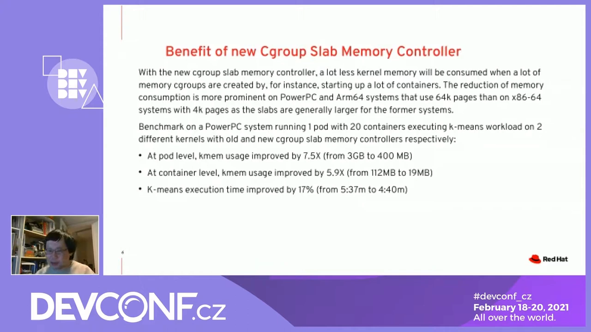
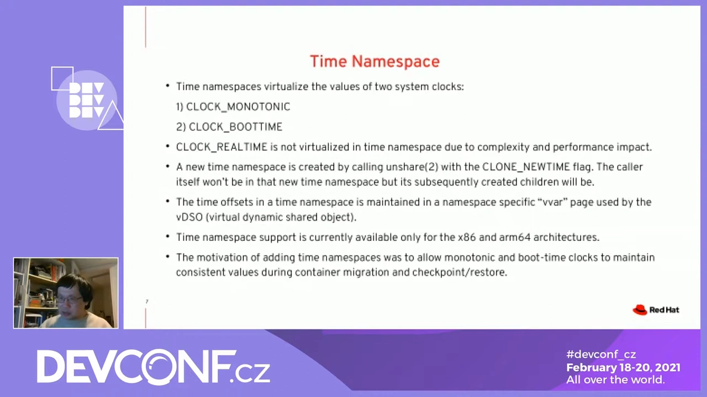
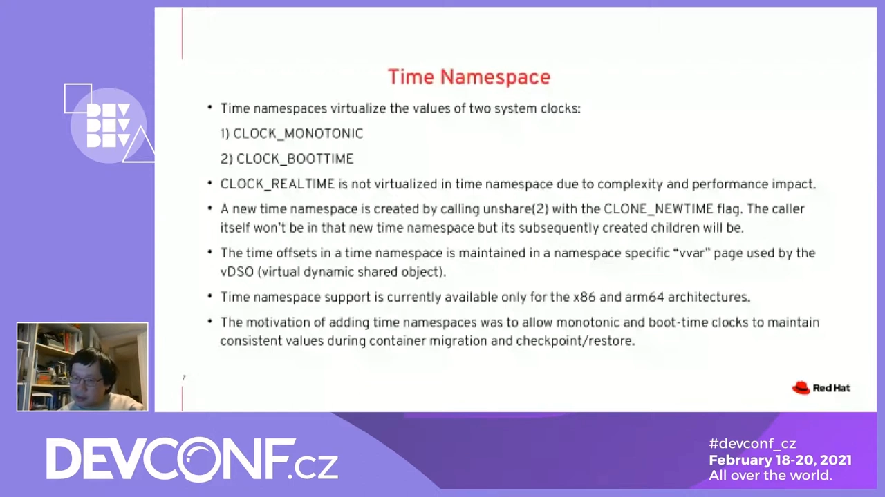

# 时间命名空间 Time Namespace：连"开机多久"都能给每个容器单独记账（DevConf.CZ 2021 内核演讲精读）

> 视频来源：[Cgroup Slab Memory Controller and Time Namespace - DevConf.CZ 2021（YouTube，DevConf）](https://www.youtube.com/watch?v=UAtgmmfc9Sw)，约 21 分钟。演讲者是 Red Hat 核心内核组的软件工程师（字幕记音"women law"，即该演讲的讲者 Waiman Long），负责维护内核中的 cgroup 与锁（locking）子系统。本篇严格基于视频内容整理：前半场（约 5:35–15:50）讲 cgroup v2 的新 slab 内存控制器，作为背景铺垫；后半场（约 16:00 起）进入本篇主题——**时间命名空间（time namespace）**。

## 本篇要解决的核心问题

**背景**：容器隔离靠两根支柱——cgroup（控制组）管"能用多少资源"，namespace（命名空间）管"能看到什么资源"。时钟历来被当作全局的：整台机器只有一个"现在几点"、一个"开机多久了"。

**冲突**：但容器世界的玩法在变：进程会被热迁移（live migration）、会被检查点后恢复（checkpoint/restore）、会在沙箱里被安全软件观察。这些场景里，`uptime`、单调时钟这类"只增不减"的读数如果不跟着搬，应用内部依赖它们的计时逻辑就会错乱。

**疑问**：Linux 能不能让不同进程组看到**不同的**"开机时长"和"单调时钟"？为什么需要？内核又是怎么实现的？

**回答（中心思想）**：能。内核 5.6 引入的**时间命名空间**就是为此而生：它虚拟化 `CLOCK_MONOTONIC` 与 `CLOCK_BOOTTIME` 两个时钟，让新命名空间里的进程读到"加了偏移"的单调时钟与开机时长；实现走 vDSO 页、开销很小；根本动机是让迁移与检查点/恢复期间时钟读数保持一致，最终服务容器生态。

## 一、背景：容器两大基石，与本讲的两块"新拼图"

演讲者开场先给坐标：让 Linux 容器成为可能的，正是 **control group（cgroup，控制组——限制/记账一组进程能用多少资源）** 与 **namespace（命名空间——让不同进程组"看到"不同的系统资源视图）** 这两个内核特性，缺一不可 [【跳转到 00:30】](https://www.youtube.com/watch?v=UAtgmmfc9Sw&t=30)。

本讲聚焦两个新特性：

- **cgroup slab 内存控制器**：内核 5.9 引入 [【跳转到 00:55】](https://www.youtube.com/watch?v=UAtgmmfc9Sw&t=55)；
- **时间命名空间**：演讲者印象中约 5.6 或 5.7 引入 [【跳转到 01:20】](https://www.youtube.com/watch?v=UAtgmmfc9Sw&t=80)。

他还顺带提到同期即将进入内核的其它特性：内存控制器触及上限时**限制新的内存分配**（避免容器进程用超被 OOM kill）[【跳转到 01:50】](https://www.youtube.com/watch?v=UAtgmmfc9Sw&t=110)、per-cpu 内存的计账、以及改进的 writeback（回写）控制以缓解 IO 不均衡带来的意外停顿 [【跳转到 02:15】](https://www.youtube.com/watch?v=UAtgmmfc9Sw&t=135)。

## 二、铺垫：cgroup v1 与 v2，为什么新特性都落在 v2

- **v1（legacy，旧版）**：每个控制器（controller）可以拥有**自己独立的一棵层级树**，看似灵活，但不同控制器之间要协调时非常麻烦 [【跳转到 03:05】](https://www.youtube.com/watch?v=UAtgmmfc9Sw&t=185) [【跳转到 03:30】](https://www.youtube.com/watch?v=UAtgmmfc9Sw&t=210)。
- **v2（新版）**：所有控制器共用**一棵统一层级** [【跳转到 04:20】](https://www.youtube.com/watch?v=UAtgmmfc9Sw&t=260)。
- 一个控制器只能运行在 v1 或 v2 之一；目前多数发行版默认仍是 v1，但趋势是向 v2 迁移——因为**新特性只做进 v2**，v1 处于"只保证不坏"的维护模式 [【跳转到 04:45】](https://www.youtube.com/watch?v=UAtgmmfc9Sw&t=285) [【跳转到 05:10】](https://www.youtube.com/watch?v=UAtgmmfc9Sw&t=310)。

## 三、前半场：cgroup v2 新 slab 内存控制器——给容器省下"隐形"的内核内存

### 3.1 旧实现的痛点：每个容器一套并行的对象缓存

内核内存除 page cache（文件缓存）外，还有一大块叫 **slab**：内核内部各种数据结构（约 250 种缓存类别）的对象池 [【跳转到 05:35】](https://www.youtube.com/watch?v=UAtgmmfc9Sw&t=335) [【跳转到 06:50】](https://www.youtube.com/watch?v=UAtgmmfc9Sw&t=410)。例如创建进程需要 `task_struct`，它的内存就来自 slab cache [【跳转到 06:25】](https://www.youtube.com/watch?v=UAtgmmfc9Sw&t=385)。

旧的 slab 控制器做法：每建一个 memcg（内存 cgroup），就为它用到的每种 cache **复制出一套并行的 slab cache**；出于性能，每套还有每 NUMA 节点、每 CPU 的本地缓存 [【跳转到 07:15】](https://www.youtube.com/watch?v=UAtgmmfc9Sw&t=435) [【跳转到 07:40】](https://www.youtube.com/watch?v=UAtgmmfc9Sw&t=460)。每个 CPU 的本地缓存都会囤起一些页（部分对象还没分配出去），于是容器一多，大量内存被"占而未用"——现代系统上每个 memcg 的每个 CPU 约消耗半 MB [【跳转到 08:05】](https://www.youtube.com/watch?v=UAtgmmfc9Sw&t=485) [【跳转到 08:55】](https://www.youtube.com/watch?v=UAtgmmfc9Sw&t=535)。

### 3.2 新实现：共享一套缓存 + obj_cgroup 记账

新控制器的思路：**所有 memcg 共享同一套 slab cache**，在缓存与 cgroup 之间加一层 **obj_cgroup** 结构负责记账"这些对象属于谁" [【跳转到 09:20】](https://www.youtube.com/watch?v=UAtgmmfc9Sw&t=560) [【跳转到 09:45】](https://www.youtube.com/watch?v=UAtgmmfc9Sw&t=585)。记账粒度从"页"细到"对象"：按字节累计，攒满一页才落到页级记账——因为对象尺寸差异很大（几十字节到超过一页的 4K/8K）[【跳转到 10:10】](https://www.youtube.com/watch?v=UAtgmmfc9Sw&t=610) [【跳转到 10:35】](https://www.youtube.com/watch?v=UAtgmmfc9Sw&t=635) [【跳转到 11:00】](https://www.youtube.com/watch?v=UAtgmmfc9Sw&t=660) [【跳转到 11:25】](https://www.youtube.com/watch?v=UAtgmmfc9Sw&t=685)。代价是每个对象多一个指针指向所属 obj_cgroup [【跳转到 11:50】](https://www.youtube.com/watch?v=UAtgmmfc9Sw&t=710) [【跳转到 12:15】](https://www.youtube.com/watch?v=UAtgmmfc9Sw&t=735)。

### 3.3 收益：64K 页架构上尤其明显，pod 级省了 7 倍

页越大（如 PowerPC/ARM64 的 64K 页），slab 越大、囤积浪费越多（slab 大小通常取 2 的幂），所以新控制器在 64K 页架构上收益最明显 [【跳转到 12:40】](https://www.youtube.com/watch?v=UAtgmmfc9Sw&t=760) [【跳转到 13:05】](https://www.youtube.com/watch?v=UAtgmmfc9Sw&t=785) [【跳转到 13:30】](https://www.youtube.com/watch?v=UAtgmmfc9Sw&t=810) [【跳转到 13:55】](https://www.youtube.com/watch?v=UAtgmmfc9Sw&t=835)。演讲给出的基准（PowerPC，跑一个 pod）：

- pod 级 slab 内存：**3GB → 400MB**，超过 7 倍的改善 [【跳转到 14:20】](https://www.youtube.com/watch?v=UAtgmmfc9Sw&t=860) [【跳转到 14:45】](https://www.youtube.com/watch?v=UAtgmmfc9Sw&t=885)；
- 容器级内存也大幅下降（演讲者口述"约缩小 6 倍"；AI 字幕将该处录作 112MB→90MB，与"6 倍"的口述比例矛盾，按比例推断应为 112MB→约 19MB，具体以视频为准）[【跳转到 15:10】](https://www.youtube.com/watch?v=UAtgmmfc9Sw&t=910)；
- 执行时间还改善了约 17%（AI 字幕记录）：创建缓存的开销更小、缓存足迹更低 [【跳转到 15:35】](https://www.youtube.com/watch?v=UAtgmmfc9Sw&t=935)。

> 这一章属于 cgroup/内存主题，与本系列 2.2 章"控制组"关系更近，此处按视频完整记录；本篇重点在下面的时间命名空间。

## 四、时间命名空间：虚拟化哪两个"时钟"？

### 4.1 先分清三个时钟

时间命名空间的目的：**虚拟化两个时钟**——`CLOCK_MONOTONIC` 与 `CLOCK_BOOTTIME` [【跳转到 16:00】](https://www.youtube.com/watch?v=UAtgmmfc9Sw&t=960)。

| 时钟 | 是什么（按演讲口径） |
| --- | --- |
| `CLOCK_MONOTONIC` | 单调时钟：一块**只会前进、永不回拨**的"秒表" [【跳转到 16:25】](https://www.youtube.com/watch?v=UAtgmmfc9Sw&t=985) |
| `CLOCK_BOOTTIME` | 开机时长：从系统启动到现在经过的时间（uptime 用的就是它） |
| `CLOCK_REALTIME` | 挂钟/墙上时间："现在几点"——**时间命名空间不虚拟化它** |

给初学者的区分法：挂钟回答"现在几点"；单调时钟回答"从某个起点起过了多久"；boottime 回答"开机多久了"。后两者是"只增不减"的相对时钟，才是命名空间要隔离的对象。

### 4.2 为什么不虚拟化挂钟

因为复杂度与性能开销摆在那里，而且"给不同进程组不同的日期时间"这个用例价值并不大——所以 `CLOCK_REALTIME` 不做虚拟化，命名空间内外的"几点几分"始终一致 [【跳转到 16:50】](https://www.youtube.com/watch?v=UAtgmmfc9Sw&t=1010)。

## 五、怎么创建：unshare + CLONE_NEWTIME 的"陷阱"语义

创建方式：调用 **unshare 系统调用并带上新标志 `CLONE_NEWTIME`** [【跳转到 17:15】](https://www.youtube.com/watch?v=UAtgmmfc9Sw&t=1035)。这里有一个与其它命名空间直觉不同的关键语义，演讲专门强调：

> 调用 `unshare` 的进程**自己不会进入**新时间命名空间；**之后创建的子进程**才会进去。

（命令行上用 `unshare` 工具配合 `--boottime` / `--monotonic` 参数设置偏移，本系列下一篇有完整实操演示。）

## 六、内核如何实现：时间偏移量 + vDSO

- 内核为每个时间命名空间维护一个**相对内核内部时间的偏移量（offset）**，单调时钟与开机时长的读数都按这个偏移修正 [【跳转到 17:40】](https://www.youtube.com/watch?v=UAtgmmfc9Sw&t=1060)；
- 偏移量放在 **vDSO**（virtual dynamic shared object：内核准备好、直接映射进用户进程地址空间的页，用户态读时钟无需陷入内核，因此极快）所使用的页里；
- 切换到新时间命名空间，效果上就是"换入对应偏移的页"（Q&A 里展开）；
- 目前**仅 x86_64 与 ARM64** 支持时间命名空间，其它架构的支持尚未提交上游 [【跳转到 18:05】](https://www.youtube.com/watch?v=UAtgmmfc9Sw&t=1085)。

## 七、根本动机：热迁移与检查点/恢复中的时钟一致性

为什么要做时间命名空间？演讲者给出的主要动机：让 `CLOCK_MONOTONIC` 与 `CLOCK_BOOTTIME` 在 **live migration（不停机把进程/虚拟机整体搬到另一台机器）** 与 **checkpoint/restore（把进程状态存盘、之后再恢复运行，如 CRIU 这类机制）** 过程中保持一致的读数 [【跳转到 18:30】](https://www.youtube.com/watch?v=UAtgmmfc9Sw&t=1110)。

设想一个进程记录了"我已运行 N 秒"、或定时器基于单调时钟——若搬家之后单调时钟突然归零或跳变，这类逻辑就会乱掉。时间命名空间让恢复出来的进程可以把时钟读数"接续"上。演讲者总结：这些上游工作，都是为了让**容器生态**获得更好的支持 [【跳转到 18:55】](https://www.youtube.com/watch?v=UAtgmmfc9Sw&t=1135)。

## 八、Q&A：x86 与 ARM64 的实现差异都在 vDSO 层

观众提问：x86 与 ARM64 的时间命名空间实现差异大吗 [【跳转到 19:25】](https://www.youtube.com/watch?v=UAtgmmfc9Sw&t=1165)？

演讲者回答：差异都在 **vDSO 层**——需要为不同时间命名空间准备包含各自偏移量的专用页，切换命名空间时换入对应的页 [【跳转到 19:50】](https://www.youtube.com/watch?v=UAtgmmfc9Sw&t=1190) [【跳转到 20:15】](https://www.youtube.com/watch?v=UAtgmmfc9Sw&t=1215)。由于各架构的时间管理代码本身不同，具体实现略有差异 [【跳转到 20:40】](https://www.youtube.com/watch?v=UAtgmmfc9Sw&t=1240)。

## 小结

- 时间命名空间虚拟化 `CLOCK_MONOTONIC`（单调秒表）与 `CLOCK_BOOTTIME`（开机时长）；**不虚拟化** `CLOCK_REALTIME`（挂钟）。
- 创建方式：`unshare` + `CLONE_NEWTIME`；注意调用者不进入、只有之后的子进程进入。
- 内核实现：每个命名空间一组时间偏移量，经由 vDSO 页暴露，读时钟无需系统调用；目前支持 x86_64 与 ARM64。
- 根本动机：热迁移与检查点/恢复时保持时钟读数一致，服务容器生态。
- 同场加映：cgroup v2 的新 slab 内存控制器把多容器场景的内核内存开销降了一个量级（64K 页架构上 pod 级 3GB→400MB）。

## 关键术语速查

| 术语 | 一句话解释 |
| --- | --- |
| cgroup | 控制组：限制并记账一组进程能使用的资源 |
| namespace | 命名空间：让不同进程组"看到"不同的系统资源视图 |
| `CLOCK_MONOTONIC` | 单调时钟：只会前进的秒表，不受人工改时间影响 |
| `CLOCK_BOOTTIME` | 开机时长：系统启动至今经过的时间（uptime 所基于的时钟） |
| `CLOCK_REALTIME` | 挂钟：日常意义的"现在几点"，时间命名空间不虚拟化 |
| `unshare` / `CLONE_NEWTIME` | 创建新命名空间的系统调用 / 其"新建时间命名空间"标志 |
| vDSO | 内核映射给用户态的页，用户态读时钟不必陷入内核 |
| checkpoint/restore | 把进程状态存盘、之后再恢复运行的机制（如 CRIU） |
| live migration | 进程/虚拟机不停机"搬家" |
| slab / obj_cgroup | 内核对象缓存 / v2 中标记对象归属哪个 memcg 的记账结构 |
