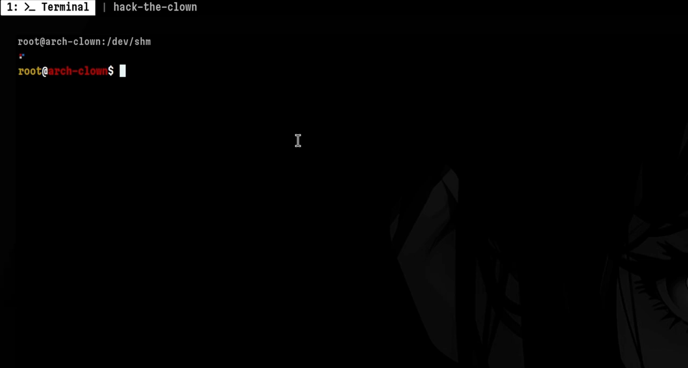
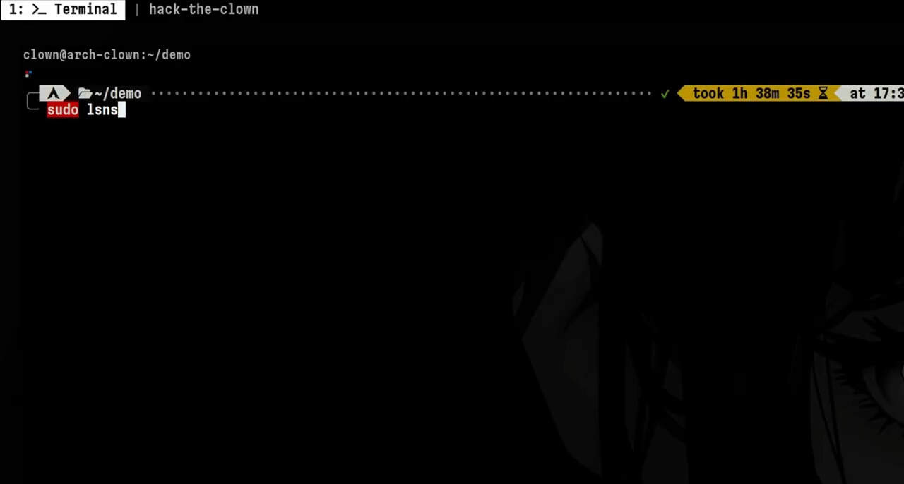
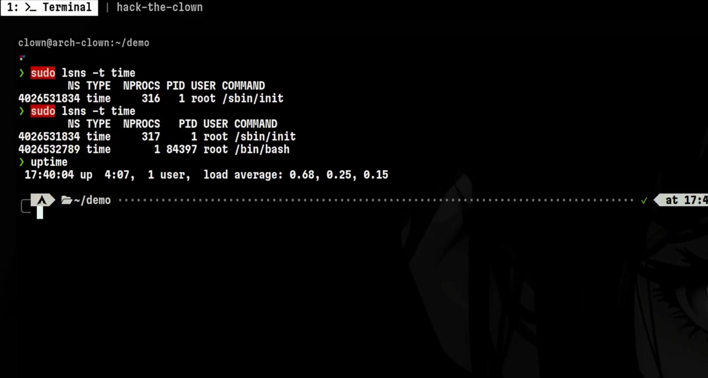
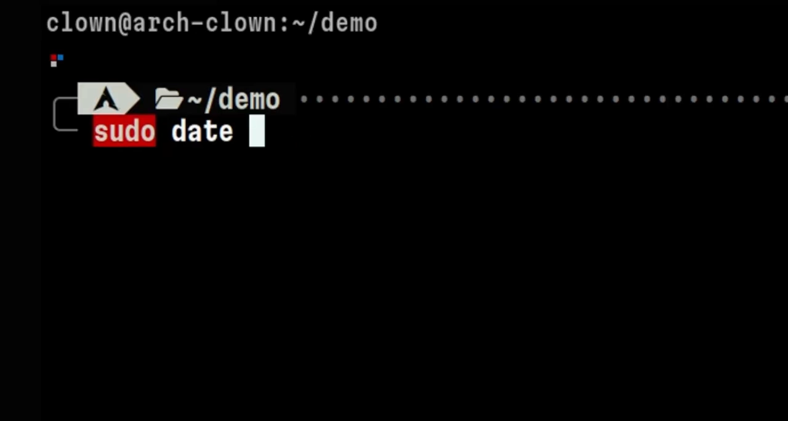

# 时间命名空间实战：一条 unshare 命令把"开机 7 天"装进命名空间——兼谈恶意软件如何用它探测沙箱

> 视频来源：[How Linux Time Namespaces can be used in Malware Development（YouTube，Hack the Clown）](https://www.youtube.com/watch?v=Y2TCxbtVQp4)，约 3.5 分钟。本篇严格基于视频内容整理（含全部演示命令与输出含义）。视频从"攻"的视角讲时间命名空间的实际效果——了解攻击者怎么思考，是为了更好地防御；时间命名空间本身的正当用途（热迁移、检查点/恢复中的时钟一致性）见本系列上一篇。

## 本篇要解决的核心问题

**背景**：时间命名空间（time namespace，内核 5.6 引入）让一组进程拥有独立的"相对时钟"读数。

**冲突**：现代恶意软件很"聪明"：一旦被放进沙箱分析环境就保持休眠（不触发攻击行为），落到真实主机上才会激活载荷——安全人员看到的和真实用户遇到的完全是两幅画面 [【跳转到 00:00】](https://www.youtube.com/watch?v=Y2TCxbtVQp4&t=0)。

**疑问**：时间命名空间到底能改什么、不能改什么？"开机时长"真的能被单独伪造吗？

**回答（中心思想）**：时间命名空间隔离的是 **boottime（开机时长）** 与 **monotonic（单调秒表）**，而不是日期时间；一条 `unshare --boottime 604800` 就能让命名空间内的进程看到"开机 7 天"的假象——这正是恶意软件作者用来模拟真实主机、测试样本休眠逻辑的手段。

## 一、30 秒概念：它不改"几点"，改"开机多久"和"秒表走了多久"

Linux 启动后，所有进程默认在**同一个**时间命名空间里，看到相同的日期、时间和开机时长 [【跳转到 00:20】](https://www.youtube.com/watch?v=Y2TCxbtVQp4&t=20)。

视频特意纠正了一个常见误解：时间命名空间**不会**让不同进程看到不同的日期时间。真正的隔离发生在两个"只增不减"的时钟上 [【跳转到 00:39】](https://www.youtube.com/watch?v=Y2TCxbtVQp4&t=39)：

- **boottime（开机时长）**：机器的 uptime，"开机多久了"；
- **monotonic（单调时钟）**：像一块持续走动的秒表，只增不减 [【跳转到 00:44】](https://www.youtube.com/watch?v=Y2TCxbtVQp4&t=44)。

## 二、动手：三个小实验看懂隔离效果

### 2.1 查看：`lsns -t time`

用 `lsns` 命令按类型过滤，可以看到系统当前只有一个时间命名空间；用 `unshare`（在新命名空间中运行程序的工具）创建一个新的之后，`lsns -t time` 就会列出两个 [【跳转到 00:59】](https://www.youtube.com/watch?v=Y2TCxbtVQp4&t=59)。

### 2.2 伪造开机时长：`--boottime 604800`

宿主机此时开机约 4 小时。创建命名空间时带上 `--boottime 604800` 参数——604800 秒正好是 **7 天**——进入后运行 `uptime`，读数与外面完全不同 [【跳转到 01:29】](https://www.youtube.com/watch?v=Y2TCxbtVQp4&t=89)。

### 2.3 伪造秒表：`--monotonic`

单调时钟怎么看？视频用 Python 打印 `CLOCK_MONOTONIC`（即 `time.monotonic()` 一类调用）：每运行一次，数值都在增大，这就是那块"秒表" [【跳转到 01:29】](https://www.youtube.com/watch?v=Y2TCxbtVQp4&t=89)。把创建命令里的 `--boottime` 换成 `--monotonic` 并设一个偏移，命名空间内外的秒表读数就各走各的 [【跳转到 01:54】](https://www.youtube.com/watch?v=Y2TCxbtVQp4&t=114)。

### 2.4 不变的东西：`date`

无论在哪个时间命名空间里，`date` 显示的日期时间都一样（视频里是 3 月 1 日，接近下午 6 点）；在外面改系统时间，里面也跟着变——挂钟是全局的，时间命名空间不动它 [【跳转到 02:06】](https://www.youtube.com/watch?v=Y2TCxbtVQp4&t=126) [【跳转到 02:16】](https://www.youtube.com/watch?v=Y2TCxbtVQp4&t=136)。

## 三、恶意软件视角：为什么"伪造 uptime"有用

- **沙箱检测思路**：沙箱 VM 通常是新开的，uptime 往往只有 0 到几小时；uptime 很大，反而说明可能跑在真实机器上 [【跳转到 02:21】](https://www.youtube.com/watch?v=Y2TCxbtVQp4&t=141)。
- **样本行为**：检测到 uptime 很小 → 判定"我在沙箱里" → 保持休眠、不暴露攻击。
- **作者的测试方法**：先在普通环境运行样本，观察它是否因 uptime 太小而休眠；再换到一个**新建的时间命名空间**里，把 boottime 调大来模拟真实主机，观察样本行为是否被"唤醒"——从而测试多种环境组合 [【跳转到 02:46】](https://www.youtube.com/watch?v=Y2TCxbtVQp4&t=166) [【跳转到 03:00】](https://www.youtube.com/watch?v=Y2TCxbtVQp4&t=180)。

## 四、防御视角与边界

- uptime 只是众多反沙箱判据之一，视频最后强调这里做了简化；恶意软件还有别的环境检测手段 [【跳转到 03:16】](https://www.youtube.com/watch?v=Y2TCxbtVQp4&t=196)。
- 对防御者的启示：时间命名空间意味着"时间读数可以在进程组层面被本地化"，安全检测不应只依赖单一的时间信号。
- 回到本源：时间命名空间的设计初衷是热迁移与检查点/恢复场景中的时钟一致性（本系列上一篇有内核演讲的完整讲解），恶意软件滥用只是它的一个"歪用"场景。

## 小结

- 时间命名空间**不隔离**日期时间（挂钟），隔离的是 boottime（开机时长）与 monotonic（单调秒表）。
- `lsns -t time` 查看；`unshare --boottime` / `--monotonic` 创建带时钟偏移的新命名空间。
- 实测：命名空间内 `uptime` 可以显示"开机 7 天"，而 `date` 与外界始终一致。
- 攻击者用它模拟真实主机环境、测试恶意样本的休眠逻辑；防御者则应明白 uptime 这类信号可以被轻易伪造，不宜作为唯一判据。

## 关键术语速查

| 术语 | 一句话解释 |
| --- | --- |
| `lsns` | 列出系统中的命名空间，`-t` 按类型过滤（如 `time`） |
| `unshare` | 在新命名空间中运行程序的命令行工具 |
| `--boottime` | 创建时间命名空间时设置开机时长偏移 |
| `--monotonic` | 创建时间命名空间时设置单调时钟偏移 |
| `CLOCK_MONOTONIC` | 单调时钟：只增不减的"秒表" |
| boottime / uptime | 开机时长：系统启动至今经过的时间 |
| 反沙箱技术 | 恶意软件检测"自己是否被分析"、延迟发作的策略总称 |
