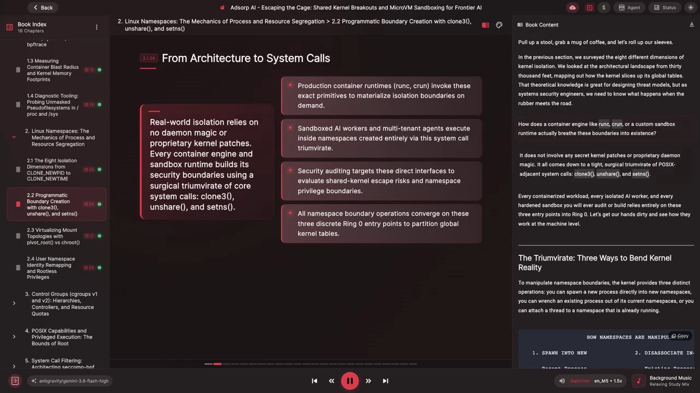
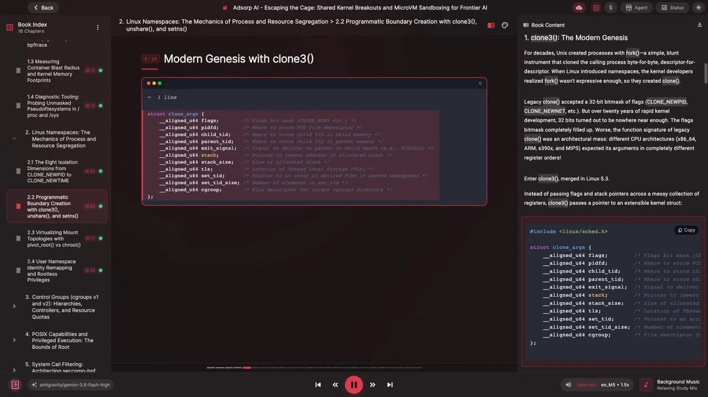
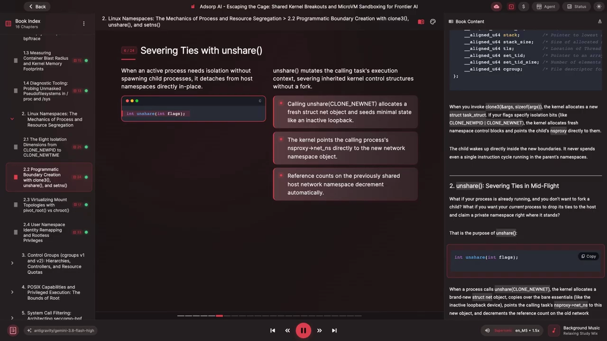
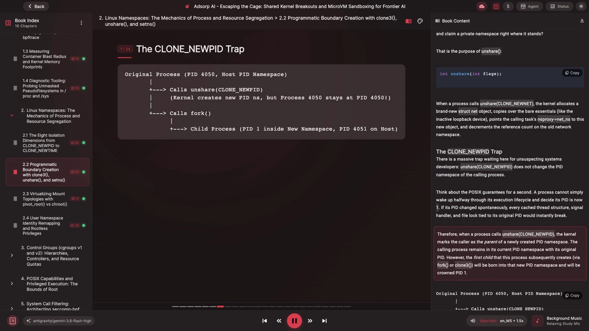
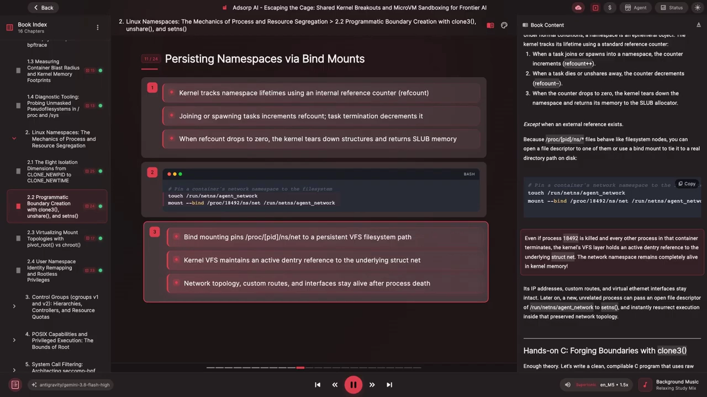
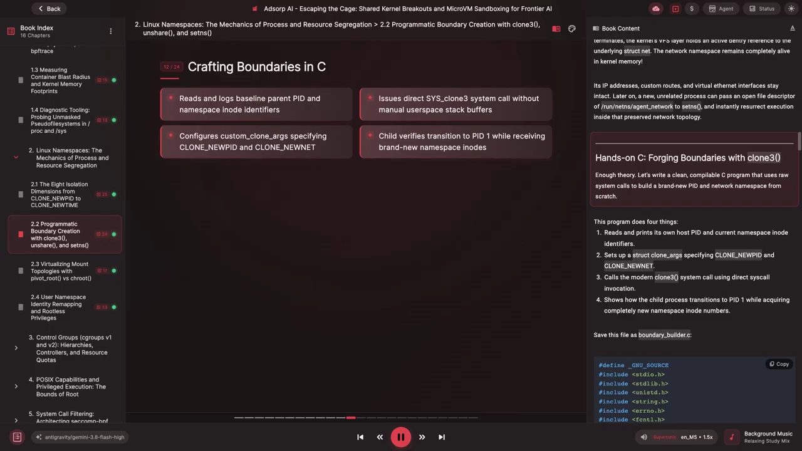
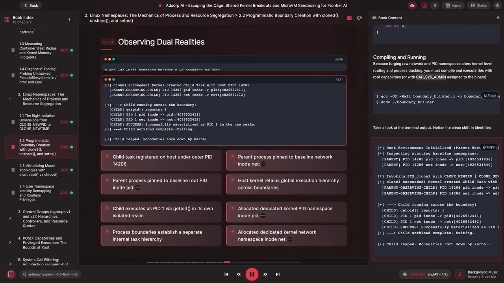
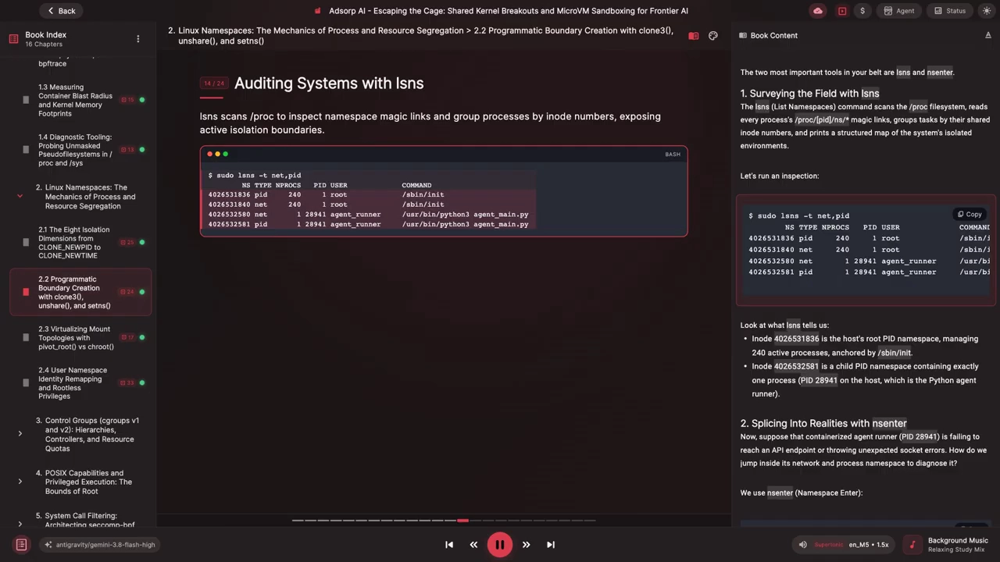

# namespace 系统调用接口：用 clone3、unshare、setns 三把钥匙铸造隔离边界

> 本文整理自 YouTube 频道 **Adsorp AI** 的系列视频《The Mechanics of Process & Resource Segregation》第 2.2 节《Boundary Creation with clone3(), unshare()》，原视频约 17 分钟，从系统调用与内核数据结构层面讲透了容器隔离边界的创建方法。文中时间戳可跳转到原视频对应位置。

## 本讲要解决的核心问题（SCQA）

**背景**：命名空间（namespace）是 Linux 容器隔离的基石。前面几讲已经认识了七种命名空间各自隔离什么资源——PID、网络、挂载点、用户……但那只回答了"隔离什么"。

**冲突**：知道"命名空间是什么"，不等于知道"边界是怎么被造出来的"。runc、沙箱运行时、各类容器引擎，究竟靠什么内核接口把一个进程送进隔离世界？

**疑问**：操作命名空间的内核接口，到底有哪几个？各自适合什么场景？有哪些暗坑？

**回答（中心思想）**：答案出奇地少——只有三个系统调用：`clone3()`（或老式 `clone()`）让子进程**直接生在新世界**，`unshare()` 让现有进程**原地脱离**，`setns()` 让线程**加入已存在的世界**。你将来审计或构建的每一个容器化负载、每一个隔离的 AI worker、每一个加固过的沙箱，都完全建立在这三个 Ring 3 入口之上。

[【跳转到 00:30】](https://www.youtube.com/watch?v=7cwrrZTSRaQ&t=30)

## 一、只有三种动作能改变命名空间边界

要对命名空间边界做操作，内核只提供三种截然不同的动作：

1. **创建型**：`clone()` / `clone3()`——在创建子进程的同时，把子进程直接放进一个或多个全新命名空间；
2. **脱离型**：`unshare()`——不创建新进程，让**调用进程自己**脱离当前共享的执行上下文，搬进新造的命名空间；
3. **迁入型**：`setns()`——把自己附着到一个**已经在运行**的命名空间上（通过文件描述符指定目标）。

[【跳转到 00:55】](https://www.youtube.com/watch?v=7cwrrZTSRaQ&t=55)

下面逐一拆解每个系统调用的"性格"与机械细节。

## 二、clone3：现代进程创生接口

### 2.1 从 fork 到 clone，再到 clone3

几十年来，Unix 用 `fork()` 创建进程——一件简单粗暴的工具，把调用进程逐位、逐描述符地克隆一份。当 Linux 引入命名空间后，内核开发者意识到 fork 的表达能力不够，于是有了 `clone()`：它在创建子进程之外，还接受一个 32 位的**标志位掩码**（`CLONE_NEWNS`、`CLONE_NEWNET` 等），用来指定子进程要进入哪些新命名空间。

但两个问题很快暴露：

- **32 位不够用了**。二十多年的内核高速开发，把这套标志位掩码几乎全部填满；
- **函数签名是架构灾难**。不同 CPU 架构（x86-64、ARM、s390x、MIPS 等）期望 clone 的参数以完全不同的寄存器顺序传入。

于是有了 **clone3()，合并于 Linux 5.3**：它不再把标志和栈指针散落在寄存器里传递，而是传一个**可扩展的内核结构体指针**。

[【跳转到 02:10】](https://www.youtube.com/watch?v=7cwrrZTSRaQ&t=130)

### 2.2 内核里发生了什么

当你带着 `clone_args` 调用 `clone3()` 时：

1. 内核分配一个新的 `task_struct`（进程描述符）；
2. 如果标志里带有 `CLONE_NEWNS`、`CLONE_NEWNET` 之类的隔离位，内核**新分配对应的命名空间控制块**，并把子进程的 `nsproxy`（命名空间代理指针）直接指向它们；
3. 子进程在新边界内醒来——**它从来没有在父进程的命名空间里执行过哪怕一条指令**。

这是 clone 系与后两个系统调用最本质的区别：新世界是"出生证明"上写好的，不存在迁移过程。

## 三、unshare：让运行中的进程"原地脱籍"

如果进程已经在运行，又不想 fork 子进程，只想让**当前进程**切断与宿主的联系、就地获得私有命名空间——这就是 `unshare()` 的用途。

[【跳转到 03:00】](https://www.youtube.com/watch?v=7cwrrZTSRaQ&t=180)

以 `unshare(CLONE_NEWNET)` 为例，内核的动作是：

1. 分配一个全新的 `struct net`（网络命名空间对象）；
2. 拷贝最基本的内容——比如一个**初始处于 down 状态**的 loopback 设备；
3. 把调用任务的 `nsproxy->net` 指向这个新对象；
4. 旧网络命名空间的引用计数减一。

### 3.1 CLONE_NEWPID 陷阱：unshare 不会改变你的 PID 命名空间

这是本讲最重要的"埋雷点"。`unshare(CLONE_NEWPID)` **并不会**把调用进程移进新 PID 命名空间。为什么？想想 POSIX 的保证：进程不可能在执行生命周期中途"醒来"就宣布自己的 PID 变成了 1——如果 PID 能自发改变，所有绑定在原 PID 上的缓存线程结构、信号处理器、文件锁会瞬间全部失效。

所以内核的处理是：调用 `unshare(CLONE_NEWPID)` 时，内核把**调用者标记为新 PID 命名空间的"父"**：

- 调用进程留在当前 PID 命名空间，保持原 PID；
- 它之后通过 `fork()` 或 `clone3()` 创建的**第一个子进程**，才会降生在新命名空间里，并加冕为 PID 1。

视频用一张图讲清了这个过程：宿主机 PID 4050 的进程先调用 `unshare(CLONE_NEWPID)`——内核创建了新 PID 命名空间，但 4050 还是 4050；接着它调用 `fork()`，子进程在新命名空间里是 PID 1，在宿主机上是 PID 451。如果你调用完 `unshare(CLONE_NEWPID)` 立刻 `getpid()`，看到的还是旧宿主机 PID，然后纳闷"怎么什么都没发生"——**你必须 fork 一个子进程，才能跨过刚画好的边界**。

[【跳转到 03:50】](https://www.youtube.com/watch?v=7cwrrZTSRaQ&t=230)

## 四、setns：加入一个已经存在的世界

考虑相反的需求：一个容器化的 AI agent 在生产环境里行为异常，它运行在自己隔离的 PID、网络、挂载命名空间里。你想在不重启它的前提下，把诊断工具跑进**完全相同的环境**——用 `setns()`。

`setns()` 把**调用线程**附着到一个已存在的命名空间上。怎么引用那个既有命名空间？打开目标进程的命名空间伪文件 `/proc/<PID>/ns/<type>` 拿到文件描述符，把这个描述符交给 `setns()`。调用成功后，内核把你任务的 nsproxy 指针指向目标的命名空间对象、目标命名空间引用计数加一，你的旧命名空间就此留在身后。

[【跳转到 04:40】](https://www.youtube.com/watch?v=7cwrrZTSRaQ&t=280)

## 五、/proc/PID/ns 魔法链接与命名空间生命周期

### 5.1 magic link：内核怎么把命名空间暴露给用户态

Linux 中万物皆文件抽象，命名空间也不例外。在 `/proc/<PID>/ns/` 目录下，每种命名空间类型各有一个条目（cgroup、ipc、mount、net、pid、time、user、uts）。每个条目看起来像符号链接，指向形如 `net:[4265840]` 的字符串——但它们不是指向磁盘路径的普通符号链接，而是 VFS 特殊处理的**魔法链接（magic link）**：方括号里的数字，是内核中该命名空间结构的 **inode 号**。

[【跳转到 05:30】](https://www.youtube.com/watch?v=7cwrrZTSRaQ&t=330)

![/proc/PID/ns 魔法链接：net:[4265840] 这样的字符串中，方括号数字是内核命名空间结构的 inode 号](assets/2.2_Boundary_Creation_with_clone3_unshare/00330.webp)

内核中每个命名空间结构都有一个公共头部 `struct ns_common`，记录引用状态、命名空间操作表和唯一的 inode 标识符。查看 `/proc/self/ns/net` 时，内核返回的就是 ns_common 里存的那个唯一整数。由此得到一个实用判据：

> 两个进程对同一类型命名空间显示的 inode 号**完全相同** = 共享同一个内核命名空间对象；哪怕只差一位数字，它们的现实就已经被切分。

### 5.2 生命周期：让"死掉"的命名空间活下去

正常情况下命名空间是短命对象：任务加入/降生时引用计数 +1，任务死亡或 unshare 离开时 -1，计数归零时内核拆毁命名空间、把内存还给 slab 分配器——**除非存在外部引用**。

因为 `/proc/<PID>/ns/*` 表现得像文件系统节点，你可以：

- 打开它的文件描述符；或
- 把它 **bind mount** 到磁盘上的真实目录（如 `/run/netns/agent-network`）持久保存。

这样即使进程 18992 被杀、容器里其它进程全部退出，内核 VFS 层仍持有对底层 `struct net` 的活跃引用——网络命名空间在内核内存中**完全活着**：IP 地址、自定义路由、虚拟以太网接口原封不动。之后任何新进程把 `/run/netns/agent-network` 的打开描述符传给 `setns()`，就能立即"复活"在这套被保存的网络拓扑里执行。

[【跳转到 07:10】](https://www.youtube.com/watch?v=7cwrrZTSRaQ&t=430)

## 六、动手：从 C 程序到命令行工具

### 6.1 用 clone3 铸造边界的 C 程序

视频给出一个可编译的完整示例 `boundary_builder.c`，用原始系统调用从零构造全新的 PID + 网络命名空间。程序做四件事：

1. 读取并打印自己的宿主机 PID 与当前命名空间 inode；
2. 设置 `struct clone_args`，指定 `CLONE_NEWPID` 和 `CLONE_NEWNET`；
3. 通过直接 `syscall()` 调用现代 `clone3()`；
4. 展示子进程如何变成 PID 1，并拿到全新的命名空间 inode 号。

由于铸造原始网络与 PID 命名空间会改动内核级的路由与进程追踪，**必须以 root 能力运行，或给二进制赋予 CAP_SYS_ADMIN**。

[【跳转到 07:35】](https://www.youtube.com/watch?v=7cwrrZTSRaQ&t=455)

运行输出值得逐个数字细看：宿主机上子进程的 PID 是 4206，但子进程内部 `getpid()` 返回 1；更重要的是 inode 号——父子进程的 pid/net 命名空间 inode 完全不同，说明内核为子进程锻造了全新的命名空间结构。**双重现实由内核的分发机制无缝维护**。

[【跳转到 08:50】](https://www.youtube.com/watch?v=7cwrrZTSRaQ&t=530)

### 6.2 lsns：把系统的命名空间画成地图

写原生 C 带来完整的机械理解，但调试线上系统、排查沙箱崩溃、分析某个 agent 的环境时，你需要暴露同样机制**的命令行工具**。最重要的两件是 `lsns` 和 `nsenter`。

`lsns`（list namespaces）扫描 `/proc` 文件系统，读取每个 `/proc/<PID>/ns/*` 魔法链接，按共享的 inode 号给任务分组，打印出系统隔离环境的结构化地图。示例输出里能看到：一个 inode 是宿主机的根 PID 命名空间，管理着 240 个活跃进程、锚定在 `/sbin/init`；另一个 inode 是子 PID 命名空间，里面只有一个进程——宿主机上的 PID 2941，一个 Python agent runner。

[【跳转到 10:05】](https://www.youtube.com/watch?v=7cwrrZTSRaQ&t=605)

### 6.3 nsenter：钻进别人的命名空间排障

假设容器化的 agent runner（PID 2941）连不上 API、不断抛 socket 错误，怎么跳进它的网络与进程命名空间诊断？用 `nsenter`：以超级用户权限进入目标进程的网络与 PID 命名空间并启动 bash。

`nsenter` 背后做的正是本讲的三板斧：

1. `open("/proc/2941/ns/net")`、`open("/proc/2941/ns/pid")`；
2. `setns(netfd, CLONE_NEWNET)`、`setns(pidfd, CLONE_NEWPID)`；
3. 在目标命名空间里 `exec("/bin/bash")`。

瞬间，你落进一个与该 agent **共享完全相同网络栈和进程树**的 shell。视频里的排障案例：进去后只看到一块 down 状态的 loopback 网卡——agent 连不上网的根因，是创建它网络命名空间的人忘了 `ip link set lo up`。因为你直接踏进了它在内核中的那一片现实，几秒钟就找到了 bug。

[【跳转到 10:55】](https://www.youtube.com/watch?v=7cwrrZTSRaQ&t=655)

## 七、三个经典陷阱

组装自定义隔离包装器、或调试边界逃逸问题时，你会撞上细微的内核约束。视频点名了最常见的三颗雷。

### 7.1 老式 clone 的栈对齐崩溃

审计老容器代码时常见原始 `clone()` 包装。与 fork / clone3 可通过写时复制页表自动复制父栈不同，**legacy clone 要求用户态手动分配并传入子进程栈的裸内存缓冲区**——这埋下一个凶狠的架构相关 bug：

- **栈方向**：x86-64 与 ARM64 的栈向下生长（从高地址向低地址）。如果你传 `child_stack = malloc()` 返回的指针，等于把缓冲区**最低字节**交给了内核；子进程执行的第一条 push/call 指令就会写进缓冲区下方未分配的内存，立刻段错误（SIGSEGV）。正确写法是传 `child_stack + stack_size`。
- **16 字节 ABI 对齐**：System V x86-64 ABI 严格规定，任何 call 指令执行前栈指针必须 16 字节对齐。分配的缓冲区或指针运算哪怕偏 8 字节，依赖 SSE/AVX 指令的标准库函数（如 `printf`）都会立刻爆发硬件对齐错误。

这正是 clone3 让 Linux 社区如释重负的原因：在 `struct clone_args` 里把 `stack` 与 `stack_size` 留空，clone3 就会像 fork 一样优雅地安全复制父栈帧，完全不需要手工管理。

[【跳转到 12:35】](https://www.youtube.com/watch?v=7cwrrZTSRaQ&t=755)

### 7.2 setns 的能力顺序舞步

用 `setns()` 在命名空间之间移动时，**切换顺序极其重要**，尤其涉及用户命名空间时。要加入一个既有命名空间（如目标 mount 或网络命名空间），内核要求调用进程在**拥有该目标命名空间的用户命名空间**中具备管理能力（CAP_SYS_ADMIN）。

反例：目标容器有一个 UID 1000 拥有的用户命名空间，它同时拥有一张网络命名空间和一张挂载命名空间。如果你的工具按 `setns(netfd, CLONE_NEWNET)` → `setns(userfd, CLONE_NEWUSER)` 的顺序附加，第一步就会失败返回 -1（EPERM）——因为此时你的进程还待在宿主机的用户命名空间里，对那个私有网络对象不具备能力关联。**必须先加入用户命名空间**，在它的范围内取得管理能力，再附加关联的网络/挂载命名空间。

理解这条所有权图至关重要：内核中每个命名空间都被一个特定的 `struct user_namespace` 拥有；如果你在拥有者用户命名空间里不持有有效能力，内核就会用 -EPERM 把门摔在你脸上。

### 7.3 多线程 unshare 与 POSIX 挂载冲突

第三个经典雷区出现在给**多线程程序**（多线程 Python 运行时、用 goroutine 的 Go 服务、C++ 线程池）加命名空间沙箱时。进程的多个线程共享同一个 `fs_struct`（记录当前工作目录与根目录）。多线程进程里若有一个线程直接调用 `unshare(CLONE_NEWNS)`（脱离当前挂载命名空间、获得挂载点私有副本），内核会立刻以 -EINVAL 拒绝——POSIX 语义规定线程必须共享文件系统上下文，放任一个线程单方面从兄弟线程脚下抽走挂载层级，会在内核 VFS 路径解析机制里制造灾难性竞态。

正确做法是先解除文件系统属性共享：先 `unshare(CLONE_FS)`（停止共享 cwd 等 fs 属性），再 `unshare(CLONE_NEWNS)`（分离挂载命名空间）。不先调 `unshare(CLONE_FS)`，内核在任何多线程环境里都拒绝隔离挂载命名空间。

[【跳转到 15:05】](https://www.youtube.com/watch?v=7cwrrZTSRaQ&t=905)

## 小结

- 操作命名空间边界的内核入口只有三个：`clone3()`（生在新世界）、`unshare()`（原地脱籍）、`setns()`（迁入既有世界）；容器引擎的全部魔法都建立在其上。
- `clone3()`（Linux 5.3）用可扩展的 `struct clone_args` 取代了 32 位 flag 位掩码与架构相关的寄存器传参；带 `CLONE_NEW*` 时子进程的 nsproxy 直接指向新命名空间，从未在父命名空间执行过一条指令。
- `unshare(CLONE_NEWPID)` 不会移动调用者：调用者成为新 PID 命名空间的父，第一个 fork 出的子进程才是 PID 1——立刻 getpid() 看到的仍是旧 PID。
- `setns()` 通过 `/proc/<PID>/ns/*` 的文件描述符迁入既有命名空间；`lsns` 按 inode 分组绘制命名空间地图，`nsenter` = open + setns + exec。
- 命名空间靠引用计数存活；bind mount `/proc/<PID>/ns/*` 可以让"没有进程"的命名空间继续存在，之后 setns 即可迁回。
- 三大陷阱：legacy clone 栈要传 `child_stack + stack_size` 且 16 字节对齐；setns 要先入 user ns 再入其它；多线程 unshare 挂载命名空间前必须先 `unshare(CLONE_FS)`。
- 边界已就位但故事未完：只有 PID 与网络隔离时，子进程仍能看到宿主机全部文件系统（/etc/shadow、/home、已装软件一览无余）——真正的沙箱还须虚拟化文件系统本身，引出下一节 pivot_root 与 chroot 的对决。

## 关键术语速查

| 术语 | 一句话解释 |
| --- | --- |
| clone3() | Linux 5.3 引入的现代进程创建系统调用，用可扩展 `struct clone_args` 传参，可同时把子进程放入新命名空间 |
| clone_args | clone3 的参数结构体：命名空间标志、栈、标识符、TLS、cgroup 等设置 |
| unshare() | 解除调用进程执行上下文指定部分的共享、就地创建新命名空间的系统调用 |
| setns() | 通过文件描述符把调用线程附着到某个已存在命名空间的系统调用 |
| CLONE_NEWPID | 创建新 PID 命名空间的标志；unshare 时调用者不移入，第一个子进程成为 PID 1 |
| CLONE_NEWNET / CLONE_NEWNS | 分别创建新网络命名空间 / 挂载命名空间的标志 |
| CLONE_NEWUSER | 创建新用户命名空间的标志；setns 其它命名空间时通常须先迁入它 |
| CLONE_FS | 停止线程间文件系统属性（cwd/root）共享的标志；多线程 unshare(CLONE_NEWNS) 前必调 |
| nsproxy | task_struct 中指向各命名空间的代理指针，setns/unshare 改写的就是它 |
| ns_common | 内核中所有命名空间结构的公共头部，内含唯一 inode 标识 |
| magic link | `/proc/<PID>/ns/*` 的特殊符号链接，`net:[4265840]` 方括号中是该命名空间的 inode 号 |
| lsns | 扫描 /proc、按 inode 分组列出系统全部命名空间的命令行工具 |
| nsenter | 打开目标进程 ns 文件并 setns 进入、再 exec 命令的命令行工具 |
| bind mount | 把 `/proc/<PID>/ns/*` 绑定挂载到磁盘路径，为命名空间保留外部引用使其免于销毁 |
| CAP_SYS_ADMIN | 创建多数命名空间、执行 setns 所需的内核能力 |
