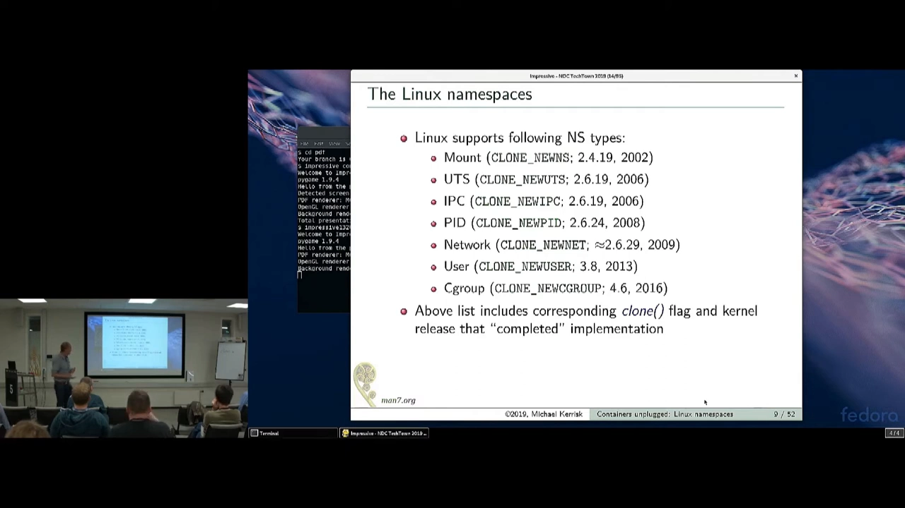
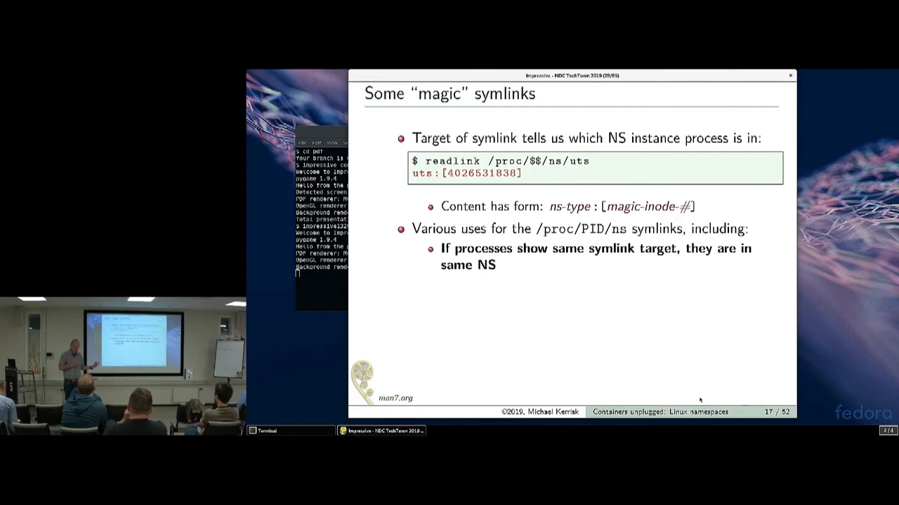
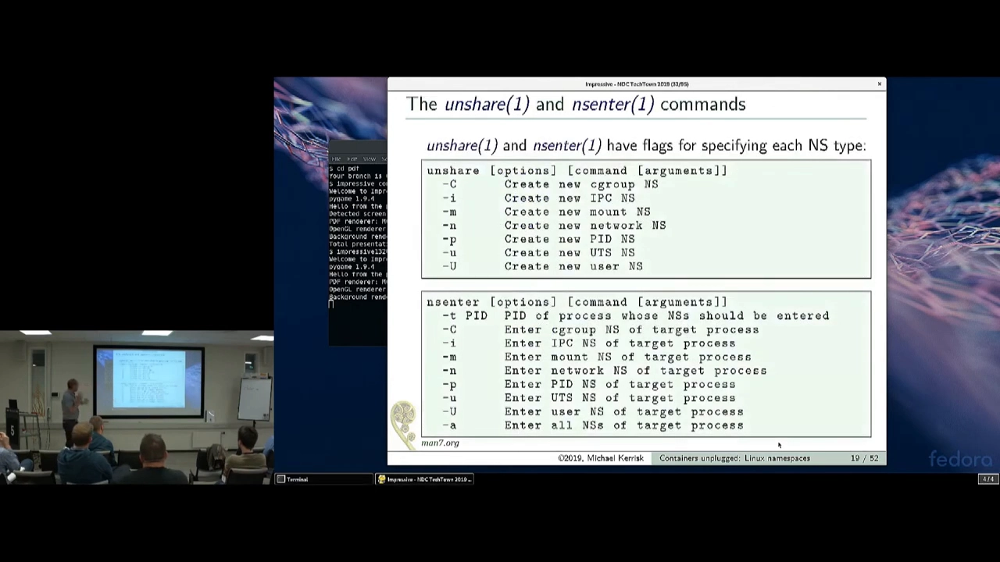
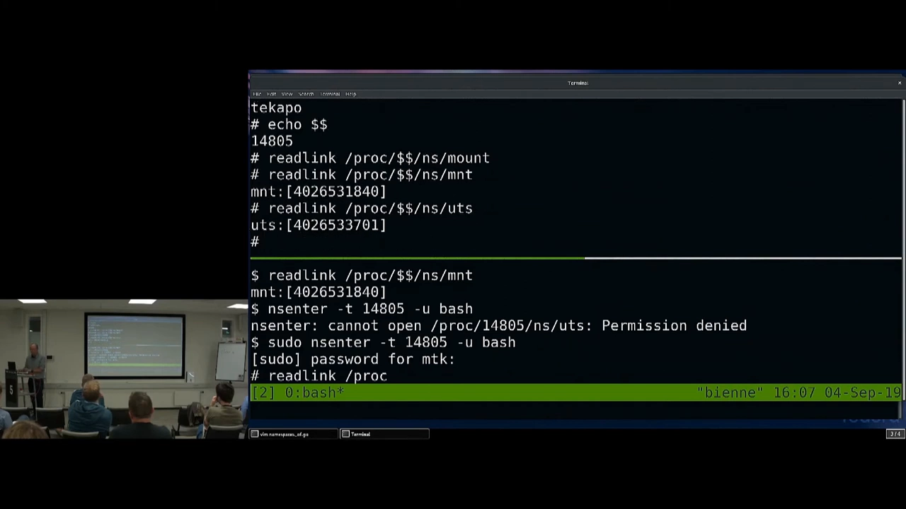
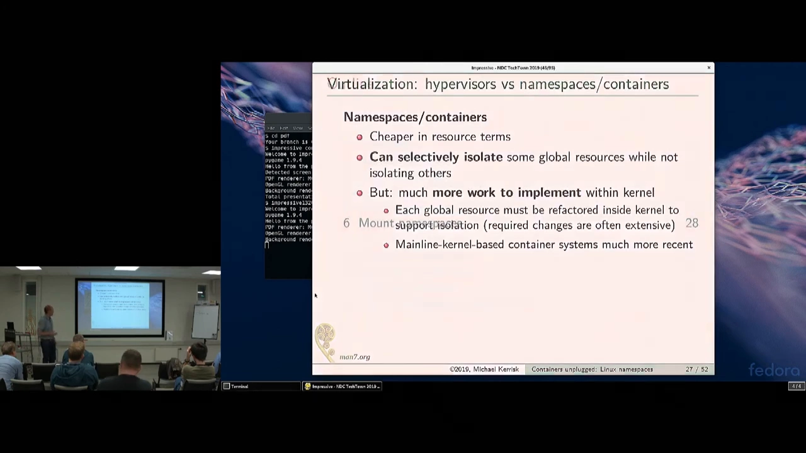
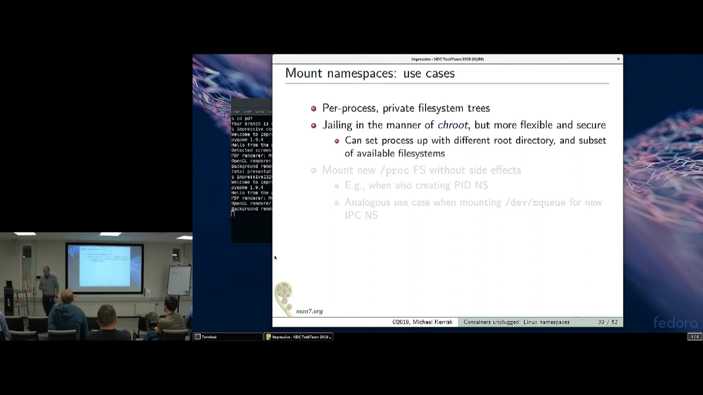
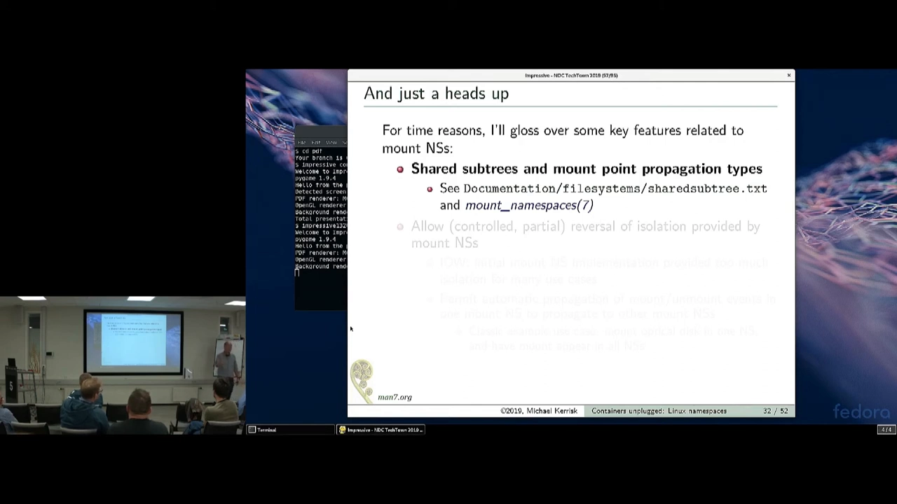
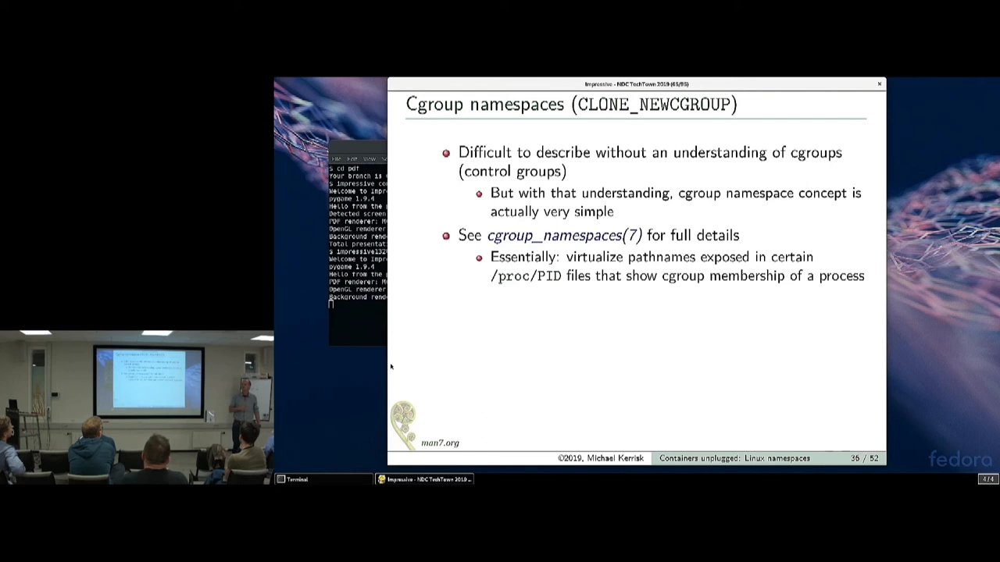
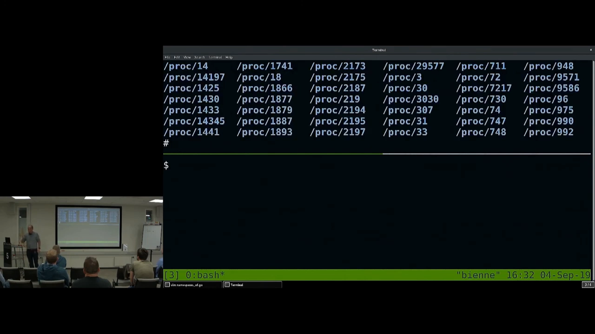

# 容器的原材料：Linux 命名空间全景与 clone/unshare/setns

> 本文整理自 Michael Kerrisk 在 NDC 大会的演讲《Containers unplugged: Linux namespaces》（约 54 分钟）。Kerrisk 是 Linux man-pages 项目维护者、《The Linux Programming Interface》作者、LWN 命名空间系列文章作者——由"Linux 手册页第一人"来讲命名空间的系统调用接口，再合适不过。演讲前半场是命名空间总论与现场演示，后半场深入用户命名空间；本文覆盖前半场全部内容。文中时间戳可跳转到原视频对应位置。

## 本讲要解决的核心问题（SCQA）

**背景**：容器技术火热，人人都在用 Docker，但很少有人能说清容器在内核层面由什么构成。

**冲突**：容器系统（及其编排体系）极其复杂；但 Kerrisk 开场就给出一个反直觉的事实——加州一位工程师写过一篇《Containers in 500 lines of C》，真正"把一个进程放进隔离环境"的代码量非常小，让容器系统复杂的全部是外围编排。

[【跳转到 02:19】](https://www.youtube.com/watch?v=0kJPa-1FuoI&t=139)

**疑问**：内核到底提供了什么原语，让"五百行 C"成为可能？这些原语怎么用？

**回答（中心思想）**：命名空间。一个命名空间**包装某种全局资源，为该资源提供隔离**；Linux 支持七种类型，每个进程对每种类型恰好处于一个实例中；操作它们的接口是三个系统调用——`clone()`、`unshare()`、`setns()`——以及架在其上的两个命令 `unshare`、`nsenter`。逐种理解这七类资源如何被隔离，就掌握了容器的原材料。

## 一、命名空间是什么：一个定义、七种类型

**定义**：a namespace wraps some global resource to provide isolation of that resource——命名空间包装某种全局资源，为它提供隔离。

**实例化**：每种命名空间类型在系统上可以有**一个或多个实例**。系统启动时，每种类型各有一个初始实例；每个进程对每种类型恰好驻留在一个实例里。

**视图私有**：同一命名空间实例内的进程看到该资源的同一份视图；其中一个进程改动资源，改动对同实例内其它进程可见，但对其它命名空间里的进程**不可见**。新创建的进程默认与父进程同处一套命名空间。

[【跳转到 05:14】](https://www.youtube.com/watch?v=0kJPa-1FuoI&t=314)

**七种类型**（演讲时点，按出现时间排序）：mount（2002，最早）、UTS、IPC、PID、network、user、cgroup（2016，当时最新）——演讲者预告"几个月内还会再加一种"（即后来的时间命名空间）。图中同时标注了各类型进入内核的版本，以及用于各类 API 的常量：**CLONE_NEW\* 标志**——引用不同命名空间类型时统一用它。

**单独用还是组合用？** 单独用完全可行——mount 命名空间 2002 年诞生时，容器概念还没影，人们只是为了隔离挂载点列表。但构建应用时常常多种组合：IPC、cgroup、PID 等命名空间要用到需要挂载的文件系统，为了不让这些挂载点影响系统其余部分，通常会同时创建 mount 命名空间。容器类框架则几乎全用：Docker 用了除 cgroup 命名空间外的几乎所有类型。

## 二、三个系统调用与两个命令

操作命名空间的系统调用只有三个（不展开细节，先立骨架）：

1. **clone()**：fork 的"加强版"——创建子进程的同时，可以用之前那张时间线上的 CLONE_NEW\* 标志指定"我要这个子进程直接进入哪些新命名空间"。
2. **unshare()**：类似，但**不创建新进程**——把调用进程自己搬进新造的命名空间。
3. **setns()**：让进程从当前驻留的命名空间，迁移到另一个**已存在**的命名空间。

[【跳转到 12:19】](https://www.youtube.com/watch?v=0kJPa-1FuoI&t=739)

命令行层面还有两个架在这些系统调用之上的工具：`unshare` 命令——创建新命名空间并在其中执行某命令；`nsenter` 命令——进入某些既有命名空间并在其中执行命令。两者都有标志指定要处理哪类命名空间，比如 `unshare -u` 创建新 UTS 命名空间；`nsenter -t <PID>` 进入与目标 PID 相同的命名空间，再加 `-u` 表示进入它的 UTS 命名空间。

**权限要求**：创建用户命名空间不需要任何特权；但创建其它所有类型的命名空间都需要 **CAP_SYS_ADMIN** 能力。

[【跳转到 13:34】](https://www.youtube.com/watch?v=0kJPa-1FuoI&t=814)

还有一个通用观察窗口：`/proc/<PID>/ns` 目录。里面每种命名空间类型各有一个符号链接（cgroup、ipc、mount、net……）。普通符号链接的指向是路径名，而这些"魔法符号链接"用 `readlink` 读出来是形如 `uts:[inode号]` 的字符串——内核在内部用一个内部文件系统实现命名空间，你看到的就是该命名空间实例的唯一 inode 号。实现细节不重要，重要的是：**这个号码对该命名空间实例唯一**。比较两个进程的同名链接：相同 = 同一命名空间；不同 = 各自隔离。

[【跳转到 10:14】](https://www.youtube.com/watch?v=0kJPa-1FuoI&t=614)

![/proc/PID/ns 目录：每个命名空间类型一个符号链接，readlink 读出 uts:[inode] 形式的唯一编号](assets/Containers_unplugged_Linux_namespaces_Michael_Kerrisk/00614.webp)

## 三、UTS 命名空间：理解命名空间的最小示例

UTS 命名空间隔离两个系统标识符：**节点名**（就是我们常说的主机名 hostname）和**域名**（与 DNS 无关，是 NIS 域名——够老的话会记得它曾叫 Yellow Pages 域名）。

名字典故：UTS 来自结构体 `utsname`——`uname()` 系统调用返回这些标识符；而这个结构体得名于它返回"你那份 UNIX Time Sharing System（UNIX 分时系统）实例"的特有标识。当年分时还是新事物，UNIX 的原名就叫 UNIX Time-Sharing System。

[【跳转到 07:19】](https://www.youtube.com/watch?v=0kJPa-1FuoI&t=439)

为什么要隔离它？容器视角：每个容器可以有各自的主机名与域名——容器里的初始化软件把自己的主机名广播给 DHCP，让容器被分配到独立的 IP 地址。

隔离的语义：同一 UTS 实例内的进程看到相同的主机名/域名，一方修改对同实例其它进程可见、对其它 UTS 实例无影响。每个 UTS 命名空间有自己的主机名、自己的域名。

[【跳转到 09:24】](https://www.youtube.com/watch?v=0kJPa-1FuoI&t=564)

**现场演示**（两个 shell 窗口，最初同处全部七种命名空间的初始实例）：

1. 两个 shell 里分别 `readlink /proc/$$/ns/uts`（`$$` 是 shell 的 PID）——号码相同，证明同处一个 UTS 命名空间；
2. 下方 shell 执行 `sudo unshare -u` 在新 UTS 命名空间里启动 shell——此刻看主机名**仍是原值**：新 UTS 命名空间创建时会从上一个 UTS 命名空间**继承一份主机名与域名的拷贝**；
3. 但 `readlink` 对比显示号码已不同——新 shell 已在另一个 UTS 实例里；
4. 在新 shell 里改主机名并验证——只有新命名空间里的进程看到新名字，原 shell 不受影响；
5. 记下新 shell 的 PID（14805），回到原 shell 执行 `sudo nsenter -t 14805 -u bash`——进入目标 PID 的 UTS 命名空间；再对比 `readlink`：号码与上方一致，`hostname` 显示的正是新命名空间里设置的名字。

[【跳转到 21:34】](https://www.youtube.com/watch?v=0kJPa-1FuoI&t=1294)

注意演示中的一个细节：这两个 shell 仍同处**挂载**命名空间等其余六种命名空间的相同实例——它们只差 UTS 成员身份。这正是"可按类型逐个隔离"的体现。

## 四、为什么用命名空间做容器（对比 hypervisor）

命名空间的重要用途是所谓"轻量级虚拟化"——更常用的名字是容器。这里的虚拟化指进程隔离：把进程放进自己的私有世界。

传统做法是 **hypervisor**：宿主机内核之上跑多个客户内核（guest kernel），客户内核里的进程活在客户内核创造的私有世界中，与其它客户内核的世界完全隔离。它的特点：

- **实现相对简单**：只要设计好客户内核与宿主内核之间的"对话"，之后每启动一个新客户内核就自动获得隔离——首批 hypervisor 出现得很早（VMware 二十岁生日快乐），2003 年就已有自由实现；
- **隔离是全有或全无**：两个进程要么在同一个客户内核里（同一世界观），要么在两个客户内核里（完全不同的世界），没有中间态；
- **资源开销大**：要隔离就得拉起一个新内核——启动慢、占资源。

命名空间把隔离放进**单个内核**的上下文中：可以做**部分隔离**——比如两个进程同处一个 UTS 命名空间、一个 mount 命名空间，却在不同的 PID 命名空间——隔离有"度"，按应用需要取舍。资源上便宜得多（只有一个内核）；代价是实现它需要大量内核重构，把全局资源改造成"多实例"概念——某些类型的实现异常复杂（用户命名空间是最突出的例子，光完成初版实现就花了数年）。

[【跳转到 22:34】](https://www.youtube.com/watch?v=0kJPa-1FuoI&t=1354)

## 五、mount 命名空间：第一个命名空间

mount 命名空间是第一个被实现的命名空间类型，2002 年进入主线内核，clone 标志是 **CLONE_NEWNS**。命名是个历史遗留：当年那位内核开发者进山林几个月，回来说"我做了个新东西，叫 namespace，标志叫 CLONE_NEWNS"——那时还没人想到将来还要隔离别的东西，叫 CLONE_NEWMOUNT 其实更贴切，但历史无法重写。

**隔离对象**：进程看到的**挂载点列表**。挂载点是"把某个挂载（某种设备）连接到某个路径名"的元组；元组里还有父挂载等要素——挂载点之间的父子关系，定义了你看到的那个单一目录层级。所以 mount 命名空间隔离的就是这组"挂载源 + 路径名 + 父挂载"的列表。

[【跳转到 25:54】](https://www.youtube.com/watch?v=0kJPa-1FuoI&t=1554)

这意味着不同 mount 命名空间里的进程看到不同的挂载点集合，进而可能看到**完全不同的单一目录树**、不同的已挂载文件系统集合——容器可以拥有自己的文件系统，外界未必可见。代价是内核重构：mount/umount 系统调用过去作用于全系统共享的全局挂载点列表，如今只应作用于调用进程所在 mount 命名空间的列表；不止系统调用，内核中一切与路径名相关的代码都要改（路径名是相对挂载点解释的），工程量不小。

**能拿它做什么？**

1. **每用户私有的文件系统树**：多用户系统上，用户登录时 PAM 模块创建新 mount 命名空间、为该用户挂载文件系统（比如家目录）；第二个用户同样处理。两个用户看到的文件系统集合可以完全不同——甚至看不到彼此的家目录，因为挂载点在各自命名空间内私有。
2. **chroot 的完全体**：chroot 只能把进程限制在既有单一目录层级的某个子树里；mount 命名空间则能**完全重排**进程看到的文件系统视图。
3. **为其它命名空间配挂载**：PID 命名空间有自己的那组 PID，想让它们出现在 /proc 里，就得挂一个显示这些 PID 的 /proc。所以创建 PID/IPC/cgroup 命名空间时，常同时创建 mount 命名空间，以便挂载必要文件系统而不影响系统其余部分。

[【跳转到 29:14】](https://www.youtube.com/watch?v=0kJPa-1FuoI&t=1754)

**补充特性 shared subtrees**：mount 命名空间最初实现后，人们发现"隔离过头了"——经典场景：一台有多个 mount 命名空间的机器上插入光盘，希望所有命名空间都能看到，原实现只能在**每个**命名空间里各挂一次。三年后实现的 shared subtrees 解决了这个问题：让挂载事件跨命名空间自动传播。这套机制复杂得出奇，但干成了这件事。

[【跳转到 32:09】](https://www.youtube.com/watch?v=0kJPa-1FuoI&t=1929)

## 六、IPC、cgroup、network 命名空间

**IPC 命名空间**：隔离 System V IPC 对象（共享内存、信号量、消息队列）以及 POSIX 消息队列。每个实例有自己的 IPC 对象集合与标识符；有自己的 /dev/mq 文件系统（POSIX 消息队列对象所在）；/proc 中也有私有文件；**命名空间销毁时，其中所有 IPC 对象自动蒸发**。

**cgroup 命名空间**：cgroup 本身是相当复杂的基础设施，容易让人以为 cgroup 命名空间也很复杂——其实超简单：它只做一件事，把某些 /proc 文件中出现的某些路径名**虚拟化**。感兴趣可读 cgroup_namespaces 手册页。

**网络命名空间**：隔离一大批网络资源——路由表、防火墙规则、socket 端口号空间、/proc/net 与 /sys/class/net 里的一些目录等。目标是让容器从网络视角"有用"：每个容器可以有自己的虚拟网络设备（虚拟以太网设备 veth）和自己的 socket 端口号空间；用 veth 把容器连接到外部世界（连到别的容器，或经 NAT 规则通向互联网）；于是每个容器都能在自己的 80 端口跑 Web 服务。

[【跳转到 34:39】](https://www.youtube.com/watch?v=0kJPa-1FuoI&t=2079)

网络命名空间的几类用途：

1. **容器化网络服务**：服务活在自己的隔离世界里。
2. **网络规则开发**：要为一套真实物理网络开发防火墙/路由规则，不必拉真实网线盒子试错——先用网络命名空间在软件里仿真，规则测试通过后再装到物理设备。甚至有现成仿真器 CORE（Common Open Research Emulator）。
3. **安全：彻底断网**。新建的网络命名空间**初始没有任何网络设备**；里面的进程即使被攻破，也无法发起任何网络连接——因为没有设备可连。
4. **安全：helper 进程模式**。面向互联网的主服务接收连接，把连接交给活在网络命名空间里的 helper 进程——这些命名空间里**没有网络设备**。helper 正常处理客户端；若客户端恶意、helper 被攻破，攻击者也无法让 helper 新建网络连接"把公司数据库发回老家"。

主服务怎么把连接交给 helper？一个 UNIX 系统里存在已久的技巧：两个进程间建一条 UNIX 域套接字连接，一方可以把**文件描述符**传给另一方。主服务器 accept 拿到连接 socket 的描述符，把它传给命名空间里的 helper，helper 便持有与客户端的那条连接。

## 七、PID 命名空间：层级、init 与 /proc 实验

PID 命名空间隔离的是**进程 ID**：一个 PID 命名空间里有一组只在该命名空间内可见的 PID，命名空间外看不见它们。

**用途一：容器搬家不冲突**。如今可以把容器在一台物理机上"冻结"、跨网络转移、在另一台机器上复活。容器原本用着一组 PID，若目标系统上这些号已被占用就麻烦了——PID 命名空间让 PID 只在命名空间内可见，**与现有 PID 不可能冲突**。

**用途二：自己的 init**。拥有自己的 PID 集合，就能有自己的 PID 1（init 进程）。PID 1 在任何 UNIX 式系统上都干特殊的事，容器里亦然：成为孤儿进程的父，通常还负责某些系统初始化。

**与其它命名空间不同：PID 命名空间有层级**。任何 PID 命名空间都有父命名空间，一路向上直到初始 PID 命名空间；最大嵌套深度 32（暂未见有人碰到麻烦）。因为这种层级，进程是自己 PID 命名空间的成员，实际上也是父、祖父……直到初始命名空间的成员——**在每一层它几乎必然有不同的 PID**。初始命名空间能看到系统全部进程；低层命名空间里的进程看不到高层的 PID。

[【跳转到 42:59】](https://www.youtube.com/watch?v=0kJPa-1FuoI&t=2579)

两个系统调用的行为随之变化：`getpid()` 返回"你所居住的命名空间视角"的 PID——图中最深处的进程调用 getpid() 得到 1；`getppid()` 呢？在这个命名空间里**没有可见的父**——返回 0。父确实存在，只是从这里看不见。

**现场实验**：执行 `unshare -p`（外加另一个对 PID 命名空间很有用、此处不便展开的标志，即 --fork）启动 bash 并 `echo $$`——这个 shell 的 PID 是 1。但 `ls -d /proc/*` 却看到一大堆数字目录——明明这个命名空间里只有一个进程？原因：看到的是**对应初始 PID 命名空间的 /proc 挂载**。教训：新建 PID 命名空间时还应重新挂载 /proc，又不想影响系统其它进程——所以应当**同时创建 mount 命名空间**。重演：同时建 PID + mount 命名空间，先看 /proc（仍是旧的）；顺带验证怪象——/proc/1/status 显示的竟是 systemd（初始命名空间的 systemd）！接着 `mount -t proc none /proc`（proc 是伪文件系统，source 写 none），再看 /proc：信息正确了。这正是"常把 mount 命名空间与其它命名空间并用"的原因：挂载文件系统而不影响更广的系统。

[【跳转到 46:22】](https://www.youtube.com/watch?v=0kJPa-1FuoI&t=2782)

**PID 1 的特殊性与命名空间之死**：新命名空间里的 PID 1 是 init——孤儿进程的父、负责初始化。传统 UNIX 上 PID 1 若死掉，内核知道 PID 1 对系统运转至关重要，会 panic 重启；PID 命名空间同理：**PID 1 消失后，该命名空间被视为不可用——其余进程全部被杀死，命名空间死亡**。

## 八、用户命名空间：30 秒预告

演讲的下半场主题（本条目只取引子）：隔离 UID/GID。核心想法——进入（创建）用户命名空间的进程，在命名空间**外**是非特权用户，在命名空间**内**却拥有 UID 0：是命名空间内的超级用户，可以在特定上下文里执行特权操作。这解锁了一些非常强大的能力（比如无特权容器）。想深挖，请看 Kerrisk 的用户命名空间专讲。

[【跳转到 49:16】](https://www.youtube.com/watch?v=0kJPa-1FuoI&t=2956)

## 问答拾遗

- **mount 命名空间的继承**：新 mount 命名空间创建时，继承上一个命名空间的挂载点列表（初始就有一套挂载点）；之后其中的进程可以增删挂载点、任意重排。
- **隔离的是挂载点，不是文件系统**：两个 mount 命名空间挂载同一文件系统时，一方修改文件，另一方完全可见——同一份文件。不想让改动可见？那就别在对方命名空间里挂载这个文件系统。
- **"文件描述符传递"名不副实**：实际传递的是对 open file description（打开文件描述）的引用；发送方用的描述符编号，与接收方在自家描述符表里分配到的编号很可能不同。且该技巧只要求一条 UNIX 域套接字连接，与命名空间是正交的技术。

## 小结

- 命名空间 = 包装全局资源、为其提供隔离；共七种类型，每个进程对每种类型恰好驻留一个实例，新进程默认继承父进程的命名空间。
- 操作接口只有三个系统调用：clone()（生在新世界）、unshare()（自身迁入新世界）、setns()（迁入既有世界）；命令行对应 unshare 与 nsenter；除用户命名空间外，创建均需 CAP_SYS_ADMIN。
- `/proc/<PID>/ns/*` 的魔法链接读出 `uts:[inode]` 式编号：同号即同实例，是判断隔离边界的直接依据。
- UTS 现场演示走通完整闭环：readlink 判等 → unshare -u 建新实例（继承主机名拷贝）→ 改名只影响本实例 → nsenter -t PID -u 迁入他人实例。
- 与 hypervisor 相比：命名空间隔离在单内核内、可分度数、资源便宜，但要求大量内核重构（用户命名空间耗时数年）。
- mount 命名空间（2002，CLONE_NEWNS）隔离挂载点列表：PAM 私有文件树、chroot 完全体、为 PID/IPC 配挂 /proc；shared subtrees 解决跨命名空间传播。
- IPC 命名空间隔离 SysV IPC 与 POSIX 消息队列（销毁即蒸发）；cgroup 命名空间只虚拟化 /proc 中的路径；网络命名空间隔离路由/防火墙/端口空间，"无设备即断网"可做安全沙箱。
- PID 命名空间有层级（嵌套上限 32）：同进程在各层 PID 不同；getpid() 返回本层视角 PID，不可见父时 getppid() 返回 0；PID 1 死则命名空间死。
- 用户命名空间：ns 外非特权、ns 内 UID 0——容器安全模型的下一块基石。

## 关键术语速查

| 术语 | 一句话解释 |
| --- | --- |
| namespace | 包装某种全局资源、为其提供隔离的内核机制；每种类型可有多个实例 |
| CLONE_NEWNS / NEWUTS / NEWIPC / NEWPID / NEWNET / NEWUSER / NEWCGROUP | 在 clone/unshare 中指定要创建/进入的命名空间类型的标志 |
| clone() | fork 加强版：创建子进程的同时用标志指定其进入的新命名空间 |
| unshare() | 不创建新进程，把调用进程自身移入新造的命名空间 |
| setns() | 把进程从当前命名空间迁入另一个已存在的命名空间 |
| unshare / nsenter 命令 | 架在系统调用之上的命令行工具：前者创建新命名空间执行命令，后者迁入目标 PID 的既有命名空间执行命令 |
| CAP_SYS_ADMIN | 创建除用户命名空间外各类命名空间所需的内核能力 |
| /proc/<PID>/ns | 每进程各命名空间类型的魔法符号链接；readlink 得 `类型:[inode]`，同号即同实例 |
| utsname / uname() | UTS 命名空间所隔离标识符（主机名/NIS 域名）的返回结构与系统调用；名字源自 UNIX Time-Sharing System |
| PAM | 可插拔认证模块；示例中在用户登录时创建私有 mount 命名空间并挂载其家目录 |
| shared subtrees | mount 命名空间特性：在命名空间之间传播挂载事件，避免重复挂载 |
| veth | 虚拟以太网设备；把容器（网络命名空间）连接到外部世界的"网线" |
| CORE | Common Open Research Emulator：基于网络命名空间的网络仿真器 |
| open file description | 文件描述符传递时真正被传递的对象：对打开文件描述的引用，而非编号本身 |
| 嵌套深度 32 | PID 命名空间的最大层级深度 |
