# Docker 是怎样运行的：用 strace 亲眼看见 unshare 与 clone

> 本文整理自 B 站视频《Docker是怎样运行的 - 对namespace的介绍》（LiveOverflow《How Docker Works - Intro to Namespaces》中文配音版，约 13 分钟）。它不講概念，而是用 `strace` 现场追踪 Docker 启动容器的全过程，把「容器 = unshare + 命名空间」这句话变成眼见为实的系统调用记录。文中时间戳可跳转到原视频对应位置。

## 本讲要解决的核心问题（SCQA）

**背景**：上一期视频演示过 docker exec 的用法，并留了一个思考题：把这些命令里的「容器」两个字替换成「命名空间」，句子依然成立——"在这个命名空间中执行进程"、"在这个命名空间中我们是 root"。

**冲突**：容器不是虚拟机——它和宿主机共享同一个内核。那么它到底共享了什么、隔离了什么？负责创建容器的 runc，究竟调用了什么系统调用把进程送进隔离世界？

**疑问**：不读内核源码、不翻文档，能不能直接"看见"这一过程？

**回答（中心思想）**：可以。把 `strace` 附加到 containerd 上再执行 `docker run`，就能沿着 docker → containerd → runc 的调用链，亲眼看到 `prctl` 改名、`unshare(CLONE_NEWPID)` 画出新边界、`clone` 生出 PID 1 的全过程——归根结底，Docker 只是围绕"unshare + 命名空间"这个内核特性的一层漂亮界面。

## 一、容器不是 VM：两个可亲手复现的证据

在深入命名空间前，先做两个观察。

**证据一：同一个用户 ID，不同的名字。** 容器里我是用户 `ctf`（UID 1000），宿主机上我是另一个名字的用户（UID 同样是 1000）。在容器里创建的文件属于 ctf；在宿主机上查看同一个共享目录，它属于我。相同的用户 ID、不同的用户名——说明容器和宿主机共享着某种东西，只是「视图」不同。

[【跳转到 01:35】](https://www.bilibili.com/video/BV1JZ4y1m7Pv/?t=95)

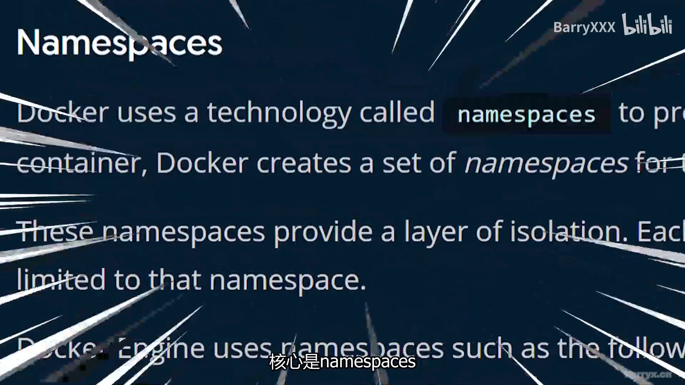

**证据二：一个进程有两个 PID。** 在容器里用 `watch` 反复执行 `ps ax`，找到那个 watch 进程本身：它在**宿主机**上的 PID 是 20675，但在**容器里**的 PID 是 79。同一个进程、两个号码——这就是「Docker 容器不是 VM」的第一条铁证：进程与宿主机共享内核，只是各自看到的 PID 视图不同。

[【跳转到 02:04】](https://www.bilibili.com/video/BV1JZ4y1m7Pv/?t=124)

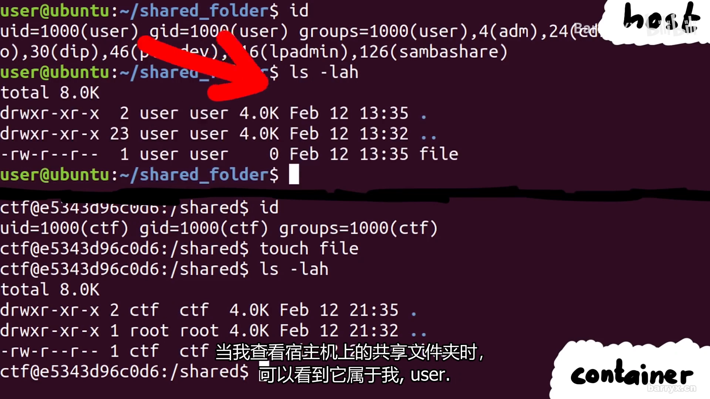

[【跳转到 02:46】](https://www.bilibili.com/video/BV1JZ4y1m7Pv/?t=166)

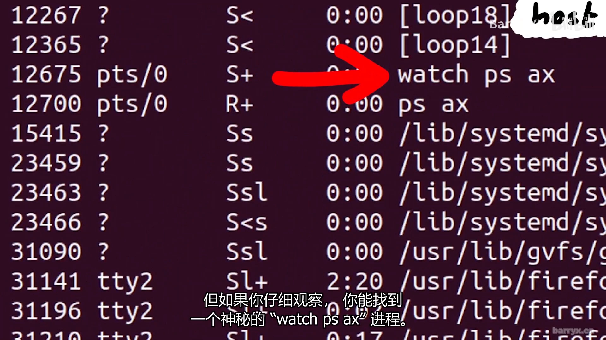

按 Docker 官方文档的说法：Docker 用 Go 编写，利用 Linux 内核的几个特性来提供功能；它使用名为「命名空间」的技术提供隔离的工作空间（即容器），运行容器时会为它创建一组命名空间——包括进程隔离的 **PID 命名空间**、管理网络接口的**网络命名空间**、管理挂载点的**挂载命名空间**等。实现容器概念的核心，正是命名空间。

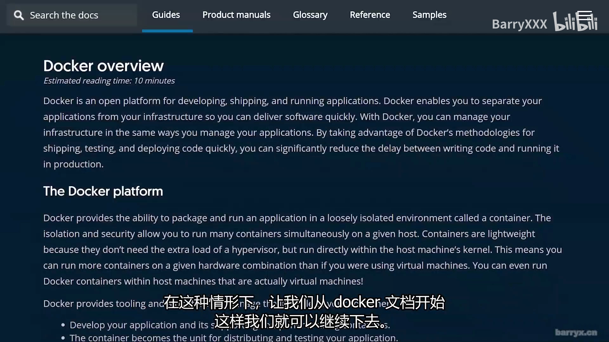

## 二、调用链全景：docker → dockerd → containerd → shim → runc

用 `pstree` 看进程树：systemd 是 init 进程，它拉起各种服务；容器里的 watch 进程，挂在 **containerd-shim** 进程之下，而 shim 又是 **containerd** 的子进程。

- **containerd**：行业标准的容器运行时，管理宿主机上容器的完整生命周期；README 自述其运行时依赖非常少，与 Linux 容器特性的大部分交互由 **runc** 处理。
- **runc**：按 OCI 规范生成并运行容器的 CLI 工具。
- Docker 侧：docker build / docker run 等**命令行客户端**与守护进程 **dockerd**（名字以 D 结尾即 daemon）通信（REST API over HTTP，或 UNIX 套接字）；dockerd 会**自动启动 containerd**——因为真正管理容器的是 containerd，而 containerd 又用 runc 实际生成并运行容器。

[【跳转到 04:25】](https://www.bilibili.com/video/BV1JZ4y1m7Pv/?t=265)

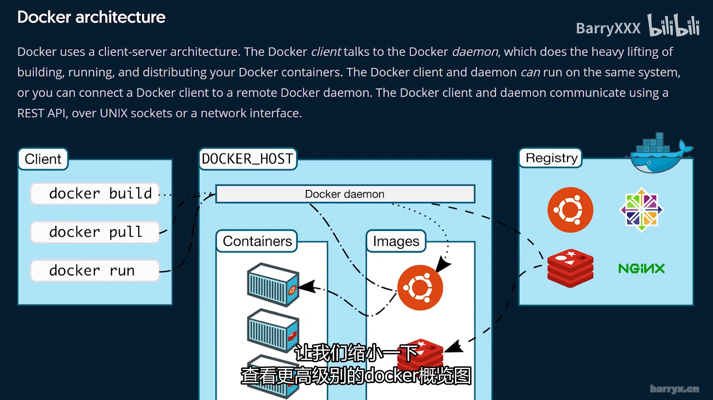

## 三、strace 抓现场：runc 铸造 PID 命名空间的三步

调查方法：`strace -f -p <containerd 的 PID>` 附加到正在运行的 containerd 进程（`-f` 跟随所有子进程），把输出重定向到文件，然后执行 `docker run`。容器的启动立刻触发 containerd 产生新进程；这份 trace 很大，但目标明确——找 runc 相关的调用：先是 execve 执行 containerd-shim（它是容器的子进程、也是后续容器进程的父进程），下一个 execve 执行的就是 **runc 二进制**。

[【跳转到 05:15】](https://www.bilibili.com/video/BV1JZ4y1m7Pv/?t=315)

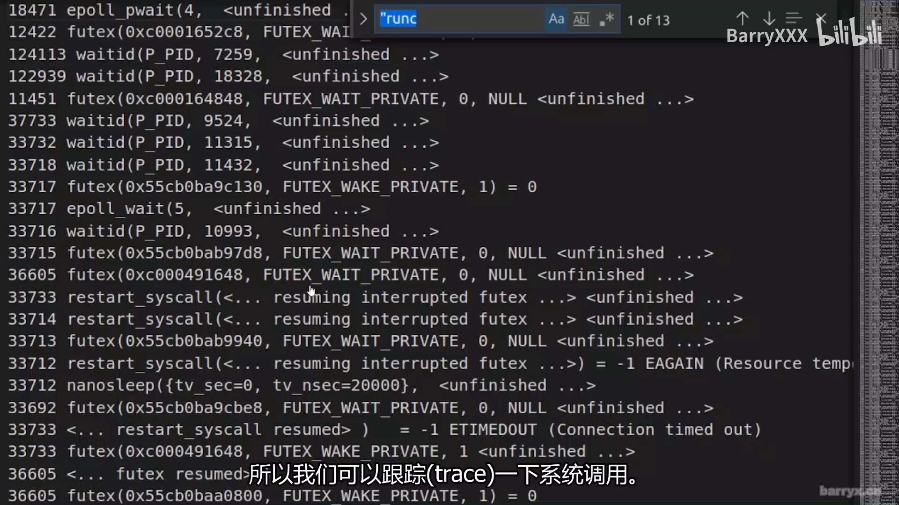

runc 内部系统调用极多。视频作者翻了半天，终于在 trace 里亲手抓到了要找的"魔法"——**unshare**。

[【跳转到 06:34】](https://www.bilibili.com/video/BV1JZ4y1m7Pv/?t=394)

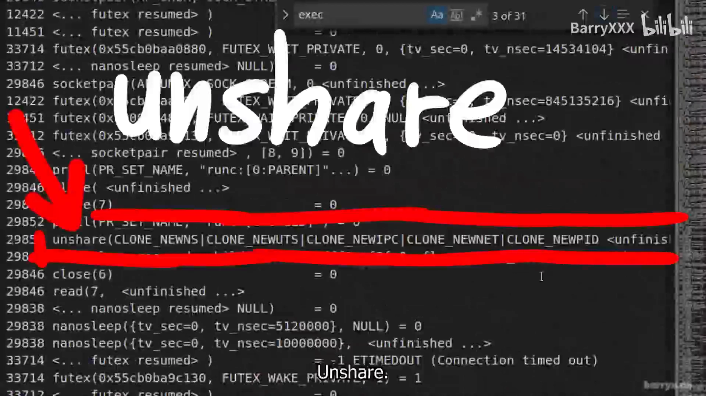

**第一步：prctl 改名。** trace 中同一进程 ID 处，runc 的子线程先调用 `prctl` 设置调用线程的名称，随后调用了 `unshare`。

**第二步：unshare(CLONE_NEWPID) 画边界。** `unshare` 允许进程把当前与其它进程共享的部分执行上下文分离出来，参数指定取消共享哪些部分。众多标志中最关键的是 **CLONE_NEWPID**：不共享 PID 命名空间——调用进程为它的**子进程**准备一个新的 PID 命名空间。注意：**调用进程自己并不会移入新命名空间**；它创建的第一个子进程将拥有进程 ID 1，并承担新命名空间中 init 的角色。

[【跳转到 07:17】](https://www.bilibili.com/video/BV1JZ4y1m7Pv/?t=437)

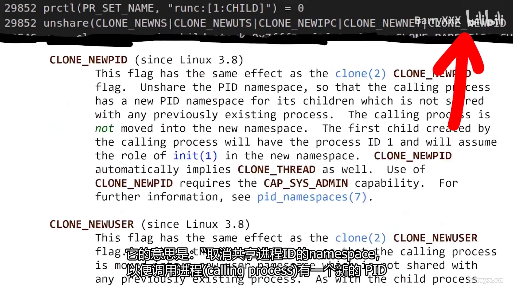

**第三步：clone 生出 PID 1，返回值出现"双宇宙"。** 顺着流程能在 trace 里找到 `clone` 系统调用，它创建的新子进程将成为新命名空间的 init 进程。由于 clone 是从宿主机一侧调用的，**返回值是宿主机上的新 PID**；但在这个新命名空间中，该进程的 PID 是 1。观察它此刻在做什么：它仍是 runc，只是给自己重新命了名——因为它已经"登基"，成为这个命名空间的 init 进程。

接着 PID 1 再次调用 clone，创建新命名空间中的另一个进程：PID 1 的孩子应该是 PID 2。那么在 PID 命名空间里执行的 clone 返回什么？strace 这一段有点混乱：strace 明显运行在命名空间之外，它看到这个进程的宿主机 PID 是 29866；**但在命名空间内部，这个系统调用的返回值是 2**。现在存在两个平行的"宇宙"，某种程度上相互共享：子命名空间里的进程，在父宇宙里是 PID 2，而这个 PID 命名空间在所有孩子周围吹起了一个"泡沫"——他们认为自己就是 1 和 2。

[【跳转到 08:31】](https://www.bilibili.com/video/BV1JZ4y1m7Pv/?t=511)

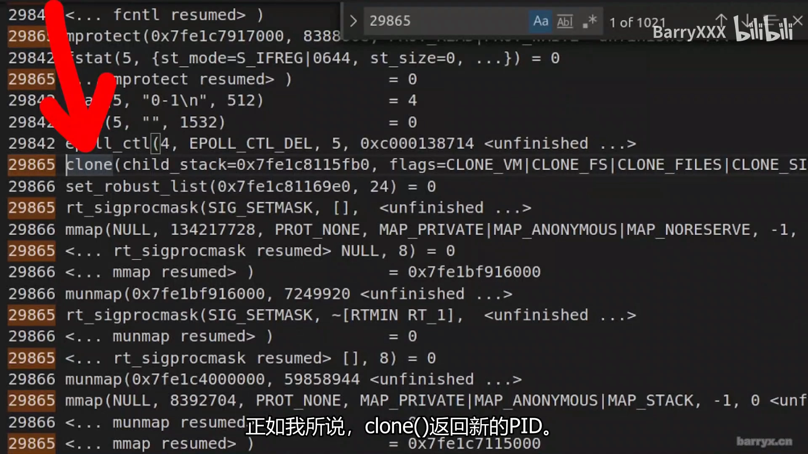

## 四、命名空间不止 PID：从 unshare 手册页看全貌

PID 命名空间只是开始。在 `unshare` 的手册页里能看到完整清单，比如：

- **CLONE_NEWNS**——不共享挂载命名空间：隔离"每个命名空间实例中的进程所看到的挂载点列表"，也就是每一次挂载（硬盘、交换分区、tmpfs、procfs 等）。你可能希望容器的文件系统与宿主机隔离。
- **CLONE_NEWNET**——不共享网络命名空间：把容器与宿主机可用的网络隔离开来。

这就是容器/Docker 背后的全部魔法：**围绕"unshare + 命名空间"这个内核特性的一层界面**。containerd 和 runc 只是与这些内核接口交互的组件；一切最终归结为这些系统调用，由它们告诉内核："请给这个子进程一个新的进程 ID 空间、或一个全新的网络栈"。

[【跳转到 09:25】](https://www.bilibili.com/video/BV1JZ4y1m7Pv/?t=565)

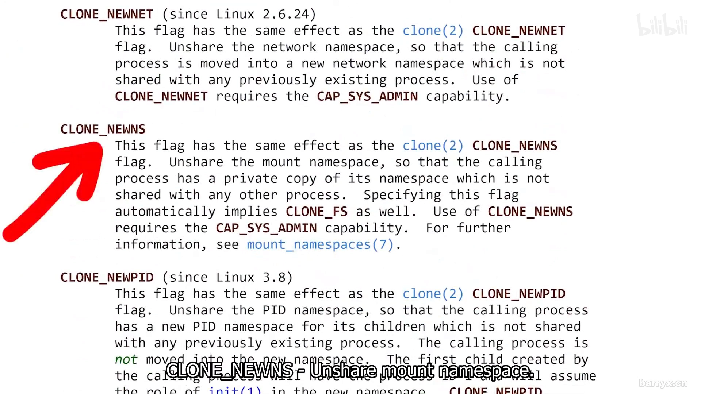

## 五、用 /proc 亲眼验证命名空间边界

最后一件事：你可以在 proc 文件系统中直接检查进程的命名空间。找到容器内 watch 进程的 PID，用 `ls` 列出它的 `/proc/<PID>/ns/` 目录，可以看到由数字（inode 号）标识的各种命名空间。

[【跳转到 10:41】](https://www.bilibili.com/video/BV1JZ4y1m7Pv/?t=641)

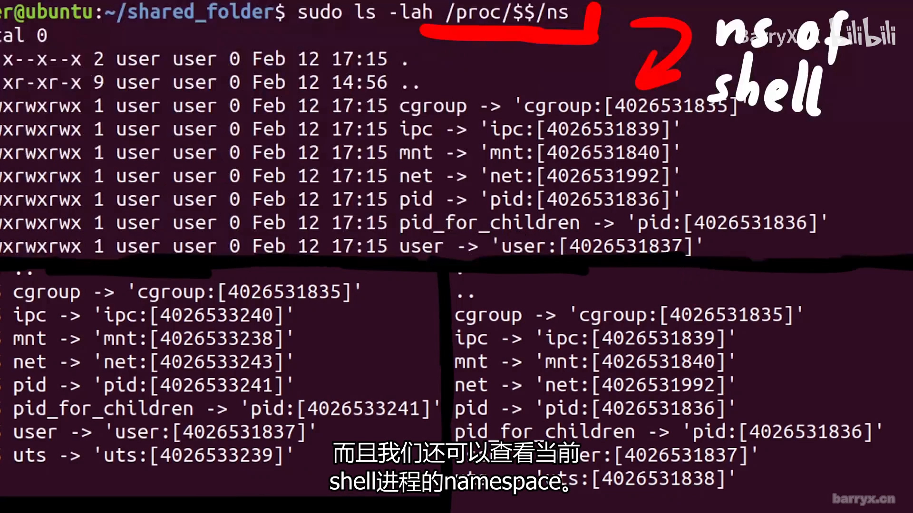

把它与宿主机 systemd（init）的命名空间对比：这一条不在容器里，是机器上真正的 systemd。再查看当前 shell 进程（`$$` 就是当前进程 ID）的命名空间：仔细对比可以看到，shell 与宿主机上其它进程**共享相同的命名空间编号**；但容器内的 watch 进程拥有一组独立的命名空间。

不过——**不是一切都不同**。它有一个不同的 PID 命名空间（前面已经证明），但**用户命名空间是一样的**。这说得通：刚才的 strace 里并没有出现 CLONE_NEWUSER 标志。

用户命名空间本身很酷：进程在命名空间内外的用户/组可以不同——特别是，进程在宿主机上可以只是一个普通非特权用户，同时在命名空间里拥有 UID 0。"看起来是容器里的 root，实际上没有额外特权"。但本例中并非如此：创建那个文件时，容器内外的用户 ID 都是 1000，只是名字不同——名字从 `/etc/passwd` 读取，容器里叫 ctf，外面叫另一个用户名。

[【跳转到 11:06】](https://www.bilibili.com/video/BV1JZ4y1m7Pv/?t=666)

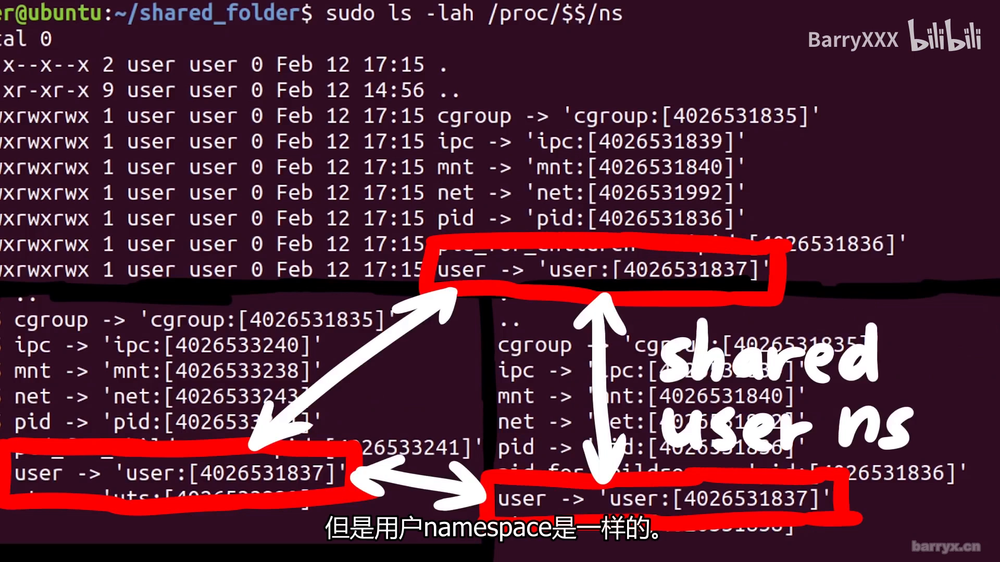

## 小结

- 容器不是 VM：同一进程在宿主机与容器内 PID 不同、用户同号不同名——它共享内核，只是视图被切分。
- 调用链：docker CLI → dockerd → containerd → containerd-shim → runc；真正"生成"容器的是 runc。
- strace 实证 runc 的三步：`prctl` 改名 → `unshare(CLONE_NEWPID)` 画边界（调用者不移入）→ `clone` 生出新命名空间的 PID 1。
- clone 的返回值存在"双宇宙"：宿主机视角是新宿主机 PID，命名空间内部返回的是 1 或 2。
- PID 之外还有 CLONE_NEWNS（挂载）、CLONE_NEWNET（网络）等；Docker 的魔法 = unshare + 命名空间的界面。
- `/proc/<PID>/ns/` 让命名空间边界可见：inode 编号相同即共享；本例中用户命名空间与宿主机一致（未用 CLONE_NEWUSER）。
- 安全提醒：容器内外共用一个内核，暴露太多可能危险，内核漏洞可能被用来逃逸。

## 关键术语速查

| 术语 | 一句话解释 |
| --- | --- |
| namespace（命名空间） | 内核提供的隔离机制：包装某类全局资源，让一组进程看到私有视图 |
| CLONE_NEWPID | unshare/clone 的标志：为新子进程提供独立 PID 命名空间；调用者自身不移入 |
| unshare() | 把调用进程与其它进程共享的执行上下文部分（按标志指定）分离的系统调用 |
| clone() | 创建子进程的系统调用；在 PID 命名空间内执行时返回值是该命名空间内的 PID |
| strace | 跟踪进程系统调用的工具；`-f` 跟随子进程，`-p <PID>` 附加到运行中的进程 |
| dockerd / containerd / runc | Docker 守护进程 / 行业标准容器运行时 / 按 OCI 规范生成运行容器的 CLI 工具 |
| containerd-shim | 每个容器的中间进程：containerd 的子进程、容器内进程的父进程 |
| PID 1（init） | 新 PID 命名空间的第一个进程，承担 init 角色（如回收孤儿进程） |
| /proc/<PID>/ns/ | 每个进程各命名空间类型一个条目，编号（inode）相同即共享同一命名空间 |
| CLONE_NEWNS / CLONE_NEWNET | 分别隔离挂载点列表 / 网络资源的命名空间标志 |
| CLONE_NEWUSER | 用户命名空间标志：进程可在命名空间内外拥有不同的 UID 映射 |
