# 01-Docker核心技术-06-Linux_Cgroups

> 视频源：[01-Docker核心技术-06-Linux Cgroups](https://www.bilibili.com/video/BV1kB42167R9/)（B 站 @河童之夏丶，23 分 22 秒）。本文基于视频演说图文稿整理，时间戳可跳转到原视频对应位置。

## 本讲要解决的核心问题（SCQA）

**背景**：前一讲里，namespace 已经让容器进程互相隔离、互相不可见——每个容器都"以为"自己在独立的环境里。对比虚拟机：启动前要指定 flavor（规格），约定好能用多少 CPU、多少资源；而容器没有这个"先谈配额"的环节。

**冲突**：但容器不是虚拟机。这些进程虽然被放进了不同的 namespace，本质上仍是同一台主机上 fork 出来、跑在同一个操作系统里的进程。程序总会有 bug：有人写出死循环，CPU 就被白白吃光，主机变慢，其他应用全部受影响；有人写出内存泄漏，主机 200G 内存跑着跑着被吃光，整台机器连交互都做不了；磁盘空间也是同样的道理。

**疑问**：容器进程没有独立操作系统，靠什么做到"你想多吃资源也吃不到"，让主机上大家相安无事？

**回答（中心思想）**：靠 Linux 内核的 cgroup（control groups，控制组）。它把进程组织成组，对每组做两件事：**限制**——给 CPU、内存等资源设上限并真正执行（CPU 超限被"压慢"，内存超限触发 OOM killer）；**记帐**——统计每组进程的真实用量，输出资源报告，这也是容器健康检查的依据。cgroup 管控的资源分两大类：CPU 这类**可压缩资源**（压着还能跑，只是变慢）与内存这类**不可压缩资源**（分不到就异常，只能杀掉）。

[【跳转到 00:00】](https://www.bilibili.com/video/BV1kB42167R9/?t=0)

## 一、隔离之外还缺一件事：资源管控

回想启动虚拟机的过程：我们总会告诉云平台一个 flavor，里面约定了这台虚拟机能用多少 CPU、多少资源。而容器进程是从主机上 fork 出来的，如果不加以管控，两种典型故障就会找上门 [【跳转到 00:25】](https://www.bilibili.com/video/BV1kB42167R9/?t=25)：

- **CPU 被吃光**：应用某个地方出现死循环，会一直占用大量 CPU，主机整体变慢，其他应用全部受影响；
- **内存被吃光**：应用内存泄漏，主机 200G 内存被它跑着跑着全部吃掉，主机任何交互都做不了，整个系统出问题——磁盘空间也是类似。

[【跳转到 00:50】](https://www.bilibili.com/video/BV1kB42167R9/?t=50)

所以，容器技术除了给容器进程提供隔离、封闭的环境（namespace 的职责）之外，还要做另一件事：**资源管控**——管住 CPU、内存这些最直观的计算资源。这件事，就是 cgroup 的职责。[【跳转到 01:15】](https://www.bilibili.com/video/BV1kB42167R9/?t=75)

## 二、cgroup 在内核里的挂载点：task_struct → css_set

cgroup 管的是进程，所以它的入口就在进程的数据结构里。看 Linux 内核的 task_struct：

- 讲 namespace 时提过，task_struct 里有一个 `nsproxy` 属性，展开就是那六类 namespace，用来声明"这个进程属于哪些 namespace"；
- cgroup 也一样：task_struct 里一定有一个 `css_set` 结构体。[【跳转到 02:05】](https://www.bilibili.com/video/BV1kB42167R9/?t=125)

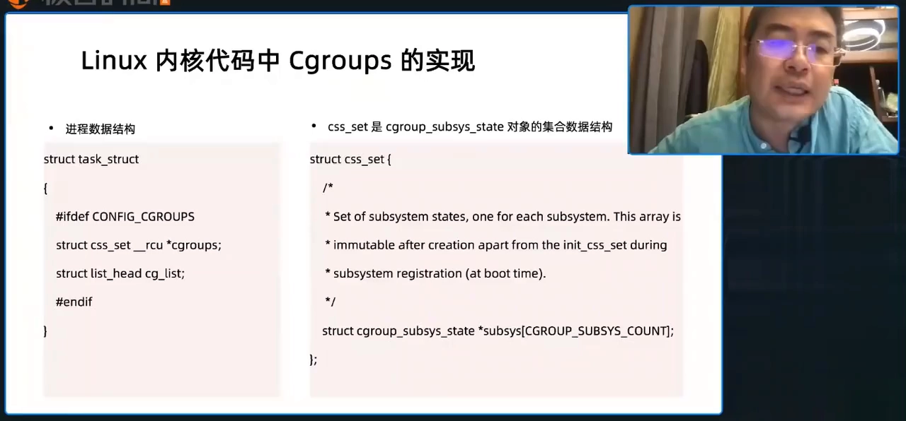

`css_set` 是 cgroup_subsys_state（cgroup 子系统状态）的集合，用来描述这个进程所在的 cgroup 的状态情况。也就是说，**namespace 决定进程"看见什么"，cgroup 决定进程"能用多少"**，两者都直接挂在进程结构体上。[【跳转到 02:30】](https://www.bilibili.com/video/BV1kB42167R9/?t=150)

## 三、组织方式：子系统 × 层级，一棵目录树

cgroup 是怎么组织的？两个关键词：**subsystem（子系统）** 和 **hierarchy（层级）**。[【跳转到 02:55】](https://www.bilibili.com/video/BV1kB42167R9/?t=175)

- **子系统**：每种资源由对应的子系统管理。要管控 CPU 就用 CPU 子系统，要管控进程内存就用 memory 子系统；
- **层级**：cgroup 以树状结构管理，就像操作系统的目录树。cgroup 通过自己的文件系统来管理整个架构：建一个根目录，往里放 100 个进程；根目录下再建两个子目录，每个子目录里又放若干进程——**在每一个层级上，都可以通过 cgroup 控制资源**。[【跳转到 03:26】](https://www.bilibili.com/video/BV1kB42167R9/?t=206)

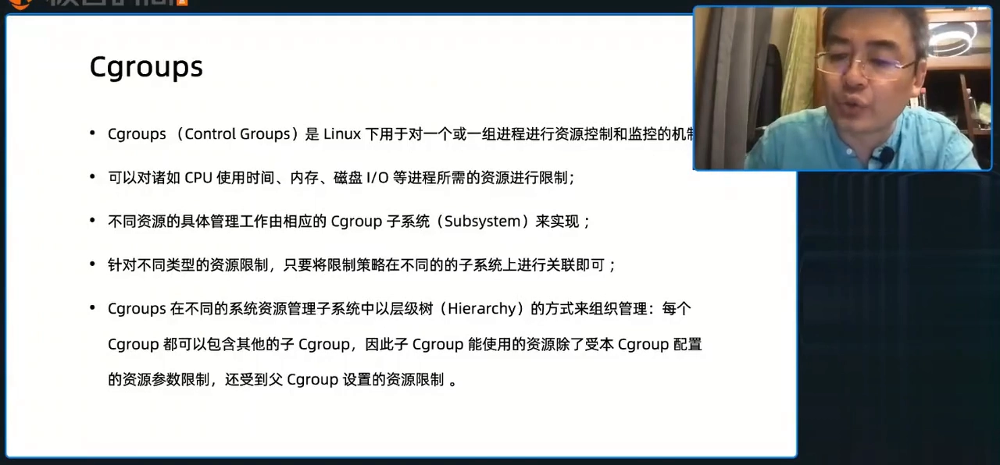

放到整机视角看：最下面是硬件（CPU、内存、存储、网络），上面是 Linux 内核——cgroup 由内核提供，内核与用户态之间通过系统调用接口交互；任何操作系统都有一个初始化的守护进程（如 systemd），容器进程就是由它 fork 出来的子进程再 fork 出来的，其资源约定就落在不同的 cgroup 上。[【跳转到 04:16】](https://www.bilibili.com/video/BV1kB42167R9/?t=256)

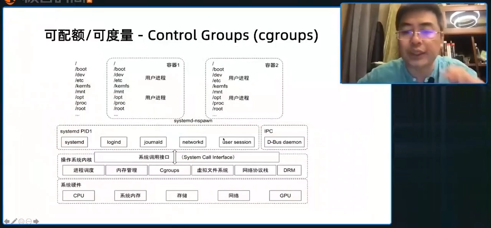

## 四、常用子系统与 cgroup 文件系统

cgroup 有哪些子系统？挑最重要的看 [【跳转到 05:31】](https://www.bilibili.com/video/BV1kB42167R9/?t=331)：

- **cpu**：控制一个进程能用多少 CPU；
- **memory**：设置进程的内存上限；
- **cpuset**：把应用进程绑定到特定 CPU 核上（比如只绑第一个核、或第二个核）；
- **cpuacct**（CPU accounting）：资源报告——这就是"记帐"。

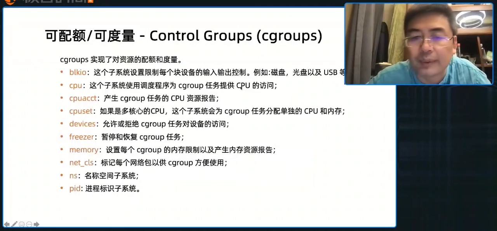

这些子系统体现在 cgroup 文件系统上：Ubuntu 上默认挂在 `/sys/fs/cgroup`，`ls` 一下就能看到 cpu、memory 等子目录。进入 cpu 子系统，里面有一堆配置文件，用来配置"这个目录下的进程能用多少 CPU"。[【跳转到 06:48】](https://www.bilibili.com/video/BV1kB42167R9/?t=408)

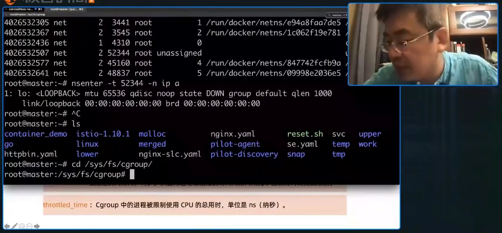

第一类配置是 **cpu.shares**。它是一个相对值：每个目录其实体现的是一个进程组，shares 就是给这个组约定一个 CPU 的相对份额——比如 docker 和 kubernetes 两个目录各有自己的 shares，两个组能用的 CPU 就是几比几的关系。[【跳转到 07:11】](https://www.bilibili.com/video/BV1kB42167R9/?t=431)

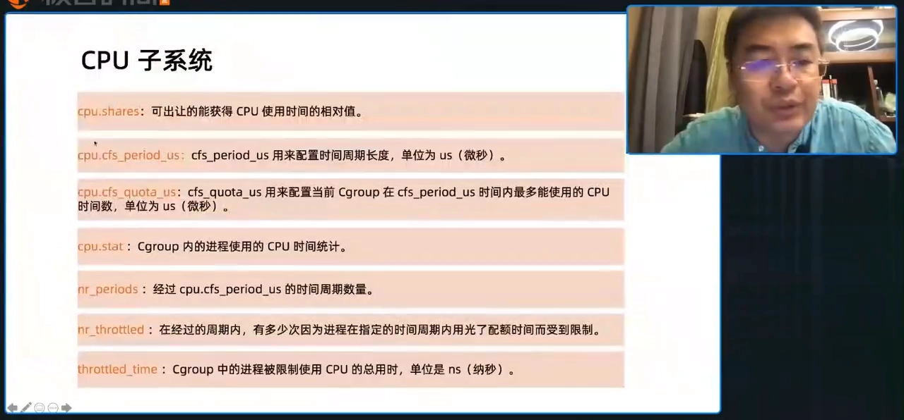

## 五、CPU 限制的两个参数：相对值与绝对值

cpu.shares 是相对值；第二个更重要的是一对绝对值参数：**cpu.cfs_quota_us** 和 **cpu.cfs_period_us**，用来控制一个进程能使用的 CPU 的绝对量。[【跳转到 08:36】](https://www.bilibili.com/video/BV1kB42167R9/?t=516)

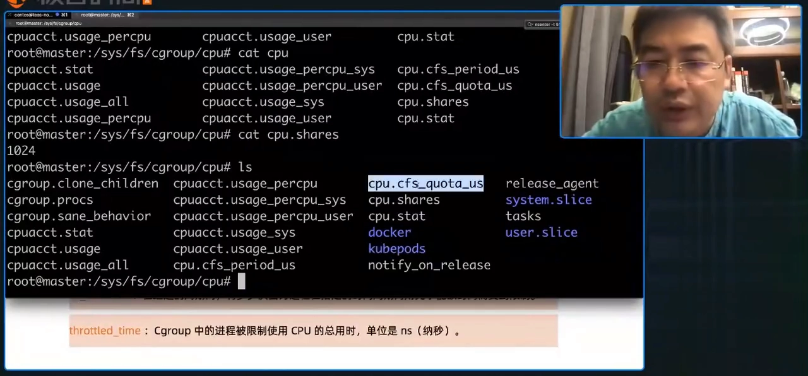

怎么理解这两个配置？`cpu.cfs_period_us` 是 CPU 的时间片（默认 10 万微秒），`cpu.cfs_quota_us` 是"在这么多时间片里，我能用多少"。两者一比，就是这个进程实际能占用的 CPU 比例。

## 六、实验：把死循环从 200% 压到 10%

demo 程序 busyloop 用 Go 写成：main 程序里一个 for 循环（死循环）不断吃 CPU，还开新的线程一起耗——这个进程啥也不干，就是空耗 CPU，已经装在实验机上。[【跳转到 10:06】](https://www.bilibili.com/video/BV1kB42167R9/?t=606)

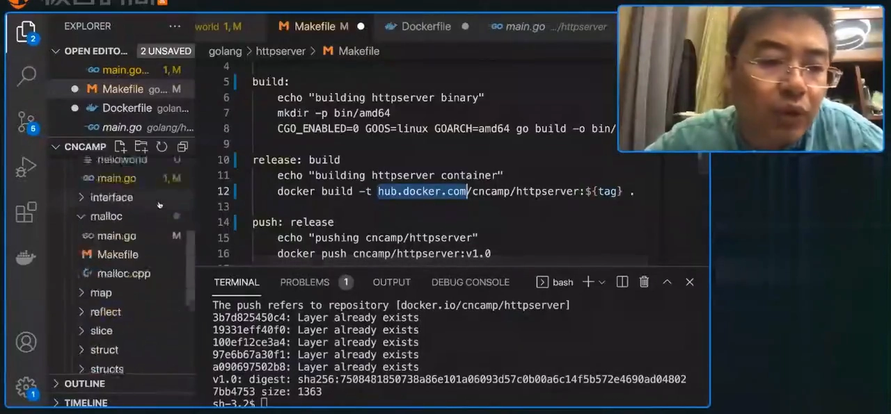

运行后用 top 观察：busyloop 占用 **200%** 的 CPU——多核机器上 200% 意味着吃满了两个核。任何应用只要写了这样的代码，就能把整机 CPU 吃光，这很危险。[【跳转到 11:01】](https://www.bilibili.com/video/BV1kB42167R9/?t=661)

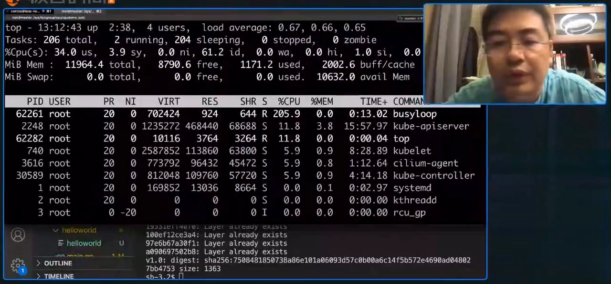

用 cgroup 控制它，只需三步 [【跳转到 11:26】](https://www.bilibili.com/video/BV1kB42167R9/?t=686)：

1. 在 cpu 子系统下建一个目录 `cpudemo`，进去 `ls` 可以看到全套控制文件被自动创建出来；
2. 把进程 PID（62261）写进该目录的 `cgroup.procs`，告诉 cgroup"这个目录里要控制的进程是它"——此时还没做任何限制，top 里 CPU 仍在 200% 上下浮动；
3. 设置参数：`cpu.cfs_period_us` 保持 100000，把 `cpu.cfs_quota_us` 从 -1（不做任何限制）改成 10000。[【跳转到 12:00】](https://www.bilibili.com/video/BV1kB42167R9/?t=720)

效果立竿见影：quota 和 period 相等（10 万比 10 万）时，进程在每 10 万个 CPU 时间片里能拿满 10 万个，即整整 1 个 CPU（100%）；改成 1 万比 10 万后，每 10 万个时间片只能拿 1 万个——top 里 CPU 直接降到 **10%**。[【跳转到 13:07】](https://www.bilibili.com/video/BV1kB42167R9/?t=787)

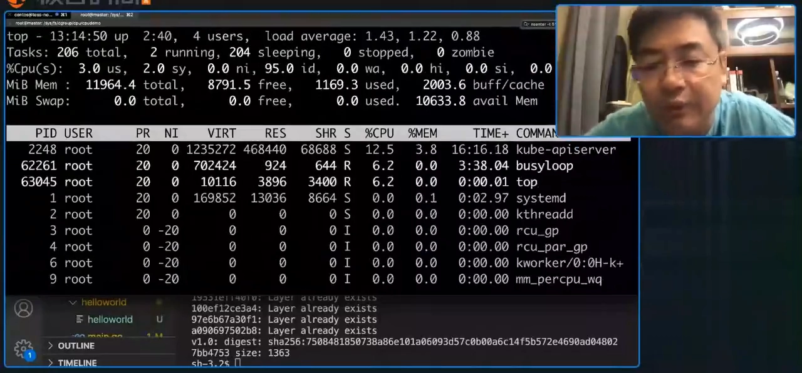

程序里还是那两个死循环，还想吃 200%，但 cgroup 把它按到了 10%。这就是"限制"的价值：你告诉我你要多少资源，我确保给你；你想多吃——吃不到。主机是大家共用的，不能让一个坏程序把其他人影响坏。[【跳转到 14:03】](https://www.bilibili.com/video/BV1kB42167R9/?t=843)

## 七、两类资源：可压缩与不可压缩

cgroup 要控制的资源分两大类 [【跳转到 14:53】](https://www.bilibili.com/video/BV1kB42167R9/?t=893)：

- **可压缩资源（compressible）**：典型是 CPU。程序本来需要 2 个核，被压到 0.1 个也能跑——只是变慢。对使用者的影响是性能：容器化后如果应用本来跑得好好的，忽然在某个环节变慢，甚至发一个 request 直接 timeout，就要查是不是给进程的 CPU 配额少了；
- **不可压缩资源（incompressible）**：典型是内存。程序需要 2G，把配额限死在 2G 后，再想 allocate（分配）内存时已经没有资源可分——内存"压不下去"，进程直接异常：malloc 分配不出内存，程序就异常、卡死在那里。[【跳转到 17:10】](https://www.bilibili.com/video/BV1kB42167R9/?t=1030)

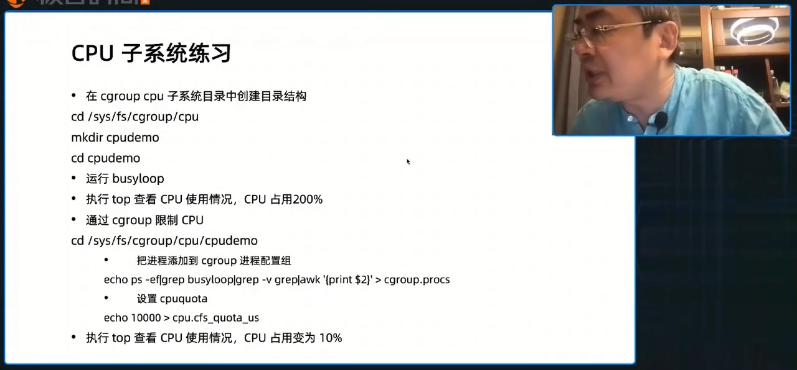

## 八、容器里看用量：top 不准，要看 cpuacct

在容器里能直接 top 看进程的资源利用情况吗？**不行**。容器技术本身是一系列技术的组合，操作系统本身并没有"容器"或 docker 的概念；当你切到某个 namespace 里去 top，看到的其实是主机的 top。同理，在容器里通过 `/proc/cpuinfo`、`/proc/meminfo` 看资源利用率或系统能力，也是不准的。[【跳转到 16:05】](https://www.bilibili.com/video/BV1kB42167R9/?t=965)

那 CPU 用量怎么看？看 cgroup 的 **cpuacct**（CPU accounting）子系统——它会告诉你这个组真正的 CPU usage 是多少。这就是"记帐"的价值：它给出的是**这个组**的真实用量，而不是主机的假象。[【跳转到 16:45】](https://www.bilibili.com/video/BV1kB42167R9/?t=1005)

## 九、memory 子系统：超限的处置是 OOM killer

对不可压缩资源，操作系统的处理行为完全不同：CPU 可以让人慢一点；memory 分不出来的话，进程很可能就异常了。这时内核有一套默认机制：**OOM control**（out of memory control），里面有 **OOM killer**。它的行为可以自定义，同时有一个默认行为 [【跳转到 18:00】](https://www.bilibili.com/video/BV1kB42167R9/?t=1080)：

> 如果应用进程消耗的内存已经超出了它的 cgroup 限制——限制通过 `memory.limit_in_bytes` 设置——那么操作系统就会通过 OOM killer 把它 kill 掉，让进程重新启动。

这就是 memory 子系统执行"限制"的方式：限制靠 limit_in_bytes，执行靠 OOM killer。[【跳转到 18:25】](https://www.bilibili.com/video/BV1kB42167R9/?t=1105)

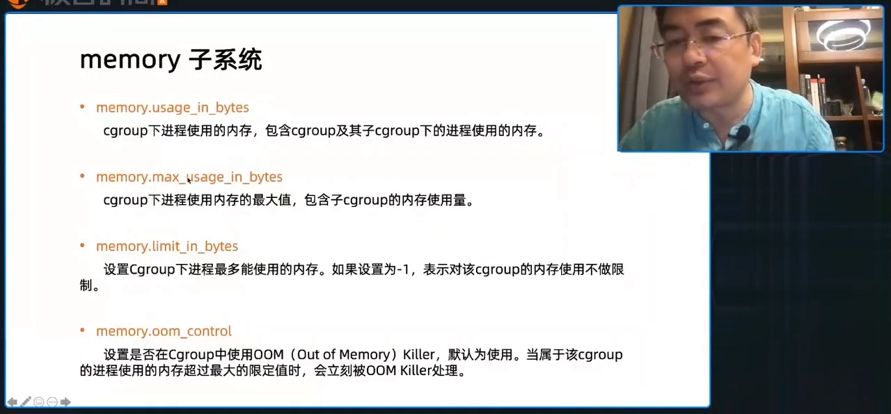

## 十、memory 实验设计：每分钟多吃 100MB，直到被 OOM

memory 子系统的练习与 CPU demo 思路一致，程序放在云原生训练营（cloudnativecamp）的 GitHub repo 里，由三部分组成 [【跳转到 19:01】](https://www.bilibili.com/video/BV1kB42167R9/?t=1141)：

- **malloc.cpp**：一个可被 Go 调用的 C 函数（Go 允许调用 C 的函数），每次被调用就分配 100MB；
- **memset 补刀**：malloc 和 memset 是两个行为——malloc 时只分配虚拟地址，内存页面没被赋值时物理内存并不真正分配；所以分配后还要 memset 赋值，把物理内存真正消耗掉；
- **main.go**：循环 10 次，每次调用分配 100MB 的函数，然后 sleep 1 分钟——让进程每分钟涨 100MB 内存。[【跳转到 20:15】](https://www.bilibili.com/video/BV1kB42167R9/?t=1215)

实验步骤：进入 memory 子系统，建一个 `memorydemo` 目录；运行编译好的程序（Makefile 已备好，需在 Linux 上 build，Mac 上头文件可能不匹配），用 watch 监控它是否在吃内存；然后把进程 PID 写进 `cgroup.procs`，再在 `memory.limit_in_bytes` 里设置比如 100MB——一旦这个进程消耗到 100MB，就会被 OOM killer kill 掉。[【跳转到 21:26】](https://www.bilibili.com/video/BV1kB42167R9/?t=1286)

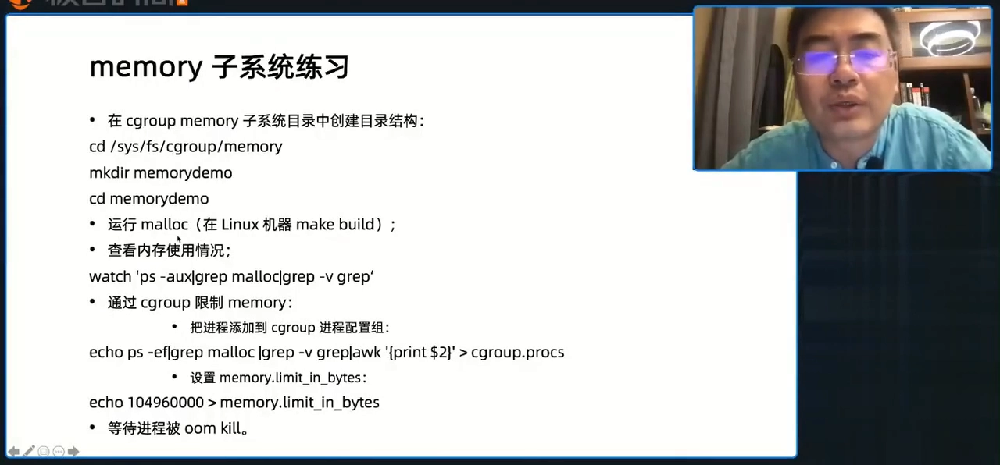

一个小提醒：实验里"循环 10 次"的次数，手慢或机器差的话先调小。讲师准备 demo 时曾忘了在 for 循环里写条件，直接 infinity loop 一直吃内存——cgroup 还没配好，整个主机的内存就被它吃光、主机都不响应了。这一点要小心。[【跳转到 22:46】](https://www.bilibili.com/video/BV1kB42167R9/?t=1366)

## 小结

- namespace 解决"看见什么"，cgroup 解决"能用多少"：容器 = namespace（隔离）+ cgroup（限制与记帐）。
- cgroup 挂在进程的 task_struct 上（css_set），以"子系统 × 层级"的目录树组织，`/sys/fs/cgroup` 就是它的文件系统。
- CPU 限制有两类参数：cpu.shares（相对份额，组间按比例）与 cpu.cfs_quota_us/cfs_period_us（绝对量，quota/period = 可用比例）。
- 资源分两类：可压缩（CPU，超限变慢）与不可压缩（内存，超限异常，由 OOM killer 杀掉）。
- 记帐由 cpuacct 等 accounting 子系统承担；容器里的 top、/proc/cpuinfo、/proc/meminfo 看到的是主机数据，不可信。
- memory 子系统通过 memory.limit_in_bytes 执行限制，超限即被 OOM killer 终止。

## 关键术语速查

| 术语 | 一句话解释 |
| --- | --- |
| cgroup | 内核的控制组机制：按组限制与统计进程资源用量 |
| task_struct | 内核描述进程的结构体，nsproxy（namespace）与 css_set（cgroup）都挂在这里 |
| css_set | 进程所属 cgroup 子系统状态的集合（cgroup_subsys_state 的集合） |
| subsystem | 资源管理器：cpu、memory、cpuset、cpuacct 等 |
| hierarchy | cgroup 的目录树组织形式，每个目录是一个控制组 |
| cpu.shares | CPU 相对份额：组与组之间按比例分配 |
| cpu.cfs_quota_us / cpu.cfs_period_us | CPU 绝对限制：每个 period 内最多用 quota 微秒 |
| 可压缩资源 | CPU 这类，超限只是变慢 |
| 不可压缩资源 | 内存这类，超限进程异常，由 OOM killer 处置 |
| OOM killer | 内存超限时内核按策略杀掉进程的机制 |
| cpuacct | CPU 记帐子系统，报告进程组真实 CPU usage |
