# openEuler_kernel_技术分享-第17期-cgroup介绍

> 视频源：[openEuler kernel 技术分享-第17期-cgroup介绍](https://www.bilibili.com/video/BV1e34y1q7bR/)（B 站 @openEuler，27 分 38 秒）。本文基于视频演说图文稿整理，时间戳可跳转到原视频对应位置。

## 本讲要解决的核心问题（SCQA）

**背景**：容器的基础是内核能力。namespace 解决"看见什么"，而资源这件事——内存、CPU、存储该给每个进程组多少、实际用了多少——需要另一套机制来回答。

**冲突**：任务（进程与其子进程）种类繁多，资源种类更多。如果没有统一的组织模型，资源限制、优先级控制、状态管理就会各自为政，很难落地到容器这种"共享内核"的场景。

**疑问**：内核用什么模型把"任务"和"资源"组织起来？用户怎么操作它？这套模型又如何演进？

**回答（中心思想）**：cgroup——Linux 内核提供的聚合与限制机制：把进程按组聚合，每组施加资源限制、优先级控制与状态管理，并统计用量（记帐）。模型上是"层级（目录树）× 子系统（资源管理器）"；操作上用户只感知目录与文件，内核用一组结构体实现；版本上从 V1（每子系统一个层级）演进到 V2（统一层级、进程与资源分离）；openEuler 还在此基础上做了文件数控制、memcg OOM 优先级、内存分级使能、后代回收与 CPU QoS 等增强。

[【跳转到 00:00】](https://www.bilibili.com/video/BV1e34y1q7bR/?t=0)

## 一、cgroup 是什么：聚合 + 限制 + 记帐的内核机制

Linux 内核文档给 cgroup 的标准定义是：一种将任务（比如进程和它的子进程）以特定约束进行聚合或隔离的机制。[【跳转到 00:26】](https://www.bilibili.com/video/BV1e34y1q7bR/?t=26)

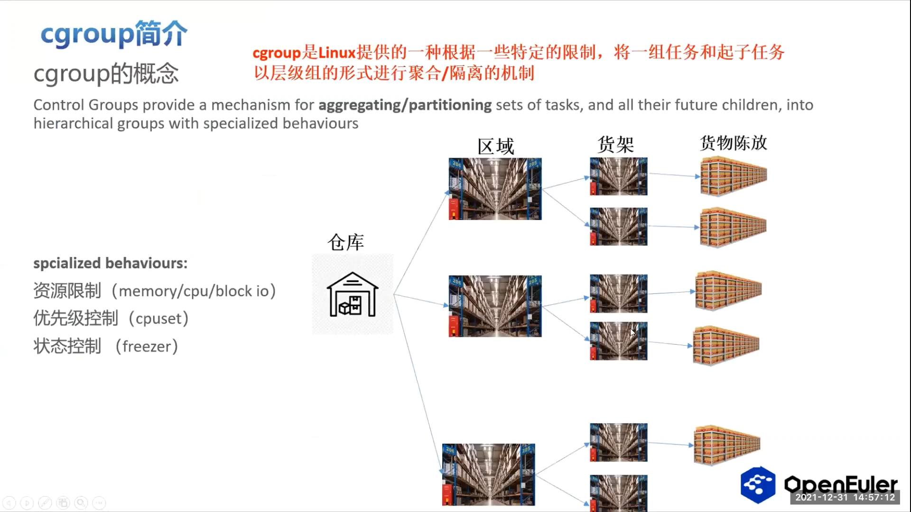

所谓"特定约束（special behaviors）"，主要是三类 [【跳转到 00:51】](https://www.bilibili.com/video/BV1e34y1q7bR/?t=51)：

- **资源限制**：内存、CPU、存储等资源的使用上限；
- **优先级控制**：比如把任务绑定在哪个核上运行；
- **状态控制**：任务处于冻结（frozen）还是运行状态。

形象地说，可以把整个系统比作一个仓库：各种资源限制划分出不同的区域（货架），并限定每块区域的内存总量、CPU 时长等；每个货物（进程）按自己符合的标准被放到对应的货架上，需要取出使用或从货架上移除时，也有对应的操作。[【跳转到 01:16】](https://www.bilibili.com/video/BV1e34y1q7bR/?t=76)

## 二、绕不开的概念：任务、目录、层级与子系统

以图为例，几个概念环环相扣 [【跳转到 02:11】](https://www.bilibili.com/video/BV1e34y1q7bR/?t=131)：

- **任务（task）**：就是内核里的一个一个的进程；在 cgroup 里，进程放在目录中管理，目录是用户态可见的；
- **层级（hierarchy）**：目录以树的形式组织，每一棵这样的树就是一个层级；
- **子系统（subsystem）**：层级上管理的资源由子系统承担，每个子系统都是一个资源管理器，以 attach 的形式附着到层级上——内存子系统也可以是一个层级。[【跳转到 02:36】](https://www.bilibili.com/video/BV1e34y1q7bR/?t=156)

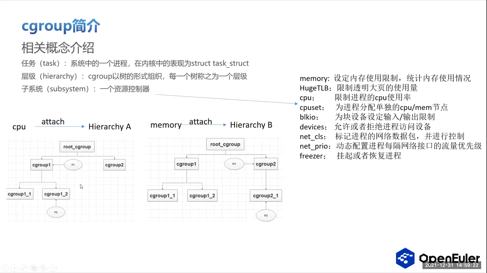

当前 cgroup 支持的常见子系统 [【跳转到 03:01】](https://www.bilibili.com/video/BV1e34y1q7bR/?t=181)：

- 内存类：memory、hugetlb（大页）；
- 调度类：cpu（管 CPU 使用率）、cpuset（为进程分配可用的 CPU 核与内存节点）；
- 存储与设备：blkio（块设备 IO）、devices（访问设备控制）；
- 网络类：net_cls 等；
- 状态类：freezer，专门管理进程的挂起或恢复。

从子系统的分布可以看出：整个 cgroup 与内核几乎所有模块都紧密相关。[【跳转到 03:26】](https://www.bilibili.com/video/BV1e34y1q7bR/?t=206)

## 三、用户态四类操作，内核里怎么走

用户对 cgroup 的操作归为四类，每类在内核里都有清晰的路径 [【跳转到 03:46】](https://www.bilibili.com/video/BV1e34y1q7bR/?t=226)：

1. **挂载/卸载子系统**：mount 命令 → cgroupfs 文件系统的 file_system_type → mount 接口；卸载走 kill superblock 这类接口；
2. **创建/删除 cgroup**：就是创建或删除一个目录 → mkdir 最终调到 cgroup_mkdir（框架层）；删除对应 rmdir 的接口；
3. **进程迁移**：用 echo 命令把 PID 写到对应目录下的 cgroup.procs 成员里 → 内核里经 cgroupfs 文件系统层 → 框架层（货架层）签任务 → 任务相关的资源在各子系统中具体迁移；[【跳转到 04:36】](https://www.bilibili.com/video/BV1e34y1q7bR/?t=276)
4. **资源限制**：echo 一个 4M 写到 memory.limit_in_bytes——当前 cgroup 就只允许占 4MB 内存；内核路径同样是 cgroupfs → 具体子系统的 cftype 结构体 → 用 write 接口完成写入。[【跳转到 05:26】](https://www.bilibili.com/video/BV1e34y1q7bR/?t=326)

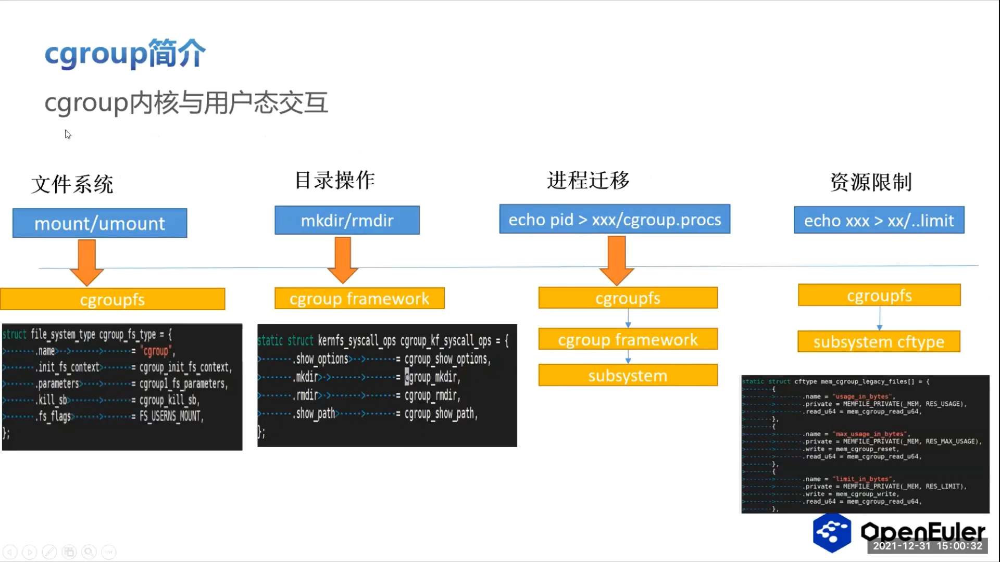

一句话总结：**用户眼里是目录和文件，内核里是 cgroupfs → cgroup 框架 → 各子系统**。

## 四、从结构体看实现：任务、目录、层级各归其位

了解 cgroup 的第一步，是了解与它相关的核心结构体。按"任务、用户态可见的目录、层级"三个着手点 [【跳转到 05:57】](https://www.bilibili.com/video/BV1e34y1q7bR/?t=357)：

- **task_struct → css_set**：cgroup 主要管理进程资源，所以进程的 task_struct 里有一个 css_set 结构体，掌控这个进程所在的所有相关 cgroup 资源；
- **cgroup_subsys_state**：每个子系统的资源状态管理在这个结构体里；它其实是个数组，每一项管理一个子系统相关的信息；
- **cgroup_subsys**：各子系统的具体实现接口——申请一块内存、子系统上线下线、签任务——这些钩子函数的定义一般放在这里；
- **cgroup**：对应用户态可见的一个目录，包含该目录下所有的信息；因为一个层级可以挂载多个子系统，所以一个目录里可能包含多个子系统的资源，结构体里有成员分别管理这些不同子系统的状态；
- **cgroup root**：与层级相关的结构，专门管理"是否以一个层级的形式管理所有 cgroup"，包括这个层级上有多少个 cgroup 等 root 级信息；系统里所有 root 的信息都放在一个链表里统一管理，需要从 root 查找或改变时直接取出来用。[【跳转到 07:37】](https://www.bilibili.com/video/BV1e34y1q7bR/?t=457)

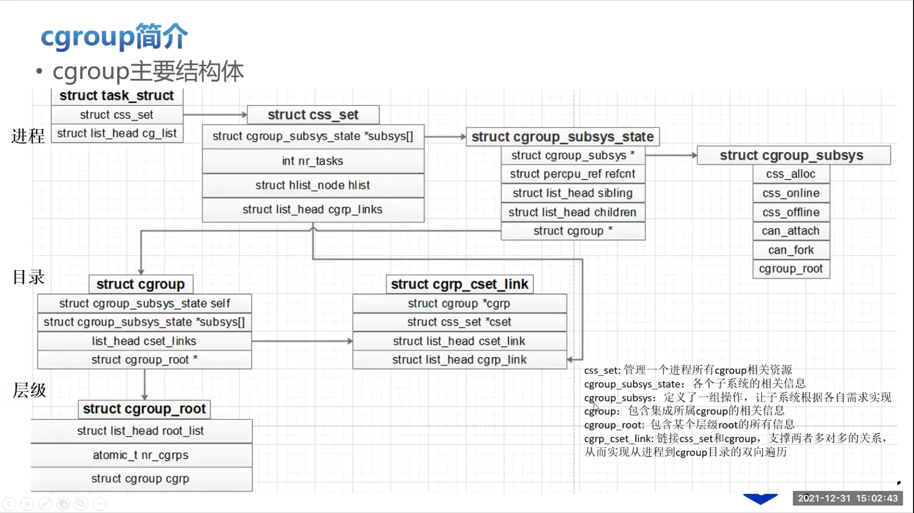

## 五、cgrp_cset_link：打通"任务 ↔ cgroup"的多对多映射

还有一个不太显眼但关键的结构体：**cgrp_cset_link**，它是专门为了让任务与 cgroup 之间能方便地遍历而生成的，成员主要包括 cgroup、css_set 和两个链表。[【跳转到 08:27】](https://www.bilibili.com/video/BV1e34y1q7bR/?t=507)

为什么需要它？因为 **css_set 与 cgroup 是多对多的关系** [【跳转到 08:52】](https://www.bilibili.com/video/BV1e34y1q7bR/?t=532)：

- 一个 css_set 里包含多个子系统（memory、cpu、blkio、devices……），不同子系统对应的目录不同——一个进程的不同子系统资源管理在不同目录里，所以一个 css_set 可以对应多个 cgroup；
- 反过来，一个 cgroup 里有很多进程，但进程们只是"这个子系统"的资源管理一致，其他子系统并不保证一致——所以一个 cgroup 里的进程可能属于不同的 css_set。

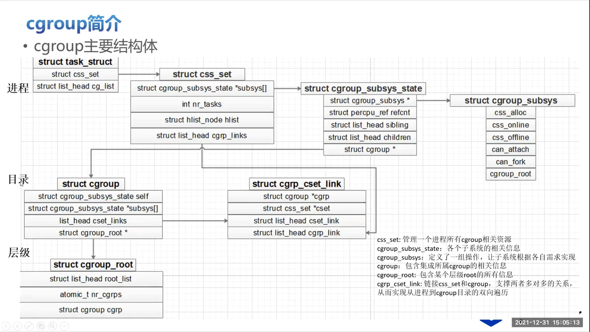

cgrp_cset_link 的存在可以完成两件事 [【跳转到 10:07】](https://www.bilibili.com/video/BV1e34y1q7bR/?t=607)：

1. 从任务出发，知道它所在的所有子系统的目录——也就是它所在的所有 cgroup（图中的绿色箭头）；
2. 从 cgroup 出发，遍历、查询它包含的所有进程（图中的蓝色箭头）。[【跳转到 10:32】](https://www.bilibili.com/video/BV1e34y1q7bR/?t=632)

## 六、V1 → V2：从"每子系统一个层级"到"统一层级"

cgroup 分 V1 和 V2 两个版本 [【跳转到 11:04】](https://www.bilibili.com/video/BV1e34y1q7bR/?t=664)：

- **V1**：最早引进 Linux 2.6 版本，很早。它的特点是允许每个层级单独管理——内存子系统挂一个层级，cpuset 子系统挂一个层级，CPU 挂一个层级，每个层级管理自己的事情。每个 cgroup 目录里同时管理两件事：资源的限制 + 放进程；这样管理时层级上的进程之间有父子关系。V1 支持的子系统最全。[【跳转到 11:29】](https://www.bilibili.com/video/BV1e34y1q7bR/?t=689)

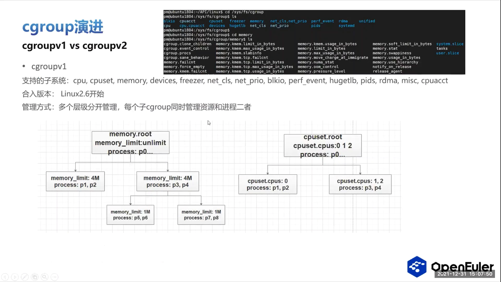

- **V2**：采取统一层级管理——把所有可支持的子系统都挂载到一个层级上，用户可见的只有一个 root 目录；进程只允许放在 root 下面和最下面的叶子节点上，中间这些层级的 cgroup 不允许存放进程。这就很好地实现了**进程和资源分开管理**：cgroup 只负责管理进程，中间的子系统负责管理相对应的资源，避免资源之间的竞争。当前 V2 不再支持 V1 里的部分 CPU 和网络相关子系统，因为 V2 采取用 eBPF 的方式来完成这两个子系统的实现。[【跳转到 11:59】](https://www.bilibili.com/video/BV1e34y1q7bR/?t=719)

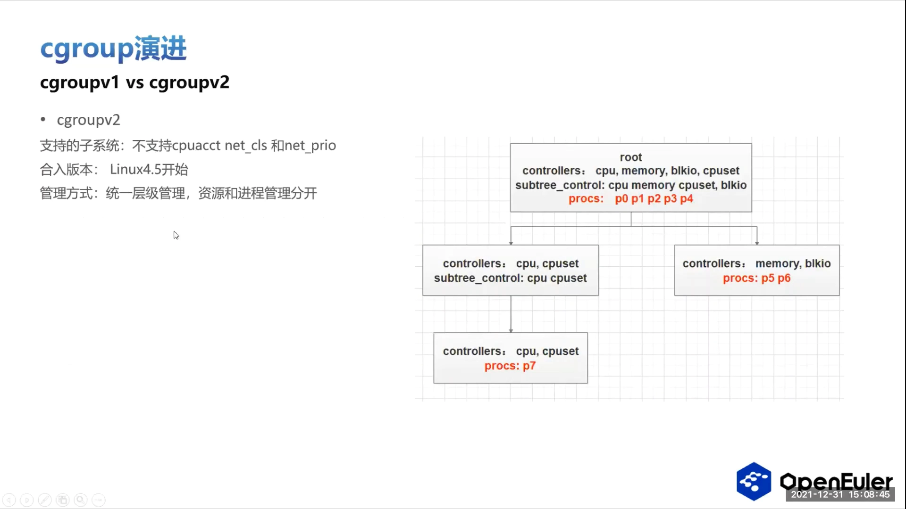

## 七、V2 的五大优势：为什么容器 2019 年起集体转向

表格列举了 V2 相对于 V1 的一些优势 [【跳转到 12:59】](https://www.bilibili.com/video/BV1e34y1q7bR/?t=779)：

1. **单一层级**：资源管理和进程管理分得很开，更有益于之后在容器里对整个业务的管理；
2. **子系统协同**：所有子系统挂载在同一层级里，需要多个子系统协同工作的功能（比较有代表性的就是 writeback）在 V1 里很难完成——彼此获取不到对应子系统的信息；V2 里很容易实现；
3. **内存分级**：把内存分级管理——分成不同等级，每一等对应不同的行为，可以提升性能，也能解决业务临时内存高峰的情况；V1 里内存管理手段比较单一、粗暴，遇到临时高峰很可能直接把业务杀掉；
4. **rootless**：V2 支持 rootless 特性，对容器非常重要——这也是 2019、2020 年开始各个容器倾向于支持 cgroup V2 而不再采用 V1 的一个主要原因；
5. **PSI**：实时监控系统中 IO、CPU、memory 几种主要资源的情况，让用户提前感知系统状况；V2 里可以把这种功能细化到每一个 cgroup，容器里的用户就能感知业务是否出问题——这个功能在 V1 里没有实现。[【跳转到 14:39】](https://www.bilibili.com/video/BV1e34y1q7bR/?t=879)

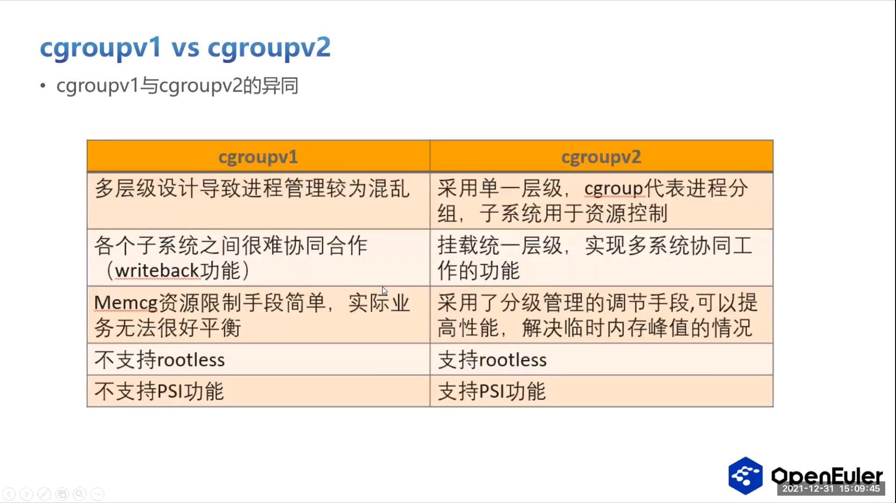

时间线上，这张表总结了当前各容器支持的 cgroup 版本和时间：从 2019 年开始，各个容器（Docker，包括这里没列出来的 K8s 类产品）都倾向于用 V2 代替 V1——原因就是刚才列举的这些 V2 的优点。所以在将来，V2 会完全取代 V1，而不是现在这种 V2、V1 兼容的形式。[【跳转到 15:26】](https://www.bilibili.com/video/BV1e34y1q7bR/?t=926)

## 八、内存子系统：限制与记帐的主战场

业务常用内存子系统的原因：把系统中进程的内存资源作为隔离的一个限制标准，从而触发不同的内存处理行为——内存回收、驱逐，或者把进程杀掉。[【跳转到 15:56】](https://www.bilibili.com/video/BV1e34y1q7bR/?t=956)

这个子系统有五个特点 [【跳转到 16:21】](https://www.bilibili.com/video/BV1e34y1q7bR/?t=981)：

1. **统计 + 限制**：既可以统计一个进程、也可以统计一个 cgroup 里现有的内存数量，还可以统计匿名页、文件页、swap 这种具体类型的内存使用量，并能根据使用量上限对 cgroup 里的进程进行限制；
2. **独立 LRU**：它配置映射到的 LRU 链表属于每一个 memcg（memory cgroup 的缩写），而不是一个全局的 LRU 链表；
3. **迁移可选**：实际业务中把任务签进新的 cgroup 时，原本业务里的内存是否要迁移是用户可以自选的，更灵活；
4. **事件计数**：一些行为——比如触发了 OOM、内存压力大超过阈值——的次数可以统计；查看这些次数，能从一个层面了解系统现在处于什么状态；
5. **root 不限**：最顶层 root 的 memory cgroup 是不受限制的，一般不会在里面真正管理需要管理的业务进程。[【跳转到 17:36】](https://www.bilibili.com/video/BV1e34y1q7bR/?t=1056)

### memcg 目录里的关键文件

以 V1 为例，openEuler 挂载之后一个 memory cgroup 目录里有哪些成员 [【跳转到 18:01】](https://www.bilibili.com/video/BV1e34y1q7bR/?t=1081)：

- **failcnt**（memory fail count）：往里放进程、进程申请内存时超过 usage limit 的次数；
- **force_empty**：类似全局里的 drop cache 功能，强制回收当前 cgroup 里所有可回收的内存；
- **kmem\*** 开头：统计 kernel memory 相关的内存；
- **limit_in_bytes**：用户可以设置的上限；
- **max.usage_in_bytes**：历史上这个 cgroup 拥有过的最大内存量；
- **numa_stat**：NUMA 多节点架构下每个节点的内存使用量；
- **memory.stat**：具体分类统计——匿名页、文件页各是多少；
- **usage_in_bytes**：当前用量——容器里的健康检查会读这个值，判断当前容器是否还可以正常运行，是一个重要的判断依据。[【跳转到 18:51】](https://www.bilibili.com/video/BV1e34y1q7bR/?t=1131)

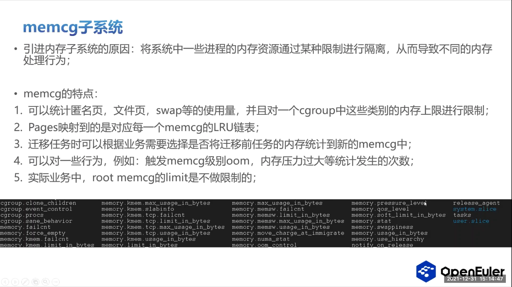

### memory.stat 的三块结构

memory.stat 大致分为三块 [【跳转到 21:18】](https://www.bilibili.com/video/BV1e34y1q7bR/?t=1278)：

- 前头**不带 total** 的：统计当前 cgroup——cache、RSS、dirty、writeback、匿名内存各有多少；
- **带 total** 的：统计当前 cgroup 加上它子 cgroup 层级结构里总共的；
- 最后两个是当前目录里的**两个限制**：memory.limit_in_bytes 和 memory.memsw.limit_in_bytes（内存 + swap 的限制）。

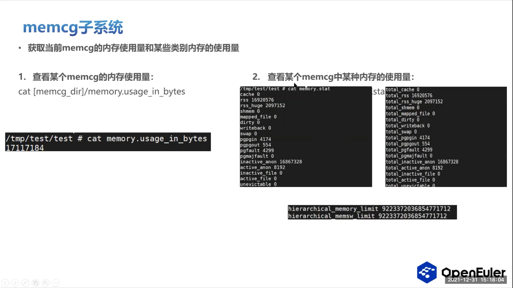

一个难点：近三年（19、20、21 年）内核主线社区非常活跃的一个问题，就是致力于把这些统计做得非常精准、非常合理——这是内存子系统里比较难的一个地方。[【跳转到 21:43】](https://www.bilibili.com/video/BV1e34y1q7bR/?t=1303)

## 九、内存实操：2MB 上限遇上 5MB 进程，会怎样

用户对内存子系统的操作主要有两步 [【跳转到 19:24】](https://www.bilibili.com/video/BV1e34y1q7bR/?t=1164)：

1. **挂载/卸载**：手动用 mount 命令，-t 指定类型、自己起一个名字、指定要挂载的目录；卸载用 umount 直接把目录卸下来——挂上后用 mount 命令能找到，卸载后就找不到了。目前大部分厂商的产品环境上都是通过 systemd 直接把这些支持的子系统拉起来的；
2. **设置上限**：写 limit_in_bytes，它代表当前 cgroup 里最多能容纳多少内存。例子：给一个子 cgroup 限制 2MB，而里面跑的是一个要占 5MB 内存的进程——这个进程就放不进去，会触发 **memcg 级的 OOM**，dmesg 里能看到对应的内存信息。[【跳转到 20:12】](https://www.bilibili.com/video/BV1e34y1q7bR/?t=1212)

如果进程成功迁移进来，就可以查看当前这个 cgroup 的内存使用量和一些特定类别的使用量——usage_in_bytes 这个值很重要；再往下就是 memory.stat 里那些类别统计。[【跳转到 20:53】](https://www.bilibili.com/video/BV1e34y1q7bR/?t=1253)

## 十、openEuler 的增强：从文件数到 CPU QoS

openEuler 相比于 Linux 社区，对 cgroup 框架和一些子系统做了这些增强 [【跳转到 22:17】](https://www.bilibili.com/video/BV1e34y1q7bR/?t=1337)：

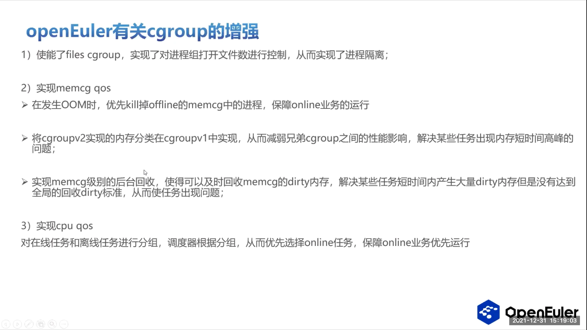

- **文件子系统**：对 cgroup 里进程组打开文件的数量进行控制，超过限制的进程不允许迁入，实现了进程隔离的一个功能；
- **memcg OOM 优先级**：发生 OOM 时，可以优先杀掉 offline 状态的内存 cgroup 里的进程，从而保证 online 业务的运行；
- **V2 分级管理使能到 V1**：既然 V2 的内存分级管理有好处，就把 V2 的一些实现在 V1 里使能；使能之后可以减少兄弟 cgroup 之间的性能影响，也解决了某些任务短时间内存高峰的问题；
- **memcg 后代回收**：及时回收一个 cgroup 里的 dirty 内存。有些场景是当前 cgroup 的 dirty 内存很大，但远远没有达到全局回收 dirty 内存的 standard，任务就可能因为 dirty 内存扩大化而触发 OOM、无法继续，导致业务中断——这种问题就通过 cgroup 级别的后代回收解决；
- **CPU QoS**：在调度方面对在线和离线任务进行分组，调度器根据分组优先选择在线任务，保障在线任务优先运行。[【跳转到 24:22】](https://www.bilibili.com/video/BV1e34y1q7bR/?t=1462)

分享末尾的问答补充了两点（提问者来自美团）：实现 memcg 级别的后台内存回收后，可以走全局后台回收的路径回收一部分内存；像 dirty 内存的回收是额外实现、可配置的，这些内存也可以得到回收——单独拎出来讲，是因为之前实际生产中遇到过 dirty 内存大量积累导致业务中断的事情。这部分 patch 当时已经合入或接近合入。[【跳转到 24:47】](https://www.bilibili.com/video/BV1e34y1q7bR/?t=1487)

## 小结

- cgroup = 内核的"聚合 + 限制 + 记帐"机制：任务按组聚合，每组施加资源限制、优先级与状态控制，并统计用量。
- 三个概念：任务放进目录，目录组成树（层级），子系统作为资源管理器 attach 到层级上。
- 用户态只有目录和文件操作（mount、mkdir、echo procs、echo limit），内核路径统一是 cgroupfs → cgroup 框架 → 子系统的 cftype.write。
- 主结构：task_struct → css_set → cgroup_subsys_state / cgroup / cgroup root；cgrp_cset_link 解决 css_set 与 cgroup 的多对多映射，任务与目录双向可查。
- V1 每子系统一个层级、目录里限制与进程混放；V2 统一层级、进程只放 root 与叶子、进程与资源分离，带来 writeback 协同、内存分级、rootless、PSI 等优势；2019 年起容器集体转向 V2。
- 内存子系统是限制与记帐的主战场：usage_in_bytes 是健康检查依据，memory.stat 分"本级 / total / 限制"三块，limit_in_bytes 超限触发 memcg 级 OOM。
- openEuler 增强：文件数控制、memcg OOM 优先级、V2 分级使能、memcg 后代回收、CPU QoS 在线/离线分组。

## 关键术语速查

| 术语 | 一句话解释 |
| --- | --- |
| cgroup | 内核控制组：按组聚合进程并施加资源限制/优先级/状态控制 |
| task | 内核里的进程，cgroup 的管理对象 |
| hierarchy（层级） | cgroup 目录组成的树 |
| subsystem（子系统） | 资源管理器：memory、hugetlb、cpu、cpuset、blkio、devices、net_cls、freezer 等 |
| css_set | task_struct 里掌控进程所属所有 cgroup 资源的结构体 |
| cgroup_subsys_state | 每个子系统在 cgroup 里的资源状态（数组形式） |
| cgrp_cset_link | 打通 css_set 与 cgroup 多对多关系的链接结构 |
| cgroupfs | cgroup 的虚拟文件系统，用户态操作的入口 |
| cftype | 子系统属性（文件）的描述结构，read/write 接口落地操作 |
| memcg | memory cgroup 的缩写 |
| memory.stat | memcg 的分类用量统计（本级 / total / 限制） |
| usage_in_bytes | memcg 当前内存用量，容器健康检查的判断依据 |
| limit_in_bytes | memcg 内存上限；memsw.limit_in_bytes 是内存+swap 的上限 |
| memcg 级 OOM | 组内内存超限触发的 kill 行为 |
| PSI | 压力失速信息：IO/CPU/内存压力的实时监控（V2 可细化到组，V1 无） |
| rootless | V2 特性：非 root 用户安全使用容器 |
