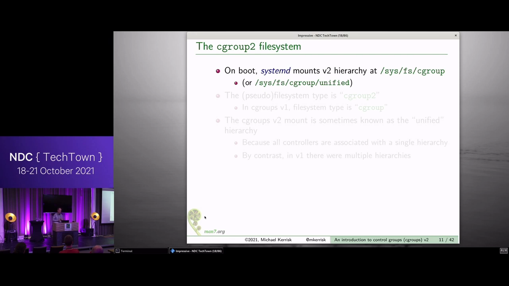
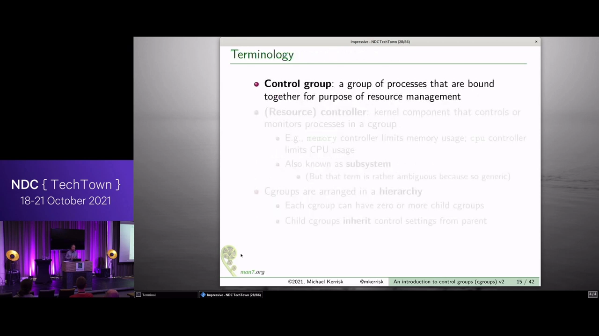
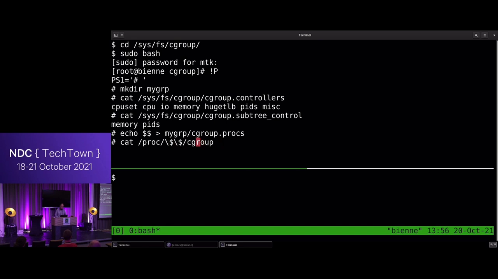
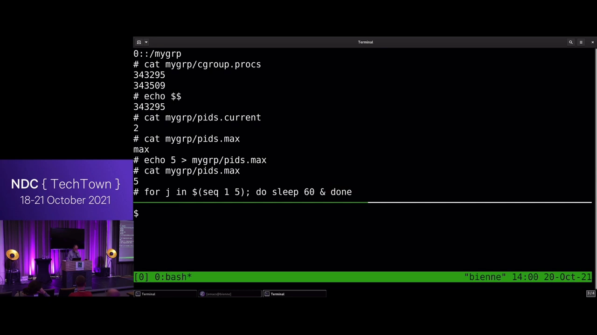
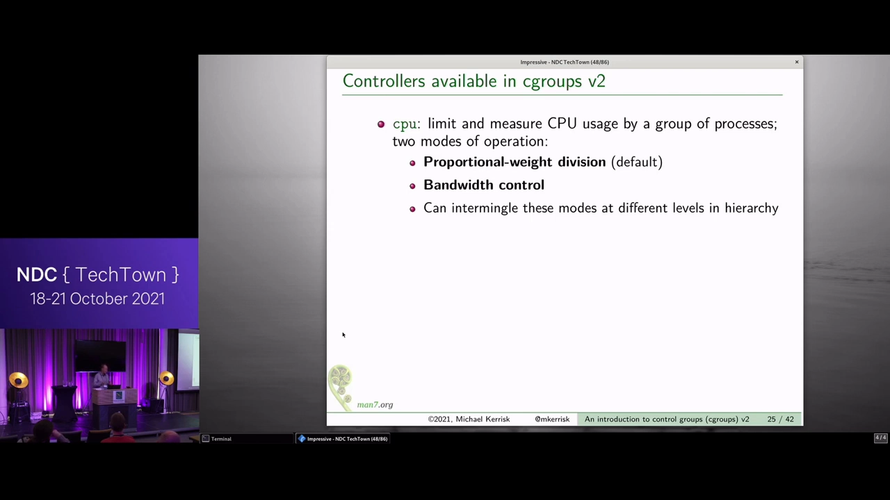
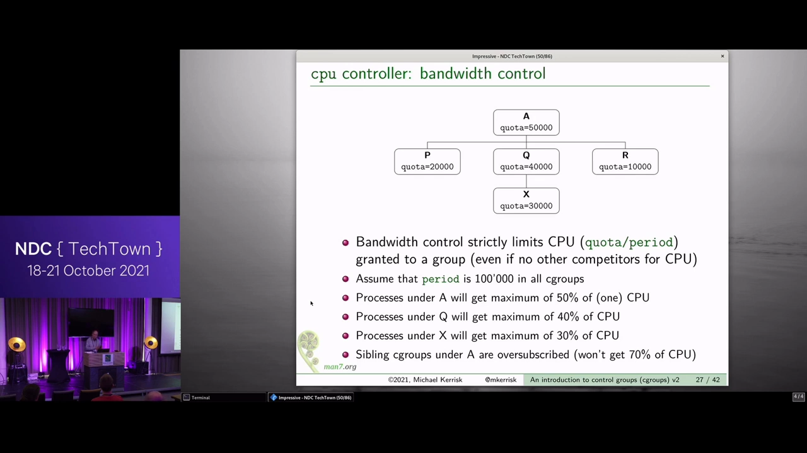
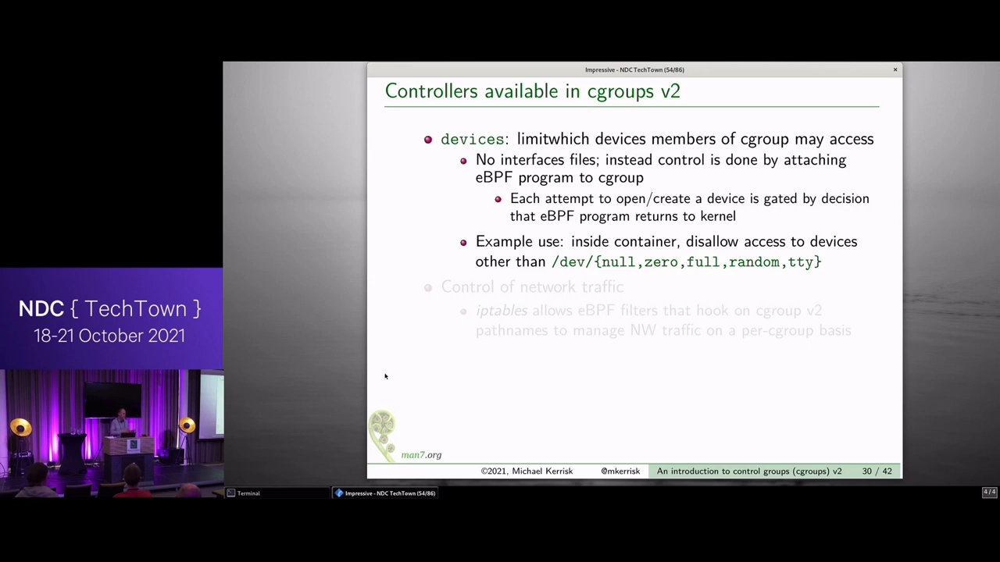
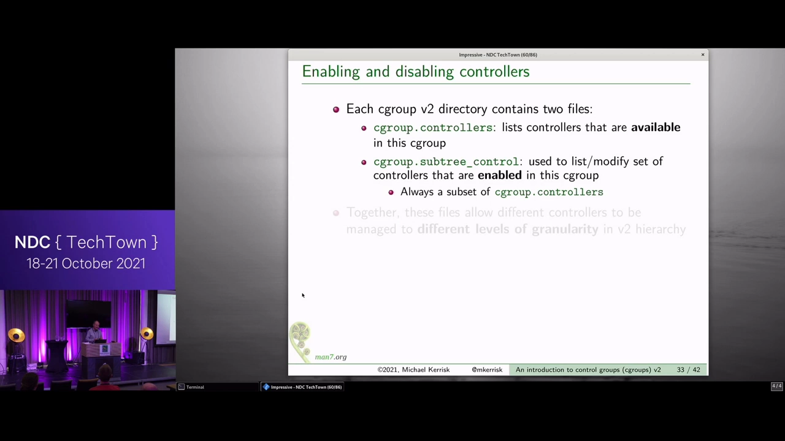
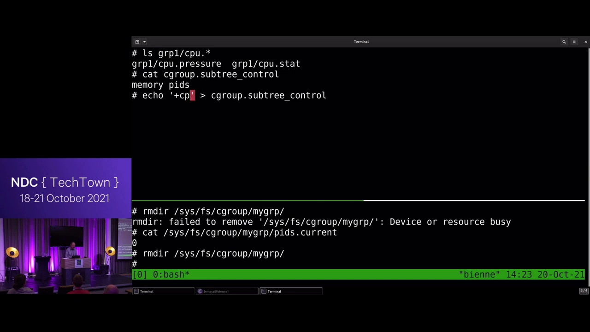
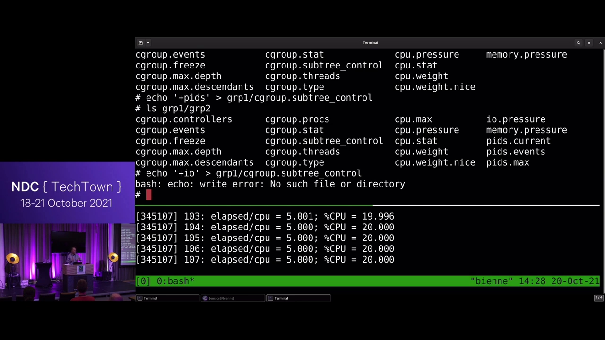

# An_introduction_to_control_groups_cgroups_version_2_Michael_Kerrisk

> 视频源：[An introduction to control groups (cgroups) version 2 - Michael Kerrisk - NDC TechTown 2021](https://www.youtube.com/watch?v=kcnFQgg9ToY)（YouTube @NDC Conferences，56 分 57 秒）。本文基于视频演说图文稿整理，时间戳可跳转到原视频对应位置。

## 本讲要解决的核心问题（SCQA）

**背景**：容器"能用多少资源"这件事由 cgroup 决定——Docker、systemd、Kubernetes 底层都在用它。演讲者 Michael Kerrisk 是 Linux man-pages 项目维护者、《Linux/UNIX 系统编程手册》作者。

**冲突**：cgroup v1 诞生于"各自为政"的去中心化协作——十几个控制器由不同团队随手添加，没有全局协调，接口不一致、语义不一致，很快成为一锅粥。

**疑问**：v2 如何把这一切理顺？普通使用者又该如何理解它、上手用它？

**回答（中心思想）**：v2 用**单一统一层级**收编所有资源，用「父级启用、子级生效」的控制器启停机制（`cgroup.controllers` / `cgroup.subtree_control`）把管控粒度做到任意深度；接口仍是纯文件——mkdir 建组、写 `pids.max` 限进程、`echo +cpu` 启用控制器。本讲以 pids/cpu 等控制器的大量现场实验，把这套机制走了一遍。

[【跳转到 00:00】](https://www.youtube.com/watch?v=kcnFQgg9ToY&t=0)

## 一、一段"去中心化设计又失败了"的历史

cgroup 起步于 2006 年 Google 内核的内部特性，2008 年初进入主线内核。最初只有三个 CPU 相关的控制器，但很快各种控制器蜂拥而入——大家看到这主意不错，都想加一个自己的 [【跳转到 02:14】](https://www.youtube.com/watch?v=kcnFQgg9ToY&t=134)。

问题在于做法：不同团队各干各的，给自己想管的东西加控制器，**没有全局监督、没有协调、没人统筹**。用 Kerrisk 的原话说："去中心化设计又一次辜负了我们（decentralized design failed us again）"。没多久乱象就显现了 [【跳转到 02:39】](https://www.youtube.com/watch?v=kcnFQgg9ToY&t=159)。


转折点的关键节点 [【跳转到 03:29】](https://www.youtube.com/watch?v=kcnFQgg9ToY&t=209)：

- **2012 年**：大家认识到必须推倒重来，v2 工程启动；
- **2015 年**：systemd 支持 v2——甚至早于内核正式发布；
- **2016 年**：v2 正式发布，但**不完整**——v1 的不少控制器还没移植过来，最关键的是**没有 CPU 控制器**，这是许多用户的重大阻碍；
- **2019 年**：Fedora 成为第一个默认启用 v2 的发行版；**2020 年** Docker 增加 v2 支持；到了演讲时（2021），Ubuntu 前几天刚切换、Debian 几个月前、Arch 更早——"其他发行版要么已切换，要么马上" [【跳转到 04:19】](https://www.youtube.com/watch?v=kcnFQgg9ToY&t=259)。

所以这场演讲干脆假设 v1 不存在，只讲 v2 [【跳转到 05:09】](https://www.youtube.com/watch?v=kcnFQgg9ToY&t=309)。

## 二、怎么确认自己用的是 v2

最简单的判别：看 `/proc/mounts` 里 cgroup 相关的行——**超过一行，你多半启动在 v1 上** [【跳转到 05:34】](https://www.youtube.com/watch?v=kcnFQgg9ToY&t=334)。想切到 v2，重启时给内核传一个参数，两种方式任选 [【跳转到 05:59】](https://www.youtube.com/watch?v=kcnFQgg9ToY&t=359)：

1. `cgroup_no_v1=all`（禁用全部 v1 控制器）——systemd 会把它当作信号：只挂 v2；
2. 或者告诉 systemd 只用 v2 挂载——这种方式下 v1 依然保留可用，想用还能用。

## 三、统一层级：一个文件系统

v2 的 cgroup 文件系统是**伪文件系统**，类型为 `cgroup2`，挂在 `/sys/fs/cgroup`（或 `/sys/fs/cgroup/unified`）[【跳转到 06:49】](https://www.youtube.com/watch?v=kcnFQgg9ToY&t=409)。这个挂载点常被称为**统一层级（unified hierarchy）**——对比就在这里：v2 **只有一个**文件系统，而 v1 同时在用**很多个**文件系统、很多棵层级树。v2 的核心设计决定就是：一棵树 [【跳转到 07:14】](https://www.youtube.com/watch?v=kcnFQgg9ToY&t=434)。



## 四、cgroup 的两大组件与基本术语

cgroup 本质上是两样东西的组合 [【跳转到 08:02】](https://www.youtube.com/watch?v=kcnFQgg9ToY&t=482)：

- **层级化的进程分组**：cgroup 可以有子 cgroup，子 cgroup 还可以有子 cgroup——一棵树；
- **控制器（resource controller）**：内核组件，对一组进程做资源测量与管控。

交互方式非常"Linux"：可以在 shell 里敲、写程序调、或者交给 systemd 这样的守护进程代办——容器框架底下用的正是 cgroup [【跳转到 08:27】](https://www.youtube.com/watch?v=kcnFQgg9ToY&t=507)。

用它做什么？四个方向 [【跳转到 09:17】](https://www.youtube.com/watch?v=kcnFQgg9ToY&t=557)：

- **限额**：这组进程只能用百分之多少的 CPU、多少内存、多少网络带宽；
- **加权**：反过来让某些组优先——比如出口流量偏向某组；
- **记账**：这组进程消耗了多少 CPU 时间、多少内存；
- **冻结**：freezer 控制器把一组进程从 CPU 运行队列上摘下来，之后解冻恢复 [【跳转到 10:07】](https://www.youtube.com/watch?v=kcnFQgg9ToY&t=607)。

术语约定 [【跳转到 10:32】](https://www.youtube.com/watch?v=kcnFQgg9ToY&t=632)：

- **control group**：为资源管理绑在一起的一组进程——它们的用量**合在一起**计量、限在一起管，而不是按单个进程；
- **resource controller**：内核里做资源限制/测量的组件。内核文档和源码里也常叫 subsystem（子系统），但 Kerrisk 不喜欢这个词——"subsystem 泛得几乎没有信息量"；
- **层级是有意义的**：给高层 cgroup 设的限制，自动约束下面的子 cgroup [【跳转到 11:47】](https://www.youtube.com/watch?v=kcnFQgg9ToY&t=707)。



操作接口就是文件系统 [【跳转到 12:12】](https://www.youtube.com/watch?v=kcnFQgg9ToY&t=732)：**创建 cgroup = mkdir 一个目录**；删除 = rmdir。每个目录里自动出现一组文件：管理本组的（如成员进程表）、设限额的、报告用量的。这些"文件"是内核现场变出来的魔法文件。

## 五、动手实验：用 pids 控制器限制进程数

接下来是全场重头戏——现场实验。以超级用户建组并把 shell 挪进去 [【跳转到 14:30】](https://www.youtube.com/watch?v=kcnFQgg9ToY&t=870)：

```bash
mkdir /sys/fs/cgroup/mygroup
echo $$ > /sys/fs/cgroup/mygroup/cgroup.procs   # 把当前 shell 放进该组
cat /proc/$$/cgroup                              # 查看本进程所属 cgroup
```

`/proc/PID/cgroup` 输出冒号分隔的字段：只启动 v2 的系统（如 Fedora 默认）只有一行，`0::/mygroup`——中间空着的是 v1 的位置，路径 `/mygroup` 相对于挂载点；如果是 v1/v2 共存的系统，会看到多行记录 [【跳转到 15:45】](https://www.youtube.com/watch?v=kcnFQgg9ToY&t=945)。



两个要点随之出现 [【跳转到 17:00】](https://www.youtube.com/watch?v=kcnFQgg9ToY&t=1020)：

- `cgroup.procs` 可写可读：写 PID 加入组，读则列出成员；
- **子进程生来就在父进程所在的 cgroup**（shell 里跑 cat，cat 自然入组）。新近内核还有个例外：`clone3()` 系统调用加了选项，允许指定新建进程从哪个 cgroup 出生 [【跳转到 17:25】](https://www.youtube.com/watch?v=kcnFQgg9ToY&t=1045)。

然后上限制 [【跳转到 18:40】](https://www.youtube.com/watch?v=kcnFQgg9ToY&t=1120)：

```bash
cat /sys/fs/cgroup/mygroup/pids.max    # 输出 max，即无限制
echo 5 > /sys/fs/cgroup/mygroup/pids.max
for i in $(seq 1 5); do sleep 60 & done
```

结果：循环只成功创建了 **4 个** sleep——第 5 个 fork 时撞上进程数上限，bash 重试几次后放弃 [【跳转到 19:30】](https://www.youtube.com/watch?v=kcnFQgg9ToY&t=1170)。`pids.current` 可以随时查看当前成员数。



有趣的小细节：到达上限后，组内连 `cat` 都跑不起来（会新建进程），但 `echo $$` 可以——它是 shell 内建命令，不需要新进程 [【跳转到 23:31】](https://www.youtube.com/watch?v=kcnFQgg9ToY&t=1411)。最后清理：直接 rmdir 会失败——目录非空（shell 自己还是成员）；先把 shell 写回根的 `cgroup.procs`，再删就成功了。目录里那些接口文件**不能 rm**——内核变出来的东西，rmdir 目录时它们自然消失 [【跳转到 24:15】](https://www.youtube.com/watch?v=kcnFQgg9ToY&t=1455)。

## 六、控制器巡礼：每种资源一个控制器

内核源码树里有专门文档介绍各控制器，现场逐个过了一遍 [【跳转到 25:10】](https://www.youtube.com/watch?v=kcnFQgg9ToY&t=1510)：

**cpu 控制器**（限制 + 测量），两种模式 [【跳转到 25:35】](https://www.youtube.com/watch?v=kcnFQgg9ToY&t=1535)：

- **权重模式**（v1 叫 shares，v2 改叫 weight）：同一层级的兄弟组把权重加总，按比例分 CPU——A、B、C 权重合计 4096，各占 1/4、1/2、1/4；B 拿到的一半还能在子级 X/Y（1000:4000）里再分成 1/10 和 4/10，层层细分。注意：**只在有竞争时起作用**——别的组闲着，你可以吃满 [【跳转到 26:00】](https://www.youtube.com/watch?v=kcnFQgg9ToY&t=1560)。
  
- **带宽模式**：绝对上限。配额写成 `quota period` 两个数（如 `20000 100000` = 每 100ms 最多用 20ms），**没人竞争也不许超过**——"你买多少就多少"，托管商最爱 [【跳转到 28:30】](https://www.youtube.com/watch?v=kcnFQgg9ToY&t=1710)。层级间超订有讲究：子级 P、Q、R 合计要 70%，但父级上限 50%，那就只能拿 50% [【跳转到 28:55】](https://www.youtube.com/watch?v=kcnFQgg9ToY&t=1735)。
  

**cpuset 控制器**：CPU 亲和 + 内存亲和 [【跳转到 29:45】](https://www.youtube.com/watch?v=kcnFQgg9ToY&t=1785)。两个用途：把某个关键进程独占的 CPU 让出来专门留给它；在 NUMA 大机器上（比如 1024 核、每 16 核一个节点、各节点本地内存）让相关进程与所访问内存同节点——访问本地内存更快 [【跳转到 31:00】](https://www.youtube.com/watch?v=kcnFQgg9ToY&t=1860)。

**memory 控制器** [【跳转到 31:25】](https://www.youtube.com/watch?v=kcnFQgg9ToY&t=1885)：软限——超了且恰有内存压力，进程开始被换出；硬限——超了 OOM killer 登场，选个受害者杀掉腾内存。OOM killer 只是内核组件，并不懂你的应用；替代方案是让内核通知用户态进程，由它做更聪明的决策（选谁杀、或者通知各进程自己释放）[【跳转到 32:15】](https://www.youtube.com/watch?v=kcnFQgg9ToY&t=1935)。

**io 控制器** [【跳转到 32:40】](https://www.youtube.com/watch?v=kcnFQgg9ToY&t=1960)：限制块设备（SSD/HDD）IO 带宽，权重式或绝对节流，可按设备分别设置。

**devices 控制器**——v2 里变化最大 [【跳转到 33:30】](https://www.youtube.com/watch?v=kcnFQgg9ToY&t=2010)：容器的典型需求是只允许访问极少数设备（null、zero、full、random……）。v1 用静态规则文件实现；v2 改用 **eBPF 程序**：把 eBPF 挂到 cgroup 上，进程想打开/创建设备时内核触发 eBPF，由它裁决放行与否。Kerrisk 顺口调侃："如今内核开发者不做点 eBPF 都不算潮人" [【跳转到 33:55】](https://www.youtube.com/watch?v=kcnFQgg9ToY&t=2035)。



**网络流量整形**（v2 新能力）：同样给 cgroup 挂 eBPF 程序做流量 shaping，偏爱或冷落某些组的流量 [【跳转到 34:45】](https://www.youtube.com/watch?v=kcnFQgg9ToY&t=2085)。**pids 控制器**：就是刚才实验的那个，防 fork 炸弹的神器 [【跳转到 35:10】](https://www.youtube.com/watch?v=kcnFQgg9ToY&t=2110)。**freezer 控制器**：冻结整组、解冻恢复，容器**迁移**是典型场景——容器进程要搬家到另一台物理机时，先冻结、搬、再解冻 [【跳转到 35:35】](https://www.youtube.com/watch?v=kcnFQgg9ToY&t=2135)。

## 七、控制器的启停：controllers 与 subtree_control

这是 v2 最有特色的机制。每个 cgroup 目录里都有两个文件 [【跳转到 36:57】](https://www.youtube.com/watch?v=kcnFQgg9ToY&t=2217)：

- `cgroup.controllers`：**本组可用**的控制器列表；
- `cgroup.subtree_control`：其中**已启用**的。



为什么要两个文件？为了**把不同控制器管到树的不同深度**（粒度控制）[【跳转到 37:22】](https://www.youtube.com/watch?v=kcnFQgg9ToY&t=2242)。另外，根目录里看到的控制器可能少于全部十几个，原因有二 [【跳转到 38:12】](https://www.youtube.com/watch?v=kcnFQgg9ToY&t=2292)：

1. 有的控制器正被 v1 占用——v1/v2 可以共存，但**同一个控制器不能两版同时用**；
2. 有的是**隐式控制器**（如 freezer）——处处可用、无需启停，因此不出现在列表里 [【跳转到 39:02】](https://www.youtube.com/watch?v=kcnFQgg9ToY&t=2342)。

启停规则：**在父级启用，子级才能用**。现场演示 [【跳转到 40:15】](https://www.youtube.com/watch?v=kcnFQgg9ToY&t=2415)：

```bash
mkdir /sys/fs/cgroup/group1                    # 建子组
ls /sys/fs/cgroup/group1/cpu.*                 # 此刻只有 cpu.stat 等统计文件，
                                               # 没有 cpu.max 等控制文件——父级未启用 cpu
echo +cpu > /sys/fs/cgroup/cgroup.subtree_control
ls /sys/fs/cgroup/group1/cpu.*                 # 一堆 cpu.* 控制文件"长"出来了
```

接着跑一个烧 CPU 的程序，写入 `echo "20000 100000" > group1/cpu.max`（每 100ms 配额 20ms），把进程挪进 group1——CPU 占用很快收敛到 **20%** [【跳转到 41:55】](https://www.youtube.com/watch?v=kcnFQgg9ToY&t=2515)。



再往下看孙级 [【跳转到 44:25】](https://www.youtube.com/watch?v=kcnFQgg9ToY&t=2665)：group1 的 `cgroup.controllers` 列出的是上层启用的那些；group2（孙组）里默认什么都没启用。在 group1 写 `+pids`，group2 就长出 pids 文件；而想在 group2 启用 io 会**报错**——io 没有在上层启用过，够不着 [【跳转到 46:30】](https://www.youtube.com/watch?v=kcnFQgg9ToY&t=2790)。

于是就有了那个经典**粒度用例** [【跳转到 47:20】](https://www.youtube.com/watch?v=kcnFQgg9ToY&t=2840)：内存管控粗一点没关系（memory 启用到某一层），CPU 要精细到叶子（cpu 启用得更深）——每个控制器在树里"管多深"，由你自己决定。



## 八、问答精选

- **控制器必须自父链一路启用**：cpu/memory/io 这类显式控制器，父级没启用子级就无从启用；隐式控制器（freezer 等）处处可用 [【跳转到 48:10】](https://www.youtube.com/watch?v=kcnFQgg9ToY&t=2890)。
- **pids 限额只限"新建"**：给已有 15 个进程的组设上限 10 没问题——存量不受影响，管理员甚至还能往里再挪；但组内任何进程再 fork 就会失败 [【跳转到 51:39】](https://www.youtube.com/watch?v=kcnFQgg9ToY&t=3099)。
- **clone3 指定出生 cgroup** 的方式：打开目标 cgroup 目录的文件描述符传给内核——这需要相应权限 [【跳转到 52:29】](https://www.youtube.com/watch?v=kcnFQgg9ToY&t=3149)。
- **设备白名单之外还有谁？** SELinux、AppArmor——设备访问管控不是 cgroup 一家的职责 [【跳转到 53:19】](https://www.youtube.com/watch?v=kcnFQgg9ToY&t=3199)。
- **"有没有 cgroups API？"** 有：open / close / read / write。历史上有人造过封装 API，都没流行起来；如今编程访问更常见的入口是 systemd 的接口 [【跳转到 54:34】](https://www.youtube.com/watch?v=kcnFQgg9ToY&t=3274)。
- **目录下那些文件是真的吗？** 是内核现场"变出来"的魔法文件，以一致的方式呈现给你——想删都删不掉 [【跳转到 55:49】](https://www.youtube.com/watch?v=kcnFQgg9ToY&t=3349)。

散场前 Kerrisk 预告了下一场的内容：**委派（delegation）**与**线程模式（thread mode）** [【跳转到 56:14】](https://www.youtube.com/watch?v=kcnFQgg9ToY&t=3374)。

## 小结

- cgroup v2 = **层级化进程分组（树）+ 控制器（内核资源管理组件）**；接口是伪文件系统：mkdir 建组、rmdir 删组、读写接口文件。
- v1 的历史包袱：十几个控制器各自为政、接口与语义不一致；v2 用**单一统一层级**收编，2016 年转正，2019 年 Fedora 起成为发行版默认。
- 控制器启停三件套：父级 `echo +cpu > cgroup.subtree_control` → 子级长出 `cpu.*` 文件 → 写入 `cpu.max` 生效；显式控制器必须自父链一路启用，隐式控制器（freezer）处处可用。
- cpu 控制器两种模式：**权重**（有竞争才起作用）与**带宽**（quota/period 绝对上限，父级封顶）；memory 分软限（换出）与硬限（OOM killer）；devices 在 v2 改用 eBPF 裁决。
- pids 实验的三个记忆点：子进程生来在父组；`pids.max` 限额后第 N+1 个 fork 失败；限额只约束"新建进程"。
- 不同控制器可管到树的不同深度——这就是 `controllers`/`subtree_control` 两个文件并存的全部意义。

## 关键术语速查

| 术语 | 一句话解释 |
| --- | --- |
| cgroup（控制组） | 为资源管理绑在一起的进程组，按树形层级组织 |
| resource controller | 内核中做资源限制/测量的组件（源码里也叫 subsystem） |
| 统一层级（unified hierarchy） | v2 的单一 cgroup2 文件系统，替代 v1 的多层级 |
| /proc/PID/cgroup | 查询进程所属 cgroup；v2-only 系统显示一行 `0::/path` |
| cgroup.procs | 组成员表：写 PID 加入组，读列出成员 |
| cgroup.controllers | 本组**可用**的控制器列表 |
| cgroup.subtree_control | 本组**已启用**的控制器；写入 +cpu 等为子层级开启管控 |
| 隐式控制器 | 处处可用、无需启停的控制器（如 freezer），不列入 controllers |
| cpu.max | 带宽模式的绝对配额：`quota period`（如 20000/100000 = 20%） |
| cpu.weight | 权重模式的相对份额：同级按权重比例分配 CPU |
| pids.max / pids.current | 进程数上限 / 当前进程数；限额只拦截新建进程 |
| eBPF（devices/网络） | v2 用挂在 cgroup 上的 eBPF 程序裁决设备访问、整形网络流量 |
| freezer | 冻结/解冻整组进程；容器迁移场景的核心部件 |
| clone3() | 新系统调用，可选参数指定新建进程的出生 cgroup |
