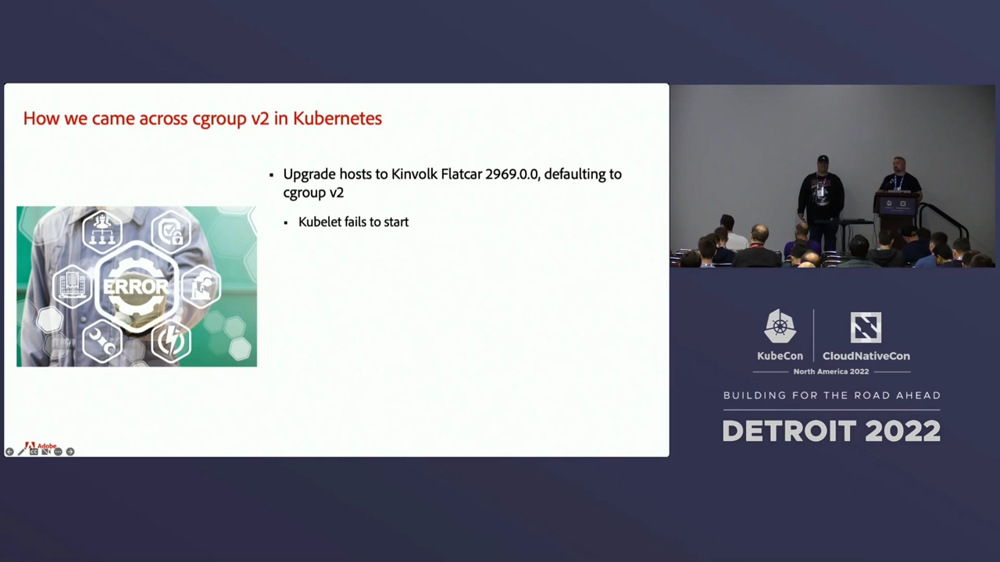
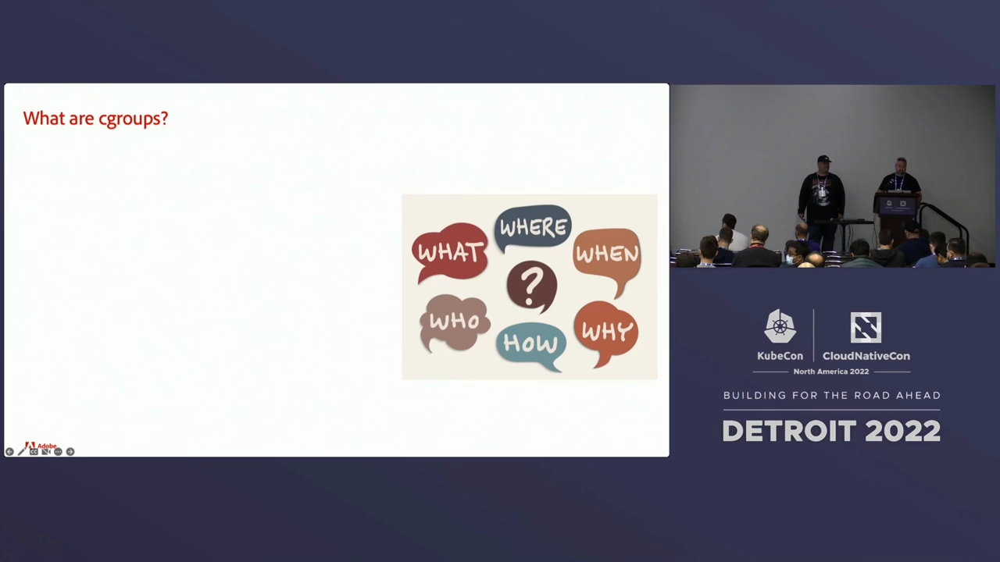
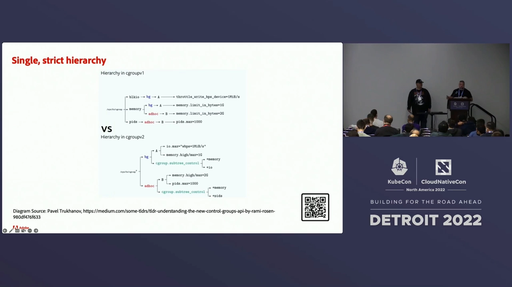
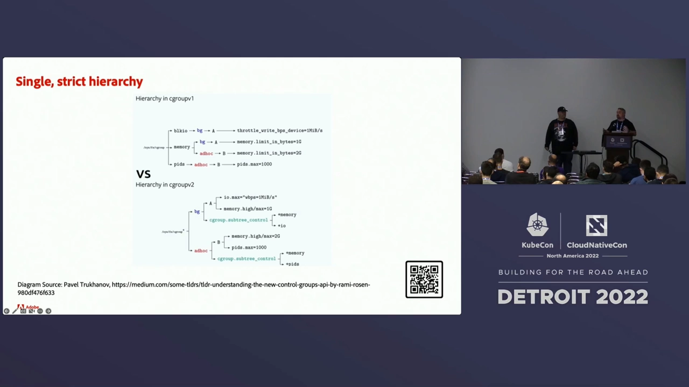
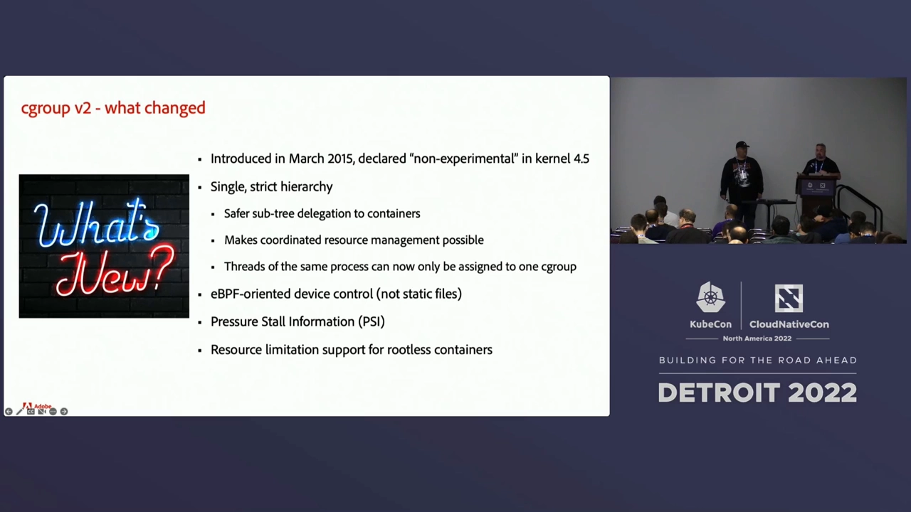
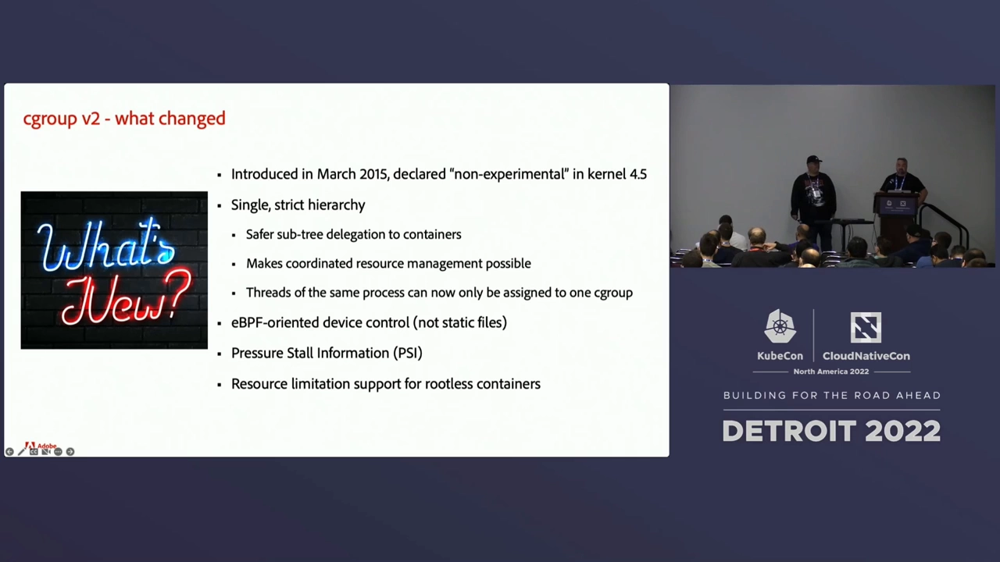
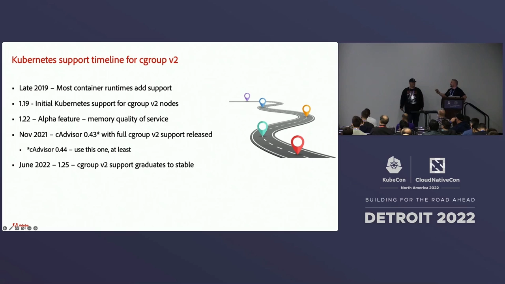
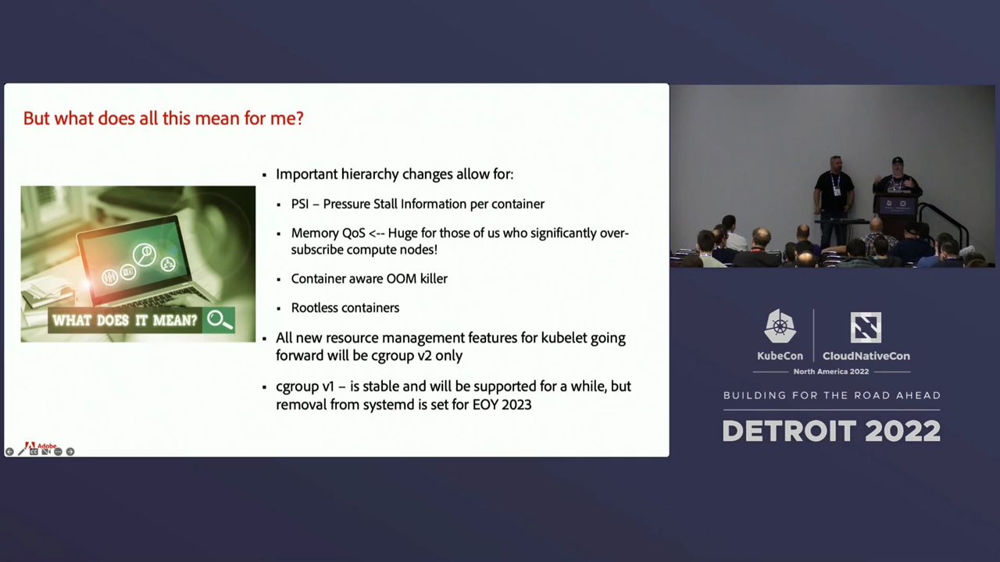
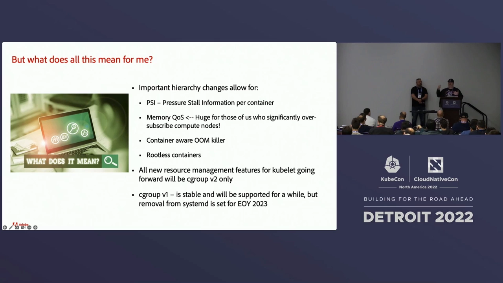
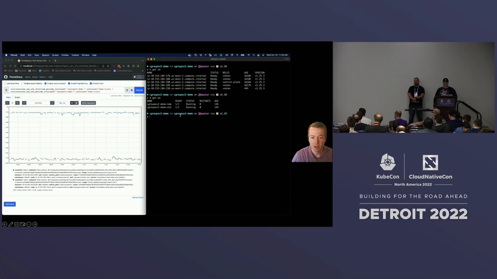

# Cgroups_V2_Before_You_Jump_In

> 视频源：[Cgroups V2: Before You Jump In - Tony Gosselin & Mike Tougeron, Adobe Systems](https://www.youtube.com/watch?v=WxZK-UXKvXk)（YouTube @CNCF [Cloud Native Computing Foundation]，28 分 32 秒）。本文基于视频演说图文稿整理，时间戳可跳转到原视频对应位置。

## 本讲要解决的核心问题（SCQA）

**背景**：两位演讲者来自 Adobe 的 ethos 团队——那是 Adobe 做 Kubernetes 容器化工作负载的平台（K8s 之上再加工具链、流程与安全管控），日常以"运维/operator"视角工作：给我 API，让我部署，别跟我讲底层。

**冲突**：一次例行的集群操作系统升级（Flatcar Linux），新版**默认启用了 cgroup v2**。团队想当然地"2 比 1 大，直接开"——结果集群起不来；修好 kubelet 和容器运行时之后，metrics-server 缺指标、Horizontal Pod Autoscaler 失灵，遥测团队直接拒绝上线："我们在盲飞！"

**疑问**：在拍下 v2 这个开关之前，到底需要考虑什么？

**回答（中心思想）**：cgroup v2 不只是"新版本号"——它把 v1 的多层级模型翻转为**进程在顶、资源在下的严格单层级**，并带来 PSI、memory QoS、rootless 容器限额等新能力；而 Kubernetes 侧的支持（尤其 cAdvisor 指标链路）有明确时间线。升级前要按清单核对操作系统、组件版本和语言库，并且充分测试。

[【跳转到 00:00】](https://www.youtube.com/watch?v=WxZK-UXKvXk&t=0)

## 一、一次"2 比 1 大所以直接开"的事故

大约一年前，团队照常升级集群底层操作系统 Flatcar Linux 到 2969.0.0。版本说明里有一行新话："我们现在默认使用 cgroup v2"。两位运维的第一反应非常真实：2 比 1 大，喜欢新软件，开！[【跳转到 02:32】](https://www.youtube.com/watch?v=WxZK-UXKvXk&t=152)

然后连环坑逐一登场 [【跳转到 03:22】](https://www.youtube.com/watch?v=WxZK-UXKvXk&t=202)：

1. **集群起不来**——研究后发现 kubelet 和容器运行时都必须"知道"自己跑在 v2 上；
2. 修好之后 **metrics-server 缺关键指标**、某些情况下起不来——Horizontal Pod Autoscaler（HPA）跟着失灵；
3. 顺藤摸瓜：metrics-server 依赖 **cAdvisor**，而 Kubernetes 1.20 自带的 cAdvisor 版本**不认识 cgroup v2**；换 0.43 版以 DaemonSet 方式运行——部分指标好了，部分还是不行；
4. 遥测团队摊牌：指标残缺等于盲飞，不能这么上线。

他们带着"我们到底做错了什么"的疑问去找 SIG-Node，得到的答案是：**这不是改个配置开关就完事的事**——启用 v2 之前，有一堆前置考虑 [【跳转到 05:27】](https://www.youtube.com/watch?v=WxZK-UXKvXk&t=327)。这正是本讲的主题。

## 二、cgroup：容器与 Kubernetes 的地基

先把概念补齐。cgroup（control groups，控制组）2008 年 1 月进入 Linux 内核，通过一个**虚拟文件系统**访问；核心职能两件事：**控制**（给一组进程设资源上限）与**记账**（统计一组进程的真实用量）[【跳转到 05:58】](https://www.youtube.com/watch?v=WxZK-UXKvXk&t=358)。

演讲者的断言很直白：**没有 cgroup 就没有容器，也没有 Kubernetes**——这是每个人每天都在用、却未必知道的功能 [【跳转到 06:48】](https://www.youtube.com/watch?v=WxZK-UXKvXk&t=408)。它在 K8s 里无处不在：你给容器设置的 `resources.requests/limits` 最终一路落到 cgroup 层；pod/容器的资源用量指标，也是系统逐层向 cgroup 查询得来的；而依赖这些指标的组件——比如 HPA——间接都踩在 cgroup 上 [【跳转到 07:13】](https://www.youtube.com/watch?v=WxZK-UXKvXk&t=433)。

## 三、v2 最大的变化：严格单层级

v2 在内核 4.5（2015 年 3 月）转正为非实验特性，到演讲时已稳定七年。它最大的特性：**单一且严格（strict）的层级** [【跳转到 07:59】](https://www.youtube.com/watch?v=WxZK-UXKvXk&t=479)。

v1 诞生时的设计哲学是**最大灵活**——给写软件的人尽可能多的资源管理方式，结果造出一个极难管理的系统 [【跳转到 08:24】](https://www.youtube.com/watch?v=WxZK-UXKvXk&t=504)。看 v1 的结构就明白了：层级树**顶部是控制器**（Block IO、Memory、PIDs……），每种资源一棵树；于是一个进程被拆散在多棵树的多个组里——块 IO 归一个组管，内存限额归另一个组管 [【跳转到 08:55】](https://www.youtube.com/watch?v=WxZK-UXKvXk&t=535)。

按"资源优先"组织树本身没问题，糟糕的是实践：人们实际是**按进程**管资源的——想把某个进程的 CPU、内存、块 IO、网络捆在一起、绑在同一个 PID 上协同管控。v1 非但不帮忙，还允许把一个进程的**不同线程**挂进不同的组；为了协调管理，大家写出了各种绕来绕去的代码 [【跳转到 09:45】](https://www.youtube.com/watch?v=WxZK-UXKvXk&t=585)。

v2 把模型整个翻转：**进程在树顶，单一层级**——一个子组声明"我管这些资源"，另一个子组实际设限；按进程紧密协同管理成为第一公民 [【跳转到 10:35】](https://www.youtube.com/watch?v=WxZK-UXKvXk&t=635)。

配套地，一些灵活性被收走了：**一个进程的所有线程只能属于一个组**。演讲者的评价是"amazing"——这把 v1 时代围绕资源管理的拧巴代码，直接内建进了 cgroup 系统本身，协作更安全、更线程安全 [【跳转到 11:00】](https://www.youtube.com/watch?v=WxZK-UXKvXk&t=660)。

## 四、v2 的其它新能力

除了层级模型，v2 还带来三样好东西 [【跳转到 11:55】](https://www.youtube.com/watch?v=WxZK-UXKvXk&t=715)：

- **eBPF 设备控制**：v1 用静态文件控制设备访问；v2 内建了与 eBPF 的结合点，用挂在 cgroup 上的 eBPF 程序做设备管控；
- **PSI（Pressure Stall Information，压力停顿信息）**：不再只有"某个时间点用了多少"的瞬时指标，还有**使用随时间变化**的信息——应用的用量是突发尖峰，还是在更长时间里逼近上限？据此才能做出聪明的资源与优先级决策 [【跳转到 12:20】](https://www.youtube.com/watch?v=WxZK-UXKvXk&t=740)；
  
- **rootless 容器也能限额**：v1 时代用 cgroup 需要 root 权限，rootless 容器设不了资源限制；v2 可以设了——这为"容器不以 root 运行"的安全路线打开了大门 [【跳转到 13:10】](https://www.youtube.com/watch?v=WxZK-UXKvXk&t=790)。

## 五、Kubernetes 的 v2 支持时间线

K8s 这边的适配是一步一步来的 [【跳转到 13:50】](https://www.youtube.com/watch?v=WxZK-UXKvXk&t=830)：

| 时间 | 节点 |
| --- | --- |
| 2019 年底 | 各主要容器运行时开始支持 v2；K8s 1.19 加入**仅节点级**的初始支持——能跑，但没有 cAdvisor 指标 |
| 2020–2021 | Alpha 特性逐步进入后续版本（如 memory QoS） |
| 2021 年 11 月 | **cAdvisor 0.43** 发布——完整 v2 指标支持落地（有几个小 bug，0.44 起才真正稳） |
| 2022 年 6 月 | **Kubernetes 1.25**：v2 全特性稳定支持 |

关键分水岭是 cAdvisor 0.43：在那之前"能设限但看不到用量"，之后才能拿到完整指标、实现完整的限制与反馈闭环 [【跳转到 14:40】](https://www.youtube.com/watch?v=WxZK-UXKvXk&t=880)。

## 六、v2 给 Kubernetes 带来的新玩法

**memory QoS**。过去 limit 可以高于 request，而内存是不可压缩资源——调度器可能把内存一次性全给出去，后来者只要想多要一点，两 pods 之一就得 OOM [【跳转到 16:20】](https://www.youtube.com/watch?v=WxZK-UXKvXk&t=980)。有了按 cgroup 细分的 PSI，K8s 可以**渐进地**多分一点内存、按公式在 request 与 limit 之间提供服务质量，而不是一次给满；用量变化也会回报给你 [【跳转到 16:45】](https://www.youtube.com/watch?v=WxZK-UXKvXk&t=1005)。

对超订大户这是巨大福音——他们的节点常见 300%~500% 的超订率，因为"用户申请的资源从来不真用满"。Facebook 正在用户态 OOM killer 方向做一些很酷的事 [【跳转到 17:35】](https://www.youtube.com/watch?v=WxZK-UXKvXk&t=1055)。

**容器级 OOM kill**（未来特性）。常见模式：应用 pod 里挂一个日志 sidecar，平时给它一点点内存。日志突然爆发时，v1 会把**整个 pod** 杀掉；v2 的底层能力则支持只 OOM 杀掉**那一个容器**、单独重启它——主应用安然无恙。这功能还没进 K8s，但底层已经具备 [【跳转到 18:25】](https://www.youtube.com/watch?v=WxZK-UXKvXk&t=1105)。

方向上，rootless 与"secure by default"是 K8s 的大趋势——能不以 root 跑的都尽量不跑 [【跳转到 18:50】](https://www.youtube.com/watch?v=WxZK-UXKvXk&t=1130)。要紧的是：**memory QoS、容器级 OOM kill 这些新特性只面向跑 v2 的节点和 kubelet**，v1 不再有新特性；v1 仍被支持，但据 Linux 邮件列表，systemd 将在 2023 年底停止支持 cgroup v1——K8s 侧的弃用公告大概率不会太远 [【跳转到 19:15】](https://www.youtube.com/watch?v=WxZK-UXKvXk&t=1155)。

## 七、运维与开发者的准备清单

**集群运维要查的** [【跳转到 20:24】](https://www.youtube.com/watch?v=WxZK-UXKvXk&t=1224)：

- **操作系统支持**：确认内核/发行版支持并已启用 v2（演讲提到 5.8 这一档内核）；有的系统默认开、有的要改启动参数再重启——如果你跑着 AWS 这类"重启即换节点"的自动伸缩，设完参数一重启节点直接被回收，等于帮了自己倒忙；
- **K8s 版本**：1.25 稳定，强烈建议；早版本也能用但" mileage may vary "，可能需要自跑 cAdvisor DaemonSet（**0.44 起为最低可用版本**，当时最新 0.55）；
- **组件配置**：容器运行时与 kubelet 的 cgroup 驱动需要统一用 systemd（v1 时代只要求两处一致即可）；好消息是 **kubelet 能自动探测 v1/v2**——可以建 v1、v2 两个节点池对照测试，验证自动化与应用表现；
- **指标链路**：metrics-server → cAdvisor 的版本兼容是当年事故的根源，升级前务必核对。

**开发者要查的** [【跳转到 22:29】](https://www.youtube.com/watch?v=WxZK-UXKvXk&t=1349)：

- 确认所用语言的 v2 支持：Java 需要 JDK 11.0.16+ 或 ≥15；Go 的 automaxprocs 需要用已包含 v2 适配补丁的新版本；Python 长期没有原生 cgroup 支持（相关 issue 开了很多年），3.12 或有改善；
- 很多语言/工具/库是**自己读 cgroup 文件系统**来判断配额的——旧库可能完全不认识 v2 的挂载布局；盘点你的遗留系统，确认它们要么支持 v2、要么需要升级；
- 最后一条朴实无华：**测试、测试、再测试**——否则出事的会是你的东西 [【跳转到 23:44】](https://www.youtube.com/watch?v=WxZK-UXKvXk&t=1424)。

## 八、实测：一个 GOMAXPROCS 引发的限流

演讲最后放了一段同事准备好的演示，把"测试"的价值演得很具体。场景：Go 应用用 Uber 的 **automaxprocs** 包自动把 `GOMAXPROCS` 对齐容器的 CPU 配额。K8s 1.25 集群上跑两个**代码相同**的 pod，CPU limit 都是 1：`old` pod 用旧版 automaxprocs，`new` pod 用已打上 v2 适配补丁的新版 [【跳转到 24:33】](https://www.youtube.com/watch?v=WxZK-UXKvXk&t=1473)。

结果 [【跳转到 25:48】](https://www.youtube.com/watch?v=WxZK-UXKvXk&t=1548)：

- `new` pod：正确读到配额，GOMAXPROCS=1，与 limit 一致；
- `old` pod：**读不到 v2 的配额**，回退默认取节点的 CPU 总数（2）——于是应用起两个忙线程，每个 CPU 周期内更快撞上 1 核的限额，周期剩余时间全部被节流。监控显示 `old` pod **98%~99% 的周期处于被节流状态**，而 `new` pod 几乎不被节流。

结论很直观：GOMAXPROCS 与容器配额的差距越大，应用在周期内越早撞墙、被节流得越狠。一句"库不认识 v2"，性能就差了百倍。

## 结尾要点

- 这是一次**核心依赖的重大升级**：cgroup 是容器与 K8s 的地基，v2 为运维与开发者都铺开了新特性（memory QoS、容器级 OOM kill、rootless 限额）；
- 未来 12~18 个月，基础设施与应用两侧都会陆续被它波及——把升级预案排上日程；
- 别忘了当年的教训：**先看清单、再充分测试，然后才去拍那个开关** [【跳转到 26:56】](https://www.youtube.com/watch?v=WxZK-UXKvXk&t=1616)。

## 小结

- 事故复盘：OS 默认切 v2 → kubelet/运行时要感知 → metrics-server 依赖的 cAdvisor 不认识 v2 → 指标缺失、HPA 失灵。"2 比 1 大"不是升级理由。
- v1 的病根：**每资源一棵树**的最大灵活，让一个进程散落多组、线程可拆散、协同管理全靠上层代码硬扛。
- v2 的答案：**进程在顶、资源在下的严格单层级**；一进程的线程只属一组；PSI、eBPF 设备控制、rootless 限额是新能力。
- K8s 时间线：1.19 节点级 → cAdvisor 0.43/0.44 指标全通 → 1.25 全特性稳定；新特性只给 v2 节点，v1 只维护不进新货，systemd 2023 年底停支持 v1。
- 升级清单：OS/内核支持与启用方式、K8s 版本、systemd 驱动统一、cAdvisor ≥0.44、语言与库的 v2 适配（Java/Go/Python）、混合节点池对照测试。
- 实测教训：旧 automaxprocs 读不到 v2 配额 → GOMAXPROCS 虚高 → 98%+ 周期被节流；库的 v2 兼容性是真实的生产事故源。

## 关键术语速查

| 术语 | 一句话解释 |
| --- | --- |
| cgroup（控制组） | 内核的进程组资源管控机制：限额 + 记账，容器的地基 |
| 严格单层级 | v2 的核心：进程在顶、资源在下的单一层级树 |
| PSI（Pressure Stall Information） | 压力停顿信息：暴露"使用随时间变化"的资源压力 |
| memory QoS | 基于 PSI 在 request 与 limit 之间渐进分配内存的 K8s 机制 |
| 容器级 OOM kill | v2 底层支持只杀/重启超限的单个容器，而非整个 pod |
| rootless 容器 | 不以 root 运行的容器；v2 使其可获得资源限额 |
| cAdvisor | K8s 指标采集组件；0.43 起支持 v2，0.44 为最低可用版 |
| kubelet cgroup 探测 | kubelet 自动识别节点用 v1 还是 v2，可建混合节点池 |
| GOMAXPROCS | Go 的并行度参数；automaxprocs 将其对齐容器 CPU 配额 |
| 节流（throttling） | 容器超出 CPU 配额后被内核压停的时段；配额错配时占比极高 |
| Flatcar Linux | Adobe 使用的容器优化 OS，新版默认启用 cgroup v2 |
| secure by default | K8s 安全方向：尽量非 root 运行，v2 的 rootless 限额是前提 |
