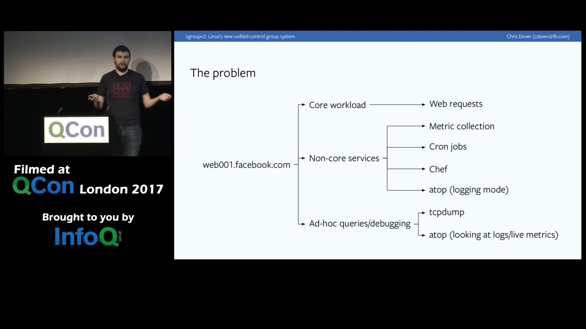
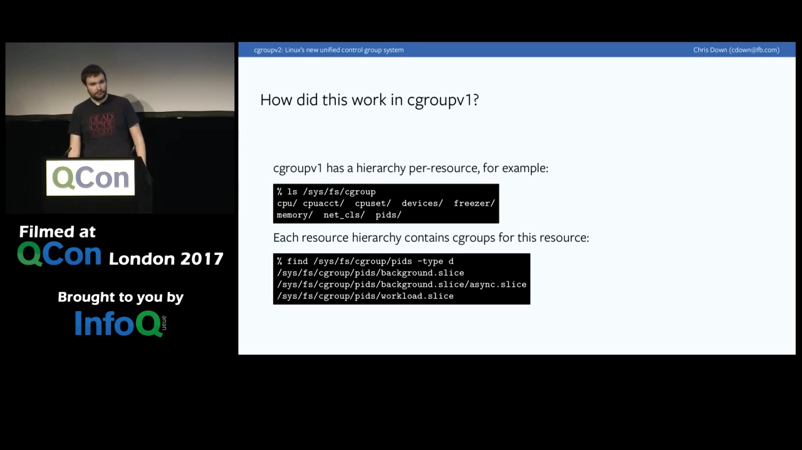
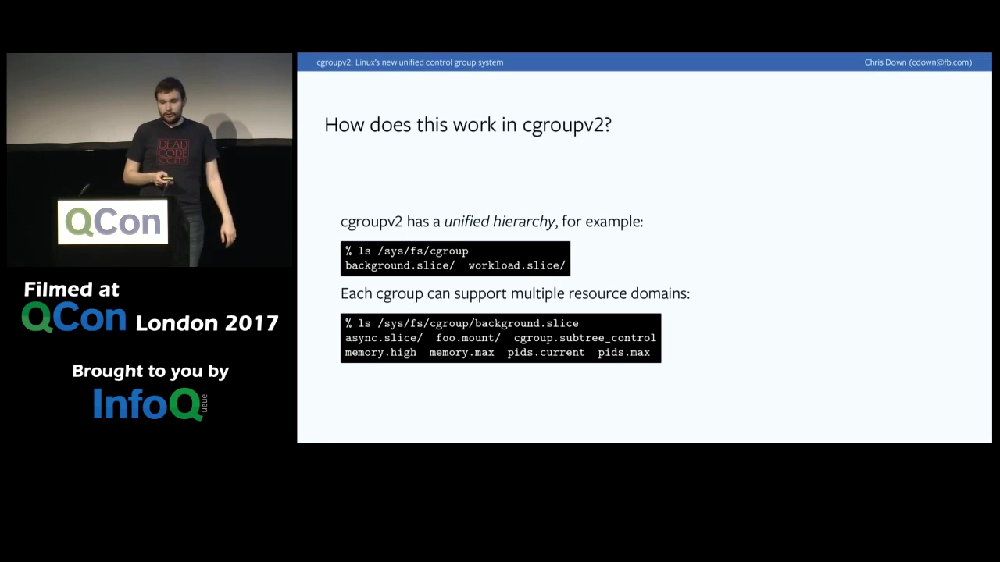
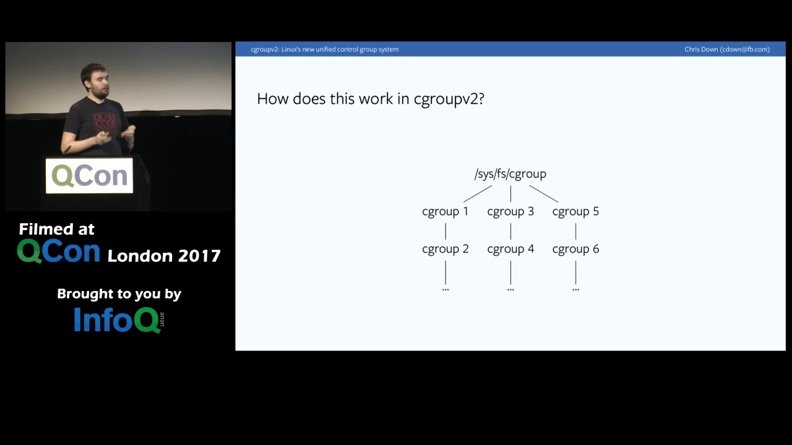
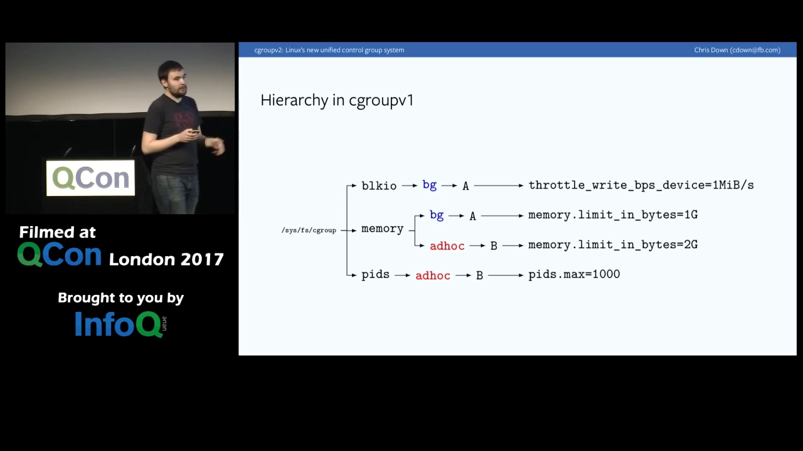
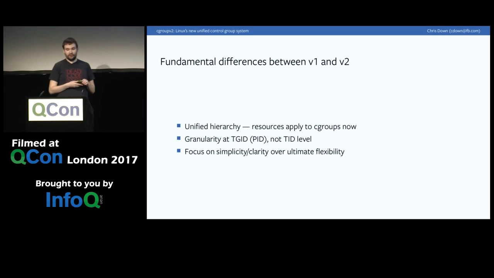
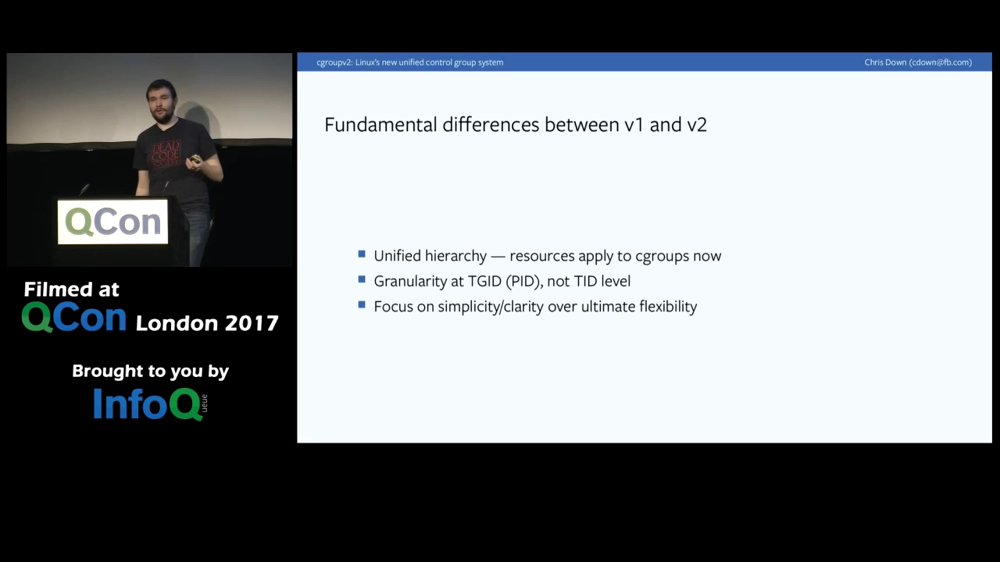
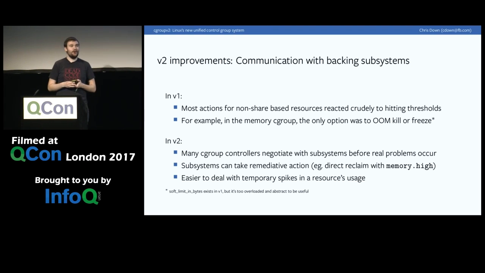
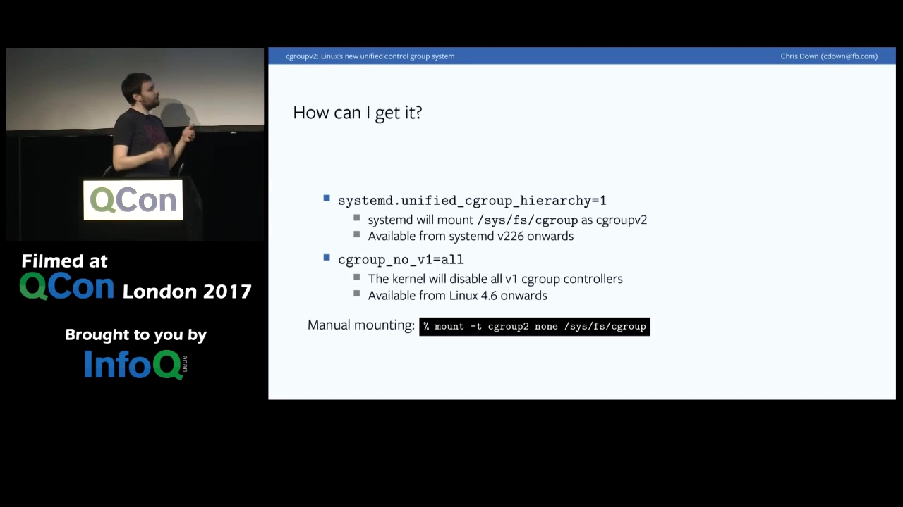

# cgroupv2_Linuxs_new_unified_control_group_hierarchy_QCON_London_2017

> 视频源：[cgroupv2: Linux's new unified control group hierarchy (QCON London 2017)](https://www.youtube.com/watch?v=ikZ8_mRotT4)（YouTube @Chris Down，42 分 26 秒）。本文基于视频演说图文稿整理，时间戳可跳转到原视频对应位置。

## 本讲要解决的核心问题（SCQA）

**背景**：2008 年进入内核的 cgroup v1，是过去十年容器化浪潮的底层基石——你今天用的 Docker、systemd，资源管控都靠它。演讲者 Chris Down 在 Facebook 负责 Web 服务器与全公司的事故处理，面对的是数十万台服务器。

**冲突**：真实的重大故障往往不是单个系统挂掉，而是资源失控引发的级联失效。而 v1 在简单场景尚可使用，复杂使用下复杂度指数级上升：同名 cgroup 在不同资源树下毫无关系、根 cgroup 没有限制能力、页缓存回写这种跨资源操作无法记账……有些事甚至根本做不到。

**疑问**：`/sys/fs/cgroup` 是极重大的内核 API，明知如此，为什么 v2 宁可断裂 API 推倒重来，也不做渐进式改良？新设计的核心决策是什么？

**回答（中心思想）**：v2 用「单一统一层级」取代「每种资源一棵树」：模型反转，资源（控制器）反过来挂在 cgroup 上、按子树启停；再配合 no-internal-process 约束、memory.min/low/high/max 统一阈值、现代化事件通知等设计，让跨资源的协同管控成为可能。这是一次为未来十年轻装上阵的重构。

[【跳转到 00:00】](https://www.youtube.com/watch?v=ikZ8_mRotT4&t=0)

## 一、为什么 Facebook 关心 cgroup：管住故障域

Chris Down 是 Facebook 伦敦办公室的生产工程师，所在团队（Web Foundation）除了维护 Web 服务器，还是全公司事故处理的总守门人，每天处理各种线上事故 [【跳转到 02:10】](https://www.youtube.com/watch?v=ikZ8_mRotT4&t=130)。这解释了他们为什么对 cgroup 如此投入：Facebook 有几十万台服务器，每台上面通常跑不止一个服务，而成熟的互联网公司里，真正的故障大多不是因为某一个系统失败，而是**不同系统之间的级联失效**——他们想做的就是把故障域限制住，别让一个服务的失败把整个系统拖下水 [【跳转到 03:25】](https://www.youtube.com/watch?v=ikZ8_mRotT4&t=205)。

要限制故障域，除了梳理服务依赖，另一件事就是：**不能让一个服务独占全部内存或全部 CPU**，这和级联失效一样致命 [【跳转到 03:50】](https://www.youtube.com/watch?v=ikZ8_mRotT4&t=230)。

从 cgroup 视角看一台典型服务器，上面大致有三类进程 [【跳转到 04:15】](https://www.youtube.com/watch?v=ikZ8_mRotT4&t=255)：

- **核心负载**：这台机器"存在的意义"，比如 Web 服务器上的 HHVM、HTTPS 负载均衡器 Proxygen；
- **系统服务**：公司级的基础设施软件，比如指标采集守护进程、配置管理工具 Chef——它们很重要，但绝不该干扰核心负载；
- **临时任务**：排障时临时跑的 tcpdump 之类，重要程度要能动态调整 [【跳转到 05:55】](https://www.youtube.com/watch?v=ikZ8_mRotT4&t=355)。

血泪案例是真实的：一个指标采集守护进程不断吃内存，几十 GB 几十 GB 地涨，直到把机器 OOM 拖垮 [【跳转到 05:05】](https://www.youtube.com/watch?v=ikZ8_mRotT4&t=305)；Chef 对保持机器配置最新至关重要，但如果它因为 bug 跑满 CPU，就会干扰线上 Web 请求 [【跳转到 05:30】](https://www.youtube.com/watch?v=ikZ8_mRotT4&t=330)。这些，都是 cgroup 要解决的问题。

## 二、先看懂 v1：每种资源一棵树

先把概念摆正：控制组（cgroup/coup）本质是**进程的灵活分组**——一组里想放多少进程都行，然后在组上设限制；管理的"资源"指 CPU、IO、内存这些共享的东西，"管理"可以是限额、达到阈值触发动作等 [【跳转到 06:45】](https://www.youtube.com/watch?v=ikZ8_mRotT4&t=405)。它最常见的用途就是资源管理：工作负载隔离（后台任务不影响主负载）、优先级（给某些任务更多 CPU/内存）、共享环境（VPS 商给客户"尽力而为"的整机体验）[【跳转到 08:50】](https://www.youtube.com/watch?v=ikZ8_mRotT4&t=530)。

使用方式上，cgroup **没有系统调用接口**，全靠 `/sys/fs/cgroup` 下的目录与文件操作（mkdir、rm、write）完成创建、删除、修改；通常由 systemd 这样的程序统一"写"层级结构，其他程序以"读"为主 [【跳转到 07:35】](https://www.youtube.com/watch?v=ikZ8_mRotT4&t=455)。每种资源由一个**控制器（controller）**提供目录里的接口文件，你写入值，内核据此改变行为 [【跳转到 08:25】](https://www.youtube.com/watch?v=ikZ8_mRotT4&t=505)。

v1（2008 年进入内核）在 `/sys/fs/cgroup` 下的样子是：顶层是控制器名的目录（cpu、memory、pids……），**每种资源各有一棵层级树**，树里的目录就是 cgroup，目录内有该资源的接口文件（比如 pids 树里设最大进程数）[【跳转到 11:00】](https://www.youtube.com/watch?v=ikZ8_mRotT4&t=660)。

这套设计埋着三个关键问题：

1. **同名无关**：资源 A 的树里有个 cgroup1，资源 C 的树里也有个 cgroup1，哪怕都叫 `foo`（systemd 搭出来的常见情形），内核视角它们**毫无关系** [【跳转到 11:40】](https://www.youtube.com/watch?v=ikZ8_mRotT4&t=700)。
   
2. **一号一位**：一个 PID 在每种资源下恰好属于一个 cgroup；没被显式分配的资源，就落在该资源的**根 cgroup**——而根 cgroup 几乎无限定能力，只有记账，没有控制 [【跳转到 12:55】](https://www.youtube.com/watch?v=ikZ8_mRotT4&t=775)。
3. **各管各的**：单棵树里你只能改本资源相关的事，跨资源没有任何协同手段 [【跳转到 12:30】](https://www.youtube.com/watch?v=ikZ8_mRotT4&t=750)。

## 三、v2 的反转：资源挂在 cgroup 上

到了 v2，`/sys/fs/cgroup` 下看到的不再是资源名，而是 **cgroup 目录本身**（`xxx.slice` 是 systemd 的命名术语，对 cgroup 本身没有含义）[【跳转到 14:02】](https://www.youtube.com/watch?v=ikZ8_mRotT4&t=842)。

模型就此反转：v1 是"在特定资源的语境里创建 cgroup"，v2 变成"**在特定 cgroup 子树的语境里启用/停用资源**"——你在某个 cgroup 上启用 CPU 控制器，就只在这个 cgroup 的语境里管 CPU [【跳转到 14:27】](https://www.youtube.com/watch?v=ikZ8_mRotT4&t=867)。这样只需要**一棵层级树**统治所有资源（演讲原话：one cgroup hierarchy to rule them all），你想在哪个组上启用哪些资源，随时可挑 [【跳转到 14:52】](https://www.youtube.com/watch?v=ikZ8_mRotT4&t=892)。

启停的抓手是一个特殊文件 `cgroup.subtree_control`：往里写 `+memory`、`+pids`，**子 cgroup** 就长出对应的接口文件；反过来在子级禁用，子级就脱离管控自由竞争。注意控制器必须从根一路启用下来——每一级都要从父级继承 [【跳转到 15:42】](https://www.youtube.com/watch?v=ikZ8_mRotT4&t=942)。

还有个附带变化：v2 以**线程组（进程）为粒度**而不是线程。这是有争议的改动，但没有广泛协作机制时，线程粒度说不通——v1 里同一进程的不同线程可以放进不同的内存 cgroup，可它们共享同一段内存，"互相竞争内存"从根上就讲不通 [【跳转到 17:47】](https://www.youtube.com/watch?v=ikZ8_mRotT4&t=1067)。

## 四、单层级解锁跨资源协同：页缓存回写的记账

单一层级最实际的红利，是**跨资源决策**成为可能。演讲用一个问答开场：Linux 里 `write()` 之后发生了什么？答案是页缓存——数据先写进页缓存成为脏页，应用程序就可以继续往下跑（它以为已经写进磁盘了）；之后某个内核 worker（pdflush）按脏页比例或过期时间，择机把脏页刷进磁盘 [【跳转到 21:35】](https://www.youtube.com/watch?v=ikZ8_mRotT4&t=1295)。

问题来了：**写页缓存是内存操作，刷盘是 IO 操作**。v1 的两棵树推断不出"资源 A 树里这个 cgroup 和资源 B 树里那个 cgroup 是不是同一批进程"，这笔账在 v1 里根本没法记，最后全部落到根 cgroup——只有记账、没有限制，更谈不上据此做资源竞争 [【跳转到 22:50】](https://www.youtube.com/watch?v=ikZ8_mRotT4&t=1370)。

v2 单一层级里，这件事可以追踪了：回写的消耗能计入 cgroup 的限额，内核还能据此理解 IO 与内存用量的关系——分配代价太高就先缓一缓，或者依据 cgroup 的 IO/内存压力采取合理动作 [【跳转到 23:15】](https://www.youtube.com/watch?v=ikZ8_mRotT4&t=1395)。

## 五、no-internal-process：进程和控制器不共处一格

v2 的新约束：**有进程的 cgroup，不能再启用控制器**——换句话说，树上的 cgroup 要么里面没有进程，要么没有启用任何控制器，二选一 [【跳转到 18:37】](https://www.youtube.com/watch?v=ikZ8_mRotT4&t=1117)。

为什么？因为"子进程与父组竞争资源"这件事极难定义。设想 Kubernetes 的 agent 跑在 cgroup I 里，它派生的任务在子 cgroup J 里——现在 I 里的**进程**和 J 这个 **cgroup** 是两类不同的对象，它们怎么分资源？把 I 里每个进程都看作一个隐式 cgroup？还是把它们合起来当作一个"虚拟 cgroup"？演讲者的态度是：内核**不替你做这个决定**，正确答案取决于你的业务，所以把层级组织权交给你，用约束逼你表达清楚意图 [【跳转到 19:02】](https://www.youtube.com/watch?v=ikZ8_mRotT4&t=1142)。根 cgroup 是特例，每种控制器自己决定如何对待根下的进程 [【跳转到 20:17】](https://www.youtube.com/watch?v=ikZ8_mRotT4&t=1217)。

## 六、为什么必须断裂 API

讲完机制，回到那个尖锐的问题：这么重大的 API，凭什么推倒重来？Chris 的回答是 [【跳转到 20:29】](https://www.youtube.com/watch?v=ikZ8_mRotT4&t=1229)：

- v1 在**基本场景**里工作得还可以，但复杂使用下复杂度**指数级**增长；
- v1 的设计常常**跟随实现**——2008 年之前没人能预料容器会怎么被使用，于是到处做了"灵活性"，结果灵活性全堆在你最不想要的地方；
- 这些是**根本性**问题，修不了，只能换 API [【跳转到 20:54】](https://www.youtube.com/watch?v=ikZ8_mRotT4&t=1254)。

v2 的设计哲学正是对 v1 的反动：**简单与清晰优先**——"我们应该提供一个引导你走向正确方案的框架，而不是要求你理解所有陷阱"，后者是灾难配方 [【跳转到 18:12】](https://www.youtube.com/watch?v=ikZ8_mRotT4&t=1092)。

## 七、更清晰的内存阈值与更温和的处置

v1 的内存管控手段相当粗暴：到硬限就 OOM kill（大多数应用对被杀反应都不好）；或者用 freezer 把进程冻结，交给用户态程序慢慢处置——但 v1 的 freezer 停点完全不可控，可能停在内核栈里不知道怎么恢复；attach GDB 抓栈时进程还会进入不可中断睡眠（D 状态），"除非你想要长期饭票" [【跳转到 24:05】](https://www.youtube.com/watch?v=ikZ8_mRotT4&t=1445)。

v1 还有个 `soft_limit_in_bytes` 软限，演讲者的原话很直白：**我读了代码也不懂它怎么工作**——它基于全局内存压力、局部内存压力、回收压力等一堆启发式，没人能推断任意时刻它的行为，干脆当它不存在 [【跳转到 25:20】](https://www.youtube.com/watch?v=ikZ8_mRotT4&t=1520)。

v2 换成四个含义清晰的阈值 [【跳转到 25:45】](https://www.youtube.com/watch?v=ikZ8_mRotT4&t=1545)：

| 文件 | 含义 |
| --- | --- |
| `memory.min` / `memory.max` | 绝对硬边界：min 是最低保障，max 触顶即 OOM |
| `memory.low` / `memory.high` | 尽力而为：high 触发内核回收，先"让应用慢下来" |

`memory.high` 的思路是：超了先**回收内存、压制应用**，而不是直接冲向 OOM killer。这对临时尖峰特别友好——v1 里内存曲线冲上峰值就可能被 OOM 杀掉、一切归零；v2 里可以先放慢你、回收几页，扛过去继续跑 [【跳转到 26:35】](https://www.youtube.com/watch?v=ikZ8_mRotT4&t=1595)。

## 八、现代化的事件通知

状态变化通知（cgroup 里没进程了、发生 OOM 了……）在 v1 里又贵又难用：想收 release 通知得预置 release_agent——一个可执行文件路径，每次 cgroup 清空内核就去执行它；高频场景下每秒要克隆上千个进程，完全不可接受 [【跳转到 27:25】](https://www.youtube.com/watch?v=ikZ8_mRotT4&t=1645)。

v2 的做法顺理成章：既然接口都是文件，就用**文件类 API**——inotify 发修改事件，所有事件支持 eventfd + poll，用现成的用户态工具（比如 inotifywait）就能监控，**一个进程盯住整棵层级**，不用再为每个事件克隆一堆进程 [【跳转到 28:15】](https://www.youtube.com/watch?v=ikZ8_mRotT4&t=1695)。

## 九、v1 的 API 碎片化与 v2 的统一限制

v1 的碎片化有两类典型症状 [【跳转到 29:55】](https://www.youtube.com/watch?v=ikZ8_mRotT4&t=1795)：

- **API 不一致**：IO 和 CPU 明明都是权重式分配，两套接口却毫不相关——你得学两遍 API、记两遍陷阱；
- **语义不一致**：多数 cgroup 继承父级限制，有的不继承，有的干脆无视层级，谁来都给。

v2 有意让"相似的东西相似"（既有刻意目标，也是统一层级的天然结果），统一层级更是直接强制了统一语义 [【跳转到 30:20】](https://www.youtube.com/watch?v=ikZ8_mRotT4&t=1820)。

碎片化的代价有个惊悚的实例。v1 最早只有 `memory.limit_in_bytes`；有人问"内核内存怎么限？"于是加了 `memory.kmem.limit_in_bytes`；又有人问"TCP 缓冲呢？"于是有了 `memory.kmem.tcp.limit_in_bytes`……内核 API 没法事后重构，结果**每种内存各一个 limit 文件**。真正的坑在于：你给 TCP 缓冲设了限，同时也有总限——这时哪怕系统还有几十 GB 空闲页，只要 TCP 缓冲超了一个单位，**立刻 OOM kill**。演讲者说这个 API"在 Facebook 内部造成过无数进程死亡"，既好笑又可怕 [【跳转到 32:00】](https://www.youtube.com/watch?v=ikZ8_mRotT4&t=1920)。

v2 用 `memory.high` / `memory.max` **统一管理所有类型的内存**。实践证明合并成一个限制就是大家想要的；真要对某一类内存单独设限，正确做法是为它**新建一个控制器**——pids 控制器就是这样诞生的（当初想靠限内核内存来限进程数，后来发现太难，干脆做了专门的 pids 控制器）[【跳转到 33:15】](https://www.youtube.com/watch?v=ikZ8_mRotT4&t=1995)。

## 十、生产实践与上手方法

**Facebook 的部署规模**：此刻访问 facebook.com，约十分之一概率命中的是 cgroup v2 服务器； tens of thousands 台机器，自称全球最大的 v2 部署；用 systemd 管理；Facebook 还有两位 v2 核心维护者 [【跳转到 33:40】](https://www.youtube.com/watch?v=ikZ8_mRotT4&t=2020)。

**演讲时点（2017）的现状**：IO、内存控制器已并入，**CPU 控制器尚未合入主线**——CPU 子系统的维护者对线程粒度、no-internal-process 约束还有保留，社区正在对话中 [【跳转到 34:55】](https://www.youtube.com/watch?v=ikZ8_mRotT4&t=2095)。

**正在路上的能力**：

- **内存压力指标**：Linux 一直没有好的"内存压力"度量。v2 团队的思路是追踪**页重故障（page refault）**——页被反复回收又反复换入，说明高频页多到装不下，系统在颠簸（thrashing），这就是超限的信号 [【跳转到 37:50】](https://www.youtube.com/watch?v=ikZ8_mRotT4&t=2270)；
- **非即时事件的归账**：页缓存回写的 IO/内存已可记账，但其消耗的 CPU 周期、网卡收到时还不知道归属的流量，都在补 [【跳转到 38:40】](https://www.youtube.com/watch?v=ikZ8_mRotT4&t=2320)；
- **文件系统元数据 IO** 的记账很难，列为后续工作；IO 控制器已合入但还不是 work-conserving（空闲资源不匀给其他组），也是要解决的要点 [【跳转到 39:30】](https://www.youtube.com/watch?v=ikZ8_mRotT4&t=2370)；
- **新 freezer**：语义对齐 SIGSTOP——停在明确定义的栈点，避免 D 状态 [【跳转到 39:30】](https://www.youtube.com/watch?v=ikZ8_mRotT4&t=2370)。

**想上手 v2？**两步 [【跳转到 39:55】](https://www.youtube.com/watch?v=ikZ8_mRotT4&t=2395)：

1. 内核 ≥ 4.5（更早只有实验性支持，"前面有龙"）；
2. 用内核参数 `cgroup_no_v1=all` 关闭 v1 控制器——禁用 v1 的同时会隐式启用 v2。**不要**让同一资源同时被 v1 和 v2 管（理论上有混合模式，但"没人知道那该怎么工作"）；然后让 init 系统挂载统一层级（systemd v226+），交给 systemd 管理是最稳妥的方式 [【跳转到 40:45】](https://www.youtube.com/watch?v=ikZ8_mRotT4&t=2445)。

## 小结

- v1 的根子问题：**每种资源一棵树**——同名 cgroup 互不相干、根 cgroup 无法限制、跨资源操作（页缓存回写）无法记账。
- v2 反转模型：**一棵统一层级树**，资源（控制器）挂在 cgroup 上、经 `cgroup.subtree_control` 按子树启停，父级启用、子级继承。
- no-internal-process 约束：有进程的 cgroup 不能再启用控制器——进程与 cgroup 不该互相竞争资源，层级怎么组织由使用者表达。
- 破坏 API 是深思熟虑的结果：v1 "设计跟随实现"，灵活性堆错了地方；v2 以简单清晰为先，接口统一、阈值清晰（memory.min/low/high/max）。
- 处置从粗暴变温和：先回收压制（memory.high），别动辄 OOM；通知走 inotify/eventfd，一个进程盯整棵树。
- 实践侧：Facebook 数万台机器跑 v2；页重故障（refault）作为内存压力信号；CPU 控制器当时尚未合入（如今已成标配）。

## 关键术语速查

| 术语 | 一句话解释 |
| --- | --- |
| 统一层级（unified hierarchy） | v2 的单一 cgroup 树，替代 v1 每资源一棵树 |
| 控制器（controller） | 提供某类资源接口文件的内核组件（cpu、memory、pids、io…） |
| cgroup.subtree_control | 在某 cgroup 上为**子层级**启用/停用控制器的开关文件 |
| no-internal-process | v2 约束：有进程的 cgroup 不能再启用控制器 |
| 页缓存回写（writeback） | 脏页从页缓存刷盘的过程，横跨内存与 IO 两种资源 |
| memory.min/low/high/max | v2 统一内存阈值：min/max 硬边界，low/high 尽力而为 |
| memory.high | 超限触发回收、压制应用，避免直接 OOM |
| release_agent | v1 的清空通知机制：预置可执行文件，每次清空即执行（开销大，v2 移除） |
| page refault | 页被回收后又被换入；反复出现即内存颠簸，是压力信号 |
| work-conserving | 有空闲也不把资源匀给其他组（当时 IO 控制器的已知局限） |
| cgroup_no_v1=all | 内核启动参数：关闭全部 v1 控制器，隐式启用 v2 |
