# Cgroup限制容器能够使用的资源（CPU篇）

> 视频源：[Cgroup限制容器能够使用的资源（CPU篇）](https://www.bilibili.com/video/BV1vML4zdE6Y/)（B 站 @双鱼飞鸟，22 分 49 秒）。本文基于视频演说图文稿整理，时间戳可跳转到原视频对应位置。

## 本讲要解决的核心问题（SCQA）

**背景**：容器本质上就是宿主机上的一个进程。进程要运行，必然要消耗宿主机上的 CPU 和内存这两大资源。[【跳转到 00:00】](https://www.bilibili.com/video/BV1vML4zdE6Y/?t=0)

**冲突**：程序总会出问题。容器代码里出现一个死循环，就可能吃掉大量 CPU，让容器里其他进程没有 CPU 可用；代码里 `malloc` 了内存却不释放，又可能占掉宿主机大量内存。[【跳转到 00:25】](https://www.bilibili.com/video/BV1vML4zdE6Y/?t=25)

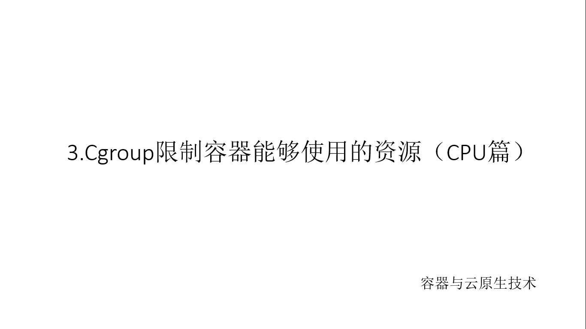

**疑问**：有没有办法限制一个容器究竟能使用多少 CPU、多少内存？[【跳转到 00:50】](https://www.bilibili.com/video/BV1vML4zdE6Y/?t=50)

**回答（中心思想）**：有——用 Linux 的 cgroup。本讲聚焦 CPU 侧：弄清 cgroup CPU 子系统的两个关键文件（`cpu.cfs_period_us` 调度周期、`cpu.cfs_quota_us` 配额），在 Docker 容器对应的 cgroup 目录里动手实验，验证三件事——限制单个容器的 CPU 上限、父目录层级式控制所有容器、用 `cpu.shares` 按权重分配比例；最后回到日常用法：`docker run` 的 `--cpu-quota` 等参数，最终也是落到这些文件上。

## 一、cgroup 的入口：/sys/fs/cgroup 目录树

限制资源靠 Linux 内核的 cgroup 机制，它的入口是一个专门的目录：`/sys/fs/cgroup`。[【跳转到 01:25】](https://www.bilibili.com/video/BV1vML4zdE6Y/?t=85)

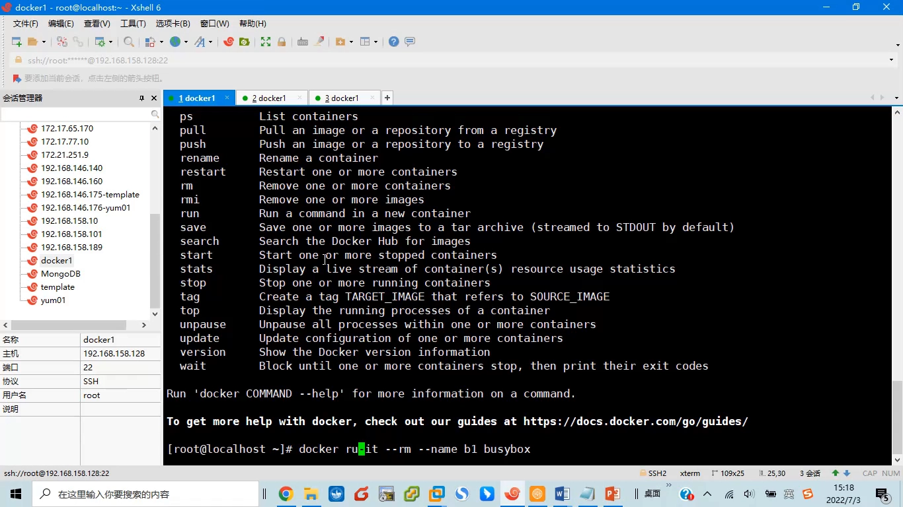

这个目录专门用来限制进程能使用的资源，里面按资源类型划分子目录：管 CPU 的 `cpu/` 在这里，管内存的限制在 `memory/` 里。本讲只看 `cpu/`。[【跳转到 01:50】](https://www.bilibili.com/video/BV1vML4zdE6Y/?t=110)

## 二、CPU 子系统的两个关键文件

进入 `cpu/` 目录，里面有很多文件，重点看两个。[【跳转到 02:55】](https://www.bilibili.com/video/BV1vML4zdE6Y/?t=175)

**第一个：`cpu.cfs_period_us`**——CPU 的调度周期。它的值是 100000（10 万），单位是微秒，也就是 0.1 秒：相当于每 100 毫秒为一个周期调度一次。这是第一个重要参数。[【跳转到 03:20】](https://www.bilibili.com/video/BV1vML4zdE6Y/?t=200)

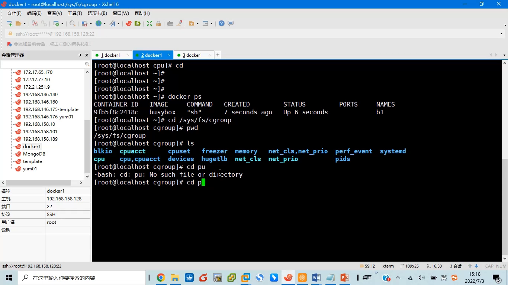

**第二个：`cpu.cfs_quota_us`**——配额。默认值是 -1，表示在这个调度周期内对配额不做限制：有多少 CPU 你就用多少。也就是说，默认情况下系统对进程的 CPU 使用是没有限制的。[【跳转到 03:45】](https://www.bilibili.com/video/BV1vML4zdE6Y/?t=225)

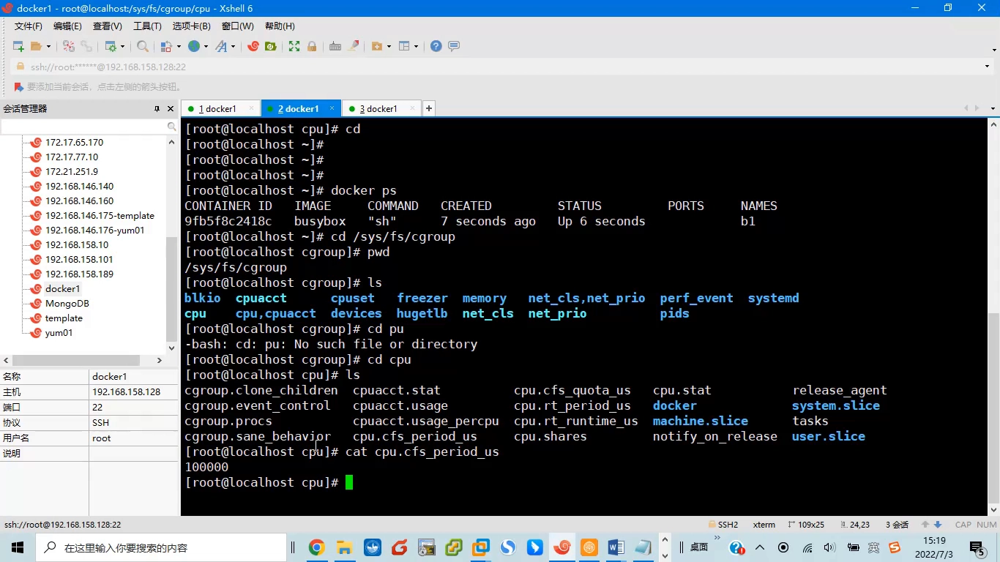

## 三、Docker 容器在 cgroup 里的位置：层级式控制

cgroup 是**层级式**的控制：上一级能控制下一级，在某一级上做的限制，会影响到它下面所有子目录。系统根目录下的 `cpu/` 设置的是整机策略，而它的 `docker/` 子目录下面，就是所有 Docker 容器。[【跳转到 04:10】](https://www.bilibili.com/video/BV1vML4zdE6Y/?t=250)

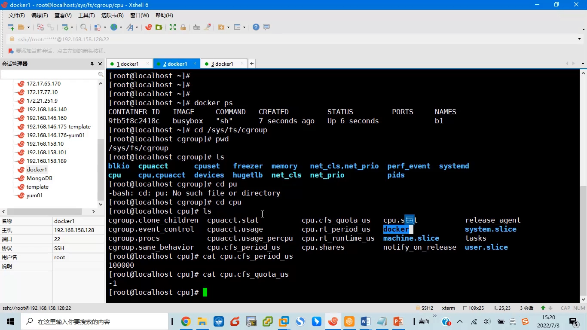

`docker/` 下的每个子目录以**容器的完整 ID** 命名，和 `docker ps` 里显示的短 ID 前缀一致。子目录的内容结构与上一级类似：`cpu.cfs_period_us` 同样是 10 万，`cpu.cfs_quota_us` 同样是 -1——下级目录默认继承上级配置，容器默认不受限制。[【跳转到 05:25】](https://www.bilibili.com/video/BV1vML4zdE6Y/?t=325)

每个容器目录里还有一个 `tasks` 文件，记录着该容器里运行的所有进程 PID：启动容器的 `sh`（父进程，即 `docker inspect` 里的入口进程）和它派生出来的工作进程，一一对应得上。[【跳转到 08:20】](https://www.bilibili.com/video/BV1vML4zdE6Y/?t=500)

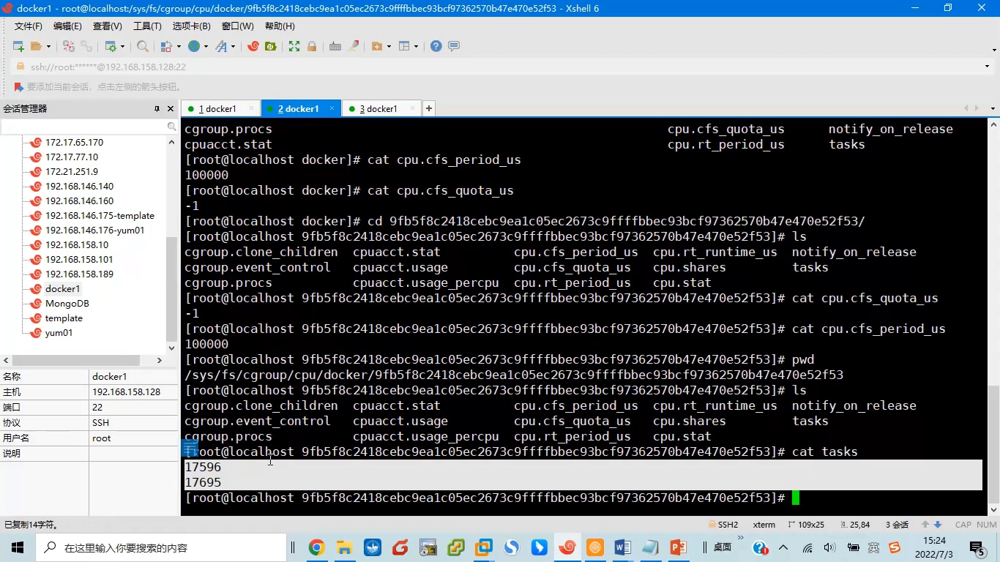

## 四、实验一：限制单个容器的 CPU 上限

先制造问题：在容器里跑一个什么都不干、只把 CPU 吃满的死循环脚本，`top` 显示它占用了 99.7% 的 CPU——容器进程几乎吃光了宿主机 CPU。[【跳转到 09:07】](https://www.bilibili.com/video/BV1vML4zdE6Y/?t=547)

现在限制它：期望这个容器最多用 CPU 的 20%。把容器目录里的 `cpu.cfs_quota_us` 从 -1 改成 20000——也就是调度周期 10 万的 20%。这是动态修改，马上生效：再看 `top`，进程立刻降到 19.9% 左右。CPU 限额就这样通过改文件控制住了。[【跳转到 09:45】](https://www.bilibili.com/video/BV1vML4zdE6Y/?t=585)

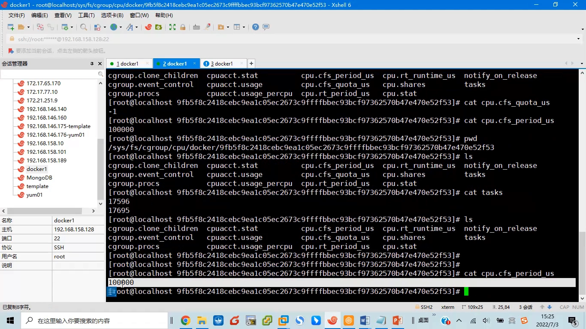

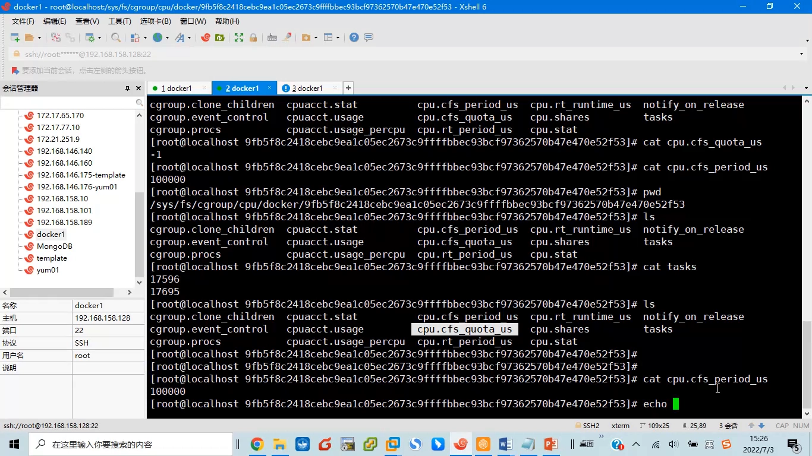

## 五、实验二：在父目录控制所有容器（层级式验证）

把容器目录的 quota 恢复成 -1，进程立刻又跑满。这说明刚才的限制只在容器自己的目录上生效。[【跳转到 11:25】](https://www.bilibili.com/video/BV1vML4zdE6Y/?t=685)

接下来换一个位置：进入容器的**上一级** `docker/` 目录，把这里的 quota 改成 20000。此时容器目录里的值仍然是 -1，但 `top` 马上又变成 20%——这就验证了 cgroup 的层级式控制架构：在 `docker/` 目录上做限制，会影响它下面**所有容器**。[【跳转到 11:50】](https://www.bilibili.com/video/BV1vML4zdE6Y/?t=710)

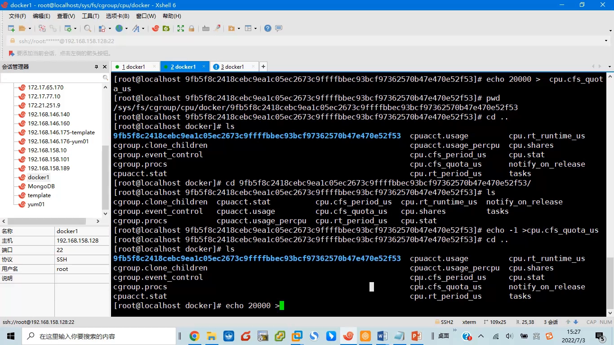

再启动第二个容器 b2（原容器叫 b1），在两个容器里各跑一个死循环。`top` 显示两个进程各占 10%：父目录限制总量 20%，而默认策略是**均分**，所以每个容器各得一半。[【跳转到 14:44】](https://www.bilibili.com/video/BV1vML4zdE6Y/?t=884)

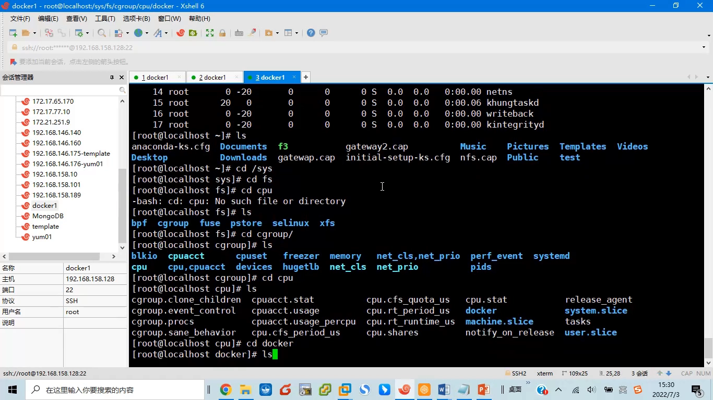

## 六、实验三：cpu.shares 按权重分配比例

能不能不均分，让两个容器按 3:1 分这 20%？可以，用 `cpu.shares`。它控制的是**权重**：b1 和 b2 的默认值都是 1024，权重相同所以均分。[【跳转到 15:59】](https://www.bilibili.com/video/BV1vML4zdE6Y/?t=959)

把 b1 的 `cpu.shares` 改成 3072（1024 的三倍），b2 保持默认。再看 `top`：b1 的进程占 15%，b2 的进程占 5%，正好 3:1，总量仍然守着父目录的 20% 上限。[【跳转到 16:55】](https://www.bilibili.com/video/BV1vML4zdE6Y/?t=1015)

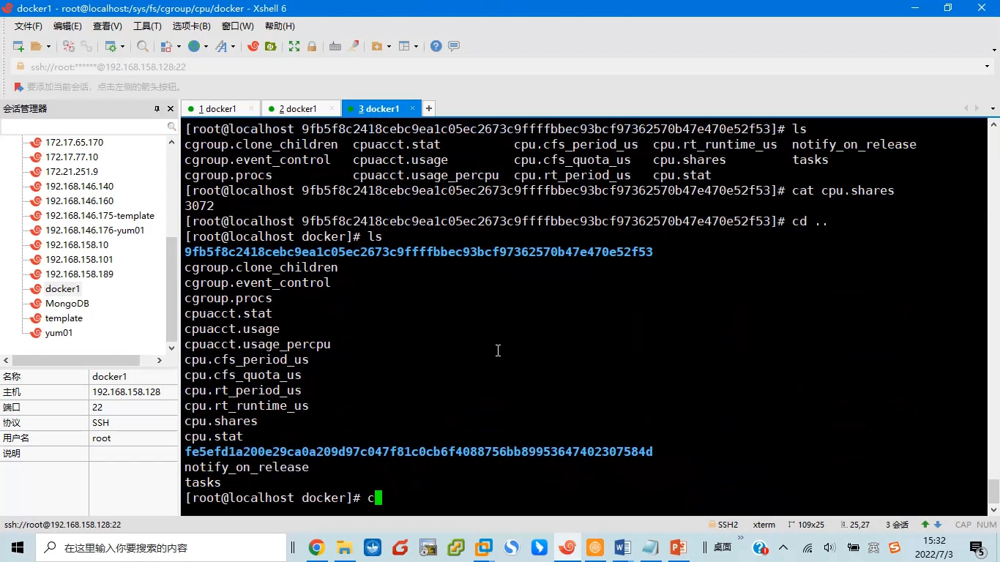

注意一点：`cpu.shares` 是在 CPU **跑满、受限**的情况下才起作用的；如果资源没有跑满，weight 不产生实际约束。[【跳转到 21:45】](https://www.bilibili.com/video/BV1vML4zdE6Y/?t=1305)

## 七、回到日常：docker run 的 CPU 参数

真正控制容器时，不需要手动进 `/sys/fs/cgroup` 改文件。`docker run --help` 里就提供了对应的参数：`--cpu-period`、`--cpu-quota`、`--cpu-shares`。[【跳转到 18:10】](https://www.bilibili.com/video/BV1vML4zdE6Y/?t=1090)

用 `docker run --cpu-quota 20000` 启动一个新容器（默认 period 是 10 万，2 万即 20%），再到 cgroup 里看：这个容器对应的目录随容器创建而出现、随容器删除而消失，与容器一一对应；目录里的 `cpu.cfs_quota_us` 正是 20000。[【跳转到 20:15】](https://www.bilibili.com/video/BV1vML4zdE6Y/?t=1215)

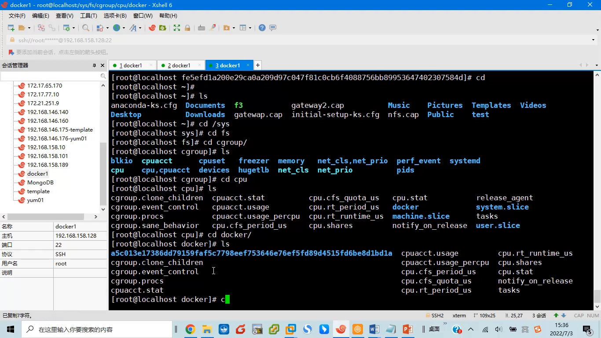

也就是说：命令行参数最终仍然落到 cgroup 文件上，只是 Docker 替你写好了。[【跳转到 20:40】](https://www.bilibili.com/video/BV1vML4zdE6Y/?t=1240)

## 八、总结

- **限制单个容器**：改容器目录的 `cpu.cfs_quota_us`（配额 = period 的百分比 × 10 万），动态生效；
- **限制所有容器**：cgroup 层级式控制，在 `docker/` 父目录上做限制，影响全部子容器；
- **分配比例**：`cpu.shares` 按权重分（默认 1024），只在 CPU 跑满、受限时起作用；
- **日常用法**：`docker run --cpu-quota / --cpu-shares`，本质上是替你写 cgroup 文件。[【跳转到 20:55】](https://www.bilibili.com/video/BV1vML4zdE6Y/?t=1255)

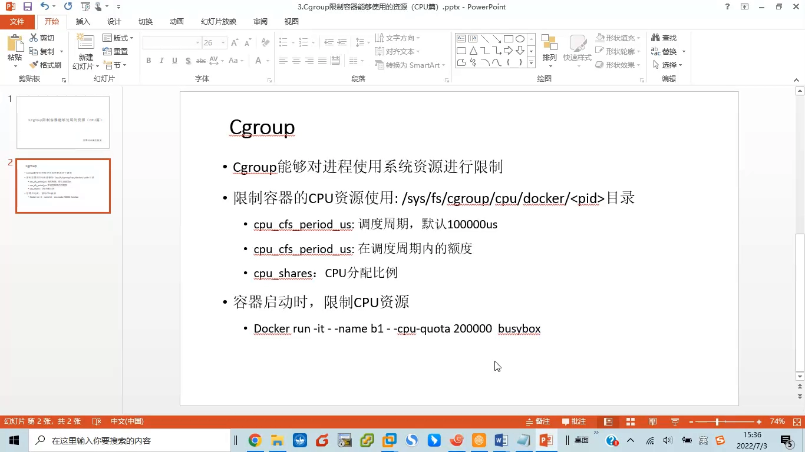
